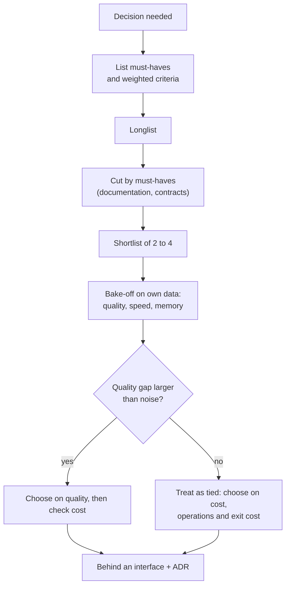

Once the architecture is chosen, you still have to pick the parts: an embedding model, a vector store, a reranker, a generation model, an orchestration approach, and the supporting services around them. The market offers dozens of each, every vendor publishes a benchmark in which it wins, and a team under time pressure tends to pick by familiarity or by whichever blog post it read last.

This lesson gives you a method that replaces that with evidence, and teaches you to spend rigour in proportion to how hard a decision is to reverse. You will build a **bake-off**: a small, repeatable experiment that compares candidate embedding models on quality, speed and memory using your own kind of data. You will then ask the question that most comparisons skip, which is whether the measured difference is larger than noise, using a paired bootstrap. Finally you will wrap the decision in an interface so that being wrong is cheap. The running case is Northgate Mutual's ClaimsCompanion, with the hybrid-plus-reranking architecture from [architecture selection](/learn/enterprise-rag-system-design/architecture-selection).

## Learning objectives

- Classify RAG components by how costly they are to replace, and allocate selection effort accordingly.
- Define must-have and weighted criteria for a vector store, an embedding model and a generation model from a requirements sheet.
- Run a reproducible embedding-model bake-off reporting quality, throughput, latency and memory.
- Use a paired bootstrap to decide whether a quality difference between two candidates is distinguishable from noise.
- Isolate a component behind an interface so that a later replacement does not ripple through the system.

## Prerequisites

- [Architecture selection](/learn/enterprise-rag-system-design/architecture-selection): the pattern whose components you are now choosing.
- [Embedding models: sentence-transformers](/learn/embedding-models/sentence-transformers) and [local embedding models](/learn/embedding-models/local-embedding-models): how the example models are loaded and used.
- [Model selection](/learn/cost-engineering/model-selection): the cost view of choosing generation models.
- [nDCG](/learn/retrieval-evaluation/ndcg) and [Recall@K](/learn/retrieval-evaluation/recall-k): the metrics used to compare candidates.

## Why this matters

Technology choices fail in three ways. The first is **selecting on the wrong evidence**: a public leaderboard measures a different corpus, language and query style from yours, so a model that tops it can lose on your documents. The second is **ignoring non-quality criteria**: the best-scoring option needs twice the memory, or its licence forbids the use, or it cannot enforce the filter your permission model needs. The third is **lock-in by accident**: model identifiers, vendor-specific query syntax and index formats spread through the codebase until replacing anything is a rewrite.

The cost of a wrong choice depends enormously on the component. Swapping the generation model is, with good tests, an afternoon's work. Swapping the embedding model means re-embedding every chunk, rebuilding every index and re-validating retrieval. For Northgate's 30 million chunks, the [capacity model](/learn/enterprise-rag-system-design/capacity-planning) later in this module estimates the backfill at days of compute. A decision method should therefore be lightweight where reversal is cheap and rigorous where it is not.

## The intuition

Buying a car is a good analogy for evidence versus reputation. The brochure (the leaderboard) is written for the average driver on the average road. You live down a steep, narrow lane and carry a wheelchair. So you list your must-haves (fits the lane, takes the chair), shortlist the cars that pass, and then test-drive two or three on **your** lane. After the drive, two cars feel the same; you do not pay 3,000 pounds extra for a difference you cannot detect. And before signing, you check how easily you could sell it again.

Each step maps onto a RAG technology decision: must-haves are hard constraints from the requirements sheet; the test drive is the bake-off on your own queries and documents; "cannot detect the difference" is a significance check; and resale value is exit cost.

## How it works

### The component map and its reversibility

Rank the decisions by how hard they are to undo, because that sets how much effort each deserves.

| Component | Cost to replace later | Why | Selection effort |
| --- | --- | --- | --- |
| **Embedding model** | High | Every stored vector must be recomputed; query and corpus models must match; the index is rebuilt ([reindexing](/learn/ci-cd-and-mlops/reindexing)) | Rigorous bake-off on your data |
| **Chunking and parsing** | High | Changes chunk boundaries and therefore every vector and citation | Evaluate on your document types |
| **Vector store** | Medium | Data can be exported, but filters, hybrid queries, consistency behaviour and operations differ | Must-haves, a proof of concept at scale |
| **Reranker** | Low to medium | A stateless stage; changing it needs only re-evaluation | Evaluate on the golden set |
| **Generation model** | Low (behind an interface) | Prompts need re-testing, but no data migrates | Evaluate; keep an alternative warm |
| **Orchestration framework** | Medium | Pipeline code is written against its abstractions | Keep it a thin layer; see below |
| **Identity and access integration** | High | Permission models propagate into the index schema and audit | Decide from requirements, early |

Spend your two weeks on the top of this table, not on arguing about frameworks.

### The selection procedure

The procedure is the same for every component:

1. **State the decision and its criteria.** Separate **must-haves** (pass or fail, from the requirements sheet) from **weighted criteria** (more is better). Examples of must-haves: runs in a UK region, supports metadata filtering inside the vector search, licence permits commercial use.
2. **Build a longlist, then cut by must-haves.** Cutting on must-haves needs only documentation and a contract check, not code.
3. **Measure the shortlist on your data.** Use the question log and a sample of the real corpus. Two to four candidates is enough.
4. **Check significance.** If two candidates differ by less than the noise in your evaluation set, treat them as tied on quality and decide on the other criteria.
5. **Include total cost and exit cost.** Price at the planned scale, including operations time. Ask what leaving would take.
6. **Decide, record, and put it behind an interface.** An ADR (see [architecture selection](/learn/enterprise-rag-system-design/architecture-selection)) records the evidence.

### Choosing a vector store

A vector store is a decision about operating a database, not just about search. Criteria that matter at enterprise scale:

- **Filtering inside search.** Permission filters must be applied during the nearest-neighbour search, not after it, or top-k results can come back nearly empty for users with narrow access. Test it with your filters at your selectivity ([filtered retrieval](/learn/advanced-retrieval/filtered-retrieval)).
- **Hybrid support.** Does the engine hold keyword and vector search together, or will you run two systems and fuse results yourself ([hybrid retrieval architecture](/learn/hybrid-search/hybrid-retrieval-architecture))?
- **Scale and memory model.** What index structures and quantisation does it offer, how does it shard, what does memory per million vectors look like? See [HNSW](/learn/vector-indexing-algorithms/hnsw) and [scalar quantisation](/learn/vector-indexing-algorithms/scalar-quantisation).
- **Update and consistency behaviour.** How quickly does a write become searchable, and can a delete be proved complete ([index updates](/learn/advanced-vector-database-engineering/index-updates))?
- **Operating model.** Managed service or self-run, who holds the pager, where can it run (residency), how are backups and restores done ([backup and recovery](/learn/advanced-vector-database-engineering/backup-and-recovery))?
- **Ecosystem and people.** Does your team already operate PostgreSQL or Elasticsearch well? Operational familiarity is a legitimate criterion, often decisive.

Broadly, the candidates fall into families, each with a characteristic fit. Check each vendor's current documentation, because features change quickly.

| Family | Examples | Tends to fit when |
| --- | --- | --- |
| **Library** | [FAISS](/learn/vector-database-ecosystem/faiss) | You want an embedded index and will build persistence, filtering and serving yourself |
| **Extension to an existing database** | [PostgreSQL with pgvector](/learn/vector-database-ecosystem/postgresql-with-pgvector) | Vectors live beside relational data, you value transactions and existing operations, and scale is moderate |
| **Search engine with vectors** | [Elasticsearch](/learn/vector-database-ecosystem/elasticsearch), [OpenSearch](/learn/vector-database-ecosystem/opensearch) | Strong keyword search and an existing cluster matter as much as vector search |
| **Dedicated vector database** | [Qdrant](/learn/vector-database-ecosystem/qdrant), [Milvus](/learn/vector-database-ecosystem/milvus), [Weaviate](/learn/vector-database-ecosystem/weaviate), [Pinecone](/learn/vector-database-ecosystem/pinecone) | Vector search is central, scale is large, and you want filtering, quantisation and sharding as first-class features |

Note the pattern: the "best" store does not exist, and a mid-size corpus can run happily on any of several. What eliminates candidates is usually a must-have such as residency or filter behaviour, not raw speed.

### Choosing an embedding model

Quality on **your** data is the primary criterion, but it competes with others:

- **Dimension.** Memory and index cost scale linearly with it. At 30 million chunks, float32 vectors take 46 GB at 384 dimensions and 92 GB at 768 (30 million × dimensions × 4 bytes), before index overhead and replicas.
- **Throughput.** It sets the backfill duration and the daily re-embedding load.
- **Query latency.** The embedding of the query sits on the critical path of every request.
- **Maximum input length.** Chunks longer than the limit are silently truncated.
- **Language coverage, licence, hosting.** A multilingual corpus needs a multilingual model ([multilingual embeddings](/learn/embedding-models/multilingual-embeddings)); a licence may restrict commercial use; a hosted API sends text to a third party.
- **Prefix or instruction conventions.** Some models need a fixed prefix for queries and passages. Forgetting it quietly degrades retrieval.
- **Stability.** A hosted model that may be retired forces a re-embedding on the vendor's schedule. Record the model identifier beside every vector so that a mixed index is detectable.

### Choosing a generation model

Treat this as a decision you will revisit. Evaluate on the golden set for faithfulness and citation accuracy, measure latency to first token and total latency on your real prompts, check the context window against your prompt budget, confirm data-handling terms and regional processing against the residency constraint, and check rate limits against your [peak token rate](/learn/enterprise-rag-system-design/capacity-planning). Keep at least one tested alternative so that a provider outage or deprecation is an operational event, not a project. Model names, prices, limits and context sizes change frequently, so consult provider documentation at decision time and record the date.

### Frameworks: thin, not thick

Orchestration frameworks ([LangChain](/learn/langchain-for-rag/langchain-architecture), [LlamaIndex](/learn/llamaindex/index-architecture)) speed up prototypes. In an enterprise system the risk is letting a framework's abstractions become your domain model. A sound compromise is to use frameworks for plumbing (loaders, clients, text splitters) while keeping your own interfaces for retrieval, permissions, evaluation and logging, which are the parts that must remain under your control.



## The mathematics

### Is the difference real?

**Intuition.** Evaluation sets are small samples of the questions users could ask. If you had drawn a different 300 questions, the averages would shift. A difference between two models matters only if it is larger than that sampling wobble.

The method is a **paired bootstrap**. Both models are scored on the same queries, so each query yields a difference $d_i = s_{A,i} - s_{B,i}$ between the per-query metric of model A and model B. Resample the queries with replacement many times, recompute the mean difference each time, and read off the 2.5th and 97.5th percentiles as a 95 per cent confidence interval:

$$
\bar d = \frac{1}{n}\sum_{i=1}^{n} d_i, \qquad \bar d^{*}_b = \frac{1}{n}\sum_{i=1}^{n} d_{J_{b,i}}, \quad J_{b,i} \sim \text{Uniform}\{1,\dots,n\}
$$

Here $n$ is the number of queries, $d_i$ the per-query difference, and $\bar d^{*}_b$ the mean difference on the $b$-th resample, where each $J_{b,i}$ is a randomly drawn query index. Pairing matters: it cancels the effect of easy and hard queries, which would otherwise swamp small differences.

**By hand.** Suppose five queries give differences $+0.2, 0, -0.1, +0.3, 0$ in nDCG. The mean is $0.4/5 = 0.08$. Resampling five values with replacement can give means as low as $-0.1$ (every draw being the one negative query) and as high as $0.3$, so a five-query interval comfortably includes zero: you cannot call the models different. With 300 queries the same method gives a much tighter interval, which is why a few hundred queries is the practical minimum for model comparison. The computation below does it in Python.

If the interval excludes zero, the data support a real difference in quality. That says nothing about whether it is large enough to justify a cost, which is a separate judgement.

## In code

The experiment compares four locally cached embedding models on the **SciFact** dataset from the BEIR benchmark: 5,183 scientific abstracts and 300 test claims with known relevant documents. SciFact is not an insurance corpus; it stands in for "a sample of your documents with questions you know the answers to". In a real project you would replace the loader with your question log and a corpus sample. The measurements were taken on a laptop CPU, so absolute speeds are far lower than a production GPU service; compare candidates against each other, not against your production targets.

```bash
pip install sentence-transformers numpy pandas huggingface_hub
```

```python
"""Embedding-model bake-off on SciFact (BEIR): quality, speed and size for four models."""
import time
import numpy as np
import pandas as pd
from huggingface_hub import hf_hub_download
from sentence_transformers import SentenceTransformer

np.random.seed(0)


def get(repo, path):
    return hf_hub_download(repo, path, repo_type="dataset")


corpus = pd.read_parquet(get("BeIR/scifact", "corpus/corpus-00000-of-00001.parquet"))
queries = pd.read_parquet(get("BeIR/scifact", "queries/queries-00000-of-00001.parquet"))
qrels = pd.read_csv(get("BeIR/scifact-qrels", "test.tsv"), sep="\t", dtype=str)
relevant = qrels.groupby("query-id")["corpus-id"].apply(set).to_dict()
queries = queries[queries["_id"].isin(relevant)].reset_index(drop=True)
doc_ids = corpus["_id"].to_numpy()
docs = (corpus["title"] + ". " + corpus["text"]).tolist()
claims = queries["text"].tolist()

CANDIDATES = {
    # name: (hub id, query prefix, passage prefix)
    "all-MiniLM-L6-v2": ("sentence-transformers/all-MiniLM-L6-v2", "", ""),
    "bge-small-en-v1.5": ("BAAI/bge-small-en-v1.5",
                          "Represent this sentence for searching relevant passages: ", ""),
    "e5-small-v2": ("intfloat/e5-small-v2", "query: ", "passage: "),
    "modernbert-embed-base": ("nomic-ai/modernbert-embed-base", "search_query: ", "search_document: "),
}


def metrics(Q, D, k=10):
    top = np.argsort(-(Q @ D.T), axis=1)[:, :k]
    ndcg, recall = [], []
    for i, qid in enumerate(queries["_id"]):
        rel = relevant[qid]
        hits = [doc_ids[j] in rel for j in top[i]]
        dcg = sum(h / np.log2(r + 2) for r, h in enumerate(hits))
        ideal = sum(1 / np.log2(r + 2) for r in range(min(len(rel), k)))
        ndcg.append(dcg / ideal)
        recall.append(sum(hits) / len(rel))
    return float(np.mean(ndcg)), float(np.mean(recall))


rows = []
for name, (hub, qp, dp) in CANDIDATES.items():
    model = SentenceTransformer(hub, device="cpu")
    model.max_seq_length = 256
    t0 = time.perf_counter()
    D = model.encode([dp + d for d in docs], normalize_embeddings=True, batch_size=64)
    doc_rate = len(docs) / (time.perf_counter() - t0)
    lat = []
    for c in claims[:100]:
        t = time.perf_counter()
        model.encode([qp + c], normalize_embeddings=True)
        lat.append((time.perf_counter() - t) * 1000)
    Q = model.encode([qp + c for c in claims], normalize_embeddings=True)
    ndcg, rec = metrics(Q, D)
    rows.append({"model": name, "dims": D.shape[1], "ndcg@10": round(ndcg, 3),
                 "recall@10": round(rec, 3), "docs/s": round(doc_rate),
                 "query ms (median)": round(float(np.median(lat)), 1),
                 "MB per 1M vectors": round(D.shape[1] * 4 * 1e6 / 1e6)})
    np.save(f"emb_{name}.npy", D)
    np.save(f"q_{name}.npy", Q)
print(pd.DataFrame(rows).to_string(index=False))
```

```output
                model  dims  ndcg@10  recall@10  docs/s  query ms (median)  MB per 1M vectors
     all-MiniLM-L6-v2   384    0.648      0.788     145                3.1               1536
    bge-small-en-v1.5   384    0.703      0.816      74                5.1               1536
          e5-small-v2   384    0.677      0.805      69                4.8               1536
modernbert-embed-base   768    0.680      0.811      14               20.7               3072
```

**How it works.** Each model gets its own query and passage prefixes, because forgetting them is the most common way to mis-measure a model. Documents are truncated to 256 tokens to keep CPU time manageable, so the quality figures are specific to that setting. Throughput is the whole corpus divided by encoding time; query latency is the median of 100 single-query calls, which mimics online use. Memory per million vectors is just dimensions times 4 bytes, before index overhead. The embeddings are saved so the next step can reuse them.

**What the output means.** The 384-dimension `bge-small` model leads on nDCG@10, but notice what the table also says. The 768-dimension `modernbert-embed-base` has about the same quality as `e5-small-v2` and `bge-small`, takes twice the memory per vector, encodes roughly five times slower than `bge-small` here, and has a query latency about four times higher. At Northgate's 30 million chunks, the raw float32 vectors would be about 46 GB for the 384-dimension models and 92 GB for the 768-dimension one. `all-MiniLM-L6-v2` is twice as fast to encode as `bge-small` but lower in quality. No row dominates; the choice depends on weights, and that is exactly the situation the matrix of the previous lesson is for.

The next script asks whether the quality gaps are real.

```python
"""Is the quality gap between two embedding models bigger than noise? Paired bootstrap over queries."""
import numpy as np
import pandas as pd
from huggingface_hub import hf_hub_download

def get(repo, path):
    return hf_hub_download(repo, path, repo_type="dataset")

corpus = pd.read_parquet(get("BeIR/scifact", "corpus/corpus-00000-of-00001.parquet"))
queries = pd.read_parquet(get("BeIR/scifact", "queries/queries-00000-of-00001.parquet"))
qrels = pd.read_csv(get("BeIR/scifact-qrels", "test.tsv"), sep="\t", dtype=str)
relevant = qrels.groupby("query-id")["corpus-id"].apply(set).to_dict()
queries = queries[queries["_id"].isin(relevant)].reset_index(drop=True)
doc_ids = corpus["_id"].to_numpy()


def per_query_ndcg(Q, D, k=10):
    top = np.argsort(-(Q @ D.T), axis=1)[:, :k]
    out = []
    for i, qid in enumerate(queries["_id"]):
        rel = relevant[qid]
        dcg = sum((doc_ids[j] in rel) / np.log2(r + 2) for r, j in enumerate(top[i]))
        ideal = sum(1 / np.log2(r + 2) for r in range(min(len(rel), k)))
        out.append(dcg / ideal)
    return np.array(out)


names = ["all-MiniLM-L6-v2", "bge-small-en-v1.5", "e5-small-v2", "modernbert-embed-base"]
scores = {n: per_query_ndcg(np.load(f"q_{n}.npy"), np.load(f"emb_{n}.npy")) for n in names}

rng = np.random.default_rng(0)
n = len(queries)
idx = rng.integers(0, n, size=(5000, n))          # the same resampled queries for every model
for a, b in [("bge-small-en-v1.5", "all-MiniLM-L6-v2"), ("bge-small-en-v1.5", "e5-small-v2"),
             ("bge-small-en-v1.5", "modernbert-embed-base")]:
    diff = scores[a] - scores[b]
    boot = diff[idx].mean(axis=1)
    lo, hi = np.percentile(boot, [2.5, 97.5])
    print(f"{a} minus {b}: mean {diff.mean():+.3f}, 95% CI [{lo:+.3f}, {hi:+.3f}], "
          f"queries where first is better/worse: {(diff > 0).sum()}/{(diff < 0).sum()} of {n}")
```

```output
bge-small-en-v1.5 minus all-MiniLM-L6-v2: mean +0.055, 95% CI [+0.028, +0.082], queries where first is better/worse: 77/41 of 300
bge-small-en-v1.5 minus e5-small-v2: mean +0.026, 95% CI [+0.001, +0.052], queries where first is better/worse: 67/42 of 300
bge-small-en-v1.5 minus modernbert-embed-base: mean +0.023, 95% CI [-0.004, +0.051], queries where first is better/worse: 60/47 of 300
```

**What this means.** The first interval excludes zero by a clear margin: on this data `bge-small` is better than `all-MiniLM-L6-v2` in a way unlikely to be noise. The second barely excludes zero (lower bound +0.001), so treat it as a weak edge. The third includes zero, so `bge-small` and `modernbert-embed-base` cannot be separated on quality here; given the doubled memory, slower encoding and higher query latency of the larger model, that tie makes the 384-dimension model the sensible default. Without the bootstrap, a team looking only at the means (0.703 against 0.680) could have been tempted to argue about a 0.023 gap that this sample cannot resolve. Also note the limits: 300 queries on a scientific corpus say little about insurance policy wordings, and this is why the bake-off must run on your own questions.

**Common errors.** Mixing up the prefixes (query prefix on passages), comparing models at different maximum sequence lengths, scoring candidates on different query subsets (the pairing breaks), and evaluating on documents that were also used to tune a model choice or a prompt.

**Extending it.** Add a candidate by adding a line to `CANDIDATES`. Bootstrap recall as well as nDCG. Report the **slice** of hard questions separately: a model that is tied overall may differ on identifiers or on comparisons. Add a hosted model through the same loop, taking care that sending corpus text to a provider is permitted.

### Put it behind an interface

The final piece makes the decision reversible. All code that embeds text depends on a small `Embedder` protocol, the model identifier is recorded beside every vector, and the model is chosen from configuration.

```python
from dataclasses import dataclass
from typing import Literal, Protocol

import numpy as np
from sentence_transformers import SentenceTransformer


class Embedder(Protocol):
    """The only embedding interface the rest of the system may depend on."""
    model_id: str      # recorded beside every stored vector
    dims: int

    def embed(self, texts: list[str], kind: Literal["query", "passage"]) -> np.ndarray: ...


@dataclass
class LocalEmbedder:
    model_id: str
    query_prefix: str = ""
    passage_prefix: str = ""

    def __post_init__(self):
        self._model = SentenceTransformer(self.model_id, device="cpu")
        self.dims = self._model.get_embedding_dimension()

    def embed(self, texts, kind):
        prefix = self.query_prefix if kind == "query" else self.passage_prefix
        return self._model.encode([prefix + t for t in texts], normalize_embeddings=True)


def build(name: str) -> Embedder:
    registry = {
        "minilm": lambda: LocalEmbedder("sentence-transformers/all-MiniLM-L6-v2"),
        "e5-small": lambda: LocalEmbedder("intfloat/e5-small-v2", "query: ", "passage: "),
    }
    return registry[name]()


for choice in ("minilm", "e5-small"):
    e = build(choice)                       # in production, `choice` comes from configuration
    v = e.embed(["How many days of annual leave do I get?"], kind="query")
    print(f"{choice:9s} -> {e.model_id}, dims={e.dims}, vector shape={v.shape}")
```

```output
minilm    -> sentence-transformers/all-MiniLM-L6-v2, dims=384, vector shape=(1, 384)
e5-small  -> intfloat/e5-small-v2, dims=384, vector shape=(1, 384)
```

The prefixes live inside the adapter, so callers never see them, and a model change cannot leave a forgotten prefix in some corner of the code. Storing `model_id` with each vector (or at collection level) lets a health check refuse to compare a query vector from one model with a corpus from another. This does not make migration free: re-embedding the corpus is still the cost. It makes migration a configuration and data task instead of a code hunt. The `get_embedding_dimension` method name is the one in the library version used here; older releases call it `get_sentence_embedding_dimension`.

## A real-world example

Northgate shortlists three vector stores after cutting by must-haves. The residency constraint removes a managed service without a UK region; the filter requirement removes an option whose filters are applied only after the nearest-neighbour search. The remaining candidates are a dedicated vector database run on the company's Kubernetes platform, and PostgreSQL with pgvector, which the data team already operates well.

The proof of concept loads 8 million chunks (a quarter of the target) with real permission metadata and replays the question log with permission filters, including the narrow filters used by privileged-claim handlers, whose visible set is under 0.1 per cent of the corpus. The team measures latency percentiles, recall against an exact search, and what happens during a re-index. PostgreSQL does well at moderate filters, but narrow filters on the largest collection need careful tuning, and memory for the index does not fit the planned machines at 30 million chunks without quantisation. The dedicated engine handles the narrow filters directly and offers quantisation and sharding, so it fits the growth path better; the team notes that PostgreSQL remains the right answer for the smaller, relational metadata store beside it.

On embeddings, the bake-off on 300 questions from the question log and a 40,000-document sample shows a 384-dimension model tied with a 768-dimension one on nDCG@10 once the confidence interval is computed. The team picks the smaller model, saving about 46 GB of raw vector memory per replica at full scale, and records in the ADR that the choice is to be reopened if the comparison slice shows a gap. The embedder sits behind the interface from this lesson, and the generation model sits behind a second interface with a tested fallback. When the provider announces a model retirement a year later, the migration is a staged evaluation, not an emergency.

## Common mistakes

- **Trusting a public leaderboard as evidence.** It measures other data; a top-ranked model can lose on yours.
- **Comparing means without noise.** A 0.02 difference on 300 queries may be sampling noise; compute an interval before spending money on it.
- **Forgetting prefixes and instructions.** Mis-prefixed queries lower measured quality and lead you to reject a good model.
- **Choosing the embedding model last.** It is the hardest component to change; rigorous evaluation belongs here, not on a framework.
- **Ignoring filter behaviour in a vector store.** A store that filters after search returns too few results for users with narrow permissions.
- **Scattering model names and endpoints through the code.** Replacement then needs a code search instead of a configuration change.
- **No fallback model.** One generation provider with no tested alternative makes an outage or a deprecation a crisis.
- **Letting a framework define the domain model.** Permissions, evaluation and logging must stay under your control.

## Best practices

- Rank components by cost to reverse and spend effort accordingly: embeddings, chunking and identity first.
- Separate must-haves from weighted criteria; cut by must-haves before measuring anything.
- Run bake-offs on your own questions and a realistic sample of your documents, with fixed seeds and saved outputs.
- Compare candidates on the same queries and report an interval, not only a mean; slice results by question type.
- Test a vector store at realistic scale with your real filters, including the most selective ones.
- Record the embedding model identifier with every vector and verify it at query time.
- Hide each component behind an interface, with prefixes, authentication and retries inside the adapter.
- Keep a tested alternative for the generation model, and record the date of the evidence since versions and prices change.

## Performance considerations

Technology choices set the constants in every later calculation. Dimension fixes vector memory: 30 million chunks × 384 × 4 bytes is 46 GB, doubled to 92 GB at 768 dimensions, and each replica repeats it. Encoding throughput fixes the backfill: at the 14 chunks per second measured above for the 768-dimension model on one laptop CPU, a single worker would need about 25 days for 30 million chunks; eight workers need about three days. A GPU service changes the figure considerably, but you must measure it rather than assume it. Query-path models matter more: a 20 millisecond query-embedding step is small next to generation, but a reranker scoring 50 candidates took about 400 milliseconds on the same laptop in our measurement (roughly 124 pairs per second for a small cross-encoder), which is a large share of a 4-second budget and a good reason to size the candidate set deliberately. All timings here are laptop measurements for relative comparison; take your own on production hardware.

## Security considerations

Selection is a security decision. Hosted embedding and generation services receive your text, so check the provider's data-handling terms, retention and training policies, regional processing and contractual protections against the data classes in your requirements sheet; a model that cannot be used for privileged claims data is a failed must-have. For self-hosted models, check the licence and the provenance of weights, and pin versions by hash where possible. A vector store must support the access model you need: confirm that filters are enforced server-side, that credentials can be scoped per service, that data is encrypted at rest and in transit, and that backups inherit the same protections. Treat every third-party component as part of your attack surface and keep a software bill of materials.

## Summary

- Rank components by reversal cost; the embedding model, chunking and identity integration deserve the most rigour.
- Follow one procedure: criteria, longlist, cut by must-haves, bake-off on your data, significance, total and exit cost, decision behind an interface.
- Vector stores are chosen mainly on must-haves such as filtering inside search, hybrid support, residency and operations, not raw speed.
- Embedding comparison must cover quality, memory, encoding throughput and query latency, using each model's required prefixes.
- A paired bootstrap shows whether a quality gap exceeds noise; ties should be decided on cost and operations.
- Interfaces, recorded model identifiers and a fallback generation model make a wrong choice survivable.

## Exercises

**1. Reversal cost.** For each of these decisions, say whether reversal is cheap or expensive and why: the reranker model, the chunk size, the generation model, the embedding model.

<details><summary>Show solution</summary>

Reranker: cheap, because it is a stateless stage with no stored artefacts; re-evaluate and swap. Generation model: cheap if behind an interface, since only prompts need re-testing. Chunk size: expensive, because it changes chunk boundaries, so every chunk must be re-embedded, citations change and evaluation resets. Embedding model: expensive, because all vectors must be recomputed and the index rebuilt, and query and corpus models must match. Selection rigour belongs on the expensive ones.

</details>

**2. Memory arithmetic.** A corpus has 45 million chunks. Compute the raw float32 vector memory at 384, 768 and 1,024 dimensions, and the memory for two replicas of the 768-dimension option.

<details><summary>Show solution</summary>

Memory is chunks × dimensions × 4 bytes. At 384: 45e6 × 384 × 4 = 69.1 GB. At 768: 138.2 GB. At 1,024: 184.3 GB. Two replicas of the 768-dimension option: 276.5 GB, before index graph overhead and the headroom you leave for operation. Quantisation to int8 would cut each vector to a quarter of its float32 size, to be weighed against any quality loss measured on your data.

</details>

**3. Interpret an interval.** Model A beats model B by a mean nDCG@10 of 0.018 with a 95 per cent bootstrap interval of [-0.011, +0.047]. Model A is 30 per cent cheaper to run. What do you decide, and what would make you revisit?

<details><summary>Show solution</summary>

The interval includes zero, so the data do not show A is worse (nor better); with A cheaper, choose A on cost, provided it meets the must-haves. Revisit if a slice of important questions (for example identifier lookups) shows a clear gap against A, if the evaluation set grows and narrows the interval toward a negative range, or if production feedback shows a quality problem. Record the decision and the interval in the ADR.

</details>

**4. Extend the bake-off.** Add one more cached or hosted model to `CANDIDATES`, and write the extra code to report the quality of each model on a "hard slice": queries containing a digit or an uppercase identifier. Explain what a gap on that slice would mean for the hybrid architecture.

<details><summary>Show solution</summary>

Add the model's entry with the correct prefixes. For the slice, select query indices with `[i for i, c in enumerate(claims) if any(ch.isdigit() for ch in c)]`, and compute `per_query_ndcg` only over those rows, reporting the mean and a bootstrap interval for each model. If embedding models score noticeably lower on the identifier slice than on the rest, that is evidence that dense retrieval alone is weak on exact identifiers, which supports the keyword component of the hybrid architecture, and suggests weighting keyword retrieval more for such queries. With few slice queries the interval will be wide, so collect more such questions before drawing a firm conclusion.

</details>

## Check your understanding

```quiz
[
  {
    "q": "Which component is generally the most expensive to replace after launch?",
    "options": [
      "The generation model, when behind an interface.",
      "The reranker.",
      "The embedding model.",
      "The logging library."
    ],
    "answer": 2,
    "why": "Changing it means re-embedding every chunk and rebuilding the index, and query and corpus vectors must come from the same model."
  },
  {
    "q": "Model A beats model B by 0.02 nDCG with a 95 per cent bootstrap interval of [-0.01, +0.05]. What follows?",
    "options": [
      "A is significantly better.",
      "B is significantly better.",
      "The data cannot separate them, so decide on cost, operations and other criteria.",
      "The evaluation is invalid."
    ],
    "answer": 2,
    "why": "An interval that includes zero means the difference may be sampling noise."
  },
  {
    "q": "Why is a paired bootstrap preferable to comparing two independent sets of scores?",
    "options": [
      "It needs fewer queries.",
      "Using the same queries for both models cancels query difficulty, so small differences become detectable.",
      "It removes the need for a golden set.",
      "It makes models faster."
    ],
    "answer": 1,
    "why": "Differences are computed per query, so easy and hard queries affect both models equally."
  },
  {
    "q": "A vector store applies metadata filters after the nearest-neighbour search. What is the main risk for a permission-controlled system?",
    "options": [
      "Higher memory use.",
      "Users with narrow access can receive far fewer than k results, or none, even though relevant permitted documents exist.",
      "The index cannot be built.",
      "Embeddings change."
    ],
    "answer": 1,
    "why": "If the top candidates are mostly forbidden, discarding them leaves few or no results; filtering inside the search avoids this."
  },
  {
    "q": "At 30 million chunks, roughly how much raw float32 vector memory does a 768-dimension model need per replica?",
    "options": [
      "About 11.5 GB",
      "About 46 GB",
      "About 92 GB",
      "About 920 GB"
    ],
    "answer": 2,
    "why": "30,000,000 × 768 × 4 bytes is about 92 GB, before index overhead."
  }
]
```

## Further reading

- Niklas Muennighoff et al., 2022, "MTEB: Massive Text Embedding Benchmark": a broad embedding benchmark, useful for the longlist but not a substitute for your own data.
- Nandan Thakur et al., 2021, "BEIR: A Heterogeneous Benchmark for Zero-shot Evaluation of Information Retrieval Models": the benchmark suite that includes SciFact.
- Bradley Efron and Robert Tibshirani, *An Introduction to the Bootstrap*: the standard text on the resampling method used above.
- Sentence-Transformers documentation: <https://www.sbert.net>.
- The documentation of each vector store you shortlist, especially its pages on filtering, quantisation and consistency.
- Neal Ford, Rebecca Parsons and Patrick Kua, *Building Evolutionary Architectures*: fitness functions and reversibility as design drivers.
