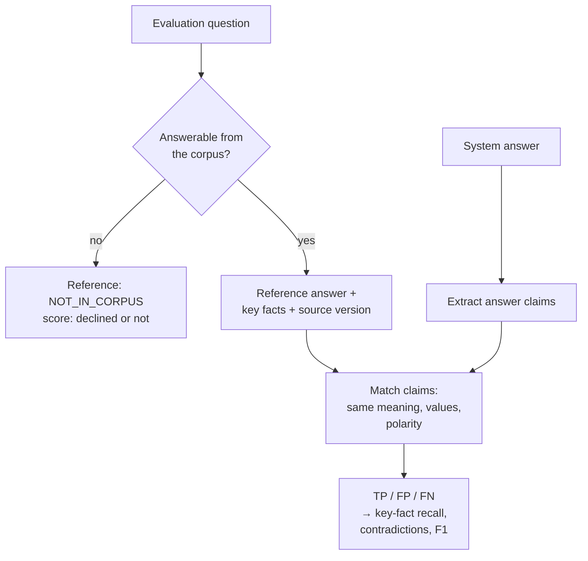

Faithfulness asks whether the answer matches the context; answer relevance asks whether it addresses the question. Neither asks the question users care about most: **is the answer right?** **Answer correctness** does, by comparing the system's answer with a **reference answer** (also called a gold or ground-truth answer) written by someone who knows. It is the only generation metric that can catch an answer that is grounded, relevant and wrong, which is exactly what a RAG system produces when it retrieves an outdated or mistaken document and faithfully repeats it.

This lesson works up the ladder of correctness measures, from exact match and token F1 (inherited from extractive question answering) through embedding similarity to claim-level comparison and reference-guided judges. You will run four of them on the same five answers and see the one failure that matters most: the two cheapest semantic measures give an answer with the wrong number almost full marks. You will also see what a reference answer must contain, how references go stale, and how to score questions whose correct answer is "this is not in the documents".

## Learning objectives

- Define answer correctness and give examples of answers that are faithful but incorrect, and correct but unfaithful.
- Compute exact match, token F1 and claim-level F1 by hand and in code, and explain what each rewards and misses.
- Explain why embedding similarity to a reference is not a correctness measure for factual answers.
- Design reference answers and key facts that make correctness measurable, including for unanswerable questions.
- Decide how extra, unrequested but true claims should affect a correctness score.

## Prerequisites

- [Faithfulness](/learn/generation-evaluation/faithfulness): claim extraction and claim-level judging.
- [Answer relevance](/learn/generation-evaluation/answer-relevance): completeness and the treatment of refusals.
- [Hallucinations and factual reliability](/learn/introduction-to-rag/hallucinations-and-factual-reliability): factuality versus faithfulness.

## Why this matters

Every other generation metric in this module can be perfect while the user is misled. Suppose the index still contains the superseded 2023 handbook, and retrieval returns its laptop policy. The context is relevant (it is about laptop refreshes), the answer "laptops are refreshed every 4 years" is faithful (the context says so) and relevant (it answers the question). It is also wrong: the current cycle is 3 years. Only a comparison with a reference that encodes the current policy catches it.

Correctness is also the metric stakeholders understand. "On our 300-question test set, 88% of answers are fully correct" is a statement HR, support or a product owner can act on. Faithfulness of 0.93 is not, because it does not tell them how often staff receive wrong information. The price is that correctness needs reference answers, which someone must write, check and keep up to date, and most of the craft of this metric lies in managing that cost.

## The intuition

A teacher marking a quiz has an answer key. For "What is the capital of France?" marking is trivial: the answer is "Paris" or it is not. For "Explain the carry-over rule" the key says "up to 5 days; use them by 31 March", and the teacher must decide what counts. "A maximum of five days, to be used before the end of March" is right despite sharing almost no words with the key. "Up to 10 days, used by 31 March" looks almost identical to the key and is wrong. And a student who writes the key's answer plus three paragraphs about other leave rules has answered correctly but has also written things the key does not mention.

A good marker reads for the **facts**, not the wording. The ladder of measures in this lesson is the story of teaching a program to mark the same way.

## How it works

### Correctness, faithfulness and the reference

Answer correctness compares an answer $a$ with a reference $r$ for the same question. It ignores the context entirely. That gives four combinations with faithfulness, all of which occur in practice:

| | Correct | Incorrect |
| --- | --- | --- |
| **Faithful** | The goal | Faithful to a stale or wrong document |
| **Unfaithful** | Right from the model's memory, not the sources | Invented and wrong |

The "correct but unfaithful" cell is subtle. The answer is right today, but it is not traceable to Meridian's documents, so it will not update when the policy changes, and it cannot be cited. Correctness alone would pass it; faithfulness flags it.

### The ladder of measures

**Exact match (EM).** After normalisation (lower-casing, removing punctuation and articles, collapsing whitespace, as in the SQuAD evaluation script of Rajpurkar and colleagues, 2016), the answer equals the reference or it does not. Suitable when answers are short spans: a number, a date, a name, an error code's meaning. Hopeless for sentences, since any rewording scores 0.

**Token F1.** Treat the answer and reference as bags of tokens and compute the F1 of their overlap. Gives partial credit and is standard for extractive question answering. It rewards copying the reference's wording, penalises correct paraphrase, and cannot tell "5" from "10" except as one token among many.

**Embedding similarity.** Embed both and take the cosine, or use a token-level variant such as BERTScore (Zhang and colleagues, 2019). Robust to paraphrase. But embeddings encode what a text is *about*, and two sentences about the carry-over rule with different numbers are about the same thing. For factual answers this is a fatal flaw: it scores a wrong answer that reuses the reference's wording almost perfectly.

**Claim-level comparison.** Extract claims from both answer and reference (as in [Faithfulness](/learn/generation-evaluation/faithfulness)), then match them:

- a **true positive (TP)** is an answer claim that matches a reference claim;
- a **false positive (FP)** is an answer claim with no match in the reference;
- a **false negative (FN)** is a reference claim with no match in the answer.

Precision, recall and F1 over claims follow. This is the structure of RAGAS's answer correctness, which combines a claim-level F1 with a semantic similarity score in a weighted sum (weighted towards the factual part; check the current documentation for the default weights). It is also the idea behind **nugget** evaluation from the TREC question-answering tracks, where assessors define the essential facts ("nuggets") an answer must contain.

**Reference-guided judges.** A language model reads the question, the reference and the answer, and labels the answer as correct, partially correct or incorrect, or labels each reference key fact as present, absent or contradicted. This handles paraphrase, units and equivalent formulations best. Kamalloo and colleagues (2023) found that lexical matching substantially underestimates the accuracy of model-generated answers in open-domain question answering, because correct answers are phrased differently from the references, and that model judges agree better with people, though not perfectly. The judge needs the same validation as any other: compare with human labels on your data.

### What counts as a match

Claim matching is where correctness is won or lost. The match must require:

1. **The same proposition**: the claims are about the same thing (semantic similarity, or a judge).
2. **The same values**: numbers, dates, amounts, codes and named entities agree after normalisation ("five" = "5", "31 March" = "March 31st", "£400" = "400 pounds").
3. **The same polarity and conditions**: "contractors are eligible" does not match "contractors are not eligible"; "up to 5 days" does not match "exactly 5 days" if the distinction matters.

Matching on similarity alone reduces claim F1 to the embedding-similarity measure with extra steps. The code below requires both meaning and numbers.

### Extra claims: errors or bonus?

An answer may contain true statements the reference does not mention: "Meridian gives 25 days of annual leave" in an answer about carry-over. Claim-level F1 counts them as false positives, which lowers precision. Whether that is right depends on what the reference is:

- If the reference is **exhaustive** (everything a good answer should say), extra claims are padding at best and unverified at worst, and penalising them is sensible.
- If the reference is **minimal** (the facts that must be present), extra claims should be checked separately, for truth against the corpus (a faithfulness-style check), not counted as wrong.

Write down which kind your references are. A common, defensible scheme scores **recall of key facts** (did the answer contain what it must?) and **contradictions** (did it state anything that conflicts with the reference?) separately, and leaves additional correct detail to answer relevance's padding check.

### Unanswerable questions

Some evaluation questions should not be answerable from the corpus ("What is the parental leave policy for contractors?"). Their reference is a label, NOT_IN_CORPUS, and correctness is binary: did the system decline (correct) or produce an answer (incorrect, and a hallucination)? Conversely, an abstention on an answerable question is incorrect. Report the two error types separately, because they have opposite fixes: false answers on unanswerable questions call for stronger grounding; false abstentions call for better retrieval or a less timid prompt.

### Reference answers go stale

References encode the truth at the time they were written. When Meridian's handbook took effect on 1 January 2025, every reference about laptops, support hours and the equipment budget had to change. A reference set that is not versioned with the corpus will mark correct answers wrong after a policy change, and teams then "fix" a system that was right. Store with each reference the source document and version it was written from, and re-validate references whenever a source changes.



### The procedure, step by step

1. **Write references** for each question: a short answer, its key facts, the source document and version, and an answerable flag.
2. **Normalise** values in both reference and answer: numbers, dates, currencies, codes.
3. **Extract claims** from the answer (and once from the reference, stored).
4. **Match** claims on meaning, values and polarity; count TP, FP and FN.
5. **Score** key-fact recall, contradiction rate and claim F1; score unanswerable questions as declined or not.
6. **Validate** the matcher or judge against human correctness labels before reporting.

> [!KEY]
> Correctness is about facts, not wording. Exact match and token F1 punish paraphrase; embedding similarity forgives wrong numbers. Compare claims, require values and polarity to agree, and keep references versioned with the documents they came from.

## The mathematics

### Token F1

**Intuition.** Treat each text as a bag of words; precision is how much of the answer is in the reference, recall how much of the reference is in the answer.

$$
P = \frac{\lvert T_a \cap T_r \rvert}{\lvert T_a \rvert}, \quad
R = \frac{\lvert T_a \cap T_r \rvert}{\lvert T_r \rvert}, \quad
F_1 = \frac{2PR}{P + R}
$$

- $T_a$ and $T_r$ are the multisets of normalised tokens in the answer and reference.
- $\lvert T_a \cap T_r \rvert$ counts shared tokens, each as many times as it appears in both.

**By hand.** Reference "Up to 5 unused days carry over, and they must be used by 31 March." normalises to 15 tokens. The partial answer "Up to 5 unused days carry over." normalises to 7 tokens, all in the reference. $P = 7/7 = 1$, $R = 7/15 \approx 0.467$, $F_1 = 2 \times 1 \times 0.467 / 1.467 \approx 0.636$.

### Claim-level F1

$$
F_1^{\text{claim}} = \frac{TP}{TP + \tfrac{1}{2}(FP + FN)}
$$

This is the ordinary F1 written in counts: it equals $2PR/(P+R)$ with $P = TP/(TP+FP)$ and $R = TP/(TP+FN)$.

**By hand.** The answer "Up to 10 unused days carry over, and they must be used by 31 March" has two claims. The deadline claim matches the reference (TP = 1). The 10-day claim matches nothing (FP = 1), and the reference's 5-day claim is unmatched (FN = 1). $F_1 = 1/(1 + 0.5 \times 2) = 0.5$.

```python
from collections import Counter

ref = "up to 5 unused days carry over and they must be used by 31 march".split()
ans = "up to 5 unused days carry over".split()
common = sum((Counter(ans) & Counter(ref)).values())
p, r = common / len(ans), common / len(ref)
print(f"tokens: answer={len(ans)} reference={len(ref)} shared={common}")
print(f"token F1 = {2 * p * r / (p + r):.3f}")

tp, fp, fn = 1, 1, 1
print(f"claim F1 = {tp / (tp + 0.5 * (fp + fn)):.3f}")
```

```output
tokens: answer=7 reference=15 shared=7
token F1 = 0.636
claim F1 = 0.500
```

## In code

**The problem.** Score five answers to "How many unused leave days can I carry over, and by when must I use them?" against a reference with four measures (exact match, token F1, embedding cosine, claim F1), and find the answers each measure gets wrong.

**Dependencies.** sentence-transformers with the cached `all-MiniLM-L6-v2` model and NumPy. No API key.

```bash
pip install sentence-transformers numpy
```

The claims extracted from each answer are given as data, as an extractor would produce them. Claim matching requires an embedding cosine of at least 0.7 *and* identical sets of numbers after mapping number words to digits.

```python
import re
import string
from collections import Counter
import numpy as np
from sentence_transformers import SentenceTransformer

REFERENCE = "Up to 5 unused days carry over, and they must be used by 31 March."
REF_CLAIMS = ["Up to 5 unused leave days can be carried over.",
              "Carried-over days must be used by 31 March."]

# Candidate answers, each with the claims an extractor produced from it.
CANDIDATES = {
    "exact":      ("Up to 5 unused days carry over, and they must be used by 31 March.",
                   REF_CLAIMS),
    "paraphrase": ("You may roll over a maximum of five days; use them before the end of March.",
                   ["A maximum of 5 leave days can be rolled over.",
                    "Rolled-over days must be used by 31 March."]),
    "wrong_num":  ("Up to 10 unused days carry over, and they must be used by 31 March.",
                   ["Up to 10 unused leave days can be carried over.",
                    "Carried-over days must be used by 31 March."]),
    "partial":    ("Up to 5 unused days carry over.",
                   ["Up to 5 unused leave days can be carried over."]),
    "verbose":    ("Good question! Meridian gives 25 days of annual leave. Up to 5 unused "
                   "days carry over, and they must be used by 31 March. Book leave in the "
                   "HR portal.",
                   ["Annual leave is 25 days.", *REF_CLAIMS,
                    "Leave is booked in the HR portal."]),
}

def normalise(text):
    """SQuAD-style normalisation: lower-case, drop punctuation and articles."""
    text = text.lower()
    text = "".join(ch for ch in text if ch not in set(string.punctuation))
    text = re.sub(r"\b(a|an|the)\b", " ", text)
    return " ".join(text.split())

def exact_match(pred, ref):
    return float(normalise(pred) == normalise(ref))

def token_f1(pred, ref):
    p, r = normalise(pred).split(), normalise(ref).split()
    common = sum((Counter(p) & Counter(r)).values())
    if common == 0:
        return 0.0
    precision, recall = common / len(p), common / len(r)
    return 2 * precision * recall / (precision + recall)

model = SentenceTransformer("sentence-transformers/all-MiniLM-L6-v2")
WORDS = {"five": "5", "ten": "10"}
NUM = re.compile(r"\d+")

def numbers(text):
    text = " ".join(WORDS.get(w, w) for w in text.lower().split())
    return set(NUM.findall(text))

def claims_match(a, b, threshold=0.7):
    """Same meaning (embedding) AND the same numbers."""
    va, vb = model.encode([a, b], normalize_embeddings=True)
    return float(va @ vb) >= threshold and numbers(a) == numbers(b)

def claim_f1(answer_claims, ref_claims):
    tp = sum(any(claims_match(c, r) for r in ref_claims) for c in answer_claims)
    fp = len(answer_claims) - tp
    fn = sum(not any(claims_match(r, c) for c in answer_claims) for r in ref_claims)
    if tp == 0:
        return 0.0, tp, fp, fn
    return tp / (tp + 0.5 * (fp + fn)), tp, fp, fn

ref_vec = model.encode([REFERENCE], normalize_embeddings=True)[0]
print(f"{'answer':<11} {'EM':>4} {'tokF1':>6} {'cosine':>7} {'claimF1':>8}  TP FP FN")
for name, (text, claims) in CANDIDATES.items():
    cos = float(model.encode([text], normalize_embeddings=True)[0] @ ref_vec)
    f1, tp, fp, fn = claim_f1(claims, REF_CLAIMS)
    print(f"{name:<11} {exact_match(text, REFERENCE):>4.0f} {token_f1(text, REFERENCE):>6.3f} "
          f"{cos:>7.3f} {f1:>8.3f}  {tp:>2} {fp:>2} {fn:>2}")
```

```output
answer        EM  tokF1  cosine  claimF1  TP FP FN
exact          1  1.000   1.000    1.000   2  0  0
paraphrase     0  0.207   0.653    1.000   2  0  0
wrong_num      0  0.933   0.989    0.500   1  1  1
partial        0  0.636   0.892    0.667   1  0  1
verbose        0  0.682   0.564    0.667   2  2  0
```

**The important lines.** `normalise` is the SQuAD convention; without it, "March." and "march" are different tokens. `Counter(p) & Counter(r)` is the multiset intersection that token F1 needs, so a word repeated in the answer is only credited as often as it occurs in the reference. `claims_match` is the heart of the claim-level measure: `numbers(a) == numbers(b)` is what stops "10 days" matching "5 days" however similar the sentences are. `claim_f1` counts false negatives from the reference side, so a missing fact is penalised even when everything the answer said was right.

**What the output means.**

- **The wrong answer nearly passes two measures.** `wrong_num` changes one number and scores 0.933 token F1 and 0.989 cosine, higher than the correct paraphrase on both. If you ranked answers by either, a wrong answer would be your second best. Claim F1 gives it 0.5: one fact right, one wrong.
- **Paraphrase is punished by surface measures.** The correct `paraphrase` scores 0 EM, 0.207 token F1 and only 0.653 cosine; claim F1 gives it 1.0, because "five" is mapped to 5 and "before the end of March" was extracted as "by 31 March". That second step was done by the extractor, which shows how much the claim measure depends on extraction and normalisation.
- **Partial and verbose answers both get 0.667 claim F1, for opposite reasons.** `partial` misses a fact (FN = 1). `verbose` contains both facts but adds two true claims the reference lacks (FP = 2). Whether the verbose answer deserves that penalty is the "extra claims" decision from the previous section; key-fact recall would give it 1.0 and the partial answer 0.5.

**Errors people commonly hit.** Comparing against a reference written from the old handbook, so that correct answers fail. Number normalisation that misses formats ("31st", "£400.00", "three-year"), which turns correct answers into contradictions. Using token F1 on long free-text answers, where it mostly measures how closely the system copies the reference's style.

**How to extend it.** For production evaluation, replace the matcher with a reference-guided judge that labels each key fact. The version below needs an API key and **was not executed** for this lesson.

```python
import anthropic
from typing import Literal
from pydantic import BaseModel

class FactCheck(BaseModel):
    fact: str
    status: Literal["present", "absent", "contradicted"]

class CorrectnessJudgement(BaseModel):
    facts: list[FactCheck]
    other_claims_conflict_with_reference: bool

INSTRUCTIONS = (
    "Compare an answer with the key facts of a reference answer. For each key fact, "
    "say whether the answer states it (equivalent wording, units and formats count), "
    "omits it, or states something incompatible with it. Then say whether any other "
    "claim in the answer conflicts with the reference. Judge only against the reference."
)

client = anthropic.Anthropic()  # reads ANTHROPIC_API_KEY from the environment

def judge_correctness(question: str, key_facts: list[str], answer: str) -> CorrectnessJudgement:
    facts = "\n".join(f"- {f}" for f in key_facts)
    prompt = f"Question: {question}\nKey facts:\n{facts}\n\n<answer>\n{answer}\n</answer>"
    response = client.messages.parse(
        model="claude-opus-5-5",
        max_tokens=512,
        system=INSTRUCTIONS,
        messages=[{"role": "user", "content": prompt}],
        output_format=CorrectnessJudgement,
    )
    return response.parsed_output
```

Key-fact recall is then the share of facts marked present, and any "contradicted" fact or conflicting claim marks the answer incorrect regardless of recall.

## A real-world example

Meridian's Platform team built a 300-question correctness set for AskMeridian, with references written by HR and IT. The first version used embedding similarity to the reference with a pass threshold, because it was quick and handled paraphrase. The pass rate looked excellent.

A routine audit by the HR team found that answers about the carry-over limit occasionally said 10 days, and those answers had passed. The similarity metric scored them almost identically to correct ones. The team switched to key-fact evaluation: each reference was rewritten as two to four key facts with normalised values, and a judge labelled each as present, absent or contradicted, with deterministic number checks applied first. The pass rate dropped noticeably overnight. Nothing about the system had changed; the old measure had been passing wrong answers.

The second lesson came three months later. Several questions about home-office equipment began to fail after a corpus update. The answers were correct: the references were wrong, having been copied from a draft that was never published. The team added a source document and version to every reference, and a check that flags references whose source has changed since they were written. A failure is now triaged as "system wrong" or "reference wrong" before anyone touches the pipeline.

## Common mistakes

- **Using embedding similarity as correctness.** It rewards answers that are about the right thing, including those with the wrong values.
- **Using exact match or token F1 for sentence answers.** Correct paraphrases fail and style-copying answers pass.
- **Matching claims without checking values and polarity.** "Eligible" and "not eligible" are semantically close and factually opposite.
- **Unversioned references.** After a policy change, the evaluation punishes correct answers and teams regress the system to match stale references.
- **Scoring abstentions on answerable questions as correct, or answers to unanswerable questions as partially correct.** Both hide the two most important behaviours a grounded system has.
- **Deciding the extra-claims policy implicitly.** Whether additional true claims cost precision should be a stated choice, not an accident of the tool.

## Best practices

- Write references as key facts with normalised values, plus a short prose answer, the source document and its version.
- Include unanswerable questions, labelled as such, and score them as declined or not.
- Check numbers, dates, amounts and codes deterministically before any semantic comparison.
- Report key-fact recall, contradiction rate and an overall correct/partially correct/incorrect split; keep EM for short-span questions only.
- Validate the matcher or judge against human correctness labels, including deliberately wrong-value answers.
- Triage failures as system wrong or reference wrong before acting.

## Performance considerations

The real cost of correctness is people, not computation. Writing and checking a reference takes a domain expert minutes per question; a 300-question set is days of expert time and must be partly redone whenever sources change. Spend it where it pays: questions that cover high-traffic topics, high-risk policies (eligibility, money, security) and known failure patterns. [Synthetic test data](/learn/testing-and-benchmarking/synthetic-test-data) can draft references, but each draft must be checked against the source.

Computationally, EM and token F1 are free; embedding comparisons are cheap; claim extraction and judging cost model calls. With an assumed 300-token answer, 100-token reference and 300 tokens of instructions, a judge call is around 700 input tokens, so 1,000 questions are under a million input tokens per run. Cache reference claim extraction (references change rarely) rather than re-extracting them each run.

## Security considerations

Reference answers for access-controlled content are themselves sensitive: a reference answer about salary bands or disciplinary procedure reproduces restricted information. Store the evaluation set with the same access controls as its sources. Evaluation that runs with a privileged identity can also hide permission bugs: if the system under test retrieves with the evaluator's broad permissions, correctness looks high on questions that real users with narrower access cannot answer. Run correctness evaluation under representative user identities as well as a privileged one.

## Summary

- Answer correctness compares the answer with a reference answer; it is the only generation metric that catches answers that are faithful and relevant but wrong.
- Exact match suits short spans; token F1 penalises paraphrase; embedding similarity forgives wrong values and is not a correctness measure for factual answers.
- Claim-level comparison (TP, FP, FN, and claim F1) works when matching requires the same meaning, values and polarity; key-fact recall plus a contradiction check is a robust reporting scheme.
- Unanswerable questions need a NOT_IN_CORPUS reference and a declined-or-not score; false answers and false abstentions are reported separately.
- References must be versioned with their source documents; triage every failure as system wrong or reference wrong.

## Exercises

1. Reference: "The laptop refresh cycle is 3 years." Answer: "Laptops are refreshed every three years." Compute exact match and token F1 (with SQuAD normalisation), and say what a claim-level measure with number normalisation would give.

<details><summary>Show solution</summary>

EM = 0. Normalised reference tokens: laptop, refresh, cycle, is, 3, years (6). Answer: laptops, are, refreshed, every, three, years (6). Shared: "years" only (no stemming, and "three" is not "3"). $P = R = 1/6$, $F_1 \approx 0.167$. A claim-level matcher with "three" mapped to 3 and a semantic match gives TP = 1, FP = 0, FN = 0, so claim F1 = 1.0.

</details>

2. An answer has 4 claims; 3 match the reference's 5 key facts and 1 is unmatched. Compute claim precision, recall and F1, and key-fact recall.

<details><summary>Show solution</summary>

TP = 3, FP = 1, FN = 2. Precision $= 3/4 = 0.75$, recall $= 3/5 = 0.6$, $F_1 = 3/(3 + 0.5 \times 3) = 3/4.5 \approx 0.667$. Key-fact recall $= 3/5 = 0.6$.

</details>

3. Extend the code: score the answer "Contractors are eligible for the £400 equipment budget." (as a single extracted claim) against the reference claims "The home-office equipment budget is £400." and "Contractors are not eligible for the equipment budget." Then try the answer "Contractors are eligible for the equipment budget." What goes wrong, and what two changes fix it?

<details><summary>Show solution</summary>

Running `claims_match` gives: the £400 answer matches the budget claim (cosine 0.707, both contain 400), so it scores TP = 1, FP = 0, FN = 1 and claim F1 ≈ 0.667 while stating the opposite of policy. The answer without a number matches "Contractors are not eligible..." (cosine 0.801, both number sets empty): a contradiction counted as a true positive. Two changes are needed. First, atomic extraction: the first answer contains two claims ("the budget is £400", "contractors are eligible"), and judging them as one let the correct half carry the wrong half. Second, a polarity test in `claims_match`, for example `has_neg = lambda t: bool(re.search(r"\b(not|no|never|cannot|ineligible)\b", t.lower()))` and requiring `has_neg(a) == has_neg(b)`. With both, "contractors are eligible" matches nothing and should be flagged as contradicting the reference.

</details>

4. Meridian's handbook changes the carry-over limit. Design the process that keeps the correctness set trustworthy through the change, from the document update to the next evaluation run.

<details><summary>Show solution</summary>

Each reference stores its source document id and version. When the handbook is re-ingested with a new version, a job lists references whose source changed and marks them "needs review"; those questions are excluded from the headline score until an owner from HR re-checks them. Reviewed references get the new version. The run before the change and after are compared only on unaffected questions, plus the reviewed ones separately. Old references are kept (versioned) so that historical runs remain reproducible.

</details>

## Check your understanding

```quiz
[
  {"q": "The retriever returns the superseded 2023 handbook and the system faithfully answers 'every 4 years'. Which metric catches the error?", "options": ["Faithfulness", "Answer relevance", "Answer correctness against a current reference", "Context relevance"], "answer": 2, "why": "The answer is faithful to its context and relevant to the question; only comparison with a reference encoding the current policy shows it is wrong."},
  {"q": "In the lesson's experiment, which answer did embedding cosine score above the correct paraphrase?", "options": ["The answer with the wrong number", "The verbose answer", "None; the paraphrase scored highest", "The partial answer only"], "answer": 0, "why": "The wrong-number answer reused the reference's wording and scored 0.989, far above the paraphrase's 0.653. The partial answer also beat the paraphrase, but the wrong-number answer is the dangerous case."},
  {"q": "An answer contains both key facts and two extra true statements. Claim F1 against an exhaustive reference counts the extras as:", "options": ["True positives", "False negatives", "Contradictions", "False positives"], "answer": 3, "why": "Answer claims with no match in the reference are false positives, lowering precision. Whether that is desirable depends on the reference policy."},
  {"q": "What is the correct reference and scoring for a question the corpus cannot answer?", "options": ["Leave it out of the evaluation", "A NOT_IN_CORPUS label, scored correct only if the system declines", "The model's best guess as the reference", "Score any answer as partially correct"], "answer": 1, "why": "Unanswerable questions test whether the system declines rather than invents; that is a binary outcome."},
  {"q": "Why must claim matching check values as well as meaning?", "options": ["Because embeddings treat sentences about the same thing as similar even when their numbers differ", "Because numbers are expensive to embed", "Because exact match requires it", "Because references never contain numbers"], "answer": 0, "why": "Semantic similarity captures topic, not the specific value; '5 days' and '10 days' are about the same thing."}
]
```

## Further reading

- Rajpurkar, Zhang, Lopyrev and Liang (2016), *SQuAD: 100,000+ Questions for Machine Comprehension of Text*. [arXiv:1606.05250](https://arxiv.org/abs/1606.05250). The origin of the exact match and token F1 conventions.
- Zhang, Kishore, Wu, Weinberger and Artzi (2019), *BERTScore: Evaluating Text Generation with BERT*. [arXiv:1904.09675](https://arxiv.org/abs/1904.09675).
- Kamalloo, Dziri, Clarke and Rafiei (2023), *Evaluating Open-Domain Question Answering in the Era of Large Language Models*, ACL 2023. Why lexical matching underestimates correct generated answers.
- Voorhees (2003), *Overview of the TREC 2003 Question Answering Track*. Nugget-based evaluation of answers.
- [Ragas documentation](https://docs.ragas.io/), for the current definition and weights of its answer correctness metric.
