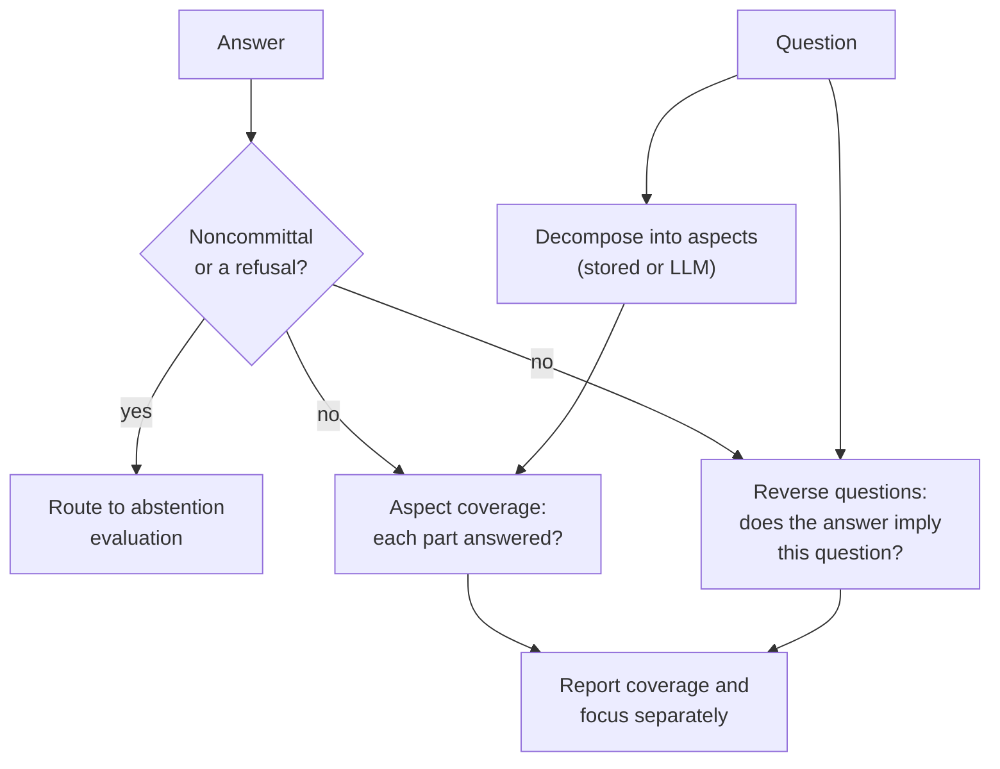

An answer can be perfectly grounded and still useless. Ask AskMeridian "how many unused leave days can I carry over, and when do I have to use them?" and receive "Annual leave is 25 days per year": every word is supported by the handbook, and the question is not answered. **Answer relevance** is the metric for this failure. It asks whether the answer addresses the question that was actually asked: directly, completely, and without wandering off into material nobody requested.

This lesson defines answer relevance and separates it from its neighbours, then examines the ways it is measured: question-answer similarity, cross-encoder scoring, the reverse-question method used by RAGAS, aspect coverage and rubric judges. You will run four of them side by side on six deliberately different answers and see that each cheap signal is fooled by a different kind of bad answer, which is the main practical lesson of the topic.

## Learning objectives

- Define answer relevance and distinguish it from faithfulness, correctness and context relevance with an example of each.
- Explain the reverse-question method and compute its score by hand from embedding vectors.
- Identify which kinds of bad answer (echoing, partial, padded, off-topic, noncommittal) fool which automatic signals.
- Implement aspect coverage for a multi-part question and explain why it needs an answer-type check.
- Decide how to treat refusals and abstentions when reporting answer relevance.

## Prerequisites

- [Faithfulness](/learn/generation-evaluation/faithfulness): claim-level evaluation and judge validation.
- [Embeddings](/learn/understanding-large-language-models/embeddings): cosine similarity between texts.
- [Query-document matching](/learn/rag-architecture-fundamentals/query-document-matching): the asymmetry between a question and the text that answers it.
- [Cross-encoders](/learn/reranking-fundamentals/cross-encoders): scoring a question and a passage together.

## Why this matters

Generation can fail by saying false things, which faithfulness and correctness catch, or by saying true things that miss the point, which only answer relevance catches. The second kind is common, and it gets more common as you make a system safer. Tighten the grounding prompt and the model starts hedging; add a refusal instruction and it starts refusing answerable questions; add "be thorough" and it pads every answer with adjacent policy. Each change can improve faithfulness while users get less of what they asked for.

Answer relevance also catches failures upstream that faithfulness hides. When retrieval returns a topical but wrong passage (the annual leave allowance instead of the carry-over rule), a well-behaved generator faithfully summarises what it was given. Faithfulness is 1.0. The answer is beside the point, and answer relevance is the only generation metric that notices.

## The intuition

Think of a good examiner marking a short-answer question. She does not first ask whether the answer is true; she asks whether it *answers the question*. A student who copies the question back in different words gets nothing, however fluent. A student who answers half of a two-part question gets half. A student who answers correctly and then adds a page on an unrelated topic is marked down for not following the question. And a student who writes "I'm not sure" gets nothing, unless the question was a trick one with no answer, in which case saying so is exactly right.

Every one of those judgements has a counterpart in this lesson: echoing, partial answers, padding, and noncommittal answers, plus the special case where declining to answer is the relevant response.

## How it works

### What answer relevance covers

Answer relevance is a property of the pair (question, answer). It ignores the context and the truth. Three aspects make it up:

- **Directness**: the answer responds to what was asked, in the form asked. A "when" question gets a date; a "how many" question gets a number.
- **Completeness**: every part of the question is addressed. "How many days, and by when?" has two parts.
- **Focus**: the answer does not bury the response in material that was not requested.

Its neighbours measure other things, and confusing them leads to bad conclusions:

| Metric | Compares | Example that fails it but passes answer relevance |
| --- | --- | --- |
| [Faithfulness](/learn/generation-evaluation/faithfulness) | answer vs context | "You can carry over up to 10 days, used by 31 March" (relevant, but not supported) |
| [Answer correctness](/learn/generation-evaluation/answer-correctness) | answer vs reference | the same answer: relevant and wrong |
| [Context relevance](/learn/generation-evaluation/context-relevance) | context vs question | a perfect answer produced despite a noisy context |

Some frameworks define answer relevance to include completeness, others treat completeness as part of correctness. Whatever your tool does, write down which aspects your number includes.

### The kinds of irrelevant answer

It helps to name the failures, because each fools a different measurement:

1. **Off-topic**: answers a neighbouring question, usually because retrieval returned a neighbouring passage. "Annual leave is 25 days per year."
2. **Partial**: answers one part of a multi-part question. "You can carry over up to 5 unused days."
3. **Echo**: restates the question, perhaps with a pointer, without answering it. "You are asking how many days you can carry over... Leave rules are set out in the handbook."
4. **Padded**: answers, then adds unrequested material. The answer plus a paragraph about remote work and expenses.
5. **Noncommittal**: hedges or deflects. "I'm not sure about that. Please check with the HR team."

### Measuring it: five approaches

**Question-answer embedding similarity.** Embed both and take the cosine. It is cheap and almost useless on its own, for the reason [Query-document matching](/learn/rag-architecture-fundamentals/query-document-matching) explained: a question and its answer are different kinds of text. The text most similar to a question is another question, so an echo answer scores highest.

**Cross-encoder relevance.** A reranker such as the MS MARCO cross-encoder reads question and answer together and was trained to score passages that answer queries. It is much better than raw similarity at rejecting off-topic and noncommittal answers. But it was trained on passages, which often contain extra material, so it does not penalise padding, and it judges topic rather than whether each part of the question is answered.

**The reverse-question method.** RAGAS (Es and colleagues, 2023) measures answer relevance by working backwards: a language model reads only the answer and writes several questions that the answer would be a good response to. Each generated question is embedded and compared with the original question by cosine similarity, and the scores are averaged. The model is also asked whether the answer is noncommittal, and a noncommittal answer is scored zero. The idea is that a focused, complete answer implies the original question; a padded answer implies a broader question ("what are the rules on leave, remote work and expenses?"), and an off-topic answer implies a different one. Because both sides of the final comparison are questions, the query-document asymmetry disappears.

**Aspect coverage.** Split the question into its parts (an LLM does this, or the evaluation set stores them), and check each part is answered somewhere in the answer. Coverage is the fraction of parts answered. This is the most direct measure of completeness, and the only one of the cheap signals that reliably catches partial and echo answers, provided "answered" is checked properly: a sentence that is merely *about* the part is not an answer to it.

**Rubric judges.** A language model given the question, the answer and a rubric ("Does the answer address every part? Does it answer directly? Does it include unrequested material? Is it noncommittal?") returns per-criterion labels. This is the most flexible approach, and the one most teams converge on for final reporting, provided the judge is validated against human labels as in [Faithfulness](/learn/generation-evaluation/faithfulness).



### Refusals and unanswerable questions

The reverse-question method scores noncommittal answers zero, and for an answerable question that is right: "please check with HR" is not an answer. But some questions have no answer in the corpus. Asked "what is the parental leave policy for contractors?", and given a handbook that says nothing on it, the relevant response is a clear statement that the handbook does not cover it, ideally with a pointer to who can help. Scoring that zero punishes exactly the behaviour [Handling missing information](/learn/prompt-engineering-for-rag/handling-missing-information) asked for.

The clean solution is to label each evaluation question as answerable or unanswerable from the corpus, and to evaluate the two groups differently:

- **Answerable questions**: measure answer relevance; count refusals as failures (a *false refusal*).
- **Unanswerable questions**: do not measure answer relevance; measure whether the system declined, and whether it declined helpfully (a *correct abstention*), versus making something up.

Report the false-refusal rate next to answer relevance. A prompt change that raises faithfulness by making the model refuse more will show up there.

### The procedure, step by step

1. **Label the evaluation set**: for each question, answerable or not, and its aspects (two or three for multi-part questions).
2. **Detect refusals and noncommittal answers** first, with a classifier, a judge flag or simple patterns, and route them to abstention evaluation.
3. **Measure coverage** of each aspect, requiring the right type of answer, not just the right topic.
4. **Measure focus**, with the reverse-question score or a judge's "unrequested material" label.
5. **Report** coverage, focus and false-refusal rate separately, and a combined score only if you have decided how to weigh them.

> [!KEY]
> Answer relevance is about the fit between question and answer, not about truth. No single cheap signal measures it: similarity rewards echoes, rerankers ignore padding and gaps, and reverse questions miss partial answers. Measure completeness and focus separately, and handle refusals as their own outcome.

## The mathematics

### The reverse-question score

**Intuition.** If an answer is a good response to the question, the questions it implies should resemble the question that was asked.

$$
\text{AR}(q, a) = \frac{1}{N} \sum_{i=1}^{N} \cos\!\big(E(g_i),\, E(q)\big)
$$

- $q$ is the original question and $a$ the answer.
- $g_1, \dots, g_N$ are $N$ questions generated from $a$ alone.
- $E(\cdot)$ is an embedding model; $\cos$ is cosine similarity.
- If the answer is flagged noncommittal, $\text{AR}$ is set to 0.

Cosine similarities between texts are rarely near 0 for sentences on related topics, so the score does not use its full range: in practice relevant answers cluster high and the differences that matter are a few hundredths. Compare scores between systems, not against an absolute bar.

**By hand.** Use two-dimensional unit vectors so the arithmetic is visible. The question is $E(q) = (0.8, 0.6)$. The answer produced two questions with $E(g_1) = (0.6, 0.8)$ and $E(g_2) = (1.0, 0.0)$. All three have length 1, so each cosine is a dot product:

- $\cos(g_1, q) = 0.6 \times 0.8 + 0.8 \times 0.6 = 0.48 + 0.48 = 0.96$
- $\cos(g_2, q) = 1.0 \times 0.8 + 0.0 \times 0.6 = 0.80$
- $\text{AR} = (0.96 + 0.80)/2 = 0.88$

### Aspect coverage

$$
\text{coverage}(q, a) = \frac{\lvert \{\, p \in P(q) : \text{answered}(a, p) \,\} \rvert}{\lvert P(q) \rvert}
$$

$P(q)$ is the set of parts (aspects) of the question and $\text{answered}(a, p)$ is true when some part of $a$ answers $p$. For the carry-over question, $P(q)$ has two parts; an answer giving the 5-day limit but no deadline has coverage $1/2 = 0.5$.

```python
import numpy as np

q = np.array([0.8, 0.6])                   # original question (unit length)
generated = np.array([[0.6, 0.8],          # questions regenerated from the answer
                      [1.0, 0.0]])
cosines = generated @ q                    # all vectors have length 1
print("cosines:", cosines.round(2), " answer relevance:", round(float(cosines.mean()), 2))

covered, aspects = 1, 2
print("aspect coverage:", covered / aspects)
```

```output
cosines: [0.96 0.8 ]  answer relevance: 0.88
aspect coverage: 0.5
```

## In code

**The problem.** Score six answers to the same two-part question with four signals (question-answer cosine, a cross-encoder, the reverse-question score and aspect coverage) and find out which kind of bad answer fools which signal.

**Dependencies.** sentence-transformers with the cached `all-MiniLM-L6-v2` bi-encoder and `cross-encoder/ms-marco-MiniLM-L-6-v2` cross-encoder, and NumPy. No API key.

```bash
pip install sentence-transformers numpy
```

The reverse-question method needs a language model to write questions from each answer. To keep the example runnable and reproducible, those generated questions and the noncommittal flag are given as fixed data, written as such a model would write them; the embedding and scoring are real. Aspect coverage uses the cross-encoder to find a sentence that is on-topic for each part *and* a regular expression for the type of answer that part expects: a number for "how many", a date for "when".

```python
import re
import numpy as np
from sentence_transformers import SentenceTransformer, CrossEncoder

QUESTION = "How many unused leave days can I carry over, and when do I have to use them?"
# Each part of the question, with the type of answer it expects.
ASPECTS = [("How many unused leave days can be carried over?", r"\b\d+\b"),
           ("When must carried-over leave days be used?",
            r"\b\d{1,2} (January|February|March|April|May|June|July|August"
            r"|September|October|November|December)\b")]

ANSWERS = {
    "direct":  "You can carry over up to 5 unused days. They must be used by 31 March.",
    "partial": "You can carry over up to 5 unused days.",
    "echo":    "You are asking how many unused leave days you can carry over and when "
               "you have to use them. Leave rules are set out in the handbook.",
    "off":     "Annual leave is 25 days per year.",
    "padded":  "You can carry over up to 5 unused days. They must be used by 31 March. "
               "Staff may also work remotely up to 3 days a week, and expenses must be "
               "submitted within 30 days.",
    "dodge":   "I'm not sure about that. Please check with the HR team.",
}

# Questions an LLM generated *from each answer* (the reverse-question step),
# plus its flag for a noncommittal answer. Written here as fixed data.
REVERSE = {
    "direct":  (["How many unused leave days can I carry over and by when must I use them?",
                 "What is the deadline for using carried-over leave?"], False),
    "partial": (["How many unused leave days can I carry over?",
                 "What is the limit on carrying over leave?"], False),
    "echo":    (["How many unused leave days can I carry over and when must I use them?",
                 "Where are the leave rules set out?"], False),
    "off":     (["How many days of annual leave do I get per year?",
                 "What is the annual leave allowance?"], False),
    "padded":  (["What are the rules on leave carry-over, remote work and expenses?",
                 "How many days can I work remotely and when are expenses due?"], False),
    "dodge":   (["Who should I ask about leave?",
                 "Can the HR team help with this question?"], True),
}

bi = SentenceTransformer("sentence-transformers/all-MiniLM-L6-v2")
ce = CrossEncoder("cross-encoder/ms-marco-MiniLM-L-6-v2")
q_vec = bi.encode([QUESTION], normalize_embeddings=True)[0]

def sentences(text):
    return [s for s in re.split(r"(?<=[.!?])\s+", text) if s]

def reverse_question_score(name):
    generated, noncommittal = REVERSE[name]
    if noncommittal:
        return 0.0
    g = bi.encode(generated, normalize_embeddings=True)
    return float(np.mean(g @ q_vec))

def aspect_coverage(answer, threshold=0.0):
    """An aspect is covered if some sentence is on-topic for it (cross-encoder
    logit above threshold) AND contains the expected type of answer."""
    sents = sentences(answer)
    covered = 0
    for aspect, answer_type in ASPECTS:
        scores = ce.predict([(aspect, s) for s in sents])
        covered += any(sc > threshold and re.search(answer_type, s)
                       for sc, s in zip(scores, sents))
    return covered / len(ASPECTS)

print(f"{'answer':<8} {'qa_cos':>7} {'ce_logit':>9} {'reverse_q':>10} {'coverage':>9}")
for name, ans in ANSWERS.items():
    qa_cos = float(bi.encode([ans], normalize_embeddings=True)[0] @ q_vec)
    ce_logit = float(ce.predict([(QUESTION, ans)])[0])
    print(f"{name:<8} {qa_cos:>7.3f} {ce_logit:>9.2f} {reverse_question_score(name):>10.3f}"
          f" {aspect_coverage(ans):>9.2f}")
```

```output
answer    qa_cos  ce_logit  reverse_q  coverage
direct     0.778      8.33      0.835      1.00
partial    0.781      7.49      0.814      0.50
echo       0.926      5.62      0.801      0.00
off        0.638     -0.79      0.608      0.50
padded     0.765      8.40      0.548      1.00
dodge      0.125    -10.91      0.000      0.00
```

**The important lines.** `reverse_question_score` is the RAGAS idea in four lines: embed the generated questions, take each cosine with the original question, average, and short-circuit to 0 for a noncommittal answer. `aspect_coverage` requires two things of a covering sentence, `sc > threshold` (on-topic, using 0 as the natural boundary of this cross-encoder's logits) and `re.search(answer_type, s)` (the right kind of answer). Without the second condition, the check degrades to topicality: when this example was first written without it, the cross-encoder judged "You can carry over up to 5 unused days" to be on-topic for the deadline question too, and the partial and echo answers both scored full coverage.

**What the output means.** Read the table column by column, asking which bad answer each signal ranks too high.

- **`qa_cos`** ranks the *echo* answer first (0.926), above the correct one. Restating the question is the best way to resemble it. This signal should not be used alone.
- **`ce_logit`** correctly sinks the off-topic and noncommittal answers, but ranks *padded* (8.40) above *direct* (8.33), and the partial answer close behind. It measures "is this passage about answering the question", not "is this a complete, focused answer".
- **`reverse_q`** is the only signal that punishes *padding* hard (0.548), because the questions implied by a padded answer are broader than the one asked. It still ranks *partial* and *echo* close to *direct*: a half-answer implies a half-question, which is still very similar to the whole.
- **`coverage`** is the only signal that separates *partial* (0.50) and *echo* (0.00) from *direct*. It is fooled by *off*: "Annual leave is 25 days per year" is on-topic for "how many days" and contains a number, so the first aspect counts as covered, even though 25 is the wrong quantity. The answer-type check confirms the *kind* of answer, not its correctness.

Together, coverage and the reverse-question score place *direct* top on both and expose every other answer on at least one. That is the practical design: two complementary signals for completeness and focus, plus a noncommittal flag.

**Errors people commonly hit.** Embedding the question with one model and the generated questions with another makes every cosine meaningless. Using a cross-encoder's raw logit as if it were a 0-to-1 score breaks averaging; apply a sigmoid or use ranks if you need a bounded number. Writing answer-type patterns that are too narrow ("31 March" but not "March 31st") turns style into a relevance failure; for open-ended aspects the type check has to be done by a judge.

**How to extend it.** Replace the fixed reverse questions and the regular expressions with a rubric judge that labels each aspect as answered or not and flags unrequested material. The version below returns validated labels; it needs an API key and **was not executed** for this lesson.

```python
import anthropic
from pydantic import BaseModel

class AspectLabel(BaseModel):
    aspect: str
    answered: bool          # the answer gives a direct response to this part

class RelevanceJudgement(BaseModel):
    aspects: list[AspectLabel]
    noncommittal: bool       # hedges or deflects instead of answering
    unrequested_material: bool

RUBRIC = (
    "You judge whether an answer addresses a question. Do not judge whether it is "
    "true. For each listed part of the question, say whether the answer gives a "
    "direct response to that part; restating the part or pointing elsewhere does "
    "not count. Flag the answer as noncommittal if it hedges or deflects, and flag "
    "unrequested material if it adds information the question did not ask for."
)

client = anthropic.Anthropic()  # reads ANTHROPIC_API_KEY from the environment

def judge_relevance(question: str, aspects: list[str], answer: str) -> RelevanceJudgement:
    parts = "\n".join(f"- {p}" for p in aspects)
    prompt = f"Question: {question}\nParts:\n{parts}\n\n<answer>\n{answer}\n</answer>"
    response = client.messages.parse(
        model="claude-opus-5-5",
        max_tokens=512,
        system=RUBRIC,
        messages=[{"role": "user", "content": prompt}],
        output_format=RelevanceJudgement,
    )
    return response.parsed_output
```

Note the rubric's first instruction: "Do not judge whether it is true." Judges asked about relevance drift towards judging correctness, which merges two metrics you want to keep apart.

## A real-world example

Meridian's Platform team changed AskMeridian's system prompt to fix a faithfulness problem: the model had occasionally added remote-work details from its general knowledge. The new prompt said "If you are not certain the context fully answers the question, say so and suggest contacting the relevant team." Faithfulness rose on the nightly evaluation, and the change was promoted.

Within a week the HR team reported more tickets than usual about routine questions. The evaluation dashboard showed answer relevance (the reverse-question score) had fallen, but only slightly on average, because the dashboard averaged over all questions and many answers were unaffected. Splitting by question type told the story: on multi-part questions, the model now often answered the first part and added "for the rest, please contact HR". The reverse-question score barely moved on those (a half-answer still implies a similar question), and the noncommittal flag did not fire, because the answer was not wholly noncommittal.

The team made three changes. They added aspect coverage, with aspects stored in the evaluation set for every multi-part question, and a false-refusal rate on answerable questions; together these showed the regression clearly. They rewrote the prompt to say which parts the context did and did not cover rather than deflecting wholesale. And they made "no drop in coverage or rise in false refusals" a release gate alongside faithfulness, so that the next grounding fix could not quietly trade usefulness for safety.

## Common mistakes

- **Using question-answer similarity as the metric.** It rewards echoing the question and penalises concise answers phrased differently from the question.
- **Scoring refusals on unanswerable questions as irrelevant.** The correct response gets a zero, and the metric pushes the system towards guessing.
- **Letting relevance absorb correctness.** A judge that marks wrong answers as irrelevant makes your relevance and correctness numbers move together, and you lose the ability to tell the failures apart.
- **Ignoring multi-part questions.** A mean over mostly single-part questions hides partial answers on the multi-part ones; split by question type.
- **Treating cross-encoder logits as probabilities.** Averaging unbounded logits across answers lets a few extreme values dominate.
- **Comparing reverse-question scores across embedding models or generators.** The scale depends on both; only compare systems scored with the same configuration.

## Best practices

- Store each evaluation question's aspects and an answerable/unanswerable label with the question.
- Report completeness (aspect coverage) and focus (reverse-question score or a judge's padding flag) separately, plus a false-refusal rate.
- Detect noncommittal answers and refusals first, and route them to abstention evaluation.
- Tell any judge explicitly not to assess truth.
- Validate the judge against a few hundred human labels, with plenty of partial and echo answers in the sample.
- Slice results by question type, because averages over easy single-part questions hide the failures that matter.

## Performance considerations

The reverse-question method costs one generation call per answer (producing $N$ short questions) plus $N + 1$ embeddings. Generated questions are short, so output tokens are small; with an assumed 300-token answer and three 20-token questions, a 1,000-question evaluation needs roughly 300,000 input and 60,000 output tokens, plus instructions. A rubric judge costs about the same input with somewhat longer outputs. Embedding and cross-encoder signals are effectively free at this scale: a small cross-encoder scores thousands of pairs per minute on a CPU.

The cheap signals are useful as filters, not as the metric. A sensible cascade runs the noncommittal patterns and cross-encoder on everything (catching off-topic and deflecting answers at no cost), and spends judge calls on the remainder. For live monitoring, the cross-encoder score and a refusal pattern can run on every request, logged per route, with the judge applied to a sample.

## Summary

- Answer relevance measures whether the answer addresses the question asked (directness, completeness, focus), independently of truth and of the context.
- The five failure shapes are off-topic, partial, echo, padded and noncommittal; each cheap signal is fooled by at least one.
- Question-answer similarity rewards echoes; cross-encoders ignore padding and gaps; the reverse-question method catches padding but not partial answers; aspect coverage catches partial and echo answers but needs an answer-type check.
- Refusals on unanswerable questions are correct behaviour; evaluate answerable and unanswerable questions separately and report a false-refusal rate.
- In practice, report coverage and focus separately, validate any judge, and slice by question type.

## Exercises

1. Classify each answer to "What is the home-office equipment budget, and are contractors eligible?" as direct, partial, echo, padded, off-topic or noncommittal: (a) "The budget is £400." (b) "The budget is £400; contractors are not eligible. Remote work is allowed up to 3 days a week." (c) "Equipment budget rules are in the HR section." (d) "The budget is £400, and contractors are not eligible."

<details><summary>Show solution</summary>

(a) Partial: one of two parts. (b) Padded: complete, plus unrequested remote-work material. (c) Echo or pointer: no part answered. (d) Direct and complete.

</details>

2. The original question's embedding is $(0.6, 0.8)$. An answer produced three generated questions with embeddings $(0.6, 0.8)$, $(0.8, 0.6)$ and $(0.0, 1.0)$. Compute the reverse-question score. What would it be if the answer were flagged noncommittal?

<details><summary>Show solution</summary>

Cosines: $0.36 + 0.64 = 1.0$; $0.48 + 0.48 = 0.96$; $0 + 0.8 = 0.8$. Mean $= (1.0 + 0.96 + 0.8)/3 = 0.92$. If flagged noncommittal, the score is 0 regardless.

</details>

3. Extend the code to the question in exercise 1. Write the two aspects with answer-type checks (an amount for the budget, an eligibility statement for contractors) and run coverage on the four answers. What answer-type check did you use for eligibility, and where does a pattern-based check stop being adequate?

<details><summary>Show solution</summary>

Budget: a currency pattern such as `r"£\s?\d+"`. Eligibility: a pattern such as `r"\b(eligible|not eligible|ineligible|can|cannot)\b"` in a sentence that is on-topic for the contractor aspect. Answers (b) and (d) cover both aspects, (a) covers one, (c) none. Patterns stop being adequate when the expected answer is not a fixed type: "why", "how do I" and "what should I do" questions have answers with no recognisable surface form, so the "answered" decision needs a judge.

</details>

4. Your evaluation set has 400 answerable and 100 unanswerable questions. A new prompt raises faithfulness from 0.91 to 0.96 and lowers mean answer relevance over all 500 questions from 0.84 to 0.82. Describe the analysis you would do before deciding, and the numbers you would want to see.

<details><summary>Show solution</summary>

Recompute answer relevance on the 400 answerable questions only; the overall mean mixes in unanswerable ones where relevance should not be scored. Compute the false-refusal rate on answerable questions before and after, and the correct-abstention rate on unanswerable ones. Slice coverage by single-part versus multi-part questions. Read the answers whose relevance fell most. If the faithfulness gain came from refusing or half-answering answerable questions, the change is a trade, not an improvement, and the prompt should be revised to state which parts are and are not covered rather than deflect.

</details>

## Check your understanding

```quiz
[
  {"q": "An answer restates the question in different words and points to the handbook. Which signal is most likely to score it highest?", "options": ["Aspect coverage with answer-type checks", "The noncommittal flag", "Question-answer embedding cosine similarity", "A false-refusal counter"], "answer": 2, "why": "The text most similar to a question is another version of the question, so an echo scores high on question-answer similarity."},
  {"q": "In the reverse-question method, why are generated questions compared with the original question rather than comparing the answer with the question directly?", "options": ["Because questions are shorter and cheaper to embed", "So that both sides of the comparison are the same kind of text, removing the question-answer asymmetry", "Because the answer may contain errors", "To avoid needing an embedding model"], "answer": 1, "why": "Question-to-question similarity is meaningful in a way question-to-answer similarity is not; the method asks which question the answer implies."},
  {"q": "A correct answer is followed by two sentences of unrelated policy. Which signal in the lesson's experiment penalised this most?", "options": ["The reverse-question score", "The cross-encoder logit", "Aspect coverage", "Question-answer cosine"], "answer": 0, "why": "A padded answer implies a broader question than the one asked, so the generated questions drift away from the original and the score falls."},
  {"q": "A question cannot be answered from the corpus, and the system says the handbook does not cover it and names the team to ask. How should answer relevance treat this?", "options": ["Score it 0 as noncommittal", "Score it 1 because it is polite", "Average it with the answerable questions", "Exclude it from answer relevance and count it as a correct abstention"], "answer": 3, "why": "On unanswerable questions, declining is the right behaviour; it belongs in abstention evaluation, not in the relevance average."},
  {"q": "Why does the aspect-coverage check require an expected answer type as well as a topical match?", "options": ["Because cross-encoders cannot score short sentences", "Because a sentence can be about a part of the question without answering it, and a topical model alone counts it as covered", "To make the check slower and more thorough", "Because regular expressions are more accurate than models"], "answer": 1, "why": "Without the type check, the carry-over sentence counted as covering the deadline question, and partial and echo answers scored full coverage."}
]
```

## Further reading

- Es, James, Espinosa-Anke and Schockaert (2023), *RAGAS: Automated Evaluation of Retrieval Augmented Generation*. [arXiv:2309.15217](https://arxiv.org/abs/2309.15217). Introduces the reverse-question answer relevance metric.
- [Ragas documentation](https://docs.ragas.io/), for the current definition and parameters of its answer relevancy metric.
- Rajpurkar, Jia and Liang (2018), *Know What You Don't Know: Unanswerable Questions for SQuAD*. [arXiv:1806.03822](https://arxiv.org/abs/1806.03822). Evaluating systems on questions that have no answer.
- Zheng and colleagues (2023), *Judging LLM-as-a-Judge with MT-Bench and Chatbot Arena*. [arXiv:2306.05685](https://arxiv.org/abs/2306.05685). Biases of model judges, including a preference for longer answers.
- [Sentence Transformers documentation](https://www.sbert.net/), for the bi-encoder and cross-encoder models used here.
