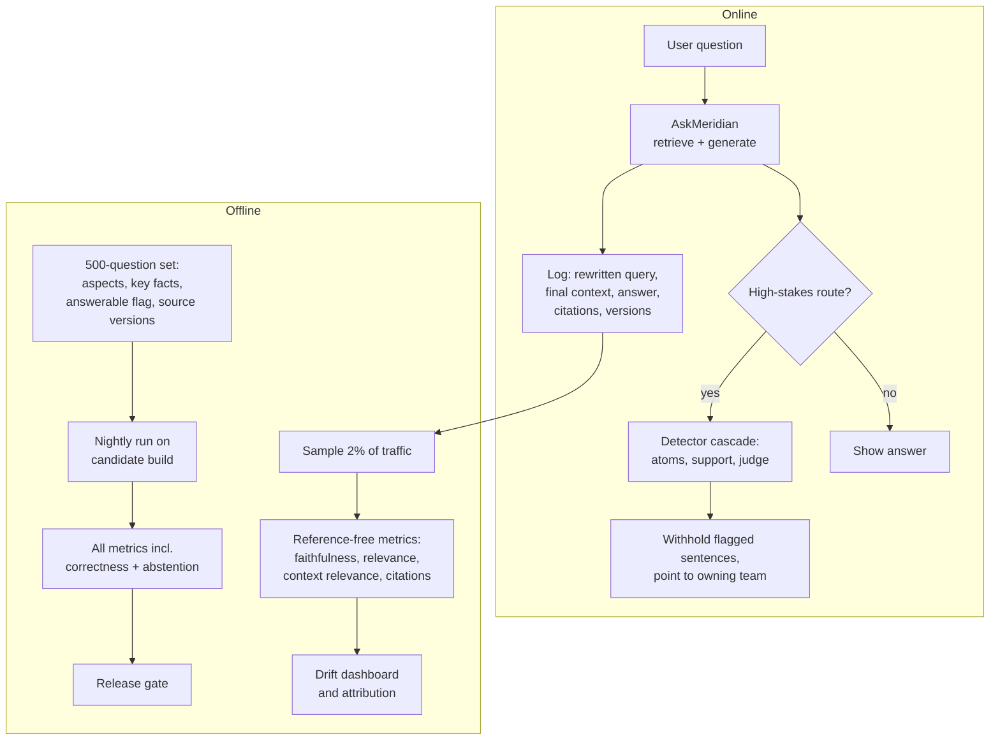

This assessment covers the whole of [Generation Evaluation](/learn/generation-evaluation): faithfulness, answer relevance, context relevance, answer correctness, hallucination detection and citation accuracy. Answer the 18 multiple-choice questions first; 13 or more correct (about 70 per cent) is a pass. Then work through the conceptual questions, the coding exercises, the architecture challenge and the troubleshooting scenarios before opening the model answers. The coding solutions were run with Python 3 and scikit-learn; their outputs are shown beneath them.

```quiz
[
  {"q": "Which metric compares the answer with the context the generator received, claim by claim?", "options": ["Answer correctness", "Faithfulness", "Answer relevance", "Context relevance"], "answer": 1, "why": "Faithfulness is the fraction of the answer's claims supported by the context; correctness compares with a reference instead."},
  {"q": "An answer faithfully repeats the superseded 2023 handbook's 4-year laptop cycle, which retrieval returned. Which metric fails it?", "options": ["Faithfulness", "Answer relevance", "Answer correctness against a current reference", "Citation precision"], "answer": 2, "why": "The answer is supported by its context and addresses the question; only comparison with a current reference shows it is wrong."},
  {"q": "The system answers 'I could not find that in the handbook.' to an answerable question. How should the module's metrics treat it?", "options": ["Faithfulness 1.0 and answer relevance 1.0", "Exclude it from faithfulness, and count it as a false refusal in correctness and relevance reporting", "Faithfulness 0.0, since nothing is supported", "Ignore it entirely"], "answer": 1, "why": "With no claims, faithfulness is undefined; on an answerable question the abstention is an error to be counted separately."},
  {"q": "Four answers have 2, 2, 2 and 4 claims, with 2, 2, 2 and 0 supported. What are macro and micro faithfulness?", "options": ["Macro 0.75, micro 0.60", "Macro 0.60, micro 0.75", "Both 0.75", "Macro 0.75, micro 0.50"], "answer": 0, "why": "Per-answer scores 1, 1, 1, 0 average to 0.75; pooled claims give 6 of 10, 0.60."},
  {"q": "A judge and a human label 10 claims. The human says 8 supported and 2 not; the judge says all 10 supported. What is Cohen's kappa?", "options": ["0.8", "0.2", "1.0", "0.0"], "answer": 3, "why": "Observed agreement 0.8 equals chance agreement 0.8 x 1.0 + 0.2 x 0 = 0.8, so kappa is 0: no better than always saying 'supported'."},
  {"q": "Which answer did question-answer embedding similarity rank highest in the answer relevance lesson?", "options": ["The direct, complete answer", "The padded answer", "The echo answer that restated the question", "The noncommittal answer"], "answer": 2, "why": "The text most similar to a question is another version of it, so echoing scores highest on similarity."},
  {"q": "In the reverse-question method, the generated questions have cosines 0.9, 0.8 and 0.7 with the original question, and the answer is not noncommittal. What is the score?", "options": ["0.8", "0.9", "2.4", "0.7"], "answer": 0, "why": "The score is the mean cosine: (0.9 + 0.8 + 0.7) / 3 = 0.8."},
  {"q": "Why did the aspect-coverage check need an expected answer type as well as a cross-encoder?", "options": ["Cross-encoders cannot score short texts", "Regular expressions are always more accurate", "To make the check run faster", "A sentence can be on topic for a part of the question without answering it, and the cross-encoder alone counted that as coverage"], "answer": 3, "why": "Without the type check, the carry-over sentence counted as answering the deadline question, and partial answers looked complete."},
  {"q": "What does context relevance, as an evaluation metric, need?", "options": ["A reference answer", "A pre-judged list of relevant documents", "The question and the context the generator actually received", "Human labels for the whole index"], "answer": 2, "why": "It grades what was retrieved after the fact, which is why it works on any evaluation run or logged traffic."},
  {"q": "An answer is faithful but off the question, and its context contains an answer-bearing chunk. Where does the triad place the fault?", "options": ["Generation", "Retrieval", "Indexing", "Nowhere"], "answer": 0, "why": "The evidence was there and the answer stayed grounded but addressed something else: a generation failure."},
  {"q": "Why is quadratic-weighted kappa preferred to plain kappa for validating a 0/1/2 relevance grader?", "options": ["It is always higher", "It ignores chance agreement", "It charges disagreements by their distance, so 2-versus-1 costs less than 2-versus-0", "It only works with three grades"], "answer": 2, "why": "Graded labels are ordered, and weighting reflects that some disagreements are near misses."},
  {"q": "What does this code print?\n```python\nfrom collections import Counter\nref = \"up to 5 days by 31 march\".split()\nans = \"up to 10 days by 31 march\".split()\nc = sum((Counter(ans) & Counter(ref)).values())\np, r = c / len(ans), c / len(ref)\nprint(round(2 * p * r / (p + r), 3))\n```", "options": ["1.0", "0.857", "0.5", "0.0"], "answer": 1, "why": "Six of seven tokens are shared on each side, so precision = recall = 6/7 and F1 is about 0.857: a wrong answer scores high on token F1."},
  {"q": "An answer has 3 claims: 2 match the reference and 1 does not. The reference has 4 key facts. What is claim-level F1?", "options": ["0.667", "0.5", "0.75", "0.571"], "answer": 3, "why": "TP = 2, FP = 1, FN = 2, so F1 = 2 / (2 + 0.5 x 3) = 2 / 3.5, about 0.571."},
  {"q": "Why must claim matching for correctness check values and polarity as well as semantic similarity?", "options": ["Embeddings place '5 days' and '10 days', or 'eligible' and 'not eligible', close together", "Because exact match requires it", "Because references are always short", "To reduce the number of judge calls"], "answer": 0, "why": "Semantic similarity captures topic, not the specific value or negation."},
  {"q": "A hallucination detector has recall 0.8 and specificity 0.9. About what is its precision when 2% of sentences are hallucinated?", "options": ["0.80", "0.90", "0.14", "0.50"], "answer": 2, "why": "True flags 0.8 x 0.02 = 0.016; false flags 0.1 x 0.98 = 0.098; precision = 0.016 / 0.114, about 0.14."},
  {"q": "Which detector family is weakest for RAG grounding, because a model that consistently repeats a wrong fact from memory passes it?", "options": ["Atom checks", "Self-consistency across sampled answers", "NLI-based claim checks", "Language-model judges given the context"], "answer": 1, "why": "Self-consistency measures agreement among samples, which reflects model uncertainty, not support by the documents."},
  {"q": "A sentence cites [S1][S2]. S1 supports it alone; S2 does not, and S1 without S2 still supports it. Under the ALCE rules:", "options": ["Both citations are precise", "Neither is precise", "The statement fails citation recall", "S1 is precise and S2 is irrelevant"], "answer": 3, "why": "A citation is irrelevant if it fails alone and the rest still supports the statement; that describes S2."},
  {"q": "A statement is supported by S4 in the context, but the answer cites S5, which does not support it. Which pair of metrics gives which verdict?", "options": ["Faithfulness passes it; citation recall fails it (misattribution)", "Both pass it", "Both fail it", "Faithfulness fails it; citation recall passes it"], "answer": 0, "why": "Faithfulness judges against the whole context; citation recall judges against the cited sources only."}
]
```

## Conceptual questions

**1.** Explain why faithfulness, answer relevance and answer correctness are all needed, by giving for each a realistic AskMeridian answer that passes the other two and fails it.

<details><summary>Show model answer</summary>

*Fails faithfulness only*: "Laptops are refreshed every 3 years" when the context contains no laptop policy; the model answered correctly from memory, and the answer is relevant. It is untraceable and will not change when the policy does. *Fails answer relevance only*: "Annual leave is 25 days per year" to "How many unused days can I carry over?", with a context containing both facts; it is faithful and correct as a statement, and does not answer the question. (Correctness against a reference about carry-over would also fail it, since the key fact is missing; relevance explains why.) *Fails correctness only*: "Laptops are refreshed every 4 years", faithfully repeating a retrieved chunk from the superseded 2023 handbook; it is grounded and relevant, and wrong. Each metric sees a different failure: support by the context, fit to the question, and agreement with the truth.

</details>

**2.** A colleague proposes to drop context relevance from the evaluation suite because "faithfulness already tells us whether the evidence was used". What does context relevance add, and what would the team lose without it?

<details><summary>Show model answer</summary>

Faithfulness says whether the answer stayed inside the context; it cannot say whether the context contained the answer. Context relevance (with a has-answer rate) says whether the generator had a chance. Without it, a wrong or unfaithful answer cannot be attributed: an invented procedure might be a generation failure (evidence present, ignored) or a retrieval failure (evidence absent, the model filled the gap). The fixes differ completely, and the team would tune the wrong component. Context relevance is also reference-free and works on logged traffic, unlike Recall@K, which needs pre-judged documents.

</details>

**3.** Why do enriched test sets overstate the precision of hallucination detectors, and how should a detector's results be reported so that a reader can judge it for production?

<details><summary>Show model answer</summary>

Precision depends on the base rate: flags come from caught hallucinations ($r\pi$) and false alarms on good items ($(1-s)(1-\pi)$). Test sets built to contain many hallucinations have a high $\pi$, so few false alarms relative to true flags. In production, where hallucinations are rare, the many good items generate many false alarms and precision falls sharply. Report recall and specificity (base-rate free), AUROC for scored detectors, the base rate measured on a labelled sample of real traffic, and precision and flag rate computed at that base rate, at the granularity of the action taken.

</details>

**4.** What is misattribution, why does it tend to increase when the context contains many similar chunks, and why is it invisible to faithfulness?

<details><summary>Show model answer</summary>

Misattribution is a cited statement that its citations do not support but other sources in the context do: the model had the right evidence and attached the wrong label. Similar chunks (runbook entries for different error codes, policy sections with parallel wording) give the model many near-identical labels to confuse. Faithfulness judges each claim against the whole context, so the statement is supported and passes; only judging against the cited sources reveals that the link the user will click is wrong.

</details>

**5.** Your correctness evaluation uses references written six months ago. What can go wrong, and what metadata and process would you add?

<details><summary>Show model answer</summary>

Sources change: a policy update (like Meridian's 2025 handbook) makes some references wrong, and the evaluation then marks correct answers incorrect and may push the team to regress the system. Store with each reference the source document id and version, its key facts with normalised values, and an answerable flag. When a source document changes, automatically mark dependent references for review, exclude them from headline scores until an owner re-checks them, and triage every failure as "system wrong" or "reference wrong" before acting. Keep old reference versions so that past runs are reproducible.

</details>

## Coding exercises

**1. Faithfulness aggregation and judge agreement.** Each answer's claim verdicts are given as a string (S supported, C contradicted, U unsupported) for a judge and for a human. Compute per-answer faithfulness, macro and micro means and the share of answers with any contradiction (from the judge's verdicts), excluding answers with no claims. Then compute raw agreement and Cohen's kappa between judge and human over all claims, and list the disagreements.

<details><summary>Show solution</summary>

```python
from sklearn.metrics import cohen_kappa_score

# Judge verdicts per answer: S = supported, C = contradicted, U = unsupported.
JUDGE = {"a1": "SSS", "a2": "SCU", "a3": "", "a4": "SSSSSU", "a5": "C"}
HUMAN = {"a1": "SSS", "a2": "SCC", "a3": "", "a4": "SSSSSU", "a5": "S"}

def report(verdicts):
    scored = {k: v for k, v in verdicts.items() if v}          # drop no-claim answers
    per = {k: v.count("S") / len(v) for k, v in scored.items()}
    macro = sum(per.values()) / len(per)
    micro = sum(v.count("S") for v in scored.values()) / sum(len(v) for v in scored.values())
    contra = sum("C" in v for v in scored.values()) / len(scored)
    return per, macro, micro, contra

per, macro, micro, contra = report(JUDGE)
print({k: round(v, 3) for k, v in per.items()})
print(f"macro={macro:.3f} micro={micro:.3f} answers_with_contradiction={contra:.2f}")

h = "".join(HUMAN[k] for k in HUMAN)
j = "".join(JUDGE[k] for k in JUDGE)
print(f"claims={len(h)} agreement={sum(a == b for a, b in zip(h, j)) / len(h):.3f} "
      f"kappa={cohen_kappa_score(list(h), list(j)):.3f}")
print("disagreements:", [(i, hh, jj) for i, (hh, jj) in enumerate(zip(h, j)) if hh != jj])
```

```output
{'a1': 1.0, 'a2': 0.333, 'a4': 0.833, 'a5': 0.0}
macro=0.542 micro=0.692 answers_with_contradiction=0.50
claims=13 agreement=0.846 kappa=0.644
disagreements: [(5, 'C', 'U'), (12, 'S', 'C')]
```

Answer a3 (no claims) is excluded. The two disagreements are of different severity: claim 5 is a contradiction the judge called unsupported (both lower faithfulness, so the score is unaffected, but the contradiction rate is understated); claim 12 is a supported claim the judge called contradicted, a false alarm that makes a5 score 0 and inflates the contradiction share.

</details>

**2. Detector evaluation at a production base rate.** Given sentence labels (1 = hallucinated) and a detector's predictions, compute the confusion counts, recall, specificity and precision on the test set, then the precision and flag rate the detector would have at a production base rate of 3%.

<details><summary>Show solution</summary>

```python
labels    = [1, 0, 0, 1, 0, 0, 0, 1, 0, 0, 1, 0, 0, 0, 0, 0, 1, 0, 0, 0]
predicted = [1, 0, 1, 1, 0, 0, 0, 0, 0, 0, 1, 0, 0, 0, 1, 0, 1, 0, 0, 0]

tp = sum(l == 1 and p == 1 for l, p in zip(labels, predicted))
fn = sum(l == 1 and p == 0 for l, p in zip(labels, predicted))
fp = sum(l == 0 and p == 1 for l, p in zip(labels, predicted))
tn = sum(l == 0 and p == 0 for l, p in zip(labels, predicted))
recall, specificity, precision = tp / (tp + fn), tn / (tn + fp), tp / (tp + fp)
print(f"tp={tp} fn={fn} fp={fp} tn={tn}")
print(f"test set: base rate={sum(labels) / len(labels):.2f} recall={recall:.2f} "
      f"specificity={specificity:.3f} precision={precision:.2f}")

pi = 0.03
true_flags, false_flags = recall * pi, (1 - specificity) * (1 - pi)
print(f"at 3%: precision={true_flags / (true_flags + false_flags):.2f} "
      f"flag rate={true_flags + false_flags:.3f}")
```

```output
tp=4 fn=1 fp=2 tn=13
test set: base rate=0.25 recall=0.80 specificity=0.867 precision=0.67
at 3%: precision=0.16 flag rate=0.153
```

Two thirds of flags are real on the test set; at a 3% base rate about one in six would be, and the detector would flag 15% of all sentences. Used to withhold sentences directly, it would hide far more good text than bad; it is better used to route sentences to a stronger second check. Twenty labelled sentences also give very uncertain estimates of recall and specificity; a real evaluation needs hundreds.

</details>

**3. Citation recall and precision from a support table.** A validated judge has recorded which minimal source sets support each statement. Using the ALCE rules, compute citation recall and precision for the cited answer, treating ids that were never supplied as imprecise, and for each unsupported statement report which supplied source would have supported it.

<details><summary>Show solution</summary>

```python
# Which source sets support each statement (from a validated judge).
SUPPORT = {
    "s1": [{"S1"}],
    "s2": [{"S2", "S4"}],
    "s3": [{"S3"}],
    "s4": [{"S4"}],
}
CITED = {"s1": ["S1", "S2"], "s2": ["S2", "S4"], "s3": ["S1"], "s4": ["S4", "S9"]}
SUPPLIED = {"S1", "S2", "S3", "S4", "S5"}

def supp(ids, stmt):
    ids = set(ids)
    return any(need <= ids for need in SUPPORT[stmt])

recall_hits, precise, total = 0, 0, 0
for stmt, cited in CITED.items():
    valid = [c for c in cited if c in SUPPLIED]
    ok = supp(valid, stmt)
    recall_hits += ok
    marks = []
    for c in cited:
        total += 1
        if not ok or c not in SUPPLIED:
            marks.append(f"{c}:x")
            continue
        rest = [x for x in valid if x != c]
        irrelevant = not supp([c], stmt) and bool(rest) and supp(rest, stmt)
        precise += not irrelevant
        marks.append(f"{c}:{'x' if irrelevant else 'ok'}")
    alt = None
    if not ok:
        alt = [s for s in sorted(SUPPLIED) if supp([s], stmt)]
    print(stmt, "supported" if ok else f"not supported (other support: {alt})", marks)
print(f"citation recall={recall_hits}/{len(CITED)}  precision={precise}/{total}")
```

```output
s1 supported ['S1:ok', 'S2:x']
s2 supported ['S2:ok', 'S4:ok']
s3 not supported (other support: ['S3']) ['S1:x']
s4 supported ['S4:ok', 'S9:x']
citation recall=3/4  precision=4/7
```

s2's citations are jointly necessary, so both are precise. s3 is a misattribution: S3 was supplied and supports it, but the answer cites S1. s4 is supported by S4; S9 was never supplied, so it is imprecise even though the statement passes recall.

</details>

## Architecture design challenge

Meridian wants a generation-evaluation service for AskMeridian that (a) runs nightly over a 500-question evaluation set and blocks releases on regressions, (b) monitors a sample of live traffic for drift, and (c) acts on live answers on high-stakes routes (pay, eligibility, security) by withholding unsupported sentences. Budget is limited: judge calls must be kept proportionate. Design the service: which metrics run where, which judges, how judges are validated, how failures are attributed, and what the release gate checks.

<details><summary>Show reference design</summary>



**Metrics and where they run.**

- *Nightly, on the evaluation set*: faithfulness (macro, micro, contradiction share), answer relevance (aspect coverage and focus, false-refusal rate), context relevance (has-answer rate, answer-bearing share), answer correctness (key-fact recall, contradictions, correct abstention on unanswerable questions) and citation recall, precision and misattribution. All contexts are frozen per run so that metrics judge what the generator saw.
- *Live sample*: the reference-free metrics only (faithfulness, answer relevance, context relevance, citation accuracy), because there are no references for live traffic. A 2% sample keeps judge cost proportionate; size it so that weekly confidence intervals on the contradiction and misattribution rates are narrow enough to act on.
- *Online, high-stakes routes only*: a sentence-level detector cascade (atom checks, similarity support, then a judge on borderline sentences) with withholding and a pointer to HR, IT or Finance.

**Judges and validation.** One language-model judge configuration per metric, with pinned model and prompt versions recorded with every score; cheap deterministic checks (numbers, codes, quote existence) run first. Each judge is validated against a human-labelled set of a few hundred items that over-represents hard cases: negations, numbers, yes/no questions, jointly necessary citations, near-miss sources. Validation reports kappa (weighted for graded labels) and confusion matrices, sliced by question type, and is repeated when any judge, generator or corpus component changes. The detector's precision is computed at the base rate measured on labelled live samples.

**Attribution.** For every failed item: no answer-bearing chunk means retrieval; evidence present but unfaithful means generation (grounding); faithful but irrelevant means generation (wrong question); faithful, relevant and incorrect means a stale or wrong source (corpus) or a stale reference. Attribution counts are published with the context grader's measured miss rate.

**Release gate.** Paired comparison of candidate against production on the same frozen set: no statistically meaningful drop in key-fact recall, no rise in contradiction share or in answers to unanswerable questions, no rise in false refusals, and no drop in citation recall. Thresholds are set as differences with bootstrap confidence intervals rather than absolute levels, so that a change in the evaluation set does not silently move the bar.

**Trade-offs.** Judging only a live sample misses rare failures between samples; the high-stakes detector covers the most expensive ones. Withholding sentences improves safety and costs completeness; it is limited to routes where a wrong statement is costly. Frozen contexts make nightly runs comparable but do not measure retrieval changes on their own; retrieval metrics run alongside. References cost expert time; the 500 questions are weighted to high-traffic and high-risk topics, and source versioning keeps them honest.

</details>

## Troubleshooting scenarios

**Scenario 1.** After a generation model upgrade, nightly faithfulness rose from 0.90 to 0.95, but HR reports more complaints about wrong eligibility answers. The evaluation pipeline and judge were not changed.

<details><summary>Show diagnosis and fix</summary>

Faithfulness depends on the claim extractor and judge as well as the generator. Likely causes: the new model writes shorter, more compound sentences and the extractor now merges or drops eligibility conditions ("You're eligible for the £400 budget" extracted as "The budget is £400"), so wrong claims are never judged; or the judge accepts claims when the context "mentions" the topic. Diagnose by reading the extracted claims for complaint cases and checking judge verdicts against human labels on eligibility and negation examples; compare the contradiction share and claims per answer before and after. Fix: require atomic, condition-preserving extraction (validated by spot checks), require evidence quotes in the judge, add negation-heavy items to the judge's validation set, pin extractor and judge versions, and add answer correctness with key facts for eligibility questions, which catches what faithfulness cannot.

</details>

**Scenario 2.** The triad attribution report says most failures on IT questions are retrieval failures, but a retrieval improvement project made no difference to user complaints.

<details><summary>Show diagnosis and fix</summary>

The attribution is only as good as the context grader. If the grader misses answer-bearing chunks (rerankers are weak on yes/no questions answered by negation, and on procedural text), generation failures are misfiled as retrieval failures. Check the grader's miss rate on answer-bearing chunks against human grades for IT questions specifically, and hand-read a sample of "retrieval failures". Also check that grading used the rewritten query and the final, post-truncation context. Fix: validate the grader by question type, use a language-model grader for question types where the reranker fails, and publish attribution with the grader's measured miss rate.

</details>

**Scenario 3.** Users say AskMeridian's citation links "never say what the answer says" for VPN error questions, but faithfulness on those answers is high and citation precision is fine.

<details><summary>Show diagnosis and fix</summary>

High faithfulness with complaints about links points to misattribution: the statements are supported by some chunk in the context but not by the cited one. Citation precision can stay high because each statement carries only one (wrong) citation, which fails recall rather than precision. Run citation evaluation with a judge that sees only cited sources, and the misattribution search; expect failures concentrated where contexts contain several similar error-code chunks with generic labels. Fix: make labels distinctive (include the error code in the label), reduce near-duplicate chunks in the context, and add a post-generation step that re-checks each cited statement and, when exactly one other source supports it, rewrites the citation and logs the repair.

</details>
