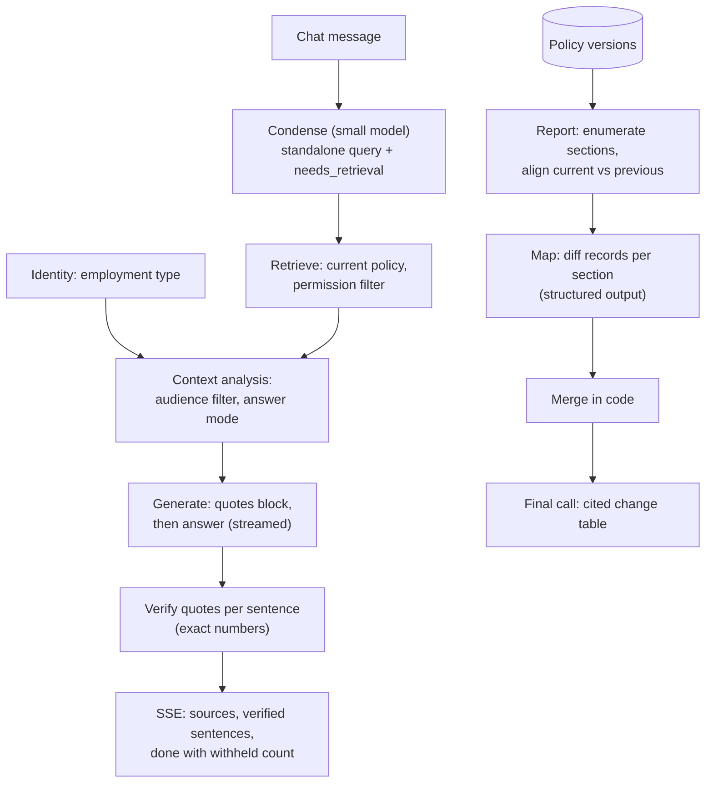

This assessment covers the whole of [Generation Strategies](/learn/generation-strategies): basic RAG, context-aware generation, citation-based generation, multi-document synthesis, structured outputs, JSON generation, streaming responses and multi-turn RAG. Answer the 18 multiple-choice questions first; 13 or more correct (about 70 per cent) is a pass. Then work through the conceptual questions, the coding exercises, the architecture challenge and the troubleshooting scenarios before opening the model answers. The coding solutions were run with Python 3 and Pydantic 2; their outputs are shown beneath them.

```quiz
[
  {
    "q": "Which description best fits basic RAG as practised today?",
    "options": [
      "A retriever and generator trained jointly, with the answer probability summed over passages",
      "One retrieval, one prompt containing the top-k chunks, and one model call",
      "An agent that searches repeatedly until it is confident",
      "A fine-tuned model with no retrieval"
    ],
    "answer": 1,
    "why": "Basic RAG is defined by its shape: retrieve once, stuff the top-k chunks into one prompt, generate once."
  },
  {
    "q": "In RAG-Sequence, two passages have retriever probabilities 0.75 and 0.25, and the generator gives the answer probability 0.8 with the first and 0.2 with the second. What is p(y|x)?",
    "options": [
      "0.50",
      "0.80",
      "0.65",
      "1.00"
    ],
    "answer": 2,
    "why": "0.75 x 0.8 + 0.25 x 0.2 = 0.6 + 0.05 = 0.65."
  },
  {
    "q": "A wrong answer's log shows the needed chunk at rank 2 with k = 5, alongside a superseded version of the same policy at rank 1. What kind of failure is this?",
    "options": [
      "A distractor effect",
      "A retrieval miss",
      "A tokenisation error",
      "A streaming failure"
    ],
    "answer": 0,
    "why": "The evidence was in the prompt; a competing source pulled the answer away. Fix it with selection, metadata or annotation."
  },
  {
    "q": "The home-office budget chunk applies to employees and the user's role is unknown. Both the budget chunk and the contractor-exclusion chunk are retrieved. Which answer mode fits best?",
    "options": [
      "Answer with £400",
      "Refuse",
      "Answer with a conflict note",
      "Ask a short clarifying question"
    ],
    "answer": 3,
    "why": "The correct answer depends on an attribute the system does not know, and the sources split by audience."
  },
  {
    "q": "Which piece of context should be applied as a retrieval filter rather than an annotation?",
    "options": [
      "A document's effective date",
      "Whether the user is allowed to read the document",
      "Whether a document is an FAQ or a policy",
      "Whether a document is superseded"
    ],
    "answer": 1,
    "why": "Permissions must stop a document reaching the prompt at all; the others help the model weigh documents and can be annotations."
  },
  {
    "q": "A model-produced quote scores 0.97 against the best window of its source, but it says '60 days' where the source says '90 days'. A correct citation pipeline should:",
    "options": [
      "Reject it as a number mismatch",
      "Accept it because the ratio exceeds 0.9",
      "Accept it and correct the number",
      "Search another source for '60 days' and cite that"
    ],
    "answer": 0,
    "why": "Fuzzy matching is for wording. Numbers, dates and codes must agree exactly."
  },
  {
    "q": "Why is embedding similarity unsafe for post-hoc attribution of claims?",
    "options": [
      "Embeddings are too slow",
      "It measures topic, so a false claim about the right subject can score highly against the passage it contradicts",
      "It cannot compare sentences",
      "It only works in English"
    ],
    "answer": 1,
    "why": "In the citation lesson, the false 12-month carry-over claim scored 0.744 against the carry-over sentence."
  },
  {
    "q": "What does `difflib.SequenceMatcher(None, 'abcd', 'abed').ratio()` return?",
    "options": [
      "0.5",
      "0.875",
      "1.0",
      "0.75"
    ],
    "answer": 3,
    "why": "Matching blocks 'ab' and 'd' give M = 3; T = 8; ratio = 2 x 3 / 8 = 0.75."
  },
  {
    "q": "Map-reduce over N = 30 documents with fan-in b = 4. How many sequential levels of calls (depth) are there?",
    "options": [
      "3",
      "30",
      "4",
      "8"
    ],
    "answer": 2,
    "why": "Reduce levels: 30 -> 8 -> 2 -> 1, so L = 3; plus the map level gives depth 4."
  },
  {
    "q": "Why should the map step of map-reduce extract facts with source ids rather than summarise each document?",
    "options": [
      "Provenance survives every level, and merging extracted facts does not compound rewording errors",
      "Summaries are always longer",
      "Extraction needs no model",
      "Summaries cannot be parallelised"
    ],
    "answer": 0,
    "why": "Labelled facts remain citable after any number of reduce levels."
  },
  {
    "q": "Which rule can constrained decoding enforce during generation?",
    "options": [
      "A refusal must contain no claims",
      "Every number in a claim appears in its source",
      "The status field is one of answered, partial or refused",
      "The answer is factually correct"
    ],
    "answer": 2,
    "why": "Enums, types and required fields compile to a grammar; cross-field rules and truth need checks after decoding."
  },
  {
    "q": "At one decoding step, allowed tokens have probabilities 0.2 and 0.05 and everything else is forbidden. What is the constrained probability of the first token?",
    "options": [
      "0.2",
      "0.25",
      "0.5",
      "0.8"
    ],
    "answer": 3,
    "why": "Renormalise over the allowed mass: 0.2 / 0.25 = 0.8."
  },
  {
    "q": "What does this print?\n```python\nimport re\ns = 'Text before [{\"a\": 1}] and after'\nprint(re.search(r'\\{.*\\}', s).group())\n```",
    "options": [
      "{\"a\": 1}",
      "[{\"a\": 1}]",
      "Text before",
      "None"
    ],
    "answer": 0,
    "why": "The pattern finds the braces of the object only. It works here, but greedy, string-unaware patterns fail when there are two objects or braces inside strings."
  },
  {
    "q": "An extraction response is cut off at max_tokens in the middle of record 31 of a JSON array. What is the best response?",
    "options": [
      "Close the open string and brackets and store the result",
      "Retry the identical request",
      "Use smaller batches or JSON Lines, and check stop_reason before parsing",
      "Translate it to Python and evaluate it"
    ],
    "answer": 2,
    "why": "Completing truncated data invents values, and an unchanged retry truncates again."
  },
  {
    "q": "In a streamed response, which provider event carries the stop_reason?",
    "options": [
      "content_block_start",
      "message_delta",
      "ping",
      "content_block_delta"
    ],
    "answer": 1,
    "why": "message_delta carries top-level changes, including stop_reason and the cumulative output token count."
  },
  {
    "q": "Retrieval takes 0.2 s, time to first token is 0.8 s, output rate is 40 tokens/s and the answer is 200 tokens. When does a streaming user first see text, and when is the answer complete?",
    "options": [
      "1.0 s and 6.0 s",
      "0.8 s and 5.0 s",
      "6.0 s and 6.0 s",
      "1.0 s and 5.0 s"
    ],
    "answer": 0,
    "why": "First text at 0.2 + 0.8 = 1.0 s; total 1.0 + 200/40 = 6.0 s."
  },
  {
    "q": "Which query should be embedded for the follow-up 'What about contractors?' after a turn about the home-office budget?",
    "options": [
      "'What about contractors?'",
      "The full conversation concatenated",
      "The previous answer",
      "'Are contractors eligible for the home-office equipment budget?'"
    ],
    "answer": 3,
    "why": "A standalone rewrite resolves the reference; the raw follow-up retrieved a procurement document first in the lesson's run."
  },
  {
    "q": "Why must [S1]-style markers be stripped from earlier answers before they are replayed as history?",
    "options": [
      "They waste many tokens",
      "Labels are numbered per turn, so old markers would point at a different source in the new turn",
      "The API rejects them",
      "They break streaming"
    ],
    "answer": 1,
    "why": "Store resolved document ids separately; per-turn labels are meaningless outside their turn."
  }
]
```

## Conceptual questions

**1.** Explain the three-step diagnosis for a wrong basic RAG answer, and why the order matters.

<details><summary>Show model answer</summary>

First ask whether the needed chunk was in the prompt at all. If not, it is a **retrieval miss**, and only retrieval changes (reranking, hybrid search, a larger candidate set, better chunking) can fix it. Second, if it was present, ask whether another chunk contradicted or distracted from it: a **distractor effect**, fixed by selection (relevance floors, metadata filters, de-duplication, annotation of superseded sources). Third, if the evidence was present and uncontested and the answer is still wrong, it is a **generation failure**: prompt, model or post-generation checks. The order matters because each check is cheaper than the next (the first needs only logged chunk ids and a labelled answer key; the last needs someone to read the answer against the sources), and because fixing the wrong stage adds risk without addressing the cause.

</details>

**2.** Compare quote-first citation with provider-native citations. What does each guarantee, and what gap remains in both?

<details><summary>Show model answer</summary>

Quote-first asks the model to copy the exact passages it relies on, tagged with source labels, and then cite those quotes. Code verifies each quote against its named source (exact, or fuzzy for wording with exact numbers), so a fabricated or misattributed quote is detected mechanically. Native citations move this into the API: the provider returns the cited text and its location within a supplied document, guaranteeing that the cited span exists, with no verification step needed. The gap in both is between the evidence and the claim: a correctly quoted or cited span can still be summarised wrongly ("right quote, wrong conclusion"). Closing it needs an entailment check (an NLI model or LLM judge) or human sampling, plus exact checks on numbers in the claim text.

</details>

**3.** When would you choose refine over map-reduce for multi-document synthesis, and what does it cost?

<details><summary>Show model answer</summary>

Refine suits small, ordered sets where the answer should evolve as documents are read, such as building a timeline or a narrative where later documents modify earlier conclusions, and where latency is not critical. Its cost is sequential depth equal to the number of documents (latency grows linearly), more total input tokens because the growing answer is re-read on every call, and the risk that an early mistake is carried through every later step. Map-reduce has logarithmic depth and parallel map calls, which makes it the default for large sets of independently extractable facts.

</details>

**4.** A colleague says: "We now use native structured outputs, so we can remove all our validation code." Respond.

<details><summary>Show model answer</summary>

Structured outputs guarantee shape for the parts of the schema the provider can enforce: types, required fields, enums, nesting. They do not guarantee cross-field rules (a refusal has no claims), constraints the provider does not enforce during decoding (some ranges and lengths, which the SDK may move into descriptions and validate afterwards), truth (claims supported by sources), business rules (values that are valid for the action you will take), or completeness when `max_tokens` cuts the response. Keep a Pydantic validation step for cross-field and business rules, check `stop_reason`, keep the citation and number checks for support, and escape string fields before rendering.

</details>

**5.** In a multi-turn conversation, what goes into the generation prompt from earlier turns, and what does not? Justify each choice.

<details><summary>Show model answer</summary>

In: recent whole exchanges (user message and answer pairs) for coherence, with citation markers removed because labels were per turn, within a token budget; optionally a stored summary of older exchanges so that facts established early survive. Out: earlier turns' retrieved sources, because they inflate input by thousands of tokens per turn and act as stale distractors (the current turn retrieves what it needs with a standalone query); the standalone query itself, because the generator should answer what the user actually wrote; and any user claims about identity or permissions as authority, because those must come from authentication.

</details>

## Coding exercises

**1. A streaming buffer that never splits a citation.** Write a generator `safe_deltas(pieces)` that takes text pieces from a stream and yields pieces of text such that no yielded piece ends inside a citation marker of the form `[S` followed by digits and `]`. Ordinary square brackets, such as `[Settings > VPN]`, must not be held back longer than necessary. Test it on a text cut into five-character pieces and confirm that the output rejoins to the original.

<details><summary>Show solution</summary>

```python
import re

PARTIAL = re.compile(r"\[S?\d*$")        # a suffix that could still become [S12]


def safe_deltas(pieces):
    buffer = ""
    for piece in pieces:
        buffer += piece
        m = PARTIAL.search(buffer)
        cut = m.start() if m else len(buffer)
        if cut:
            yield buffer[:cut]
            buffer = buffer[cut:]
    if buffer:
        yield buffer


text = "Use the menu [Settings > VPN] to reinstall it [S2]. Certificates expire [S12]."
pieces = [text[i:i + 5] for i in range(0, len(text), 5)]
out = list(safe_deltas(pieces))
print(out)
print("rejoined correctly:", "".join(out) == text)
print("no delta ends inside a marker:", not any(re.search(r"\[S\d*$", d) for d in out[:-1]))
```

```output
['Use t', 'he me', 'nu ', '[Settin', 'gs > ', 'VPN] ', 'to re', 'insta', 'll it', ' [S2]', '. Cer', 'tific', 'ates ', 'expir', 'e ', '[S12].']
rejoined correctly: True
no delta ends inside a marker: True
```

`PARTIAL` matches only a suffix that could still become a marker: `[`, `[S` or `[S` plus digits. `[Settin` is released immediately, because `[Se` can no longer be a citation, while ` [S2]` and `[S12].` are released only once complete. Holding the whole tail after any `[`, the simpler rule, would delay everything after an ordinary bracket until it closed.

</details>

**2. A per-request citation schema.** Write `build_schema(labels)` returning a Pydantic model for `{"status": ..., "claims": [{"text": ..., "sources": [...]}]}` in which `status` is one of `answered`, `partial` or `refused`, each claim cites at least one source, and sources can only be labels in `labels`. Validate a correct answer, one citing `S4` when only `S1` to `S3` were supplied, and one with an invalid status.

<details><summary>Show solution</summary>

```python
from typing import Literal
from pydantic import BaseModel, Field, ValidationError, create_model


def build_schema(labels):
    Label = Literal[tuple(labels)]
    Claim = create_model("Claim", text=(str, ...), sources=(list[Label], Field(min_length=1)))
    return create_model("Answer", status=(Literal["answered", "partial", "refused"], ...),
                        claims=(list[Claim], ...))


Answer = build_schema(["S1", "S2", "S3"])
tests = [
    '{"status": "answered", "claims": [{"text": "Laptops are refreshed every 3 years.", "sources": ["S3"]}]}',
    '{"status": "answered", "claims": [{"text": "Laptops are refreshed every 3 years.", "sources": ["S4"]}]}',
    '{"status": "unsure", "claims": []}',
]
for raw in tests:
    try:
        a = Answer.model_validate_json(raw)
        print("valid:", a.status, [c.sources for c in a.claims])
    except ValidationError as e:
        print("invalid:", [(".".join(map(str, err["loc"])), err["type"]) for err in e.errors()])
```

```output
valid: answered [['S3']]
invalid: [('claims.0.sources.0', 'literal_error')]
invalid: [('status', 'literal_error')]
```

`Literal[tuple(labels)]` builds the enum at run time, so the same code produces a schema matching each request's sources; in its JSON schema the field becomes an `enum`, which a constrained decoder enforces. The error locations (`claims.0.sources.0`) are precise enough to send back to a model on a retry.

</details>

**3. Choosing a synthesis strategy.** Write `plan(N, b)` that returns `"stuff"` with one call when $N$ documents of 1,000 tokens fit a 50,000-token budget, and otherwise `"map-reduce"` with its total calls, depth and estimated time at 3 seconds per call. Run it for 12, 60 and 300 documents with $b = 5$.

<details><summary>Show solution</summary>

```python
import math


def plan(N, b, t=3.0, budget_tokens=50_000, doc_tokens=1_000):
    """Pick stuff if it fits the budget, else map-reduce; return calls, depth and estimated seconds."""
    if N * doc_tokens <= budget_tokens:
        return "stuff", 1, 1, t
    calls, n, levels = N, N, 0
    while n > 1:
        n = math.ceil(n / b)
        calls += n
        levels += 1
    return "map-reduce", calls, 1 + levels, t * (1 + levels)


for N in (12, 60, 300):
    print(N, plan(N, b=5))
```

```output
12 ('stuff', 1, 1, 3.0)
60 ('map-reduce', 76, 4, 12.0)
300 ('map-reduce', 376, 5, 15.0)
```

For 60 documents: map 60, then reduce levels of 12, 3 and 1 calls, 76 calls in all with depth 4. For 300: 60, 12, 3 and 1 reduce calls, 376 in all with depth 5. Depth grows by one level each time $N$ grows by a factor of $b$, which is why 300 documents take only 3 seconds longer than 60 under unlimited parallelism; in practice a concurrency limit on map calls adds to this.

</details>

## Architecture design challenge

Meridian's Finance team wants an assistant inside its expenses tool. Staff ask questions in a chat panel ("can I claim a taxi home after 22:00?", "and if I'm a contractor?"). Every answer must show, for each claim, the exact sentence of the expenses policy it rests on. The panel must show text within about a second. Finance also wants a monthly report: "every rule in the expenses policy that changed since last month", generated from the policy documents. The policy exists in a current version and several superseded versions; some rules differ for contractors.

Design the generation side: the strategies used for chat and for the report, how citations are produced and verified, how streaming and verification coexist, how conversation is handled, and what structured output is used where. Draw the architecture and state the main trade-offs.

<details><summary>Show reference design</summary>

**Chat route.**

1. **Condense** each follow-up with a small, fast model into a standalone query and a `needs_retrieval` flag (structured output). Skip on the first turn.
2. **Retrieve** from the current policy version only, filtered by permissions; superseded versions are retrieved only for questions that mention change or history, and are annotated `status="superseded"` when present.
3. **Context**: a `request_context` block with today's date and the user's employment type from the identity provider, so contractor-specific rules are filtered or the assistant asks when the type is unknown.
4. **Generate** with quote-first citations (or native citations if the team accepts provider lock-in), streaming the answer.
5. **Verify** each quote against its own source as soon as its quotes block completes; numbers must match exactly.
6. **Stream** with sentence-level release: sources first, then each answer sentence only after the quotes it cites have verified. A sentence citing a failed quote is withheld and the `done` event reports it.

**Report route.** Enumerate all policy sections in the current and previous month's versions by metadata; align by section id; run a map step per section pair that extracts differing values as structured records (`rule`, `old`, `new`, both section ids), with an empty list for unchanged sections; merge in code; one final call writes the report as a table, citing both versions. No streaming is needed; it runs as a scheduled job.



**Trade-offs.**

- Sentence-level release adds roughly a sentence of delay (plus the quotes block before the first sentence) in exchange for never showing an unverified claim; Finance's audit requirement justifies it. Time to first text can be protected by sending sources and a status immediately.
- Quote-first raises output tokens per answer; native citations remove quote verification but tie the system to one provider's document format.
- The condense call adds latency to follow-ups only; a small model keeps it short.
- Doing the report's merge in code rather than with a reducer model prevents silent dropping of conflicting values, at the cost of requiring structured map outputs.
- Excluding superseded versions from default chat retrieval removes most distractor effects, but questions about changes need an explicit route that includes them, annotated.

</details>

## Troubleshooting scenarios

**1. Citations point at the wrong documents after a few turns.** Users report that in longer conversations, footnote links sometimes open a document that does not mention the cited fact. First turns are never affected. The citation validator reports no unknown labels.

<details><summary>Show diagnosis and fix</summary>

The labels exist (so the existence check passes) but refer to the wrong sources: earlier answers are being replayed into history with their `[S1]`-style markers, and the model copies a marker from an earlier answer into a new one, where `S1` now names a different chunk. Fix: strip citation markers from replayed assistant messages and store the resolved document ids in a separate field; optionally make labels unique per turn. Add a regression test with a multi-turn conversation whose second answer restates a first-turn fact, and check that its citation resolves to the right document.

</details>

**2. Streamed answers appear all at once in production.** Locally, text arrives within half a second. In production, users see a long pause and then the whole answer. Server logs show the model stream starting promptly.

<details><summary>Show diagnosis and fix</summary>

Something between the service and the browser is buffering the response: typically a reverse proxy or ingress with response buffering enabled, or compression middleware wrapping the `text/event-stream` response. Confirm by measuring time to first byte at the client against the server's first-delta timestamp. Fix: disable proxy buffering for the streaming route (for nginx-based proxies, the `X-Accel-Buffering: no` response header or the equivalent configuration), exclude `text/event-stream` from compression, send `Cache-Control: no-cache`, and add a deployment test that asserts the first delta event arrives well before `done` through the real network path.

</details>

**3. The weekly error-code extraction job loses whole pages.** About one runbook page in ten yields no records. The job logs `json.decoder.JSONDecodeError` for each.

<details><summary>Show diagnosis and fix</summary>

Classify the raw outputs before changing anything. Likely causes: long pages producing outputs truncated at `max_tokens` (check `stop_reason`), responses wrapped in prose or code fences, and occasional trailing commas. Fix in layers: check `stop_reason` and treat truncation by splitting the page into smaller batches or switching to JSON Lines so a cut-off costs one record; locate the JSON with a string-aware scanner instead of calling `json.loads` on the whole text; repair only trailing commas; validate with Pydantic and retry once with the exact error; prefer native structured output if the model supports it. Log the failure class for each page so the remaining failures can be counted by cause.

</details>
