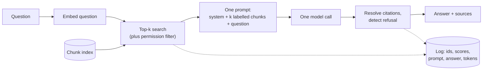

**Basic RAG** is the simplest complete generation strategy: retrieve the top $k$ chunks for the question, place all of them in one prompt, and make one model call. It is sometimes called *retrieve-then-read* or the *stuff* strategy, because everything retrieved is stuffed into a single context. Almost every production RAG system began life as this, and many still are this with careful engineering around it.

This lesson treats basic RAG as a generation strategy in its own right: what it assumes, how it relates to the original RAG formulation, which knobs it exposes, and how to tell whether a bad answer is its fault or retrieval's. Every later lesson in this module relaxes one of its assumptions, so knowing exactly where it stops working tells you when to reach for each of them.

## Learning objectives

- Implement a basic RAG loop (embed, retrieve top-$k$, build one prompt, generate, resolve citations) with a pluggable generator.
- State the five assumptions basic RAG makes and name the failure that follows when each is violated.
- Compute the RAG-Sequence marginal probability for a small example and explain how in-context stuffing differs from it.
- Measure how coverage, the share of useful chunks and prompt size change with $k$, and choose $k$ from that measurement.
- Diagnose a wrong answer as a retrieval miss, a distractor effect or a generation failure from logged evidence.

## Prerequisites

- [Generation pipeline](/learn/rag-architecture-fundamentals/generation-pipeline): the four stages around the model call.
- [Response generation](/learn/rag-architecture-fundamentals/response-generation): the grounded-answer contract and the citation validator.
- [Context injection](/learn/prompt-engineering-for-rag/context-injection): how sources are serialised and escaped in the user turn.
- [Top-K retrieval](/learn/retrieval-fundamentals/top-k-retrieval): what $k$ controls on the retrieval side.

## Why this matters

Every more elaborate strategy in this module adds latency, cost and code. You can only justify that addition by comparing against a baseline, and basic RAG is the baseline. Teams that skip it tend to build an agentic, multi-step system, find that it answers 80 questions in 100 correctly, and have no idea whether a single well-tuned retrieval call would have answered 85.

Basic RAG also fails in a small number of recognisable ways: the right chunk was never retrieved, it was retrieved but other chunks misled the model, or the model had everything it needed and still answered badly. These need entirely different fixes, and the only way to tell them apart is to log what basic RAG put in the prompt.

## The intuition

Imagine a reference librarian and a researcher working together on a quick question. The librarian hears the question, walks to the shelves, and comes back with exactly three pages: the three that looked most relevant at a glance. She does not read them carefully. The researcher receives the three pages and the question together, reads all three at once, and writes a short answer, noting which page each fact came from.

That is the whole strategy. Notice what it takes for granted. The answer must be on one of the three pages; if it is on the fourth, the researcher never sees it. The three pages must fit on the desk together. The question must make sense on its own; if the researcher asked "and what about contractors?", the librarian would have no idea what "and" referred to. And the pages must agree with each other; if one says three years and another four, the researcher needs to know which is current.

When all of that holds, the arrangement is fast and cheap. When any of it fails, the fix is to change the arrangement rather than to ask the researcher to try harder.

## How it works

### The loop

1. **Embed the question** with the same model used to embed the chunks at indexing time.
2. **Retrieve the top $k$ chunks** by similarity, optionally after a metadata filter (for example, the user's permissions).
3. **Build one prompt**: the static system prompt, then the $k$ chunks, each labelled and delimited, then the question.
4. **Call the model once** and collect its text.
5. **Post-process**: resolve citation labels to real chunk identifiers, detect a refusal, run cheap checks.
6. **Log** the question, the retrieved chunk identifiers with their scores, the exact prompt, the answer and the token usage.



Steps 3 and 5 were developed in [Context injection](/learn/prompt-engineering-for-rag/context-injection) and [Response generation](/learn/rag-architecture-fundamentals/response-generation). What makes this *basic* is the shape: one retrieval, one prompt, one call, with no loop back.

### Where basic RAG came from

The term RAG comes from Lewis and colleagues (2020), and their system was not quite this. They trained a retriever (DPR) and a sequence-to-sequence generator (BART) together. The generator read **one retrieved passage at a time**, and the final answer probability was a weighted sum over the passages, weighted by how relevant the retriever thought each one was. That weighted sum is the subject of the mathematics section.

What most people now call basic RAG is a simpler arrangement, sometimes called **in-context retrieval augmentation** (Ram and colleagues, 2023, studied it under the name In-Context RALM): a retriever and a language model, each used as-is with no joint training, connected only by text. The retrieved passages are concatenated into the prompt and the model reads them all at once. Any capable model works, nothing is trained, and the model can combine facts from several passages in one sentence; the cost is that its attention is spread across everything you stuffed in, relevant or not.

### The knobs

Basic RAG has few settings, and each one trades something.

| Knob | Raising it | Lowering it |
| --- | --- | --- |
| $k$ (chunks in the prompt) | More questions have their evidence present; more distractors; more tokens | Fewer tokens and distractors; more retrieval misses |
| Chunk size | Each chunk carries more context; fewer fit in the same budget | More precise matches; facts may be split across chunks |
| Relevance floor (minimum score) | Fewer weak chunks reach the model; more questions get "no context" | More recall; weak chunks dilute the context |
| `max_tokens` (output cap) | Long answers complete | Answers cut off; check `stop_reason` |

Sampling temperature is not a knob here: current Claude models do not accept `temperature`, `top_p` or `top_k`, and grounding, instructions and checks do the work of factual stability.

The most consequential knob is $k$: raising it improves **coverage** (the share of questions whose needed chunks are all in the prompt) and lowers the **useful share** (the fraction of prompt chunks that help).

### The five assumptions

Basic RAG works when five things are true. Each failure points to a later lesson.

| Assumption | When it fails | Where it is addressed |
| --- | --- | --- |
| The evidence is in the top $k$ | The answer is never seen; the model refuses or guesses | [Reranking](/learn/reranking-fundamentals), [hybrid search](/learn/hybrid-search) |
| The top $k$ fits comfortably in one prompt | Questions needing many documents (summaries, comparisons) are truncated | [Multi-document synthesis](/learn/generation-strategies/multi-document-synthesis) |
| The question is self-contained | Follow-ups such as "what about contractors?" retrieve the wrong chunks | [Multi-turn RAG](/learn/generation-strategies/multi-turn-rag) |
| The sources agree and are current | The model mixes superseded and current policy | [Context-aware generation](/learn/generation-strategies/context-aware-generation) |
| Free text is an acceptable output | Downstream code cannot rely on the answer's shape | [Structured outputs](/learn/generation-strategies/structured-outputs) |

### Diagnosing a bad answer

Given a logged request that produced a wrong answer, three questions in order locate the fault.

1. **Was the needed chunk in the prompt?** If not, it is a **retrieval miss**. No prompt change will fix it. Look at where the chunk ranked; if it was at rank $k+1$, raising $k$ or reranking may fix it; if it was at rank 40, the query and the chunk do not match and you need a retrieval change.
2. **Was it there, but alongside a chunk that contradicts or distracts?** That is a **distractor effect**. A superseded policy, a similar product's documentation, or a chunk that shares the question's words but not its subject can pull the answer away. Fixes are on the selection side: a relevance floor, reranking, metadata filters, de-duplication.
3. **Was it there, uncontested, and the model still got it wrong?** That is a **generation failure**: the model ignored, misread or embellished the evidence. Fixes are on the prompt, the model choice or post-generation checks.

> [!KEY]
> Basic RAG cannot answer from evidence it never saw. Before blaming the model for a wrong answer, check whether the right chunk was in the prompt. In most young systems, retrieval misses outnumber generation failures.

```playground
rag-pipeline
```

## The mathematics

### RAG-Sequence marginalisation

**Intuition.** If you are not sure which passage holds the answer, you can ask the generator to answer once per passage, then trust each answer in proportion to how relevant the passage looked. Lewis and colleagues' RAG-Sequence model does exactly this, as a probability.

$$
p(y \mid x) \approx \sum_{z \in \text{top-}k(x)} p_\eta(z \mid x)\; p_\theta(y \mid x, z),
\qquad
p_\eta(z \mid x) = \frac{\exp\big(s(x, z)\big)}{\sum_{z' \in \text{top-}k(x)} \exp\big(s(x, z')\big)}
$$

- $x$ is the question and $y$ is a candidate answer.
- $z$ is one retrieved passage; $\text{top-}k(x)$ is the set of $k$ passages the retriever returned.
- $s(x, z)$ is the retriever's score, in the original work the inner product of the question and passage embeddings.
- $p_\eta(z \mid x)$ is the retriever's probability for passage $z$: a softmax of the scores over the retrieved set, with retriever parameters $\eta$.
- $p_\theta(y \mid x, z)$ is the generator's probability of answer $y$ given the question and **that one passage**, with generator parameters $\theta$. In the full model this is a product of per-token probabilities.

The sum is approximate because only the top $k$ passages are included, not the whole corpus.

**By hand.** Two passages are retrieved with scores $s_1 = 0.8$ and $s_2 = 0.4$. The generator, reading passage 1 alone, gives the answer "25 days" probability $0.9$; reading passage 2 alone, $0.1$.

- $e^{0.8} = 2.2255$, $e^{0.4} = 1.4918$, sum $= 3.7174$.
- $p_\eta(z_1 \mid x) = 2.2255 / 3.7174 = 0.5987$; $p_\eta(z_2 \mid x) = 0.4013$.
- $p(y \mid x) = 0.5987 \times 0.9 + 0.4013 \times 0.1 = 0.5388 + 0.0401 = 0.5790$.

Because the scores were close, the weak passage pulls the probability down from 0.9 to 0.58. Scaling both scores by 10 sharpens the softmax to weights of about 0.98 and 0.02, and $p(y \mid x) \approx 0.886$.

```python
import numpy as np

scores = np.array([0.8, 0.4])            # retriever scores s(x, z)
p_gen = np.array([0.9, 0.1])             # p(y | x, z) for each passage alone

def rag_sequence(scores, p_gen):
    w = np.exp(scores - scores.max())    # subtract the max for numerical stability
    w = w / w.sum()                      # p(z | x): softmax over the retrieved set
    return w, float(w @ p_gen)

for scale in (1, 10):
    w, p = rag_sequence(scores * scale, p_gen)
    print(f"scale {scale:>2}: p(z|x) = {w.round(4)}, p(y|x) = {p:.4f}")
```

```output
scale  1: p(z|x) = [0.5987 0.4013], p(y|x) = 0.5790
scale 10: p(z|x) = [0.982 0.018], p(y|x) = 0.8856
```

### What stuffing does instead

Basic RAG as practised today does not marginalise. It computes $p_\theta(y \mid x, z_1 \oplus z_2 \oplus \dots \oplus z_k)$, where $\oplus$ means concatenation: one generation conditioned on every passage at once. There is no explicit weight per passage. Whatever weighting happens is done implicitly by the model's attention, which is why order, labelling and distractors matter so much in practice (the subject of [Context engineering](/learn/context-engineering)). The two consequences worth remembering are that a single answer can combine facts from several passages, and that a distracting passage cannot be "outvoted" by a formula: it is in the prompt, and the model may use it.

## In code

**The problem.** Build a complete basic RAG loop over a small Meridian corpus, with real local embeddings and a pluggable generator, so that the retrieval, the exact prompt and the citations can be inspected; then measure how the choice of $k$ changes coverage and prompt size.

**Dependencies.** sentence-transformers (which installs PyTorch and downloads the 384-dimensional `all-MiniLM-L6-v2` model on first use), NumPy and tiktoken for token counting.

```bash
pip install sentence-transformers numpy tiktoken
```

The generator is a parameter. For tests and for this lesson it is `fake_llm`, a deterministic stand-in that copies the source sentence sharing the most words with the question (at least two) and cites it, or refuses. It is not a model of how an LLM behaves; it exists so that every other stage runs and can be tested without a key. The real generator follows after the output.

```python
import html
import re
import numpy as np
from sentence_transformers import SentenceTransformer

CORPUS = [
    {"id": "handbook-leave-1", "title": "Employee Handbook > Annual leave",
     "text": "Annual leave is 25 days per year. Up to 5 unused days carry over and must be used by 31 March."},
    {"id": "handbook-remote-1", "title": "Employee Handbook > Remote work",
     "text": "Staff may work remotely up to 3 days a week. The home-office equipment budget is £400."},
    {"id": "handbook-remote-2", "title": "Employee Handbook > Remote work",
     "text": "Contractors are not eligible for the home-office equipment budget."},
    {"id": "handbook-expenses-1", "title": "Employee Handbook > Expenses",
     "text": "Expenses must be submitted within 30 days. Anything over £75 needs a receipt."},
    {"id": "runbook-security-1", "title": "IT Runbook > Accounts",
     "text": "Passwords must be rotated every 90 days. VPN is required on public Wi-Fi."},
    {"id": "runbook-laptops-1", "title": "IT Runbook > Laptops",
     "text": "Laptops are refreshed every 3 years. Lost laptops must be reported to the support desk at once."},
    {"id": "runbook-support-1", "title": "IT Runbook > Support desk",
     "text": "The support desk is open 08:00 to 18:00 UK time."},
]

model = SentenceTransformer("sentence-transformers/all-MiniLM-L6-v2")
doc_vectors = model.encode([c["text"] for c in CORPUS], normalize_embeddings=True)


def retrieve(question: str, k: int = 3) -> list[dict]:
    """Return the k chunks whose embeddings are closest to the question's."""
    q = model.encode([question], normalize_embeddings=True)[0]
    scores = doc_vectors @ q                      # unit vectors: dot product = cosine
    order = np.argsort(-scores)[:k]
    return [dict(CORPUS[i], score=float(scores[i])) for i in order]


SYSTEM = (
    "You are AskMeridian. Answer only from the sources in <sources>. "
    "Cite the source id after each sentence, like [S1]. If the sources do not "
    "contain the answer, reply exactly: I don't know based on the provided sources."
)


def build_prompt(question: str, hits: list[dict]) -> tuple[str, dict]:
    """Stuff every retrieved chunk into one user message; return it and the label map."""
    labels, blocks = {}, []
    for n, hit in enumerate(hits, start=1):
        label = f"S{n}"
        labels[label] = hit["id"]
        title, text = html.escape(hit["title"]), html.escape(hit["text"])
        blocks.append(f'<source id="{label}" title="{title}">\n{text}\n</source>')
    prompt = "<sources>\n" + "\n".join(blocks) + "\n</sources>\n\n<question>" + html.escape(question) + "</question>"
    return prompt, labels


def fake_llm(system: str, prompt: str) -> str:
    """A stand-in for the model, for tests: copy the source sentence that best overlaps the question."""
    question = re.search(r"<question>(.*)</question>", prompt).group(1)
    q_words = set(re.findall(r"[a-z0-9£]+", question.lower())) - {"the", "a", "is", "are", "do", "i", "how", "what", "my", "to", "of", "for", "when", "many", "much", "be", "must", "can"}
    best, best_overlap = None, 0
    for label, body in re.findall(r'<source id="(S\d+)"[^>]*>\n(.*?)\n</source>', prompt, re.S):
        for sentence in re.split(r"(?<=\.)\s+", body):
            overlap = len(q_words & set(re.findall(r"[a-z0-9£]+", sentence.lower())))
            if overlap >= 2 and overlap > best_overlap:
                best, best_overlap = f"{sentence[:-1]} [{label}].", overlap
    return best or "I don't know based on the provided sources."


def answer(question: str, k: int = 3, llm=fake_llm) -> dict:
    hits = retrieve(question, k)
    prompt, labels = build_prompt(question, hits)
    text = llm(SYSTEM, prompt)
    cited = re.findall(r"\[(S\d+)\]", text)
    return {"answer": text, "sources": [labels[c] for c in cited if c in labels], "hits": hits, "prompt": prompt}


if __name__ == "__main__":
    result = answer("How many days of annual leave do I get?")
    print(result["prompt"])
    print()
    for h in result["hits"]:
        print(f"  {h['score']:.3f}  {h['id']}")
    print("\nANSWER:", result["answer"])
    print("SOURCES:", result["sources"])

    print()
    for q in ["What is the home-office budget for contractors?", "Can I bring my dog to the office?"]:
        r = answer(q)
        print(q)
        print("  retrieved:", [(h["id"], round(h["score"], 3)) for h in r["hits"]])
        print("  answer:   ", r["answer"])
```

```output
<sources>
<source id="S1" title="Employee Handbook &gt; Annual leave">
Annual leave is 25 days per year. Up to 5 unused days carry over and must be used by 31 March.
</source>
<source id="S2" title="Employee Handbook &gt; Remote work">
Staff may work remotely up to 3 days a week. The home-office equipment budget is £400.
</source>
<source id="S3" title="Employee Handbook &gt; Expenses">
Expenses must be submitted within 30 days. Anything over £75 needs a receipt.
</source>
</sources>

<question>How many days of annual leave do I get?</question>

  0.797  handbook-leave-1
  0.353  handbook-remote-1
  0.333  handbook-expenses-1

ANSWER: Annual leave is 25 days per year [S1].
SOURCES: ['handbook-leave-1']

What is the home-office budget for contractors?
  retrieved: [('handbook-remote-2', 0.568), ('handbook-remote-1', 0.509), ('handbook-expenses-1', 0.278)]
  answer:    Contractors are not eligible for the home-office equipment budget [S1].
Can I bring my dog to the office?
  retrieved: [('handbook-remote-1', 0.272), ('handbook-remote-2', 0.257), ('handbook-expenses-1', 0.2)]
  answer:    I don't know based on the provided sources.
```

**The important lines.**

- `normalize_embeddings=True` on both sides makes every vector unit length, so `doc_vectors @ q` is the cosine similarity. Encoding the question with a different model, or without normalisation, would silently corrupt the ranking.
- `build_prompt` returns the label map along with the prompt. `S1` exists only for this request; the map is what turns it back into `handbook-leave-1`. Losing the map is the most common reason citations end up pointing at the wrong document.
- `html.escape` is applied to titles, text and the question; the `>` in each title would otherwise break the block structure.
- `answer(..., llm=fake_llm)` takes the generator as a parameter. Production passes the real model; tests pass a fake, so retrieval, prompt building and citation resolution can be tested deterministically.

**What the output means.** For the leave question the right chunk scores 0.797 and is cited; the other two are in the prompt only because $k = 3$, as distractors. For the contractor question both remote-work chunks reach the prompt, so a real model can combine them. For the dog question nothing is relevant, yet three chunks still arrive with scores of 0.20 to 0.27. Basic RAG always retrieves *something*; whether the system refuses depends on the generator obeying its instructions, or on a relevance floor applied before the call.

### Choosing $k$ by measurement

The next script reuses the functions above (saved as `basic.py`) on seven questions written the way staff actually ask them, each labelled with the chunks needed to answer it fully. For each $k$ it reports how many questions are fully covered, what share of the prompt's chunks are useful, and the average prompt size in tokens. tiktoken's `cl100k_base` is an OpenAI tokeniser used only as an approximation; the Anthropic API's token-counting endpoint gives exact counts.

```python
import tiktoken
from basic import retrieve, build_prompt, SYSTEM, CORPUS

enc = tiktoken.get_encoding("cl100k_base")    # an approximation of the model's own tokeniser

tests = [   # (question, the chunk ids needed to answer it fully)
    ("How much holiday can I roll over into next year?", {"handbook-leave-1"}),
    ("Is the VPN mandatory in a coffee shop?", {"runbook-security-1"}),
    ("My laptop was stolen on the train. Who do I tell?", {"runbook-laptops-1"}),
    ("Do I need to keep the till slip for a taxi?", {"handbook-expenses-1"}),
    ("I'm a freelancer. Can I claim money for a monitor?", {"handbook-remote-2"}),
    ("Can I phone IT at 7pm?", {"runbook-support-1"}),
    ("As a contractor, how many days can I work from home, and do I get the £400?",
     {"handbook-remote-1", "handbook-remote-2"}),
]

print(f"{'k':>2} {'fully covered':>14} {'useful share':>13} {'prompt tokens':>14}")
for k in range(1, 6):
    covered, useful, tokens = 0, 0, 0
    for question, gold in tests:
        hits = retrieve(question, k)
        ids = {h["id"] for h in hits}
        covered += gold <= ids                    # every needed chunk is in the prompt
        useful += len(ids & gold)
        prompt, _ = build_prompt(question, hits)
        tokens += len(enc.encode(SYSTEM)) + len(enc.encode(prompt))
    n = len(tests)
    print(f"{k:>2} {covered:>9} of {n} {useful / (k * n):>13.2f} {tokens / n:>14.0f}")

print()
for question, gold in tests:
    ranked = [h["id"] for h in retrieve(question, len(CORPUS))]
    print(f"ranks {sorted(ranked.index(g) + 1 for g in gold)}: {question}")
```

```output
 k  fully covered  useful share  prompt tokens
 1         4 of 7          0.71            114
 2         5 of 7          0.43            153
 3         7 of 7          0.38            186
 4         7 of 7          0.29            224
 5         7 of 7          0.23            260

ranks [1]: How much holiday can I roll over into next year?
ranks [1]: Is the VPN mandatory in a coffee shop?
ranks [1]: My laptop was stolen on the train. Who do I tell?
ranks [2]: Do I need to keep the till slip for a taxi?
ranks [3]: I'm a freelancer. Can I claim money for a monitor?
ranks [1]: Can I phone IT at 7pm?
ranks [1, 3]: As a contractor, how many days can I work from home, and do I get the £400?
```

**Reading the table.** At $k = 1$, three of seven questions cannot be answered from the prompt ("till slip" ranked the receipt chunk second, "freelancer" ranked the contractor chunk third, and the two-part question needs two chunks). At $k = 3$ all are covered; each further chunk adds about 38 tokens of pure distraction. The procedure is the point, not the number: on your corpus, with realistic chunk sizes, the knee will be elsewhere, and a reranker can move it left.

**The real generator.** This needs an API key and was not executed. It has the same signature as `fake_llm`, so `answer(question, llm=claude_llm)` swaps it in.

```python
import anthropic

client = anthropic.Anthropic()  # reads ANTHROPIC_API_KEY from the environment


def claude_llm(system: str, prompt: str) -> str:
    response = client.messages.create(
        model="claude-opus-5-5",
        max_tokens=1024,
        system=system,
        messages=[{"role": "user", "content": prompt}],
    )
    if response.stop_reason == "max_tokens":
        raise RuntimeError("answer was cut off at max_tokens")
    print("tokens:", response.usage.input_tokens, "in,", response.usage.output_tokens, "out")
    return "".join(block.text for block in response.content if block.type == "text")
```

For the contractor question, your exact wording will differ; the output looks like this:

```output
tokens: 231 in, 41 out
The home-office equipment budget is £400 [S2]. However, contractors are not eligible for it [S1].
```

**Errors people commonly hit.** Re-encoding the corpus on every request (compute `doc_vectors` once, or keep them in a vector database); resolving `[S1]` against a global document list instead of the per-request label map; and detecting `max_tokens` truncation without logging it, so it never shows on a dashboard. To extend the example, add a relevance floor (exercise 3) and run the [citation validator](/learn/rag-architecture-fundamentals/response-generation) on every answer.

## A real-world example

The Platform team at Meridian was asked to add a "manager mode" to AskMeridian that would plan, run several searches and reflect on the results before answering. Before building it, Tomasz, the engineer leading the work, set up basic RAG with $k = 5$ as a baseline and ran it over the team's set of 150 labelled questions, each with the chunks a correct answer needs.

He classified every wrong answer with the three-question diagnosis. Most were retrieval misses: the needed chunk ranked between 6 and 15 because staff used words the handbook did not ("freelancer", "till slip", "WFH"). Most of the rest were distractor effects from the superseded 2023 handbook, still indexed, which said laptops were refreshed every four years. Only a handful were genuine generation failures.

The plan changed. The team added a reranker over the top 30 candidates, moved the 2023 handbook behind an explicit "archived documents" filter, and kept the single call. Both failure groups shrank sharply on the labelled set. The agentic design was reserved for the question types the baseline could not handle, and now had a number to beat.

## Common mistakes

- **Building the advanced system first.** Without a basic RAG baseline on a labelled set, no later change can be shown to be an improvement.
- **Blaming the model for retrieval misses.** If the needed chunk was not in the prompt, prompt and model changes cannot help, and "fixes" made there only add risk.
- **Raising $k$ until the problem goes away.** Coverage rises, but so do cost, latency and the number of distractors; past the knee, answers can get worse, not better.
- **Treating top-$k$ as a relevance judgement.** The retriever returns $k$ chunks even for unanswerable questions.
- **Not logging the prompt.** Without the retrieved identifiers and exact prompt, a wrong answer can only be guessed at.

## Best practices

- Build basic RAG first and keep it running as the baseline every other strategy is compared against.
- Keep a labelled question set (question plus the chunk identifiers a correct answer needs) and measure coverage at $k$ before tuning anything else.
- Choose $k$ at the knee of the coverage curve for your corpus, then let a reranker narrow a wider candidate set rather than raising $k$ in the prompt.
- Log question, chunk identifiers, scores, rank of any known gold chunk, exact prompt, answer, `stop_reason` and token usage for every request.
- Apply access-control filters inside retrieval, before ranking, never after generation.

## Performance considerations

Basic RAG has one embedding call, one search and one generation. The generation dominates both cost and latency.

**Input size.** Input tokens $\approx T_{\text{system}} + k \cdot T_{\text{chunk}} + T_{\text{question}}$. With a 300-token system prompt, $k = 5$ chunks of 400 tokens and a 20-token question, that is $300 + 2000 + 20 = 2320$ tokens per request. Raising $k$ to 10 makes it 4,320: an increase of 86 per cent in input cost for the chunks ranked 6 to 10, which you should add only if your coverage measurement shows they help.

**Cost.** Per request, cost $= (\text{input tokens} \times P_{\text{in}} + \text{output tokens} \times P_{\text{out}}) / 10^6$ with prices per million tokens. Assume, for illustration only, an input price of 3 dollars and an output price of 15 dollars per million tokens (check the provider's pricing page for real figures): 2,320 input and 150 output tokens cost $(2320 \times 3 + 150 \times 15)/10^6 \approx 0.0092$ dollars, so 100,000 questions a month cost about 920 dollars. The input side is three quarters of it, so $k$ and chunk size are cost settings as much as quality settings.

**Latency.** Total time $\approx$ embedding + search + time to first token + $N_{\text{out}} / r$, where $r$ is the output rate in tokens per second. Assuming $r = 50$ tokens per second, a 150-token answer takes 3 seconds to generate after the first token, far longer than a local embedding and an in-memory search. Shorter answers and [streaming](/learn/generation-strategies/streaming-responses) do more for perceived speed than any retrieval optimisation.

## Security considerations

Everything in the top $k$ goes into the prompt, so anyone who can write a document that ranks well can put text in front of the model. Treat retrieved chunks as untrusted: escape them so they cannot forge structure, state in the system prompt that they are data rather than instructions, and validate the output. [Indirect prompt injection](/learn/rag-security-fundamentals/indirect-prompt-injection) covers the defences in depth.

Basic RAG has no notion of who is asking unless you give it one. Filter retrieval by the user's permissions before ranking, as covered in [Document-level permissions](/learn/access-control-and-privacy/document-level-permissions), so that a chunk the user may not read never reaches the prompt. A model told "do not reveal confidential content" is not access control.

## Summary

- Basic RAG is one retrieval, one prompt holding the top $k$ chunks, and one model call; it is the baseline every other generation strategy must beat.
- It assumes the evidence is in the top $k$, fits in one prompt, answers a self-contained question, is consistent, and that free text is an acceptable output; each later lesson in this module relaxes one of these.
- $k$ trades coverage against distractors, cost and latency; choose it by measuring coverage on labelled questions.
- Diagnose wrong answers in order: retrieval miss, distractor effect, generation failure. Each needs a different fix.

## Exercises

**1.** A request with $k = 4$ produced the answer "laptops are refreshed every 4 years [S3]". The log shows S1 is the current IT runbook ("every 3 years") and S3 is the 2023 handbook. Which of the three failure types is this, and what is the first fix to try?

<details><summary>Show solution</summary>

It is a **distractor effect**: the correct evidence (S1) was in the prompt, but a superseded source was too, and the model used it. The first fixes are on the selection side: exclude superseded documents from default retrieval with a metadata filter, or attach a status or date so that the model can prefer the current one ([Context-aware generation](/learn/generation-strategies/context-aware-generation)). Changing the model or raising $k$ would not address the cause.

</details>

**2.** Using the RAG-Sequence formula, three passages have scores 2.0, 1.0 and 0.0, and the generator's probability of the correct answer given each passage alone is 0.8, 0.5 and 0.0. Compute $p(y \mid x)$ by hand to three decimal places.

<details><summary>Show solution</summary>

$e^{2} = 7.389$, $e^{1} = 2.718$, $e^{0} = 1$; sum $= 11.107$. Weights: $0.665$, $0.245$, $0.090$. Then $p(y \mid x) = 0.6653 \times 0.8 + 0.2447 \times 0.5 + 0.0900 \times 0 = 0.5322 + 0.1224 + 0 = 0.655$ (carry four decimals in the weights; rounding them to three first gives 0.654).

</details>

**3.** Add a relevance floor to `answer()`: if the top retrieval score is below a threshold, return the refusal sentence without calling the generator. Using the scores printed in this lesson, pick a threshold that refuses the dog question but answers the other two, and say why a threshold chosen this way is fragile.

<details><summary>Show solution</summary>

```python
REFUSAL = "I don't know based on the provided sources."

def answer(question: str, k: int = 3, llm=fake_llm, floor: float = 0.4) -> dict:
    hits = retrieve(question, k)
    if not hits or hits[0]["score"] < floor:
        return {"answer": REFUSAL, "sources": [], "hits": hits, "prompt": None}
    prompt, labels = build_prompt(question, hits)
    text = llm(SYSTEM, prompt)
    cited = re.findall(r"\[(S\d+)\]", text)
    return {"answer": text, "sources": [labels[c] for c in cited if c in labels], "hits": hits, "prompt": prompt}
```

The dog question's top score was 0.272 and the others were 0.797 and 0.568, so any floor between about 0.3 and 0.55 separates them; 0.4 is a reasonable choice. It is fragile because it was chosen from three questions: cosine scores depend on the embedding model, the phrasing and the length of the query, and an answerable question phrased in unusual words ("till slip") can score low. Choose the floor from a larger labelled set, including unanswerable questions, and re-check it whenever the embedding model changes.

</details>

## Check your understanding

```quiz
[
  {
    "q": "What makes a RAG system 'basic' in the sense used in this lesson?",
    "options": [
      "It uses keyword search instead of embeddings",
      "It retrieves once, places the top-k chunks in one prompt and calls the model once",
      "It has no system prompt",
      "It uses a small language model"
    ],
    "answer": 1,
    "why": "Basic RAG is defined by its shape: one retrieval, one stuffed prompt, one generation call, with no loop back."
  },
  {
    "q": "A wrong answer is logged. The chunk containing the correct fact ranked 9th and k was 5. What kind of failure is this?",
    "options": [
      "A generation failure",
      "A distractor effect",
      "A retrieval miss",
      "A citation failure"
    ],
    "answer": 2,
    "why": "The needed chunk never reached the prompt. No prompt or model change can fix that; retrieval (reranking, hybrid search, a larger candidate set) must."
  },
  {
    "q": "How does today's in-context basic RAG differ from the RAG-Sequence model of Lewis and colleagues?",
    "options": [
      "It concatenates all retrieved passages into one prompt instead of generating per passage and weighting by retrieval probability",
      "It uses a larger number of passages",
      "It trains the retriever and generator together",
      "It does not use embeddings"
    ],
    "answer": 0,
    "why": "RAG-Sequence sums p(z|x) p(y|x,z) over passages read one at a time; in-context RAG conditions one generation on all passages at once, leaving the weighting to attention."
  },
  {
    "q": "Raising k from 3 to 10 is most likely to do which of these?",
    "options": [
      "Reduce input tokens",
      "Guarantee better answers",
      "Increase coverage while lowering the share of useful chunks and raising cost and latency",
      "Remove the need for a refusal rule"
    ],
    "answer": 2,
    "why": "More chunks means more questions have their evidence present, but also more distractors, more input tokens and a longer time to first token."
  }
]
```

## Further reading

- Lewis, P. et al. (2020). *Retrieval-Augmented Generation for Knowledge-Intensive NLP Tasks*. [arXiv:2005.11401](https://arxiv.org/abs/2005.11401)
- Ram, O. et al. (2023). *In-Context Retrieval-Augmented Language Models*. [arXiv:2302.00083](https://arxiv.org/abs/2302.00083)
- Izacard, G. and Grave, E. (2021). *Leveraging Passage Retrieval with Generative Models for Open Domain Question Answering* (Fusion-in-Decoder). [arXiv:2007.01282](https://arxiv.org/abs/2007.01282)
- Gao, Y. et al. (2023). *Retrieval-Augmented Generation for Large Language Models: A Survey*. [arXiv:2312.10997](https://arxiv.org/abs/2312.10997)
- Anthropic, *Claude Developer Platform documentation*: Messages API and token counting. [platform.claude.com/docs](https://platform.claude.com/docs)
