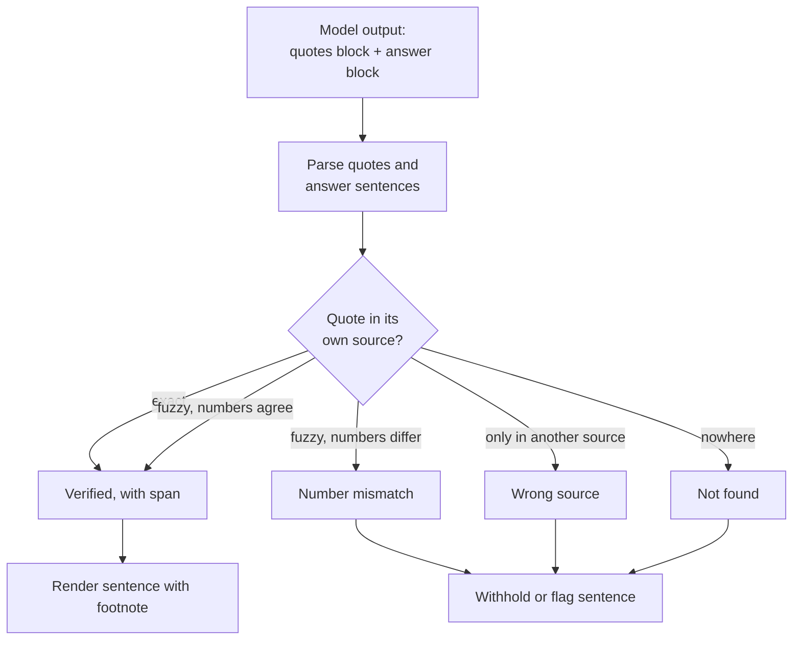

A citation is a promise: *this sentence is supported by that passage*. [Response generation](/learn/rag-architecture-fundamentals/response-generation) showed the minimum needed to keep the promise honest, a validator that checks cited labels exist and that numbers appear in the cited source, and [Citation instructions](/learn/prompt-engineering-for-rag/citation-instructions) covers how to ask a model to cite. **Citation-based generation** goes further: it designs the whole generation step around evidence, so that every claim the user sees can be traced to a specific, verified span of a specific document.

This lesson compares the four architectures for producing citations (inline markers, quote-first generation, post-hoc attribution and provider-native citations), explains how to verify a quotation against its source with fuzzy matching and why numbers must be checked separately, and builds a pipeline that verifies quotes, withholds unsupported sentences and renders numbered footnotes pointing at character spans.

## Learning objectives

- Compare inline, quote-first, post-hoc and native citation architectures by verifiability, cost and failure modes.
- Verify a model-produced quotation against its source using exact and fuzzy matching, and explain why fuzzy matching must not be trusted on numbers.
- Compute a `SequenceMatcher` similarity ratio by hand and choose a sensible acceptance threshold.
- Build a pipeline that withholds sentences whose evidence fails verification and renders the rest with numbered footnotes and source spans.
- Explain why embedding similarity is not evidence of support, using a concrete counter-example.

## Prerequisites

- [Basic RAG](/learn/generation-strategies/basic-rag): the single-call loop and its per-request label map.
- [Response generation](/learn/rag-architecture-fundamentals/response-generation): existence, coverage and number checks on `[S1]` markers.
- [Context injection](/learn/prompt-engineering-for-rag/context-injection): native document blocks.
- [Semantic similarity](/learn/embedding-fundamentals/semantic-similarity): what an embedding cosine measures.

## Why this matters

A citation that is wrong is worse than no citation. Without one, a careful user checks the answer elsewhere. With one, the user sees a link to the employee handbook and stops checking. Studies of generative search engines have found that a substantial share of generated sentences were not fully supported by the sources cited next to them (Liu, Zhang and Liang, 2023), and the reason is structural: a model asked to put `[S1]` after each sentence learns to produce plausible markers, and the marker is generated by the same process as the claim.

The `[S1]` validator catches citations to sources that do not exist and numbers that appear nowhere in the cited text. It cannot catch a sentence with a real label and a meaning the source does not support. Citation-based generation narrows that gap by changing what the model is asked to produce. If the model must first copy the exact words it relies on, and code checks those words against the source, then a large class of unsupported claims becomes mechanically detectable: either the quoted words are in the document or they are not.

For regulated or high-stakes answers (payroll, security procedures, legal policy) this is often the difference between a system that can be deployed and one that cannot. An auditor can be shown, for every sentence, the exact span it rests on.

## The intuition

A junior analyst writes a briefing note. One manager asks only that each paragraph end with "(see file 3)". Another insists that every claim be accompanied by the exact sentence copied from the file, in quotation marks, so that she can check it in ten seconds. The second rule changes how the analyst works: he must find the sentence before he writes the claim, and if no such sentence exists he notices. The manager's check also changes, from "does file 3 seem to be about this?" to "are these words in file 3?", which needs no judgement at all.

Quote-first citation is the second manager's rule, applied to a model and checked by code.

## How it works

### Granularity

A citation can point at a whole document, a chunk, a sentence, or an exact character span. Finer is better for the user (a highlighted sentence is quicker to check than a page) and for verification (a short span can be compared with a short claim). Coarser is cheaper and more robust: a chunk-level label cannot be "misquoted". Most production systems cite at chunk level in the text and show a span when the user opens the citation.

### Four architectures

| Architecture | What the model produces | How support is checked | Main weakness |
| --- | --- | --- | --- |
| Inline markers | Answer with `[S1]` after sentences | Label existence, number checks; full support needs a judge model | A real label can sit next to an unsupported claim |
| Quote-first | Exact quotes with source ids, then an answer citing the quotes | Each quote is string-matched against its source | The model may quote correctly and still draw a wrong conclusion from the quote |
| Post-hoc attribution | An answer with no citations; a second step finds evidence for each sentence | Retrieval or entailment of each sentence against sources | Similarity is not support; adds a step and latency |
| Native citations | Text blocks carrying structured citations to document spans | The provider returns the cited text and its location | Tied to one provider's API and document formats |

**Inline markers** are the baseline from [Response generation](/learn/rag-architecture-fundamentals/response-generation). They are cheap and portable.

**Quote-first** asks the model to extract the relevant passages verbatim before answering, then to cite those extracts. Anthropic's long-context prompting guidance recommends a version of this (asking the model to pull relevant quotes into tags before carrying out the task) as a way to help it focus on the relevant parts of long documents; here it serves verification as well. The quotes cost output tokens, and it moves the trust problem rather than removing it: a correctly quoted sentence can still be summarised wrongly. But the remaining gap is now between a short quote and a short claim, which a human or a judge model can check far more reliably than a claim against a whole document.

**Post-hoc attribution** generates first and attributes afterwards. RARR (Gao and colleagues, 2022) is a research system in this family: it researches each claim with search and revises the text to agree with the evidence it finds. A cheap production version embeds each sentence and finds the most similar source sentence. As the code will show, that cheap version is dangerous, because a sentence about the same topic with the wrong number is *more* similar to the source than a correct paraphrase can be.

**Native citations** move the mechanism into the API. In Anthropic's Messages API, documents sent as `document` content blocks with `"citations": {"enabled": True}` produce text blocks whose `citations` list holds the exact `cited_text` and its location; for plain-text documents the location is a `char_location` with a `document_index`, `start_char_index` and `end_char_index`. The provider guarantees that the cited text comes from the document, which removes the quote-verification step. The trade-offs are those noted in [Context injection](/learn/prompt-engineering-for-rag/context-injection): portability and control.

### The quote-first pipeline

1. Inject sources with short labels, as in [Basic RAG](/learn/generation-strategies/basic-rag).
2. Instruct the model to write a `<quotes>` block first, each quote numbered and tagged with its source label and copied exactly, then an `<answer>` block in which each sentence cites quote numbers such as `[Q1]`.
3. Parse both blocks.
4. Verify each quote against **its own** source: exact match after normalising whitespace and typographic quotes; otherwise the best fuzzy match above a threshold, provided the numbers in the quote and the matched span agree.
5. Classify failures: *not found*, *wrong source* (the words exist but in a different document), *number mismatch*.
6. Withhold (or flag) every answer sentence that cites a failed quote, and every sentence that cites nothing.
7. Renumber surviving quotes as footnotes in order of first use and attach each footnote's document title, link and character span, so that the interface can highlight the passage.
8. Log every failure type; a rising rate is a prompt, model or retrieval regression.



### Why fuzzy, and why not for numbers

Models copy imperfectly. They change "in" to "on", straighten typographic apostrophes, drop a trailing clause. Rejecting every such quote would discard many correct answers, so a tolerant comparison is needed. But tolerance is exactly wrong for the characters that matter most. "Annual leave is 28 days per year" differs from the source's "25 days per year" by one character out of 33; any character-level similarity will call it a near-perfect match. The rule is therefore: **accept fuzzy matches for wording, require exact agreement for numbers** (amounts, dates, durations, codes such as E-4021).

> [!KEY]
> A citation is only as good as the check behind it. Ask for evidence the code can verify (exact quotes or provider-native spans), check numbers exactly, and never treat topical similarity as proof of support.

## The mathematics

### The `SequenceMatcher` ratio

**Intuition.** Two strings are similar if most of their characters can be lined up in order. Count the characters that line up, and divide by the average length.

$$
\text{ratio}(a, b) = \frac{2M}{T}, \qquad T = |a| + |b|
$$

- $a$ and $b$ are the two strings (here, a normalised quote and a window of the source of the same length).
- $M$ is the number of matched characters: Python's `difflib.SequenceMatcher` finds the longest common contiguous block, then recursively the longest blocks to its left and right, and sums their sizes.
- $|a|$ and $|b|$ are the string lengths, so $T$ is their total.

The ratio is 1 for identical strings and 0 for strings with nothing in common.

**By hand.** Compare $a$ = "in the hr portal" with $b$ = "on the hr portal". Each is 16 characters, so $T = 32$. The longest common block is "n the hr portal", 15 characters; the first characters differ and nothing else is left to match. So $M = 15$ and the ratio is $2 \times 15 / 32 = 0.9375$.

Now "25 days" against "28 days": $T = 14$. `SequenceMatcher` finds the blocks "2" (1 character) and " days" (5 characters), so $M = 6$ and the ratio is $12/14 = 0.857$. A one-digit change that makes the claim false still scores 0.86, and in a longer sentence the same change scores higher still, because the one wrong digit is diluted by more matching characters.

```python
from difflib import SequenceMatcher

for a, b in [("in the hr portal", "on the hr portal"), ("25 days", "28 days")]:
    m = SequenceMatcher(None, a, b)
    blocks = [(blk.a, blk.size) for blk in m.get_matching_blocks() if blk.size]
    print(f"{a!r} vs {b!r}: blocks={blocks} ratio={m.ratio():.4f}")
```

```output
'in the hr portal' vs 'on the hr portal': blocks=[(1, 15)] ratio=0.9375
'25 days' vs '28 days': blocks=[(0, 1), (2, 5)] ratio=0.8571
```

A threshold of about 0.9 accepts the first kind of difference and, for short strings, rejects the second; the code below adds an explicit number check so that the decision does not depend on string length.

## In code

**The problem.** Take a quote-first model output, verify each quote against the source it claims, show only the sentences whose evidence checks out with numbered footnotes and character spans, and report why the rest were withheld.

**Dependencies.** The standard library only for the pipeline; the post-hoc comparison afterwards uses sentence-transformers.

```bash
pip install sentence-transformers
```

The model output is written by hand so that it contains one of each failure: an exact quote, a slightly misquoted one, an invented one, a real quote attributed to the wrong source, and a quote with a changed number. The prompt that asks for this format is a few lines: "First copy the sentences you rely on into `<quotes>`, one per line, as `[Q1] S1: \"exact text\"`. Then write `<answer>`, citing quote ids after each sentence."

```python
import re
from difflib import SequenceMatcher

SOURCES = {
    "S1": {"title": "Employee Handbook > Annual leave",
           "text": "Annual leave is 25 days per year. Up to 5 unused days carry over "
                   "and must be used by 31 March."},
    "S2": {"title": "Employee Handbook > Booking leave",
           "text": "Leave requests are made in the HR portal and approved by your line manager."},
    "S3": {"title": "Employee Handbook > Expenses",
           "text": "Expenses must be submitted within 30 days. Anything over £75 needs a receipt."},
}

# What the model returned (written by hand here; a real run calls the model).
MODEL_OUTPUT = """<quotes>
[Q1] S1: "Up to 5 unused days carry over and must be used by 31 March."
[Q2] S2: "Leave requests are made on the HR portal"
[Q3] S1: "Unused days can be carried over for up to 12 months."
[Q4] S3: "approved by your line manager"
[Q5] S1: "Annual leave is 28 days per year."
</quotes>
<answer>
You can carry over up to 5 unused days, which must be used by 31 March [Q1]. Book leave in the HR portal [Q2]. Carried-over days last 12 months [Q3]. Your line manager approves requests [Q4]. You get 28 days a year [Q5].
</answer>"""


def normalise(s: str) -> str:
    return re.sub(r"\s+", " ", s.replace("’", "'").replace("“", '"').replace("”", '"')).strip().lower()


def best_window(quote: str, text: str) -> tuple[float, int, int]:
    """Slide a window of the quote's length over the text; return the best ratio and its span."""
    q, t = normalise(quote), normalise(text)
    best = (0.0, 0, 0)
    for start in range(0, max(1, len(t) - len(q) + 1)):
        ratio = SequenceMatcher(None, q, t[start:start + len(q)]).ratio()
        if ratio > best[0]:
            best = (ratio, start, start + len(q))
    return best


def verify(source_id: str, quote: str, threshold: float = 0.9) -> dict:
    text = SOURCES.get(source_id, {}).get("text", "")
    start = normalise(text).find(normalise(quote))
    if start >= 0:
        return {"status": "exact", "span": (start, start + len(normalise(quote)))}
    ratio, s, e = best_window(quote, text)
    window = normalise(text)[s:e]
    numbers_match = re.findall(r"\d+", normalise(quote)) == re.findall(r"\d+", window)
    if ratio >= threshold and numbers_match:
        return {"status": "fuzzy", "ratio": round(ratio, 3), "span": (s, e)}
    if ratio >= threshold:
        return {"status": "number mismatch", "ratio": round(ratio, 3), "source_says": window}
    for other, src in SOURCES.items():            # is it verbatim in a different source?
        if other != source_id and normalise(quote) in normalise(src["text"]):
            return {"status": "wrong source", "found_in": other, "ratio": round(ratio, 3)}
    return {"status": "not found", "ratio": round(ratio, 3)}


if __name__ == "__main__":
    quotes = {qid: (sid, q) for qid, sid, q in re.findall(r'\[(Q\d+)\] (S\d+): "(.*)"', MODEL_OUTPUT)}
    answer = re.search(r"<answer>\s*(.*?)\s*</answer>", MODEL_OUTPUT, re.S).group(1)

    results = {qid: verify(sid, q) for qid, (sid, q) in quotes.items()}
    for qid, r in results.items():
        print(qid, quotes[qid][0], r)

    # Render: keep sentences whose quotes verified, number footnotes in order of first use.
    footnotes, kept, dropped = {}, [], []
    for sentence in re.split(r"(?<=[.!?])\s+", answer):
        qids = re.findall(r"\[(Q\d+)\]", sentence)
        if qids and all(results[q]["status"] in ("exact", "fuzzy") for q in qids):
            for q in qids:
                footnotes.setdefault(q, len(footnotes) + 1)
                sentence = sentence.replace(f"[{q}]", f"[{footnotes[q]}]")
            kept.append(sentence)
        else:
            dropped.append(sentence)

    print("\nANSWER SHOWN:\n" + " ".join(kept))
    for q, n in footnotes.items():
        sid = quotes[q][0]
        s, e = results[q]["span"]
        print(f"  [{n}] {SOURCES[sid]['title']} (chars {s}-{e}): \"{SOURCES[sid]['text'][s:e]}\"")
    print("\nWITHHELD:", dropped)
```

```output
Q1 S1 {'status': 'exact', 'span': (34, 94)}
Q2 S2 {'status': 'fuzzy', 'ratio': 0.975, 'span': (0, 40)}
Q3 S1 {'status': 'not found', 'ratio': 0.596}
Q4 S3 {'status': 'wrong source', 'found_in': 'S2', 'ratio': 0.379}
Q5 S1 {'status': 'number mismatch', 'ratio': 0.97, 'source_says': 'annual leave is 25 days per year.'}

ANSWER SHOWN:
You can carry over up to 5 unused days, which must be used by 31 March [1]. Book leave in the HR portal [2].
  [1] Employee Handbook > Annual leave (chars 34-94): "Up to 5 unused days carry over and must be used by 31 March."
  [2] Employee Handbook > Booking leave (chars 0-40): "Leave requests are made in the HR portal"

WITHHELD: ['Carried-over days last 12 months [Q3].', 'Your line manager approves requests [Q4].', 'You get 28 days a year [Q5].']
```

**The important lines.**

- `normalise` lower-cases, straightens typographic quotes and collapses whitespace on both sides, so that trivial differences are not treated as misquotes. Here it preserves length, so spans in the normalised text are valid in the original; if your normalisation can change lengths, keep a map from normalised to original offsets before highlighting.
- `best_window` slides a window the length of the quote along the source and keeps the best `SequenceMatcher` ratio. It is $O(n \cdot m)$ per quote, fine for chunks of a few hundred words.
- `numbers_match` compares the digit sequences in the quote and in the matched window. This is what turns Q5 from a 0.97 "match" into a `number mismatch`.
- The `wrong source` branch searches the other sources. It distinguishes a model that invented a fact from one that mislabelled a real one, which matters for diagnosis and allows a repair: re-pointing Q4 at S2 would make it valid.
- The rendering loop withholds a sentence if **any** of its quotes failed, and numbers footnotes in order of first use, so the user sees [1], [2] rather than [Q1], [Q2].

**What the output means.** Q1 is exact. Q2 says "on the HR portal" where the source says "in"; it is accepted as fuzzy (0.975) and, importantly, the footnote shows the *source's* text for the span, not the model's version. Q3 is invented; the best window scores 0.596. Q4 is real text from S2 attributed to S3. Q5 scores 0.97, which any similarity threshold would accept, and is rejected only by the number check: the source says 25. Two of five sentences survive. What the user sees is shorter, and every word of it is backed by a highlighted span.

### Why similarity is not support

Post-hoc attribution by embedding similarity is tempting because it needs no change to the prompt. The script below tries it on the three withheld claims, attributing each to the most similar source sentence if the cosine is at least 0.6.

```python
import re
from sentence_transformers import SentenceTransformer
from cite import SOURCES

model = SentenceTransformer("sentence-transformers/all-MiniLM-L6-v2")
units = [(sid, sent) for sid, src in SOURCES.items()
         for sent in re.split(r"(?<=[.!?])\s+", src["text"])]
unit_vecs = model.encode([u[1] for u in units], normalize_embeddings=True)

def attribute(claim: str, floor: float = 0.6):
    scores = unit_vecs @ model.encode([claim], normalize_embeddings=True)[0]
    i = int(scores.argmax())
    return (units[i][0], units[i][1], round(float(scores[i]), 3)) if scores[i] >= floor else (None, None, round(float(scores[i]), 3))

for claim in ["Your line manager approves requests.", "Carried-over days last 12 months.",
              "You get 28 days a year."]:
    print(claim, "->", attribute(claim))
```

```output
Your line manager approves requests. -> (None, None, 0.599)
Carried-over days last 12 months. -> ('S1', 'Up to 5 unused days carry over and must be used by 31 March.', 0.744)
You get 28 days a year. -> (None, None, 0.535)
```

The result is backwards. The true claim about line-manager approval scores 0.599 and is left unattributed. The false claim that carried-over days last 12 months scores 0.744 against the carry-over sentence, because it is about the same subject, and would be shown with a citation to a passage that contradicts it. Embedding similarity measures topic, not entailment. Post-hoc attribution needs an entailment check (a natural language inference model or an LLM judge, covered under [Faithfulness](/learn/generation-evaluation/faithfulness)), or it should be used only to *suggest* sources for human review.

### Native citations with the Anthropic API

This needs an API key and was not executed. Each source is a document block with citations enabled; the response's text blocks carry structured citations.

```python
import anthropic

client = anthropic.Anthropic()  # reads ANTHROPIC_API_KEY from the environment

docs = list(SOURCES.items())    # [("S1", {...}), ("S2", {...}), ...]
content = [
    {
        "type": "document",
        "source": {"type": "text", "media_type": "text/plain", "data": src["text"]},
        "title": src["title"],
        "citations": {"enabled": True},
    }
    for _, src in docs
]
content.append({"type": "text", "text": "How much leave can I carry over, and how do I book it?"})

response = client.messages.create(
    model="claude-opus-5-5",
    max_tokens=1024,
    system="Answer only from the provided documents.",
    messages=[{"role": "user", "content": content}],
)

footnotes, parts = {}, []
for block in response.content:
    if block.type != "text":
        continue
    marks = ""
    for c in block.citations or []:
        if c.type == "char_location":
            key = (c.document_index, c.start_char_index, c.end_char_index)
            footnotes.setdefault(key, (len(footnotes) + 1, c.document_title, c.cited_text))
            marks += f"[{footnotes[key][0]}]"
    parts.append(block.text + marks)

print("".join(parts))
for (doc, start, end), (n, title, text) in footnotes.items():
    print(f"  [{n}] {title} (chars {start}-{end}): {text!r}")
```

Your exact wording and spans will differ; the output looks like this:

```output
Up to 5 unused days carry over and must be used by 31 March.[1] Leave requests are made in the HR portal and approved by your line manager.[2]
  [1] Employee Handbook > Annual leave (chars 34-94): 'Up to 5 unused days carry over and must be used by 31 March.'
  [2] Employee Handbook > Booking leave (chars 0-77): 'Leave requests are made in the HR portal and approved by your line manager.'
```

The response is split into several text blocks, and a block with citations is the claim those citations support. No quote verification is needed; the number check on the claim text is still worth running, because the claim is generated and the citation is not.

**Errors people commonly hit.**

- Treating a high fuzzy ratio as proof. Check numbers, codes and dates exactly.
- Searching all sources for a quote and accepting any match, which hides wrong-source citations and makes footnotes point at the wrong document.
- Showing the model's version of a quote in the footnote instead of the source's text at the matched span.
- Losing character offsets through normalisation that changes string length, so highlights land a few characters off.

**Extending it.** Repair wrong-source quotes automatically when the words occur in exactly one other supplied source; replace withheld sentences with a short note ("one statement could not be verified and was removed"); and send verified quote-claim pairs to an entailment check to catch correct quotes with wrong conclusions.

## A real-world example

Meridian's Security team wanted AskMeridian to answer questions about the IT runbooks, but only if every instruction could be traced to the runbook text, since a wrong step in a VPN or account procedure creates incidents. Their first trial used inline `[S1]` markers and the existence-and-number validator. A review by two engineers of a sample of answers found that most were fine, but a few sentences cited a real runbook section and stated a step it did not contain, such as telling users to reinstall the VPN client for E-4012, when the runbook says the certificate has expired.

Kofi on the Platform team switched the runbook route to quote-first generation with the verification from this lesson, keeping inline markers for handbook questions, where the stakes were lower and answers shorter. For runbook answers, sentences whose quotes failed were withheld, and if more than half an answer was withheld the assistant returned its refusal with a link to the runbook. Output tokens per runbook answer rose noticeably because of the quotes block. In the next review, the reviewers could check each answer in a fraction of the time, because each step came with its highlighted runbook sentence, and the misattributed-step pattern was no longer found in the sample. The remaining errors were of the "right quote, wrong conclusion" kind, which the team now samples for human review.

## Common mistakes

- **Equating a citation marker with support.** A marker is generated text; without a check behind it, it is decoration.
- **Using embedding similarity to attribute claims.** It attaches false claims to on-topic passages, as the code shows.
- **Fuzzy matching numbers.** A one-digit change scores above any reasonable similarity threshold.
- **Accepting a quote found in any source.** Wrong-source citations then send users to the wrong document.
- **Quoting whole chunks.** Very long quotes make verification trivially true and the footnote useless; ask for the minimal sentence or clause.
- **Hiding withheld content silently.** Users notice missing parts of an answer; say that something could not be verified.

## Best practices

- Choose the architecture by stakes: inline markers for low-risk answers, quote-first or native citations where every claim must be auditable.
- Verify each quote against the source it names, with exact matching first and fuzzy matching only for wording.
- Require exact agreement for numbers, dates, amounts and identifiers.
- Show the source's own text at the verified span, with a link, in every footnote.
- Log failure types separately (not found, wrong source, number mismatch, uncited); each points to a different fix.
- Pair string verification with sampled entailment checks or human review for the "right quote, wrong conclusion" gap.

## Performance considerations

Quote-first generation costs output tokens, which are slower and dearer than input tokens. If an answer of 120 tokens needs four quotes of 25 tokens each, output grows to about 220 tokens, an increase of over 80 per cent. At an assumed output rate of 50 tokens per second, that is 2 more seconds of generation, and the quotes are produced before the answer, so time to the first answer word grows by the same amount unless you stream the answer block separately ([Streaming responses](/learn/generation-strategies/streaming-responses)).

Verification is cheap. The sliding-window comparison for a quote of $m$ characters over a source of $n$ characters makes about $n - m + 1$ comparisons, each roughly $O(m)$ for strings this short; for a 25-word quote against a 400-word chunk that is a few thousand comparisons of short strings, a few milliseconds in Python. Native citations move the extraction into the provider's response; cited text appears in the response alongside the answer, so check your provider's documentation for how it is billed.

## Security considerations

Citations raise trust, which raises the payoff for attackers. A poisoned document that is cited looks authoritative. Verification proves only that the words are in a retrieved document, not that the document is legitimate, so source authority (from a controlled registry, as in [Context-aware generation](/learn/generation-strategies/context-aware-generation)) should be shown next to each footnote. Footnote rendering is also an output channel: titles and quoted text come from documents and must be escaped before insertion into HTML, or a document title becomes a script. Finally, a link in a footnote should come from your label map, never from text the model generated, so that a document cannot make the assistant display an attacker's URL as a source.

## Summary

- A citation should be backed by a check; markers alone make wrong answers look verified.
- Quote-first generation makes support partly mechanical: the quoted words are in the named source or they are not.
- Verify quotes against their own source, accept fuzzy matches only for wording, and require numbers to agree exactly.
- Embedding similarity is not support; it can attribute a false claim to the passage it contradicts.
- Native API citations remove quote verification at the cost of portability; the claims they support still need checking.

## Exercises

**1.** A quote reads "Passwords must be rotated every 60 days." and the source says "Passwords must be rotated every 90 days." Will `verify` accept it? Explain using the ratio and the number check.

<details><summary>Show solution</summary>

No. The strings differ in one character out of about 40, so the best window's ratio is well above 0.9 and the fuzzy branch is reached. But `numbers_match` compares `['60']` with `['90']`, which differ, so the result is `number mismatch` and the sentence citing it is withheld. Without the number check it would have been shown with a footnote to a passage that contradicts it.

</details>

**2.** Compute the `SequenceMatcher` ratio by hand for "vpn is required" against "vpn is requested". Would it pass a 0.9 threshold?

<details><summary>Show solution</summary>

Lengths are 15 and 16, so $T = 31$. The longest common block is "vpn is requ" (11 characters). To its right, "ired" and "ested" share the final "ed" (2 characters), giving $M = 13$ (confirm with `get_matching_blocks()`). Ratio $= 26/31 \approx 0.839$, which fails a 0.9 threshold. Note how close it is despite the meaning being different: "required" and "requested" are not interchangeable, which is why thresholds should be set on real examples from your corpus.

</details>

**3.** Design the policy for an answer in which some sentences are verified and some are not. Cover: when to show a partial answer, when to refuse, what to tell the user, and what to log.

<details><summary>Show solution</summary>

A reasonable policy: if every sentence that answers the core of the question is verified, show the verified sentences and append "One statement could not be verified against the sources and was removed." If the withheld sentences carry the core answer (for example the only sentence with the number asked for), or more than half the sentences fail, show the fixed refusal with links to the retrieved documents instead of a fragment. Optionally retry once, passing the failure reasons ("Q3 not found in S1"). Log each failure with its type, the quote, the source id and the best ratio, plus the final decision (shown, partial, refused), so that failure rates can be charted by route and model version.

</details>

## Check your understanding

```quiz
[
  {
    "q": "Why is an inline [S1] marker, on its own, weak evidence that a sentence is supported?",
    "options": [
      "Because labels are too short",
      "Because the marker is generated by the same process as the claim and can sit next to a claim the source does not support",
      "Because users cannot click on it",
      "Because models cannot produce square brackets reliably"
    ],
    "answer": 1,
    "why": "Existence of the label can be checked; support cannot, without comparing the claim with the source text."
  },
  {
    "q": "A quote scores 0.97 against the best window of its source, but the quote says 28 and the source says 25. What should the pipeline do?",
    "options": [
      "Accept it, since 0.97 is above the threshold",
      "Accept it and correct the number silently",
      "Reject it as a number mismatch and withhold or flag the sentence that cites it",
      "Search the web for the right number"
    ],
    "answer": 2,
    "why": "Fuzzy matching is for wording; numbers must agree exactly, because a one-digit change barely moves a similarity ratio."
  },
  {
    "q": "In the lesson's post-hoc attribution test, what did embedding similarity do with the false claim that carried-over days last 12 months?",
    "options": [
      "Attributed it to the carry-over sentence with a high score",
      "Left it unattributed",
      "Attributed it to the expenses source",
      "Flagged it as false"
    ],
    "answer": 0,
    "why": "It scored 0.744 against the carry-over sentence because it is about the same topic. Similarity measures topic, not support."
  },
  {
    "q": "What does `difflib.SequenceMatcher.ratio()` compute?",
    "options": [
      "The cosine of two embeddings",
      "The edit distance divided by the longer length",
      "The share of words in common",
      "Twice the number of matched characters divided by the total length of both strings"
    ],
    "answer": 3,
    "why": "ratio = 2M / T, where M is the size of the matching blocks found and T is the sum of the two lengths."
  },
  {
    "q": "What is the main advantage of provider-native citations over quote-first prompting?",
    "options": [
      "They work with every model provider",
      "The provider returns the cited text and its location from the document, so quotes need no verification",
      "They make the claims themselves correct",
      "They remove the need to send documents"
    ],
    "answer": 1,
    "why": "Native citations guarantee the cited span comes from the document. The claim text is still generated, so it can still misstate what the span says."
  }
]
```

## Further reading

- Gao, T., Yen, H., Yu, J. and Chen, D. (2023). *Enabling Large Language Models to Generate Text with Citations* (ALCE). [arXiv:2305.14627](https://arxiv.org/abs/2305.14627)
- Liu, N. F., Zhang, T. and Liang, P. (2023). *Evaluating Verifiability in Generative Search Engines*. [arXiv:2304.09848](https://arxiv.org/abs/2304.09848)
- Gao, L. et al. (2022). *RARR: Researching and Revising What Language Models Say, Using Language Models*. [arXiv:2210.08726](https://arxiv.org/abs/2210.08726)
- Anthropic, *Claude Developer Platform documentation*: citations, and long-context prompting tips. [platform.claude.com/docs](https://platform.claude.com/docs)
- Python documentation, `difflib`. [docs.python.org/3/library/difflib.html](https://docs.python.org/3/library/difflib.html)
