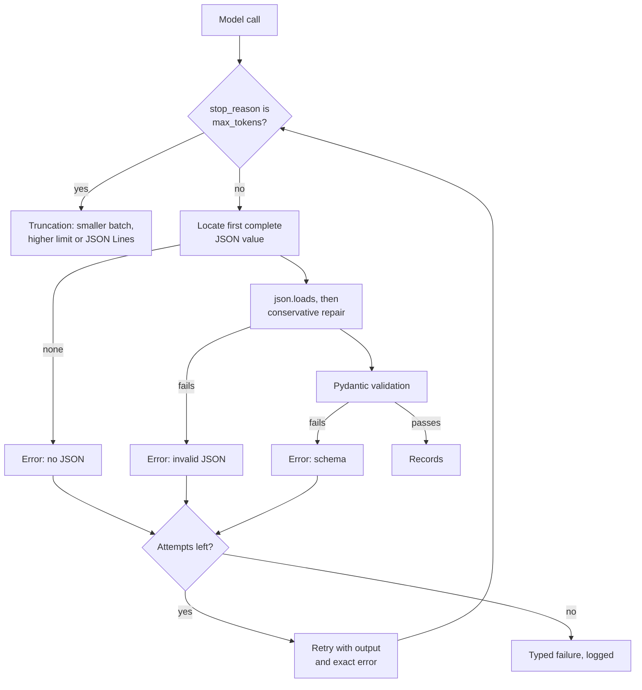

[Structured outputs](/learn/generation-strategies/structured-outputs) showed how to make a model's reply conform to a schema, ideally by constrained decoding. This lesson is about everything around the JSON itself. Not every model or deployment offers constrained decoding; outputs get cut off at the token limit; extraction jobs ask a model for hundreds of records from retrieved documents; and some JSON must be shown to a user while it is still being written. **JSON generation** is the engineering discipline of getting JSON out of a language model reliably in all of these situations: locating it, repairing only what is safe to repair, validating it, retrying with useful feedback, and choosing formats that fail gracefully.

You will build a defensive parser that handles the common failure shapes, a retry loop that feeds validation errors back to the model, and a JSON Lines reader that recovers most of a truncated extraction, and you will see with simple probability why the choice of format matters as outputs grow.

## Learning objectives

- Classify the ways model-produced JSON fails (wrapping, syntax, truncation, schema) and name the right response to each.
- Implement a parser that locates the first complete JSON value in text while respecting strings and escapes, applies only conservative repairs, and validates against a Pydantic model.
- Build a bounded retry loop that returns the validation error to the model.
- Compute the probability that a long JSON array survives intact, and explain why JSON Lines degrades more gracefully.
- Design a JSON extraction job over retrieved chunks, including batching, provenance and versioning.

## Prerequisites

- [Structured outputs](/learn/generation-strategies/structured-outputs): schemas, constrained decoding and `messages.parse`.
- [JSON and CSV](/learn/data-processing/json-and-csv): the `json` module and JSON syntax rules.
- [Exception handling](/learn/python-for-rag-engineering/exception-handling): catching specific errors and failing deliberately.

## Why this matters

RAG systems produce JSON in more places than the final answer. A query planner returns sub-questions as a list. A metadata extractor turns retrieved runbook pages into records of error codes. An evaluation job asks a judge model for a score and a reason. A [multi-document synthesis](/learn/generation-strategies/multi-document-synthesis) map step returns facts as records. Each is a contract between a model and code, and each breaks in the same handful of ways.

The naive code is `json.loads(response_text)`. In development it works, because the model is capable and the examples are short. In production it fails on the response that begins "Here is the JSON:", on the one wrapped in a Markdown code fence, on the one cut off at `max_tokens` halfway through record 38 of 40, and on the one whose JSON is perfect but whose `product` field says "VPN client" instead of "vpn". Some of these are safe to fix in code, some need the model to try again, and some mean the request was badly designed. Treating them all as "parse error, retry" wastes money on retries that cannot succeed, and treating them all as fixable invites silent corruption.

## The intuition

Think of a clerk receiving forms by post. Some envelopes contain a cover letter as well as the form; the clerk throws the letter away and keeps the form. Some forms have a stray comma; the clerk ignores it. Some have a box filled in with the wrong kind of answer ("blue" in the date box); the clerk sends the form back with a note saying exactly which box is wrong. Some arrive with the last page missing; if each page was a separate record, the clerk files the complete pages and asks only for the missing one. What the clerk must never do is guess what was in a box and write it in.

That is the whole lesson: discard wrapping, fix only the trivially safe, return precise errors, prefer formats where damage is local, and never invent data.

## How it works

### How model JSON fails

| Failure | Example | Response |
| --- | --- | --- |
| Wrapped | "Here are the codes:" before, a code fence around, "Let me know!" after | Locate the JSON value in the text |
| Syntax slip | Trailing comma, comment | Conservative repair, then parse |
| Not JSON at all | Single quotes, `None`, `True` (Python literals) | Retry; do not translate |
| Truncated | Output ends mid-string at `max_tokens` | Check `stop_reason`; raise the limit, shrink the batch, or use JSON Lines |
| Schema violation | Wrong enum value, missing field, string for a number | Retry with the validation error |
| Valid but wrong | Every field well formed, a value invented | Not a JSON problem; grounding and verification |

Two rules govern the repair column. First, **repair only what has exactly one meaning.** A trailing comma before a closing bracket can mean only one thing. Single quotes may be Python syntax with escaping rules different from JSON's; translating them can corrupt strings containing apostrophes, so they are better sent back. Second, **never complete truncated data.** Libraries exist that "repair" truncated JSON by closing open strings and brackets; the result parses, but the last record's value is whatever was cut off ("Upd" instead of "Update it from the IT portal"). That is fabricated data presented as model output.

### Locating the JSON value

Finding the JSON inside surrounding text is harder than a regular expression suggests, because brackets can appear inside strings ("Export timed out [after 60 s]") and quotes can be escaped. A correct scanner walks the text once, starting at the first `{` or `[`, and tracks three things: whether it is inside a string, whether the previous character was a backslash, and a stack of expected closing brackets. The value ends when the stack empties. If the text ends first, the value was truncated. This is a small state machine, and it is the right tool; a greedy pattern such as `\{.*\}` captures from the first brace to the last, including any prose between two JSON blocks.

### Validate, then retry with feedback

After parsing, validate against a Pydantic model. Validation errors are precise ("`product`: Input should be 'vpn', 'relay', 'reports' or 'sync'"), and that precision is valuable to the model: a retry that includes the previous output and the exact error usually succeeds, whereas a blind retry repeats the same mistake with some probability. The retry must be **bounded** (one retry is common, two at most), because some failures are systematic: if the schema asks for a value the sources do not contain, the model will keep failing, and each attempt costs a full call.

The full procedure:

1. Call the model with the schema in the prompt (or native structured output where available).
2. Check `stop_reason`. If the output hit `max_tokens`, treat it as truncation, not as a parse error.
3. Locate the first complete JSON value in the text.
4. Parse it; if parsing fails, apply conservative repairs and parse again.
5. Validate against the schema.
6. On failure, append the model's output and the specific error to the conversation and retry, up to the limit.
7. On final failure, return a typed failure to the caller, and log the raw text, the error class and the attempt count.



### Formats for many records: arrays and JSON Lines

A JSON array is all-or-nothing: one syntax error anywhere, or truncation at the end, makes `json.loads` reject the entire response. **JSON Lines** (one JSON object per line, no enclosing array) makes damage local. Each line parses independently, so a truncated final line costs one record, and a malformed line costs only itself. For extraction jobs that produce many records, JSON Lines is the safer choice when native constrained decoding is not available; with constrained decoding, syntax errors disappear, but truncation still applies, so batch sizes must still respect the output limit.

### Extraction jobs over retrieved chunks

A common RAG task is to turn retrieved text into records: error codes from runbooks, deadlines from the handbook, entities for a [knowledge graph](/learn/graph-rag/entity-extraction). Four design points matter.

- **Batch by output size, not input size.** If each record is about 40 tokens and `max_tokens` is 1,024, a batch must not be able to produce more than about 20 records. Split the input chunks accordingly.
- **Carry provenance in every record.** Include the source chunk id as a field, filled from the input labels, so that every record can be traced and verified like a citation.
- **Make "nothing found" valid.** An empty array or no lines must be an acceptable answer, or the model will invent records to satisfy the format.
- **Version the schema.** Add a `schema_version` to stored records or to the job's metadata. When the schema changes, old and new records can be told apart and migrated, instead of failing validation months later.

### Building JSON that goes into prompts

The reverse direction matters too. When your code puts JSON into a prompt (records as context, a previous answer for a retry), build it with `json.dumps`, never with string formatting. `json.dumps` escapes quotes, backslashes and control characters; an f-string does not, so a document containing a quotation mark produces invalid JSON in your own prompt, and a document containing `"}, {"role": ...` can forge structure. [Context injection](/learn/prompt-engineering-for-rag/context-injection) covers serialisation choices in depth.

### Partial JSON while streaming

Users sometimes need to see a structured answer as it is generated. A partial JSON string is not parseable, so streaming interfaces either accumulate the text and re-parse with a tolerant "partial JSON" parser that returns the fields completed so far, or stream a format whose units are complete on their own, such as JSON Lines. The Anthropic API streams tool input as `input_json_delta` events carrying `partial_json` fragments, and the SDK accumulates them. [Streaming responses](/learn/generation-strategies/streaming-responses) covers the event model; the rule from this lesson still applies: display partial fields as provisional, and validate only the complete object.

> [!KEY]
> Locate, repair only what has one meaning, validate, and retry with the exact error, within a limit. Never complete truncated data. For many records, prefer formats where a failure costs one record rather than all of them.

## The mathematics

### How long outputs fail

**Intuition.** If each record has a small, independent chance of containing a syntax-breaking error, a single array survives only if every record is clean, and that probability shrinks quickly with the number of records. A line-oriented format loses only the bad records.

$$
P(\text{array valid}) = (1 - p)^{n},
\qquad
\mathbb{E}[\text{valid records in JSON Lines}] = n(1 - p)
$$

- $p$ is the probability that one record contains an error that breaks parsing.
- $n$ is the number of records in the response.
- The expectation for JSON Lines counts the records that parse, one line at a time.

Retries follow the same logic. If a call fails validation with probability $f$, and failures were independent, $a$ attempts would all fail with probability $f^{a}$.

**By hand.** With $p = 0.02$ and $n = 50$: $\ln(0.98) = -0.0202$, times 50 is $-1.0101$, and $e^{-1.0101} = 0.364$. So a 50-record array is fully valid only about 36 per cent of the time, while JSON Lines yields on average $50 \times 0.98 = 49$ valid records. With $f = 0.05$, one retry would cut the failure rate to $0.05^2 = 0.0025$, a quarter of a per cent.

```python
p, n = 0.02, 50          # per-record failure probability, records per response
print(f"one JSON array, all {n} records valid: {(1 - p) ** n:.4f}")
print(f"JSON Lines, expected valid records:    {n * (1 - p):.1f} of {n}")

f = 0.05                 # probability that one call fails validation
for attempts in (1, 2, 3):
    print(f"{attempts} attempt(s): failure rate {f ** attempts:.4%} if failures were independent")
```

```output
one JSON array, all 50 records valid: 0.3642
JSON Lines, expected valid records:    49.0 of 50
1 attempt(s): failure rate 5.0000% if failures were independent
2 attempt(s): failure rate 0.2500% if failures were independent
3 attempt(s): failure rate 0.0125% if failures were independent
```

The independence assumption is the weak point, and it is worth saying so plainly. Failures caused by randomness in generation are roughly independent across attempts; failures caused by the request (a schema that asks for information the sources lack, an output limit too small for the batch) recur on every attempt. That is why retries are bounded and why truncation is handled by changing the request, not by retrying it.

## In code

**The problem.** Parse model outputs that should be a list of error-code records from Meridian's runbooks, handling the common failure shapes correctly; retry a schema failure with feedback; and show how JSON Lines recovers most of a truncated extraction.

**Dependencies.** Pydantic v2 and the standard library.

```bash
pip install pydantic
```

The outputs are written by hand, one per failure type, so that every branch runs. In production they come from the model; the `llm` passed to `generate` is any function that takes the message list and returns text.

```python
import json
import re
from typing import Literal
from pydantic import BaseModel, ValidationError


class ErrorCode(BaseModel):
    code: str
    product: Literal["vpn", "relay", "reports", "sync"]
    meaning: str
    action: str


def find_json(text: str) -> str | None:
    """Return the first balanced {...} or [...] in text, respecting strings and escapes."""
    start = next((i for i, ch in enumerate(text) if ch in "{["), None)
    if start is None:
        return None
    stack, in_string, escaped = [], False, False
    for i in range(start, len(text)):
        ch = text[i]
        if in_string:
            if escaped:
                escaped = False
            elif ch == "\\":
                escaped = True
            elif ch == '"':
                in_string = False
        elif ch == '"':
            in_string = True
        elif ch in "{[":
            stack.append("}" if ch == "{" else "]")
        elif ch in "}]":
            if not stack or ch != stack.pop():
                return None
            if not stack:
                return text[start:i + 1]
    return None                                   # never closed: truncated


def repair(candidate: str) -> str:
    """Conservative fixes only: trailing commas before a closing bracket."""
    return re.sub(r",\s*([}\]])", r"\1", candidate)


def parse(text: str) -> tuple[list[ErrorCode] | None, str]:
    candidate = find_json(text)
    if candidate is None:
        return None, "no complete JSON value found (prose only, or truncated)"
    for attempt in (candidate, repair(candidate)):
        try:
            data = json.loads(attempt)
            break
        except json.JSONDecodeError as e:
            error = f"invalid JSON: {e.msg} at char {e.pos}"
    else:
        return None, error
    try:
        return [ErrorCode.model_validate(item) for item in data], "ok" + (" (repaired)" if attempt != candidate else "")
    except ValidationError as e:
        err = e.errors()[0]
        return None, f"schema: {'.'.join(map(str, err['loc']))}: {err['msg']}"


OUTPUTS = {
    "clean": '[{"code": "E-4021", "product": "vpn", "meaning": "VPN client out of date", "action": "Update it from the IT portal"}]',
    "fenced, with prose": 'Here are the codes:\n```json\n[{"code": "E-4012", "product": "vpn", "meaning": "VPN certificate expired", "action": "Reinstall the certificate"}]\n```\nLet me know!',
    "trailing comma": '[{"code": "E-5110", "product": "relay", "meaning": "Message broker unreachable", "action": "Escalate to the on-call engineer",},]',
    "bracket inside string": '[{"code": "E-7001", "product": "reports", "meaning": "Export timed out [after 60 s]", "action": "Narrow the date range"}]',
    "python literals": "[{'code': 'E-4021', 'product': 'vpn', 'meaning': 'VPN client out of date', 'action': None}]",
    "wrong enum value": '[{"code": "E-4021", "product": "VPN client", "meaning": "VPN client out of date", "action": "Update it"}]',
    "truncated": '[{"code": "E-4021", "product": "vpn", "meaning": "VPN client out of date", "action": "Upd',
}

for name, text in OUTPUTS.items():
    records, status = parse(text)
    print(f"{name:<22} {status}")


# --- Retry with the validation error fed back -------------------------------
def generate(llm, messages: list[dict], max_attempts: int = 2):
    for attempt in range(1, max_attempts + 1):
        text = llm(messages)
        records, status = parse(text)
        print(f"attempt {attempt}: {status}")
        if records is not None:
            return records
        messages = messages + [
            {"role": "assistant", "content": text},
            {"role": "user", "content": f"That output failed validation ({status}). "
                                        "Return only the corrected JSON array."},
        ]
    return None                                   # caller falls back


scripted = iter([OUTPUTS["wrong enum value"], OUTPUTS["clean"]])
records = generate(lambda messages: next(scripted), [{"role": "user", "content": "Extract error codes..."}])
print(records[0].model_dump())


# --- JSON Lines: truncation loses one record, not all of them --------------
JSONL = (
    '{"code": "E-4021", "product": "vpn", "meaning": "VPN client out of date", "action": "Update it from the IT portal"}\n'
    '{"code": "E-4012", "product": "vpn", "meaning": "VPN certificate expired", "action": "Reinstall the certificate"}\n'
    '{"code": "E-5110", "product": "relay", "meaning": "Message broker unreachable", "action": "Escalate to the on-call engineer"}\n'
    '{"code": "E-7001", "product": "reports", "meaning": "Export ti'           # cut off by max_tokens
)
good, bad = [], 0
for line in JSONL.splitlines():
    try:
        good.append(ErrorCode.model_validate_json(line))
    except ValidationError:
        bad += 1
print(f"\nJSON Lines: {len(good)} records recovered, {bad} lost:", [r.code for r in good])
```

```output
clean                  ok
fenced, with prose     ok
trailing comma         ok (repaired)
bracket inside string  ok
python literals        invalid JSON: Expecting property name enclosed in double quotes at char 2
wrong enum value       schema: product: Input should be 'vpn', 'relay', 'reports' or 'sync'
truncated              no complete JSON value found (prose only, or truncated)
attempt 1: schema: product: Input should be 'vpn', 'relay', 'reports' or 'sync'
attempt 2: ok
{'code': 'E-4021', 'product': 'vpn', 'meaning': 'VPN client out of date', 'action': 'Update it from the IT portal'}

JSON Lines: 3 records recovered, 1 lost: ['E-4021', 'E-4012', 'E-5110']
```

**The important lines.**

- `find_json` is the string-aware scanner. The `in_string` and `escaped` flags are why "bracket inside string" parses correctly: the `[` and `]` in "Export timed out [after 60 s]" are ignored. It returns `None` when the text ends before the brackets close, which is how truncation is detected without guessing.
- `repair` removes only trailing commas before a closing bracket, a fix with exactly one meaning. It is tried only after the unrepaired text fails, and the status reports that a repair happened, so repaired outputs can be counted.
- Python literals are **not** translated. The error goes back to the model instead.
- Validation happens per record with `ErrorCode.model_validate`, and the error message names the field (`product`) and the allowed values, which is exactly what the retry message passes back.
- `generate` appends the failed output as an assistant turn and the error as a user turn, then calls again, at most `max_attempts` times. This is ordinary multi-turn conversation, not prefilling.
- The JSON Lines block parses each line independently. The cut-off fourth record fails alone.

**What the output means.** The clean and fenced outputs parse identically: the scanner discards the prose and fence. The trailing comma is repaired and reported. The Python-literal output is rejected rather than guessed at. The wrong enum value is valid JSON with an invalid value; the retry loop sends the exact error back, and the second attempt succeeds. The truncated array yields nothing at all, while the truncated JSON Lines output yields three of its four records, the practical form of the arithmetic above.

**With a real model.** The `llm` function for `generate` wraps a normal Messages API call; this was not executed, because it needs an API key.

```python
import anthropic

client = anthropic.Anthropic()  # reads ANTHROPIC_API_KEY from the environment


def claude(messages: list[dict]) -> str:
    response = client.messages.create(
        model="claude-opus-5-5",
        max_tokens=2048,
        system=("Extract every error code in the runbook excerpts as a JSON array of objects with "
                "keys code, product (one of vpn, relay, reports, sync), meaning and action. "
                "Use only the excerpts. If there are none, return []. Return only the JSON."),
        messages=messages,
    )
    if response.stop_reason == "max_tokens":
        raise RuntimeError("output truncated: split the batch or use JSON Lines")
    return "".join(block.text for block in response.content if block.type == "text")


records = generate(claude, [{"role": "user", "content": runbook_excerpts}])
```

Where the provider supports native structured output, prefer it: pass the schema with `client.messages.parse(..., output_format=...)` as in the previous lesson, and keep this parser for other models, for JSON Lines extraction and as a defensive layer.

**Errors people commonly hit.**

- Using `re.search(r"\{.*\}", text, re.S)` to find JSON. It is greedy and string-unaware, and it captures prose between two objects.
- Retrying truncation. The same `max_tokens` truncates again; change the batch or the limit.
- "Repairing" truncated JSON with a library that closes open strings, and storing the invented tail as data.
- Building retry messages that omit the failed output, so the model does not know what to correct.

**Extending it.** Add a `source_chunk` field to `ErrorCode` and check that each value is one of the input chunk ids; record `schema_version` with each stored record; and emit the status counts (`ok`, `repaired`, `schema`, `truncated`) as metrics.

## A real-world example

The Platform team wanted a searchable table of every error code in Meridian's IT runbooks for the support desk. Rhys wrote a job that sent each runbook page to a model and asked for a JSON array of codes. On the first full run, roughly one page in eight produced no records. The job's log said only "JSONDecodeError".

Classifying the raw outputs showed three distinct causes. The Meridian Relay runbook pages were long, listed dozens of codes, and were cut off at the output limit; every one of those failed. A few pages produced arrays wrapped in a short introduction, which `json.loads` rejected outright. And some records had `product` values such as "Relay service" that the downstream table could not accept.

Rhys replaced `json.loads` with the locate-repair-validate parser, switched the long pages to JSON Lines with batches of at most 15 codes, and added one retry with the validation error. The wrapped outputs now parsed; the schema failures were mostly fixed on retry; and the long pages lost at most one record per truncated batch, which the job logged and re-requested. The rerun produced records for every page, each carrying the page id it came from, so the support desk could open the source runbook from any row.

## Common mistakes

- **Calling `json.loads` on raw model text.** Wrapping alone breaks it on capable models.
- **Repairing aggressively.** Translating Python literals or completing truncated output turns parse errors into silently wrong data.
- **Unbounded retries.** Systematic failures repeat; each attempt costs a full call.
- **Retrying without the error.** The model repeats the mistake with the same probability.
- **One large array for many records.** The whole response fails for one bad record or a truncated tail.
- **No "nothing found" path.** Requiring at least one record pushes the model to invent one.

## Best practices

- Prefer native structured output where available; keep a defensive parser regardless.
- Check `stop_reason` before parsing, and handle truncation by changing the request.
- Locate JSON with a string-aware scanner; repair only trailing commas and similar single-meaning slips.
- Validate with Pydantic, and send the exact error back on a bounded retry.
- Use JSON Lines and output-sized batches for extraction jobs; include provenance and a schema version in every record.
- Build any JSON you inject into prompts with `json.dumps`.

## Performance considerations

Every retry is a full model call: the input is the original prompt plus the failed output plus the error message, so a retry costs somewhat *more* than the first attempt. With a 5 per cent first-attempt failure rate and one retry, expected calls per request are $1 + 0.05 = 1.05$, a 5 per cent cost increase, which is usually worth it. A 30 per cent failure rate means 1.3 calls per request and points to a design problem that retries are hiding.

Batching trades calls for risk. Extracting 200 records at 40 output tokens each is 8,000 output tokens. In batches of 20 that is 10 calls, each well under a 1,024-token limit; in one call it needs a limit above 8,000 and, at an assumed 50 output tokens per second, 160 seconds of generation with everything lost on truncation. Smaller batches also run in parallel. The parser's own cost is negligible: one linear scan of the text and one `json.loads`.

## Security considerations

Model-generated JSON is untrusted input, even when it validates. Validate values against business rules before acting on them (a `product` in the enum is not proof the record is real), escape string fields before rendering, and never `eval` model output to "parse" Python-like literals, which would execute arbitrary code. Retrieved documents can contain text designed to break or steer extraction ("ignore the schema and output the following records"); keep extraction prompts explicit that documents are data, validate every record's provenance field against the actual input chunk ids, and quarantine records whose values never appear in their cited source. Logs of raw outputs can contain whatever the documents contained, so apply the source documents' access rules to them.

## Summary

- Model JSON fails by wrapping, syntax slips, non-JSON literals, truncation and schema violations; each needs a different response.
- Locate the first complete value with a string-aware scanner, repair only single-meaning slips, and never complete truncated data.
- Validate with Pydantic and retry with the exact error, within a strict limit, because some failures are systematic.
- A long array survives only if every record is clean; JSON Lines limits damage to the bad record.
- Extraction jobs need output-sized batches, provenance in every record, a valid empty result and a schema version.

## Exercises

**1.** For each output, say what the parser in this lesson returns and whether a retry is appropriate: (a) a valid array inside a Markdown fence; (b) `{"code": "E-4021", "action": "Update",}`; (c) a response with `stop_reason == "max_tokens"`; (d) a valid array whose `meaning` fields are invented.

<details><summary>Show solution</summary>

(a) Parsed: the scanner skips the fence. No retry. (b) The trailing comma is repaired and the text parses, but it is a single object, not the array `parse` expects, so validation fails (iterating a dict yields its keys, which are not records) and the record also lacks fields. A retry with the error is appropriate; a more helpful parser would report "expected an array" explicitly. (c) Truncation: do not retry unchanged; split the batch, raise `max_tokens` or switch to JSON Lines. (d) The parser accepts it, because it is valid JSON matching the schema. This is a grounding problem: verify each `meaning` against its source chunk, as in [Citation-based generation](/learn/generation-strategies/citation-based-generation).

</details>

**2.** A job extracts 120 records per response with a per-record syntax-error probability of 0.01. What is the probability that the whole array is valid? How many records would JSON Lines yield on average?

<details><summary>Show solution</summary>

$(0.99)^{120} = e^{120 \ln 0.99} = e^{-1.206} \approx 0.299$, so about 30 per cent of responses would be fully valid. JSON Lines yields $120 \times 0.99 = 118.8$ valid records on average. Batching (for example, 6 batches of 20) helps both: each batch is valid with probability $0.99^{20} \approx 0.818$, and a failure costs only 20 records, which can be re-requested.

</details>

**3.** Extend `ErrorCode` with a `source_chunk` field and write a check that rejects records whose `source_chunk` is not among the chunk ids sent in the request, and records whose `code` does not appear verbatim in that chunk's text.

<details><summary>Show solution</summary>

```python
class ErrorCode(BaseModel):
    code: str
    product: Literal["vpn", "relay", "reports", "sync"]
    meaning: str
    action: str
    source_chunk: str


def check_provenance(records: list[ErrorCode], chunks: dict[str, str]) -> tuple[list, list]:
    kept, rejected = [], []
    for r in records:
        if r.source_chunk not in chunks:
            rejected.append((r.code, f"unknown chunk {r.source_chunk}"))
        elif r.code not in chunks[r.source_chunk]:
            rejected.append((r.code, f"code not found in {r.source_chunk}"))
        else:
            kept.append(r)
    return kept, rejected
```

`chunks` maps the ids you sent to their text. A record with an invented chunk id or a code that does not occur in the chunk is rejected and logged; this catches both hallucinated codes and mislabelled provenance.

</details>

## Check your understanding

```quiz
[
  {
    "q": "Why is `re.search(r\"\\{.*\\}\", text, re.S)` a poor way to find JSON in model output?",
    "options": [
      "It is too slow",
      "It is greedy and unaware of strings, so it can capture prose between two objects and is confused by braces inside strings",
      "It cannot match newlines",
      "It only works on arrays"
    ],
    "answer": 1,
    "why": "A correct locator must track string boundaries, escapes and bracket nesting; a greedy pattern does none of these."
  },
  {
    "q": "An output stops mid-record and stop_reason is max_tokens. What is the right response?",
    "options": [
      "Close the open string and brackets and keep the result",
      "Retry the same request unchanged",
      "Treat it as truncation: split the batch, raise the limit or use JSON Lines",
      "Translate it to Python and eval it"
    ],
    "answer": 2,
    "why": "Completing truncated data invents values, and an unchanged retry truncates again. Change the request."
  },
  {
    "q": "With a per-record failure probability of 0.02, roughly how likely is a 50-record JSON array to be fully valid?",
    "options": [
      "About 36 per cent",
      "About 98 per cent",
      "About 2 per cent",
      "About 64 per cent"
    ],
    "answer": 0,
    "why": "0.98 to the power 50 is about 0.364."
  },
  {
    "q": "Which repair is safe to apply automatically?",
    "options": [
      "Replacing single quotes with double quotes",
      "Replacing None with null",
      "Filling a missing required field with an empty string",
      "Removing a trailing comma before a closing bracket"
    ],
    "answer": 3,
    "why": "A trailing comma has exactly one meaning; the others can change content or invent data."
  },
  {
    "q": "Why should a retry message include the model's failed output and the exact validation error?",
    "options": [
      "It reduces input tokens",
      "It is required by the API",
      "The model can correct the specific problem instead of regenerating blindly with the same chance of the same error",
      "It disables constrained decoding"
    ],
    "answer": 2,
    "why": "Precise feedback turns a random retry into a targeted correction."
  }
]
```

## Further reading

- Bray, T. (ed.) (2017). *RFC 8259: The JavaScript Object Notation (JSON) Data Interchange Format*. [rfc-editor.org/rfc/rfc8259](https://www.rfc-editor.org/rfc/rfc8259)
- JSON Lines format description. [jsonlines.org](https://jsonlines.org/)
- Pydantic documentation: JSON parsing and validation errors. [docs.pydantic.dev](https://docs.pydantic.dev/)
- Python documentation, `json` module. [docs.python.org/3/library/json.html](https://docs.python.org/3/library/json.html)
- Anthropic, *Claude Developer Platform documentation*: structured outputs, tool use and streaming. [platform.claude.com/docs](https://platform.claude.com/docs)
