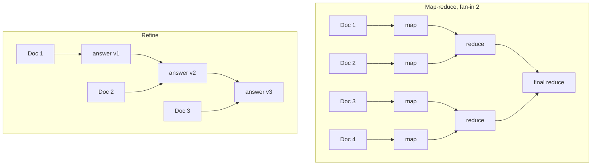

Some questions are answered by one passage: "how many days of annual leave do I get?" Others can only be answered by reading many documents and combining what they say: "list every deadline staff must observe", "how do the 2023 and 2025 handbooks differ?", "summarise last quarter's incident reports". **Multi-document synthesis** is the family of generation strategies for the second kind. They decide how material from many sources is read (all at once, in parallel pieces, or one after another), how intermediate results are combined, and how each final claim keeps its link to the document it came from.

This lesson explains when [basic RAG](/learn/generation-strategies/basic-rag)'s single stuffed prompt stops being enough, the three classic strategies (stuff, map-reduce and refine) plus the hierarchical variant of map-reduce, their exact call counts, sequential depth and token costs, the "extract, then synthesise" pattern that keeps provenance intact, and how to handle disagreement between documents during synthesis.

## Learning objectives

- Recognise question types (aggregation, comparison, corpus-wide summary) that need multi-document synthesis, and explain why top-$k$ retrieval is often the wrong first step for them.
- Implement stuff, map-reduce (with a reduce tree) and refine strategies over a pluggable model, and measure their calls, depth and tokens.
- Derive the number of calls and the sequential depth of map-reduce with fan-in $b$ and of refine, and use them to estimate latency.
- Preserve source identifiers through every intermediate step so that the final answer remains citable.
- Choose a strategy for a given corpus size, context budget, latency target and need for cross-document reasoning.

## Prerequisites

- [Basic RAG](/learn/generation-strategies/basic-rag): the stuffed single-call baseline.
- [Citation-based generation](/learn/generation-strategies/citation-based-generation): why provenance must survive generation.
- [Context windows](/learn/understanding-large-language-models/context-windows): the budget all strategies are working within.
- [Lost-in-the-middle problem](/learn/context-engineering/lost-in-the-middle-problem): why a very long stuffed prompt is not free even when it fits.

## Why this matters

Basic RAG assumes the answer lives in a handful of chunks. Synthesis questions break that assumption in two ways.

First, **the evidence is wide.** "List every deadline" has an answer spread over the leave, expenses, password and laptop sections, and possibly dozens more. Top-$k$ retrieval with $k = 5$ returns the five chunks most similar to the question, which is not the same as all chunks containing a deadline. The answer will look complete and silently omit the rest.

Second, **the evidence is large.** "Summarise last quarter's 60 incident reports" may need far more text than you want in one prompt. Even when a long-context model can technically take it all, cost grows linearly with the input, time to first token grows with it, and research on long contexts (Liu and colleagues, 2023) found that models use information in the middle of a long input less reliably than information at the start or end.

The failure mode in both cases is the same: a fluent, confident answer that covers part of the evidence and presents itself as the whole. Users cannot see what was left out. Synthesis strategies exist to make coverage deliberate: every relevant document is read by some call, and every claim in the output is traceable.

## The intuition

A manager asks three assistants to review forty supplier contracts and list every termination clause.

The first assistant puts all forty contracts on one desk and reads them in one sitting. Fast, if the desk is big enough, but by contract twenty-five her attention is fading.

The second gives one contract each to ten colleagues ("note every termination clause, with the contract number"), then collects the notes in groups of four, merges each group, and merges the merged notes. Lots of people, but they work at the same time, and the whole thing takes three rounds.

The third reads the contracts one by one, keeping a running list and updating it after each. He needs only one desk and sees every contract in full, but it takes forty rounds, and if he makes a careless edit to the list at round twelve, nobody notices.

These are stuff, map-reduce and refine. The colleagues' habit of writing the contract number next to every note is provenance, and without it the manager cannot check anything.

## How it works

### Getting the right documents first

Synthesis begins with selecting the set of documents to read, and for many synthesis questions that is not a similarity search. "Every incident report from last quarter" is a **metadata query**: filter by document type and date, and read all of them. "Every deadline" is closer to a classification over the whole handbook. Using top-$k$ for an enumerating question caps the answer at $k$ sources, whatever the corpus contains. Use [filtered retrieval](/learn/advanced-retrieval/filtered-retrieval) or a plain database query to enumerate the set, and similarity search only to narrow it when it is genuinely too large.

### Three strategies

**Stuff.** Put every selected document into one prompt and make one call. This is basic RAG with a larger, deliberately chosen context. It is the only strategy in which the model sees all documents at once, so it is the best at cross-document reasoning ("the 2025 handbook raised the budget that the 2023 one set at £250"). It fails when the documents do not fit, and degrades as the prompt grows.

**Map-reduce.** Apply the same instruction to each document separately (the **map** step), producing short notes, then combine the notes (the **reduce** step). If the notes are too many to combine in one call, reduce them in groups of $b$ (the **fan-in**), then reduce the results, forming a tree until one remains. Map calls are independent, so they run in parallel. LangChain's legacy `map_reduce` chain and LlamaIndex's `tree_summarize` response mode are implementations of this idea, and Microsoft's GraphRAG answers global questions with a map-reduce over community summaries ([Local and global search](/learn/graph-rag/local-and-global-search)).

**Refine.** Process documents one at a time, passing the running answer and the next document to each call, which returns an improved answer. LlamaIndex's `refine` response mode works this way. Each call sees a document in full and the current answer, so it can relate new material to what has been found so far, but calls are strictly sequential, and every call re-reads the growing answer.



### Extract, then synthesise

The most reliable form of map-reduce does not ask the map step to *summarise*; it asks it to **extract**: copy each relevant fact with its source identifier, and omit everything else. Extraction has three advantages over summarisation at the map step.

1. **Provenance survives.** Each note carries `[hb-leave]`, so after any number of reduce levels the final answer can still cite the original document, and the [quote verification](/learn/generation-strategies/citation-based-generation) from the previous lesson still applies.
2. **Errors do not compound.** A summary of a summary of a summary drifts; a list of extracted facts can be merged and de-duplicated without rewording.
3. **Notes can be structured.** Asking for each fact as a record (`fact`, `value`, `source`, `effective_date`) turns the reduce step into partly deterministic code: group by fact, compare values, sort by date. [Structured outputs](/learn/generation-strategies/structured-outputs) covers how to get such records reliably.

The final step, turning merged notes into prose for the user, is then a small stuffed call over the notes, with every claim citable.

### Disagreement during synthesis

Reading many documents means meeting conflicts: the 2023 and 2025 handbooks, a policy and an FAQ, two incident reports giving different root causes. The reduce instruction must say what to do, and the safe default is: **keep both, mark the conflict, carry both sources.** A reducer told only to "merge and remove duplicates" will often pick one value silently, and the conflict is gone before the final step could report it. If a ranking exists (current over superseded, policy over FAQ), apply it in the final step with the metadata described in [Context-aware generation](/learn/generation-strategies/context-aware-generation).

### Choosing a strategy

| Situation | Strategy |
| --- | --- |
| Selected documents fit comfortably in one prompt, and cross-document reasoning matters | Stuff |
| Many documents, a latency target, facts that can be extracted independently | Map-reduce (extract, then synthesise) |
| The answer must evolve as documents are read (a narrative, a running timeline), and latency is not critical | Refine |
| Very many documents, a corpus-wide question | Map-reduce over precomputed summaries, or a hierarchical index ([Summary indexes](/learn/hierarchical-rag/summary-indexes)) |

The step-by-step procedure for a synthesis request:

1. Classify the question: single-fact, aggregation, comparison or summary.
2. Enumerate the document set with filters; use similarity only to prune.
3. Estimate the tokens of the set. If it fits the budget with room to spare, stuff; otherwise map-reduce.
4. Map: extract facts with source identifiers, in parallel, with a concurrency limit.
5. Reduce: merge and de-duplicate, keep conflicts, preserve identifiers; repeat in a tree if needed.
6. Synthesise: one final call turns the merged notes into the answer, citing sources.
7. Report coverage: how many documents were read and how many contributed.

> [!KEY]
> In multi-document synthesis, coverage and provenance are the product. Enumerate the documents deliberately, extract facts with their source ids rather than summarising, and keep conflicts visible until the final step.

## The mathematics

### Calls, depth and tokens

**Intuition.** Parallel calls cost money but not waiting time; sequential calls cost both. So count two things: the total number of calls (cost) and the length of the longest chain of calls that must happen one after another (latency).

For $N$ documents and a reduce fan-in of $b \ge 2$:

$$
C_{\text{map-reduce}} = N + \sum_{j=1}^{L} \left\lceil \frac{N}{b^{j}} \right\rceil,
\qquad
L = \lceil \log_b N \rceil,
\qquad
\text{depth}_{\text{map-reduce}} = 1 + L
$$

$$
C_{\text{refine}} = N, \qquad \text{depth}_{\text{refine}} = N, \qquad C_{\text{stuff}} = \text{depth}_{\text{stuff}} = 1
$$

- $N$ is the number of documents; $b$ is how many notes one reduce call combines.
- $L$ is the number of reduce levels: each level divides the number of notes by $b$, rounding up.
- $\lceil x \rceil$ rounds up. Level $j$ makes $\lceil N / b^j \rceil$ calls (counting, for simplicity, a call even for a group of one; an implementation can skip those).
- Depth is the number of calls on the critical path: one map level plus $L$ reduce levels.

With $t$ seconds per call and unlimited parallelism, latency $\approx t \times \text{depth}$.

**By hand.** $N = 40$ documents of about 1,000 tokens each, $b = 4$, and assume $t = 3$ seconds per call.

- Map-reduce: $L = \lceil \log_4 40 \rceil = 3$ (since $4^2 = 16 < 40 \le 64 = 4^3$). Reduce calls: $\lceil 40/4 \rceil + \lceil 40/16 \rceil + \lceil 40/64 \rceil = 10 + 3 + 1 = 14$. Total $C = 54$, depth $= 4$, latency $\approx 12$ s.
- Refine: 40 calls, depth 40, latency $\approx 120$ s.
- Stuff: 1 call holding about 40,000 tokens of documents; depth 1, but that one call's time to first token grows with its 40,000-token input.

Raising the fan-in to $b = 8$ gives $L = 2$, reduce calls $5 + 1 = 6$, $C = 46$ and depth 3: fewer, larger reduce calls.

```python
import math

def map_reduce_cost(N, b):
    calls, n, levels = N, N, 0
    while n > 1:
        n = math.ceil(n / b)
        calls += n
        levels += 1
    return calls, 1 + levels

t = 3  # assumed seconds per call
for N, b in [(10, 4), (40, 4), (40, 8), (200, 8)]:
    calls, depth = map_reduce_cost(N, b)
    print(f"N={N:>3} b={b}: map-reduce {calls:>3} calls, depth {depth}, ~{t * depth:>3} s | "
          f"refine {N:>3} calls, depth {N:>3}, ~{t * N:>3} s")
```

```output
N= 10 b=4: map-reduce  14 calls, depth 3, ~  9 s | refine  10 calls, depth  10, ~ 30 s
N= 40 b=4: map-reduce  54 calls, depth 4, ~ 12 s | refine  40 calls, depth  40, ~120 s
N= 40 b=8: map-reduce  46 calls, depth 3, ~  9 s | refine  40 calls, depth  40, ~120 s
N=200 b=8: map-reduce 230 calls, depth 4, ~ 12 s | refine 200 calls, depth 200, ~600 s
```

Depth grows with the logarithm of $N$ for map-reduce and linearly for refine; that single fact usually decides between them. Total input tokens are higher for map-reduce and refine than for stuff, because instructions are repeated per call and refine re-reads its growing answer every time.

## In code

**The problem.** Answer an aggregation question ("list every deadline, time limit or recurring interval") over ten Meridian documents with each of the three strategies, and measure calls, sequential depth, total input tokens and the largest single prompt, while checking that source identifiers survive.

**Dependencies.** tiktoken, used only to count tokens approximately.

```bash
pip install tiktoken
```

The model is a deterministic `FakeLLM` that performs the *extraction* behaviour the prompts ask for (copy sentences that state a time rule, with their source id) and records what each call would cost. It does not model how a real model makes mistakes; it measures the structural costs of each strategy, which do not depend on the model. Because the fake is perfect, all three strategies extract the same facts; with a real model, the risks discussed above (silent dropping in reduce, drift in refine) apply.

```python
import re
import tiktoken

enc = tiktoken.get_encoding("cl100k_base")   # approximate token counts

DOCS = {
    "hb-leave": "Annual leave is 25 days per year. Up to 5 unused days carry over and must be used by 31 March.",
    "hb-remote": "Staff may work remotely up to 3 days a week. The home-office equipment budget is £400.",
    "hb-contractors": "Contractors are not eligible for the home-office equipment budget.",
    "hb-expenses": "Expenses must be submitted within 30 days. Anything over £75 needs a receipt.",
    "rb-passwords": "Passwords must be rotated every 90 days. VPN is required on public Wi-Fi.",
    "rb-laptops": "Laptops are refreshed every 3 years. Lost laptops must be reported to the support desk at once.",
    "rb-support": "The support desk is open 08:00 to 18:00 UK time.",
    "rb-vpn": "Error E-4021 means the VPN client is out of date; update it from the IT portal.",
    "pd-reports": "Meridian Reports exports to PDF and CSV. SAML single sign-on is available on the Enterprise plan.",
    "pd-sync": "Meridian Sync keeps shared folders up to date across devices.",
}
QUESTION = "List every deadline, time limit or recurring interval staff must observe."
TIME_WORDS = re.compile(r"\b(days?|years?|within|by \d|every|at once)\b", re.I)


class FakeLLM:
    """Deterministic stand-in: extracts sentences that state a time rule, keeping their source ids."""
    def __init__(self):
        self.calls, self.input_tokens, self.largest_prompt = 0, 0, 0

    def __call__(self, instruction: str, material: str) -> str:
        n = len(enc.encode(instruction)) + len(enc.encode(material))
        self.calls += 1
        self.input_tokens += n
        self.largest_prompt = max(self.largest_prompt, n)
        notes = set()
        for line in material.splitlines():
            if line.startswith("- "):                        # already a note: keep it
                notes.add(line)
            elif (m := re.match(r"\[(\S+)\] (.*)", line)):   # a raw document
                for sentence in re.split(r"(?<=\.)\s+", m.group(2)):
                    if TIME_WORDS.search(sentence):
                        notes.add(f"- {sentence} [{m.group(1)}]")
        return "\n".join(sorted(notes))


def fmt(ids):
    return "\n".join(f"[{i}] {DOCS[i]}" for i in ids)


MAP = f"Question: {QUESTION}\nCopy each relevant fact as a bullet ending with its [source id]. Omit the rest."
REDUCE = f"Question: {QUESTION}\nMerge these bullet lists. Remove duplicates. Keep every [source id]."
REFINE = f"Question: {QUESTION}\nHere is the answer so far and a new document. Add any new relevant facts, keeping [source ids]."


def stuff(llm, ids):
    return llm(MAP, fmt(ids)), 1                                 # (answer, sequential depth)


def map_reduce(llm, ids, fan_in=4):
    notes = [llm(MAP, fmt([i])) for i in ids]                    # independent: can run in parallel
    depth = 1
    while len(notes) > 1:                                        # tree of reduce calls
        groups = [notes[j:j + fan_in] for j in range(0, len(notes), fan_in)]
        notes = [llm(REDUCE, "\n".join(g)) if len(g) > 1 else g[0] for g in groups]
        depth += 1
    return notes[0], depth


def refine(llm, ids):
    answer = llm(MAP, fmt(ids[:1]))
    for i in ids[1:]:                                            # each step waits for the last
        answer = llm(REFINE, answer + "\n" + fmt([i]))
    return answer, len(ids)


ids = list(DOCS)
print(f"{'strategy':<12}{'calls':>6}{'depth':>7}{'input tokens':>14}{'largest prompt':>16}{'facts':>7}")
results = {}
for name, fn in [("stuff", stuff), ("map-reduce", map_reduce), ("refine", refine)]:
    llm = FakeLLM()
    answer, depth = fn(llm, ids)
    results[name] = answer
    print(f"{name:<12}{llm.calls:>6}{depth:>7}{llm.input_tokens:>14}{llm.largest_prompt:>16}{len(answer.splitlines()):>7}")

print("\nSame facts from all three:", len({results[k] for k in results}) == 1)
print(results["map-reduce"])
```

```output
strategy     calls  depth  input tokens  largest prompt  facts
stuff            1      1           268             268      7
map-reduce      14      3           931             149      7
refine          10     10          1389             183      7

Same facts from all three: True
- Annual leave is 25 days per year. [hb-leave]
- Expenses must be submitted within 30 days. [hb-expenses]
- Laptops are refreshed every 3 years. [rb-laptops]
- Lost laptops must be reported to the support desk at once. [rb-laptops]
- Passwords must be rotated every 90 days. [rb-passwords]
- Staff may work remotely up to 3 days a week. [hb-remote]
- Up to 5 unused days carry over and must be used by 31 March. [hb-leave]
```

**The important lines.**

- `fmt` prefixes each document with `[id]`, and the map instruction asks for every fact to end with its source id. Every note in the final output still names its document, three levels later.
- `map_reduce` runs the map calls in a list comprehension; in production they are independent requests and should run concurrently, with a semaphore limiting how many are in flight (see [Async programming](/learn/python-for-rag-engineering/async-programming)).
- The `while` loop builds the reduce tree, grouping `fan_in` notes per call. With ten notes and `fan_in=4` it makes three reduce calls, then one: 14 calls in all and a depth of 3, as the formula predicts.
- `refine` threads `answer` through every call, so call $i$ cannot start before call $i-1$ ends; its depth equals the number of documents.
- `largest_prompt` tracks the biggest single input, which is what must fit the context window.

**What the output means.** Stuff used one call and the fewest tokens (268), because instructions appear once and nothing is re-read; with ten short documents it is clearly the right choice. Map-reduce used 14 calls and about 3.5 times the tokens, but its largest prompt (149 tokens) is the smallest of the three, and that is the property that matters when the documents do not fit in one prompt. Refine used 10 calls at depth 10 and the most tokens (1,389) because each call re-reads the growing answer. On ten short documents the costs of map-reduce and refine buy nothing; their advantages appear only when $N$ times the document size exceeds what you are willing to put in one prompt.

**The real model.** This needs an API key and was not executed. It has the same `(instruction, material)` signature as `FakeLLM`, so `map_reduce(claude, ids)` runs the real thing; for parallel map calls use `anthropic.AsyncAnthropic` with `asyncio.gather`.

```python
import anthropic

client = anthropic.Anthropic()  # reads ANTHROPIC_API_KEY from the environment

SYSTEM = ("You extract and merge facts from Meridian documents. Use only the material given. "
          "Every bullet must end with the [source id] it came from. If two bullets conflict, "
          "keep both and prefix them with CONFLICT.")


def claude(instruction: str, material: str) -> str:
    response = client.messages.create(
        model="claude-opus-5-5",
        max_tokens=1024,
        system=SYSTEM,
        messages=[{"role": "user", "content": f"<material>\n{material}\n</material>\n\n{instruction}"}],
    )
    if response.stop_reason == "max_tokens":
        raise RuntimeError("notes were truncated; lower the fan-in or raise max_tokens")
    return "".join(block.text for block in response.content if block.type == "text")
```

**Errors people commonly hit.**

- Summarising in the map step ("summarise this document") instead of extracting. Source ids disappear and the final answer cannot be cited.
- Reduce outputs truncated at `max_tokens` when the fan-in is too high; facts vanish silently. Check `stop_reason` on every call.
- Running hundreds of map calls at once and hitting rate limits. Bound concurrency and retry with backoff.
- Telling the reducer to "remove duplicates", which a model may interpret as "remove disagreements".

**Extending it.** Make the map step return structured records and do the reduce in code (group by fact, flag differing values); add a final synthesis call over the merged notes; and report coverage ("read 10 documents; 6 contained relevant facts") with the answer.

## A real-world example

Meridian's HR team asked AskMeridian, before the annual policy review, to "list every policy that has changed between the 2023 and 2025 handbooks". The basic RAG route answered with three changes, all correct, and HR almost circulated it. Funmi on the Platform team was asked to check it and found that the handbooks differed in at least six places, including support hours and the laptop cycle, which the answer omitted.

The cause was the shape of the question. Top-$k$ retrieval had returned the five chunks most similar to "policy changed between handbooks", which were chunks that mention dates and versions, not the chunks that differ. Funmi built a synthesis route for comparison questions. It enumerated both handbooks' sections by metadata, aligned them by section heading, and ran a map step per section pair asking for each value that differs, as a record with both values and both section ids. Pairs with no differences returned nothing. A short final call wrote the comparison as a table, with each row citing both sections.

The answer now listed every difference, including the equipment budget (£250 to £400) and support hours (09:00 to 17:00, now 08:00 to 18:00), and each row was traceable. It took several seconds longer than the basic route, so the team routed only comparison and "list every" questions to it, using a lightweight classifier on the question.

## Common mistakes

- **Answering enumerating questions with top-$k$.** The answer is capped at $k$ sources and looks complete.
- **Losing provenance in intermediate steps.** Once a note drops its source id, no later step can recover it.
- **Choosing refine for large sets.** Depth equals the number of documents, so latency grows linearly, and an early mistake is carried through every later step.
- **Silent conflict resolution in reduce.** The final step cannot report a disagreement the reducer already erased.
- **Stuffing because it fits.** A prompt that fits the window can still be expensive and slow, and material in the middle may be used less reliably.
- **Not reporting coverage.** Users cannot tell an answer drawn from 60 reports from one drawn from 5.

## Best practices

- Classify questions and route only aggregation, comparison and summary questions to synthesis.
- Enumerate the document set with filters; use similarity only to prune.
- Extract facts with source ids in the map step; summarise only in the final step.
- Keep conflicts explicit through every reduce level, and resolve them only with metadata in the final step.
- Run map calls concurrently with a bounded pool, and check `stop_reason` on every call.
- Return coverage information alongside the answer, and log the document set used.

## Performance considerations

The mathematics section gives the shape: map-reduce costs more calls and tokens than stuff, buys bounded prompt size and logarithmic depth, and refine costs linear depth. Three practical points refine those estimates.

**Repeated instructions.** Every map call repeats the instruction and system prompt. With a 300-token system prompt and 40 documents, that is 12,000 tokens of repetition per question, which prompt caching of the static prefix can largely discount. Put the instruction before the document so that the shared prefix is identical across calls.

**Output tokens dominate reduce latency.** A reduce call that writes 400 tokens of merged notes at an assumed 50 tokens per second takes 8 seconds regardless of input size. Extracted facts are shorter than summaries, which is another reason to extract.

**Precompute where the corpus is stable.** If the same documents are synthesised repeatedly (quarterly reports, handbook sections), run the map step at ingestion and store the extracted notes. A query then needs only the reduce and final calls. This is the idea behind [summary indexes](/learn/hierarchical-rag/summary-indexes).

## Security considerations

Synthesis reads many documents per answer, so it multiplies exposure to injected instructions: one poisoned incident report among sixty can tell the reducer to omit certain facts, and the omission is invisible in the final answer. Treat every document as data in every call (the system prompt above repeats this), keep map outputs in a constrained format so that free-form instructions do not propagate to later calls, and validate that every source id in the output belongs to the enumerated set. Enumeration must also respect permissions: a "summarise all incident reports" question must enumerate only the reports the user may read, or the synthesis leaks content from documents the user could never open.

## Summary

- Aggregation, comparison and corpus-wide questions need many documents; top-$k$ retrieval silently caps their coverage.
- Stuff reads everything at once and reasons best across documents, but only while the set fits comfortably.
- Map-reduce extracts in parallel and merges in a tree: more calls, bounded prompt size, depth $1 + \lceil \log_b N \rceil$.
- Refine threads a running answer through every document: depth $N$, so reserve it for small, ordered sets.
- Extract facts with source ids, keep conflicts visible, and report coverage; provenance and coverage are what make the output trustworthy.

## Exercises

**1.** Using the formulas, compute the calls and depth of map-reduce for $N = 100$ documents with $b = 5$ and $b = 10$. With 3 seconds per call, how long does each take, and how does refine compare?

<details><summary>Show solution</summary>

$b = 5$: $L = \lceil \log_5 100 \rceil = 3$ ($25 < 100 \le 125$). Reduce calls $20 + 4 + 1 = 25$; $C = 125$; depth 4; about 12 s.
$b = 10$: $L = 2$. Reduce calls $10 + 1 = 11$; $C = 111$; depth 3; about 9 s.
Refine: 100 calls, depth 100, about 300 s. The higher fan-in saves calls and a level of latency but requires each reduce call to merge 10 notes, so its output must still fit `max_tokens`.

</details>

**2.** The reducer in a real deployment receives "- Laptops are refreshed every 3 years. [hb25]" and "- Laptops are refreshed every 4 years. [hb23]" and outputs only the first. Name two changes to the pipeline that would keep the conflict visible, and say where the conflict should finally be resolved.

<details><summary>Show solution</summary>

(1) Change the reduce instruction to keep both bullets and mark them `CONFLICT`, never deleting a bullet whose value differs. (2) Better, make map outputs structured records (`fact`, `value`, `source`) and do the merge in code, grouping by `fact` and keeping every distinct `value`, so no model can drop one. Resolve the conflict in the final synthesis step using metadata (status current or superseded, effective date), which says "every 3 years; this changed from 4 years in the 2023 handbook".

</details>

**3.** Modify `map_reduce` so that the map calls run concurrently with at most 8 in flight, given an asynchronous `allm(instruction, material)` function. Show the code.

<details><summary>Show solution</summary>

```python
import asyncio

async def map_reduce_async(allm, ids, fan_in=4, max_in_flight=8):
    sem = asyncio.Semaphore(max_in_flight)

    async def bounded(instruction, material):
        async with sem:
            return await allm(instruction, material)

    notes = await asyncio.gather(*(bounded(MAP, fmt([i])) for i in ids))
    depth = 1
    while len(notes) > 1:
        groups = [notes[j:j + fan_in] for j in range(0, len(notes), fan_in)]
        notes = await asyncio.gather(*(bounded(REDUCE, "\n".join(g)) if len(g) > 1
                                       else asyncio.sleep(0, result=g[0]) for g in groups))
        depth += 1
    return notes[0], depth
```

The semaphore caps concurrent requests; `asyncio.gather` preserves order, so grouping is deterministic. Reduce calls at the same level also run concurrently. `asyncio.sleep(0, result=...)` passes a single-note group through without a call.

</details>

## Check your understanding

```quiz
[
  {
    "q": "Why is top-k similarity search often the wrong first step for 'list every incident report from last quarter'?",
    "options": [
      "Because embeddings cannot represent dates",
      "Because it returns at most k documents, capping coverage regardless of how many reports exist",
      "Because incident reports are too long",
      "Because it is slower than a database query"
    ],
    "answer": 1,
    "why": "Enumerating questions need the complete set, which a metadata filter provides; top-k returns the k most similar items and silently omits the rest."
  },
  {
    "q": "Map-reduce with N = 64 documents and fan-in b = 4 has what sequential depth?",
    "options": [
      "64",
      "16",
      "4",
      "3"
    ],
    "answer": 2,
    "why": "L = ceil(log4 64) = 3 reduce levels, plus one map level, gives depth 4."
  },
  {
    "q": "What is the main reason to extract facts with source ids in the map step rather than summarise each document?",
    "options": [
      "Extraction keeps provenance and avoids compounding rewording errors across levels",
      "Summaries use fewer tokens",
      "Extraction needs no model",
      "Summaries cannot be merged"
    ],
    "answer": 0,
    "why": "Extracted, labelled facts can be merged and cited after any number of levels; summaries of summaries drift and lose their sources."
  },
  {
    "q": "In the lesson's measurements on ten short documents, which strategy used the most input tokens, and why?",
    "options": [
      "Stuff, because it sends every document",
      "Map-reduce, because it has the most calls",
      "All used the same",
      "Refine, because every call re-reads the growing answer as well as a new document"
    ],
    "answer": 3,
    "why": "Refine used 1,389 tokens against 931 for map-reduce and 268 for stuff: the running answer is re-sent on each of its sequential calls."
  },
  {
    "q": "A reducer is told to 'merge and remove duplicates'. What risk does this create?",
    "options": [
      "It may run out of context",
      "It may silently drop one of two conflicting values, so the conflict never reaches the final answer",
      "It will always keep both values",
      "It will reorder the documents"
    ],
    "answer": 1,
    "why": "A model may treat a differing value as a duplicate. Instruct it to keep and mark conflicts, or merge structured records in code."
  }
]
```

## Further reading

- Liu, N. F. et al. (2023). *Lost in the Middle: How Language Models Use Long Contexts*. [arXiv:2307.03172](https://arxiv.org/abs/2307.03172)
- Edge, D. et al. (2024). *From Local to Global: A Graph RAG Approach to Query-Focused Summarization*. [arXiv:2404.16130](https://arxiv.org/abs/2404.16130)
- Dean, J. and Ghemawat, S. (2004). *MapReduce: Simplified Data Processing on Large Clusters*. OSDI 2004.
- LlamaIndex documentation: response synthesizers and response modes (`refine`, `compact`, `tree_summarize`). [docs.llamaindex.ai](https://docs.llamaindex.ai/)
- Anthropic, *Claude Developer Platform documentation*: prompt caching and rate limits. [platform.claude.com/docs](https://platform.claude.com/docs)
