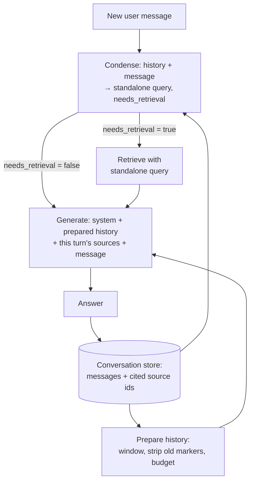

People do not ask an assistant one self-contained question and leave. They ask "what's the home-office budget?", then "what about contractors?", then "who do I tell if it gets stolen?". Each follow-up leans on what came before: "contractors" means "contractors and the equipment budget", "it" means the laptop. **Multi-turn RAG** is the set of techniques that let a retrieval-augmented system hold such a conversation correctly: rewriting each follow-up into a question that retrieval can answer, deciding whether a turn needs retrieval at all, and managing the conversation history that goes into each generation prompt.

[Basic RAG](/learn/generation-strategies/basic-rag) assumed the question is self-contained. This lesson shows, with real retrieval scores, what happens when it is not, then builds the standard architecture: a condensing step that produces a standalone query and a retrieval decision, per-turn retrieval, and a history manager that strips stale citations and keeps the prompt within budget. The general technique of query rewriting is covered in [Query rewriting](/learn/advanced-retrieval/query-rewriting); here the focus is on what conversation adds.

## Learning objectives

- Explain why retrieving with the raw text of a follow-up fails, and demonstrate the failure with retrieval ranks.
- Implement a condense step that turns a follow-up and recent history into a standalone query and a decision on whether to retrieve.
- Manage conversation history for generation: which turns to keep, why old citation markers must be removed, and how to fit a token budget.
- Compute how input tokens grow over a conversation with full history, a window and retained sources.
- Choose what to persist between turns (answers, source ids, summaries) and what to discard.

## Prerequisites

- [Basic RAG](/learn/generation-strategies/basic-rag): the single-turn loop each turn reuses.
- [Context injection](/learn/prompt-engineering-for-rag/context-injection): where history sits relative to sources and the question.
- [Structured outputs](/learn/generation-strategies/structured-outputs): used for the condense step's output.
- [System prompts and user prompts](/learn/understanding-large-language-models/system-prompts-and-user-prompts): the message roles a conversation is built from.

## Why this matters

Retrieval sees only the text you give it. "What about contractors?" contains one useful word, and in a corpus with several documents about contractors (invoices, procurement, equipment return), that word alone does not identify the one about the equipment budget. "What are their hours?" contains no reference to the support desk at all; it is as similar to the London office's opening hours and to the canteen as to anything else. The model generating the answer could resolve these references from the history, but by then retrieval has already chosen the wrong chunks, and a model told to answer only from the sources will answer about the wrong hours or say it does not know.

History also costs. A conversation of twenty turns that sends every earlier exchange with every request pays for the first question twenty times. And history carries hazards from earlier turns: citation labels such as `[S1]` that referred to a different set of sources, retrieved text from three questions ago that now distracts, and, if earlier sources are kept, a context that grows by thousands of tokens per turn. Getting multi-turn right is the difference between an assistant people use for real conversations and one they learn to address in carefully self-contained questions.

## The intuition

You phone a helpdesk and are passed between two people. The first, the receptionist, listens to your whole conversation so far and writes a note for the specialist: not "what about contractors?" but "caller wants to know whether contractors get the home-office equipment budget". The specialist looks up exactly that, and answers. If you say "thanks, that's all", the receptionist does not send anyone to the archives.

The receptionist is the condense step. The note is the standalone query. Deciding not to send anyone to the archives is the retrieval decision. And the receptionist's own notebook, in which she keeps short summaries of what has been asked and answered rather than photocopies of every document the specialist consulted, is history management.

## How it works

### The architecture

Each user turn goes through these steps.

1. **Condense.** Give a model the recent history and the new message; ask for a standalone version of the question (one that makes sense with no history) and whether answering it needs new retrieval.
2. **Decide.** If no retrieval is needed (a thank-you, a request to shorten the previous answer, a question about the previous answer itself), skip to generation with history only.
3. **Retrieve** with the standalone query, not the raw message.
4. **Prepare history** for the generation prompt: recent exchanges only, with old citation markers removed, within a token budget.
5. **Generate** with the system prompt, the prepared history, this turn's sources and the user's message. Answer the user's message as written; the standalone query was for retrieval.
6. **Persist** the user message, the answer and the source ids it cited (as stable document ids, not per-turn labels).



### Condensing a follow-up

A **standalone query** (also called a *condensed* or *decontextualised* question) restates the follow-up so that every reference is explicit. Research on conversational question answering has studied this as *question rewriting*: the CANARD dataset (Elgohary and colleagues, 2019) pairs conversational questions with human rewrites, and QReCC (Anantha and colleagues, 2021) studied rewriting for open-domain conversational retrieval. In practice, a capable LLM with a short instruction does it well.

Good condensing instructions say:

- Resolve pronouns and ellipsis ("it", "they", "what about…") using the history.
- Keep the user's intent and constraints; do not answer the question.
- Do not add assumptions the history does not support; if the reference is genuinely ambiguous, say so (and let the assistant ask).
- Return `needs_retrieval: false` for turns that are about the conversation itself.

Use only the last few exchanges as input; references rarely reach further back, and a shorter input makes condensing fast and cheap. Condensing is a separate model call before retrieval, so it adds to time to first token; a small, fast model is usually sufficient for it.

### The retrieval decision

Not every turn needs retrieval. "Can you put that as a bullet list?" or "Thanks!" should not trigger a search, which would at best waste time and at worst replace the previous answer's sources with irrelevant ones. Asking the condense step for a boolean is the simplest way to decide. When in doubt, retrieving is the safer error: an unnecessary search costs latency, while a skipped one forces the model to answer from history alone, which is where unsupported claims creep in.

### What history goes into the generation prompt

The generation model needs enough history to answer naturally ("No, contractors aren't eligible" reads better than restating the whole question), but history is not evidence. The policy:

- **Keep recent exchanges, as messages.** Put earlier turns in the `messages` list as alternating `user` and `assistant` messages, then the current user message with this turn's sources. Keep whole exchanges; a user message without its answer, or the reverse, confuses the model.
- **Strip citation markers from earlier answers.** `[S1]` in turn 2 referred to turn 2's sources. In turn 5, `S1` names a different chunk. Left in, the model may copy old markers into the new answer, producing citations that point at the wrong document. [Response generation](/learn/rag-architecture-fundamentals/response-generation) described exactly this failure. Store the resolved document ids alongside the message, not in its text.
- **Do not re-send earlier turns' sources.** The current turn retrieves what it needs. If an earlier source is still relevant, retrieval with a good standalone query will find it again, now labelled for this turn.
- **Fit a budget.** Keep the newest exchanges that fit a fixed token budget. For long conversations, replace older exchanges with a short summary, written by a model and stored, so that facts established early ("I'm a contractor based in Manchester") survive.

> [!KEY]
> Retrieve with a standalone query, not the raw follow-up. Give the generator recent history for coherence, never as evidence: strip old citation markers, do not carry old sources, and keep the history within a budget.

### Facts about the user, and memory

Some things said in conversation are facts about the user, not about the documents: "I'm a contractor", "I work part time". These affect which sources apply, as [Context-aware generation](/learn/generation-strategies/context-aware-generation) explained. Two cautions. First, attributes that control access or eligibility should come from authenticated identity, not from what the user says. Second, persistent memory across conversations (remembering next week what was said today) is a separate design with its own privacy obligations: what is stored, for how long, and how a user can see and delete it. Within one conversation, a short summary carried in the history is usually enough.

## The mathematics

### How input grows over a conversation

**Intuition.** If every turn re-sends all earlier exchanges, turn $t$ carries $t - 1$ exchanges of history, so the total over a conversation grows with the square of its length. A window caps the history; keeping old sources makes the growth far steeper.

$$
\text{Input}_{\text{total}} = \sum_{t=1}^{T} \Big(P + s + h\,(t - 1)\Big) = T\,(P + s) + h\,\frac{T(T - 1)}{2}
$$

- $T$ is the number of turns.
- $P$ is the system prompt's token count; $s$ is the tokens of sources retrieved per turn.
- $h$ is the tokens per earlier exchange (one user message plus one answer) kept in history.
- With a window of the last $w$ exchanges, replace $h(t-1)$ with $h \min(t - 1, w)$. If earlier sources are also kept, each earlier exchange costs $h + s$ instead of $h$.

**By hand.** $P = 300$, $s = 2000$, $h = 150$, $T = 20$. Then $T(P + s) = 20 \times 2300 = 46{,}000$ and $h\,T(T-1)/2 = 150 \times 190 = 28{,}500$, so the total is $74{,}500$ tokens. With a window of $w = 4$, history per turn is at most 600 tokens: turns 1 to 4 carry $0 + 150 + 300 + 450 = 900$ and turns 5 to 20 carry $16 \times 600 = 9{,}600$, a total of $46{,}000 + 10{,}500 = 56{,}500$. Keeping old sources makes each earlier exchange cost 2,150 tokens: $46{,}000 + 2150 \times 190 = 454{,}500$, six times the full-history figure.

```python
P, s, h, T, w = 300, 2000, 150, 20, 4     # system, sources per turn, tokens per exchange, turns, window

def total_input(per_turn_history):
    return sum(P + s + per_turn_history(t) for t in range(1, T + 1))

full = total_input(lambda t: h * (t - 1))                   # every earlier exchange
window = total_input(lambda t: h * min(t - 1, w))           # last w exchanges only
with_sources = total_input(lambda t: (h + s) * (t - 1))     # earlier sources kept as well

print(f"full history:        {full:>9,} input tokens over {T} turns")
print(f"window of {w}:         {window:>9,}")
print(f"keeping old sources: {with_sources:>9,}")
print(f"formula check: {T * (P + s) + h * T * (T - 1) // 2:,}")
```

```output
full history:           74,500 input tokens over 20 turns
window of 4:            56,500
keeping old sources:   454,500
formula check: 74,500
```

[Context windows](/learn/context-engineering/context-windows) derives the same growth from the window's point of view. The quadratic term is modest when $h$ is small, which is why stripping answers down to their text and not carrying sources matters more than the window size. Sources, not chat, are what make long conversations expensive.

## In code

**The problem.** Show, with real retrieval over a small Meridian corpus, how follow-up questions retrieve when used as typed and when rewritten as standalone queries; then prepare the history for the generation prompt by stripping old citation markers and fitting a token budget.

**Dependencies.** sentence-transformers (local `all-MiniLM-L6-v2` embeddings), NumPy and tiktoken (approximate token counts).

```bash
pip install sentence-transformers numpy tiktoken
```

The corpus deliberately includes near-misses that a real intranet has: other documents about contractors, other opening hours. The standalone rewrites are written by hand, in the form the condense step is asked to produce; the model call that produces them in production follows the output.

```python
import re
import numpy as np
import tiktoken
from sentence_transformers import SentenceTransformer

enc = tiktoken.get_encoding("cl100k_base")   # approximate token counts
model = SentenceTransformer("sentence-transformers/all-MiniLM-L6-v2")

CORPUS = {
    "remote-1": "Staff may work remotely up to 3 days a week. The home-office equipment budget is £400.",
    "remote-2": "Contractors are not eligible for the home-office equipment budget.",
    "contract-1": "Contractor invoices are paid within 30 days of receipt.",
    "contract-2": "Contractors must return all Meridian equipment when their contract ends.",
    "laptops-1": "Laptops are refreshed every 3 years. Lost laptops must be reported to the support desk at once.",
    "support-1": "The support desk is open 08:00 to 18:00 UK time.",
    "portal-1": "The IT portal is available at all hours for software updates.",
    "canteen-1": "The canteen serves breakfast from 08:00 and closes at 15:00.",
    "contract-3": "Contractors are engaged through the procurement team and need a purchase order.",
    "hours-1": "Office hours at the London site are 07:00 to 19:00.",
    "expenses-1": "Expenses must be submitted within 30 days. Anything over £75 needs a receipt.",
}
ids = list(CORPUS)
vectors = model.encode(list(CORPUS.values()), normalize_embeddings=True)


def rank_of(query: str, gold: str) -> int:
    scores = vectors @ model.encode([query], normalize_embeddings=True)[0]
    return [ids[i] for i in np.argsort(-scores)].index(gold) + 1


# Follow-ups as typed, and the standalone rewrites a condensing model is asked to produce.
# The rewrites are written by hand here; in production they come from the model call shown later.
TURNS = [
    ("What is the home-office equipment budget?", None, "remote-1"),
    ("What about contractors?", "Are contractors eligible for the home-office equipment budget?", "remote-2"),
    ("My laptop is four years old. Is that normal?", None, "laptops-1"),
    ("Who do I tell if it gets stolen?", "Who do I report a stolen laptop to?", "laptops-1"),
    ("What are their hours?", "What are the support desk's opening hours?", "support-1"),
]

print(f"{'as typed':<46}{'rank':>5}   {'standalone rewrite':<62}{'rank':>5}")
for typed, rewrite, gold in TURNS:
    r_typed = rank_of(typed, gold)
    if rewrite:
        r_rew = rank_of(rewrite, gold)
        print(f"{typed:<46}{r_typed:>5}   {rewrite:<62}{r_rew:>5}")
    else:
        print(f"{typed:<46}{r_typed:>5}   {'(already standalone)':<62}{'-':>5}")


# --- History for the generation prompt: strip old citations, keep within a budget ----------
history = [
    ("user", "What is the home-office equipment budget?"),
    ("assistant", "The home-office equipment budget is £400 [S1]."),
    ("user", "What about contractors?"),
    ("assistant", "Contractors are not eligible for the home-office equipment budget [S1]."),
    ("user", "My laptop is four years old. Is that normal?"),
    ("assistant", "No. Laptops are refreshed every 3 years [S1], so yours is due for replacement."),
    ("user", "Who do I tell if it gets stolen?"),
    ("assistant", "Report a lost or stolen laptop to the support desk at once [S1]."),
]


def prepare_history(history, budget_tokens):
    """Drop old citation markers (their labels belonged to earlier turns) and keep the newest
    whole exchanges that fit the budget."""
    cleaned = [(role, re.sub(r"\s*\[S\d+\]", "", text)) for role, text in history]
    pairs = [cleaned[i:i + 2] for i in range(0, len(cleaned), 2)]
    kept, used = [], 0
    for pair in reversed(pairs):                       # newest first
        cost = sum(len(enc.encode(text)) for _, text in pair)
        if used + cost > budget_tokens:
            break
        kept = pair + kept
        used += cost
    return [{"role": r, "content": t} for r, t in kept], used


for budget in (100, 40):
    messages, used = prepare_history(history, budget)
    print(f"\nbudget {budget}: kept {len(messages)} messages, {used} tokens")
    for m in messages:
        print(f"  {m['role']:<9} {m['content']}")
```

```output
as typed                                       rank   standalone rewrite                                             rank
What is the home-office equipment budget?         1   (already standalone)                                              -
What about contractors?                           2   Are contractors eligible for the home-office equipment budget?    1
My laptop is four years old. Is that normal?      1   (already standalone)                                              -
Who do I tell if it gets stolen?                  3   Who do I report a stolen laptop to?                               1
What are their hours?                             3   What are the support desk's opening hours?                        1

budget 100: kept 8 messages, 84 tokens
  user      What is the home-office equipment budget?
  assistant The home-office equipment budget is £400.
  user      What about contractors?
  assistant Contractors are not eligible for the home-office equipment budget.
  user      My laptop is four years old. Is that normal?
  assistant No. Laptops are refreshed every 3 years, so yours is due for replacement.
  user      Who do I tell if it gets stolen?
  assistant Report a lost or stolen laptop to the support desk at once.

budget 40: kept 2 messages, 22 tokens
  user      Who do I tell if it gets stolen?
  assistant Report a lost or stolen laptop to the support desk at once.
```

**The important lines.**

- `rank_of` embeds a query and reports where the chunk a correct answer needs ranks among all chunks; rank 1 means it would be first in the prompt.
- Each turn is retrieved twice, once as typed and once as rewritten, against the same index. Nothing else changes, so the difference in rank is entirely due to the query text.
- `prepare_history` removes `[S1]`-style markers with a regular expression before anything else; the labels belonged to earlier turns' sources.
- History is grouped into user-assistant pairs and kept newest first until the budget is spent, so the prompt never contains half an exchange.

**What the output means.** The two standalone turns retrieve their chunk first either way. The three follow-ups do not. "What about contractors?" puts the procurement document first and the budget exclusion second: the word "contractors" matches three documents equally well, and nothing in the message says "budget". "Who do I tell if it gets stolen?" ranks the laptop chunk third, behind the expenses rule, because "it" carries no meaning for the embedding. "What are their hours?" prefers the London office's hours and ranks the support desk third. Every rewrite moves the needed chunk to rank 1. With $k = 1$ or $2$, the raw follow-ups would have produced answers about the wrong document; with a larger $k$ they would have arrived with distractors ranked above the evidence.

The history output shows the markers removed and the effect of the budget: with 100 tokens all four exchanges fit; with 40 only the most recent one does. The next turn, "What are their hours?", still has the exchange it refers to ("the support desk"), which is why condensing works from the most recent exchanges.

**The condense call.** This needs an API key and was not executed. It uses structured output so that the query and the decision arrive as fields.

```python
import anthropic
from pydantic import BaseModel, Field

client = anthropic.Anthropic()  # reads ANTHROPIC_API_KEY from the environment


class Condensed(BaseModel):
    standalone_query: str = Field(description="The latest message rewritten to make sense with no history.")
    needs_retrieval: bool = Field(description="False only if the message is about the conversation itself.")


CONDENSE_SYSTEM = (
    "Rewrite the user's latest message as a standalone question for searching Meridian's documents. "
    "Resolve pronouns and references from the conversation. Do not answer it and do not add facts "
    "the conversation does not contain. Set needs_retrieval to false for thanks, greetings or requests "
    "to reformat the previous answer."
)


def condense(history: list[dict], message: str) -> Condensed:
    transcript = "\n".join(f"{m['role']}: {m['content']}" for m in history[-6:])
    response = client.messages.parse(
        model="claude-opus-5-5",
        max_tokens=256,
        system=CONDENSE_SYSTEM,
        messages=[{"role": "user", "content":
                   f"<conversation>\n{transcript}\n</conversation>\n<latest>{message}</latest>"}],
        output_format=Condensed,
    )
    return response.parsed_output


messages, _ = prepare_history(history, budget_tokens=600)
print(condense(messages, "What are their hours?"))
```

Your exact wording will differ; the output looks like this:

```output
standalone_query="What are the support desk's opening hours?" needs_retrieval=True
```

The generation call then sends `messages` (the prepared history) followed by one user message containing this turn's sources and the user's original wording, exactly as in [Basic RAG](/learn/generation-strategies/basic-rag).

**Errors people commonly hit.**

- Retrieving with the concatenation of all previous messages. It retrieves documents about the whole conversation, usually the first topic, not the current question.
- Letting the condenser answer the question instead of rewriting it, which then gets embedded as a query. The instruction must forbid answering, and outputs should be checked for length.
- Sending the standalone query to the generator instead of the user's message. The answer then responds to a paraphrase the user never wrote.
- Storing answers with their `[S1]` markers and replaying them, so old labels leak into new citations.

**Extending it.** Store a running summary of exchanges that fall outside the window and prepend it to the history; log the standalone query next to the raw message so that retrieval failures can be diagnosed; and add evaluation cases built as whole conversations, scoring retrieval on each follow-up.

## A real-world example

A month after launch, AskMeridian's analytics showed that answers to second and later turns were rated unhelpful far more often than first turns. Ines on the Platform team sampled poorly rated conversations and found a consistent pattern: follow-ups such as "and for part-timers?" or "where do I send it?" were being embedded as typed, and retrieval returned whichever documents happened to mention part-time work or sending things.

She added a condense step using a small, fast model, with the instruction and structured output from this lesson, and switched retrieval to the standalone query. She also found a second, quieter bug: the conversation store saved answers with their citation markers and replayed them, so later answers occasionally cited `[S3]` for a fact that had come from a different turn's `S3`. Stripping markers from replayed answers and storing cited document ids in a separate field fixed it.

The condense call added a fraction of a second to time to first token for follow-ups (first turns skipped it, since there was nothing to condense). Helpfulness ratings on follow-up turns rose to roughly the level of first turns over the next few weeks. Ines added fifty short conversations to the regression set, each scored on whether every turn's needed chunk was retrieved, so that a change to the condense prompt could not silently undo the gain.

## Common mistakes

- **Embedding the raw follow-up.** Pronouns and ellipses carry no retrieval signal; the wrong chunks reach the prompt.
- **Embedding the whole conversation.** The query drifts towards the first topic discussed.
- **Replaying old citation markers.** Labels from earlier turns point at different sources now.
- **Carrying earlier sources forward.** Cost grows by thousands of tokens per turn and stale evidence distracts.
- **Retrieving for every turn.** "Thanks" or "make it shorter" replaces good sources with irrelevant ones.
- **Trusting identity claims made in chat.** "I'm a permanent employee" is not authentication.

## Best practices

- Condense every follow-up into a standalone query with a short, explicit instruction, using the last few exchanges.
- Ask the condense step whether retrieval is needed, and retrieve when unsure.
- Generate an answer to the user's original message, with recent history for coherence and this turn's sources as evidence.
- Store cited document ids separately from answer text; strip markers before replaying history.
- Keep history within a token budget, summarising older exchanges when conversations are long.
- Evaluate with whole conversations, scoring retrieval on each follow-up, not only on first questions.

## Performance considerations

The condense step adds one short model call before retrieval: perhaps a few hundred input tokens and a few dozen output tokens. Its latency adds directly to time to first token, so use a fast model, cap `max_tokens`, and skip it on the first turn. Its cost is small next to generation, whose input includes thousands of tokens of sources.

History costs follow the mathematics above: the quadratic growth is driven by $h$, the tokens per exchange, and dwarfed by $s$ if sources are carried. A window of a few exchanges plus a summary bounds per-turn input regardless of conversation length. The static system prompt remains cacheable across turns; the growing history can also benefit from prompt caching when it is a stable prefix of the next request, since each turn appends to the previous turn's messages. Check the provider's caching rules for how prefixes are matched.

## Security considerations

A conversation is a channel for gradual manipulation. A user can establish false context early ("as discussed, I'm on the security team") and rely on it later; history must not become a source of authority, and attributes that matter must come from identity. Retrieved documents from earlier turns may contain injected instructions; not carrying old sources forward limits how long such text stays in the prompt. The condense step is itself a model call over user text, so a crafted message can try to make the standalone query fetch documents unrelated to the conversation; this is harmless only if retrieval enforces permissions on every query, as it must. Finally, stored conversations contain personal data and anything users chose to share; give them a retention period and a deletion path, as covered in [Data retention](/learn/access-control-and-privacy/data-retention).

## Summary

- Follow-ups rely on the conversation; retrieving with their raw text puts the wrong chunks first, as the ranks in this lesson show.
- A condense step rewrites each follow-up into a standalone query and decides whether retrieval is needed.
- History is for coherence, not evidence: keep recent whole exchanges, strip old citation markers, and do not carry earlier sources.
- Input tokens grow quadratically with full history and far faster with retained sources; a window plus summary bounds them.
- Evaluate multi-turn behaviour with whole conversations, scoring every follow-up's retrieval.

## Exercises

**1.** For each message, give a standalone query and say whether retrieval is needed. History: the user asked about the expenses deadline and was told 30 days. (a) "And receipts?" (b) "Thanks, that's clear." (c) "Can you say that in one sentence?" (d) "Does the same apply to contractors?"

<details><summary>Show solution</summary>

(a) "When does an expense claim need a receipt?" Retrieval needed. (b) No query; no retrieval. (c) No retrieval: it is about the previous answer; the generator reformats it from history. (d) "Does the 30-day expenses submission deadline apply to contractors?" Retrieval needed; note the rewrite keeps the specific rule being asked about, which is what lets retrieval find any contractor-specific expenses policy.

</details>

**2.** Using the formula, compute total input tokens for $T = 10$ turns with $P = 400$, $s = 1500$, $h = 200$, first with full history and then with a window of $w = 3$.

<details><summary>Show solution</summary>

Full history: $T(P + s) = 10 \times 1900 = 19{,}000$; $h\,T(T-1)/2 = 200 \times 45 = 9{,}000$; total $28{,}000$. Window of 3: history per turn is $0, 200, 400, 600$ for turns 1 to 4, then 600 for turns 5 to 10: $1{,}200 + 6 \times 600 = 4{,}800$; total $19{,}000 + 4{,}800 = 23{,}800$.

</details>

**3.** Extend `prepare_history` so that exchanges that do not fit the budget are not lost entirely: they are passed to a `summarise(pairs) -> str` function, and its result is prepended as a single user message beginning "Summary of earlier conversation:". Show the code and say what must be true of the summary.

<details><summary>Show solution</summary>

```python
def prepare_history(history, budget_tokens, summarise=None):
    cleaned = [(role, re.sub(r"\s*\[S\d+\]", "", text)) for role, text in history]
    pairs = [cleaned[i:i + 2] for i in range(0, len(cleaned), 2)]
    kept, used, cut = [], 0, 0
    for idx in range(len(pairs) - 1, -1, -1):
        cost = sum(len(enc.encode(text)) for _, text in pairs[idx])
        if used + cost > budget_tokens:
            cut = idx + 1                    # pairs[0:cut] did not fit
            break
        kept = pairs[idx] + kept
        used += cost
    messages = [{"role": r, "content": t} for r, t in kept]
    if cut and summarise:
        summary = summarise([p for pair in pairs[:cut] for p in pair])
        messages = [{"role": "user", "content": f"Summary of earlier conversation: {summary}"},
                    {"role": "assistant", "content": "Understood."}] + messages
    return messages, used
```

The summary must contain no citation markers, must record facts the user stated about themselves and the topics already settled, and must be short enough to fit alongside the kept exchanges (count it in the budget in production). The placeholder assistant reply keeps the roles alternating. Generate the summary once, store it, and update it incrementally rather than re-summarising the whole conversation each turn.

</details>

## Check your understanding

```quiz
[
  {
    "q": "Why does retrieving with the raw follow-up 'What are their hours?' fail?",
    "options": [
      "Because the embedding model cannot handle questions",
      "Because the message does not say whose hours, so similar documents about other opening hours rank as high or higher",
      "Because follow-ups are too short to embed",
      "Because the corpus has no opening hours"
    ],
    "answer": 1,
    "why": "In the lesson's run, the London office hours ranked first and the support desk third; the reference to the support desk lives only in the history."
  },
  {
    "q": "Which text should the generation model answer?",
    "options": [
      "The standalone query produced by the condense step",
      "The first message of the conversation",
      "The user's original message, with recent history and this turn's sources",
      "The concatenation of all user messages"
    ],
    "answer": 2,
    "why": "The standalone query is for retrieval. The user should get an answer to what they actually wrote, with history for coherence."
  },
  {
    "q": "Why strip [S1]-style markers from earlier answers before replaying them?",
    "options": [
      "Labels are per turn; in a new turn S1 names a different source, so copied markers would cite the wrong document",
      "To save one token per marker",
      "Because the API rejects square brackets",
      "Because markers confuse the tokeniser"
    ],
    "answer": 0,
    "why": "Each turn numbers its own sources. Store resolved document ids separately, and remove the per-turn labels from replayed text."
  },
  {
    "q": "With P = 300, s = 2000, h = 150 and T = 20, keeping earlier sources in history raises total input from 74,500 tokens to about how many?",
    "options": [
      "About 80,000",
      "About 150,000",
      "About 1,000,000",
      "About 455,000"
    ],
    "answer": 3,
    "why": "Each earlier exchange then costs h + s = 2,150 tokens: 46,000 + 2,150 x 190 = 454,500."
  },
  {
    "q": "A user says 'thanks, can you make that shorter?'. What should the pipeline do?",
    "options": [
      "Retrieve with the message as typed",
      "Skip retrieval and reformat the previous answer from history",
      "Retrieve with the whole conversation",
      "Start a new conversation"
    ],
    "answer": 1,
    "why": "The turn is about the previous answer; retrieval would at best waste time and at worst replace good sources with irrelevant ones."
  }
]
```

## Further reading

- Elgohary, A., Peskov, D. and Boyd-Graber, J. (2019). *Can You Unpack That? Learning to Rewrite Questions-in-Context*. EMNLP 2019.
- Anantha, R. et al. (2021). *Open-Domain Question Answering Goes Conversational via Question Rewriting* (QReCC). NAACL 2021.
- Dalton, J., Xiong, C. and Callan, J. (2020). *TREC CAsT 2019: The Conversational Assistance Track Overview*. [arXiv:2003.13624](https://arxiv.org/abs/2003.13624)
- Anthropic, *Claude Developer Platform documentation*: Messages API conversations, structured outputs and prompt caching. [platform.claude.com/docs](https://platform.claude.com/docs)
