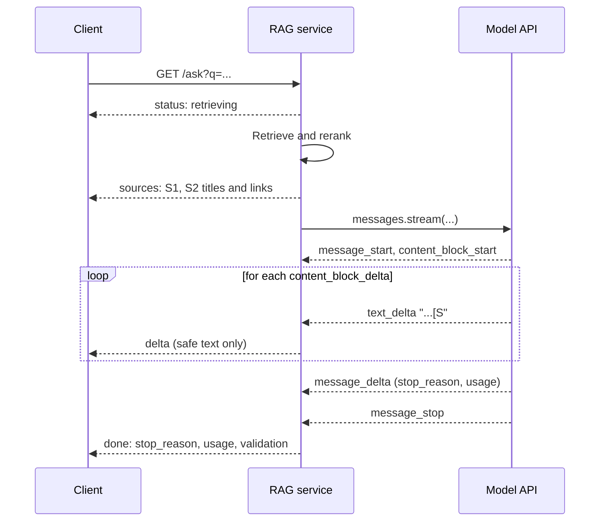

A RAG answer takes seconds to generate, and a user staring at an empty box for six seconds assumes something is broken. **Streaming** sends the answer as it is produced, so the first words appear in well under a second and the rest arrive faster than anyone can read them. [Response generation](/learn/rag-architecture-fundamentals/response-generation) introduced the idea and the basic tension with validation. This lesson treats streaming as a generation strategy to be engineered: the provider's event model, the application's own event protocol (status, sources, text, warnings, completion), holding back citation markers that arrive in pieces, cancellation that actually stops the model, and what to do when a stream fails halfway.

You will build an asynchronous streaming pipeline that runs locally against a simulated model, measure its time to first text, cancel it mid-answer and watch the cancellation reach the model, and serve it over Server-Sent Events with FastAPI.

## Learning objectives

- Describe the sequence of events in a streamed Messages API response and what each carries.
- Design an application-level event protocol for RAG that sends status, sources, text deltas, warnings and a completion event.
- Implement a delta buffer that never releases a partial citation marker, and explain its latency cost.
- Propagate client cancellation to the model stream so that abandoned answers stop costing tokens.
- Compute time to first token and total latency for blocking and streaming responses, and explain why streaming changes perceived but not total latency.

## Prerequisites

- [Basic RAG](/learn/generation-strategies/basic-rag): the pipeline being streamed.
- [Response generation](/learn/rag-architecture-fundamentals/response-generation): the stream-then-validate and sentence-buffering strategies.
- [Model inference](/learn/understanding-large-language-models/model-inference): prefill, decoding and why output arrives token by token.
- [Async programming](/learn/python-for-rag-engineering/async-programming): `async for`, async generators and cancellation.

## Why this matters

Generation dominates RAG latency. A 300-token answer at an output rate of 50 tokens per second takes 6 seconds after the first token, whatever you do to retrieval. Without streaming, the user waits for all of it; with streaming, they start reading after the time to first token, and generation then outpaces their reading. Perceived latency drops by an order of magnitude with no change to the model or the pipeline.

But streaming changes the shape of the system in ways that cause real bugs. Text reaches the user before it can be validated. Citations arrive split across pieces, so a naive renderer shows `[S` and then `1]`. A user who closes the tab leaves the server generating, and paying for, an answer nobody will read. A network error at sentence three leaves a half answer on screen, and the request cannot simply be retried, because the user has already read part of it. And intermediaries (proxies, load balancers, compression middleware) buffer responses by default, quietly turning a streamed answer back into a blocking one. Streaming done casually is a demonstration; streaming done properly is a protocol.

## The intuition

A newspaper can publish one edition at the end of the day, or run a live blog. The live blog gets the first facts out in minutes, and readers keep up with it as it grows. But it needs rules the daily edition does not: say up front what sources the coverage relies on; never publish half a sentence that might be misread; mark corrections clearly because readers have already seen the original; and stop paying the reporter when everybody has gone home.

Streaming a RAG answer is running a live blog with those rules.

## How it works

### The provider's event stream

When you ask the Anthropic Messages API to stream, it sends **Server-Sent Events** (SSE), a simple HTTP format in which the server keeps the response open and writes named events, each a few lines of text, as they happen. A streamed message arrives as:

1. `message_start`: the message object, with no content yet, and initial usage.
2. `content_block_start`: a new content block begins (text, or a tool call).
3. Many `content_block_delta` events, each carrying a delta: `text_delta` with a piece of text, `citations_delta` with a citation when native citations are enabled, or `input_json_delta` with a fragment of a tool call's JSON input.
4. `content_block_stop`: the block is complete.
5. `message_delta`: top-level changes, including the `stop_reason` and the cumulative output token count.
6. `message_stop`: the stream is finished.

`ping` events may appear at any point, and an `error` event can arrive mid-stream (for example, if the service is overloaded). The Python SDK wraps this: `stream.text_stream` yields just the text pieces, iterating over the stream yields higher-level events (`text`, `citation` and the raw events), and `stream.get_final_message()` returns the assembled message with its usage.

A text delta is not a word or a sentence. It is whatever the model produced since the last event, often a few characters, and its boundaries fall wherever they fall: inside a word, inside a number, inside a citation marker.

### The application's event protocol

Your client should not receive the provider's events directly. It should receive **your** events, designed around what the interface needs. A good RAG stream sends:

| Event | When | Why |
| --- | --- | --- |
| `status` | Immediately, and at each slow stage | The user sees "searching" rather than nothing |
| `sources` | After retrieval, before generation | Titles and links are known early; the interface can show them while text arrives |
| `delta` | For each safe piece of text | The answer itself |
| `warning` | When a check fails mid-stream | For example, a citation to an unknown source |
| `done` | At the end | `stop_reason`, usage, validation result; the client finalises rendering |
| `error` | On failure | What failed and whether partial text should be kept |

Sending `sources` before the first delta is the single most useful improvement over streaming raw text. Retrieval is finished before generation starts, so the list of sources costs nothing extra to send early, and it lets the interface show "based on: Employee Handbook > Annual leave" while the answer is still being written.



### Holding back partial markers

The simplest safe rule: release everything in the buffer except a trailing `[` that has not yet been closed by `]`. When the closing bracket arrives, the complete marker is released together with what follows. The latency cost is bounded by the length of a marker, a few tokens, which at 50 tokens per second is well under a tenth of a second. Releasing at sentence boundaries instead, as in [Response generation](/learn/rag-architecture-fundamentals/response-generation), lets you validate each sentence before display at the cost of a sentence's delay; choose by how costly a briefly visible error is.

Native citations change this: with citations enabled, citation data arrives as separate `citations_delta` events, not as characters in the text, so there is nothing to reassemble. Structured output changes it in another way: JSON arrives in fragments that cannot be parsed until complete, so either stream a format whose units are self-contained or treat partially parsed fields as provisional ([JSON generation](/learn/generation-strategies/json-generation)).

### Cancellation

When a user presses stop or closes the page, three things must happen in order: the client stops reading, the server notices, and the server closes its stream to the model so that generation stops. The third step is the one that is forgotten. In Python, async generators are not closed automatically when a consumer stops iterating them; they are closed later, by garbage collection or event-loop shutdown, and until then the upstream request may keep running. Close generators explicitly (`aclose()`, or `contextlib.aclosing`), and in the SDK exit the `with client.messages.stream(...)` block, which closes the HTTP connection. Most web frameworks cancel the response task when the client disconnects; make sure that cancellation reaches the model call.

### Failure mid-stream

Before the first delta, a failure can be handled like any other: retry, or fall back. After text has been shown, a silent retry would present a different answer stitched onto the first. The honest options are to send an `error` event and let the interface mark the partial answer as incomplete, or to keep the partial text, label it, and offer to regenerate. Log partial answers with their `stop_reason` (or the absence of one), because a rising rate of incomplete streams is an availability signal.

### The full procedure

1. Send `status` at once.
2. Retrieve and build the prompt; send `sources` with titles and links from the label map.
3. Open the model stream inside a context manager that guarantees closure.
4. For each text delta, append to a buffer, release the safe prefix as a `delta`, and run cheap checks on released markers.
5. Record `stop_reason` and usage from `message_delta`.
6. Flush the buffer; run whole-answer validation; send `done` with the results.
7. On client disconnect, close the model stream; on a model error, send `error` and log the partial answer.

> [!KEY]
> Stream your own events, not the model's: status first, sources before text, safe text deltas, and a completion event carrying validation and usage. Close the model stream when the user leaves, and never retry silently after text has been shown.

## The mathematics

### Time to first token and total latency

**Intuition.** Streaming does not make the answer finish sooner. It moves the moment the user starts reading from the end of generation to the beginning.

$$
T_{\text{first}} = t_{\text{retrieve}} + t_{\text{ttft}},
\qquad
T_{\text{total}} = T_{\text{first}} + \frac{N_{\text{out}}}{r}
$$

- $t_{\text{retrieve}}$ is the time for embedding, search and reranking.
- $t_{\text{ttft}}$ is the model's time to first token: queueing plus reading (prefilling) the prompt. It grows with prompt length.
- $N_{\text{out}}$ is the number of output tokens and $r$ the output rate in tokens per second.
- A blocking response shows nothing until $T_{\text{total}}$; a streamed one shows text from $T_{\text{first}}$.

After the first token, the user waits for text only if the model generates more slowly than they read. With reading speed $r_{\text{read}}$ in tokens per second, streaming keeps ahead of the reader whenever $r > r_{\text{read}}$.

**By hand.** Assume retrieval takes 0.15 s, time to first token is 0.60 s, the output rate is 50 tokens per second and the answer is 300 tokens (all assumptions; measure your own). Then $T_{\text{first}} = 0.75$ s and $T_{\text{total}} = 0.75 + 300/50 = 6.75$ s. A blocking interface shows nothing for 6.75 s; a streaming one shows text after 0.75 s. Taking an assumed reading speed of about 270 words a minute, roughly 6 tokens per second, the user needs about 50 seconds to read the answer, so generation finishes long before they do.

```python
t_retrieve, t_first = 0.15, 0.60    # assumed: retrieval, then model time to first token (s)
rate, n_out = 50, 300               # assumed output rate (tokens/s) and answer length (tokens)
read_rate = 6                       # assumed reading speed, tokens per second (about 270 words/min)

ttft = t_retrieve + t_first
total = ttft + n_out / rate
print(f"blocking: user sees nothing for {total:.2f} s")
print(f"streaming: first text at {ttft:.2f} s, last token at {total:.2f} s")
print(f"time to read the answer: {n_out / read_rate:.0f} s; generation outpaces reading: {rate > read_rate}")
```

```output
blocking: user sees nothing for 6.75 s
streaming: first text at 0.75 s, last token at 6.75 s
time to read the answer: 50 s; generation outpaces reading: True
```

Two engineering conclusions follow. Effort to reduce latency belongs in $T_{\text{first}}$ (retrieval speed, prompt length, sending sources early), because after that the reader is the bottleneck. And output length still matters for total time and cost, which is why shorter answers remain worth asking for.

## In code

**The problem.** Build a streaming RAG pipeline that emits the application events described above, holds back partial citation markers, measures time to first text, and propagates cancellation to the model; then serve it as Server-Sent Events.

**Dependencies.** The standard library for the pipeline; FastAPI and httpx (for its test client) for the endpoint.

```bash
pip install fastapi httpx
```

The model is simulated by `fake_model_stream`, an async generator that produces the same event sequence as the API, with a 0.3 s delay before the first piece and 6-character pieces cut wherever they fall. This lets every part of the pipeline run, including cancellation, without a key. Timings are wall-clock measurements and vary slightly between runs.

```python
import asyncio
import contextlib
import json
import re
import time

ANSWER = ("You can carry over up to 5 unused days [S1]. They must be used by 31 March [S1]. "
          "Book leave in the HR portal [S2].")
SOURCES = {"S1": "Employee Handbook > Annual leave", "S2": "Employee Handbook > Booking leave"}


async def fake_model_stream(text, first_token_delay=0.30, per_piece=0.02):
    """Imitate the provider's event sequence. Pieces are cut at awkward places on purpose."""
    yield {"type": "message_start"}
    yield {"type": "content_block_start", "index": 0}
    await asyncio.sleep(first_token_delay)                 # prefill: reading the prompt
    pieces = [text[i:i + 6] for i in range(0, len(text), 6)]
    generated = 0
    try:
        for piece in pieces:
            generated += 1
            yield {"type": "content_block_delta", "delta": {"type": "text_delta", "text": piece}}
            await asyncio.sleep(per_piece)
        yield {"type": "content_block_stop", "index": 0}
        yield {"type": "message_delta", "delta": {"stop_reason": "end_turn"}, "usage": {"output_tokens": generated}}
        yield {"type": "message_stop"}
    finally:
        if generated < len(pieces):
            print(f"   [model] stream closed early after {generated} of {len(pieces)} pieces")


async def rag_stream(question):
    """Turn retrieval plus model events into the application's own event stream."""
    yield {"event": "status", "data": "retrieving"}
    await asyncio.sleep(0.05)                              # retrieval and reranking
    yield {"event": "sources", "data": SOURCES}             # known before generation starts
    buffer, stop_reason = "", None
    async with contextlib.aclosing(fake_model_stream(ANSWER)) as model_events:
        async for ev in model_events:
            if ev["type"] == "content_block_delta":
                buffer += ev["delta"]["text"]
                # Release everything except a possibly unfinished "[S.." marker at the end.
                cut = buffer.rfind("[")
                safe = buffer if cut == -1 or "]" in buffer[cut:] else buffer[:cut]
                if safe:
                    for label in re.findall(r"\[(S\d+)\]", safe):
                        if label not in SOURCES:
                            yield {"event": "warning", "data": f"unknown citation {label}"}
                    yield {"event": "delta", "data": safe}
                    buffer = buffer[len(safe):]
            elif ev["type"] == "message_delta":
                stop_reason = ev["delta"]["stop_reason"]
    if buffer:
        yield {"event": "delta", "data": buffer}
    yield {"event": "done", "data": {"stop_reason": stop_reason}}


def sse(event):
    """Format one application event as a Server-Sent Events frame."""
    return f"event: {event['event']}\ndata: {json.dumps(event['data'])}\n\n"


async def client(max_deltas=None):
    t0, first, deltas = time.perf_counter(), None, []
    gen = rag_stream("How does carry-over work?")
    try:
        async for event in gen:
            now = time.perf_counter() - t0
            if event["event"] == "delta":
                first = first or now
                deltas.append(event["data"])
                if max_deltas and len(deltas) >= max_deltas:
                    print(f"   [client] user pressed stop at {now:.2f}s")
                    break
            elif event["event"] != "delta":
                print(f"   {now:5.2f}s {sse(event).strip().replace(chr(10), ' | ')}")
    finally:
        await gen.aclose()                                  # propagate cancellation upstream
    print(f"   first text at {first:.2f}s, {len(deltas)} deltas")
    print("   deltas:", "|".join(deltas[:8]), "...")


if __name__ == "__main__":
    print("Full stream:")
    asyncio.run(client())
    print("\nCancelled stream:")
    asyncio.run(client(max_deltas=5))
```

```output
Full stream:
    0.00s event: status | data: "retrieving"
    0.05s event: sources | data: {"S1": "Employee Handbook > Annual leave", "S2": "Employee Handbook > Booking leave"}
    0.77s event: done | data: {"stop_reason": "end_turn"}
   first text at 0.35s, 19 deltas
   deltas: You ca|n carr|y over| up to| 5 unu|sed da|ys |[S1]. The ...

Cancelled stream:
    0.00s event: status | data: "retrieving"
    0.05s event: sources | data: {"S1": "Employee Handbook > Annual leave", "S2": "Employee Handbook > Booking leave"}
   [client] user pressed stop at 0.44s
   [model] stream closed early after 5 of 19 pieces
   first text at 0.35s, 5 deltas
   deltas: You ca|n carr|y over| up to| 5 unu ...
```

**The important lines.**

- `rag_stream` sends `status` before doing anything and `sources` as soon as retrieval ends, which is why both appear long before the first delta.
- The buffer logic finds the last `[`; if it has no matching `]` yet, everything before it is released and the rest waits. The delta list shows this happening: `ys ` is released, the `[S` that arrived with it is held, and `[S1]. The` goes out once the marker is complete.
- `contextlib.aclosing(fake_model_stream(...))` guarantees that the model stream is closed when `rag_stream` is closed, not at some later garbage collection. In the cancelled run, the model reports "closed early" *before* the client's summary line, showing that cancellation reached the model immediately. Without `aclosing`, the inner generator was closed only at event-loop shutdown.
- `client` calls `gen.aclose()` in `finally`, the equivalent of a web framework cancelling the response when the browser disconnects.
- `sse` formats each event as an SSE frame: an `event:` line, a `data:` line containing JSON, and a blank line.

**What the output means.** In the full run, status and sources arrive at 0.00 s and 0.05 s, the first text at about 0.35 s (retrieval plus the simulated time to first token), and `done` at about 0.77 s. In the cancelled run, the client stops after five deltas, and the model stream closes after five of nineteen pieces, so the remaining fourteen are never generated or paid for.

### Serving it over SSE

The endpoint wraps the same generator. This was run with FastAPI's test client.

```python
from fastapi import FastAPI
from fastapi.responses import StreamingResponse
from fastapi.testclient import TestClient
from stream import rag_stream, sse

app = FastAPI()


@app.get("/ask")
async def ask(q: str):
    async def frames():
        async for event in rag_stream(q):
            yield sse(event)
    return StreamingResponse(frames(), media_type="text/event-stream",
                             headers={"Cache-Control": "no-cache", "X-Accel-Buffering": "no"})


with TestClient(app) as http:
    with http.stream("GET", "/ask", params={"q": "How does carry-over work?"}) as r:
        print(r.status_code, r.headers["content-type"])
        lines = [line for line in r.iter_lines() if line.startswith("event:")]
        print(lines[:3], "...", lines[-1], f"({len(lines)} events)")
```

```output
200 text/event-stream; charset=utf-8
['event: status', 'event: sources', 'event: delta'] ... event: done (22 events)
```

`media_type="text/event-stream"` tells browsers and proxies this is an event stream. `Cache-Control: no-cache` and `X-Accel-Buffering: no` (an nginx convention) discourage intermediaries from buffering it. In a browser, the standard `EventSource` API consumes it for GET requests; for POST requests with a body, use `fetch` and read the response body as a stream. [Streaming APIs](/learn/backend-engineering/streaming-apis) covers the server side in depth.

### The real model stream

This needs an API key and was not executed. It replaces `fake_model_stream` with the SDK's stream, mapping text events into the same buffer logic.

```python
import anthropic

client = anthropic.AsyncAnthropic()  # reads ANTHROPIC_API_KEY from the environment


async def model_text(system: str, prompt: str):
    """Yield text pieces, then a final dict with stop_reason and usage."""
    async with client.messages.stream(
        model="claude-opus-5-5",
        max_tokens=1024,
        system=system,
        messages=[{"role": "user", "content": prompt}],
    ) as stream:
        async for text in stream.text_stream:
            yield text
        final = await stream.get_final_message()
        yield {"stop_reason": final.stop_reason,
               "input_tokens": final.usage.input_tokens,
               "output_tokens": final.usage.output_tokens}
```

Leaving the `async with` block, normally or because the consumer closed the generator, closes the connection, which is how cancellation reaches the API. Your timings and pieces will differ; the shape is the same as the simulated run: many small text pieces, then a final summary.

**Errors people commonly hit.**

- Rendering deltas directly, so users see `[S` flicker into `[S1]`, or links built from half a label.
- Middleware that compresses or buffers responses (gzip, some proxies), so the stream arrives all at once. Test streaming through the real deployment path, not just locally.
- Forgetting to close the upstream stream on disconnect, so abandoned answers keep generating.
- Retrying after partial output and appending the new answer to the old.
- Using the synchronous client inside an async server, which blocks the event loop for every streamed request.

**Extending it.** Run the [citation validator](/learn/rag-architecture-fundamentals/response-generation) on the full text before `done` and include its result; add a periodic heartbeat event so that idle connections are not closed by proxies during a long time to first token; and record time to first delta and total time as metrics per request.

## A real-world example

AskMeridian's web client streamed from the start, and in development the first words appeared almost instantly. After deployment behind the company's ingress proxy, users reported that answers "appeared all at once after a long pause". Mateusz, on call for the Platform team, measured time to first byte at the client and found it equal to the total generation time: the stream was being buffered.

Two settings were responsible. The ingress proxy buffered upstream responses by default, and a compression middleware added for the API's JSON endpoints was also wrapping the event stream. Mateusz disabled buffering for the streaming route with the `X-Accel-Buffering: no` header, excluded `text/event-stream` from compression, and added a deployment test that requested a streamed answer through the ingress and asserted that the first `delta` event arrived well before `done`.

The same investigation surfaced a cost leak. Logs showed that a noticeable share of streamed answers ran to completion even though the browser had disconnected early, typically when users rephrased a question and resubmitted. The model call ran in a task that was not cancelled on disconnect. After wiring the request's cancellation through to an `async with` around the model stream, those abandoned generations stopped at the point of disconnection.

## Common mistakes

- **Streaming the provider's events to the client unchanged.** The client then has to understand the provider's protocol, and you lose the place to add sources, warnings and validation.
- **Sending sources only at the end.** They were known before generation began.
- **Releasing partial markers.** Users see broken citations and links to wrong labels.
- **Not propagating cancellation.** Abandoned answers keep consuming tokens.
- **Silent retry after partial output.** The user sees two answers spliced together.
- **Testing only locally.** Buffering proxies and compression appear only in the deployed path.

## Best practices

- Define your own event protocol: status, sources, delta, warning, done, error.
- Send sources before the first text delta.
- Buffer only as much as your checks need: a partial marker by default, a sentence if errors must never be visible.
- Close the model stream deterministically when the client leaves.
- Treat failures after the first delta as partial answers: mark them, log them, offer to regenerate.
- Measure time to first delta and total time in production, through the real network path.

## Performance considerations

Streaming does not change total generation time or token cost; it changes when the user starts reading. Its own overheads are small: an SSE frame adds a few dozen bytes per delta, and with deltas every few tokens a 300-token answer sends perhaps 100 frames, a few kilobytes in total.

Its effect on server capacity is significant. A streamed request holds a connection open for the full generation time, so a server handling 20 requests per second with 7-second answers holds about $20 \times 7 = 140$ concurrent connections (Little's law: concurrency equals arrival rate times duration). Async servers handle this easily; thread-per-request servers may not. Cancellation improves capacity directly: every abandoned stream closed early frees a connection and stops output tokens. Finally, time to first token grows with prompt length, so the input-size reductions from [Basic RAG](/learn/generation-strategies/basic-rag) (choosing $k$, reranking) are also streaming optimisations.

## Security considerations

Streamed text is displayed before whole-answer checks complete, so anything that must never be shown, such as personal data that output filtering would remove or text that fails a policy check, needs sentence-level buffering and checking before release, not end-of-stream validation. Escape every delta before inserting it into a page; an injected document can make the model emit markup, and incremental rendering makes it easy to forget escaping. SSE endpoints need the same authentication as any other endpoint; browsers' `EventSource` cannot set custom headers, so teams often fall back to cookies or tokens in the URL, and tokens in URLs leak into logs. Finally, long-lived connections are a denial-of-service surface: limit concurrent streams per user and set a maximum stream duration.

## Summary

- Streaming moves the start of reading from the end of generation to the first token; total time and cost are unchanged.
- The provider streams typed events; your service should translate them into its own protocol: status, sources, deltas, warnings, done.
- Deltas split text arbitrarily; hold back partial citation markers, or whole sentences when errors must never be visible.
- Cancellation must reach the model stream; close async generators and SDK streams explicitly.
- After text has been shown, failures are partial answers to be labelled and logged, not silently retried.

## Exercises

**1.** With retrieval at 0.2 s, time to first token at 1.0 s, an output rate of 40 tokens per second and a 400-token answer, compute $T_{\text{first}}$ and $T_{\text{total}}$. If halving $k$ cut time to first token to 0.7 s, by how much does each change?

<details><summary>Show solution</summary>

$T_{\text{first}} = 0.2 + 1.0 = 1.2$ s; $T_{\text{total}} = 1.2 + 400/40 = 11.2$ s. With time to first token at 0.7 s: $T_{\text{first}} = 0.9$ s and $T_{\text{total}} = 10.9$ s. Both drop by 0.3 s, but for a streaming user the 25 per cent reduction in time to first text is what they notice; the 3 per cent reduction in total time is invisible because they are still reading.

</details>

**2.** The buffer rule releases everything except an unclosed trailing `[`. Give an answer text for which this rule holds back far more than a marker, and propose a fix.

<details><summary>Show solution</summary>

Any literal `[` that is not a citation, for example "Use the menu [Settings > VPN] to reinstall the certificate [S2]." From `[Settings` onwards everything is held until `]` arrives, which is fine here, but if the model writes an unmatched `[` (for example "options [a" with no closing bracket), the rest of the answer is held until the end. Fix: hold back only a suffix that could still become a citation marker, i.e. one matching the pattern `\[S?\d*$` and at most a few characters long; release anything else immediately.

</details>

**3.** Modify `rag_stream` so that if the model stream raises an exception after at least one delta has been sent, the client receives an `error` event saying the answer is incomplete, and if it raises before any delta, the client receives a `delta` containing the fixed refusal sentence followed by `done`.

<details><summary>Show solution</summary>

```python
sent_any = False
try:
    async with contextlib.aclosing(fake_model_stream(ANSWER)) as model_events:
        async for ev in model_events:
            ...                                   # buffer logic as before
            if safe:
                sent_any = True
                yield {"event": "delta", "data": safe}
except Exception as exc:                          # log exc with the request id
    if sent_any:
        yield {"event": "error", "data": {"incomplete": True, "message": "The answer was interrupted."}}
        return
    yield {"event": "delta", "data": "I don't know based on the provided sources."}
    yield {"event": "done", "data": {"stop_reason": "fallback"}}
    return
```

Before any text is shown, a fallback (or a retry) is invisible to the user. After text is shown, the honest move is to mark the answer incomplete and let the interface offer to regenerate.

</details>

## Check your understanding

```quiz
[
  {
    "q": "What does streaming change about a RAG response?",
    "options": [
      "It reduces the total number of output tokens",
      "It makes generation faster",
      "It lets the user start reading at the time to first token instead of after the whole answer is generated",
      "It removes the need for retrieval"
    ],
    "answer": 2,
    "why": "Total time and cost are unchanged; perceived latency drops because text appears from the first token."
  },
  {
    "q": "Which provider event carries the stop_reason of a streamed message?",
    "options": [
      "message_delta",
      "content_block_start",
      "message_start",
      "ping"
    ],
    "answer": 0,
    "why": "message_delta carries top-level changes, including stop_reason and the cumulative output token count."
  },
  {
    "q": "Why send a sources event before the first text delta?",
    "options": [
      "Because the API requires it",
      "Because retrieval has finished before generation starts, so the interface can show what the answer is based on while text arrives",
      "Because sources are smaller than text",
      "To reduce output tokens"
    ],
    "answer": 1,
    "why": "Sources are known early at no extra cost, and showing them early improves trust and perceived speed."
  },
  {
    "q": "A user closes the tab mid-answer. What must the server do to stop paying for the rest of the answer?",
    "options": [
      "Nothing; the model stops automatically when the browser closes",
      "Retry the request",
      "Send a done event",
      "Close the upstream model stream, for example by leaving the SDK's stream context or closing the async generator"
    ],
    "answer": 3,
    "why": "Unless cancellation is propagated to the model call, generation continues and output tokens are billed."
  },
  {
    "q": "The model stream fails after two sentences have been shown. What is the honest response?",
    "options": [
      "Retry silently and append the new answer",
      "Send an error event and mark the partial answer as incomplete, offering to regenerate",
      "Hide the error and send done",
      "Restart the stream from the beginning without telling the user"
    ],
    "answer": 1,
    "why": "Text already read cannot be unsaid; the user must know the answer is incomplete."
  }
]
```

## Further reading

- Anthropic, *Claude Developer Platform documentation*: streaming messages and the event types. [platform.claude.com/docs](https://platform.claude.com/docs)
- WHATWG, *HTML Living Standard*, section on server-sent events. [html.spec.whatwg.org/multipage/server-sent-events.html](https://html.spec.whatwg.org/multipage/server-sent-events.html)
- FastAPI documentation: custom responses and `StreamingResponse`. [fastapi.tiangolo.com](https://fastapi.tiangolo.com/)
- Python documentation, `contextlib.aclosing` and asynchronous generators. [docs.python.org/3/library/contextlib.html](https://docs.python.org/3/library/contextlib.html)
