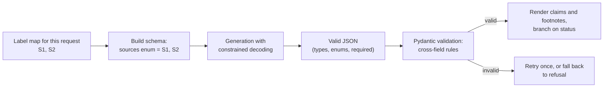

So far in this module the model's answer has been prose with markers in it, and code has used regular expressions to pull out citations and detect refusals. That works until something downstream needs to *rely* on the answer's shape: a user interface that renders claims and footnotes separately, a workflow that branches on whether the assistant refused, an evaluation job that counts citations. **Structured outputs** means making the model return data that matches a schema you define, and having that conformance guaranteed by mechanism rather than hoped for by instruction.

This lesson explains the spectrum of techniques, from asking nicely to constrained decoding, how constrained decoding actually works on the model's next-token probabilities, how to design a response schema for RAG (including one whose citation field can only name the sources supplied with this request), and what structure does and does not guarantee. The next lesson, [JSON generation](/learn/generation-strategies/json-generation), covers the engineering around the JSON itself: parsing, repair, retries, streaming partial objects and extraction pipelines.

## Learning objectives

- Compare prompt-only formatting, forced tool use and native structured outputs by the guarantee each gives.
- Explain constrained decoding as masking and renormalising next-token probabilities, and compute a constrained distribution by hand.
- Design a Pydantic response schema for a RAG answer with an answer status, claims and per-request citation labels.
- Separate the rules a schema can enforce during decoding from the rules that must be validated afterwards.
- Request validated structured output through the Anthropic SDK with `messages.parse`.

## Prerequisites

- [Basic RAG](/learn/generation-strategies/basic-rag): the per-request label map.
- [Citation-based generation](/learn/generation-strategies/citation-based-generation): what a citation must point at.
- [Dataclasses and Pydantic](/learn/python-for-rag-engineering/dataclasses-and-pydantic): models, fields and validation errors.
- [Temperature and sampling](/learn/understanding-large-language-models/temperature-and-sampling): next-token distributions and softmax.

## Why this matters

A free-text answer is a string that code must interpret. Every interpretation is a guess with a failure rate: the refusal check misses "I do not know"; the citation regex misses `[S1, S2]`; the parser that expects a list gets a paragraph. Each of these is small, but a production system has dozens of them, and each fails in a way that is invisible until a user sees a broken page or a wrong branch is taken.

Structure moves the agreement from prose into a contract that both sides can check. The model is told the exact shape, the shape is enforced where possible, and what cannot be enforced is validated by code before anything downstream runs. In a RAG system this gives three concrete benefits. The interface can render each claim with its own sources and show refusals differently from answers. Monitoring can count answer statuses and citations exactly, rather than by pattern matching. And a whole class of invalid outputs (a citation to a source that was never supplied, a refusal that nonetheless contains claims) can be made impossible or immediately detectable.

## The intuition

Compare two ways of getting a form filled in. You can send someone a letter: "please tell us your name, date of birth and whether you need parking, in that order". Most replies will be usable; some will forget the parking question, write the date as "next Tuesday", or add a paragraph about their commute. Or you can hand them a paper form with labelled boxes, a date field split into DD / MM / YYYY, and a yes/no tick box for parking. They can still write a false date, but they cannot write a paragraph in the parking box.

Prompting for a format is the letter. Structured output is the form. Constrained decoding is a form whose boxes physically refuse the wrong kind of ink.

## How it works

### A spectrum of guarantees

| Technique | How | Guarantee |
| --- | --- | --- |
| Prompt-only | Describe the format, show an example | None; the model usually complies |
| Prompt plus validation | As above, then parse and validate; retry on failure | Invalid output is detected, not prevented |
| Forced tool use | Define a tool whose input schema is your format, and force the model to call it | Output arrives as structured tool input; strict conformance depends on the provider's mode |
| Native structured outputs | Pass a JSON schema as the response format; the provider constrains decoding | Syntactically valid JSON that matches the supported parts of the schema |

**Prompt-only** is portable and works with any model, and capable models comply most of the time. "Most of the time" is the problem: at scale, a small failure rate is a steady stream of broken requests.

**Forced tool use** repurposes function calling. You define a tool such as `record_answer` with an `input_schema`, set `tool_choice={"type": "tool", "name": "record_answer"}`, and the model's reply is a `tool_use` block whose `input` is a dictionary. Anthropic's tool definitions also accept `strict: true`, which asks for the input to conform exactly to the schema. Tool use was the standard route to structure before native support existed, and it remains useful when the same request also offers real tools.

**Native structured outputs** pass the schema as the response format. In the Anthropic API this is `output_config={"format": {"type": "json_schema", "schema": ...}}` on `messages.create`, and the Python SDK wraps it as `client.messages.parse(..., output_format=MyModel)`, which converts a Pydantic model to a schema, sends it, and validates the reply into `response.parsed_output`. The guarantee comes from **constrained decoding**.

### Constrained decoding

A language model generates one token at a time by computing a probability for every token in its vocabulary and choosing one ([Model inference](/learn/understanding-large-language-models/model-inference)). Constrained decoding inserts one step before the choice:

1. Compile the schema into a grammar, effectively a state machine that knows, at every point in the output, which continuations keep the text valid.
2. At each step, compute the model's probabilities as usual.
3. Set the probability of every token that would violate the grammar in the current state to zero.
4. Renormalise the remaining probabilities so that they sum to 1, and choose a token from them.
5. Advance the state machine with the chosen token, and repeat until the grammar reaches an accepting state.

Because an invalid token can never be chosen, the output is valid by construction. This is established technique: open-source libraries such as Outlines (described by Willard and Louf, 2023) and grammar support in local inference engines implement it, and hosted providers apply the same principle server-side.

Three consequences follow.

- **Syntax, not truth.** The grammar guarantees `"status"` is one of `answered`, `partial` or `refused`. It does not guarantee the status is *correct*. A model can return a well-formed `answered` with claims the sources do not support.
- **Masking can distort.** If the model strongly wanted a token the grammar forbids, its remaining probability mass is spread over tokens it rated lower. Forcing a model into a schema that does not fit the task (no way to say "the sources do not cover this") produces confidently shaped nonsense. Give the schema an honest way to express every legitimate outcome.
- **Not every schema feature is enforceable.** Grammars handle types, required properties, enums and nesting well. Numeric ranges, string lengths, array lengths and cross-field rules ("if refused, claims must be empty") are often not enforced during decoding. The Anthropic SDK's `parse` helper moves constraints the API does not support into the field descriptions and validates the result against your full Pydantic model afterwards, so a violation surfaces as a validation error rather than as bad data. Check your provider's documentation for the supported subset.

### Designing a response schema for RAG

A good RAG response schema encodes the grounded-answer contract as fields.

1. **An explicit status.** `answered`, `partial` or `refused` as an enum. This replaces the brittle exact-sentence refusal check and gives the model an honest way out, which reduces the pressure to invent.
2. **Claims as a list of objects**, each with `text` and `sources`. Citations become data attached to the claim they support, not markers to be parsed out of prose.
3. **Citation labels restricted to this request's sources.** The set of valid labels differs per request, so build the schema per request with an enum of the labels actually supplied. Under constrained decoding, a citation to `S4` when only `S1` and `S2` exist becomes impossible to generate, removing the existence check from [Response generation](/learn/rag-architecture-fundamentals/response-generation) entirely.
4. **A field for what is missing.** `not_covered` lets a partial answer say what the sources do not address, as [Handling missing information](/learn/prompt-engineering-for-rag/handling-missing-information) recommends, in a place code can find.
5. **Cross-field rules in a validator.** "A refusal has no claims" and "a partial answer says what is missing" cannot be expressed in most decoding grammars; they go in a Pydantic `model_validator` and are checked after decoding.

Field order deserves thought. The model writes the JSON from beginning to end, so earlier fields are generated without seeing later ones. Putting `status` first commits the model to a decision before it writes the claims; putting it last lets the claims inform it. Neither is universally better; test both on your evaluation set.

Keep schemas small. Every property name and description is sent with every request and must be generated as tokens in the output; a schema with twenty optional fields invites the model to fill them.



> [!KEY]
> Structured output guarantees shape, not truth. Encode the grounded-answer contract as fields (status, claims with sources, what is missing), restrict citation labels to this request's sources, and validate whatever the decoder cannot enforce.

## The mathematics

### Masking and renormalising

**Intuition.** Constrained decoding keeps the model's preferences among the allowed tokens and discards the rest, scaling what remains back up to a full probability distribution.

$$
p'(t) = \frac{p(t)\, m(t)}{\sum_{t' \in V} p(t')\, m(t')},
\qquad
m(t) = \begin{cases} 1 & \text{if } t \text{ is allowed in the current state} \\ 0 & \text{otherwise} \end{cases}
$$

- $V$ is the vocabulary and $t$ a token in it.
- $p(t)$ is the model's probability for $t$ at this step, the softmax of its logits.
- $m(t)$ is the mask from the grammar's current state.
- $p'(t)$ is the constrained probability. The ratio between any two allowed tokens is unchanged; only forbidden tokens are removed.

**By hand.** A toy vocabulary has seven tokens. At the step where the value of `status` is generated, the model's logits for `answered`, `refused` and `maybe` are 1.2, 0.3 and 1.5, and four other tokens have logit 0. Exponentials: $e^{1.2} = 3.3201$, $e^{0.3} = 1.3499$, $e^{1.5} = 4.4817$, and $e^{0} = 1$ for each of the other four. The sum is $13.1517$, so $p(\text{answered}) = 0.2524$, $p(\text{refused}) = 0.1026$ and $p(\text{maybe}) = 0.3408$. The model's favourite is `maybe`, which is not in the enum.

The grammar allows only `answered` and `refused`. The allowed mass is $0.2524 + 0.1026 = 0.3550$, so $p'(\text{answered}) = 0.2524 / 0.3550 = 0.711$ and $p'(\text{refused}) = 0.289$. Note what happened: the model preferred an answer the schema could not express, and constraint redirected that preference to the nearest allowed value. That is why a schema must include every honest outcome.

The script below runs a full toy decode with and without the mask. The logits are hand-made to imitate a chatty model that likes to begin with "Sure!".

```python
import numpy as np

VOCAB = ['{"status": "', 'answered', 'refused', 'maybe', '"}', 'Sure! ', '<end>']
# Toy "model": next-token logits for each step, hand-made to imitate a chatty model.
LOGITS = [
    np.array([1.0, 0.0, 0.0, 0.0, 0.0, 2.0, -1.0]),   # step 1: prefers to start with 'Sure! '
    np.array([0.0, 1.2, 0.3, 1.5, 0.0, 0.0, 0.0]),    # step 2: prefers 'maybe' over the enum values
    np.array([0.0, 0.0, 0.0, 0.0, 2.0, 0.0, 0.5]),    # step 3
    np.array([0.0, 0.0, 0.0, 0.0, 0.0, 0.0, 3.0]),    # step 4
]
# Grammar as a finite-state machine: state -> {allowed token: next state}
FSM = {0: {'{"status": "': 1}, 1: {"answered": 2, "refused": 2}, 2: {'"}': 3}, 3: {"<end>": 4}}


def softmax(z):
    e = np.exp(z - z.max())
    return e / e.sum()


def decode(constrained: bool):
    state, out = 0, []
    for logits in LOGITS:
        p = softmax(logits)
        if constrained:
            mask = np.array([tok in FSM[state] for tok in VOCAB], dtype=float)
            p = p * mask / (p * mask).sum()             # zero illegal tokens, renormalise
        tok = VOCAB[int(p.argmax())]                    # greedy choice
        out.append(tok)
        if constrained:
            state = FSM[state][tok]
        if tok == "<end>":
            break
    return "".join(t for t in out if t != "<end>"), p


step2 = softmax(LOGITS[1])
mask = np.array([t in FSM[1] for t in VOCAB], dtype=float)
print("step 2 probabilities:", {t: round(float(v), 4) for t, v in zip(VOCAB[1:4], step2[1:4])})
print("step 2 constrained:  ", {t: round(float(v), 4) for t, v in zip(VOCAB[1:4], (step2 * mask / (step2 * mask).sum())[1:4])})
print("unconstrained:", decode(False)[0])
print("constrained:  ", decode(True)[0])
```

```output
step 2 probabilities: {'answered': 0.2524, 'refused': 0.1026, 'maybe': 0.3408}
step 2 constrained:   {'answered': 0.7109, 'refused': 0.2891, 'maybe': 0.0}
unconstrained: Sure! maybe"}
constrained:   {"status": "answered"}
```

Unconstrained greedy decoding produces `Sure! maybe"}`, which no JSON parser accepts. With the mask, the same model, choosing greedily from the same logits, can only produce valid output.

## In code

**The problem.** Build a RAG response schema whose citation labels are limited to the sources supplied with this request, look at the JSON schema it produces, and validate five candidate outputs, each breaking a different rule. Then request output in this schema from the model.

**Dependencies.** Pydantic v2 for the schema and validation (run here with Pydantic 2.14); the Anthropic SDK for the model call.

```bash
pip install pydantic anthropic
```

```python
import json
from typing import Literal
from pydantic import BaseModel, Field, ValidationError, create_model, model_validator


def answer_model(labels: list[str]) -> type[BaseModel]:
    """Build a response schema whose citations can only name this request's source labels."""
    SourceLabel = Literal[tuple(labels)]

    Claim = create_model(
        "Claim",
        text=(str, Field(description="One factual sentence, without citation markers.")),
        sources=(list[SourceLabel], Field(min_length=1, description="Labels of supporting sources.")),
    )

    class RAGAnswer(BaseModel):
        status: Literal["answered", "partial", "refused"]
        claims: list[Claim]
        not_covered: str | None = Field(
            default=None, description="What the sources do not cover; required unless answered.")

        @model_validator(mode="after")
        def consistent(self):
            if self.status == "refused" and self.claims:
                raise ValueError("a refusal must have no claims")
            if self.status != "refused" and not self.claims:
                raise ValueError("an answer needs at least one claim")
            if self.status != "answered" and not self.not_covered:
                raise ValueError("partial answers and refusals must say what is not covered")
            return self

    return RAGAnswer


RAGAnswer = answer_model(["S1", "S2"])
schema = RAGAnswer.model_json_schema()
print(json.dumps(schema["$defs"]["Claim"]["properties"]["sources"], indent=1))
print("status enum:", schema["properties"]["status"]["enum"])

candidates = {
    "good": '{"status": "partial", "claims": [{"text": "Annual leave is 25 days per year.", '
            '"sources": ["S1"]}], "not_covered": "How to book leave."}',
    "unknown label": '{"status": "answered", "claims": [{"text": "Part-time staff get pro-rata leave.", '
                     '"sources": ["S4"]}]}',
    "refusal with claims": '{"status": "refused", "claims": [{"text": "Leave is 25 days.", '
                           '"sources": ["S1"]}], "not_covered": "Everything."}',
    "uncited claim": '{"status": "answered", "claims": [{"text": "Leave is 25 days.", "sources": []}]}',
    "not JSON": 'Sure! Here is the answer: {"status": "answered"}',
}
print()
for name, raw in candidates.items():
    try:
        parsed = RAGAnswer.model_validate_json(raw)
        print(f"{name:<20} OK   {parsed.status}, {len(parsed.claims)} claim(s)")
    except ValidationError as e:
        first = e.errors()[0]
        print(f"{name:<20} FAIL {first['type']}: {first['msg'][:70]}")
```

```output
{
 "description": "Labels of supporting sources.",
 "items": {
  "enum": [
   "S1",
   "S2"
  ],
  "type": "string"
 },
 "minItems": 1,
 "title": "Sources",
 "type": "array"
}
status enum: ['answered', 'partial', 'refused']

good                 OK   partial, 1 claim(s)
unknown label        FAIL literal_error: Input should be 'S1' or 'S2'
refusal with claims  FAIL value_error: Value error, a refusal must have no claims
uncited claim        FAIL too_short: List should have at least 1 item after validation, not 0
not JSON             FAIL json_invalid: Invalid JSON: expected value at line 1 column 1
```

**The important lines.**

- `Literal[tuple(labels)]` builds, at run time, a type that accepts only this request's labels. Pydantic writes it into the JSON schema as an `enum`, which is exactly what a constrained decoder enforces. The schema is now per request, which is correct: valid citations *are* per request.
- `create_model` builds the `Claim` model dynamically, because its field type depends on `labels`. The outer model can be an ordinary class that refers to it.
- `Field(min_length=1)` on `sources` appears in the schema as `minItems: 1`. Whether a provider enforces it during decoding varies; Pydantic enforces it afterwards regardless, which is what the "uncited claim" case shows.
- `model_validator(mode="after")` holds the cross-field rules. These never appear in the JSON schema and are checked only after decoding.
- `model_validate_json` parses and validates in one step, and its `ValidationError` lists each problem with a machine-readable `type` (`literal_error`, `too_short`, `json_invalid`), which is what you log and count.

**What the output means.** The schema snippet shows the citation field as an array of `S1` or `S2` with at least one item. The good candidate is a partial answer that says what is not covered. "Unknown label" cites `S4`, which the enum rejects; under constrained decoding the model could not have produced it at all. "Refusal with claims" is valid JSON with valid types and is caught only by the model validator, showing why cross-field rules must be checked in code. "Uncited claim" fails `minItems`. "Not JSON" is what prompt-only formatting sometimes yields, and what constrained decoding prevents.

**The model call.** This needs an API key and was not executed. `messages.parse` accepts the Pydantic class, sends its schema as the output format, and validates the reply with the same class, so the model validator runs too.

```python
import anthropic
from pydantic import ValidationError

client = anthropic.Anthropic()  # reads ANTHROPIC_API_KEY from the environment

labels = ["S1", "S2"]
RAGAnswer = answer_model(labels)
prompt = (
    '<sources>\n<source id="S1">Annual leave is 25 days per year.</source>\n'
    '<source id="S2">Leave requests are made in the HR portal.</source>\n</sources>\n'
    "<question>How much leave do I get, and can I take it in half days?</question>"
)

try:
    response = client.messages.parse(
        model="claude-opus-5-5",
        max_tokens=1024,
        system="Answer only from the sources. Use status 'partial' and fill not_covered "
               "when the sources answer only part of the question.",
        messages=[{"role": "user", "content": prompt}],
        output_format=RAGAnswer,
    )
    result = response.parsed_output
    print(result.status, [(c.text, c.sources) for c in result.claims], result.not_covered)
except ValidationError as e:          # a cross-field rule failed after decoding
    print("invalid:", e.errors()[0]["msg"])
```

Your exact wording will differ; the output looks like this:

```output
partial [('Annual leave is 25 days per year.', ['S1'])] Whether leave can be taken in half days.
```

The forced-tool alternative, also not executed, gives the same structure through tool use; it is useful when the request also offers real tools, or with SDK versions that predate `parse`.

```python
response = client.messages.create(
    model="claude-opus-5-5",
    max_tokens=1024,
    system="Answer only from the sources by calling record_answer.",
    messages=[{"role": "user", "content": prompt}],
    tools=[{
        "name": "record_answer",
        "description": "Record the grounded answer.",
        "input_schema": RAGAnswer.model_json_schema(),
        "strict": True,
    }],
    tool_choice={"type": "tool", "name": "record_answer"},
)
tool_input = next(block.input for block in response.content if block.type == "tool_use")
result = RAGAnswer.model_validate(tool_input)
```

**Errors people commonly hit.**

- Building the schema once at start-up with a fixed list of labels, so the enum no longer matches the request's sources.
- Treating `parsed_output` as proof of correctness. It proves shape; the claims still need the support checks from [Citation-based generation](/learn/generation-strategies/citation-based-generation).
- Schemas with no honest way to express "not covered", which push the model into filling claims it cannot support.
- Ignoring `stop_reason == "max_tokens"`: a structured reply cut off mid-object will not parse, and should be logged as truncation, not as a model error.

**Extending it.** Add an optional `quote` field to each claim and verify it with the quote checker from the previous lesson; render claims and footnotes in the interface directly from the object; and record `status` as a metric so the share of partial answers and refusals is charted per corpus area.

## A real-world example

AskMeridian's web client originally displayed the model's prose and turned `[S1]` markers into links with a regular expression. When the Platform team added a Slack integration, Oluwaseun found that a small share of answers rendered with raw markers or broken links, because the model sometimes wrote `[S1, S3]` or `(see S2)`, and Slack's formatter treated square brackets specially. Separately, the analytics dashboard's "refusal rate" was undercounting, because the refusal check compared against one exact sentence and the model sometimes added a helpful second sentence pointing to the HR portal.

The team moved the answer route to native structured output with a per-request schema like the one in this lesson. Each client now rendered claims and sources from fields, so formatting markers disappeared from the pipeline entirely. The refusal rate came from the `status` field. Citations to non-existent sources, which the old validator had caught and logged a few times a week, stopped appearing, because the enum made them impossible to generate. The validator stayed in place for the cross-field rules, and in the first week it caught a handful of `answered` responses with an empty claims list, which led the team to move `status` after `claims` in the schema and re-test on their evaluation set.

## Common mistakes

- **Relying on prompt-only formatting at scale.** A rare format failure is a constant stream of errors at production volume.
- **Assuming the schema enforces everything.** Ranges, lengths and cross-field rules may only be checked after decoding; without validation they are suggestions.
- **Confusing valid with true.** A perfectly shaped answer can still contain unsupported claims.
- **Leaving no honest outcome.** Without a status such as `refused` or `partial`, constraint pushes the model into answers the sources do not support.
- **Static citation enums.** Labels are per request; a global list lets the model cite sources that were not supplied.
- **Oversized schemas.** Many optional fields cost tokens and invite filler.

## Best practices

- Use native structured outputs or strict tool use wherever downstream code depends on the shape; keep prompt-only formatting for prose meant only for humans.
- Encode the grounded-answer contract as fields: status, claims with sources, what is not covered.
- Build the schema per request when valid values depend on the request, as citation labels do.
- Put cross-field rules in a validator and log validation failures by `type`.
- Keep schemas small, with short descriptions that say what each field means.
- Test field order on your evaluation set; it changes what the model has committed to when it writes each field.

## Performance considerations

Structure has a token cost on both sides. The schema is sent with the request: the `RAGAnswer` schema above serialises to about 830 characters of JSON, on the order of 200 to 250 tokens, small next to a few thousand tokens of sources, and repeated identically for requests with the same labels. On the output side, JSON keys, quotes and brackets are tokens the model must generate: a 40-word answer as prose might be 60 tokens, while the same content as two claim objects with keys and source arrays might be 90. At an assumed 50 output tokens per second that is about 0.6 seconds more.

Constrained decoding itself needs the grammar to be compiled; providers typically cache compiled grammars, so the first request with a new schema may be slower than later ones. A per-request schema that differs only in its label enum is a new schema each time the label set changes; keeping labels in a fixed form (`S1` to `S8`, always) and building the enum from the number of sources keeps the set of distinct schemas small. Check your provider's documentation for how schema compilation is cached.

## Security considerations

Structured output narrows what the model can emit, which is a defensive benefit: an injected instruction in a retrieved document cannot make the model output a fifth field or a raw HTML block if the schema forbids it, and cannot produce a citation to a source that was not supplied. It does not stop injected *content* inside allowed string fields, so claim text must still be escaped before rendering and treated as untrusted. Never pass structured output straight into actions (database writes, emails, tool calls) without validating values against business rules, because a well-formed object can still carry a malicious or mistaken value. Keep sensitive fields out of response schemas unless they are needed; anything in the schema is something the model is invited to produce.

## Summary

- Structured outputs replace interpretation of prose with a schema that both the model and code can check.
- Constrained decoding masks invalid tokens and renormalises the rest, so output is valid by construction, but only for what the grammar can express.
- A RAG schema should hold an explicit status, claims with sources, and what is not covered; citation labels should be an enum of this request's sources.
- Cross-field rules and unsupported constraints are validated after decoding; `messages.parse` does this with your Pydantic model.
- Valid shape is not truth: support checks, escaping and business-rule validation still apply.

## Exercises

**1.** At some step the allowed tokens are `"partial"` (probability 0.05), `"answered"` (0.15) and `"refused"` (0.10); all other tokens, with total probability 0.70, are forbidden. Compute the constrained distribution. What does the large forbidden mass suggest about the schema or prompt?

<details><summary>Show solution</summary>

Allowed mass $= 0.05 + 0.15 + 0.10 = 0.30$. Constrained: `answered` $0.15/0.30 = 0.50$, `refused` $0.10/0.30 = 0.333$, `partial` $0.05/0.30 = 0.167$. That 70 per cent of the model's probability was on forbidden tokens suggests a mismatch: the model wanted to write something the schema does not allow (perhaps prose, or a status the enum lacks). Review the prompt (does it explain the statuses?) and the schema (is an honest outcome missing?).

</details>

**2.** Which of these rules can a JSON schema express for constrained decoding, and which belong in a Pydantic validator? (a) `status` is one of three values; (b) each claim cites at least one source; (c) a refusal has no claims; (d) each cited label was supplied with this request; (e) every number in a claim appears in a cited source.

<details><summary>Show solution</summary>

(a) Schema: an enum. (b) Schema as `minItems: 1`, though decoders may not enforce array lengths, so validate it as well. (c) Validator: it relates two fields. (d) Schema, if you build the enum per request, as in the lesson. (e) Neither: it needs the source texts, so it is a post-generation check in application code, like the number check in [Response generation](/learn/rag-architecture-fundamentals/response-generation).

</details>

**3.** Extend `answer_model` so that each claim may carry an optional `quote` (at most 300 characters) and add a validator rule that a claim with a quote must cite exactly one source. Show the changed parts and one candidate that fails the new rule.

<details><summary>Show solution</summary>

```python
from pydantic import model_validator

class ClaimBase(BaseModel):
    @model_validator(mode="after")
    def one_source_for_quote(self):
        if self.quote is not None and len(self.sources) != 1:
            raise ValueError("a quoted claim must cite exactly one source")
        return self

Claim = create_model(
    "Claim",
    __base__=ClaimBase,
    text=(str, Field(description="One factual sentence.")),
    sources=(list[SourceLabel], Field(min_length=1)),
    quote=(str | None, Field(default=None, max_length=300,
                             description="Exact sentence copied from the cited source.")),
)
```

A failing candidate: `{"status": "answered", "claims": [{"text": "Leave is 25 days.", "sources": ["S1", "S2"], "quote": "Annual leave is 25 days per year."}]}`. Validation raises "a quoted claim must cite exactly one source", because a single quote can come from only one document.

</details>

## Check your understanding

```quiz
[
  {
    "q": "What does constrained decoding guarantee?",
    "options": [
      "That the answer is factually correct",
      "That every claim is supported by a source",
      "That the output conforms to the grammar compiled from the schema",
      "That the model uses fewer tokens"
    ],
    "answer": 2,
    "why": "Invalid tokens are masked at every step, so the output matches the grammar. Truth and support are separate questions."
  },
  {
    "q": "At one step, p(answered) = 0.3, p(refused) = 0.1 and the rest is forbidden. What is the constrained probability of answered?",
    "options": [
      "0.3",
      "0.75",
      "0.4",
      "0.25"
    ],
    "answer": 1,
    "why": "Renormalise over the allowed mass: 0.3 / (0.3 + 0.1) = 0.75."
  },
  {
    "q": "Why build the citation enum per request rather than once at start-up?",
    "options": [
      "Because valid citation labels depend on which sources were supplied with this request",
      "Because enums expire",
      "Because Pydantic cannot reuse models",
      "Because it makes the schema shorter"
    ],
    "answer": 0,
    "why": "A per-request enum makes citations to unsupplied sources impossible to generate under constrained decoding."
  },
  {
    "q": "Where must the rule 'a refusal has no claims' be enforced?",
    "options": [
      "Only in the prompt",
      "In the JSON schema enum",
      "By the model's tokeniser",
      "In a validator after decoding, because it relates two fields"
    ],
    "answer": 3,
    "why": "Cross-field rules are generally not expressible in decoding grammars; a Pydantic model validator checks them afterwards."
  },
  {
    "q": "Why should a RAG response schema include statuses such as 'partial' and 'refused'?",
    "options": [
      "To make the JSON longer",
      "Because without an honest way to say the sources fall short, constraint pushes the model into unsupported answers",
      "Because the API requires them",
      "To avoid the need for citations"
    ],
    "answer": 1,
    "why": "Masking redirects probability to allowed values; if only 'answered' is allowed, the model is forced to answer."
  }
]
```

## Further reading

- Willard, B. T. and Louf, R. (2023). *Efficient Guided Generation for Large Language Models*. [arXiv:2307.09702](https://arxiv.org/abs/2307.09702)
- Anthropic, *Claude Developer Platform documentation*: structured outputs and tool use. [platform.claude.com/docs](https://platform.claude.com/docs)
- Pydantic documentation: models, JSON Schema and validators. [docs.pydantic.dev](https://docs.pydantic.dev/)
- JSON Schema specification and guides. [json-schema.org](https://json-schema.org/)
