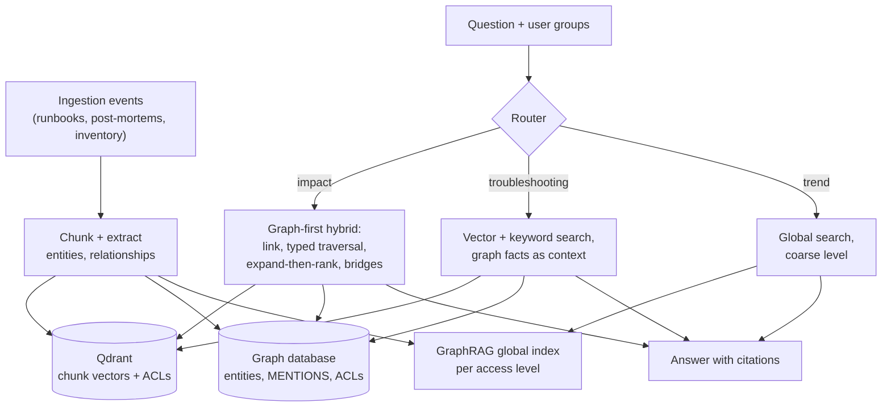

This assessment covers the whole Graph RAG module: knowledge graph models, entity and relationship extraction, graph construction and entity resolution, traversal, graph retrieval, Microsoft's GraphRAG with its local and global search, and hybrid graph-vector retrieval. It mixes recall, calculation, code-reading and production scenarios. Aim for at least 70% on the quiz (13 of 18) before moving on, and write your own answer to every open question before opening the model answer. The coding exercises run locally with NetworkX and scikit-learn and need no API key or model download.

```quiz
[
  {
    "q": "Which question does a knowledge graph answer more reliably than similarity search over chunks?",
    "options": [
      "'What is the carry-over deadline for annual leave?'",
      "'List every system the Platform team owns.'",
      "'Summarise the remote work policy.'",
      "'What does the handbook say about expenses?'"
    ],
    "answer": 1,
    "why": "Exhaustive listing over a relationship is a graph strength: follow every OWNED_BY edge into the Platform team. Top-k retrieval returns k similar chunks and cannot promise completeness."
  },
  {
    "q": "An extractor returns 8 entities for a chunk; 6 are correct, and the chunk actually contains 10 entities. What are precision and recall?",
    "options": [
      "Precision 0.6, recall 0.75",
      "Precision 0.75, recall 0.8",
      "Precision 0.75, recall 0.6",
      "Precision 0.8, recall 0.6"
    ],
    "answer": 2,
    "why": "Precision is 6 correct of 8 returned (0.75); recall is 6 found of 10 present (0.6)."
  },
  {
    "q": "Two independent documents state the same relationship with confidences 0.8 and 0.5. What is the noisy-OR combined confidence?",
    "options": [
      "0.90",
      "0.65",
      "0.40",
      "1.30"
    ],
    "answer": 0,
    "why": "1 - (1 - 0.8)(1 - 0.5) = 1 - 0.2 x 0.5 = 0.90. The sources must be genuinely independent; copies of one memo count once."
  },
  {
    "q": "Why does entity resolution use blocking before pairwise comparison?",
    "options": [
      "To improve the precision of the similarity function",
      "To merge entities transitively",
      "To remove entities with no mentions",
      "To avoid comparing every pair of names, which grows quadratically with the number of entities"
    ],
    "answer": 3,
    "why": "Blocking groups candidates by a cheap key so that only pairs within a block are compared, instead of all n(n-1)/2 pairs."
  },
  {
    "q": "In a graph built with the module's conventions, which edge records that the HR team is responsible for the handbook?",
    "options": [
      "(HR team) -[OWNED_BY]-> (Employee handbook)",
      "(Employee handbook) -[OWNED_BY]-> (HR team)",
      "(Employee handbook) -[MENTIONS]-> (HR team)",
      "(HR team) -[INDEXES]-> (Employee handbook)"
    ],
    "answer": 1,
    "why": "OWNED_BY points from the owned thing to its owner. A question such as 'who owns the handbook?' follows it forwards; 'what does HR own?' follows it backwards."
  },
  {
    "q": "A breadth-first traversal from 'Employee handbook' at depth 3 returns most of the graph. What is the most likely cause?",
    "options": [
      "A hub node within reach multiplies the frontier; a hub limit or node budget is needed",
      "The visited set is missing, so nodes are revisited",
      "Personalised PageRank was not normalised",
      "The edges are directed"
    ],
    "answer": 0,
    "why": "Through a hub, one hop adds hundreds of nodes. Limits on neighbours per node, typed traversal and node budgets keep expansion bounded."
  },
  {
    "q": "What is the first thing to check when a graph retriever returns irrelevant facts for 'is the vector database down?'",
    "options": [
      "The seeds produced by entity linking",
      "The PageRank damping factor",
      "The serialisation format",
      "The community level"
    ],
    "answer": 0,
    "why": "Every later stage works from the seeds. A missed or wrong link sends the whole retrieval to the wrong part of the graph."
  },
  {
    "q": "What does this print?\n```python\nimport networkx as nx\nG = nx.Graph([('A','H'), ('B','H'), ('C','H')])\nppr = nx.pagerank(G, personalization={'A': 1, 'B': 0, 'C': 0, 'H': 0})\nprint(max(ppr, key=ppr.get))\n```",
    "options": [
      "A",
      "B",
      "C",
      "H"
    ],
    "answer": 3,
    "why": "Every walk from A must pass through the hub H, so H accumulates more visits than the seed A: about 0.46 against 0.28."
  },
  {
    "q": "A graph retriever keeps the top 8 nodes by personalised PageRank. The answer needs an edge to the 9th-ranked node. What happens?",
    "options": [
      "The edge is kept because edges are ranked separately",
      "The retriever raises an error",
      "The edge is silently dropped and the answer may be incomplete",
      "PageRank is recomputed with a higher damping factor"
    ],
    "answer": 2,
    "why": "Pruning by nodes keeps only edges between kept nodes. Path-aware or relation-aware pruning rules avoid stranding needed facts."
  },
  {
    "q": "In Microsoft's GraphRAG, what is level 0 of the community hierarchy?",
    "options": [
      "The broadest communities, from partitioning the whole graph",
      "The individual entities",
      "The text units",
      "The finest sub-communities"
    ],
    "answer": 0,
    "why": "Hierarchical Leiden partitions the whole graph first (level 0) and re-partitions large communities into finer ones at higher levels."
  },
  {
    "q": "A graph of 7 edges is split into two communities, each with 3 internal edges and total degree 7. What is its modularity?",
    "options": [
      "0.25",
      "0.50",
      "0.36",
      "0.43"
    ],
    "answer": 2,
    "why": "Each community contributes 3/7 - (7/14)^2 = 0.4286 - 0.25 = 0.1786; two of them give about 0.357."
  },
  {
    "q": "Why can filtering community reports by user permissions at query time fail to protect restricted documents?",
    "options": [
      "Reports have no identifiers",
      "Global search ignores permissions",
      "Leiden merges permission groups",
      "A report blends content from all documents in its community, so restricted facts are already inside report text"
    ],
    "answer": 3,
    "why": "The leak happens when the report is written. Separate indexes per access level, or excluding restricted documents, are the reliable controls."
  },
  {
    "q": "GraphRAG's fast indexing method differs from the standard method mainly by:",
    "options": [
      "Using noun phrases and co-occurrence instead of model-based entity and relationship extraction",
      "Skipping community reports",
      "Using a smaller embedding model",
      "Disabling Leiden clustering"
    ],
    "answer": 0,
    "why": "Fast indexing replaces the expensive extraction step with NLP; a model still writes the community reports."
  },
  {
    "q": "A global search reads 300 reports of 800 tokens with a map budget of 12,000 tokens. How many model calls does it make?",
    "options": [
      "20",
      "300",
      "21",
      "25"
    ],
    "answer": 2,
    "why": "300 x 800 = 240,000 tokens; 240,000 / 12,000 = 20 map calls, plus one reduce call."
  },
  {
    "q": "Which question should be routed to GraphRAG local search rather than global search?",
    "options": [
      "'What are the main themes in this year's post-mortems?'",
      "'Which teams are affected when the Qdrant cluster is down?'",
      "'How has our incident profile changed over two years?'",
      "'What topics dominate the engineering wiki?'"
    ],
    "answer": 1,
    "why": "It names specific entities and needs their relationships. The others are about the whole corpus."
  },
  {
    "q": "A hybrid retriever adds raw cosine similarities to raw personalised PageRank scores. What goes wrong?",
    "options": [
      "Nothing; both lie between 0 and 1",
      "PageRank fails on chunk nodes",
      "Cosine similarity becomes negative",
      "The graph scores are ignored because cosine values are larger, so the sum is effectively vector-only"
    ],
    "answer": 3,
    "why": "PageRank scores sum to 1 over many nodes and are small; cosine values are much larger. Fuse by rank (RRF) or use the graph as a pool or filter."
  },
  {
    "q": "Expand-then-rank retrieves 'the Qdrant cluster is patched on the first Tuesday' but not 'AskMeridian stores its embeddings in the Qdrant cluster' for 'When is AskMeridian unavailable for maintenance?'. What is the best fix?",
    "options": [
      "Raise k for every query",
      "Lower the RRF constant",
      "Include the chunk on the path from the seed entity to the entity that brought in each result",
      "Switch to global search"
    ],
    "answer": 2,
    "why": "The bridge chunk resembles the question least, so similarity drops it; its position on the graph path is why it matters."
  },
  {
    "q": "Meridian keeps the vector index in Qdrant and the graph in a separate database. A deleted runbook is still cited through graph facts. What prevents this?",
    "options": [
      "Using the same embedding model in both stores",
      "Driving both stores from one ingestion pipeline with retraction by source chunk, plus reconciliation of chunk identifiers",
      "Raising the PageRank damping factor",
      "Re-running Leiden nightly"
    ],
    "answer": 1,
    "why": "Drift between stores comes from updates reaching one and not the other. Shared chunk identifiers, one pipeline and a reconciliation job keep them consistent."
  }
]
```

## Conceptual questions

**1.** A colleague proposes replacing AskMeridian's vector index with a knowledge graph "because graphs are more accurate". Explain what a graph adds, what it loses, and what you would propose instead.

<details><summary>Show model answer</summary>

A graph adds explicit relationships: multi-hop questions ("who owns what AskMeridian depends on?"), exhaustive listings and aggregations can be answered by following edges rather than hoping the right chunks look similar to the question. It loses everything extraction did not capture: wording, detail, nuance, and any fact phrased around ideas that never became entities or edges. Extraction also introduces errors that look authoritative once they are edges. A graph alone cannot answer most of the questions a handbook assistant receives, which are single-fact lookups that vector or keyword search already answers well. The proposal should be a hybrid: keep the vector index, add the graph for relationship questions (routed or fused), keep provenance from every edge to its chunk, and decide with a labelled evaluation split by question type.

</details>

**2.** Why does every serialised graph fact need provenance, and what breaks across the module's pipeline when it is missing?

<details><summary>Show model answer</summary>

Provenance (the chunk identifiers supporting each relationship) is what connects the domain layer to the text. Without it: the model cannot cite a source for a graph fact, and reviewers cannot check an extraction error against the original sentence; document deletion cannot retract exactly the facts that document supported, so stale facts survive; noisy-OR cannot count independent sources, because it cannot tell which documents a fact came from; access control cannot be applied to relationships, because their source permissions are unknown; and hybrid retrieval cannot join graph facts to chunks in the vector index. Provenance is the one property every later stage relies on.

</details>

**3.** Compare GraphRAG's global search with a top-k vector retriever on the question "What are the recurring causes of VPN outages across two years of post-mortems?". Discuss coverage, cost and failure modes.

<details><summary>Show model answer</summary>

The vector retriever returns the k chunks most similar to the question: a handful of post-mortems that happen to use the words "recurring" or "cause", so the answer is fluent but based on a small, arbitrary slice. It costs one embedding and one model call. Global search reads every community report at the chosen level in map calls, extracts scored points relevant to the question, and reduces the best points into an answer, so it can draw on the whole corpus. It costs many calls, growing linearly with the number of reports at the level, plus the large indexing cost already paid. Its failure modes are different: errors in reports propagate into answers, the reduce budget silently drops lower-scored themes, and restricted content inside reports reaches every user. For this question global search is the right method, at a coarse level first; the vector retriever is the right method for "what happened in incident 214?".

</details>

**4.** Explain the hub problem in graph retrieval, where it appears in the module (traversal, ranking, community detection), and three mitigations.

<details><summary>Show model answer</summary>

A hub is a node with very many edges, such as the IT portal or the employee handbook. In traversal, one hop through a hub adds hundreds of nodes, so a depth-2 or depth-3 neighbourhood floods the context. In personalised PageRank, the walk is drawn into hubs from many directions, so a hub can outscore the seeds and its leaves receive equal small scores that together crowd the ranking. In community detection, a hub can glue unrelated topics into one community whose report is vague. Mitigations: cap neighbours per node and use typed traversal along relation types the question needs; normalise scores by degree or exclude a short list of hubs from ranking while keeping them for serialisation; weight edges by relation type so that generic relations (such as CONTAINS or OFFERED_BY) carry less of the walk. Each should be evaluated on labelled questions, because over-correcting demotes hubs that genuinely are the answer.

</details>

## Coding exercises

### Exercise 1: degree-normalised ranking

Write `rank_neighbourhood(triples, seeds, hops, top_n, beta)` that expands to the `hops`-hop neighbourhood of the seeds (ignoring direction), runs personalised PageRank on it, divides each score by the node's degree raised to `beta`, and returns the top `top_n` nodes. Run it from the seed "E-4021" on a graph where the IT portal is a hub offering five services, with `beta` 0 and 1, and explain the difference.

<details><summary>Show solution</summary>

```python
import networkx as nx

TRIPLES = [
    ("AskMeridian", "OWNED_BY", "Platform team"),
    ("AskMeridian", "RUNS_ON", "Qdrant cluster"),
    ("Qdrant cluster", "OWNED_BY", "Platform team"),
    ("E-4021", "AFFECTS", "VPN client"),
    ("VPN client", "DOWNLOADED_FROM", "IT portal"),
    ("IT portal", "OWNED_BY", "Support desk"),
] + [(svc, "OFFERED_BY", "IT portal") for svc in
     ["Password reset", "Software requests", "Laptop refresh", "Printer setup", "Guest Wi-Fi"]]

def rank_neighbourhood(triples, seeds, hops=2, top_n=5, beta=0.0):
    G = nx.Graph()
    G.add_edges_from((s, o) for s, _, o in triples)
    cand = set()
    for s in seeds:
        cand |= set(nx.single_source_shortest_path_length(G, s, cutoff=hops))
    sub = G.subgraph(cand)
    ppr = nx.pagerank(sub, alpha=0.85, personalization={n: int(n in seeds) for n in sub})
    score = {n: ppr[n] / sub.degree(n) ** beta for n in sub}   # beta = 0: plain PPR
    return [(n, round(score[n], 3)) for n in sorted(score, key=lambda n: (-score[n], n))[:top_n]]

for beta in (0.0, 1.0):
    print(f"beta={beta}:", rank_neighbourhood(TRIPLES, {"E-4021"}, hops=3, top_n=6, beta=beta))
```

```output
beta=0.0: [('IT portal', 0.283), ('E-4021', 0.258), ('VPN client', 0.253), ('Guest Wi-Fi', 0.034), ('Laptop refresh', 0.034), ('Password reset', 0.034)]
beta=1.0: [('E-4021', 0.258), ('VPN client', 0.127), ('IT portal', 0.04), ('Guest Wi-Fi', 0.034), ('Laptop refresh', 0.034), ('Password reset', 0.034)]
```

With `beta=0` (plain PPR) the IT portal hub outranks the seed itself, because the walk is drawn into it from the VPN client and from its five leaves. With `beta=1` its score is divided by its degree of 7 and it drops to third, below the seed and the VPN client, which is the right order for "what is E-4021 about?". Two things remain unsolved. The service leaves still score 0.034 each, exactly as much as the Support desk, which owns the portal and is the useful contact (it misses the top 6 only on the alphabetical tie-break), because all degree-1 neighbours of the portal look alike to the walk. Telling them apart needs relation-type weights (`OWNED_BY` heavier than `OFFERED_BY`) or typed traversal. And `beta` is a dial, not a fix: values between 0 and 1 are common, chosen on labelled questions.

</details>

### Exercise 2: permission-aware hybrid retrieval

Chunks carry the groups allowed to read them. Write a hybrid retriever that scores chunks with TF-IDF and with personalised PageRank over a chunk-entity graph, fuses the two rankings with RRF, and guarantees that a chunk the user may not read can never influence the result. Show the output for a platform engineer and for other staff.

<details><summary>Show solution</summary>

```python
import networkx as nx
from sklearn.feature_extraction.text import TfidfVectorizer

CHUNKS = {  # id: (text, entities, groups allowed to read it)
    "c1": ("The Qdrant cluster is patched on the first Tuesday of each month.", ["Qdrant cluster"], {"all"}),
    "c2": ("AskMeridian stores its embeddings in the Qdrant cluster.", ["AskMeridian", "Qdrant cluster"], {"all"}),
    "c3": ("Incident 214: the Qdrant cluster lost a node after a failed patch.", ["Qdrant cluster"], {"platform"}),
    "c4": ("The IT portal is unavailable every Sunday from 02:00 to 04:00.", ["IT portal"], {"all"}),
}
ids = list(CHUNKS)
tfidf = TfidfVectorizer().fit([CHUNKS[c][0] for c in ids])
doc_vecs = tfidf.transform([CHUNKS[c][0] for c in ids])

G = nx.Graph()
for c, (_, ents, _) in CHUNKS.items():
    G.add_edges_from((c, "E:" + e) for e in ents)

def rank(scores):
    return sorted(scores, key=lambda c: (-scores[c], c))

def hybrid(question, seeds, groups, k=60, top=4):
    allowed = [c for c in ids if CHUNKS[c][2] & groups]           # filter BEFORE ranking
    sims = (doc_vecs @ tfidf.transform([question]).T).toarray().ravel()
    vec = {c: sims[ids.index(c)] for c in allowed}
    sub = G.subgraph(allowed + ["E:" + e for e in seeds] +
                     [n for c in allowed for n in G[c]])
    ppr = nx.pagerank(sub, personalization={n: int(n[2:] in seeds) if n.startswith("E:") else 0
                                            for n in sub})
    graph = {c: ppr[c] for c in allowed}
    fused = {c: 1 / (k + rank(vec).index(c) + 1) + 1 / (k + rank(graph).index(c) + 1) for c in allowed}
    return rank(fused)[:top]

q = "When is AskMeridian unavailable for maintenance?"
print("platform engineer:", hybrid(q, {"AskMeridian"}, {"all", "platform"}))
print("other staff:      ", hybrid(q, {"AskMeridian"}, {"all"}))
```

```output
platform engineer: ['c2', 'c4', 'c1', 'c3']
other staff:       ['c2', 'c4', 'c1']
```

The restricted incident chunk c3 appears only for the platform engineer. The key line is the first one in `hybrid`: the allowed set is computed before either retriever runs, and the graph walk is run on a subgraph that contains only allowed chunks. Filtering after fusion would not be enough, because a restricted chunk would still have absorbed and passed on PageRank mass, changing the scores of the chunks other staff do see; and a restricted relationship could still reveal its content through the graph. Notice also that the IT portal chunk c4 ranks second for both users: TF-IDF matches "unavailable", which is the look-alike problem from [Hybrid graph-vector retrieval](/learn/graph-rag/hybrid-graph-vector-retrieval), and an expand-then-rank pool would remove it.

</details>

## Architecture design challenge

Meridian's IT team wants AskMeridian to answer three kinds of question over the IT runbooks, two years of post-mortems and the system inventory: impact questions ("if the Qdrant cluster is down, what breaks and who should be told?"), troubleshooting questions ("Relay shows E-4021; what do I do?") and trend questions ("what are the recurring causes of outages this year?"). Some post-mortems are restricted to the security team. The existing system is AskMeridian on the Qdrant cluster with vector search. Design the retrieval architecture: what to build, how questions are routed, how the stores stay consistent, how permissions are enforced, and how you will know it works.

<details><summary>Show reference design</summary>



**Indexing.** One ingestion pipeline chunks every document once, with stable chunk identifiers, and writes to both stores: chunk vectors with access labels to Qdrant, and entities, relationships and `MENTIONS` edges with provenance and inherited access labels to a graph database. The system inventory is structured data, so it is loaded directly as entities and `RUNS_ON`, `DEPENDS_ON` and `OWNED_BY` edges rather than extracted, which makes the dependency backbone exact. Deletions and updates retract by source chunk in both stores; a nightly job reconciles chunk identifiers and reports orphans. For trend questions, a GraphRAG index over post-mortems is built monthly, in two versions: one without restricted post-mortems for everyone, one with them for the security team. Fast indexing is a reasonable starting point if the pilot shows its reports are good enough for trends.

**Routing.** A small classifier (or one cheap model call) labels each question impact, troubleshooting, trend or factual, and logs its decision. Impact questions use typed traversal along dependency and ownership relations with hub limits, then expand-then-rank with bridge chunks, and serialise the path as cited triples. Troubleshooting uses vector plus keyword search (error codes need exact matching), enriched with relationships among the retrieved chunks' entities. Trend questions go to global search at a coarse level, with a deeper level offered explicitly. Factual lookups stay on the existing vector path.

**Permissions.** Every retriever filters by the user's groups before ranking: chunk filters in Qdrant, access labels on graph nodes and relationships, and the choice of global index by group.

**Evaluation.** A labelled set from real tickets and incident reviews, split by question type, with the chunks each answer needs; recall at the context size actually used, per type, for vector-only versus each hybrid; separate measurements of linking accuracy and router accuracy; and cost per question type. The architecture is justified only where the per-type numbers show gains that outweigh the extraction and operating cost.

**Trade-offs.** Two stores keep the existing Qdrant investment and let each engine do its job, at the price of reconciliation; a single graph database with vector indexes would remove drift but means migrating AskMeridian. Loading the inventory directly is far more reliable than extraction but needs an owner to keep it current. Per-access-level global indexes double indexing cost for the security slice, which is the price of not leaking restricted post-mortems into shared reports.

</details>

## Troubleshooting scenarios

### Scenario 1: confident answers about the wrong system

After the graph retriever launches, engineers report that "is the search cluster down?" produces answers about the IT portal. Logs show the seeds were "IT portal" (embedding similarity 0.38) and nothing else.

<details><summary>Show diagnosis and fix</summary>

Entity linking failed and the fallback linked the wrong node. "Search cluster" is not a name or alias of "Qdrant cluster", and the embedding fallback compares the question with bare entity names, which carry little meaning, so a weak similarity to an unrelated node passed a threshold that was never calibrated. Fix: embed each entity's name together with its description; add confirmed user phrasings ("search cluster", "vector DB") to the alias table, using a review queue for low-similarity links; calibrate the threshold on a labelled set of paraphrases, recording both correct and wrong links; and log the linking method and score with every answer so the next failure is visible immediately.

</details>

### Scenario 2: global search bill spikes

The monthly model bill for AskMeridian triples after GraphRAG global search is added. Most of the extra calls come from questions such as "what does E-4012 mean?".

<details><summary>Show diagnosis and fix</summary>

Specific questions are being sent to global search, which reads every report at the chosen level: dozens of map calls for a question that local or basic search answers with one. Check the routing rule (possibly every question goes to global search, or the router defaults to global when unsure) and the community level (the finest level multiplies the cost). Fix: route identifier and entity questions to local or basic search, make "trend" the only route into global search, default to a coarse level, cache answers to common global questions until the next re-index, and alert on map calls per question.

</details>

### Scenario 3: a security incident in a public answer

A member of the sales team asks AskMeridian "what are the main reliability themes this year?" and the answer mentions details of a restricted security incident. Vector retrieval filters by groups correctly.

<details><summary>Show diagnosis and fix</summary>

The global index was built over all post-mortems, including restricted ones, so the restricted incident's entities entered communities and its details were written into community reports. Global search reads reports, not chunks, so the chunk-level permission filter never applied. Filtering reports at query time would not fix it, because the content is inside report text that blends many sources. Fix: rebuild the global index without restricted documents for general users, and build a separate index including them for the security team only; audit other derived artefacts (entity descriptions, summaries) for the same leak; and add a check to the indexing pipeline that refuses documents whose access labels do not match the index being built.

</details>
