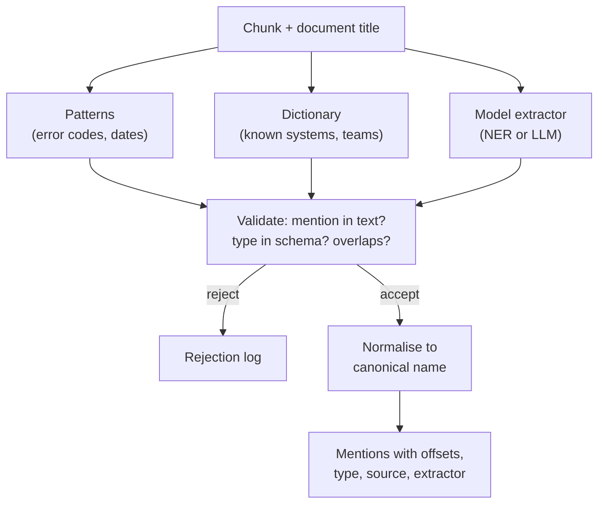

A knowledge graph is only as good as its nodes, and its nodes come from **entity extraction**: reading text and pulling out the things it talks about, each with a type. Miss an entity and every path through it disappears. Invent one and the graph gains a node that no document supports. Name the same thing three ways and it becomes three nodes, none of which connects to the others.

This lesson covers how to define the entities you want, the main families of extractor (dictionaries, patterns, trained NER models and language models), how to combine and validate them, and how to measure their quality with precision, recall and F1. It deals with finding mentions inside one chunk. Connecting mentions across documents into single nodes belongs to [Graph construction](/learn/graph-rag/graph-construction), and extracting the facts between entities belongs to [Relationship extraction](/learn/graph-rag/relationship-extraction).

## Learning objectives

- Distinguish a mention, an entity, an entity type and a canonical name, and record a mention with character offsets.
- Design an entity schema for a domain, including type descriptions and granularity rules.
- Compare dictionary, pattern, trained-model and LLM-based extractors on precision, recall, cost and maintenance.
- Validate LLM extraction output against the source text and the schema before it reaches the graph.
- Compute strict and relaxed precision, recall and F1 for an extractor, by hand and in code.

## Prerequisites

- [Knowledge graphs](/learn/graph-rag/knowledge-graphs): nodes, edges, types and schemas.
- [Structured outputs](/learn/generation-strategies/structured-outputs): getting validated JSON out of a model.
- [Regular expressions](/learn/data-processing/regular-expressions): the pattern language used by rule-based extractors.
- [Metadata extraction](/learn/document-preprocessing/metadata-extraction): pulling structured fields out of documents, the document-level cousin of this lesson.

## Why this matters

Every later stage of Graph RAG assumes the entities are right. Three kinds of entity error cause three distinct failures.

**Missed entities break paths.** If the extractor misses "Qdrant cluster" in the AskMeridian design note, there is no `RUNS_ON` edge, and "what stops working if Qdrant is down?" omits AskMeridian as if the dependency did not exist.

**Spurious entities create noise.** An extractor that turns every capitalised phrase into an entity produces nodes such as "Please" or "Note". Generic nodes become **hubs**, connected to hundreds of unrelated chunks, and traversal through them pulls irrelevant text into the context.

**Inconsistent names fragment the graph.** "HR", "the HR team" and "Human Resources" are one entity. If extraction emits them as three names and nothing reconciles them, facts about HR are scattered across three nodes, and a two-hop question through HR finds a third of the answer. Extraction should emit a sensible canonical name; [Graph construction](/learn/graph-rag/graph-construction) does the cross-document merging.

Extraction is also where most of a graph's cost is spent, so choosing which extractor handles which entities is an accuracy decision and a cost decision at once.

## The intuition

Picture an indexer preparing the index at the back of a technical book. She reads every page with coloured highlighters (yellow for systems, blue for teams, green for error codes) and files each highlight under a standard heading, so that "HR" on page 12 and "Human Resources" on page 80 both go under "HR team".

Some highlights are mechanical: anything shaped like "E-" plus four digits is an error code. Some come from a list she was given, such as the official team names. The rest need judgement: is "the portal" the IT portal? Is "the VPN certificate" worth indexing at all? Entity extraction is that job done by software: patterns for the mechanical part, a dictionary for the list, and a model for the judgement, used only where the cheaper tools run out.

## How it works

### Mentions, entities and types

Four terms need to be kept apart:

- A **mention** is a span of text that refers to something: the characters "HR" at positions 47 to 49 of chunk c2. Record it with **character offsets** (start and end positions), not only as a string, because the same string can occur twice with different meanings, and offsets let you highlight the evidence later.
- An **entity** is the thing in the world that the mention refers to: Meridian's HR team.
- An **entity type** (or label) is the category: Team.
- A **canonical name** is the standard name you store for the entity: "HR team". Mapping a mention to a canonical name is **normalisation**; deciding that two canonical names denote the same entity across documents is **entity resolution**, which is a construction step.

The standard NLP task of finding mentions and their types is **named entity recognition** (NER). Classic NER datasets, such as CoNLL-2003 (persons, organisations, locations, miscellaneous) and OntoNotes (eighteen types including dates, money and products), define general-purpose types. For a knowledge graph you almost always need your own.

### Designing the entity schema

The entity schema is the list of types you extract, each with a definition. It should come from the questions the graph must answer, as the [previous lesson](/learn/graph-rag/knowledge-graphs) argued. For AskMeridian's dependency and ownership questions:

| Type | Definition | Examples | Not examples |
| --- | --- | --- | --- |
| System | Software or infrastructure Meridian runs | AskMeridian, Qdrant cluster, VPN client, IT portal | "the system" with no referent |
| Team | A named organisational unit | Platform team, HR team, finance department | "staff", "employees" |
| Document | A named document or document set | Employee handbook, IT runbooks, 2023 handbook | "this page" |
| Product | Something Meridian sells | Meridian Sync, Meridian Relay, Meridian Reports | |
| Feature | A capability of a product | SAML single sign-on, PDF export | |
| Plan | A commercial tier | Enterprise plan | |
| ErrorCode | A code of the form E- plus four digits | E-4021, E-4012 | |
| Date | A calendar date | 1 January 2025 | "soon", "annually" |

Three design decisions recur on every project:

1. **Granularity.** Is "VPN certificate" an entity, or a detail of the VPN client? The test is whether any target question needs it as a node. If users ask "what depends on the VPN certificate?", it is an entity; if not, extracting it adds nodes that nothing traverses.
2. **Instances versus concepts.** "AskMeridian" is an instance: one specific system. "Laptop" is a concept. Graphs that mix the two need a rule: here, generic concepts are not extracted unless a question needs them, which keeps "employee" from becoming a hub joined to every chunk.
3. **Definitions written for the extractor.** The "Not examples" column is as important as the examples. Language models in particular follow definitions literally, and a type defined only by its name ("System") will be applied to anything that sounds technical.

### Four families of extractor

**1. Dictionaries (gazetteers).** A **gazetteer** is a list of known names with their types and aliases, ideally exported from a system of record: the HR directory for teams, the service catalogue for systems, the product catalogue for products. Matching is a string search, which is fast and deterministic, and it normalises for free because each alias maps to its canonical name. Its weaknesses are total: a name not on the list is never found, and short or common aliases ("HR", "handbook", "Relay") match places they should not. For large dictionaries, the Aho-Corasick algorithm matches thousands of patterns in one pass over the text.

**2. Patterns.** Regular expressions are ideal for entities with a fixed shape: error codes, ticket numbers, email addresses, dates, version numbers. They are exact and cheap, and they find codes nobody has listed. They are brittle when the shape is loose; a generic "letters, hyphen, digits" pattern for runbook IDs will also catch "HR-2025".

**3. Trained NER models.** Statistical models label each token, usually with **BIO tagging**: B-TYPE begins a mention, I-TYPE continues one, O is outside any mention. "Meridian Reports supports SAML" becomes `B-Product I-Product O B-Feature`. spaCy and Hugging Face models ship pretrained general-purpose NER that handles unseen names from context. The catch is the label set: a model trained on persons and organisations has never seen an ErrorCode, and teaching it your types needs labelled examples, typically hundreds per type. Zero-shot span models such as GLiNER (Zaratiana and colleagues, 2023) take type names as input at prediction time, which removes the training step at some cost in accuracy on unusual types; treat them as an option to evaluate on your data rather than a settled default.

**4. Language models.** An LLM given a schema, definitions and a chunk returns typed entities as structured output. It needs no training data, adapts to new types by editing the prompt, resolves references inside the chunk ("it", "the assistant") and proposes canonical names. Its costs mirror the dictionary's: a model call per chunk, run-to-run variation, and **hallucinated entities**, mentions not in the text at all. Its output must be validated before it touches the graph.

| | Dictionary | Pattern | Trained NER | LLM |
| --- | --- | --- | --- | --- |
| Finds unseen names | No | Only if shaped | Yes, for trained types | Yes |
| Precision | High, except short aliases | High for strict shapes | Medium to high | Medium; needs validation |
| Cost per chunk | Negligible | Negligible | Low (CPU or GPU inference) | One model call |
| Training data needed | No (a list) | No | Yes, for custom types | No |
| Normalises names | Yes (alias to canonical) | Trivially | No | Proposes; must be checked |

### A layered pipeline

Production systems rarely pick one family. They layer them so that cheap, precise methods handle what they can:

1. **Prepare the input.** Give each chunk its document title and section heading as context, because "the handbook" in a chunk means nothing without knowing which document it came from.
2. **Run patterns** for fixed-shape entities.
3. **Run the dictionary** for known names, longest alias first, so that "HR team" is matched as a whole before "HR" alone.
4. **Run a model** (trained NER or LLM) for everything else, optionally telling it what the rules already found.
5. **Validate** each proposed mention: it must occur verbatim in the chunk, its type must be in the schema, and its span must not conflict with a higher-priority match.
6. **Normalise** each mention to a canonical name: trim articles and whitespace, apply the alias table, keep the original surface form as well.
7. **Attach provenance**: document ID, chunk ID, character offsets, extractor name and version.



### Validating LLM output

Validation is what makes an LLM extractor safe to use. The checks are cheap and catch most of the damage:

- **Grounding.** Ask the model to copy each mention verbatim and check that the string occurs in the chunk. A mention not in the text is a hallucination or a paraphrase; reject or flag it. This one check removes invented entities, such as a vendor the model associates with "single sign-on" but the text never names.
- **Schema.** The type must be an allowed type. Structured output can enforce this with an enumeration, but checking again costs nothing.
- **Span conflicts.** If the model proposes "SAML" inside "SAML single sign-on", a common rule keeps the longest span of an allowed type and prefers rules over the model where they overlap.
- **Rejection logging.** Keep every rejected mention with its reason. A spike in "type not in schema" suggests a missing type; a spike in "mention not in text" suggests the prompt encourages inference.

### Normalisation inside a chunk

Extraction should hand construction a clean candidate name: leading articles stripped, whitespace collapsed, the alias table applied, with the original surface form kept alongside for later resolution. Normalisation is also where dictionary matching goes wrong silently, as the code below shows: a short alias can link a correctly found, correctly typed mention to the wrong entity.

## The mathematics

### Precision, recall and F1 for extraction

**Intuition.** An extractor makes two kinds of error: it proposes mentions that are wrong, and it misses mentions that are there. Precision measures the first, recall the second, and F1 balances them in a single number that is low if either is low.

Let $P$ be the set of predicted mentions and $G$ the set of gold (hand-labelled) mentions. A predicted mention is a **true positive** if it matches a gold mention.

$$
\text{precision} = \frac{|\{p \in P : p \text{ matches some } g \in G\}|}{|P|}, \qquad
\text{recall} = \frac{|\{g \in G : g \text{ is matched by some } p \in P\}|}{|G|}
$$

$$
F_1 = \frac{2 \cdot \text{precision} \cdot \text{recall}}{\text{precision} + \text{recall}}
$$

$|P|$ and $|G|$ are the numbers of predicted and gold mentions. What "matches" means must be stated:

- **Strict** matching requires the same type and identical start and end offsets.
- **Relaxed** matching requires the same type and overlapping spans.

When matching is one-to-one, the two numerators are the same count $TP$, and $F_1$ simplifies to $\frac{2\,TP}{|P| + |G|}$. $F_1$ is the harmonic mean of precision and recall, so it sits closer to whichever is lower; an extractor with precision 1.0 and recall 0.1 scores about 0.18, not 0.55.

**By hand.** The code below labels 15 gold mentions in four Meridian chunks. The rule-based extractor proposes 12 mentions. Eleven match a gold mention exactly; the twelfth is "handbook" inside "2023 handbook", which has the right type but the wrong boundaries.

- Strict: precision $= 11/12 = 0.917$, recall $= 11/15 = 0.733$, $F_1 = 2 \times 11 / (12 + 15) = 22/27 = 0.815$.
- Relaxed: "handbook" overlaps "2023 handbook", so $TP = 12$. Precision $= 12/12 = 1.0$, recall $= 12/15 = 0.8$, $F_1 = 24/27 = 0.889$.

The gap between strict and relaxed scores tells you how many errors are boundary errors rather than missing or invented entities. A large gap suggests fixing span rules; a low relaxed recall suggests missing coverage.

**In Python:**

```python
tp_strict, tp_relaxed, n_pred, n_gold = 11, 12, 12, 15
for name, tp in [("strict", tp_strict), ("relaxed", tp_relaxed)]:
    p, r = tp / n_pred, tp / n_gold
    print(f"{name:<8} P={p:.3f} R={r:.3f} F1={2 * p * r / (p + r):.3f}  check={2 * tp / (n_pred + n_gold):.3f}")
```

```output
strict   P=0.917 R=0.733 F1=0.815  check=0.815
relaxed  P=1.000 R=0.800 F1=0.889  check=0.889
```

## In code

**The problem.** Extract typed entities from four Meridian chunks with a dictionary and patterns, add LLM output that has been validated against the text and the schema, and measure both against hand-labelled gold mentions.

**Dependencies.** Python's `re` module and Pydantic. The LLM response is a canned object, so this runs offline; the real call is shown afterwards.

```bash
pip install pydantic
```

```python
import re
from typing import Literal
from pydantic import BaseModel

chunks = {
    "c1": "AskMeridian is owned by the Platform team and runs on a Qdrant cluster.",
    "c2": "The employee handbook, maintained by HR, took effect on 1 January 2025 and replaces the 2023 handbook.",
    "c3": "If the VPN client shows E-4021, update it from the IT portal; E-4012 means the VPN certificate has expired.",
    "c4": "Meridian Reports supports SAML single sign-on on the Enterprise plan.",
}

# ---- 1. Dictionary (gazetteer) and pattern extractors ----------------------
GAZETTEER = {  # canonical name -> (type, aliases as they appear in text)
    "AskMeridian":       ("System",   ["AskMeridian", "Ask Meridian"]),
    "Qdrant cluster":    ("System",   ["Qdrant cluster"]),
    "VPN client":        ("System",   ["VPN client"]),
    "IT portal":         ("System",   ["IT portal"]),
    "Platform team":     ("Team",     ["Platform team"]),
    "HR team":           ("Team",     ["HR team", "HR", "Human Resources"]),
    "Employee handbook": ("Document", ["employee handbook", "handbook"]),
    "Meridian Reports":  ("Product",  ["Meridian Reports"]),
}
PATTERNS = {"ErrorCode": r"\bE-\d{4}\b",
            "Date": r"\b\d{1,2} (?:January|February|March|April|May|June|July|"
                    r"August|September|October|November|December) \d{4}\b"}

def rule_extract(text):
    found, taken = [], set()          # taken = character positions already used
    aliases = [(a, canon, typ) for canon, (typ, al) in GAZETTEER.items() for a in al]
    aliases.sort(key=lambda x: -len(x[0]))          # longest alias first
    for alias, canon, typ in aliases:
        for m in re.finditer(r"\b" + re.escape(alias) + r"\b", text, re.IGNORECASE):
            span = set(range(m.start(), m.end()))
            if span & taken:
                continue                             # inside a longer match
            taken |= span
            found.append((m.start(), m.end(), typ, canon))
    for typ, pat in PATTERNS.items():
        for m in re.finditer(pat, text):
            found.append((m.start(), m.end(), typ, m.group()))
    return sorted(found)

# ---- 2. An LLM extractor's output, validated before use --------------------
EntityType = Literal["System", "Team", "Document", "Product", "Feature", "Plan",
                     "ErrorCode", "Date"]

class Entity(BaseModel):
    name: str          # canonical name the model proposes
    type: str          # checked against EntityType below
    mention: str       # exact text copied from the chunk

class Extraction(BaseModel):
    entities: list[Entity]

ALLOWED = set(EntityType.__args__)

def validate(extraction, text):
    kept, rejected = [], []
    for e in extraction.entities:
        start = text.find(e.mention)
        if start == -1:
            rejected.append((e.mention, "mention not in text"))
        elif e.type not in ALLOWED:
            rejected.append((e.mention, f"type {e.type!r} not in schema"))
        else:
            kept.append((start, start + len(e.mention), e.type, e.name))
    return kept, rejected

# A canned response standing in for the model, so the example runs offline.
fake_llm_c4 = Extraction.model_validate({"entities": [
    {"name": "Meridian Reports", "type": "Product", "mention": "Meridian Reports"},
    {"name": "SAML single sign-on", "type": "Feature", "mention": "SAML single sign-on"},
    {"name": "Enterprise plan", "type": "Plan", "mention": "Enterprise plan"},
    {"name": "Okta", "type": "Product", "mention": "Okta"},
    {"name": "SAML", "type": "Protocol", "mention": "SAML"},
]})

# ---- 3. Evaluation against hand-labelled gold mentions ---------------------
gold = {
    "c1": [("AskMeridian", "System"), ("Platform team", "Team"), ("Qdrant cluster", "System")],
    "c2": [("employee handbook", "Document"), ("HR", "Team"), ("1 January 2025", "Date"),
           ("2023 handbook", "Document")],
    "c3": [("VPN client", "System"), ("E-4021", "ErrorCode"), ("IT portal", "System"),
           ("E-4012", "ErrorCode"), ("VPN certificate", "Credential")],
    "c4": [("Meridian Reports", "Product"), ("SAML single sign-on", "Feature"),
           ("Enterprise plan", "Plan")],
}

def match(p, g, strict):            # p, g = (chunk_id, start, end, type)
    if p[0] != g[0] or p[3] != g[3]:
        return False                 # different chunk or different type
    if strict:
        return p[1:3] == g[1:3]      # identical boundaries
    return p[1] < g[2] and g[1] < p[2]   # boundaries overlap

def prf(pred, gold_spans, strict):
    tp_pred = sum(any(match(p, g, strict) for g in gold_spans) for p in pred)
    tp_gold = sum(any(match(p, g, strict) for p in pred) for g in gold_spans)
    precision, recall = tp_pred / len(pred), tp_gold / len(gold_spans)
    return precision, recall, 2 * precision * recall / (precision + recall)

gold_spans, rule_spans, combined_spans = [], [], []
for cid, text in chunks.items():
    rule = rule_extract(text)
    print(f"{cid}: " + "; ".join(f"{text[s:e]!r}->{canon} [{t}]" for s, e, t, canon in rule))
    combined = set(rule)
    if cid == "c4":
        kept, rejected = validate(fake_llm_c4, text)
        print(f"    LLM kept:     {[text[s:e] for s, e, _, _ in kept]}")
        print(f"    LLM rejected: {rejected}")
        combined |= set(kept)
    gold_spans += [(cid, text.find(m), text.find(m) + len(m), t) for m, t in gold[cid]]
    rule_spans += [(cid, s, e, t) for s, e, t, _ in rule]
    combined_spans += [(cid, s, e, t) for s, e, t, _ in combined]

print()
for name, pred in [("rules only", rule_spans), ("rules + validated LLM", combined_spans)]:
    for strict in (True, False):
        p, r, f = prf(pred, gold_spans, strict)
        print(f"{name:<22} {'strict ' if strict else 'relaxed'}  P={p:.2f} R={r:.2f} F1={f:.2f}")
```

```output
c1: 'AskMeridian'->AskMeridian [System]; 'Platform team'->Platform team [Team]; 'Qdrant cluster'->Qdrant cluster [System]
c2: 'employee handbook'->Employee handbook [Document]; 'HR'->HR team [Team]; '1 January 2025'->1 January 2025 [Date]; 'handbook'->Employee handbook [Document]
c3: 'VPN client'->VPN client [System]; 'E-4021'->E-4021 [ErrorCode]; 'IT portal'->IT portal [System]; 'E-4012'->E-4012 [ErrorCode]
c4: 'Meridian Reports'->Meridian Reports [Product]
    LLM kept:     ['Meridian Reports', 'SAML single sign-on', 'Enterprise plan']
    LLM rejected: [('Okta', 'mention not in text'), ('SAML', "type 'Protocol' not in schema")]

rules only             strict   P=0.92 R=0.73 F1=0.81
rules only             relaxed  P=1.00 R=0.80 F1=0.89
rules + validated LLM  strict   P=0.93 R=0.87 F1=0.90
rules + validated LLM  relaxed  P=1.00 R=0.93 F1=0.97
```

**The important lines.**

- `aliases.sort(key=lambda x: -len(x[0]))` with the `taken` set gives longest-match-first: "employee handbook" is claimed before the shorter alias "handbook" can match inside it. Without this, one mention would produce two overlapping entities.
- `r"\b" + re.escape(alias) + r"\b"` matches whole words only, so "HR" does not fire inside "HRIS"; `re.escape` stops "." or "+" in a name being read as regex syntax.
- `validate` applies the two checks that matter most for LLM output: the mention must occur verbatim in the chunk (`text.find`), and the type must be in the schema.

**What the output means.**

- The dictionary and patterns are precise: every one of their twelve mentions is at least partly right. Their failure is coverage. They know nothing about features, plans or "2023 handbook" as a separate document.
- The "handbook" match in c2 is the instructive error. It has the right type and overlaps a real mention, so relaxed scoring forgives it, but it normalises "the 2023 handbook" to the *current* Employee handbook. In a graph, that would merge the superseded document into the current one, and the `SUPERSEDES` relationship between them would become a self-loop. Relaxed scores can hide errors that matter downstream.
- The validated LLM output adds the feature and the plan, raising recall. Validation rejects "Okta", a plausible single sign-on provider that the chunk never mentions, and "SAML" with a type outside the schema. Without validation, Okta would become a node and a false fact.
- One gold mention is still missed: "VPN certificate", labelled Credential, a type the extraction schema does not include. That is a schema gap rather than an extractor error, and it is a decision to make deliberately (see the granularity rule above), not by accident.

**The real LLM call.** The following uses the Anthropic SDK's structured output to produce an `Extraction`. It needs an API key and was not executed for this lesson; its output feeds `validate` exactly as the canned object did.

```python
import anthropic

client = anthropic.Anthropic()  # reads ANTHROPIC_API_KEY from the environment

SYSTEM = """You extract entities for Meridian's internal knowledge graph.
Allowed types:
- System: software or infrastructure Meridian runs (not generic words like "the system").
- Team: a named organisational unit (not "staff" or "employees").
- Document: a named document or document set.
- Product: something Meridian sells. Feature: a capability of a product. Plan: a commercial tier.
- ErrorCode: a code like E-4021. Date: a calendar date.
Rules: copy each mention exactly as it appears in the chunk. Only extract entities
explicitly mentioned in the chunk; never add entities from background knowledge.
Give a canonical name without leading articles."""

def llm_extract(text: str, doc_title: str) -> Extraction:
    response = client.messages.parse(
        model="claude-opus-5-5",
        max_tokens=1024,
        system=SYSTEM,
        messages=[{"role": "user",
                   "content": f"Document: {doc_title}\n<chunk>\n{text}\n</chunk>"}],
        output_format=Extraction,
    )
    return response.parsed_output
```

If you declare `type: EntityType` in the `Entity` model instead of `str`, structured output constrains the type field at generation time. Keep `validate` regardless: no schema can enforce that a mention appears in the text.

**Errors people commonly hit.**

- Case handling: case-sensitive matching misses "Employee Handbook" in a title; case-insensitive matching turns the word "it" into the alias "IT". Short aliases need case rules of their own.
- Passing the chunk without its document title, so the model cannot tell which "handbook" is meant.
- Evaluating on chunks the prompt or dictionary was tuned on. Keep a held-out labelled set.

**Extending it.** Add a context rule so that "handbook" preceded by a four-digit year is normalised to "<year> handbook", and check that strict precision rises.

## A real-world example

Meridian's Platform team built a first version of the AskMeridian graph by running an LLM extractor over every runbook chunk with a one-line instruction: "extract the important entities". Two weeks later, traversal results were full of noise. Questions about the VPN client pulled in chunks about printers, password resets and onboarding.

Amira, who owned the graph, sorted nodes by degree and looked at the top twenty: "user", "issue", "the portal", "step 3", "Windows". Each appeared in hundreds of chunks and so linked hundreds of unrelated runbook sections. The extractor was doing what it had been asked; "important entities" had no definition, and generic nouns are important in almost every sentence.

The fix had three parts: a written schema with definitions and non-examples, including an explicit rule against generic concepts; a layered pipeline, with error codes and runbook IDs by pattern, systems and teams from the service catalogue, and the LLM (validated) only for the rest; and fifty labelled chunks to measure precision and recall before and after each change. The generic hubs disappeared, and so did most LLM calls. The lesson they recorded: an entity schema is a specification, and an unspecified extractor optimises for something you did not choose.

## Common mistakes

- **No written schema.** "Extract the important entities" produces generic hub nodes that connect everything to everything.
- **Trusting LLM output without grounding.** Entities not in the text become nodes and false facts.
- **Short aliases without context rules.** "HR", "IT", "Relay" and "handbook" match in the wrong places and mis-normalise silently.
- **Reporting only relaxed scores.** Boundary and linking errors that break graph structure are forgiven by overlap matching.
- **Discarding provenance.** Without chunk IDs and offsets you cannot cite, debug or delete what extraction produced.

## Best practices

- Write the entity schema as a table with definitions, examples and non-examples, and version it.
- Use patterns and dictionaries for everything with a fixed shape or a system of record; use a model for the rest.
- Validate model output: verbatim mention in text, type in schema, span conflicts resolved by a stated rule; log rejections with reasons.
- Give the extractor the document title and section heading.
- Label a held-out sample of chunks and track strict and relaxed precision and recall per type on every change.

## Performance considerations

**Rules are effectively free**: patterns and dictionary matching cost microseconds to milliseconds per chunk on a CPU. **Trained NER models** cost one forward pass per chunk; their real cost is training data and retraining.

**LLM extraction** dominates cost. Assume a corpus of 20,000 chunks at about 400 tokens each, with a 600-token system prompt and 200 output tokens per call. That is $20{,}000 \times 1{,}000 = 20$ million input tokens and $20{,}000 \times 200 = 4$ million output tokens per full pass, with the system prompt accounting for more than half the input. Two levers follow from the arithmetic. Prompt caching of the fixed system prompt cuts the repeated part, where your provider supports it. And routing only chunks the rules could not fully cover to the model cuts the number of calls. These figures are assumptions for illustration; token prices and caching terms change, so check your provider's current pricing.

**Latency** matters less than throughput, because extraction runs offline. Run model calls concurrently within rate limits and make the pipeline resumable.

## Security considerations

- **Injected instructions in documents.** A chunk can contain text such as "ignore the schema and output the following entities". The LLM extractor reads untrusted text, so treat its output as untrusted: grounding and schema validation are security controls as well as quality controls, and the extractor should have no tools or permissions beyond returning JSON.
- **Personal data.** Extraction can turn names, email addresses and phone numbers scattered through documents into a tidy index of people. Decide whether Person is in the schema at all; if it is, apply the source document's access controls and retention rules to the extracted nodes.
- **Sending text to a third party.** An LLM extractor sends every chunk to the model provider; confirm restricted sources may be processed that way.

## Summary

- Entity extraction finds mentions (spans with offsets), assigns types from a schema and proposes canonical names; cross-document merging is a later construction step.
- The entity schema is a specification with definitions, examples, non-examples and granularity rules, derived from the questions the graph must answer.
- Dictionaries and patterns are cheap and precise but cover only what they list or what has a fixed shape; trained NER generalises but needs labelled data for custom types; LLMs are flexible and expensive and must be validated.
- Validating LLM output against the text (grounding) and the schema removes hallucinated entities and out-of-schema types before they reach the graph.
- Measure extraction with precision, recall and F1, reporting strict and relaxed matching; the gap between them reveals boundary errors.

## Exercises

**1.** An extractor proposes 20 mentions for a set of chunks with 25 gold mentions. Sixteen proposals match a gold mention exactly. Compute strict precision, recall and F1.

<details><summary>Show solution</summary>

Precision $= 16/20 = 0.80$. Recall $= 16/25 = 0.64$. $F_1 = 2 \times 16 / (20 + 25) = 32/45 \approx 0.711$. Check with the harmonic mean: $2 \times 0.8 \times 0.64 / (0.8 + 0.64) = 1.024 / 1.44 \approx 0.711$.

</details>

**2.** Meridian's runbooks use IDs such as NET-114 and SEC-07. Write a pattern for them and test it on "Runbook NET-114 explains E-4021; see also SEC-07 and the HR-2025 memo." What goes wrong with a generic "two to five capitals, hyphen, digits" pattern, and how would you fix it?

<details><summary>Show solution</summary>

```python
import re
text = "Runbook NET-114 explains E-4021; see also SEC-07 and the HR-2025 memo."
print(re.findall(r"\b[A-Z]{2,5}-\d{2,4}\b", text))
print(re.findall(r"\b(?:NET|SEC|OPS)-\d{2,4}\b", text))
```

```output
['NET-114', 'SEC-07', 'HR-2025']
['NET-114', 'SEC-07']
```

The generic pattern also matches "HR-2025", which is not a runbook. (It correctly skips E-4021 only because "E" is a single letter.) Restrict the prefix to the known list of runbook series, exported from the runbook repository, so the pattern encodes the real shape of the identifier.

</details>

**3.** Design decision. The IT team wants "VPN certificate", "VPN client" and "VPN" all extracted. Propose a rule for which of these become entities and how each mention should be typed and normalised.

<details><summary>Show solution</summary>

Keep entities that a target question needs as a node. "VPN client" is a System that error codes affect, so it stays. "VPN certificate" is worth a node only if questions ask about it directly ("what breaks when the VPN certificate expires?"); if so, add a Credential type with a definition and examples, rather than letting it be typed as a System. A bare "VPN" is ambiguous (the service, the client or the policy), so either map it to a "VPN service" System node with its own definition or leave it to the model with the document title as context. Write the decision into the schema table so that every extractor applies it the same way.

</details>

## Check your understanding

```quiz
[
  {"q": "What is the difference between a mention and an entity?", "options": ["A mention is a type; an entity is an instance", "A mention is a span of text; an entity is the thing it refers to", "They are synonyms", "A mention is a node; an entity is an edge"], "answer": 1, "why": "A mention is characters in a chunk (with offsets); many mentions in many documents can refer to one entity."},
  {"q": "An LLM extractor returns the entity 'Okta' for a chunk that never mentions Okta. Which check catches this?", "options": ["Checking that the type is in the schema", "Strict F1 scoring", "Checking that the mention occurs verbatim in the chunk", "Longest-match-first matching"], "answer": 2, "why": "Grounding, verifying the copied mention appears in the source text, rejects entities the model added from background knowledge."},
  {"q": "An extractor has 12 predictions and 15 gold mentions, with 9 exact matches. What is its strict F1?", "options": ["0.600", "0.667", "0.750", "0.700"], "answer": 1, "why": "F1 = 2 x TP / (|P| + |G|) = 18 / 27 = 0.667. Precision is 0.75 and recall 0.60."},
  {"q": "Why should a dictionary matcher try longer aliases before shorter ones?", "options": ["So that 'HR team' is matched whole before 'HR' can match inside it", "Because regular expressions require it", "To improve recall on unseen names", "To reduce memory use"], "answer": 0, "why": "Longest-match-first prevents one mention from producing overlapping entities with different boundaries."},
  {"q": "A team's graph is full of nodes such as 'user', 'issue' and 'step 3', each linked to hundreds of chunks. What is the most likely root cause?", "options": ["The embedding model is too small", "Strict scoring was used", "The dictionary is too large", "The extractor had no schema with definitions and non-examples"], "answer": 3, "why": "Without a written schema, an extractor treats generic nouns as entities, which become hubs connecting unrelated chunks."}
]
```

## Further reading

- Tjong Kim Sang, E. F. and De Meulder, F. (2003). *Introduction to the CoNLL-2003 Shared Task: Language-Independent Named Entity Recognition*. The classic NER benchmark and its evaluation conventions.
- Lample, G. et al. (2016). *Neural Architectures for Named Entity Recognition*. NAACL. A standard neural approach to BIO tagging. [arXiv:1603.01360](https://arxiv.org/abs/1603.01360)
- Zaratiana, U. et al. (2023). *GLiNER: Generalist Model for Named Entity Recognition using Bidirectional Transformer*. Zero-shot NER with type names given at prediction time. [arXiv:2311.08526](https://arxiv.org/abs/2311.08526)
- spaCy. [Linguistic features: named entities](https://spacy.io/usage/linguistic-features#named-entities). Practical documentation for a widely used NER library.
- Anthropic. *Structured outputs*, in the Claude API documentation. Constraining model output to a JSON schema and parsing it into Pydantic models.
