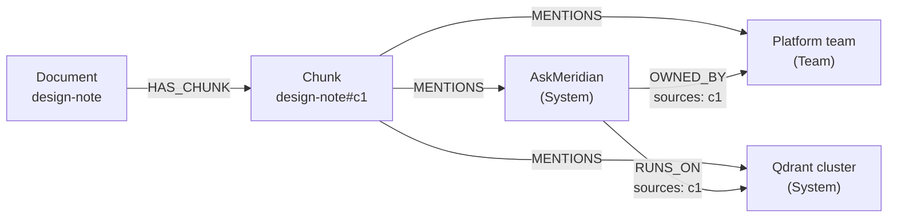

Extraction produces fragments: a few entities and triples per chunk, each named however that chunk happened to name things. **Graph construction** turns those fragments into one coherent graph. It decides which mentions are the same entity, gives each entity a stable identity, attaches every fact to the text that supports it, and keeps the whole structure correct as documents are added, changed and deleted.

This is the least glamorous stage of Graph RAG and the one that most often decides whether the graph is usable. A graph with excellent extraction and poor construction is fragmented, duplicated and stale. This lesson covers the two-layer graph layout, entity resolution with blocking and clustering, idempotent upserts, provenance-based updates and deletions, quality checks, and the main storage options.

## Learning objectives

- Design a graph with a lexical layer (documents, chunks, mentions) and a domain layer (entities and relationships) linked by provenance.
- Perform entity resolution with normalisation, blocking, pairwise similarity and union-find clustering, and explain the risk of transitive over-merging.
- Compute character-trigram Jaccard similarity and the pair savings from blocking, by hand and in Python.
- Implement idempotent upserts and document deletion that removes exactly the facts the document supported.
- Choose a storage option (in-memory library, property graph database, RDF store, relational tables) for a given scale and team.

## Prerequisites

- [Knowledge graphs](/learn/graph-rag/knowledge-graphs): nodes, edges, identifiers, provenance.
- [Entity extraction](/learn/graph-rag/entity-extraction): mentions, types and canonical names.
- [Relationship extraction](/learn/graph-rag/relationship-extraction): triples with evidence and confidence.
- [Document identifiers](/learn/document-engineering/document-identifiers): stable IDs for documents and chunks.
- [Incremental ingestion](/learn/understanding-document-ingestion/incremental-ingestion): processing only what changed.

## Why this matters

Three construction failures account for most broken knowledge graphs.

**Fragmentation.** The design note says "AskMeridian", a runbook says "Ask Meridian", a third page says "the assistant". Without resolution these are three nodes. Ownership facts attach to one, dependency facts to another, and a two-hop question finds a fraction of the answer. Fragmentation is invisible from any single query; the graph simply knows less than its sources.

**Over-merging.** The opposite error is worse. Merge "Meridian Relay" (a product) with "mail relay" (a server setting in a runbook) because both contain "relay", and the product suddenly has the mail server's dependencies, owners and error codes. Every answer that crosses that node mixes two unrelated things, and because the merge is structural, no amount of prompt engineering fixes it.

**Staleness.** The employee handbook took effect on 1 January 2025 and superseded the 2023 handbook. If the graph was built once and never updated, it still holds the 2023 handbook's 4-year laptop cycle and 09:00 to 17:00 support hours as current facts. If it was updated by adding new facts without removing old ones, it holds both versions and contradicts itself. Correct updates require knowing which facts each document contributed, which is only possible if provenance was recorded at construction time.

Full rebuilds avoid staleness but not cheaply: if extraction uses a language model, every rebuild repeats every model call. Incremental construction, done correctly, is what makes a knowledge graph affordable to keep current.

## The intuition

Think about merging the contact lists from three old phones into one address book. One phone has "Priya Shah", another "Priya S.", the third "P. Shah (work)". You merge them because the phone numbers match, not because the names do. You do *not* merge "Sam Patel" with "Sam Peters", even though the names are close, because the evidence says they are different people. You keep a note of which phone each number came from, so that when you find out one phone's data is wrong, you can remove exactly what it contributed and nothing else.

Graph construction is that job for entities. Names are weak evidence; types, context and known aliases are stronger. Every merge decision is a risk in one direction or the other. And provenance, the note of where each fact came from, is what lets you undo, update and delete without rebuilding everything.

## How it works

### Two layers linked by provenance

A well-built Graph RAG graph has two layers.

The **lexical layer** mirrors the documents: `Document` nodes, `Chunk` nodes linked by `HAS_CHUNK`, and `MENTIONS` edges from each chunk to every entity it mentions. It records *where things are said*.

The **domain layer** holds the knowledge: `Entity` nodes and typed relationships between them (`OWNED_BY`, `RUNS_ON`). Every relationship carries a `sources` property listing the chunks whose text supports it. It records *what is said*.



The two layers serve different purposes at query time and at maintenance time:

- At query time, traversal moves through the domain layer to find related entities, then crosses `MENTIONS` edges back to chunks so the model can read and cite the original text. [Graph retrieval](/learn/graph-rag/graph-retrieval) builds on exactly this.
- At maintenance time, deleting a document follows `HAS_CHUNK` to its chunks and removes those chunks from every `sources` list. A relationship whose list becomes empty has lost all its evidence and is deleted; an entity no chunk mentions and no relationship touches is an orphan and is deleted too.

### Identity: what makes two nodes the same

Every entity node needs an **identifier** that is stable (the same entity gets the same ID on every build) and independent of display formatting. Three common sources, in order of preference:

1. **A system of record.** Teams from the HR directory, systems from the service catalogue, products from the product catalogue. If an ID exists, use it, and treat its official name and aliases as the dictionary for both extraction and resolution.
2. **A deterministic key.** Type plus normalised name, such as `System:askmeridian`. Deterministic keys make construction idempotent: rebuilding produces the same IDs, so upserts find existing nodes.
3. **A generated ID** (a UUID) assigned when a new cluster is first seen, with a persisted mapping from normalised names to IDs. This survives renames but needs the mapping table to be maintained.

Keep the **display name** separate from the ID. The ID never changes; the display name can be updated when the official name changes.

### Entity resolution

**Entity resolution** (also called record linkage or deduplication) decides which candidate entities from different chunks refer to the same thing. It runs in five steps:

1. **Normalise.** Lower-case, collapse whitespace, strip leading articles, and apply the alias table ("HR" and "Human Resources" become "hr team"). Many duplicates disappear here: "Qdrant Cluster" and "Qdrant cluster" become identical.
2. **Block.** Comparing every candidate with every other is quadratic. **Blocking** restricts comparisons to candidates that share a cheap key: the same type, the same first token, a shared character n-gram. Blocking by type also enforces a hard rule: a Product is never the same entity as a System, which prevents the "Meridian Relay" and "mail relay" merge outright.
3. **Score pairs.** Within each block, compute a similarity. Character n-gram Jaccard handles spacing and spelling variants; embedding similarity of the name plus a short context handles different wordings ("the assistant" for AskMeridian); exact matches on identifiers (an error code, an email address) are near-certain evidence.
4. **Decide.** Merge pairs above a threshold, keep apart pairs below another, and send the uncertain middle to review or to a model with both contexts. The threshold is a precision-recall trade-off: lower merges more variants and risks over-merging; higher keeps more duplicates.
5. **Cluster.** Pairwise decisions are combined into groups with **union-find**: each candidate starts in its own set, and every "merge" decision joins two sets. The final sets are the entities.

Union-find computes the **transitive closure** of the merge decisions: if A matches B and B matches C, then A, B and C become one entity even if A and C look nothing alike. This is efficient and dangerous. A chain of individually reasonable merges ("IT portal", "IT portals", "IT portal team", "HR portal team") can join things that should stay separate. Guard against it with **cannot-link** rules (pairs that must never merge, for example two different entries in the service catalogue), with type blocking, and by flagging clusters whose least similar pair falls below a floor for review.

### Upserts and idempotence

Construction should be **idempotent**: processing the same chunk twice leaves the graph exactly as processing it once. That property makes retries after failures safe and makes incremental updates simple. It requires:

- **Merge-or-create** for nodes, keyed by ID ("upsert"). In Cypher this is `MERGE`; in NetworkX, `add_node` on an existing node updates it.
- **Edge identity** defined as (subject ID, predicate, object ID). A second chunk stating the same fact adds itself to the edge's `sources` rather than creating a parallel edge.
- **Set semantics for provenance.** Adding a chunk ID that is already in `sources` changes nothing.

### Updates and deletions

When a document changes, the reliable procedure is "retract, then re-assert":

1. Find the document's chunks through `HAS_CHUNK`.
2. Remove those chunk IDs from the `sources` of every relationship, and delete relationships whose `sources` become empty.
3. Delete the chunk nodes and their `MENTIONS` edges.
4. Delete orphaned entities: no mentions, no relationships.
5. Re-chunk and re-extract the new version, and upsert the results.

This touches only the facts the document contributed. A fact also supported by another document survives with its remaining evidence. Pair it with change detection from [Incremental ingestion](/learn/understanding-document-ingestion/incremental-ingestion) (content hashes per chunk) so that unchanged chunks skip re-extraction, which is where the cost is.

Superseded documents need a policy decision. Either retract them like deletions (the graph holds only current facts) or keep them with a `valid_to` date and a `SUPERSEDES` edge from the new version (the graph holds history). For an assistant that answers "what is the policy now?", the first is safer; for one that also answers "what changed?", the second is needed, and retrieval must then filter by validity.

### Quality checks after every build

Cheap checks catch construction bugs before users do:

- **Degree outliers.** List the highest-degree entities. A generic node ("user", "system") or an over-merged cluster shows up at the top.
- **Type violations.** Relationships whose endpoints violate the schema's domain and range.
- **Self-loops.** An edge from a node to itself often means two different entities were merged (a document that "supersedes" itself).
- **Orphans and unsupported edges.** Entities with no mentions, relationships with empty `sources`.
- **Duplicates that survived.** Pairs of entities of the same type with high name similarity, for review.

### Where to store the graph

| Option | Strengths | Limits | Fits |
| --- | --- | --- | --- |
| In-memory library (NetworkX) | Simple, scriptable, rich algorithms | Single process, memory-hungry, no concurrency or persistence | Prototypes, small graphs, offline analysis |
| Property graph database (Neo4j, Memgraph, Amazon Neptune) | Cypher or GQL, constraints, indexes, concurrent access, variable-length path queries | Another service to run and secure | Most production Graph RAG |
| RDF triple store | Standards, SPARQL, reasoning, global identifiers | Edge properties need RDF-star or reification | Interoperability with published ontologies |
| Relational tables (`nodes`, `edges`) in PostgreSQL | Already operated, transactional, joins with other data | Multi-hop queries need recursive CTEs, which get slow and awkward for deep traversals | Small graphs, shallow queries, teams avoiding new infrastructure |

The graph can also live next to the vector index: some vector databases store payload references that make the chunk-to-entity link cheap. Whatever the store, the two layers and the `sources` property should look the same.

## The mathematics

### Character-trigram Jaccard similarity

**Intuition.** Two spellings of the same name share most of their short letter sequences, even with a space added or a letter changed. Breaking each name into three-letter pieces and measuring the overlap gives a similarity that tolerates small variations and ignores word order within short strings.

$$
J(a, b) = \frac{|T(a) \cap T(b)|}{|T(a) \cup T(b)|}
$$

$T(s)$ is the set of character **trigrams** (overlapping three-character substrings) of the string $s$ after normalisation (here, lower-case with spaces removed). $\cap$ is the set intersection (trigrams in both), $\cup$ the union (trigrams in either), and $|\cdot|$ the number of elements. $J$ is 1 for identical trigram sets and 0 for no overlap.

**By hand.** Compare "hr portal" and "it portal". With spaces removed, "hrportal" has the trigrams hrp, rpo, por, ort, rta, tal; "itportal" has itp, tpo, por, ort, rta, tal. They share 4 (por, ort, rta, tal); the union has $6 + 6 - 4 = 8$. So $J = 4/8 = 0.50$. Half the letters agree, but the half that differs is the half that names the thing. A threshold of 0.8 keeps them apart, correctly.

### Why blocking matters

Comparing $n$ candidates pairwise takes $\binom{n}{2} = n(n-1)/2$ comparisons. With $n = 100{,}000$ candidates that is about 5 billion pairs. If blocking divides them into 100 blocks of 1,000, the count becomes $100 \times \binom{1000}{2} = 100 \times 499{,}500 \approx 50$ million, a hundredfold reduction. In general, $B$ equal blocks cut the work by roughly a factor of $B$. The cost is recall: a true duplicate pair that lands in different blocks is never compared, so blocking keys must be chosen so that real duplicates almost always share one.

```python
def trigrams(s):
    s = s.replace(" ", "")
    return {s[i:i + 3] for i in range(len(s) - 2)}

a, b = trigrams("hr portal"), trigrams("it portal")
print(sorted(a), sorted(b))
print(f"shared={len(a & b)} union={len(a | b)} jaccard={len(a & b) / len(a | b):.2f}")

pairs = lambda n: n * (n - 1) // 2
print(f"100,000 candidates, no blocking: {pairs(100_000):,} pairs")
print(f"100 blocks of 1,000:             {100 * pairs(1_000):,} pairs")
```

```output
['hrp', 'ort', 'por', 'rpo', 'rta', 'tal'] ['itp', 'ort', 'por', 'rta', 'tal', 'tpo']
shared=4 union=8 jaccard=0.50
100,000 candidates, no blocking: 4,999,950,000 pairs
100 blocks of 1,000:             49,950,000 pairs
```

## In code

**The problem.** Take extraction output from three Meridian documents, resolve the entity mentions into nodes, build a two-layer graph with provenance on every relationship, and then delete one document and confirm that exactly its contributions disappear.

**Dependencies.** NetworkX and the standard library. No model or API key.

```bash
pip install networkx
```

```python
import re
from collections import Counter
from itertools import combinations
import networkx as nx

# Output of entity and relationship extraction, per chunk (previous lessons):
# mentions are (surface form, type); triples use surface forms as extracted.
extractions = {
    "design-note#c1": {"mentions": [("AskMeridian", "System"), ("Platform team", "Team"),
                                     ("Qdrant cluster", "System")],
                       "triples": [("AskMeridian", "OWNED_BY", "Platform team"),
                                   ("AskMeridian", "RUNS_ON", "Qdrant cluster")]},
    "runbook-07#c3": {"mentions": [("Ask Meridian", "System"), ("the Platform Team", "Team"),
                                    ("IT portal", "System"), ("mail relay", "System")],
                      "triples": [("Ask Meridian", "OWNED_BY", "the Platform Team")]},
    "reports-docs#c2": {"mentions": [("Meridian Relay", "Product"), ("Meridian Reports", "Product"),
                                      ("HR portal", "System")],
                        "triples": []},
}
ALIASES = {"hr": "hr team", "human resources": "hr team"}   # from the HR directory

def normalise(name):
    name = re.sub(r"^(the|a|an)\s+", "", name.strip(), flags=re.IGNORECASE).lower()
    return ALIASES.get(re.sub(r"\s+", " ", name), name)

def trigrams(s):
    s = s.replace(" ", "")                   # "ask meridian" ~ "askmeridian"
    return {s[i:i + 3] for i in range(len(s) - 2)}

def jaccard(a, b):
    A, B = trigrams(a), trigrams(b)
    return len(A & B) / len(A | B)

# ---- 1. Distinct (normalised name, type) candidates --------------------------
surface = {}                                  # candidate -> Counter of surface forms
for ex in extractions.values():
    for m, t in ex["mentions"]:
        surface.setdefault((normalise(m), t), Counter())[m] += 1
candidates = sorted(surface)

# ---- 2. Block by type, score pairs, union the matches ------------------------
parent = {c: c for c in candidates}
def find(x):
    while parent[x] != x:
        parent[x] = parent[parent[x]]         # path halving keeps trees shallow
        x = parent[x]
    return x

THRESHOLD = 0.8
compared = 0
for a, b in combinations(candidates, 2):
    if a[1] != b[1]:
        continue                              # blocking: never compare across types
    compared += 1
    sim = jaccard(a[0], b[0])
    if sim > 0:
        print(f"  {a[0]!r} vs {b[0]!r} [{a[1]}] sim={sim:.2f} -> "
              f"{'MERGE' if sim >= THRESHOLD else 'keep apart'}")
    if sim >= THRESHOLD:
        parent[find(a)] = find(b)
n = len(candidates)
print(f"compared {compared} of {n * (n - 1) // 2} possible pairs")

# One node per cluster: a stable ID from its shortest normalised name, and
# that candidate's most frequent surface form as the display name.
node_of, names, clusters = {}, {}, {}
for c in candidates:
    clusters.setdefault(find(c), []).append(c)
for members in clusters.values():
    key = min(members, key=lambda m: len(m[0]))
    nid = f"{key[1]}:{key[0].replace(' ', '-')}"
    names[nid] = surface[key].most_common(1)[0][0]
    for m in members:
        node_of[m] = nid

# ---- 3. Build the graph: lexical layer + domain layer with provenance --------
def add_chunk(G, chunk_id, ex):
    doc = chunk_id.split("#")[0]
    G.add_node(doc, kind="Document")
    G.add_node(chunk_id, kind="Chunk")
    G.add_edge(doc, chunk_id, key="HAS_CHUNK")
    types = dict(ex["mentions"])
    for m, t in ex["mentions"]:
        nid = node_of[(normalise(m), t)]
        G.add_node(nid, kind="Entity", type=t, name=names[nid])
        G.add_edge(chunk_id, nid, key="MENTIONS")
    for s, p, o in ex["triples"]:
        u, v = node_of[(normalise(s), types[s])], node_of[(normalise(o), types[o])]
        if G.has_edge(u, v, key=p):
            G.edges[u, v, p]["sources"].add(chunk_id)    # same fact, new evidence
        else:
            G.add_edge(u, v, key=p, sources={chunk_id})

def remove_document(G, doc):
    chunks = {c for _, c, k in G.out_edges(doc, keys=True) if k == "HAS_CHUNK"}
    for u, v, k, data in list(G.edges(keys=True, data=True)):
        if "sources" in data:
            data["sources"] -= chunks
            if not data["sources"]:
                G.remove_edge(u, v, key=k)               # no evidence left
    G.remove_nodes_from(chunks | {doc})
    orphans = [n for n, d in G.nodes(data=True) if d["kind"] == "Entity" and G.degree(n) == 0]
    G.remove_nodes_from(orphans)                          # nothing mentions them
    return orphans

def show(G):
    ents = sorted(n for n, d in G.nodes(data=True) if d["kind"] == "Entity")
    print(f"{len(ents)} entities: " + ", ".join(f"{n} ({G.nodes[n]['name']})" for n in ents))
    for u, v, k, d in G.edges(keys=True, data=True):
        if "sources" in d:
            print(f"  {u} -{k}-> {v}  sources={sorted(d['sources'])}")

G = nx.MultiDiGraph()
for chunk_id, ex in extractions.items():
    add_chunk(G, chunk_id, ex)
print("\nAfter building from three documents:")
show(G)
print("\nDelete design-note. Orphaned entities removed:", remove_document(G, "design-note"))
show(G)
```

```output
  'ask meridian' vs 'askmeridian' [System] sim=1.00 -> MERGE
  'hr portal' vs 'it portal' [System] sim=0.50 -> keep apart
  'meridian relay' vs 'meridian reports' [Product] sim=0.50 -> keep apart
compared 16 of 36 possible pairs

After building from three documents:
8 entities: Product:meridian-relay (Meridian Relay), Product:meridian-reports (Meridian Reports), System:askmeridian (AskMeridian), System:hr-portal (HR portal), System:it-portal (IT portal), System:mail-relay (mail relay), System:qdrant-cluster (Qdrant cluster), Team:platform-team (Platform team)
  System:askmeridian -OWNED_BY-> Team:platform-team  sources=['design-note#c1', 'runbook-07#c3']
  System:askmeridian -RUNS_ON-> System:qdrant-cluster  sources=['design-note#c1']

Delete design-note. Orphaned entities removed: ['System:qdrant-cluster']
7 entities: Product:meridian-relay (Meridian Relay), Product:meridian-reports (Meridian Reports), System:askmeridian (AskMeridian), System:hr-portal (HR portal), System:it-portal (IT portal), System:mail-relay (mail relay), Team:platform-team (Platform team)
  System:askmeridian -OWNED_BY-> Team:platform-team  sources=['runbook-07#c3']
```

**The important lines.**

- `normalise` collapses "the Platform Team" and "Platform team" to the same candidate before any comparison, and "Qdrant Cluster" style variants never reach the similarity step at all.
- `if a[1] != b[1]: continue` is blocking by type. "Meridian Relay" (Product) and "mail relay" (System) are never compared, so they cannot be merged however similar their names.
- `find` and `parent[find(a)] = find(b)` are union-find. Each merge joins two sets; the final sets are the entities.
- `G.edges[u, v, p]["sources"].add(chunk_id)` makes the second statement of a fact add evidence to the existing edge instead of creating a duplicate.
- `remove_document` is retract-then-clean: subtract the document's chunks from every `sources` set, drop edges with no evidence left, then drop entities nothing refers to.

**What the output means.**

- Of 36 possible pairs, blocking left 16 to compare. Only three pairs share any trigrams. "ask meridian" and "askmeridian" are identical once spaces are removed and merge. "hr portal" against "it portal" and "Meridian Relay" against "Meridian Reports" score 0.50 and stay apart: similar strings, different things.
- The ownership fact is stated by two documents in different spellings and ends up as one edge with two sources. That is resolution paying off: without it, the runbook's version would hang off a separate "Ask Meridian" node.
- Deleting the design note removes the `RUNS_ON` edge (its only evidence was in the design note) and the Qdrant cluster entity (nothing else mentions it). The ownership edge survives with its remaining source. Nothing else changes.

**The storage version.** The same upsert in Neo4j uses `MERGE` with a uniqueness constraint. This needs a running Neo4j server and the `neo4j` Python driver and was not executed for this lesson.

```python
import os
from neo4j import GraphDatabase

driver = GraphDatabase.driver(os.environ["NEO4J_URI"],
                              auth=(os.environ["NEO4J_USER"], os.environ["NEO4J_PASSWORD"]))
driver.execute_query(
    "CREATE CONSTRAINT entity_id IF NOT EXISTS FOR (e:Entity) REQUIRE e.id IS UNIQUE")

ALLOWED = {"OWNED_BY", "RUNS_ON", "INDEXES", "DOCUMENTS", "SUPERSEDES"}

def upsert_fact(s_id, s_name, s_type, pred, o_id, o_name, o_type, chunk_id):
    if pred not in ALLOWED:          # relationship types cannot be query parameters,
        raise ValueError(pred)       # so whitelist before formatting them in
    driver.execute_query(
        f"""
        MERGE (s:Entity {{id: $s_id}}) ON CREATE SET s.name = $s_name, s.type = $s_type
        MERGE (o:Entity {{id: $o_id}}) ON CREATE SET o.name = $o_name, o.type = $o_type
        MERGE (s)-[r:{pred}]->(o)
        SET r.sources = CASE WHEN $chunk IN coalesce(r.sources, [])
                             THEN r.sources ELSE coalesce(r.sources, []) + $chunk END
        """,
        s_id=s_id, s_name=s_name, s_type=s_type, o_id=o_id, o_name=o_name,
        o_type=o_type, chunk=chunk_id,
    )
```

**Errors people commonly hit.**

- Building node IDs from display names with formatting ("AskMeridian" against "askmeridian"), so the same entity gets a new ID on every build and upserts create duplicates.
- Formatting user-controlled strings into Cypher. Only whitelisted relationship types belong in the query text; everything else goes in parameters.
- Deleting a document's chunks without updating `sources`, leaving edges that claim support from text that no longer exists.
- A threshold tuned on one block (product names) applied to another (people's names), where the right value is different.

**Extending it.** Add a second resolution signal: embed each candidate's name with a sentence-transformer and merge pairs whose cosine is high *and* whose trigram Jaccard is above a lower floor. Then add a cannot-link list from the service catalogue and confirm that no cluster ever contains two catalogue entries.

## A real-world example

Meridian's Platform team rebuilt the AskMeridian graph from scratch every night. It worked for a month. Then two things happened in the same week. The extraction bill for the nightly rebuild was raised in a cost review, because every rebuild re-ran the language model over every runbook chunk although only a handful changed each day. And a member of staff was told the support desk closed at 17:00, citing the graph.

Joanne investigated the second problem first. The 2023 handbook had been archived to a "superseded" folder rather than deleted, and the ingestion job indexed that folder too. Both handbooks produced `HAS_HOURS` facts for the support desk, and traversal returned whichever edge it reached first. The graph had no notion of which document was current.

The team changed the construction pipeline in three ways. First, chunk-level content hashes: only chunks whose hash changed were re-extracted, which reduced nightly model calls to a small fraction of a full build. Second, provenance on every edge, with retract-then-re-assert for changed documents, so an edited runbook replaced its old facts instead of adding to them. Third, a policy for superseded documents: they were retracted from the main graph, and a single `SUPERSEDES` edge was kept so that "what changed from the 2023 handbook?" could still be routed to the archived text. The incorrect support hours disappeared on the next run, and the cost question went away. The decision they recorded was that provenance is not a debugging nicety; it is the mechanism that makes updates and deletions possible at all.

## Common mistakes

- **Merging on name similarity alone.** Similar strings ("HR portal", "IT portal") are often different entities; use types, aliases and context as evidence.
- **Ignoring transitivity.** Union-find turns chains of plausible merges into giant clusters; review large or loosely connected clusters.
- **No provenance on edges.** Without `sources`, a changed or deleted document cannot be retracted, and the graph only ever grows.
- **Appending on update.** Re-extracting a changed document and adding its facts without retracting the old ones leaves both versions in the graph.
- **Unstable IDs.** IDs that change between builds break upserts, external references and caches.
- **Indexing superseded documents as if current.** The graph then holds contradictory facts with no way to choose between them.

## Best practices

- Keep a lexical layer (documents, chunks, mentions) and a domain layer (entities, relationships) linked by `sources` on every relationship.
- Take identities and aliases from systems of record wherever they exist; otherwise use deterministic keys.
- Resolve entities with normalisation, type blocking, a similarity threshold and union-find, plus cannot-link rules and review of uncertain pairs.
- Make construction idempotent: upsert nodes by ID, edges by (subject, predicate, object), provenance as a set.
- Update by retract-then-re-assert, driven by per-chunk content hashes, and decide explicitly how superseded documents are handled.
- Run quality checks (degree outliers, type violations, self-loops, orphans, surviving near-duplicates) after every build.

## Performance considerations

**Resolution cost** is dominated by pair comparisons. As the mathematics showed, blocking turns billions of comparisons into tens of millions. Embedding-based similarity adds one embedding per candidate (computed once and cached), and approximate nearest-neighbour search can replace pairwise comparison entirely: for each candidate, retrieve its 10 nearest names and compare only those, which is linear in the number of candidates.

**Union-find** with path compression runs in effectively constant time per operation, so clustering is never the bottleneck.

**Upserts** in a graph database are index lookups when a uniqueness constraint exists on the ID; without the constraint, `MERGE` scans and slows sharply as the graph grows. Batch upserts (hundreds or thousands of facts per transaction) rather than one transaction per fact, to amortise round-trip latency.

**Incremental updates** pay for themselves quickly. If a corpus of 20,000 chunks changes by 1% a day, incremental extraction processes about 200 chunks instead of 20,000, a hundredfold saving in model calls. Retraction is cheap if chunk IDs are indexed in `sources` or held in a separate provenance table; scanning every edge, as the toy code does, is fine for small graphs and too slow for large ones.

## Security considerations

- **Access control survives merging.** When entities from a public runbook and a restricted incident report merge into one node, the node holds facts from both. Store access labels on each edge and on each `MENTIONS` link (inherited from the source document), and filter traversal by the user's permissions rather than by node.
- **Deletion obligations.** A request to delete personal data or a withdrawn document must remove every edge and node it produced. Retract-by-provenance does this; a graph without provenance cannot honour such a request without a full rebuild.
- **Query injection.** Graph query languages are injectable like SQL. Pass values as parameters and whitelist anything (such as relationship types) that must be formatted into the query text.
- **Poisoning through resolution.** A planted document using an existing entity's name attaches its claims to that entity. Weight or quarantine facts from low-trust sources, and review new edges on high-value entities.

## Summary

- Graph construction resolves mentions into entities, assigns stable identities, links facts to their evidence and keeps the graph correct as sources change.
- A lexical layer (documents, chunks, mentions) and a domain layer (entities, relationships) joined by `sources` support both citation and maintenance.
- Entity resolution runs normalise, block, score, decide and cluster; type blocking prevents cross-type merges, and union-find's transitivity must be guarded against chains.
- Idempotent upserts and retract-then-re-assert updates, driven by per-chunk hashes, keep the graph current at a fraction of the cost of rebuilding.
- Storage ranges from NetworkX for prototypes to property graph databases for production; the layout and provenance should be the same in any store.

## Exercises

**1.** Compute the trigram Jaccard similarity (spaces removed) of "vpn client" and "vpn clients". Would a 0.8 threshold merge them? Should it?

<details><summary>Show solution</summary>

"vpnclient" has 7 trigrams: vpn, pnc, ncl, cli, lie, ien, ent. "vpnclients" has those 7 plus nts, so 8. Shared 7, union 8, $J = 7/8 = 0.875$. A 0.8 threshold merges them, which is right here: the plural is a spelling variant of the same system. The same score between two different systems with a shared stem would be wrong, which is why type blocking, aliases and context matter as well as string similarity.

</details>

**2.** A corpus yields 40,000 entity candidates spread evenly over 8 types. How many pairwise comparisons are needed without blocking, and with blocking by type?

<details><summary>Show solution</summary>

Without blocking: $40{,}000 \times 39{,}999 / 2 = 799{,}980{,}000$, about 800 million. With 8 blocks of 5,000: $8 \times 5{,}000 \times 4{,}999 / 2 = 99{,}980{,}000$, about 100 million, roughly an eightfold reduction. A finer key within each type (for example a shared first trigram) would cut it much further.

</details>

**3.** Extend `remove_document` from the code above into `update_document(G, doc, new_extractions)` that retracts the old version and adds the new one. Test it by replacing the design note with a version that states only `(AskMeridian, RUNS_ON, Qdrant cluster)`.

<details><summary>Show solution</summary>

```python
def update_document(G, doc, new_extractions):
    remove_document(G, doc)
    for chunk_id, ex in new_extractions.items():
        add_chunk(G, chunk_id, ex)

update_document(G, "design-note", {
    "design-note#c1": {"mentions": [("AskMeridian", "System"), ("Qdrant cluster", "System")],
                       "triples": [("AskMeridian", "RUNS_ON", "Qdrant cluster")]}})
show(G)
```

Run after the lesson's code (which has already deleted the design note once, so the first `remove_document` call finds nothing to retract):

```output
8 entities: Product:meridian-relay (Meridian Relay), Product:meridian-reports (Meridian Reports), System:askmeridian (AskMeridian), System:hr-portal (HR portal), System:it-portal (IT portal), System:mail-relay (mail relay), System:qdrant-cluster (Qdrant cluster), Team:platform-team (Platform team)
  System:askmeridian -OWNED_BY-> Team:platform-team  sources=['runbook-07#c3']
  System:askmeridian -RUNS_ON-> System:qdrant-cluster  sources=['design-note#c1']
```

The ownership fact keeps only the runbook as its source, because the new design note no longer states it. In production, check that every new mention resolves to an existing ID (or run resolution for new candidates) before calling `add_chunk`.

</details>

## Check your understanding

```quiz
[
  {"q": "What is the main purpose of recording `sources` (chunk IDs) on every relationship?", "options": ["To speed up traversal", "To allow citation and to retract exactly a document's facts when it changes or is deleted", "To reduce memory use", "To enable embedding search"], "answer": 1, "why": "Provenance links each fact to its evidence; removing a document's chunks from sources and deleting edges with none left is how updates and deletions stay correct."},
  {"q": "Why does blocking by type prevent 'Meridian Relay' (Product) from merging with 'mail relay' (System)?", "options": ["Their trigram Jaccard is zero", "Union-find rejects different types", "Pairs in different blocks are never compared, so they cannot be merged", "The threshold is applied per type"], "answer": 2, "why": "Blocking restricts comparisons to candidates sharing a key; with type as the key, cross-type pairs are never scored."},
  {"q": "Union-find merges A with B and B with C. What happens to A and C?", "options": ["They end up in the same entity even if A and C look dissimilar", "They stay separate unless compared directly", "C is discarded", "The merge is rejected as a cycle"], "answer": 0, "why": "Union-find computes the transitive closure of merge decisions, which is why chains of merges must be reviewed."},
  {"q": "A document is edited. Which update procedure keeps the graph correct?", "options": ["Re-extract it and add the new facts", "Delete the whole graph and rebuild", "Re-extract only entities", "Remove its chunks from every edge's sources, delete edges with no sources and orphaned entities, then add the new version's facts"], "answer": 3, "why": "Retract-then-re-assert removes exactly what the old version contributed while preserving facts other documents also support."},
  {"q": "Roughly how many pairwise comparisons do 10,000 candidates need without blocking?", "options": ["About 10,000", "About 100,000", "About 50 million", "About 100 million"], "answer": 2, "why": "n(n-1)/2 = 10,000 x 9,999 / 2, about 50 million."}
]
```

## Further reading

- Christen, P. (2012). *Data Matching: Concepts and Techniques for Record Linkage, Entity Resolution, and Duplicate Detection*. Springer. The standard text on blocking, similarity and clustering for resolution.
- Papadakis, G. et al. (2020). *Blocking and Filtering Techniques for Entity Resolution: A Survey*. ACM Computing Surveys.
- Neo4j. [Cypher Manual: MERGE](https://neo4j.com/docs/cypher-manual/current/clauses/merge/). Upsert semantics and the need for uniqueness constraints.
- Tarjan, R. E. (1975). *Efficiency of a Good But Not Linear Set Union Algorithm*. Journal of the ACM. The analysis behind union-find with path compression.
- NetworkX. [MultiDiGraph reference](https://networkx.org/documentation/stable/reference/classes/multidigraph.html).
