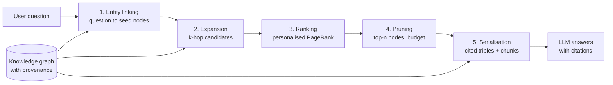

A knowledge graph sitting in a database answers nothing by itself. Something has to take a question written in plain English, decide where in the graph to start, decide how far to wander, decide which of the facts it found are worth the model's attention, and turn those facts into text a language model can read and cite. That end-to-end procedure is **graph retrieval**, and it is the subject of this lesson.

The earlier lessons in this module built the graph ([Graph construction](/learn/graph-rag/graph-construction)) and showed how to walk it ([Graph traversal](/learn/graph-rag/graph-traversal)). Here those pieces become a retriever: a function with the same contract as a vector retriever, query in, context out, but working over entities and relationships instead of chunks. You will build one in about sixty lines of Python, rank its results with personalised PageRank, and see the failure modes each stage introduces.

## Learning objectives

- Describe the five stages of a graph retriever (entity linking, candidate expansion, ranking, pruning, serialisation) and what can go wrong in each.
- Link the entities in a query to graph nodes using exact matching, aliases and an embedding fallback, and explain when each one fails.
- Use personalised PageRank scores to rank and prune a candidate subgraph, and explain why a hub can outrank the seeds it was reached from.
- Implement a graph retriever with NetworkX that returns cited triples within a size budget.
- Choose between subgraph retrieval and a generated graph query (such as Cypher) for a given kind of question.

## Prerequisites

- [Knowledge graphs](/learn/graph-rag/knowledge-graphs): nodes, edges, triples and property graphs.
- [Graph construction](/learn/graph-rag/graph-construction): how extracted entities and relationships become a graph with provenance.
- [Graph traversal](/learn/graph-rag/graph-traversal): breadth-first search, k-hop neighbourhoods and paths.
- [Semantic search](/learn/dense-retrieval/semantic-search): embedding a query and ranking by cosine similarity.

## Why this matters

Vector retrieval answers "which passages look like this question?". Many of the questions that make teams consider a graph are not of that shape. "If the Qdrant cluster goes down, whose documents can AskMeridian no longer answer from?" has an answer spread across three facts in three different places: AskMeridian runs on the Qdrant cluster; AskMeridian indexes the employee handbook and the IT runbooks; the HR team owns the handbook and the support desk owns the runbooks. No single chunk contains the answer, and the chunk about HR owning the handbook does not mention Qdrant, so it will not look similar to the question. A graph makes the chain explicit.

But a graph is only as useful as the retriever in front of it, and each stage of that retriever can fail quietly. The user says "the vector database" and the graph calls it "Qdrant cluster", so retrieval starts nowhere; the retriever looks two hops out when the answer is three away, or three hops out from a popular node and drags in half the graph. Knowing the stages lets you put a measurement on each one instead of tuning the whole thing by feel.

## The intuition

Imagine asking a long-serving Meridian engineer the Qdrant question. She does not reread every document. She thinks: "Qdrant, that's what AskMeridian runs on. AskMeridian reads the handbook and the runbooks. The handbook is HR's, the runbooks are the support desk's." She starts at the things you named, follows the connections that seem relevant, stops when she has enough, and then tells you the answer along with where each piece came from.

That is the whole algorithm: starting points, expansion, ranking (she ignores that the handbook also contains the expenses policy), stopping at a budget, and citing sources. She also makes the retriever's two characteristic mistakes: if she knows it only as "Qdrant", "the vector database" may not register; and she mentions the support desk whenever laptops come up, because it is connected to almost everything.

## How it works

### The pipeline



1. **Entity linking.** Find the nodes the question is about. These are the **seed nodes**.
2. **Expansion.** Collect a **candidate set**: the nodes within some number of hops of any seed (the k-hop neighbourhood from [Graph traversal](/learn/graph-rag/graph-traversal)).
3. **Ranking.** Score every candidate by how relevant it is to the seeds, typically with **personalised PageRank**, a random walk that keeps jumping back to the seeds.
4. **Pruning.** Keep the top-scoring nodes, take the edges among them, and stop at a token budget.
5. **Serialisation.** Write the surviving edges as text the model can read, each with the identifier of the chunk it was extracted from, and optionally attach the source chunks themselves.

Stages 2 and 3 are deliberately separate. Expansion is cheap and generous: it decides what is *possible*. Ranking decides what is *worth showing*. Returning every node within two hops works on a toy graph and falls apart on a real one.

### Stage 1: entity linking

**Entity linking** maps a span of the question ("Relay", "the vector database") to a node identifier ("Meridian Relay", "Qdrant cluster"). It is the most important stage, because every later stage only looks where linking points. A missed seed is an unrecoverable recall failure.

Production linkers layer three methods, cheapest first:

1. **Exact and normalised match.** Lower-case the question and look for node names in it. Fast and precise, and it handles identifiers such as error codes, which embeddings handle poorly (the same weakness covered in [Dense retrieval limitations](/learn/dense-retrieval/dense-retrieval-limitations)).
2. **Alias table.** A mapping from known alternative names to the canonical node: "Relay" to "Meridian Relay", "Qdrant" to "Qdrant cluster". The alias table is usually a by-product of entity resolution during [graph construction](/learn/graph-rag/graph-construction): every surface form that was merged into a node is an alias of it.
3. **Embedding fallback.** Embed each node's name together with a short description, embed the question, and take the nearest nodes above a similarity threshold. This catches paraphrases ("the reporting tool" for "Meridian Reports") at the cost of occasional wrong links.

A fourth option is to have a language model extract the question's entities first and match its output with methods 1 to 3, at the cost of a model call per query.

Two details matter more than they look. First, embed **descriptions**, not bare names: "Qdrant cluster" tells a general-purpose embedding model little; "Qdrant cluster: vector database cluster that stores AskMeridian's embeddings" tells it a lot. This is why Microsoft's GraphRAG embeds entity descriptions for its local search, as [Local and global search](/learn/graph-rag/local-and-global-search) describes. Second, the threshold must be calibrated on your own data. Similarity scores are not probabilities, and a threshold copied from another system's model means nothing for yours.

### Stage 2: expansion

Given seeds, collect the nodes within $h$ hops, treating edges as undirected for this purpose. Direction carries meaning ("Employee handbook OWNED_BY HR team" is not the same as the reverse) and is preserved for serialisation, but a question can need an edge in either direction. The Qdrant question reaches AskMeridian by walking *against* the RUNS_ON edge from the Qdrant cluster.

The number of hops is the main dial. One hop is safe and usually too shallow; two answers most two-step questions ("which team owns the system Relay depends on?"); three is often needed for chains such as error code, client, portal, owner, and is where real graphs explode. The explosion is arithmetic. If the average node has 20 neighbours, the number of nodes within $h$ hops grows roughly like $20^h$: about 20 at one hop, 400 at two, 8,000 at three. Real graphs are not uniform, and the variance makes it worse: one hop through a **hub** (a node with hundreds of edges, such as "Employee handbook" in a graph built from the handbook) brings in hundreds of nodes at once. Practical defences are to cap the number of neighbours taken per node (keeping the highest-weighted edges), to exclude or down-weight known hub types, or to restrict expansion to relationship types that the question plausibly needs.

### Stage 3: ranking with personalised PageRank

The candidate set is a pool, not an answer. To rank it you want a score that is high for nodes that are close to the seeds, reachable by many short paths, and not merely popular. **Personalised PageRank (PPR)**, derived and computed by hand in [Graph traversal](/learn/graph-rag/graph-traversal), provides exactly that: a random walk that keeps restarting at the seeds, whose visit frequencies measure closeness to *this* question. Here the question is not how to compute it but how to use its scores for retrieval.

- **Run it on the candidate subgraph, not the whole graph.** Expansion has already bounded the region worth considering, so PPR over a few thousand edges is cheap, and nodes outside the candidate set cannot crowd the ranking.
- **Restart at every seed.** With several seeds, spread the restart mass across them (NetworkX normalises the `personalization` dictionary). A node reachable from two seeds then accumulates visits from both, which is what multi-entity questions need: the answer usually sits where the seeds' neighbourhoods meet.
- **Treat scores as ranks, not probabilities of relevance.** They sum to 1 over the candidate set, so their absolute size depends on how many candidates there are.
- **Correct for hubs.** A node with many edges is reached from many directions and can outscore the seeds themselves, as the code below shows. Weight edges by relation type, divide each score by a function of the node's degree, or exclude a short list of known hubs from ranking while keeping them available for serialisation. Choose among these on labelled questions.

PPR is also the ranking at the heart of HippoRAG (Gutiérrez and colleagues, 2024), a research system that runs it from question entities to score passages for multi-hop question answering; treat its reported gains as research evidence, not a guarantee for your corpus.

### Stage 4: pruning

Keep the top $n$ nodes by score, take every edge between two kept nodes (the **induced subgraph**), and drop the lowest-scoring edges until the serialised text fits a token budget. Pruning by nodes can strand a fact: if the answer is the edge to the 9th node and you keep 8, it disappears. And because PPR scores sum to 1 over the candidate set, they shrink as the set grows, so a fixed score threshold behaves differently from query to query; rank cut-offs are more predictable.

### Stage 5: serialisation

The model reads text, so the subgraph must become text: **triples** one per line (`(AskMeridian) -[RUNS_ON]-> (Qdrant cluster) [c1]`), compact and easy to cite; **sentences** ("AskMeridian runs on the Qdrant cluster [c1]."); or **entity cards**, one block per node with its description and edges, which suit graphs whose nodes carry rich descriptions, as in GraphRAG. Whatever the format, carry **provenance**: the identifier of the chunk each edge was extracted from. Extraction makes mistakes, and a cited source chunk lets the model (and a human reviewer) check an edge against the original text. A widespread and sensible pattern is to send the triples as a map and the top few source chunks as evidence, so that the model reasons over the structure and quotes the text.

### An alternative: generating a graph query

Everything above is **subgraph retrieval**: fetch a neighbourhood and let the model reason over it. The other main approach is **query generation**: ask a model to translate the question into a graph query language, run it, and hand the result to the model. With Neo4j that language is Cypher; the generated query for the Qdrant question might be:

```text
MATCH (:System {name: "Qdrant cluster"})<-[:RUNS_ON]-(:System)-[:INDEXES]->(d:Document)-[:OWNED_BY]->(t:Team)
RETURN d.name, t.name
```

(Illustrative Cypher; labels depend on your schema.)

Subgraph retrieval suits open questions ("what is related to X?") and fails by returning noisy context. Query generation suits precise questions with a clear shape (counts, filters, paths, aggregates), needs a stable schema the model can see, and fails by producing an invalid or subtly wrong query that silently returns nothing; and because it is generated code running against your database, it must be sandboxed. Many production systems use both: route aggregate and filter questions to query generation and everything else to subgraph retrieval. Routing is covered in [Query routing](/learn/agentic-rag/query-routing).

> [!KEY]
> A graph retriever is five stages, and the first is the one that fails most often. When a graph RAG answer is wrong, check the seeds before you touch anything else.

## In code

**The problem.** Build a graph retriever over a small Meridian knowledge graph that answers multi-hop questions with cited triples.

**Dependencies.** NetworkX for the graph and PageRank, `sentence-transformers` for the embedding fallback (the model is downloaded once, about 90 MB):

```bash
pip install networkx sentence-transformers
```

**The source.** The graph is hand-written here so that you can see every edge; in a real system it comes from the extraction and construction steps of earlier lessons. Each triple records the chunk it came from.

```python
import networkx as nx
import numpy as np
from sentence_transformers import SentenceTransformer

# 1. A small Meridian knowledge graph: (subject, relation, object, source chunk)
TRIPLES = [
    ("AskMeridian", "OWNED_BY", "Platform team", "c1"),
    ("AskMeridian", "RUNS_ON", "Qdrant cluster", "c1"),
    ("AskMeridian", "INDEXES", "Employee handbook", "c1"),
    ("AskMeridian", "INDEXES", "IT runbooks", "c1"),
    ("Qdrant cluster", "OWNED_BY", "Platform team", "c2"),
    ("Employee handbook", "OWNED_BY", "HR team", "c3"),
    ("IT runbooks", "OWNED_BY", "Support desk", "c4"),
    ("IT portal", "OWNED_BY", "Support desk", "c4"),
    ("E-4021", "AFFECTS", "VPN client", "c5"),
    ("E-4012", "AFFECTS", "VPN client", "c5"),
    ("VPN client", "DISTRIBUTED_VIA", "IT portal", "c5"),
    ("Meridian Relay", "REQUIRES", "VPN client", "c6"),
    ("Meridian Reports", "SUPPORTS", "SAML single sign-on", "c7"),
    ("SAML single sign-on", "OWNED_BY", "Identity team", "c7"),
    ("Expenses policy", "OWNED_BY", "Finance department", "c8"),
    ("Employee handbook", "CONTAINS", "Expenses policy", "c8"),
]
DESCRIPTIONS = {
    "Qdrant cluster": "vector database cluster that stores AskMeridian's embeddings",
    "Meridian Reports": "reporting product with PDF and CSV export",
    "SAML single sign-on": "SAML login for Enterprise customers",
    "VPN client": "VPN software staff install on their laptops",
}
ALIASES = {"qdrant": "Qdrant cluster", "relay": "Meridian Relay", "handbook": "Employee handbook"}

G = nx.MultiDiGraph()
for s, r, o, chunk in TRIPLES:
    G.add_edge(s, o, relation=r, chunk=chunk)

# 2. Entity linking: exact names and aliases first, embeddings as a fallback
model = SentenceTransformer("sentence-transformers/all-MiniLM-L6-v2")
names = list(G.nodes)
texts = [f"{n}: {DESCRIPTIONS[n]}" if n in DESCRIPTIONS else n for n in names]
name_vecs = model.encode(texts, normalize_embeddings=True)

def link_entities(query, threshold=0.35, k=2):
    q = query.lower()
    seeds = {canon for alias, canon in ALIASES.items() if alias in q}
    seeds |= {n for n in names if n.lower() in q}
    if seeds:
        return seeds, "exact"
    sims = name_vecs @ model.encode([query], normalize_embeddings=True)[0]
    best = [i for i in np.argsort(-sims)[:k] if sims[i] >= threshold]
    return {names[i] for i in best}, "embedding " + ", ".join(f"{names[i]}={sims[i]:.2f}" for i in best)

# 3 and 4. Expand to a k-hop candidate set, then rank it with personalised PageRank
def retrieve_subgraph(seeds, hops=3, top_n=8):
    U = G.to_undirected(as_view=True)        # follow edges in both directions
    cand = set()
    for s in seeds:
        cand |= set(nx.single_source_shortest_path_length(U, s, cutoff=hops))
    sub = nx.Graph(U.subgraph(cand))        # one edge per pair, for ranking
    restart = {n: (1.0 if n in seeds else 0.0) for n in sub}
    ppr = nx.pagerank(sub, alpha=0.85, personalization=restart)
    keep = sorted(ppr, key=lambda n: (-ppr[n], n))[:top_n]
    return keep, ppr, len(cand)

# 5. Serialise the kept nodes' edges as triples that cite their source chunk
def serialise(keep):
    rows = [f"({s}) -[{d['relation']}]-> ({o})  [{d['chunk']}]"
            for s, o, d in G.subgraph(keep).edges(data=True)]
    return "\n".join(sorted(rows))

for query in ["If the Qdrant cluster goes down, whose documents can AskMeridian no longer answer from?",
              "Relay will not connect and shows E-4021. Who can help?",
              "How do I log in to the reporting tool with single sign-on?"]:
    seeds, how = link_entities(query)
    keep, ppr, n_cand = retrieve_subgraph(seeds)
    print("QUERY:", query)
    print(f"seeds ({how}):", sorted(seeds), f"| candidates: {n_cand}")
    print("kept:", ", ".join(f"{n} {ppr[n]:.3f}" for n in keep))
    print(serialise(keep), end="\n\n")
```

**The important lines.**

- `G = nx.MultiDiGraph()` keeps direction and allows several relationships between the same pair; each edge stores its relation and source chunk.
- `link_entities` falls back to embeddings only when nothing literal matched, and returns *how* it linked, which you should log: an embedding link is a weaker claim than an exact one.
- `G.to_undirected(as_view=True)` lets expansion walk edges in either direction without copying the graph. `single_source_shortest_path_length(..., cutoff=hops)` is a breadth-first search that stops at `hops`.
- `nx.Graph(U.subgraph(cand))` collapses parallel edges for ranking, so a pair with three relationships does not get three times the walk (a design choice).
- `personalization=restart` turns PageRank into personalised PageRank. NetworkX normalises the dictionary, so two seeds with value 1 each receive half the restart mass.
- `G.subgraph(keep)` is the induced subgraph on the original directed multigraph, so serialisation shows the true direction of every edge and every parallel edge.

**The output:**

```output
QUERY: If the Qdrant cluster goes down, whose documents can AskMeridian no longer answer from?
seeds (exact): ['AskMeridian', 'Qdrant cluster'] | candidates: 10
kept: AskMeridian 0.287, Qdrant cluster 0.198, Platform team 0.145, Employee handbook 0.107, IT runbooks 0.085, Support desk 0.057, Expenses policy 0.047, HR team 0.030
(AskMeridian) -[INDEXES]-> (Employee handbook)  [c1]
(AskMeridian) -[INDEXES]-> (IT runbooks)  [c1]
(AskMeridian) -[OWNED_BY]-> (Platform team)  [c1]
(AskMeridian) -[RUNS_ON]-> (Qdrant cluster)  [c1]
(Employee handbook) -[CONTAINS]-> (Expenses policy)  [c8]
(Employee handbook) -[OWNED_BY]-> (HR team)  [c3]
(IT runbooks) -[OWNED_BY]-> (Support desk)  [c4]
(Qdrant cluster) -[OWNED_BY]-> (Platform team)  [c2]

QUERY: Relay will not connect and shows E-4021. Who can help?
seeds (exact): ['E-4021', 'Meridian Relay'] | candidates: 6
kept: VPN client 0.403, E-4021 0.161, Meridian Relay 0.161, IT portal 0.134, E-4012 0.086, Support desk 0.057
(E-4012) -[AFFECTS]-> (VPN client)  [c5]
(E-4021) -[AFFECTS]-> (VPN client)  [c5]
(IT portal) -[OWNED_BY]-> (Support desk)  [c4]
(Meridian Relay) -[REQUIRES]-> (VPN client)  [c6]
(VPN client) -[DISTRIBUTED_VIA]-> (IT portal)  [c5]

QUERY: How do I log in to the reporting tool with single sign-on?
seeds (embedding SAML single sign-on=0.44): ['SAML single sign-on'] | candidates: 3
kept: SAML single sign-on 0.541, Identity team 0.230, Meridian Reports 0.230
(Meridian Reports) -[SUPPORTS]-> (SAML single sign-on)  [c7]
(SAML single sign-on) -[OWNED_BY]-> (Identity team)  [c7]
```

**What the output means.**

- **Query 1** finds the whole chain, and a model can answer "the HR team's handbook and the support desk's runbooks", citing c1, c3 and c4. But "HR team" only just made the cut, in eighth place, reached by one thin path; with `top_n=6` the answer would have been half right. The irrelevant "Expenses policy" ranked above it simply because it sits next to the handbook.
- **Query 2** shows the hub effect: the VPN client scores 0.403, far above either seed, because both seeds point at it: the hub bias described in [Graph traversal](/learn/graph-rag/graph-traversal). Here that helps, but the neighbour E-4012, a different error, comes along too.
- **Query 3** has no literal entity, so the embedding fallback links "SAML single sign-on" at 0.44, and "Meridian Reports" arrives as a neighbour rather than being linked from "the reporting tool".

**Common errors.** With no seeds, the personalisation dictionary is empty and `pagerank` fails or returns meaningless scores; check for empty seeds first. `NodeNotFound` from the shortest-path call usually means the alias table points at a node renamed during re-indexing; validate aliases after every rebuild.

**Extending it.** Weight edges by relation type (exercise 3), attach the text of the cited chunks after the triples, and measure linking accuracy separately from end-to-end accuracy (exercise 2).

## A real-world example

Meridian's Platform team adds a graph retriever to AskMeridian so that engineers can ask dependency questions during incidents: "what breaks if X goes down?" and "who owns the thing that error Y comes from?". The graph is extracted from the IT runbooks and the architecture pages. In the first week of testing, answers are good for questions that name systems exactly and poor for everything else.

The team logs every stage for 200 real questions and finds most failures happen before ranking runs. Engineers write "the vector DB" or "Qdrant prod"; the alias table holds only surface forms from the runbooks, and the embedding fallback links against bare names.

They make three changes: embed each node's name plus its one-line description instead of the bare name; queue low-similarity links for an engineer to confirm, turning confirmed pairs into aliases; and cap expansion through two hubs, "IT runbooks" and "Employee handbook", which were pulling unrelated policies into every answer. After each change they re-run the 200 questions and score linking and answers separately, so they can tell which change helped.

Their write-up: measure the seeds first; ranking changes cannot help a question that starts in the wrong place.

## Common mistakes

- **Linking against bare entity names, with a borrowed threshold.** Names give an embedding model little to work with, and thresholds depend on the model and data, so paraphrased questions link to nothing or to the wrong node.
- **Returning the whole k-hop neighbourhood.** On a real graph, two or three hops from a hub is most of the graph. The context fills with noise, costs rise and the model is distracted.
- **Ignoring the hub effect.** Without weighting or degree normalisation, the same few popular nodes dominate every result.
- **Serialising without provenance.** The model cannot cite, reviewers cannot audit extraction errors, and wrong edges become confident wrong answers.
- **Executing generated graph queries with write permissions.** A model-written query is untrusted code; a stray `DELETE` or an expensive unbounded path match can damage or stall the database.

## Best practices

- Log the seeds and how each was linked for every query, and evaluate linking accuracy as its own metric.
- Embed entity names with their descriptions; build aliases from entity resolution plus confirmed user phrasing.
- Prune by rank to a token budget rather than by a raw score threshold, and weight edges or normalise by degree to tame hubs.
- Serialise edges with the chunk they came from, and include the top source chunks so the answer can quote evidence.
- Route precise, aggregate questions ("how many", "list all") to a generated graph query, and open-ended questions to subgraph retrieval.

## Performance considerations

- **Linking** costs one query embedding plus a search over entity vectors: 100,000 entities at 384 float32 dimensions is about 154 MB, small enough for exact search in memory.
- **Expansion** cost is proportional to the number of edges touched, which is the explosive part. With a per-node cap of 20 neighbours and 3 hops, the worst case is $20 + 20^2 + 20^3 = 8{,}420$ nodes per seed; with a cap of 10 it is 1,110. Caps are the cheapest performance lever you have.
- **PPR** costs about edges multiplied by iterations: 5,000 candidate edges and 50 iterations is 250,000 multiply-adds, negligible. Running it over a whole graph of millions of edges per query is not, which is a reason to expand first and rank second.
- **Context cost** scales with serialised size. A triple line is roughly 15 to 25 tokens, so 40 triples cost under 1,000 tokens, far less than 40 chunks; most of graph RAG's cost is paid at indexing time, in extraction.

## Security considerations

- **Access control must apply to edges, not only documents.** An edge extracted from a restricted document is restricted information. Store the access labels of each edge's source chunk and filter the candidate set by the user's permissions before ranking, exactly as [Filtered retrieval](/learn/advanced-retrieval/filtered-retrieval) does for chunks.
- **Generated graph queries are untrusted code.** Run them with a read-only database user, apply a timeout and a result limit, and reject queries that contain write clauses.
- **Extracted text can carry prompt injection.** Treat entity descriptions and relation labels as untrusted data in the prompt, just like chunks.

## Summary

- Graph retrieval turns a question into context in five stages: entity linking, expansion, ranking, pruning and serialisation.
- Entity linking fails most often and fails silently. Layer exact matches, an alias table and an embedding fallback over names plus descriptions, and measure it on its own.
- Expansion decides what is possible and explodes with hop count; ranking decides what is worth showing. Keep them separate.
- Personalised PageRank ranks candidates by closeness to the seeds through many paths, but hubs absorb probability and need weighting or normalisation.
- Serialise edges with their source chunks so the model can cite and humans can audit; use generated graph queries for precise, aggregate questions.

## Exercises

**1. A stranded fact.** Rerun the Qdrant question with `top_n=6`. Which triples are lost, and is the answer still complete? Suggest a pruning rule that would have kept it.

<details><summary>Show solution</summary>

With `top_n=6` the kept nodes are AskMeridian, Qdrant cluster, Platform team, Employee handbook, IT runbooks and Support desk. The edges `(Employee handbook) -[OWNED_BY]-> (HR team)` and `(Employee handbook) -[CONTAINS]-> (Expenses policy)` disappear. The model can still say the runbooks belong to the support desk but cannot say who owns the handbook, so the answer is half right, and nothing in the context signals that something is missing. A rule that keeps, for every kept node, its edges of the relation types the question needs (here `OWNED_BY`), or that keeps whole paths from a seed rather than individual nodes, would have retained the fact at the cost of a few extra lines.

</details>

**2. Measure linking.** Write ten paraphrased questions for the Meridian graph in the code ("the vector database", "the SSO feature", "whoever runs the help desk"), each with the node it should link to. Report how many link correctly with the threshold at 0.25, 0.35 and 0.45. What does the trade-off look like?

<details><summary>Show solution</summary>

Store pairs such as `("the vector database is down", "Qdrant cluster")`, call `link_entities` on each, and count both correct links and wrong nodes returned. Your counts depend on your questions, but the shape is consistent: a lower threshold links more questions correctly and returns more wrong seeds. A wrong seed is often worse than a missing one, since it produces a confident answer about the wrong thing.

</details>

**3. Relation weights.** Modify `retrieve_subgraph` so that each edge carries a weight by relation type (try `OWNED_BY` 2.0, `REQUIRES` 2.0, `AFFECTS` 1.5, `CONTAINS` 0.5, others 1.0) and pass `weight="weight"` to `pagerank`. Does "HR team" rise above "Expenses policy" for the Qdrant question?

<details><summary>Show solution</summary>

When building the triples, store `weight=WEIGHTS.get(r, 1.0)` on each edge. When collapsing to `nx.Graph`, parallel edges collapse to one, so take the maximum weight per pair explicitly:

```python
sub = nx.Graph()
for u, v, d in U.subgraph(cand).edges(data=True):
    w = max(d["weight"], sub[u][v]["weight"]) if sub.has_edge(u, v) else d["weight"]
    sub.add_edge(u, v, weight=w)
```

Then call `nx.pagerank(sub, alpha=0.85, personalization=restart, weight="weight")`. With `CONTAINS` down-weighted, the walker leaving the handbook steps to the HR team far more often than to the expenses policy, and "HR team" (about 0.040) moves above "Expenses policy" (about 0.024). Weights encode a judgement about your questions, so keep them in configuration and evaluate every change.

</details>

## Check your understanding

```quiz
[
  {
    "q": "A graph retriever returns nothing useful for 'is the vector database down?' although the graph contains a well-connected 'Qdrant cluster' node. Which stage most likely failed?",
    "options": ["Ranking", "Serialisation", "Entity linking", "Pruning"],
    "answer": 2,
    "why": "No stage after linking can recover a missing seed. The question's wording does not match the node name, so linking needs an alias or an embedding of the node's description."
  },
  {
    "q": "In personalised PageRank, what does the restart distribution control?",
    "options": [
      "Which nodes the random walker jumps back to, which is what makes the scores specific to the query",
      "How many hops the walker may take before stopping",
      "The weight of each relationship type",
      "The order in which triples are serialised"
    ],
    "answer": 0,
    "why": "Ordinary PageRank restarts uniformly over all nodes and measures global importance; PPR restarts only at the seeds, so scores measure closeness to them."
  },
  {
    "q": "Why can a non-seed node such as 'VPN client' score higher than the seeds that led to it?",
    "options": [
      "NetworkX sorts nodes alphabetically before scoring",
      "Seeds are excluded from the PageRank computation",
      "The damping factor is applied only to seeds",
      "It is reached from several seeds and paths, so the random walk passes through it more often than through any single seed"
    ],
    "answer": 3,
    "why": "Mass flows from every seed into a shared neighbour. This is the hub effect: shared, well-connected neighbours draw the walk in."
  },
  {
    "q": "Which question is better served by generating a graph query (for example Cypher) than by retrieving a subgraph?",
    "options": [
      "'Tell me about Meridian Relay.'",
      "'How many systems does each team own?'",
      "'What is related to error E-4021?'",
      "'Explain how AskMeridian works.'"
    ],
    "answer": 1,
    "why": "Counting over the whole graph is a precise aggregate. A database computes it exactly; a model counting serialised triples in its context is slower, costlier and error-prone."
  },
  {
    "q": "Why should each serialised edge carry the identifier of the chunk it was extracted from?",
    "options": [
      "So that the model can cite evidence and a reviewer can check the edge against the source text",
      "Because PageRank needs chunk identifiers as node weights",
      "To reduce the number of tokens in the context",
      "Because graph databases reject edges without them"
    ],
    "answer": 0,
    "why": "Extraction makes mistakes. Provenance lets the answer be grounded in, and audited against, the original text rather than resting on an unverifiable triple."
  }
]
```

## Further reading

- Gutiérrez, Shu, Gu, Yasunaga and Su (2024), [HippoRAG: Neurobiologically Inspired Long-Term Memory for Large Language Models](https://arxiv.org/abs/2405.14831): entity linking plus personalised PageRank for multi-hop retrieval.
- Peng and colleagues (2024), [Graph Retrieval-Augmented Generation: A Survey](https://arxiv.org/abs/2408.08921): a map of graph-based indexing, retrieval and generation methods.
- [NetworkX documentation](https://networkx.org/documentation/stable/): `pagerank`, `single_source_shortest_path_length` and the graph classes used here.
- [Neo4j Cypher Manual](https://neo4j.com/docs/cypher-manual/current/): the query language used for generated graph queries.
