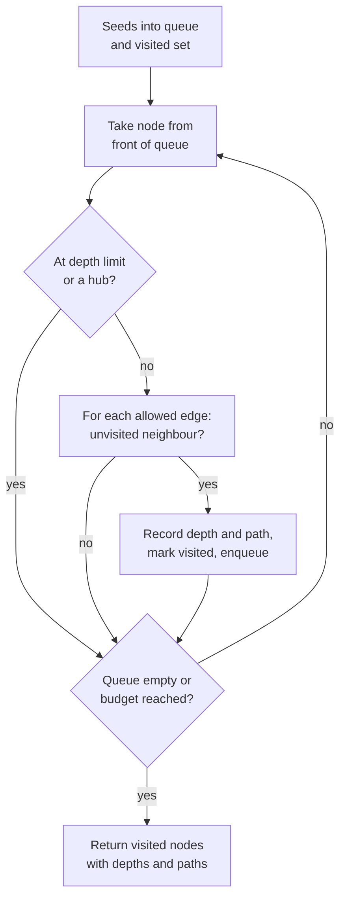

A knowledge graph answers questions by being walked. "What stops working if the Qdrant cluster is down?" starts at one node and follows dependency edges backwards until nothing new appears. "How is error E-4021 connected to the Platform team?" looks for a path between two nodes. "What is most relevant to this question about the VPN client?" spreads outwards from the question's entities and ranks what it reaches. Each is a **graph traversal**: a systematic procedure for visiting nodes by following edges.

This lesson covers the traversal algorithms Graph RAG relies on: breadth-first and depth-first search, typed and directed traversal, shortest paths (including paths weighted by confidence), and personalised PageRank. It also covers the engineering that keeps traversal useful on real graphs, where hub nodes and exponential growth turn an unbounded walk into a flood. Choosing which traversal results become context for the model, and how to write them out, is the subject of the next lesson, [Graph retrieval](/learn/graph-rag/graph-retrieval).

## Learning objectives

- Implement breadth-first traversal with a visited set, depth limit, hub limit and node budget, and explain what each guards against.
- Restrict traversal by relationship type and direction to answer dependency, impact and ownership questions.
- Find and explain connecting paths with shortest-path search, and weight paths by edge confidence using negative log costs.
- Compute personalised PageRank by power iteration, by hand for a small graph and with NetworkX, and explain its bias towards hubs.
- Choose a traversal strategy for a given question type.

## Prerequisites

- [Knowledge graphs](/learn/graph-rag/knowledge-graphs): directed labelled multigraphs, adjacency and the growth of multi-hop neighbourhoods.
- [Graph construction](/learn/graph-rag/graph-construction): stable entity IDs and provenance on edges.
- [Query decomposition](/learn/advanced-retrieval/query-decomposition): the text-only approach to multi-step questions, which traversal replaces for structural ones.

## Why this matters

Building a graph is expensive, and a graph that is walked badly returns either nothing useful or far too much.

**Unbounded expansion floods the context.** The [first lesson of this module](/learn/graph-rag/knowledge-graphs) showed that a $k$-hop neighbourhood grows roughly as $b^k$ for average degree $b$. Real graphs are worse than average: a few **hub** nodes (the IT portal, "VPN", the employee handbook) connect to hundreds of others. A two-hop expansion from any error code that passes through the IT portal reaches every service the portal offers. Handed to a model, that is a context full of password resets and printer setup for a question about a VPN error.

**Undirected wandering answers the wrong question.** "What depends on the Qdrant cluster?" and "what does the Qdrant cluster depend on?" follow the same edges in opposite directions. A traversal that ignores direction and relation type mixes owners, dependents, documents and error codes into one undifferentiated set.

**Cycles and repeats waste the budget.** Knowledge graphs are full of cycles (A owned by T, T owns B, B depends on A). Without a record of visited nodes, a depth-first walk loops; even breadth-first search without one revisits nodes and inflates its results.

**Too little traversal misses answers.** A system that looks only one hop from the query's entities cannot answer the multi-hop questions that justified building the graph. Doing traversal well means matching the algorithm to the question and putting firm limits on every walk.

## The intuition

Imagine a fire warden checking which offices are affected by a closed stairwell. She does not wander the building at random. She starts at the stairwell, checks every office that opens directly onto it, then every office reached only through those, floor by floor, ticking each room on a list so she never checks one twice. She stops at the fire doors, because what lies beyond them is not affected. And she does not walk through the main atrium, because everything opens onto the atrium and walking through it would mean checking the whole building.

That is a well-behaved graph traversal. Starting at the stairwell is choosing **seed nodes**. Going floor by floor is **breadth-first** order. The ticked list is the **visited set**. Stopping at fire doors is following only certain **relationship types** in a certain **direction**. Avoiding the atrium is a **hub limit**. And the floor count she stops at is the **depth limit**.

## How it works

### Seeds, frontiers and the visited set

Every traversal starts from one or more **seed nodes**, usually the entities mentioned in the question. Linking the question's words to node IDs is part of [Graph retrieval](/learn/graph-rag/graph-retrieval); here the seeds are given.

The traversal then maintains two structures:

- The **frontier**: nodes discovered but not yet expanded.
- The **visited set**: nodes already discovered, so they are never added again.

At each step it takes a node from the frontier, looks at its edges, and adds each unvisited neighbour to both the frontier and the visited set. The order in which the frontier is consumed defines the algorithm.

### Breadth-first search

**Breadth-first search** (BFS) uses a first-in, first-out queue as its frontier. It expands every node at depth 1 before any node at depth 2, and so on. Two properties make it the default for Graph RAG:

- It finds every node within $k$ hops before going further, so "the neighbourhood within two hops" is simply BFS stopped at depth 2.
- The first time BFS reaches a node, it has found a path with the fewest edges to it, so paths recorded during BFS are shortest paths in hop count.

The procedure, with the budgets that make it safe:

1. Put the seeds in the queue and the visited set, at depth 0.
2. Take the next node from the front of the queue.
3. If its depth equals the depth limit, do not expand it.
4. If it is a hub (degree above a threshold) and not a seed, record it but do not expand it.
5. For each edge of an allowed type and direction, if the neighbour is unvisited, record its depth and the path that reached it, add it to the visited set, and append it to the queue.
6. Stop when the queue is empty or the node budget is reached.



**Depth-first search** (DFS) uses a stack instead: it follows one path as far as it can before backtracking. It uses little memory and suits enumerating all paths up to a length, but it does not discover nodes in order of distance, so a depth-limited DFS can spend its whole budget down one long branch. For retrieval, where nearer is usually more relevant, BFS is the better default.

### Typed and directed traversal

Most useful questions constrain which edges may be followed:

- **Impact analysis** ("what stops working if X fails?") follows dependency edges (`RUNS_ON`, `DEPENDS_ON`) *backwards*, from the failed component to everything that relies on it, transitively.
- **Dependency analysis** ("what does X need?") follows the same edges *forwards*.
- **Ownership** ("who is responsible for what AskMeridian indexes?") follows `INDEXES` forwards, then `OWNED_BY` forwards: a fixed sequence of relationship types, sometimes called a **metapath**.

Restricting relation types does two jobs at once. It makes the answer correct (owners do not appear in an impact list) and it shrinks the search, because most edges are skipped. In Cypher the constraints are written into the pattern. The Cypher query below, which was not executed for this lesson, finds everything that depends on the Qdrant cluster within three hops:

```text
MATCH (q:Entity {id: $id})<-[:RUNS_ON|DEPENDS_ON*1..3]-(affected:Entity)
RETURN DISTINCT affected.name
```

The arrow direction, the relationship types and the `*1..3` length bound are the same three constraints the BFS above applies.

### Shortest paths and explanations

Sometimes the question is not "what is near X?" but "how are X and Y connected?". A **shortest path** between two nodes is both an answer and an explanation: "E-4021 is documented in the IT runbooks, which AskMeridian indexes, and AskMeridian is owned by the Platform team." BFS finds shortest paths in hop count. For explanation, direction is often ignored (any connection counts), but each step is printed with its true direction so the explanation reads correctly.

Not all edges are equally trustworthy. If edges carry a confidence $c$ from [relationship extraction](/learn/graph-rag/relationship-extraction), a path's overall reliability is roughly the product of its edges' confidences, and the best path is the one with the highest product. Taking $-\ln c$ as each edge's cost turns "maximise a product" into "minimise a sum", which is exactly what Dijkstra's algorithm does. The mathematics section works an example.

### Personalised PageRank

BFS treats every node within $k$ hops as equally reachable. Often you want a *ranking*: which nodes are most strongly connected to the seeds, counting all the paths between them, not just the shortest?

**Personalised PageRank** (PPR) answers that with a random walk. A walker starts at a seed. At each step, with probability $\alpha$ (typically 0.85) it moves along a random edge of its current node; with probability $1 - \alpha$ it jumps back to a seed. The fraction of time the walker spends at each node, in the long run, is that node's PPR score. Nodes reachable from the seeds by many short paths score high; distant or weakly connected nodes score low. Because the walker keeps returning to the seeds, the scores are personal to the query rather than a global measure of importance.

PPR is the traversal behind several graph-based retrieval systems, including HippoRAG (Gutiérrez and colleagues, 2024); how its scores are used to rank and prune retrieved facts is covered in [Graph retrieval](/learn/graph-rag/graph-retrieval). Its systematic bias matters for traversal too: **high-degree nodes attract the walker**, because many edges lead into them, so a hub adjacent to the seeds can outrank the seeds themselves. The mathematics section shows why, and exercise 3 tries one mitigation.

### Budgets and hubs

Every traversal needs explicit limits, chosen from the context budget and latency target rather than left at library defaults:

- **Depth limit**: two or three hops covers most questions; more rarely helps and always costs.
- **Hub limit**: do not expand nodes above a degree threshold (still report them, since a hub can be the answer). Alternatively, expand only the top few neighbours of a hub by edge confidence or by similarity to the question.
- **Node budget**: a hard cap on the total number of nodes returned, so that no query can produce an unbounded result.
- **Relation filter**: follow only relationship types relevant to the question type.
- **Access filter**: skip edges the user may not see, during the walk, not after it.

### Choosing a traversal

| Question type | Traversal | Example |
| --- | --- | --- |
| Impact or dependency | Typed BFS in one direction, transitive | "What stops working if the Qdrant cluster is down?" |
| Fixed multi-hop lookup | Metapath: a set sequence of relation types | "Who owns the documents AskMeridian indexes?" |
| Connection or explanation | Shortest path, optionally confidence-weighted | "How is E-4021 related to the Platform team?" |
| Open-ended relevance | Personalised PageRank from the query's entities | "Tell me about problems with the VPN client" |
| Local context for an entity | Depth-limited BFS with hub limit | "What do we know about E-4021?" |

## The mathematics

### Personalised PageRank by power iteration

**Intuition.** Picture the random walker repeated millions of times and count where it is. Mathematically, start with all the probability on the seeds, then repeatedly let a fraction $\alpha$ of it flow along edges and send the remaining $1-\alpha$ back to the seeds. After enough rounds the distribution stops changing; that fixed point is the PPR vector.

$$
\mathbf{r}^{(t+1)} = (1 - \alpha)\,\mathbf{s} + \alpha\, P^{\top} \mathbf{r}^{(t)}
$$

$\mathbf{r}^{(t)}$ is the vector of scores after $t$ iterations, one entry per node, summing to 1. $\mathbf{s}$ is the **personalisation vector**: the restart probabilities, non-zero only on seed nodes and summing to 1. $\alpha$ is the probability of following an edge rather than restarting (NetworkX calls it `alpha`; it is often called the damping factor). $P$ is the **transition matrix**: $P_{uv} = 1/\deg(u)$ if $u$ and $v$ are adjacent and 0 otherwise, so each row sums to 1 and a walker at $u$ picks each neighbour with equal probability. $P^{\top}\mathbf{r}$ moves the probability mass one step along the edges. Start from $\mathbf{r}^{(0)} = \mathbf{s}$.

**By hand.** Take the path A — B — C, with all restarts at A, so $\mathbf{s} = (1, 0, 0)$ and $\alpha = 0.85$. A and C have degree 1; B has degree 2. So B receives everything A and C send, while A and C each receive half of what B sends.

- Iteration 1: $r_A = 0.15 \times 1 + 0.85 \times (0/2) = 0.15$; $r_B = 0.85 \times (1 + 0) = 0.85$; $r_C = 0.85 \times (0/2) = 0$.
- Iteration 2: $r_A = 0.15 + 0.85 \times (0.85/2) = 0.51125$; $r_B = 0.85 \times (0.15 + 0) = 0.1275$; $r_C = 0.85 \times (0.85/2) = 0.36125$.

The values oscillate at first and then settle. At convergence B scores about 0.46, *higher than the seed A* at about 0.35: B has twice the degree, so the walk passes through it from both sides. That is the hub bias in miniature.

### Path cost from confidences

**Intuition.** A chain is as reliable as all of its links together. Multiplying confidences gives the path's reliability; taking negative logarithms turns the product into a sum, so standard shortest-path algorithms can find the most reliable path.

$$
\text{cost}(\pi) = \sum_{e \in \pi} -\ln c_e \qquad\Longleftrightarrow\qquad \prod_{e \in \pi} c_e = e^{-\text{cost}(\pi)}
$$

$\pi$ is a path, $e$ ranges over its edges, and $c_e \in (0, 1]$ is edge $e$'s confidence. A certain edge ($c = 1$) costs 0; a doubtful one costs more. Minimising cost maximises the product.

**By hand.** Path 1 has confidences 0.9 and 0.8: cost $= 0.1054 + 0.2231 = 0.3285$, product 0.72. Path 2 has 0.95 and 0.6: cost $= 0.0513 + 0.5108 = 0.5621$, product 0.57. Both have two hops, so BFS cannot separate them; the weighted cost prefers path 1.

```python
import math
import numpy as np
import networkx as nx

# Path graph A - B - C, all restarts at A.
nodes = ["A", "B", "C"]
A = np.array([[0, 1, 0], [1, 0, 1], [0, 1, 0]], dtype=float)
P = A / A.sum(axis=1, keepdims=True)          # row-stochastic: P[u, v] = 1/deg(u)
s = np.array([1.0, 0.0, 0.0])
alpha = 0.85

r = s.copy()
for t in range(1, 101):
    r = (1 - alpha) * s + alpha * (P.T @ r)
    if t <= 2:
        print(f"iteration {t}: {np.round(r, 5)}")
print(f"after 100 iterations: {np.round(r, 4)}")
nx_r = nx.pagerank(nx.path_graph(nodes), alpha=alpha, personalization={"A": 1, "B": 0, "C": 0})
print("networkx pagerank:   ", {k: round(v, 4) for k, v in nx_r.items()})

# Path cost from edge confidences.
for name, confs in [("two strong edges", [0.9, 0.8]), ("one weak edge", [0.95, 0.6])]:
    cost = sum(-math.log(c) for c in confs)
    print(f"{name:<17} product={math.prod(confs):.2f}  cost={cost:.3f}")
```

```output
iteration 1: [0.15 0.85 0.  ]
iteration 2: [0.51125 0.1275  0.36125]
after 100 iterations: [0.3453 0.4595 0.1953]
networkx pagerank:    {'A': 0.3453, 'B': 0.4595, 'C': 0.1953}
two strong edges  product=0.72  cost=0.329
one weak edge     product=0.57  cost=0.562
```

The hand-rolled iteration and NetworkX agree. For edge confidences in NetworkX, store `cost = -math.log(c)` as an edge attribute and pass `weight="cost"` to `nx.shortest_path` or `nx.dijkstra_path`.

## In code

**The problem.** On a Meridian graph with a hub (the IT portal, which offers many services), answer four questions with four traversals: an impact analysis, a two-hop neighbourhood with and without a hub limit, a connecting path, and a personalised PageRank ranking.

**Dependencies.** NetworkX. No model or API key.

```bash
pip install networkx
```

```python
from collections import deque
import networkx as nx

triples = [
    ("AskMeridian", "OWNED_BY", "Platform team"),
    ("AskMeridian", "RUNS_ON", "Qdrant cluster"),
    ("Qdrant cluster", "OWNED_BY", "Platform team"),
    ("Docs search", "RUNS_ON", "Qdrant cluster"),
    ("Helpdesk bot", "DEPENDS_ON", "AskMeridian"),
    ("AskMeridian", "INDEXES", "Employee handbook"),
    ("AskMeridian", "INDEXES", "IT runbooks"),
    ("Employee handbook", "OWNED_BY", "HR team"),
    ("IT runbooks", "DOCUMENTS", "E-4021"),
    ("IT runbooks", "DOCUMENTS", "E-4012"),
    ("E-4021", "AFFECTS", "VPN client"),
    ("E-4012", "AFFECTS", "VPN client"),
    ("E-4021", "RESOLVED_VIA", "IT portal"),
    ("VPN client", "DOWNLOADED_FROM", "IT portal"),
] + [(svc, "OFFERED_BY", "IT portal") for svc in [
    "Password reset", "Software requests", "Laptop refresh", "Hardware returns",
    "Access requests", "Printer setup", "Licence requests", "Guest Wi-Fi"]]

G = nx.MultiDiGraph()
for s, r, o in triples:
    G.add_edge(s, o, key=r)

def neighbours(G, node, relations=None, direction="both"):
    """Yield (neighbour, labelled arrow) for edges touching node."""
    if direction in ("out", "both"):
        for _, v, r in G.out_edges(node, keys=True):
            if relations is None or r in relations:
                yield v, f"-{r}->"
    if direction in ("in", "both"):
        for u, _, r in G.in_edges(node, keys=True):
            if relations is None or r in relations:
                yield u, f"<-{r}-"

def bfs(G, seeds, max_depth=2, max_degree=None, max_nodes=50, **kw):
    """Breadth-first expansion with budgets. Returns {node: (depth, path)}."""
    found = {s: (0, [s]) for s in seeds}
    queue = deque(seeds)
    while queue:
        node = queue.popleft()
        depth, path = found[node]
        if depth == max_depth:
            continue
        if max_degree is not None and depth > 0 and G.degree(node) > max_degree:
            continue                              # a hub: record it, do not expand it
        for nbr, arrow in neighbours(G, node, **kw):
            if nbr in found:
                continue                          # visited set: no cycles, no repeats
            if len(found) >= max_nodes:
                return found
            found[nbr] = (depth + 1, path + [arrow, nbr])
            queue.append(nbr)
    return found

# 1. Impact analysis: follow dependency edges backwards from the failed component.
print("If the Qdrant cluster is down, what is affected?")
hit = bfs(G, ["Qdrant cluster"], max_depth=3, relations={"RUNS_ON", "DEPENDS_ON"},
          direction="in")
for node, (d, path) in hit.items():
    if d > 0:
        print(f"  depth {d}: {node:<14} via {' '.join(path)}")

# 2. Neighbourhood of a query entity, without and with a hub limit.
for limit in (None, 6):
    hood = bfs(G, ["E-4021"], max_depth=2, max_degree=limit)
    print(f"\n2-hop neighbourhood of E-4021, max_degree={limit}: {len(hood)} nodes")
    print("  " + ", ".join(sorted(n for n in hood if n != "E-4021")))

# 3. Explain a connection: shortest path ignoring direction.
U = G.to_undirected(as_view=True)
path = nx.shortest_path(U, "E-4021", "Platform team")
print("\nHow is E-4021 connected to the Platform team?")
steps = []
for a, b in zip(path, path[1:]):
    if G.has_edge(a, b):
        steps.append(f"{a} -{next(iter(G[a][b]))}-> {b}")
    else:
        steps.append(f"{a} <-{next(iter(G[b][a]))}- {b}")
print("  " + "\n  ".join(steps))

# 4. Personalised PageRank seeded on the query's entities, on the undirected graph.
seeds = {"E-4021": 0.5, "VPN client": 0.5}
ppr = nx.pagerank(nx.Graph(U), alpha=0.85, personalization=seeds)
print("\nPersonalised PageRank from {E-4021, VPN client}, top 8:")
for node, score in sorted(ppr.items(), key=lambda x: -x[1])[:8]:
    print(f"  {score:.3f}  {node}")
```

```output
If the Qdrant cluster is down, what is affected?
  depth 1: AskMeridian    via Qdrant cluster <-RUNS_ON- AskMeridian
  depth 1: Docs search    via Qdrant cluster <-RUNS_ON- Docs search
  depth 2: Helpdesk bot   via Qdrant cluster <-RUNS_ON- AskMeridian <-DEPENDS_ON- Helpdesk bot

2-hop neighbourhood of E-4021, max_degree=None: 14 nodes
  Access requests, AskMeridian, E-4012, Guest Wi-Fi, Hardware returns, IT portal, IT runbooks, Laptop refresh, Licence requests, Password reset, Printer setup, Software requests, VPN client

2-hop neighbourhood of E-4021, max_degree=6: 6 nodes
  AskMeridian, E-4012, IT portal, IT runbooks, VPN client

How is E-4021 connected to the Platform team?
  E-4021 <-DOCUMENTS- IT runbooks
  IT runbooks <-INDEXES- AskMeridian
  AskMeridian -OWNED_BY-> Platform team

Personalised PageRank from {E-4021, VPN client}, top 8:
  0.230  IT portal
  0.174  VPN client
  0.168  E-4021
  0.087  IT runbooks
  0.074  E-4012
  0.048  AskMeridian
  0.020  Password reset
  0.020  Software requests
```

**The important lines.**

- `neighbours` is the single place where relation type and direction are applied. Every traversal goes through it, so a question type maps to a `(relations, direction)` choice rather than a new algorithm.
- `deque` with `popleft` makes the frontier first-in, first-out: that is what makes this breadth-first. Replacing it with `pop` (last-in, first-out) would make it depth-first.
- `if nbr in found: continue` is the visited set. The graph has cycles (AskMeridian and the Qdrant cluster are both owned by the Platform team), and without this check nodes would be revisited.
- `G.degree(node) > max_degree` with `depth > 0` skips expanding hubs but still records them, and never blocks a seed, since a question about a hub must still be answerable.
- `nx.pagerank(..., personalization=seeds)` runs PPR with restarts to the seeds, on an undirected copy because relevance flows both ways along a fact.

**What the output means.**

- **Impact analysis** finds the transitive dependents of the Qdrant cluster: AskMeridian and Docs search directly, and the Helpdesk bot through AskMeridian. Owners, documents and error codes do not appear, because only `RUNS_ON` and `DEPENDS_ON` edges were followed, and only backwards. Each result carries the path that justifies it.
- **The hub limit** shrinks the two-hop neighbourhood of E-4021 from 14 nodes to 6. The eight services offered by the IT portal, none relevant to a VPN error, disappear; the IT portal itself remains, correctly, since E-4021 is resolved through it.
- **The shortest path** turns an abstract connection into a readable chain of three facts, with each step printed in its true direction.
- **Personalised PageRank** ranks the IT portal above both seeds. Part of that is earned (it is directly connected to both seeds) and part is the hub bias from the mathematics section: its ten edges draw the walk in. The eight portal services each receive the same small score, 0.020, which together is nearly as much as E-4021's. Use PPR scores as a ranking signal, inspect what hubs do to them, and consider degree normalisation (exercise 3).

**Errors people commonly hit.**

- Traversing a `MultiDiGraph` with `G.neighbors(node)`, which returns only successors (outgoing edges). Facts pointing *into* a node, such as everything that runs on the Qdrant cluster, are silently skipped.
- Passing a `personalization` dictionary whose keys are not node names. Misspelt seeds are a common cause of PPR results that look like global PageRank.

**Extending it.** Add a `confidence` attribute to each edge, store `cost = -math.log(confidence)`, and replace the unweighted shortest path with `nx.dijkstra_path(U, "E-4021", "Platform team", weight="cost")`. Then add an alternative, lower-confidence route and check that Dijkstra prefers the more reliable path even when it is longer.

## A real-world example

The first version of graph traversal in AskMeridian expanded two hops in every direction from each entity in the question. On dependency questions it worked well. On troubleshooting questions it did not: engineers asking about a VPN error got answers that drifted into laptop returns and guest Wi-Fi.

Ravi, on the Platform team, logged the traversal output for a week of troubleshooting queries and counted which nodes appeared most often. The IT portal and the employee handbook headed the list. Both were genuine hubs: the portal was linked to every service it offered, the handbook to every policy it defined. Any expansion that reached either one pulled in everything attached to it, and the model, given a dozen unrelated facts, sometimes wove them into its answer.

The team made three changes. They mapped question types to traversal settings: impact questions used typed, backward BFS over dependency relations with depth 3; troubleshooting questions used depth-2 BFS with a degree limit, so hubs were reported but not expanded. They added a node budget to every traversal, sized from the context budget given to graph facts. And for open-ended questions they switched to personalised PageRank with scores divided by degree, after checking on a set of labelled questions that this ranked the facts engineers actually needed above hub leaves. The drift into unrelated services stopped. The lesson they recorded was that the graph was fine; the walk needed to know what question it was answering.

## Common mistakes

- **Expanding without limits.** No depth limit, no hub limit, no node budget: one hub turns every query into a dump of its neighbours.
- **Ignoring direction.** Impact and dependency questions become indistinguishable, and owners or documents leak into answers about dependents.
- **Following every relation type.** Mixing ownership, documentation and dependency edges in one walk produces a neighbourhood that answers no particular question.
- **No visited set.** Cycles cause repeated nodes, inflated results and, in depth-first code, infinite loops.
- **Treating PPR scores as relevance without checking hubs.** High-degree nodes outrank genuinely relevant ones.
- **Filtering permissions after traversal.** A walk through a restricted node can still reach and reveal nodes beyond it; filter edges during the walk.

## Best practices

- Map each question type to a traversal (relations, direction, depth, algorithm) instead of using one generic expansion.
- Default to breadth-first search with a visited set, a depth limit of two or three, a hub limit and a node budget.
- Record the path that reached every node, so that results can be explained and cited.
- Use shortest paths for "how are these connected?", weighted by $-\ln c$ when edge confidences exist.
- Use personalised PageRank for open-ended relevance, and evaluate hub mitigations (degree normalisation, hub exclusion) on labelled questions.
- Apply access control to edges during traversal.

## Performance considerations

**BFS cost** is proportional to the nodes and edges it touches, $O(V' + E')$ for the visited part of the graph, not the whole graph. With depth 2, a hub limit of 50 and an average degree of 10, a single seed touches at most about $1 + 10 + 10 \times 50$ nodes in the worst case where every neighbour is just under the hub limit, and far fewer in practice. These walks take milliseconds in memory or in a graph database with indexed node IDs.

**Variable-length patterns** in graph databases (`*1..5`) can enumerate every path, not every node, and the number of paths grows much faster than the number of nodes. Keep length bounds small, use `DISTINCT`, and prefer the database's shortest-path functions when only one path per pair is needed.

**Personalised PageRank** costs one sparse matrix-vector product per iteration, $O(E)$, over the whole graph, with typically a few dozen iterations to converge. On a graph of 10 million edges that is hundreds of millions of operations per query: acceptable offline, borderline for every interactive query. Common remedies are running PPR on the subgraph within a few hops of the seeds (much smaller), or using approximate local push algorithms that touch only the region around the seeds.

**Caching** helps: neighbourhoods and impact analyses change only when the graph does, so cache them keyed by node ID and graph version.

## Security considerations

- **Permission-aware walks.** A traversal that crosses a node derived from a restricted document can reach facts beyond it and disclose the restricted connection itself. Check each edge's access labels (inherited from its sources, as described in [Graph construction](/learn/graph-rag/graph-construction)) before following it.
- **Resource exhaustion.** User-influenced traversals without budgets can be made expensive on purpose, for example by asking about known hubs at maximum depth. Enforce depth, node and time limits on the server side, not in the prompt.
- **Query injection.** If the model or user input selects relationship types or depths that are formatted into a graph query, whitelist them; never interpolate raw strings into Cypher.

## Summary

- Traversal turns a graph into answers: start from seed nodes and follow edges under a visited set and explicit budgets.
- Breadth-first search finds nodes in order of hop distance and records shortest paths; depth-first search suits path enumeration but not distance-ordered retrieval.
- Relation types and direction select the question being answered: impact (dependents, backwards), dependencies (forwards), or a fixed metapath for ownership-style lookups.
- Shortest paths explain connections; negative log confidences make the most reliable path the shortest.
- Personalised PageRank ranks nodes by random-walk proximity to the seeds and is biased towards hubs; depth limits, hub limits and node budgets keep every traversal bounded.

## Exercises

**1.** In the path graph A — B — C with restarts at A and $\alpha = 0.85$, compute the third iteration of personalised PageRank by hand, starting from the iteration-2 values (0.51125, 0.1275, 0.36125).

<details><summary>Show solution</summary>

$r_A = 0.15 + 0.85 \times (0.1275 / 2) = 0.15 + 0.0541875 = 0.2041875$.
$r_B = 0.85 \times (0.51125 + 0.36125) = 0.85 \times 0.8725 = 0.741625$.
$r_C = 0.85 \times (0.1275 / 2) = 0.0541875$.
They sum to 1. The values are still swinging between A-and-C-heavy and B-heavy iterations; they settle at about (0.345, 0.460, 0.195).

</details>

**2.** For each question, choose a traversal (algorithm, relation types, direction, depth): (a) "Which documents does AskMeridian index, and who owns each?" (b) "If AskMeridian is down, which tools stop working?" (c) "Is there any connection between the Helpdesk bot and the HR team?"

<details><summary>Show solution</summary>

(a) A metapath: from AskMeridian follow `INDEXES` forwards, then `OWNED_BY` forwards; depth exactly 2.

(b) Typed BFS from AskMeridian over `RUNS_ON` and `DEPENDS_ON`, backwards (incoming edges), transitive with a depth limit of about 3. In the lesson's graph this finds the Helpdesk bot.

(c) A shortest path ignoring direction: Helpdesk bot, `DEPENDS_ON`, AskMeridian, `INDEXES`, Employee handbook, `OWNED_BY`, HR team. Report it as a chain of facts, and note that a connection is not necessarily a meaningful relationship.

</details>

**3.** Divide each PPR score from the lesson's code by the node's degree in the undirected graph and re-rank the top six. What happens to the IT portal, and what new problem might this normalisation create?

<details><summary>Show solution</summary>

```python
UG = nx.Graph(U)
norm = {n: s / UG.degree(n) for n, s in ppr.items()}
for node, score in sorted(norm.items(), key=lambda x: -x[1])[:6]:
    print(f"  {score:.3f}  {node} (degree {UG.degree(node)})")
```

```output
  0.058  VPN client (degree 3)
  0.056  E-4021 (degree 3)
  0.037  E-4012 (degree 2)
  0.029  IT runbooks (degree 3)
  0.023  IT portal (degree 10)
  0.020  Password reset (degree 1)
```

The IT portal falls from first to fifth, behind E-4012 and the IT runbooks, which are more specific to the question. The new problem is the opposite bias: leaves with degree 1 are no longer penalised, so "Password reset" now sits sixth, close behind the portal, though it is irrelevant. Degree normalisation trades a hub bias for a leaf bias; a softer divisor (such as the square root or logarithm of degree) is a common compromise, and the right choice is an empirical question for your labelled queries.

</details>

## Check your understanding

```quiz
[
  {"q": "What makes a traversal breadth-first rather than depth-first?", "options": ["It uses a visited set", "Its frontier is a first-in, first-out queue, so all nodes at depth d are expanded before depth d + 1", "It ignores edge direction", "It stops at a depth limit"], "answer": 1, "why": "The frontier's order defines the algorithm; a queue gives breadth-first order and a stack gives depth-first order. Both use visited sets and limits."},
  {"q": "To find everything that stops working when the Qdrant cluster fails, which traversal is right?", "options": ["Follow RUNS_ON and DEPENDS_ON edges forwards from the Qdrant cluster", "Personalised PageRank from the Qdrant cluster", "Follow all edges in both directions to depth 2", "Follow RUNS_ON and DEPENDS_ON edges backwards (incoming) from the Qdrant cluster, transitively"], "answer": 3, "why": "Dependents point at what they depend on, so impact analysis follows dependency edges into the failed component, repeatedly."},
  {"q": "Two two-hop paths have edge confidences (0.9, 0.9) and (0.99, 0.5). Using cost = sum of -ln c, which is preferred?", "options": ["(0.9, 0.9), with product 0.81 against 0.495", "(0.99, 0.5), because it contains the strongest edge", "Neither; they have equal hop counts", "(0.99, 0.5), because its first edge is cheaper"], "answer": 0, "why": "Minimising the sum of -ln c maximises the product of confidences: 0.81 beats 0.495."},
  {"q": "In personalised PageRank, why can a hub outrank the seed nodes?", "options": ["Hubs are always seeds", "The damping factor is too low", "Many edges lead into a hub, so the random walk passes through it often", "PageRank ignores the personalisation vector"], "answer": 2, "why": "A walker arrives at a node from each of its neighbours, so high-degree nodes accumulate visits, even with restarts to the seeds."},
  {"q": "A traversal skips expanding nodes with degree above 50 but still returns them. What is this guarding against?", "options": ["Cycles", "Hub explosion: one high-degree node pulling all its neighbours into the result", "Wrong edge direction", "Slow embedding calls"], "answer": 1, "why": "A hub limit stops a single generic node from flooding the result with its many neighbours while still reporting the hub itself."}
]
```

## Further reading

- Cormen, T. H., Leiserson, C. E., Rivest, R. L. and Stein, C. *Introduction to Algorithms*, chapters on elementary graph algorithms and single-source shortest paths. The standard treatment of BFS, DFS and Dijkstra.
- Page, L., Brin, S., Motwani, R. and Winograd, T. (1999). *The PageRank Citation Ranking: Bringing Order to the Web*. Stanford technical report. Includes the personalised variant.
- Gutiérrez, B. J. et al. (2024). *HippoRAG: Neurobiologically Inspired Long-Term Memory for Large Language Models*. Personalised PageRank over a knowledge graph for retrieval. [arXiv:2405.14831](https://arxiv.org/abs/2405.14831)
- NetworkX. [Traversal algorithms](https://networkx.org/documentation/stable/reference/algorithms/traversal.html) and [PageRank](https://networkx.org/documentation/stable/reference/algorithms/generated/networkx.algorithms.link_analysis.pagerank_alg.pagerank.html).
- Neo4j. [Cypher Manual: variable-length patterns](https://neo4j.com/docs/cypher-manual/current/patterns/). Writing typed, directed, bounded traversals in a graph database.
