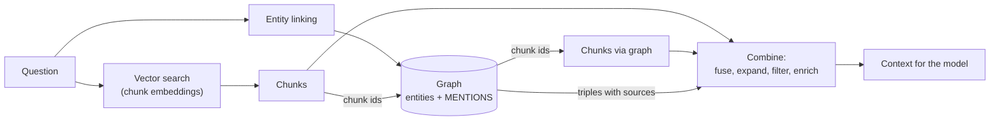

Vector search and graph retrieval fail on different questions. A vector index finds passages that resemble the question, and misses the passage that answers it when the link between them is a relationship rather than a resemblance. A graph follows relationships precisely, and misses everything that was never extracted as an entity or an edge, which in most corpora is most of the text. **Hybrid graph-vector retrieval** combines the two so that each covers the other's blind spot. It is the most common way knowledge graphs are used in production RAG: rarely on their own, usually alongside the vector index a team already runs.

This lesson covers the ways of combining them (parallel fusion, graph expansion of vector results, vector ranking inside a graph neighbourhood, graph facts as added context, and routing), how to store and keep the two indexes consistent, and how to tell whether the graph is earning its cost. You will compare three retrievers on a small Meridian corpus and see each hybrid fail in its own way.

## Learning objectives

- Describe five patterns for combining graph and vector retrieval and the kind of question each one helps.
- Implement parallel fusion and expand-then-rank hybrids over a chunk-entity graph and compare them with vector retrieval on labelled questions.
- Explain why a "bridge" chunk that connects two facts can be missed by every similarity-based ranking, and add it back with path-aware context.
- Design the storage and synchronisation of a vector index and a graph that share chunk identifiers.
- Plan an evaluation that shows, per question type, whether the graph improves retrieval enough to justify its cost.

## Prerequisites

- [Graph retrieval](/learn/graph-rag/graph-retrieval): entity linking, expansion and ranking over a graph.
- [Graph construction](/learn/graph-rag/graph-construction): chunk nodes, `MENTIONS` edges and provenance.
- [Reciprocal Rank Fusion](/learn/hybrid-search/reciprocal-rank-fusion): combining rankings by rank rather than score.
- [Semantic search](/learn/dense-retrieval/semantic-search): ranking chunks by embedding similarity.

## Why this matters

Take the question "When is AskMeridian unavailable for maintenance?". Meridian's documentation answers it in two steps: AskMeridian stores its embeddings in the Qdrant cluster, and the Qdrant cluster is patched on the first Tuesday of each month with a one-hour outage. Neither chunk alone answers the question, and the second never mentions AskMeridian. Meanwhile a third chunk, about the IT portal's Sunday maintenance window, contains the words "unavailable" and "maintenance" and looks more like the question than either. A vector retriever returns the IT portal chunk with confidence, and the model answers about the wrong system.

A graph-only retriever has the opposite problem. It knows that AskMeridian is linked to the Qdrant cluster, but it only knows what extraction captured. Questions phrased around ideas that never became entities ("how do I claim for a new chair?") find no seed, and the graph has nothing to say. Most of the useful text in a corpus is not in the graph.

Hybrid retrieval exists because each side covers the other's weakness. But combining them badly gives the worst of both: graph noise pushes good vector results out of the top k, two stores drift out of sync, and a team pays for graph extraction without being able to show that it helped. The patterns in this lesson, and the evaluation that goes with them, are how to avoid that.

## The intuition

Think of two colleagues helping you find an answer in Meridian's documentation. One has read everything and has an excellent sense of which pages *sound like* your question; the other has memorised the org chart and the system diagram and knows *what connects to what*, but has read little.

You can use them in several ways. Ask both separately and merge their lists (parallel fusion). Ask the reader first, then ask the diagram expert "what is connected to the pages she found?" (expansion of vector results). Ask the diagram expert which part of the system you are asking about, then ask the reader to pick the best pages from that part only (vector ranking inside a graph neighbourhood). Or let the reader find the pages and have the diagram expert annotate them with the relevant connections (graph facts as context). And sometimes you can tell from the question that only one of them is needed (routing).

None of these is best in general. Which one helps depends on the question, and the only way to know for your corpus is to measure.

## How it works

### The shared backbone: chunks linked to entities

Every hybrid pattern relies on one link: from a **chunk** in the vector index to the **entities** it mentions in the graph, and back. [Graph construction](/learn/graph-rag/graph-construction) builds this as `MENTIONS` edges from chunk nodes to entity nodes, with relationships carrying the chunk identifiers that support them. The essential rule is that both stores use the **same chunk identifiers**. With that, any vector hit can be looked up in the graph and any graph fact can be traced to its chunk in the vector index.



### Five patterns

1. **Parallel retrieval and fusion.** Run vector search and a graph retriever independently, each producing a ranked list of chunks, and combine the lists. The graph retriever links the question's entities and scores chunks by graph proximity, for example personalised PageRank over the chunk-entity graph. Because the two scores are on unrelated scales, fuse by rank with [Reciprocal Rank Fusion](/learn/hybrid-search/reciprocal-rank-fusion) rather than adding scores. This is the easiest pattern to add to an existing system and the easiest to evaluate, since either side can be switched off.
2. **Vector first, graph expansion.** Take the top vector hits, look up the entities they mention, follow one hop to related entities, and add chunks that mention those. This catches the follow-on fact a vector hit points to. Its risk is that a wrong top hit expands in the wrong direction, so expansion is usually limited to the top few hits and to strong or relevant relation types.
3. **Graph first, vector ranking (expand-then-rank).** Link the question's entities, collect the chunks about them and their neighbouring entities into a candidate pool, and rank the pool by vector similarity. The graph decides *which part of the corpus* is relevant; vector similarity decides *which passages within it* answer the question. It removes look-alike chunks about unrelated systems, which is exactly the IT portal failure above. It needs a seed: when linking finds nothing, fall back to plain vector search.
4. **Graph facts as context.** Retrieve chunks by vector search as usual, then add the relationships among the entities they mention (and perhaps one hop beyond) as triples with sources. The chunks supply wording and detail; the triples supply connections the chunks do not state. GraphRAG's local search, from [Local and global search](/learn/graph-rag/local-and-global-search), is a structured version of this pattern.
5. **Routing.** Decide per question whether the graph is needed at all. Questions that name entities and ask about relationships ("who owns", "what depends on", "what is affected by") go to a hybrid; simple factual lookups go to vector or keyword search. Routing is the main cost control, covered in [Query routing](/learn/agentic-rag/query-routing).

Patterns combine. A common production shape is routing in front of pattern 3 or 1, with pattern 4 applied to the final context.

### The bridge-chunk problem

Hybrids that rank chunks by similarity, even inside a graph-defined pool, share a weakness. In a two-step answer, the chunk that *connects* the question to the answer often resembles the question least. "AskMeridian stores its embeddings in the Qdrant cluster" says nothing about maintenance or availability. It is essential to the answer, because without it the model is told when the Qdrant cluster is patched with no reason to connect that to AskMeridian, and every similarity ranking places it low.

The graph knows why that chunk matters: it is the edge on the path from the seed entity (AskMeridian) to the entity whose chunk answered the question (Qdrant cluster). The fix is **path-aware context**: when a chunk enters the results through a neighbouring entity rather than a seed, also include the chunk that links the seed to that neighbour. The code below shows the failure and exercise 3 adds the fix.

### Storage: one store or two

Two architectures are common.

- **One store.** A graph database that also has a vector index over chunk nodes, so that a single query can find similar chunks and walk from them. Neo4j, for example, supports vector indexes on node properties, and some vector databases store enough payload to approximate a shallow graph. One store removes synchronisation problems at the cost of using one engine for both jobs.
- **Two stores.** The existing vector database (for AskMeridian, the Qdrant cluster) plus a separate graph database, joined by chunk identifiers in application code. Each engine does what it is good at, and existing vector infrastructure is untouched. The cost is consistency: every ingestion, update and deletion must reach both stores.

With two stores, the failure to design against is **drift**. A document is deleted from the vector index but its relationships survive in the graph, so the graph keeps asserting facts from a document that no longer exists; or a re-chunked document gets new chunk identifiers in one store and not the other. Drive both stores from the same ingestion events, use the retract-then-reassert procedure from [Graph construction](/learn/graph-rag/graph-construction) for updates, and run a reconciliation job that compares the chunk identifiers in each store and reports orphans.

### Evaluating whether the graph helps

The graph has a real cost: extraction at indexing time, a second store to run, and more moving parts at query time. Evaluate it like any other component:

1. Build a labelled question set that includes the question types you expect the graph to help with (multi-hop, relationship, impact) and the types you do not (single-fact lookups), with the chunks each answer needs.
2. Measure retrieval with and without the graph, per question type, using a recall measure at the k you actually send to the model.
3. Check that the graph does not hurt the simple questions. A hybrid that improves multi-hop recall and degrades factual lookups may still be a loss if most traffic is factual.
4. Read the failures. Recall numbers on a few dozen questions are noisy; the useful output is the list of questions each method missed and why.

> [!KEY]
> The vector index finds passages that resemble the question; the graph finds passages connected to what the question is about. Hybrids work when the graph constrains or extends what vector search returns, and they must be evaluated per question type, because the graph's benefit is concentrated in the questions that need relationships.

## In code

**The problem.** Compare three retrievers on a small Meridian corpus with labelled questions: plain vector search, parallel fusion of vector and graph rankings with RRF, and expand-then-rank. Measure how many of the chunks each answer needs appear in the top 3.

**Dependencies.** NetworkX for the chunk-entity graph and personalised PageRank, `sentence-transformers` for the embeddings:

```bash
pip install networkx sentence-transformers numpy
```

**The source.** Each chunk lists the entities extraction found in it. The corpus includes deliberate look-alikes (other systems' maintenance windows, another Relay chunk, another VPN error) so that similarity alone is not enough.

```python
import networkx as nx
import numpy as np
from sentence_transformers import SentenceTransformer

# Chunks, each with the entities extraction found in it
CHUNKS = {
    "c1": ("AskMeridian is the internal assistant run by the Platform team. It indexes the "
           "employee handbook and the IT runbooks.", ["AskMeridian", "Platform team", "Employee handbook", "IT runbooks"]),
    "c2": ("AskMeridian stores its embeddings in the Qdrant cluster.", ["AskMeridian", "Qdrant cluster"]),
    "c3": ("The Qdrant cluster is patched on the first Tuesday of each month, with a "
           "one-hour outage.", ["Qdrant cluster"]),
    "c4": ("The employee handbook is owned by the HR team; the current edition took effect "
           "on 1 January 2025.", ["Employee handbook", "HR team"]),
    "c5": ("The IT runbooks are maintained by the support desk, open 08:00 to 18:00 UK time.",
           ["IT runbooks", "Support desk"]),
    "c6": ("Meridian Relay's admin console is only reachable through the VPN client.",
           ["Meridian Relay", "VPN client"]),
    "c7": ("Error E-4021 means the VPN client is out of date; update it from the IT portal.",
           ["E-4021", "VPN client", "IT portal"]),
    "c8": ("Annual leave is 25 days; up to 5 unused days carry over and must be used by 31 March.",
           ["Annual leave"]),
    "c9": ("Expenses must be submitted within 30 days; anything over 75 pounds needs a receipt.",
           ["Expenses policy"]),
    "c10": ("The VPN is required on public Wi-Fi.", ["VPN client"]),
    "c11": ("Meridian Reports supports PDF and CSV export, and SAML single sign-on on the "
            "Enterprise plan.", ["Meridian Reports", "SAML single sign-on"]),
    "c12": ("The IT portal is unavailable for maintenance every Sunday from 02:00 to 04:00.",
            ["IT portal"]),
    "c13": ("Meridian Sync maintenance windows are announced a week in advance.", ["Meridian Sync"]),
    "c14": ("Relay's admin console lets administrators manage routing rules.", ["Meridian Relay"]),
    "c15": ("Error E-4012 means the VPN certificate has expired.", ["E-4012", "VPN client"]),
    "c16": ("AskMeridian answers questions about IT and HR policies.", ["AskMeridian"]),
}
QUESTIONS = {  # question: chunks a complete answer needs
    "When is AskMeridian unavailable for maintenance?": {"c2", "c3"},
    "Relay's admin console won't open and I see E-4021. What do I do?": {"c6", "c7"},
    "Who maintains the runbooks that AskMeridian answers IT questions from?": {"c1", "c5"},
    "How many days of annual leave can I carry over?": {"c8"},
    "Who owns the employee handbook?": {"c4"},
}
ids = list(CHUNKS)

# Vector side: one embedding per chunk
model = SentenceTransformer("sentence-transformers/all-MiniLM-L6-v2")
chunk_vecs = model.encode([CHUNKS[c][0] for c in ids], normalize_embeddings=True)

def vector_scores(q):
    return dict(zip(ids, chunk_vecs @ model.encode([q], normalize_embeddings=True)[0]))

# Graph side: a bipartite graph linking each chunk to the entities it mentions
G = nx.Graph()
for c, (_, ents) in CHUNKS.items():
    G.add_edges_from((c, "E:" + e) for e in ents)

ALIASES = {"relay": "Meridian Relay", "runbooks": "IT runbooks", "handbook": "Employee handbook"}
ENTITY_NAMES = sorted({e for _, ents in CHUNKS.values() for e in ents})

def link(q):
    ql = q.lower()
    return {e for e in ENTITY_NAMES if e.lower() in ql} | {e for a, e in ALIASES.items() if a in ql}

def graph_scores(q, alpha=0.85):
    """Parallel graph retriever: a random walk from the linked entities over the
    chunk-entity graph; a chunk's score is how often the walk visits it."""
    seeds = link(q)
    if not seeds:
        return {c: 0.0 for c in ids}
    ppr = nx.pagerank(G, alpha=alpha, personalization={"E:" + e: 1 for e in seeds})
    return {c: ppr[c] for c in ids}

def expand_then_rank(q, vec):
    """Sequential hybrid: the graph proposes candidates (chunks about the linked entities
    and their neighbouring entities); vector similarity ranks them; plain vector fills up."""
    ents = {"E:" + e for e in link(q)}
    ents |= {n for e in ents for c in G[e] for n in G[c]}       # entity -> chunk -> entity
    pool = {c for e in ents for c in G[e]}
    return {c: vec[c] + (1.0 if c in pool else 0.0) for c in ids}  # pool first, then the rest

def rrf(*rankings, k=60):
    fused = {}
    for scores in rankings:
        for rank, c in enumerate(sorted(scores, key=lambda c: (-scores[c], c)), start=1):
            fused[c] = fused.get(c, 0) + 1 / (k + rank)
    return fused

def top_k(scores, k=3):
    return sorted(scores, key=lambda c: (-scores[c], c))[:k]

totals = {"vector": 0, "RRF(vector, graph)": 0, "expand-then-rank": 0}
needed = sum(len(g) for g in QUESTIONS.values())
for q, gold in QUESTIONS.items():
    vec = vector_scores(q)
    graph = graph_scores(q)
    runs = {"vector": top_k(vec), "RRF(vector, graph)": top_k(rrf(vec, graph)),
            "expand-then-rank": top_k(expand_then_rank(q, vec))}
    print(q)
    for name, got in runs.items():
        hits = len(gold & set(got)); totals[name] += hits
        print(f"  {name:<19} {', '.join(got):<13} found {hits}/{len(gold)}")
print("\nrecall@3 over all questions:",
      ", ".join(f"{n} {t}/{needed}" for n, t in totals.items()))
```

**The important lines.**

- `G` is a **bipartite** graph: chunk nodes connect only to entity nodes (prefixed `E:`), the `MENTIONS` structure from [Graph construction](/learn/graph-rag/graph-construction). Two chunks are related when they mention a common entity.
- `link` is deliberately simple: exact names plus a small alias table, as in [Graph retrieval](/learn/graph-rag/graph-retrieval). Every hybrid's graph side depends on it.
- `graph_scores` is the parallel graph retriever: personalised PageRank restarting at the linked entities, read off at the chunk nodes.
- `rrf` fuses by rank with the conventional constant $k = 60$, so the two incomparable score scales never meet. Ties are broken by chunk id so that results are reproducible.
- `expand_then_rank` collects entities two steps out (entity, chunk, entity), takes every chunk that mentions any of them as the pool, and adds 1.0 to pool members' cosine similarity. Because these cosine similarities are all far below the 1.0 offset, every pool chunk outranks every non-pool chunk, and vector similarity orders within each group: a simple way to say "graph decides the region, vectors decide the order, vectors fill any remaining places".

**The output:**

```output
When is AskMeridian unavailable for maintenance?
  vector              c12, c1, c13  found 0/2
  RRF(vector, graph)  c1, c2, c16   found 1/2
  expand-then-rank    c1, c3, c16   found 1/2
Relay's admin console won't open and I see E-4021. What do I do?
  vector              c6, c14, c7   found 2/2
  RRF(vector, graph)  c6, c7, c14   found 2/2
  expand-then-rank    c6, c14, c7   found 2/2
Who maintains the runbooks that AskMeridian answers IT questions from?
  vector              c1, c5, c16   found 2/2
  RRF(vector, graph)  c1, c5, c16   found 2/2
  expand-then-rank    c1, c5, c16   found 2/2
How many days of annual leave can I carry over?
  vector              c8, c9, c4    found 1/1
  RRF(vector, graph)  c8, c9, c1    found 1/1
  expand-then-rank    c8, c9, c4    found 1/1
Who owns the employee handbook?
  vector              c4, c1, c16   found 1/1
  RRF(vector, graph)  c1, c4, c5    found 1/1
  expand-then-rank    c4, c1, c16   found 1/1

recall@3 over all questions: vector 6/8, RRF(vector, graph) 7/8, expand-then-rank 7/8
```

**What the output means.**

- **Question 1 is the multi-hop case.** Vector search returns the IT portal's maintenance window (c12), the AskMeridian overview (c1) and Meridian Sync's maintenance notice (c13), and finds neither needed chunk. The two hybrids each find one, and different ones. RRF finds c2, the AskMeridian-Qdrant link, because the graph ranks chunks directly about AskMeridian highly, but it cannot lift c3 (two entity hops away, low in both rankings). Expand-then-rank finds c3, the Qdrant patching schedule, because its pool removed the look-alikes c12 and c13; but it ranks c2 below the general AskMeridian chunk c16, because c2 resembles the question least. That is the bridge-chunk problem, visible in a corpus of sixteen chunks.
- **Questions 2 and 3** are answered by all three methods. The question names the entities and the chunks share its vocabulary, so the graph has nothing to add here, and, importantly, it does not hurt.
- **Questions 4 and 5** are simple lookups, also answered by all three. The third-ranked chunk differs (RRF and expand-then-rank pull in graph neighbours such as c1 or c5), which matters if the context is small: graph neighbours can displace the vector runner-up.
- **The totals** (6, 7 and 7 of 8) are from five hand-made questions. They illustrate the mechanism; they are not evidence that one method is better in general. A real comparison needs a labelled set from your own traffic.

**Common errors.** Fusing raw scores instead of ranks lets the scale with larger numbers dominate. Forgetting the no-seed fallback makes graph-first hybrids return nothing for questions without a recognised entity. And building the graph with different chunk identifiers from the vector index makes every join silently miss.

**The same pattern in a graph database.** In Neo4j, the vector index and the expansion can run in one Cypher query. The sketch below assumes `Chunk` nodes with an `embedding` property, `MENTIONS` edges to `Entity` nodes, and a vector index named `chunk_embeddings`. It was not executed (it needs a running Neo4j server), and Cypher syntax for vector search has been evolving, so check the manual for your version:

```python
import os
from neo4j import GraphDatabase
from sentence_transformers import SentenceTransformer

model = SentenceTransformer("sentence-transformers/all-MiniLM-L6-v2")
driver = GraphDatabase.driver(os.environ["NEO4J_URI"],
                              auth=(os.environ["NEO4J_USER"], os.environ["NEO4J_PASSWORD"]))

# Vector hits, then one entity hop out to connected chunks, each with its best vector score
CYPHER = """
CALL db.index.vector.queryNodes('chunk_embeddings', $k, $embedding)
YIELD node AS hit, score
MATCH (hit)-[:MENTIONS]->(:Entity)<-[:MENTIONS]-(related:Chunk)
WITH related, max(score) AS via_score
RETURN related.id AS chunk_id, related.text AS text, via_score
ORDER BY via_score DESC
LIMIT $limit
"""

question = "When is AskMeridian unavailable for maintenance?"
embedding = model.encode(question, normalize_embeddings=True).tolist()
records, _, _ = driver.execute_query(CYPHER, k=5, embedding=embedding, limit=10)
for r in records:
    print(r["chunk_id"], round(r["via_score"], 3), r["text"][:60])
driver.close()
```

This is pattern 2 (vector first, graph expansion): each related chunk inherits the best score of the vector hit that led to it. Cypher does not reuse a relationship within one match, so a hit appears among the results only when another chunk's entities lead back to it; union the original hits in if you want them kept.

**Extending it.** Add pattern 4 to the winning hybrid: after choosing the chunks, serialise the relationships among their entities as cited triples and place them before the chunks.

## A real-world example

Meridian's Platform team has run AskMeridian on the Qdrant cluster for a year when the IT team asks for better answers to dependency questions ("if X is down, what else breaks?"). The team builds a graph from the IT runbooks in a separate graph database, linked by chunk identifiers, and adds it as a parallel retriever fused with RRF.

The first evaluation, on 60 labelled questions drawn from support tickets, is disappointing: overall recall barely moves. Splitting the results by question type explains why. On the dozen dependency and impact questions, the hybrid finds clearly more of the needed chunks. On the factual lookups that make up most of the set, it is slightly worse, because graph neighbours displace the vector runner-up in a top-5 context. The average hides both effects.

The team makes two changes. A router sends only questions with relationship language and at least one linked entity to the hybrid; everything else stays on vector search. And for the routed questions they switch to expand-then-rank with path-aware bridge chunks, which handles the "which system depends on which" questions better than fusion did. Dependency questions improve and factual lookups return to their old behaviour.

Three months later a different problem appears: AskMeridian cites a retired runbook. The runbook had been deleted from Qdrant, but the deletion never reached the graph, whose edges still pointed at its chunk identifiers. The fix is to drive both stores from the same ingestion events, plus a nightly reconciliation job that lists chunk identifiers present in one store and not the other.

## Common mistakes

- **Adding raw graph and vector scores.** They are on unrelated scales; one dominates. Fuse ranks, or use the graph as a filter or pool rather than as a score.
- **Evaluating only the average.** The graph's benefit is concentrated in relationship questions, and a small cost on simple lookups can hide it, or outweigh it.
- **No fallback when linking finds nothing.** Graph-first hybrids then return nothing for most questions phrased in ordinary words.
- **Expanding from every vector hit.** Expansion from a wrong hit adds a whole wrong neighbourhood. Expand from the top few, along relevant relation types.
- **Two stores with no reconciliation.** Deleted documents survive in the graph and the model cites them; re-chunked documents break the joins.
- **Dropping the bridge chunk.** Similarity ranking discards the chunk that connects the facts, leaving the model with an answer it cannot justify.

## Best practices

- Use the same chunk identifiers in the vector index and the graph, and carry them on every relationship as provenance.
- Start with parallel fusion (easy to add and to switch off), measure per question type, and move to expand-then-rank or routing where the measurements say so.
- Always fall back to vector retrieval when entity linking finds no seed.
- Include path chunks when results arrive through neighbouring entities, and serialise the connecting relationships as cited triples.
- Drive both stores from one ingestion pipeline and reconcile them on a schedule.
- Route: send relationship questions to the hybrid and keep simple lookups on the cheaper path.

## Performance considerations

- **Query latency** is roughly the maximum of the two retrievals when they run in parallel (pattern 1), and their sum when sequential (patterns 2 and 3). Graph steps that touch a few hundred nodes are usually milliseconds in a graph database or in memory; the risk is unbounded expansion through hubs, so cap neighbours per node.
- **Context size** grows with the union of both result sets plus any triples. Fix the final k and budget, and let the fusion decide what fills it, rather than concatenating both lists.
- **Indexing cost** is dominated by entity and relationship extraction, as in [Microsoft GraphRAG concepts](/learn/graph-rag/microsoft-graphrag-concepts). If the graph will only seed expansion, a cheaper extraction (named-entity recognition plus a curated entity list) may be enough.
- **Storage** for the chunk-entity link is small: with 1 million chunks averaging 5 mentions each, that is 5 million edges, each a pair of identifiers.
- **Two stores** double the operational surface: two services to monitor, back up and scale. That is a real cost to weigh against the single-store option.

## Security considerations

- **Permissions must be enforced on both sides, before fusion.** A chunk the user cannot read must not enter through the graph side either. Store access labels on chunk nodes and on relationships (from their source chunks) and filter both retrievers, as in [Filtered retrieval](/learn/advanced-retrieval/filtered-retrieval).
- **Graph facts can leak restricted content** even when their chunks are filtered: a relationship extracted from a restricted document reveals information by itself. Filter relationships by the access labels of their sources, not only chunks.
- **Generated graph queries** (if the graph side uses text-to-Cypher) need a read-only user, timeouts and result limits.

## Summary

- Vector search finds passages that resemble the question; the graph finds passages connected to what the question is about. Hybrids cover each other's blind spots.
- Five patterns: parallel fusion with RRF, vector-first graph expansion, graph-first vector ranking, graph facts as context, and routing; they combine.
- The bridge chunk that connects two facts often resembles the question least, so similarity rankings drop it; path-aware context puts it back.
- One store or two: two stores need shared chunk identifiers, one ingestion pipeline and reconciliation to prevent drift.
- Evaluate per question type: the graph's benefit is concentrated in relationship questions and must not be bought with worse simple lookups.

## Exercises

**1. Predict the pool.** For "Who maintains the runbooks that AskMeridian answers IT questions from?", list the linked entities, the entities two steps out, and the chunk pool that `expand_then_rank` builds. Which chunks are excluded?

<details><summary>Show solution</summary>

Linked: IT runbooks (through the alias "runbooks") and AskMeridian. Their chunks (c1, c2, c5, c16) mention Platform team, Employee handbook, Qdrant cluster and Support desk, so those join the entity set. The pool is every chunk mentioning any of them: c1, c2, c3, c4, c5 and c16. Excluded: c6 to c15, including all the VPN, Relay, expenses, leave and maintenance-window chunks. Within the pool, vector similarity puts c1 and c5 first, which is the answer.

</details>

**2. When fusion hurts.** Using the output, explain why the RRF ranking for "Who owns the employee handbook?" puts c1 above c4, although c4 alone answers it. What would you change if most of your traffic were questions like this?

<details><summary>Show solution</summary>

The graph side restarts at "Employee handbook". Both c1 and c4 mention it, but c1 also mentions AskMeridian, Platform team and IT runbooks, so the walk reaches c1 from several directions and gives it the higher graph score. RRF then sees c1 ranked first by the graph and second by vector, and c4 first by vector and second by the graph; with ties broken by chunk id, c1 wins. Both are still in the top 3 here, but in a tighter context the graph's preference for well-connected chunks can displace the best vector hit. If most traffic is single-fact lookups, route them to vector search and use the hybrid only for relationship questions; or weight RRF towards the vector ranking.

</details>

**3. Add the bridge chunk.** Extend the code so that, when a chunk in the top 3 of `expand_then_rank` does not mention any seed entity, the chunk that links a seed to one of its entities is appended. Does question 1 now find both needed chunks?

<details><summary>Show solution</summary>

```python
def with_bridges(q, ranked):
    seeds = {"E:" + e for e in link(q)}
    out = list(ranked)
    for c in ranked:
        if any(e in seeds for e in G[c]):
            continue                                   # already about a seed entity
        for e in G[c]:                                 # entity that brought c in
            for b in G[e]:                             # chunks mentioning that entity...
                if b not in out and any(s in G[b] for s in seeds):   # ...and a seed
                    out.append(b)
    return out
```

Applied to `top_k(expand_then_rank(q, vec))`, question 1 returns c1, c3, c16, c2 and finds both needed chunks; the other questions are unchanged, because their top 3 already mention a seed. The context grows by one chunk only where a hop was taken, and the model can now state the full chain: AskMeridian depends on the Qdrant cluster, which is patched on the first Tuesday of each month.

</details>

## Check your understanding

```quiz
[
  {
    "q": "Why fuse graph and vector results with Reciprocal Rank Fusion rather than by adding their scores?",
    "options": [
      "RRF is faster to compute",
      "The two scores are on unrelated scales, so adding them lets one dominate arbitrarily",
      "Graph scores are always negative",
      "RRF uses the graph's edge weights"
    ],
    "answer": 1,
    "why": "A cosine similarity and a PageRank score mean different things on different scales. RRF uses only ranks, which are comparable."
  },
  {
    "q": "In the expand-then-rank pattern, what does each side decide?",
    "options": [
      "The graph decides the order; vectors decide the region",
      "Both produce independent rankings that are averaged",
      "The graph decides which part of the corpus is relevant; vector similarity orders the chunks within it",
      "Vectors pick entities; the graph picks chunks"
    ],
    "answer": 2,
    "why": "Linked entities and their neighbours define a candidate pool, which removes look-alike chunks about unrelated systems; similarity then ranks the pool."
  },
  {
    "q": "What is a 'bridge chunk', and why do similarity rankings tend to drop it?",
    "options": [
      "A chunk connecting the question's entity to the answer's entity; it often shares little wording with the question",
      "A duplicate chunk produced by overlapping chunking",
      "A chunk that mentions no entities",
      "A chunk stored in both the vector index and the graph"
    ],
    "answer": 0,
    "why": "'AskMeridian stores its embeddings in the Qdrant cluster' is essential to the maintenance answer but resembles the question least. Path-aware context includes it because of its graph position."
  },
  {
    "q": "A runbook was deleted from the vector index, but AskMeridian still cites facts from it through the graph. What is the root cause?",
    "options": [
      "The embedding model was changed",
      "RRF constant k is too small",
      "Entity linking used aliases",
      "The two stores are not updated from the same ingestion events, so the graph kept relationships whose source chunks no longer exist"
    ],
    "answer": 3,
    "why": "Drift between stores. Drive both from one pipeline, retract relationships by source chunk on deletion, and reconcile identifiers on a schedule."
  },
  {
    "q": "A hybrid improves recall on relationship questions but slightly lowers it on simple lookups, and overall recall is unchanged. What is the best next step?",
    "options": [
      "Abandon the graph",
      "Route relationship questions to the hybrid and keep simple lookups on vector search",
      "Increase k for every question",
      "Replace vector search with the graph everywhere"
    ],
    "answer": 1,
    "why": "The average hides two opposite effects. Routing keeps the gain where the graph helps and removes the cost where it does not."
  }
]
```

## Further reading

- Peng and colleagues (2024), [Graph Retrieval-Augmented Generation: A Survey](https://arxiv.org/abs/2408.08921): retrieval patterns that combine graphs with other indexes.
- Gutiérrez and colleagues (2024), [HippoRAG: Neurobiologically Inspired Long-Term Memory for Large Language Models](https://arxiv.org/abs/2405.14831): personalised PageRank over an entity graph linked to passages.
- Cormack, Clarke and Büttcher (2009), *Reciprocal Rank Fusion outperforms Condorcet and individual Rank Learning Methods*, SIGIR: the fusion method used here.
- [Neo4j Cypher Manual](https://neo4j.com/docs/cypher-manual/current/): vector indexes and the query patterns in the sketch.
- [NetworkX documentation](https://networkx.org/documentation/stable/): graph classes and `pagerank`.
