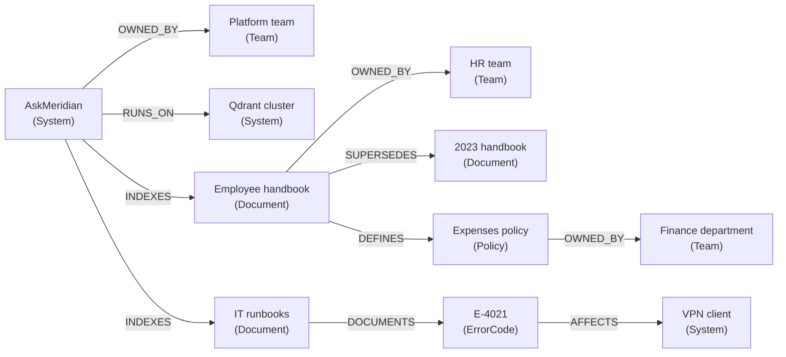
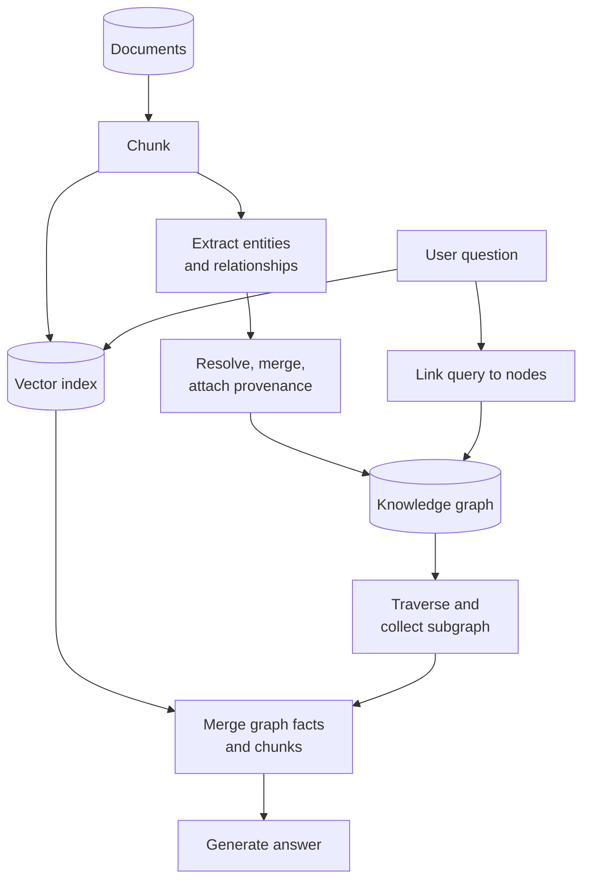

Every retriever you have built so far answers one kind of question well: "find me passages that look like this query". Many real questions are of a different kind. "Which team owns the documents that AskMeridian indexes?" is not answered by any single passage; it is answered by following two facts that live in different places. A **knowledge graph** stores facts as explicit connections between things, so that a question like that becomes a walk from one node to another rather than a hope that the right passages happen to resemble the query.

This lesson covers nodes, edges and triples, the two main data models (RDF and the labelled property graph), what a schema adds, and where a graph sits in a RAG system, ending with a small Meridian graph in NetworkX set beside vector search over the same facts. The rest of the module builds on this vocabulary.

## Learning objectives

- Define nodes, edges, labels, properties and triples, and represent a set of facts as a directed, labelled multigraph.
- Contrast the RDF and labelled property graph data models and choose between them for a given use.
- Identify questions (multi-hop, aggregation, exhaustive listing) that a knowledge graph answers more reliably than similarity search, and questions where it adds nothing.
- Compute multi-hop path counts from an adjacency matrix by hand and in NumPy.
- Build a small knowledge graph in NetworkX and answer one-hop, two-hop and reverse-direction questions over it.

## Prerequisites

- [Naive RAG](/learn/advanced-rag-patterns/naive-rag): the retrieve-then-generate baseline that this module extends.
- [Dense retrieval limitations](/learn/dense-retrieval/dense-retrieval-limitations): why similarity search misses some relevant passages.
- [Query decomposition](/learn/advanced-retrieval/query-decomposition): splitting a multi-part question into sub-questions, the text-only answer to multi-hop questions.
- [Document metadata](/learn/document-engineering/document-metadata): structured fields attached to documents, the simplest form of structured knowledge.

## Why this matters

A vector index stores chunks and finds the ones whose embeddings lie closest to the query's. That design has three blind spots, and each corresponds to a type of question users ask every day.

**Multi-hop questions.** "Who should I talk to about the documents AskMeridian searches?" needs two facts: AskMeridian indexes the employee handbook, and the handbook is owned by the HR team. Those facts are written in different documents, in different words. The second fact does not mention AskMeridian at all, so it has no reason to be similar to the query. Similarity search retrieves the first hop and frequently misses the second. Query decomposition can help, but only if the model knows what to ask for at step two, which it learns only after step one.

**Aggregation and exhaustive listing.** "List every system that runs on the Qdrant cluster" asks for *all* of something. Top-k retrieval returns k chunks, whether there are two relevant systems or forty. It has no concept of "all", and nothing tells you whether the list is complete.

**Disambiguation.** "Relay" might be Meridian Relay the product or an ordinary English word in a mail-server runbook. Embeddings blur the senses; a graph that stores *Meridian Relay* as one node of type Product does not.

The failures are quiet. The assistant answers the first hop confidently and invents or omits the second; it lists three systems when there are five, and the answer looks complete. Knowledge graphs make relationships first-class data: stored explicitly, queried exactly and counted reliably. They are not free (someone or some model must extract the facts and keep them current), and most of this module is about that cost.

## The intuition

Think about two ways of learning how the London Underground connects.

One is a guidebook: a page about each station, its area and the lines that stop there. To get from Brixton to King's Cross you read the Brixton page, notice the Victoria line, look up other stations on it, and eventually find King's Cross. The route is never written down; you assemble it from pages that each describe one place.

The other is the Tube map. It throws away almost everything and keeps only stations and the lines between them. The route is something you *trace with your finger*, and questions such as "which stations does the Victoria line serve?" become easy.

A vector index is the guidebook: rich passages, retrieved one at a time by how well they match what you asked. A knowledge graph is the map: thin facts about how things connect, which you can follow, count and list. You want both. The map tells you that King's Cross is two stops away; the guidebook tells you what you will find when you get there. Graph RAG is the practice of using the map to decide which pages of the guidebook to read.

## How it works

### Nodes, edges and triples

A **graph** is a set of **nodes** (also called vertices) and a set of **edges** connecting pairs of nodes. In a knowledge graph:

- A node stands for a **thing**: a person, team, system, document, policy, product, error code. Things that a graph stores are usually called **entities**.
- An edge stands for a **relationship** between two things, and it carries a **label** saying which relationship: `OWNED_BY`, `INDEXES`, `RUNS_ON`.
- Edges are **directed**. "AskMeridian is owned by the Platform team" is not the same fact as "the Platform team is owned by AskMeridian". The arrow points from the **subject** to the **object**.

The smallest unit of knowledge is then a **triple**: (subject, predicate, object). The **predicate** is the relationship label.

```text
(AskMeridian,        OWNED_BY, Platform team)
(AskMeridian,        INDEXES,  Employee handbook)
(Employee handbook,  OWNED_BY, HR team)
```

Three triples, four nodes, three edges. Notice that "AskMeridian" and "Employee handbook" each appear in two triples. That shared node is what joins the facts together: a triple on its own is a sentence, but triples that share nodes form a network you can walk.

Two more details complete the picture:

- Nodes usually carry a **type** (also called a class or label): AskMeridian is a System, the HR team is a Team. Types let you ask "every System that..." and let you reject nonsense such as a Policy that runs on a Team.
- Two nodes can be joined by more than one edge with different labels. AskMeridian both `INDEXES` and (perhaps) `CITES` the handbook. A graph that allows several edges between the same pair is a **multigraph**. Knowledge graphs are directed, labelled multigraphs.



Read as a map, questions become paths. "Who owns the expenses policy in the handbook AskMeridian indexes?" is the path AskMeridian, INDEXES, Employee handbook, DEFINES, Expenses policy, OWNED_BY, Finance department. No passage says this, yet the graph answers it exactly.

### Two data models: RDF and property graphs

There are two widely used ways to store a knowledge graph. They share the core idea and differ in where extra information goes.

**RDF** (the Resource Description Framework, a W3C standard) stores *only* triples. Every node and every predicate is identified by an **IRI**, a globally unique web-style identifier such as `https://meridian.example/id/AskMeridian`, so that graphs built by different organisations can be merged without name clashes. Literal values such as numbers and dates appear as the object of a triple: `(Annual leave policy, days, 25)`. RDF graphs are queried with **SPARQL**, and their schemas are written in RDF Schema or **OWL** (the Web Ontology Language), which can state rules such as "every Team is an Organisation" and let a reasoner derive facts that were never written down. Public knowledge bases such as Wikidata and DBpedia are published as RDF.

The limitation shows up when you want to say something *about an edge*, such as the date from which the handbook superseded the 2023 one. Plain RDF must turn the edge into a node (**reification**) or use the newer, less widely supported RDF-star extension.

A **labelled property graph** (LPG) lets both nodes and edges carry arbitrary key-value **properties**. The edge `SUPERSEDES` can carry `{effective: "2025-01-01"}` directly; the AskMeridian node can carry `{vector_store: "Qdrant", owner_contact: "#platform"}`. Neo4j, Amazon Neptune (which supports both models), Memgraph and many others use this model, and most query it with **Cypher** or the ISO standard **GQL**, which grew out of it.

| | RDF | Labelled property graph |
| --- | --- | --- |
| Unit of storage | Triple | Node and edge, each with properties |
| Identifiers | Global IRIs | Local IDs chosen by you |
| Facts about an edge | Reification or RDF-star | Edge properties |
| Query language | SPARQL | Cypher, GQL |
| Schema and reasoning | RDFS, OWL, standard reasoners | Constraints and indexes; reasoning is up to you |
| Typical home | Linked open data, life sciences, publishing standards | Application databases, most Graph RAG tooling |

For Graph RAG the property graph is the common choice, because edges need properties (source chunk, confidence, date) and most Graph RAG tooling targets property graph stores. RDF is better when you must interoperate with published ontologies or need formal reasoning. The two can be converted into each other; the choice is about tooling, not expressive power.

### Schema, ontology and the open world

A **schema** says which node types and edge types are allowed, and which types each edge may connect. A richer schema with rules and class hierarchies is called an **ontology**. For Meridian, a small schema might say:

- Node types: System, Team, Document, Policy, Product, ErrorCode.
- `OWNED_BY` goes from a System, Document or Policy to a Team.
- `INDEXES` goes from a System to a Document.
- `DOCUMENTS` goes from a Document to an ErrorCode.

The schema tells extraction what to look for, lets you reject bad facts (a Team that `INDEXES` a Policy is almost certainly an extraction error), and makes questions answerable by type: "every System" is a set only if systems are labelled.

One more idea matters for RAG. In the code below, the graph has no `OWNED_BY` edge for the IT runbooks. Does that mean nobody owns them? Under the **closed-world assumption** used by ordinary databases, a fact that is not stored is false. Under the **open-world assumption** used by RDF and appropriate for anything extracted from text, a missing fact is merely *unknown*. Extracted knowledge graphs are always incomplete, so an assistant must say "I have no record of an owner", not "the runbooks have no owner". Getting this wrong turns a gap in your extraction into a confident false statement.

### Where a knowledge graph sits in a RAG system

A Graph RAG system adds a second index, built offline next to the vector index, and a second retrieval path at query time.

1. **Extract entities.** Read each chunk and find the things it mentions, with their types. ([Entity extraction](/learn/graph-rag/entity-extraction).)
2. **Extract relationships.** Find the facts that connect those things, as typed triples with evidence. ([Relationship extraction](/learn/graph-rag/relationship-extraction).)
3. **Build the graph.** Merge mentions of the same thing across documents, attach provenance back to the source chunks, and store the result. ([Graph construction](/learn/graph-rag/graph-construction).)
4. **Link the query.** At query time, find which nodes the question is about.
5. **Traverse.** Walk outwards from those nodes along relevant edges, within limits. ([Graph traversal](/learn/graph-rag/graph-traversal).)
6. **Retrieve and assemble context.** Turn the subgraph (and the chunks it points to) into text the model can read. ([Graph retrieval](/learn/graph-rag/graph-retrieval).)
7. **Generate.** Exactly as in ordinary RAG.



The graph can be the main knowledge store, or an *index into the chunks* whose edges remember which chunk they came from. Microsoft's GraphRAG adds summaries of graph clusters for whole-corpus questions ([Microsoft GraphRAG concepts](/learn/graph-rag/microsoft-graphrag-concepts)); combining traversal with vector search is [Hybrid graph-vector retrieval](/learn/graph-rag/hybrid-graph-vector-retrieval).

### What a graph is good at, and what it is not

| Question | Vector index | Knowledge graph |
| --- | --- | --- |
| "How many days of annual leave do I get?" | Excellent: one passage answers it | Adds little; the answer is a sentence, not a relationship |
| "Who owns the documents AskMeridian indexes?" | Unreliable: needs facts from two places | Exact: a two-hop path |
| "List every system that runs on the Qdrant cluster" | Cannot guarantee completeness | Exact, up to what was extracted |
| "Why might E-4021 appear after a laptop refresh?" | Good if a passage explains it | Can connect the pieces, but the explanation lives in text |
| "Summarise the main themes across all runbooks" | Poor: top-k sees a sliver | Helped by community summaries (lesson 7) |

A graph helps when the answer is *structural* (who, what connects to what, how many, all of which) and spread across documents. It does little for questions one passage answers, which is most questions in a typical internal assistant, so graphs usually complement a vector index rather than replace it.

Explore a small graph and watch a query expand from its starting nodes:

```playground
graph-rag
```

## The mathematics

### The adjacency matrix and multi-hop paths

**Intuition.** A graph can be written as a table: one row and one column per node, with a 1 where an edge goes from the row's node to the column's node. Multiplying that table by itself combines one-hop moves into two-hop moves, so matrix powers count paths. This is the arithmetic behind "how many ways can I get from here to there in k steps", and it explains why multi-hop neighbourhoods grow so quickly.

For a graph with $n$ nodes, the **adjacency matrix** $A$ is the $n \times n$ matrix with

$$
A_{ij} = \begin{cases} 1 & \text{if there is an edge from node } i \text{ to node } j \\ 0 & \text{otherwise} \end{cases}
$$

The number of directed paths of length exactly $k$ from node $i$ to node $j$ is the $(i, j)$ entry of the $k$-th matrix power:

$$
\big(A^k\big)_{ij} = \sum_{m=1}^{n} \big(A^{k-1}\big)_{im} \, A_{mj}
$$

Here $i$ and $j$ index the start and end nodes, $m$ runs over every possible last-but-one node, and $k$ is the number of hops. For $k = 2$ the formula reads: count every intermediate node $m$ such that $i \to m$ and $m \to j$ are both edges. The **out-degree** of node $i$ (how many edges leave it) is the row sum $\sum_j A_{ij}$; the **in-degree** of $j$ is the column sum $\sum_i A_{ij}$. Edge labels are ignored here; to count paths along one relationship only, build $A$ from the edges with that label.

**By hand.** Take four nodes in this order: AskMeridian, Employee handbook, IT runbooks, VPN. AskMeridian indexes both documents, and both documents mention the VPN.

$$
A = \begin{pmatrix} 0 & 1 & 1 & 0 \\ 0 & 0 & 0 & 1 \\ 0 & 0 & 0 & 1 \\ 0 & 0 & 0 & 0 \end{pmatrix}
$$

The entry $(A^2)_{1,4}$, from AskMeridian to VPN, is row 1 of $A$ times column 4 of $A$: $0 \times 0 + 1 \times 1 + 1 \times 1 + 0 \times 0 = 2$. There are two two-hop paths, one through each document. Every other entry of $A^2$ is 0, and $A^3$ is entirely zero because no path of length three exists. AskMeridian has out-degree 2; VPN has in-degree 2.

**In NumPy:**

```python
import numpy as np

nodes = ["AskMeridian", "Employee handbook", "IT runbooks", "VPN"]
A = np.array([
    [0, 1, 1, 0],   # AskMeridian -> handbook, runbooks
    [0, 0, 0, 1],   # handbook -> VPN
    [0, 0, 0, 1],   # runbooks -> VPN
    [0, 0, 0, 0],   # VPN has no outgoing edges
])
A2 = A @ A
print("A^2 =\n", A2)
print("two-hop paths AskMeridian -> VPN:", A2[0, 3])
print("A^3 is all zeros:", not (A2 @ A).any())
print("out-degrees:", {n: int(d) for n, d in zip(nodes, A.sum(axis=1))})
print("in-degrees: ", {n: int(d) for n, d in zip(nodes, A.sum(axis=0))})
```

```output
A^2 =
 [[0 0 0 2]
 [0 0 0 0]
 [0 0 0 0]
 [0 0 0 0]]
two-hop paths AskMeridian -> VPN: 2
A^3 is all zeros: True
out-degrees: {'AskMeridian': 2, 'Employee handbook': 1, 'IT runbooks': 1, 'VPN': 0}
in-degrees:  {'AskMeridian': 0, 'Employee handbook': 1, 'IT runbooks': 1, 'VPN': 2}
```

Real systems walk adjacency lists rather than computing matrix powers ([Graph traversal](/learn/graph-rag/graph-traversal)), but the matrix view explains one important fact. If a typical node has out-degree $b$, the number of nodes within $k$ hops grows roughly like $b^k$. With $b = 10$, two hops reach about 100 nodes and three hops about 1,000. Multi-hop retrieval without limits floods the context window, and that growth is why every traversal needs a budget.

## In code

**The problem.** Represent a dozen Meridian facts as a knowledge graph, answer three relational questions by walking it, and compare with similarity search over the same facts written as sentences.

**Dependencies.** NetworkX for the graph, sentence-transformers for the comparison. The embedding model (about 90 MB) downloads on first use; no API key is needed.

```bash
pip install networkx sentence-transformers
```

NetworkX's `MultiDiGraph` is a directed multigraph, which matches the knowledge graph model: edges have a direction and two nodes may be joined by several differently labelled edges. Each edge's **key** holds the relationship label, and node attributes hold the type.

```python
import networkx as nx
from sentence_transformers import SentenceTransformer

# Each fact is a triple: (subject, relation, object).
triples = [
    ("AskMeridian", "OWNED_BY", "Platform team"),
    ("AskMeridian", "RUNS_ON", "Qdrant cluster"),
    ("AskMeridian", "INDEXES", "Employee handbook"),
    ("AskMeridian", "INDEXES", "IT runbooks"),
    ("Employee handbook", "OWNED_BY", "HR team"),
    ("Employee handbook", "SUPERSEDES", "2023 handbook"),
    ("Employee handbook", "DEFINES", "Annual leave policy"),
    ("Employee handbook", "DEFINES", "Expenses policy"),
    ("Expenses policy", "OWNED_BY", "Finance department"),
    ("IT runbooks", "DOCUMENTS", "E-4021"),
    ("IT runbooks", "DOCUMENTS", "E-4012"),
    ("E-4021", "AFFECTS", "VPN client"),
    ("E-4012", "AFFECTS", "VPN client"),
]
node_types = {
    "AskMeridian": "System", "Qdrant cluster": "System", "VPN client": "System",
    "Platform team": "Team", "HR team": "Team", "Finance department": "Team",
    "Employee handbook": "Document", "2023 handbook": "Document", "IT runbooks": "Document",
    "Annual leave policy": "Policy", "Expenses policy": "Policy",
    "E-4021": "ErrorCode", "E-4012": "ErrorCode",
}

G = nx.MultiDiGraph()
for name, label in node_types.items():
    G.add_node(name, type=label)
for s, r, o in triples:
    G.add_edge(s, o, key=r, relation=r)

print(f"{G.number_of_nodes()} nodes, {G.number_of_edges()} edges")

# 1. One hop: everything we know about AskMeridian.
print("\nOut-edges of AskMeridian:")
for _, obj, rel in G.out_edges("AskMeridian", keys=True):
    print(f"  AskMeridian -[{rel}]-> {obj} ({G.nodes[obj]['type']})")

# 2. Two hops: who owns the documents that AskMeridian indexes?
print("\nOwners of documents indexed by AskMeridian:")
for _, doc, rel in G.out_edges("AskMeridian", keys=True):
    if rel != "INDEXES":
        continue
    owners = [o for _, o, r in G.out_edges(doc, keys=True) if r == "OWNED_BY"]
    print(f"  {doc}: {owners or 'no owner recorded'}")

# 3. Reverse direction: which errors affect the VPN client, and where are they documented?
print("\nError codes affecting the VPN client, with the document that covers each:")
for err, _, rel in G.in_edges("VPN client", keys=True):
    docs = [d for d, _, r in G.in_edges(err, keys=True) if r == "DOCUMENTS"]
    print(f"  {err} <- documented in {docs}")

# The same facts as sentences, searched by similarity.
sentences = [f"{s} {r.lower().replace('_', ' ')} {o}." for s, r, o in triples]
model = SentenceTransformer("sentence-transformers/all-MiniLM-L6-v2")
E = model.encode(sentences, normalize_embeddings=True)
q = "Which team owns the documents that AskMeridian indexes?"
qv = model.encode([q], normalize_embeddings=True)[0]
scores = E @ qv
print(f"\nVector search for: {q!r}")
for i in scores.argsort()[::-1][:4]:
    print(f"  {scores[i]:.3f}  {sentences[i]}")
```

```output
13 nodes, 13 edges

Out-edges of AskMeridian:
  AskMeridian -[OWNED_BY]-> Platform team (Team)
  AskMeridian -[RUNS_ON]-> Qdrant cluster (System)
  AskMeridian -[INDEXES]-> Employee handbook (Document)
  AskMeridian -[INDEXES]-> IT runbooks (Document)

Owners of documents indexed by AskMeridian:
  Employee handbook: ['HR team']
  IT runbooks: no owner recorded

Error codes affecting the VPN client, with the document that covers each:
  E-4021 <- documented in ['IT runbooks']
  E-4012 <- documented in ['IT runbooks']

Vector search for: 'Which team owns the documents that AskMeridian indexes?'
  0.651  AskMeridian indexes IT runbooks.
  0.577  AskMeridian owned by Platform team.
  0.522  AskMeridian indexes Employee handbook.
  0.364  AskMeridian runs on Qdrant cluster.
```

**The important lines.**

- `G.add_edge(s, o, key=r, relation=r)` adds a directed edge from subject to object. Using the relation as the `key` means two different relations between the same pair become two edges, while adding the same triple twice does not create a duplicate.
- `G.out_edges(node, keys=True)` yields `(node, neighbour, key)` for edges leaving the node; `G.in_edges` gives edges arriving. Questions often need both directions.
- The two-hop query is an explicit, typed walk: follow `INDEXES` from AskMeridian, then `OWNED_BY` from each document. Every step is filtered by relation, so unrelated edges (`RUNS_ON`, `SUPERSEDES`) are never followed.

**What the output means.**

- The graph answers the two-hop question exactly: the handbook is owned by the HR team. It also reports a gap honestly. No `OWNED_BY` edge exists for the IT runbooks, and under the open-world assumption the right answer is "no owner recorded", not "unowned".
- Similarity search retrieves everything *about AskMeridian*. The fact that answers the question, "Employee handbook owned by HR team", is not in the top four because it does not mention AskMeridian. Worse, "AskMeridian owned by Platform team" ranks second and invites the answer "the Platform team". That is the classic multi-hop failure: first hop retrieved, second missed, a plausible distractor filling the gap.
- Query 3 has no natural phrasing for similarity search at all: walk edges *backwards* to collect everything pointing at a node.

**Errors people commonly hit.**

- Using `nx.DiGraph` instead of `nx.MultiDiGraph`: a `DiGraph` allows one edge per ordered pair, so a second relation between the same nodes silently overwrites the first.
- Treating names as identifiers: "HR team" and "Human Resources" become two nodes. Merging them is the job of [Graph construction](/learn/graph-rag/graph-construction).
- Forgetting direction: `G.successors("VPN client")` is empty; its facts all point *into* it.

**Extending it.** Add a `source` attribute to each edge recording the chunk it came from, and print it next to each answer: that attribute is the bridge between a graph and the text a model needs to cite.

## A real-world example

The Platform team at Meridian, which owns AskMeridian, kept seeing one complaint from IT staff: questions about *dependencies* got vague answers. "If the Qdrant cluster is down, what stops working?" produced a paragraph about Qdrant's replication from the vector database runbook, which was relevant to Qdrant and useless to the person asking. The answer they needed (AskMeridian, and through it every question about the handbook and runbooks) was spread across a system inventory page, the AskMeridian design note and two runbooks, none of which described the dependency chain in one place.

Dev, an engineer on the team, proposed "putting everything in a knowledge graph". The team's lead asked him first to sort a fortnight of logged questions into two piles: answered by one passage, or answered by a relationship spread across sources. The first pile was much larger and already handled well. The second was small but clustered tightly around ownership, dependencies and "which X use Y" questions.

That sorting shaped the design. They left the handbook as text, defined a small schema (System, Team, Document, ErrorCode; `OWNED_BY`, `RUNS_ON`, `DEPENDS_ON`, `INDEXES`, `DOCUMENTS`), populated it from the inventory and runbooks, and recorded the source chunk on every edge. Dependency questions went to graph traversal; everything else stayed on the vector path. The lesson they wrote down was about scope: the schema should cover the structural questions and nothing more.

## Common mistakes

- **Building a graph before knowing which questions need it.** Without a list of relational questions the graph is meant to answer, the schema grows without limit and extraction cost follows.
- **Turning every sentence into triples.** Policy text such as "unused days must be used by 31 March" loses its conditions when flattened into `(Annual leave, MUST_BE_USED_BY, 31 March)`. Keep the passage; link to it from the graph.
- **Using names as identifiers.** Different spellings of the same thing become separate nodes and break every multi-hop path through them.
- **Treating absence as falsehood.** An extracted graph is incomplete. Reporting "no owner" when the truth is "no owner recorded" turns extraction gaps into wrong answers.
- **Dropping provenance.** A fact without a link to its source cannot be cited, checked or deleted.

## Best practices

- Start from a list of real questions, and design the smallest schema whose paths answer them.
- Give every node a stable identifier separate from its display name.
- Attach provenance (document, chunk, extraction date, confidence) to every edge and node.
- Constrain types: write down which node types each relationship may connect, and reject triples that violate it.
- Keep the text. Use the graph to find and connect passages, and give the model passages to cite, not only bare triples.

## Performance considerations

**Storage.** An adjacency list costs memory proportional to nodes plus edges, $O(n + e)$. NetworkX stores Python dictionaries per node and per edge: convenient for prototypes and small graphs, memory-hungry beyond that. Graph databases store adjacency compactly and serve concurrent queries.

**Query cost.** A one-hop lookup touches only one node's edges. A $k$-hop expansion touches roughly $b^k$ nodes for average out-degree $b$, as the mathematics section showed, and real graphs have **hubs** (nodes with thousands of edges, such as "IT portal" or "VPN") that make individual expansions far worse than average. Bound every traversal by depth, by fan-out per node and by total nodes.

**Construction cost** dominates. If extraction uses a language model, every chunk costs one or more model calls. A corpus of 50,000 chunks with one call per chunk is 50,000 calls; at an assumed 1,500 input and 300 output tokens per call, that is 75 million input and 15 million output tokens for a full build, and the same again for every full rebuild. Prices change often; multiply by current rates from your provider's pricing page. This is why incremental updates, covered in [Graph construction](/learn/graph-rag/graph-construction), matter.

**Latency.** An indexed graph lookup is usually cheap next to the model calls around it: linking the question to nodes and generating the answer dominate.

## Security considerations

- **Aggregation leaks.** A graph combines facts from many documents into one structure. An edge extracted from a restricted document (an HR investigation, a security incident report) can reveal its contents to anyone whose query walks across it. Carry the source document's access controls onto every node and edge it produced, and filter by them during traversal, not after.
- **Poisoned facts.** Anyone who can add a document can add edges, and a planted fact is reached by every query that walks past it. Record provenance and restrict who can write to indexed sources.
- **Deletion.** When a document is deleted or a person's data must be erased, every node and edge derived from it must go too. Without provenance on edges that is impossible to do reliably.

## Summary

- A knowledge graph stores facts as typed nodes joined by directed, labelled edges; the atomic fact is a (subject, predicate, object) triple.
- RDF stores only triples with global identifiers and suits interoperability and reasoning; labelled property graphs put properties on nodes and edges and are the usual choice for Graph RAG.
- A schema defines allowed node and edge types; extracted graphs are incomplete, so missing facts mean "unknown", not "false".
- Graphs answer structural questions (multi-hop, aggregation, exhaustive listing, disambiguation) that similarity search handles poorly, and add little for single-passage lookups.
- Multi-hop neighbourhoods grow roughly as $b^k$, so traversal needs limits; adjacency matrix powers count paths and make that growth visible.
- In RAG a graph usually complements a vector index and should keep provenance links to the chunks it was built from.

## Exercises

**1.** Write the following facts as triples with a direction and a label, and give each node a type: "The Platform team owns AskMeridian. AskMeridian runs on a Qdrant cluster. Meridian Reports offers SAML single sign-on on the Enterprise plan."

<details><summary>Show solution</summary>

```text
(AskMeridian,      OWNED_BY, Platform team)        System -> Team
(AskMeridian,      RUNS_ON,  Qdrant cluster)       System -> System
(Meridian Reports, SUPPORTS, SAML single sign-on)  Product -> Feature
```

The direction is a convention, but pick one and keep it: here ownership points from the thing owned to its owner. The third sentence has a condition ("on the Enterprise plan") that a bare triple loses. In a property graph, put it on the edge, `SUPPORTS {plan: "Enterprise"}`; in RDF you would need reification or RDF-star.

</details>

**2.** For each question, say whether a knowledge graph, a vector index or both would serve it best, and why: (a) "How much is the home-office equipment budget?" (b) "Which documents does AskMeridian index, and who owns each?" (c) "Which error codes in the IT runbooks affect the VPN client?"

<details><summary>Show solution</summary>

(a) **Vector index.** One handbook passage states £400; there is no relationship to follow.

(b) **Knowledge graph.** It is a two-hop question with an exhaustive "each": follow `INDEXES` then `OWNED_BY`. Vector search tends to retrieve the first hop and miss ownership facts that do not mention AskMeridian.

(c) **Knowledge graph, then text.** The graph lists every `ErrorCode` documented in the runbooks with an `AFFECTS` edge to the VPN client, completely. The meaning of each code and the fix are explanations, best taken from the source chunks the edges point to.

</details>

**3.** Using the adjacency matrix method, add a fifth node "IT portal" with edges VPN → IT portal and Employee handbook → IT portal to the four-node example. How many paths of length 2 and length 3 now go from AskMeridian to IT portal? Check your answer in NumPy.

<details><summary>Show solution</summary>

Length 2: AskMeridian → Employee handbook → IT portal, so 1 path. Length 3: AskMeridian → handbook → VPN → IT portal and AskMeridian → runbooks → VPN → IT portal, so 2 paths.

```python
import numpy as np
A = np.zeros((5, 5), dtype=int)
for i, j in [(0, 1), (0, 2), (1, 3), (2, 3), (3, 4), (1, 4)]:
    A[i, j] = 1
A2 = A @ A
print(A2[0, 4], (A2 @ A)[0, 4])
```

```output
1 2
```

</details>

## Check your understanding

```quiz
[
  {"q": "What is the smallest unit of knowledge in a knowledge graph?", "options": ["A chunk with an embedding", "A (subject, predicate, object) triple", "A node with a type", "A path of length two"], "answer": 1, "why": "A triple states one fact: a subject connected to an object by a labelled, directed relationship. Nodes alone state nothing; paths are built from triples."},
  {"q": "You need to record that the employee handbook superseded the 2023 handbook with effect from 1 January 2025, with the date attached to the relationship itself. Which data model handles this most directly?", "options": ["RDF without extensions", "A plain vector index", "A labelled property graph, using an edge property", "An adjacency matrix"], "answer": 2, "why": "Property graphs allow key-value properties on edges. Plain RDF needs reification or the RDF-star extension to attach data to a triple."},
  {"q": "The graph has no OWNED_BY edge for the IT runbooks. Under the open-world assumption, what should the assistant say?", "options": ["The IT runbooks have no owner", "The IT runbooks are owned by the Platform team, since AskMeridian indexes them", "It has no record of who owns the IT runbooks", "The question is invalid"], "answer": 2, "why": "Extracted graphs are incomplete, so a missing fact means unknown, not false. Inferring an owner from a different relationship would be invention."},
  {"q": "In a graph where nodes have an average out-degree of 8, roughly how many nodes can a 3-hop expansion from one node reach?", "options": ["24", "512", "64", "8"], "answer": 1, "why": "Neighbourhoods grow roughly as b to the power k: 8 x 8 x 8 = 512. This growth is why traversal must be bounded."},
  {"q": "Which question gains least from adding a knowledge graph to a vector-based assistant?", "options": ["Which systems run on the Qdrant cluster?", "Who owns the documents AskMeridian indexes?", "How many days of annual leave do staff get?", "Which error codes affect the VPN client?"], "answer": 2, "why": "The leave entitlement is stated in one passage that similarity search finds easily. The others are listing or multi-hop questions whose answers are relationships spread across documents."}
]
```

## Further reading

- Hogan, A. et al. (2021). *Knowledge Graphs*. ACM Computing Surveys. A thorough survey of data models, schemas, reasoning and construction. [arXiv:2003.02320](https://arxiv.org/abs/2003.02320)
- W3C (2014). [RDF 1.1 Concepts and Abstract Syntax](https://www.w3.org/TR/rdf11-concepts/). The defining specification for triples, IRIs and literals.
- Neo4j. [Cypher Manual](https://neo4j.com/docs/cypher-manual/current/). The query language of the most widely used property graph database.
- NetworkX. [Documentation](https://networkx.org/documentation/stable/). Graph classes, including `MultiDiGraph`, and algorithms used throughout this module.
- Edge, D. et al. (2024). *From Local to Global: A Graph RAG Approach to Query-Focused Summarization*. Microsoft Research. [arXiv:2404.16130](https://arxiv.org/abs/2404.16130)
