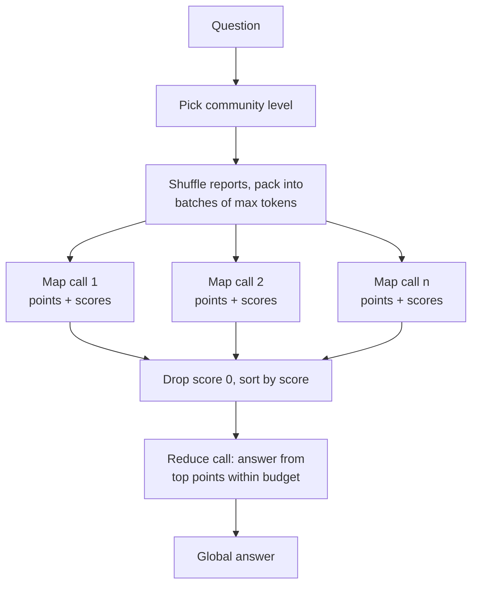
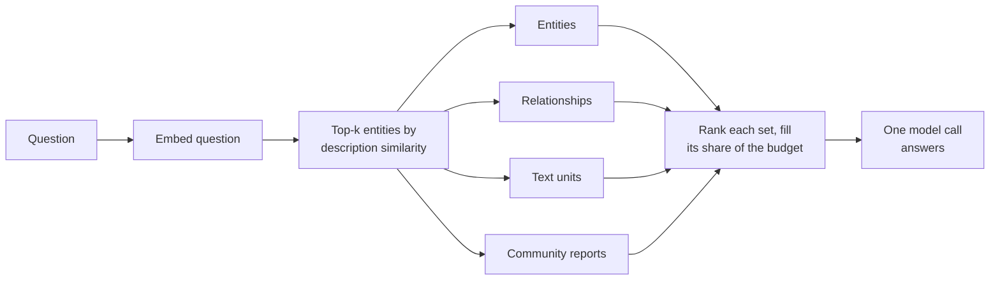

The previous lesson built a GraphRAG index: entities, relationships, text units and a hierarchy of community reports. This lesson is about reading it. GraphRAG answers questions in two fundamentally different ways. **Global search** reads community reports in a map-reduce pass to answer questions about the whole corpus. **Local search** starts from the entities a question mentions and gathers everything connected to them to answer questions about something specific. The library also offers DRIFT search, which mixes the two, and basic search, which is ordinary vector RAG over text units.

You will implement both main methods over a miniature index, see how each fills its context window, work out what global search costs at different community levels, and learn to route a question to the right method.

## Learning objectives

- Describe the map and reduce steps of global search, including how intermediate points are scored, filtered and fitted to a budget.
- Describe how local search uses entity embeddings as entry points and fills its context window from entities, relationships, text units and community reports.
- Estimate the number of model calls and input tokens of a global search at a given community level.
- Implement both search methods over a small index and explain how context budgets shape what the model sees.
- Choose between global, local, DRIFT and basic search for a given question.

## Prerequisites

- [Microsoft GraphRAG concepts](/learn/graph-rag/microsoft-graphrag-concepts): the index this lesson queries.
- [Graph retrieval](/learn/graph-rag/graph-retrieval): entity linking and subgraph context.
- [Context windows](/learn/context-engineering/context-windows): why the amount of context is a budget.
- [Query routing](/learn/agentic-rag/query-routing): sending each question to the right retriever.

## Why this matters

A GraphRAG index is expensive to build, and its value depends entirely on choosing the right query method. The two main methods fail in opposite ways:

- Send "what does E-4021 mean?" to global search and it reads every report at the chosen level, makes many model calls, and returns a broad essay about IT operations with the one-line answer buried in it.
- Send "what are the recurring themes in our post-mortems?" to local search and it answers from the neighbourhood of a few entities that happen to resemble the words "recurring themes": fluent, narrow, and exactly the failure GraphRAG was built to fix.

Within each method, dials such as the community level and the context budget change cost and quality by an order of magnitude, and they should be set with arithmetic rather than by trial and error in production.

## The intuition

Go back to the archivist from the previous lesson, with her index cards, piles and briefings.

A director asks "what are the main themes in our IT documents?". She hands her briefings on the broad piles to a team of assistants, a few each. Each writes down the points that bear on the question, scoring each out of 100 for usefulness. She discards the useless points, sorts the rest, and writes the answer from the best ones she has room for. That is **global search**: map (assistants in parallel), then reduce (her synthesis).

An engineer asks "what does E-4021 mean?". She goes to the card for E-4021, pulls the cards linked to it (the VPN client), the original passages they came from, and the briefing of their small pile, arranges them on a desk with limited room, and answers. That is **local search**.

## How it works

### Global search: map-reduce over community reports



1. **Choose a level.** The caller picks which level of the community hierarchy to read. Level 0 has the fewest, broadest reports; deeper levels have more, narrower ones.
2. **Batch the reports.** The reports at that level are shuffled and packed into batches, each up to a token budget per map call. Shuffling spreads related reports across batches so that no single map call is overwhelmed by one topic.
3. **Map.** Each batch goes to a model with the question. The model returns a list of **points**, each a short statement relevant to the question with a numeric **importance score** (0 to 100 in the paper and default prompts). A score of 0 means "nothing here helps". The map calls are independent and run in parallel.
4. **Filter and sort.** Points scoring 0 are discarded; the rest are sorted by score, highest first.
5. **Reduce.** Points are added to the reduce context in score order until its token budget is full. A final model call writes the answer from those points. Points that did not fit are lost, so the budget and the scores decide what the answer can mention.

Each map call summarises part of the corpus with respect to the question, and the reduce step summarises the summaries. Because every report at the level is read, the answer can draw on the whole corpus, which top-k retrieval cannot do.

**The level is the main dial.** The documentation notes that lower, more detailed levels tend to give more thorough answers at the cost of more time and model calls. The arithmetic is in [The mathematics](#the-mathematics) below.

**Dynamic community selection.** Reading every report at a level wastes calls on reports irrelevant to the question. The library's configuration includes options for **dynamic search**, described by Microsoft Research in late 2024: start at the root, ask a model to rate each report's relevance to the question, prune subtrees whose reports are rated irrelevant, and descend into the children of relevant ones. Only the surviving reports enter the map step. It trades some extra cheap rating calls for fewer expensive map calls; check the current documentation for its exact behaviour and settings.

Global search can optionally let the model add general knowledge not in the reports (`allow_general_knowledge`). For a grounded assistant, leave it off.

### Local search: entities as entry points



1. **Find entry entities.** Embed the question and compare it with the embeddings of entity descriptions (computed at indexing time). The top-k most similar entities are the entry points. This is the entity-linking stage of [Graph retrieval](/learn/graph-rag/graph-retrieval), done with descriptions, which is why GraphRAG summarises descriptions at indexing time.
2. **Gather candidates** from the knowledge model around the entry entities: the entities themselves and their neighbours, the relationships touching them, the text units they were extracted from, the community reports of the communities they belong to, and any claims (covariates). Conversation history can also be included.
3. **Rank each candidate set.** Typical priorities: relationships between two entry entities before relationships to outside entities, and stronger or better-connected relationships before weaker ones; text units linked to more of the entry entities before those linked to one.
4. **Fill the context window.** The context has a fixed token budget, divided between sections. The library exposes the split as configuration (for example `text_unit_prop` and `community_prop` set the shares for text units and community reports, with the remainder going to entities and relationships). Each section takes items in rank order until its share is used.
5. **Answer** with one model call over the assembled context.

Local search is one model call per question, like ordinary RAG, but its context is assembled from the graph: text units give evidence, entities and relationships give cross-document connections, reports give the surrounding picture.

### DRIFT and basic search

**DRIFT search** (Dynamic Reasoning and Inference with Flexible Traversal) combines the two. In the documentation's description it has three phases: a **primer** that compares the question with the most relevant community reports and produces a broad initial answer plus follow-up questions; **follow-up** rounds that answer those questions with local search, each producing further follow-ups; and an **output hierarchy** of questions and answers ranked by relevance. It suits questions that are specific but benefit from broad context ("how do VPN problems affect remote workers?"), at the cost of several local searches per question.

**Basic search** is plain vector RAG over the text units. It is there as a baseline and for questions where the graph adds nothing.

### Choosing a method

| Question | Method | Why |
| --- | --- | --- |
| "What does E-4021 mean?" | Local (or basic) | Specific entity; answer is in a few text units |
| "Who owns the systems AskMeridian depends on?" | Local | Specific entities, needs relationships across documents |
| "What are the main themes in the post-mortems?" | Global | Needs the whole corpus |
| "How do VPN problems affect remote workers?" | DRIFT | Specific, but benefits from broad context |
| "What is the carry-over deadline?" | Basic | A single fact in a single passage |

In a product, a router makes this choice per question (see [Query routing](/learn/agentic-rag/query-routing)); because of the cost asymmetry, a wrong "global" decision is the expensive mistake.

> [!KEY]
> Global search reads every report at a level and summarises with map-reduce: thorough, many calls. Local search starts from matched entities and assembles one budgeted context: precise, one call. Route each question to the method its shape needs.

## The mathematics

### The cost of a global search

**Intuition.** Global search reads every report at the chosen level once, in batches. The number of map calls is the total report text divided by what fits in one call; the reduce call adds one more.

$$
n_{\text{map}} = \left\lceil \frac{R \cdot t}{B} \right\rceil, \qquad
n_{\text{calls}} = n_{\text{map}} + 1, \qquad
T_{\text{in}} \approx R \cdot t + n_{\text{map}} \cdot p + T_{\text{reduce}}
$$

- $R$ is the number of reports at the chosen level.
- $t$ is the average report length in tokens.
- $B$ is the report-token budget of one map call.
- $p$ is the length of the map prompt (instructions and question), sent with every map call.
- $T_{\text{reduce}}$ is the reduce call's input: its prompt plus the selected points.
- $\lceil\cdot\rceil$ rounds up, because a partial batch still costs a call.
- $T_{\text{in}}$ is the total input tokens; output tokens (the points and the answer) come on top.

**By hand.** Assume (illustrative numbers, not library defaults) reports of $t = 1{,}000$ tokens, a map budget $B = 8{,}000$, a map prompt $p = 1{,}000$ and a reduce input of $8{,}000$ tokens.

- Level 0 with $R = 40$ reports: $n_{\text{map}} = \lceil 40{,}000 / 8{,}000 \rceil = 5$, so 6 calls; $T_{\text{in}} \approx 40{,}000 + 5{,}000 + 8{,}000 = 53{,}000$ tokens.
- A deeper level with $R = 600$ reports: $n_{\text{map}} = \lceil 600{,}000 / 8{,}000 \rceil = 75$, so 76 calls; $T_{\text{in}} \approx 600{,}000 + 75{,}000 + 8{,}000 = 683{,}000$ tokens.

The deeper level costs about thirteen times as much for one question. Latency grows less, because map calls run in parallel, but only up to your rate limit: 75 calls at 10 concurrent is 8 rounds of map calls before the reduce.

**In Python:**

```python
import math

def global_cost(reports, report_tokens, budget, prompt_tokens, reduce_input):
    map_calls = math.ceil(reports * report_tokens / budget)
    tokens = reports * report_tokens + map_calls * prompt_tokens + reduce_input
    return map_calls, map_calls + 1, tokens

for level, reports in [(0, 40), (2, 600)]:
    m, calls, tok = global_cost(reports, report_tokens=1_000, budget=8_000,
                                prompt_tokens=1_000, reduce_input=8_000)
    print(f"level {level}: {reports:>3} reports -> {m:>2} map calls, {calls:>2} calls in total, "
          f"{tok:,} input tokens")
```

```output
level 0:  40 reports ->  5 map calls,  6 calls in total, 53,000 input tokens
level 2: 600 reports -> 75 map calls, 76 calls in total, 683,000 input tokens
```

Compare local search under the same assumptions: one embedding and one model call with, say, a 12,000-token context, whatever the corpus size. That asymmetry is why routing matters.

## In code

**The problem.** Implement global and local search over a miniature GraphRAG index of Meridian's IT and HR documents (the communities from the previous lesson, with reports written for them), and print exactly what each method would send to the model.

**Dependencies.** `tiktoken` for counting tokens, `sentence-transformers` for entity embeddings:

```bash
pip install tiktoken sentence-transformers numpy
```

The map step of global search needs a model that can judge which statements help answer a broad question. The relevance models available locally (cross-encoders trained on search queries) are not suited to that judgement, so the map call is replaced by a **test double**, a function that returns fixed answers in the shape a model would. Everything else (batching, filtering, budgeting, local search's embedding and context assembly) runs for real. A sketch of the real map call follows the output.

```python
import numpy as np
import tiktoken
from sentence_transformers import SentenceTransformer

enc = tiktoken.get_encoding("cl100k_base")    # a stand-in tokeniser for budgeting
ntok = lambda text: len(enc.encode(text))

# A miniature GraphRAG index (the communities from the previous lesson, with reports)
REPORTS = {  # community: (level, title, rating, findings)
    0: (0, "HR and finance policy", 7.0, ["The HR team owns the employee handbook, effective 1 January 2025.",
        "Leave, remote work and expenses rules are all defined in the handbook.",
        "Equipment for home working is claimed through the expenses process."]),
    1: (0, "AskMeridian platform", 6.0, ["The Platform team owns AskMeridian and the Qdrant cluster it runs on.",
        "AskMeridian indexes the employee handbook and the IT runbooks."]),
    2: (0, "IT operations and VPN", 8.0, ["Most IT issues are VPN problems: an outdated client (E-4021) or an expired certificate (E-4012).",
        "The support desk owns the IT portal, laptop refreshes and password resets."]),
    6: (1, "VPN client errors", 8.5, ["E-4021 means the VPN client is out of date; update it from the IT portal.",
        "E-4012 means the VPN certificate has expired."]),
    7: (1, "Support desk services", 6.5, ["The support desk is open 08:00 to 18:00 UK time.",
        "Laptops are refreshed every 3 years; passwords rotate every 90 days."]),
}
ENTITIES = {  # title: (description, community at the finest level, text units)
    "VPN CLIENT": ("VPN software required on public Wi-Fi, updated from the IT portal", 6, ["t6", "t8"]),
    "E-4021": ("Error: the VPN client is out of date", 6, ["t6"]),
    "E-4012": ("Error: the VPN certificate has expired", 6, ["t6"]),
    "IT PORTAL": ("Site where staff download software updates", 7, ["t7", "t8"]),
    "SUPPORT DESK": ("IT help, open 08:00 to 18:00 UK time", 7, ["t7"]),
    "ANNUAL LEAVE POLICY": ("25 days a year; 5 days carry over to 31 March", 0, ["t3"]),
}
RELATIONSHIPS = [("E-4021", "VPN CLIENT", "E-4021 means the VPN client is out of date", 9),
                 ("E-4012", "VPN CLIENT", "E-4012 means the VPN certificate expired", 9),
                 ("VPN CLIENT", "IT PORTAL", "VPN client updates come from the IT portal", 8),
                 ("SUPPORT DESK", "IT PORTAL", "The support desk owns the IT portal", 8)]
TEXT_UNITS = {"t3": "Annual leave is 25 days; up to 5 unused days carry over and must be used by 31 March.",
              "t6": "If the VPN shows E-4021 the client is out of date: update it from the IT portal. E-4012 means the certificate expired.",
              "t7": "The support desk (08:00 to 18:00 UK time) owns the IT portal and handles laptop refreshes.",
              "t8": "The VPN client is distributed through the IT portal. VPN is required on public Wi-Fi."}

# ---------------- Global search: map over reports at one level, then reduce ----------------
def batches(level, max_tokens=110):
    """Pack the reports of one level into map-call contexts of at most max_tokens."""
    out, cur, used = [], [], 0
    for cid, (lvl, title, rating, findings) in sorted(REPORTS.items(), key=lambda kv: -kv[1][2]):
        if lvl != level:
            continue
        text = f"[report {cid}] {title}: " + " ".join(findings)
        if cur and used + ntok(text) > max_tokens:
            out.append(cur); cur, used = [], 0
        cur.append((cid, text)); used += ntok(text)
    return out + [cur] if cur else out

def fake_map_llm(question, batch):
    """Test double for the map call: canned (point, score 0-100) answers per report."""
    canned = {2: [("Recurring VPN failures (E-4021, E-4012) dominate IT issues", 90),
                  ("The support desk owns IT services such as the portal and laptops", 55)],
              0: [("HR policy centres on the handbook: leave, remote work, expenses", 80)],
              1: [("AskMeridian is an internal platform, not a documentation theme", 0)]}
    return [(p, s, cid) for cid, _ in batch for p, s in canned.get(cid, [])]

def global_search(question, level, reduce_budget=40):
    calls = batches(level)
    points = [pt for b in calls for pt in fake_map_llm(question, b)]        # map (parallel in practice)
    points = sorted((p for p in points if p[1] > 0), key=lambda p: -p[1])  # drop score 0, best first
    kept, used = [], 0
    for text, score, cid in points:                                        # reduce: fill the budget
        if used + ntok(text) <= reduce_budget:
            kept.append((text, score, cid)); used += ntok(text)
    return calls, points, kept, used

q = "What are the main themes in Meridian's IT and HR documentation?"
calls, points, kept, used = global_search(q, level=0)
print("GLOBAL:", q)
print("  map calls:", [[cid for cid, _ in b] for b in calls])
for text, score, cid in points:
    print(f"  {'KEEP' if (text, score, cid) in kept else 'drop'} {score:>3} [report {cid}] {text}")
print(f"  reduce context: {used} tokens\n")

# ---------------- Local search: entities as entry points, then gather around them ----------------
embedder = SentenceTransformer("sentence-transformers/all-MiniLM-L6-v2")
names = list(ENTITIES)
ent_vecs = embedder.encode([f"{n}: {ENTITIES[n][0]}" for n in names], normalize_embeddings=True)

def local_search(question, k=3, budget=200, shares={"entities": 0.2, "relationships": 0.2,
                                                     "text_units": 0.4, "reports": 0.2}):
    sims = ent_vecs @ embedder.encode([question], normalize_embeddings=True)[0]
    top = [names[i] for i in np.argsort(-sims)[:k]]
    rels = sorted((r for r in RELATIONSHIPS if r[0] in top or r[1] in top),
                  key=lambda r: (-(r[0] in top and r[1] in top), -r[3]))   # in-network first
    unit_ids = sorted({u for n in top for u in ENTITIES[n][2]},
                      key=lambda u: (-sum(u in ENTITIES[n][2] for n in top), u))  # most-linked first
    candidates = {
        "entities": [f"{n}: {ENTITIES[n][0]}" for n in top],
        "relationships": [f"{s} -> {t}: {d}" for s, t, d, _ in rels],
        "text_units": [f"[{u}] {TEXT_UNITS[u]}" for u in unit_ids],
        "reports": [f"[report {c}] {REPORTS[c][1]}: " + " ".join(REPORTS[c][3])
                    for c in dict.fromkeys(ENTITIES[n][1] for n in top)],
    }
    context = {}
    for section, items in candidates.items():                 # fill each section to its share
        allowance, used, context[section] = budget * shares[section], 0, []
        for item in items:
            if used + ntok(item) <= allowance:
                context[section].append(item); used += ntok(item)
    return top, context

q = "My VPN says E-4021, what do I do?"
top, context = local_search(q)
print("LOCAL:", q)
print("  entry entities:", top)
for section, items in context.items():
    print(f"  {section} ({sum(map(ntok, items))} tokens)")
    for item in items:
        print("    " + item)
```

**The important lines.**

- `batches` packs one level's reports into map-call contexts up to `max_tokens`. The library shuffles reports first; here they are sorted by rating so the output is reproducible.
- `fake_map_llm` returns `(point, score, report id)` triples, the shape a real map call is parsed into; the report id lets the answer cite its sources.
- `if p[1] > 0` drops points the map model marked irrelevant; the reduce loop adds the rest best-first until the (deliberately tiny) `reduce_budget` is spent.
- In `local_search`, the entity texts embedded are `"name: description"`, mirroring GraphRAG's entity description embeddings.
- `shares` splits the context budget between sections, the role `text_unit_prop` and `community_prop` play in the library. Each section is filled in rank order and anything that does not fit its share is skipped.

**The output:**

```output
GLOBAL: What are the main themes in Meridian's IT and HR documentation?
  map calls: [[2, 0], [1]]
  KEEP  90 [report 2] Recurring VPN failures (E-4021, E-4012) dominate IT issues
  KEEP  80 [report 0] HR policy centres on the handbook: leave, remote work, expenses
  drop  55 [report 2] The support desk owns IT services such as the portal and laptops
  reduce context: 31 tokens

LOCAL: My VPN says E-4021, what do I do?
  entry entities: ['E-4021', 'E-4012', 'VPN CLIENT']
  entities (26 tokens)
    E-4021: Error: the VPN client is out of date
    E-4012: Error: the VPN certificate has expired
  relationships (37 tokens)
    E-4021 -> VPN CLIENT: E-4021 means the VPN client is out of date
    E-4012 -> VPN CLIENT: E-4012 means the VPN certificate expired
  text_units (55 tokens)
    [t6] If the VPN shows E-4021 the client is out of date: update it from the IT portal. E-4012 means the certificate expired.
    [t8] The VPN client is distributed through the IT portal. VPN is required on public Wi-Fi.
  reports (40 tokens)
    [report 6] VPN client errors: E-4021 means the VPN client is out of date; update it from the IT portal. E-4012 means the VPN certificate has expired.
```

**What the output means.**

- **Global.** Three level-0 reports went into two map calls. The AskMeridian point scored 0 and was filtered out, and the support-desk point (55) did not fit the 40-token reduce budget. The answer would say nothing about the support desk, not because it was judged irrelevant but because the budget ran out. At real budgets of thousands of tokens the same effect decides how many themes survive.
- **Local.** The entry entities are right; E-4012 came along because its description resembles E-4021's. The entity section fitted only two of three descriptions, and the VPN-client-to-portal relationship was cut the same way. The answer survives because text unit t6 and report 6 both say "update it from the IT portal": local search is robust because the same fact usually arrives by more than one route.

**The real map call.** With a model in place of the test double, the map step asks for points as structured output. This was not executed (it needs an API key) and is a sketch, not GraphRAG's own prompt:

```python
import anthropic
from pydantic import BaseModel

class Point(BaseModel):
    description: str
    score: int          # 0 to 100: how much this point helps answer the question

class MapResult(BaseModel):
    points: list[Point]

client = anthropic.Anthropic()  # reads ANTHROPIC_API_KEY from the environment

def map_call(question: str, reports_text: str) -> list[Point]:
    response = client.messages.parse(
        model="claude-opus-5-5",
        max_tokens=1024,
        system=("From the community reports provided, list the key points that help answer the "
                "question. Score each point 0-100 for importance. Use only the reports. "
                "If nothing is relevant, return a single point with score 0."),
        messages=[{"role": "user", "content": f"Question: {question}\n\nReports:\n{reports_text}"}],
        output_format=MapResult,
    )
    return response.parsed_output.points
```

Run map calls concurrently under a limit that respects your rate limits.

**Common errors.** Points without report ids cannot be cited. A tokeniser different from the model's misjudges budgets slightly, so leave headroom; and `shares` summing to more than 1 silently over-fills the context.

**Extending it.** Add dynamic selection: before mapping at level 1, rate each level-0 report for relevance and only descend into the children of relevant ones.

## A real-world example

Meridian's Platform team adds a GraphRAG index over the IT runbooks and two years of post-mortems to AskMeridian, alongside the existing vector index. The first version sends every question to global search at the finest level, on the theory that more detail is better. The results are thorough, and the bill and latency are not: a simple question such as "what does E-4012 mean?" takes many seconds and dozens of model calls, and the answer is a page about VPN reliability with the one-line fix in the fourth paragraph.

They change three things. A small router sends specific questions to local search, factual ones to the existing vector index, and only global questions to global search. Global search moves to a coarser level by default, after comparing two levels on twenty real global questions; the finer level becomes an explicit "detailed analysis" mode. And an alert watches global search call counts, because one misrouted question at the finest level costs more than hundreds of local searches.

They also find a local-search failure that looks like a bug and is not. "Is Relay affected by the VPN outage?" answered about the VPN client and ignored Relay: the question's embedding matched the VPN entities more strongly than "MERIDIAN RELAY", whose description never mentions the VPN. Raising `k` from 3 to 6 entry entities fixed it. Their note: check the entry entities before blaming the model.

## Common mistakes

- **Sending specific questions to global search.** It reads every report at the level; the cost is many times local search's, and the answer is diluted.
- **Sending global questions to local search.** The answer reflects a few entities that happen to resemble the question's words.
- **Defaulting to the finest community level.** Cost grows with the number of reports. Start coarse and move deeper only where evaluation shows it helps.
- **Allowing general knowledge in global search for a grounded assistant.** The model fills gaps with material from outside the corpus that looks like a finding.
- **Too few entry entities in local search.** With a small `k`, a relevant entity whose description is phrased differently is never reached.
- **Ignoring budget truncation.** Both methods silently drop what does not fit; log it.

## Best practices

- Route each question to global, local, DRIFT or basic search; log the decision and evaluate the router separately.
- Choose the global search level by comparing answers on real questions at two or three levels, with cost recorded for each.
- Keep report and text-unit identifiers with every point and context item so answers can cite them.
- Tune local search's budget split on your own questions: more text units when answers need exact wording, more reports when they need context.
- Run map calls concurrently under an explicit concurrency limit, and set per-question limits on calls and tokens.
- Disable general-knowledge inclusion unless the product explicitly wants it, and say so in the answer when it is used.

## Performance considerations

- **Global search** cost is linear in the number of reports read at the chosen level, as the worked example shows; dynamic selection reduces the reports read, at the price of extra rating calls. Latency is roughly (map rounds) times (one map call) plus (one reduce call), where map rounds are the map calls divided by your concurrency.
- **Local search** cost is one embedding plus one model call whose input is the context budget, independent of corpus size. Latency is close to that of ordinary RAG.
- **DRIFT** sits in between: a primer over reports plus several local searches, so its cost scales with the number of follow-up rounds and questions per round.
- **Caching**: global answers to common questions can be cached until the next re-index, since reports do not change in between.
- **Context size**: larger local budgets add tokens linearly while the quality gain flattens; measure rather than maximise.

## Security considerations

- **Global search reads every report at a level**, so restricted content inside a report reaches anyone who asks a broad question. Enforce access with separate indexes, not the query method.
- **Local search** can filter entities, relationships and text units by the user's permissions before assembling the context, as long as each carries the access labels of its source documents. Community reports cannot be filtered this way, because they blend sources.
- **Map outputs derive from untrusted text.** A planted instruction can travel from document to report to map point; treat points as data.

## Summary

- Global search is map-reduce over the community reports at one level: map calls extract scored points in parallel, points scoring 0 are dropped, and the reduce call answers from the best points that fit its budget.
- Local search embeds the question, matches entity descriptions to find entry points, gathers entities, relationships, text units and reports around them, and fills a budgeted context in one model call.
- Global search cost grows linearly with the number of reports at the chosen level; local search cost does not depend on corpus size.
- DRIFT combines a report-based primer with local-search follow-ups; basic search is plain vector RAG.
- Route each question to the method its shape needs, and debug by inspecting levels, entry entities and what the budgets dropped.

## Exercises

**1. Cost by hand.** A level has 250 reports averaging 1,200 tokens. Each map call takes 10,000 tokens of reports and a 1,500-token prompt; the reduce input is 10,000 tokens. How many calls and roughly how many input tokens does one global search cost? With 8 concurrent calls, how many rounds of map calls are there?

<details><summary>Show solution</summary>

Report tokens: $250 \times 1{,}200 = 300{,}000$. Map calls: $\lceil 300{,}000 / 10{,}000 \rceil = 30$, plus 1 reduce, 31 calls. Input tokens: $300{,}000 + 30 \times 1{,}500 + 10{,}000 = 355{,}000$. Rounds: $\lceil 30 / 8 \rceil = 4$, followed by the reduce call.

</details>

**2. The budget decides.** In the code, raise `reduce_budget` to 60 and rerun global search. Then lower the entity share in local search to 0.1. What changes, and what does that tell you about debugging a "missing" fact?

<details><summary>Show solution</summary>

At 60 tokens the support-desk point fits and is kept, so the answer can mention the support desk. With the entity share at 0.1 (20 tokens), only one entity description fits, so the entity section shrinks to E-4021 alone. Neither change involved retrieval quality: the same candidates were found and the budget decided what reached the model. When a fact is missing from an answer, check whether it was found and then dropped by a budget before changing retrieval.

</details>

**3. Routing design.** Write the routing rules you would give AskMeridian for these questions, and justify each: "summarise this quarter's incident trends", "what does E-4030 mean?", "which teams are affected when the Qdrant cluster is down?", "how many days of leave carry over?".

<details><summary>Show solution</summary>

"Summarise this quarter's incident trends" is global: it needs the whole corpus. Start at a coarse level, and filter the corpus to the quarter if the index supports time-scoped communities or a per-quarter index. "What does E-4030 mean?" is a factual lookup of an identifier: basic search, preferably with keyword matching for the code, or local search if the code is an entity. "Which teams are affected when the Qdrant cluster is down?" is local: specific entities, answer spread across relationships. "How many days of leave carry over?" is a single fact in one passage: basic search.

</details>

## Check your understanding

```quiz
[
  {
    "q": "In global search, what happens to a point the map step scores 0?",
    "options": [
      "It is placed last in the reduce context",
      "It is discarded before the reduce step",
      "It triggers a second map call",
      "It is replaced by the community report's summary"
    ],
    "answer": 1,
    "why": "A score of 0 is the map model saying nothing in its batch helps answer the question; such points are filtered out before sorting and reduce."
  },
  {
    "q": "What does local search use as its entry points into the index?",
    "options": [
      "The community reports at level 0",
      "The text units most similar to the question",
      "The entities whose description embeddings are most similar to the question",
      "Every entity with a high degree"
    ],
    "answer": 2,
    "why": "Local search embeds the question and matches it against entity description embeddings; the top matches are the starting points for gathering relationships, text units and reports."
  },
  {
    "q": "A global search reads 600 reports of 1,000 tokens at a map budget of 8,000 tokens. How many model calls does it make?",
    "options": ["75", "601", "8", "76"],
    "answer": 3,
    "why": "600,000 / 8,000 = 75 map calls, plus one reduce call, makes 76."
  },
  {
    "q": "Which question is best suited to global search?",
    "options": [
      "'What are the recurring causes of outages across all post-mortems?'",
      "'What does E-4012 mean?'",
      "'Who owns the IT portal?'",
      "'How many days of leave carry over?'"
    ],
    "answer": 0,
    "why": "It asks about the whole corpus. The others are about specific entities or single facts, which local or basic search answer with far fewer calls."
  },
  {
    "q": "A fact is in the index, local search finds the right entities, but the fact is missing from the context. What is the most likely cause?",
    "options": [
      "The embedding model is broken",
      "The item did not fit its section's share of the context budget",
      "Global search should have been used",
      "The community level is too coarse"
    ],
    "answer": 1,
    "why": "Each section is filled in rank order up to its share; items beyond it are silently skipped. Inspect the budget split before changing retrieval."
  }
]
```

## Further reading

- Edge and colleagues (2024), [From Local to Global: A Graph RAG Approach to Query-Focused Summarization](https://arxiv.org/abs/2404.16130): the map-reduce answering over community summaries.
- [GraphRAG documentation](https://microsoft.github.io/graphrag/): the query engine pages for global, local and DRIFT search, and the configuration reference.
- Microsoft Research blog (2024), *GraphRAG: Improving global search via dynamic community selection*: rating and pruning communities before the map step.
- Microsoft Research blog (2024), *Introducing DRIFT Search*: the design of DRIFT.
