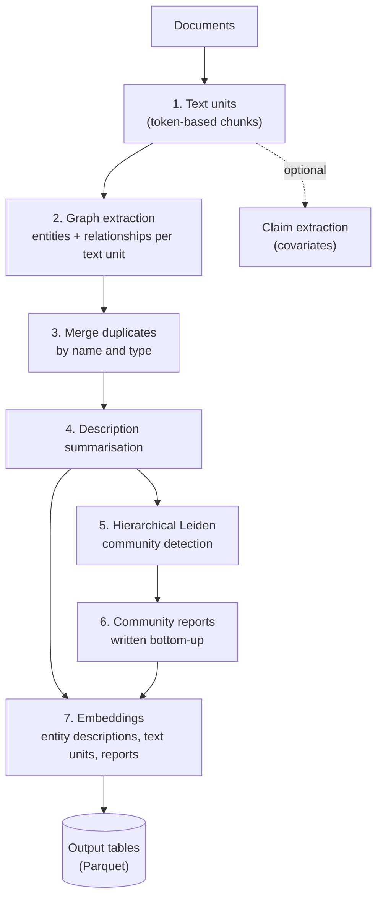

In 2024 a team at Microsoft Research published a paper and an open-source library both called **GraphRAG**. It has become the reference design for graph-based RAG, and the name is now used loosely for any system that puts a knowledge graph behind a language model. This lesson is about the specific design: what its indexing pipeline builds, why each step exists, and what the result costs. The key idea is not the graph itself but what GraphRAG does with it: it groups entities into a hierarchy of **communities** and has a model write a summary report for every one, ahead of time.

The query side, how local and global search use those reports and entities to answer questions, is the subject of the next lesson, [Local and global search](/learn/graph-rag/local-and-global-search). Here you will build a miniature of the indexing pipeline: merged entities, hierarchical community detection with the Leiden algorithm, and the context from which a community report is written.

## Learning objectives

- Explain the kind of question ("global sensemaking") that GraphRAG was designed for and why top-k vector retrieval cannot answer it.
- List the stages of the GraphRAG indexing pipeline and the tables it produces.
- Compute the modularity of a partition by hand and explain what the Leiden algorithm optimises.
- Build a hierarchy of communities with NetworkX and assemble the context for a community report.
- Estimate the model-call cost of indexing a corpus and choose between the standard and fast indexing methods.

## Prerequisites

- [Entity extraction](/learn/graph-rag/entity-extraction) and [Relationship extraction](/learn/graph-rag/relationship-extraction): getting entities and edges out of text with a model.
- [Graph construction](/learn/graph-rag/graph-construction): merging duplicates and storing a graph with provenance.
- [Graph retrieval](/learn/graph-rag/graph-retrieval): turning a question into a cited subgraph.
- [Structured outputs](/learn/generation-strategies/structured-outputs): getting validated JSON back from a model.

## Why this matters

Ask AskMeridian "what are the main themes in this year's IT incident post-mortems?" and a vector retriever will do what it always does: embed the question, find the five or ten chunks most similar to it, and hand them to the model. The model summarises whichever chunks happen to resemble a question about "main themes", and the answer sounds plausible while resting on a few per cent of the corpus.

The GraphRAG paper (Edge and colleagues, 2024) calls these **global sensemaking questions**: questions whose answer depends on the whole corpus rather than on a few passages. The task is a form of **query-focused summarisation**: summarise this collection, with respect to this question. Top-k retrieval cannot do it, because no k passages contain the answer. Stuffing the whole corpus into the context does not scale, and quality degrades on very long contexts (see [Lost-in-the-middle problem](/learn/context-engineering/lost-in-the-middle-problem)).

GraphRAG's answer is to **do the summarising at indexing time**. It builds a graph, partitions it into communities of closely related entities, and writes a report for each. A global question is then answered by reading reports instead of raw text. The price is a large number of model calls before the first question is asked, so understanding the pipeline is a cost decision as much as a technical one.

## The intuition

Imagine Meridian hires an archivist to make sense of ten years of internal documents. She works in three passes.

First she reads everything and fills in an index card for every team, system and policy she meets, noting which document each line came from. Meeting the VPN client for the fifth time, she adds a line to its existing card.

Second she lays the cards on a table and pushes together the ones that keep referring to each other: VPN client, the two VPN error codes, the IT portal. Piles form. Big piles she splits, so she ends up with a few broad piles ("IT operations", "HR policy") made of tighter sub-piles ("VPN problems", "laptops and passwords").

Third, for every pile and sub-pile, she writes a one-page briefing.

Asked "what are the main themes across our IT documents?", she reads her briefings on the broad piles and synthesises. Asked "what does E-4021 mean?", she goes to the card. The first is global search, the second local search, and GraphRAG's indexing is those three passes.

## How it works

### The indexing pipeline

The library's documentation describes the standard pipeline as a sequence of phases, each producing tables that later phases read.



1. **Compose text units.** Documents are split into token-based chunks called **text units**. They are the unit of extraction and of provenance. The size is configurable (the documentation gives a default of 1,200 tokens at the time of writing); larger units mean fewer calls, but the paper observed that a model extracts fewer entities per token from long chunks.
2. **Extract the graph.** A model reads each text unit and returns **entities** (a name, a type from a configurable list such as organisation, person, geography and event, and a description) and **relationships** (source, target, description and a numeric strength). Extraction can be repeated in **gleanings**: the model is asked whether it missed anything and, if so, continues. Each gleaning is another call per text unit (`max_gleanings`).
3. **Merge.** Entities with the same name and type, extracted from different text units, are merged into one entity whose descriptions are a list. Relationships are merged likewise. This is a string-based form of the entity resolution in [Graph construction](/learn/graph-rag/graph-construction): "Meridian Relay" and "Relay" stay separate unless the model named them identically.
4. **Summarise descriptions.** Each entity and relationship now has several descriptions, one per mention. A model condenses each list into a single description.
5. **Detect communities.** The **hierarchical Leiden** algorithm partitions the entity graph into communities, then re-partitions any community larger than a size threshold (`max_cluster_size`), recursively.
6. **Write community reports.** For every community at every level, a model writes a structured report: a title, a summary, an importance rating with an explanation, and a list of detailed findings. Reports are written bottom-up, as explained below.
7. **Embed.** By default the pipeline embeds entity descriptions, text unit text and community report text, and writes them to a configured vector store for the query engines.

Optional **claim extraction** (stored as **covariates**) pulls out time-bounded factual claims. It is off by default, and the documentation notes it usually needs prompt tuning.

### The output: a knowledge model in tables

The index is not a graph database. It is a set of tables, written as Parquet files in an output folder:

| Table | One row per | Key columns (conceptually) |
| --- | --- | --- |
| Documents | input document | text, the text units it was split into |
| Text units | chunk | text, token count, document, entities and relationships found in it |
| Entities | merged entity | title, type, summarised description, text units, degree |
| Relationships | merged edge | source, target, description, weight, text units |
| Communities | community at one level | level, parent, entities, relationships |
| Community reports | community | title, summary, full content, rating, findings |
| Covariates | claim (if enabled) | subject, object, type, status, period, source text |

You can inspect these tables with pandas, load entities and relationships into a graph database for exploration, or feed reports to another system. Column names change between library versions, so read them from your own output.

### Communities and the Leiden algorithm

A **community** is a set of nodes more densely connected to each other than to the rest of the graph. The standard measure of a partition's quality is **modularity**: the fraction of edges inside communities minus the fraction you would expect if edges were placed at random while keeping every node's degree.

The **Louvain** algorithm finds high-modularity partitions greedily: move each node to the neighbouring community that most increases modularity, collapse each community into a single node, and repeat. It can produce internally disconnected communities. The **Leiden** algorithm (Traag, Waltman and van Eck, 2019) adds a refinement phase that guarantees connected communities, which matters when a report will claim a community is "about" one thing.

GraphRAG makes it **hierarchical** by recursion: run Leiden on the whole graph, then again inside each community that is still too big. Level 0 holds the broadest communities. Query engines choose a level: coarse levels give fewer, broader reports; fine levels more, narrower ones.

### How reports are written bottom-up

A report's input is the community's own **elements**: its entities, relationships and claims, each with its summarised description. For a small leaf community these fit in the model's context easily. For a large level-0 community they may not. The paper describes the strategy:

1. **Leaf communities**: add element summaries in order of importance (the paper prioritises edges by the combined degree of their two endpoints, adding each edge's endpoint descriptions with it) until the context limit is reached.
2. **Higher-level communities**: if all the element summaries fit, use them. If not, substitute the **reports of sub-communities** for their elements, starting with the sub-communities whose elements take the most tokens, until the context fits.

So a broad community's report is partly a summary of summaries: cheap to read at query time, and a route by which a leaf report's mistake reaches its parent. The report's rating lets global search prioritise; its findings are what global search's map step reads.

### Standard and fast indexing

The library offers two indexing methods. **Standard** (`graphrag index --method standard`, the default) uses a model for extraction, summarisation and reports, as described above. **Fast** (`graphrag index --method fast`) replaces the model in the first two with conventional NLP: entities are noun phrases found by a library such as NLTK or spaCy, relationships are co-occurrence of two noun phrases in the same text unit, and neither has a description. A model still writes the community reports. The documentation describes fast indexing as far cheaper with a noisier graph, reasonable when you mainly want global summaries rather than a clean graph, and recommends much smaller text units for it.

### Running the library

The command-line workflow is short. It was not run for this lesson, because indexing makes many paid model calls:

```bash
pip install graphrag
graphrag init                    # writes settings.yaml, .env and an input/ folder
# put .txt files in input/, set the API key in .env, review settings.yaml
graphrag index                   # builds the index into output/ as Parquet tables
graphrag query "What are the main themes in these documents?"           # global search
graphrag query "What does error E-4021 mean?" --method local            # local search
```

`settings.yaml` holds the sections you will tune: `chunking` (size and overlap), `extract_graph` (`entity_types`, `max_gleanings`), `cluster_graph` (`max_cluster_size`), and one section per query method. Keys have changed between releases, so treat the official configuration reference as the source of truth. The library also has a prompt-tuning command that adapts the extraction prompts to your domain.

### What the evidence says

The paper evaluated GraphRAG on global sensemaking questions over two corpora of roughly one million tokens each (podcast transcripts and news articles) against a conventional vector RAG baseline. A language model acting as judge compared answers in pairs on **comprehensiveness**, **diversity** and **empowerment** (how well the answer helps the reader understand and judge), with **directness** as a control. GraphRAG won on comprehensiveness and diversity; the vector baseline gave more direct answers, as expected.

Two cautions. These were global questions, the case GraphRAG was designed for; the paper does not claim it beats vector RAG on specific lookups. And an LLM judge measures preference, not correctness. Run your own evaluation for anything else.

Indexing cost is the main practical objection. Microsoft Research has since described **LazyGraphRAG** (research blog, late 2024), which defers model use from indexing to query time; check the library's current state before planning around it.

## The mathematics

### Modularity

**Intuition.** A good partition puts many more edges inside communities than you would get by wiring the same nodes at random with the same degrees.

$$
Q = \sum_{c} \left[ \frac{L_c}{m} - \left( \frac{d_c}{2m} \right)^{2} \right]
$$

- $Q$ is the modularity of the partition, between $-0.5$ and $1$; higher is better.
- $c$ ranges over the communities of the partition.
- $L_c$ is the number of edges with both ends inside community $c$.
- $m$ is the total number of edges in the graph.
- $d_c$ is the sum of the degrees of the nodes in $c$, so $d_c / 2m$ is the share of all edge endpoints that belong to $c$, and its square is the share of edges you would expect inside $c$ by chance.

Leiden can optimise modularity or the related Constant Potts Model (NetworkX: `metric="modularity"` or `"cpm"`), with a **resolution** parameter that favours smaller or larger communities.

**By hand.** Two triangles, A–B–C and D–E–F, joined by the single edge C–D: $m = 7$. Each triangle has 3 internal edges and total degree $2 + 2 + 3 = 7$.

- Split into the two triangles: each term is $3/7 - (7/14)^2 = 0.4286 - 0.25 = 0.1786$, so $Q = 0.3571$.
- Everything in one community: $7/7 - (14/14)^2 = 0$.
- A bad split, {A, B, D} and {C, E, F}: each side has 1 internal edge and total degree 7, so each term is $1/7 - 0.25 = -0.1071$ and $Q = -0.2143$.

The natural split scores highest; a split through the triangles is worse than no split at all.

**In Python:**

```python
import networkx as nx

# Two triangles {A,B,C} and {D,E,F} joined by the single edge C-D
G = nx.Graph([("A", "B"), ("B", "C"), ("A", "C"),
              ("D", "E"), ("E", "F"), ("D", "F"), ("C", "D")])
m = G.number_of_edges()

def Q(parts):
    total = 0.0
    for p in parts:
        L = G.subgraph(p).number_of_edges()          # edges inside the community
        d = sum(deg for _, deg in G.degree(p))       # total degree of its nodes
        total += L / m - (d / (2 * m)) ** 2
    return total

for name, parts in [("two triangles", [{"A", "B", "C"}, {"D", "E", "F"}]),
                    ("one community", [set(G)]),
                    ("bad split", [{"A", "B", "D"}, {"C", "E", "F"}])]:
    print(f"{name:<14} by hand: {Q(parts):+.4f}   networkx: {nx.community.modularity(G, parts):+.4f}")
```

```output
two triangles  by hand: +0.3571   networkx: +0.3571
one community  by hand: +0.0000   networkx: +0.0000
bad split      by hand: -0.2143   networkx: -0.2143
```

## In code

**The problem.** Reproduce the heart of GraphRAG's indexing on a small Meridian corpus: merge extracted entities, detect a two-level community hierarchy, and assemble a community report's context. Extraction output is fixed data so the structural steps run without a model; the report-writing call is shown afterwards.

**Dependencies.** NetworkX 3.5 or later provides `leiden_communities`; this was run with NetworkX 3.7. On older versions, `louvain_communities` has the same call shape and gives similar results on small graphs, without Leiden's connectedness guarantee.

```bash
pip install "networkx>=3.5" pandas
```

**The source.**

```python
import networkx as nx
import pandas as pd
from collections import defaultdict

# 1. What graph extraction returned, one record per (text unit, entity or relationship).
#    The same entity seen in several text units arrives several times with different descriptions.
ENTITY_MENTIONS = [
    ("t1", "ASKMERIDIAN", "SYSTEM", "Internal assistant that answers staff questions"),
    ("t2", "ASKMERIDIAN", "SYSTEM", "Owned by the Platform team; indexes the handbook and runbooks"),
    ("t1", "PLATFORM TEAM", "TEAM", "Team that runs AskMeridian"),
    ("t2", "QDRANT CLUSTER", "SYSTEM", "Vector database behind AskMeridian"),
    ("t2", "IT RUNBOOKS", "DOCUMENT", "Operational guides for IT issues"),
    ("t3", "EMPLOYEE HANDBOOK", "DOCUMENT", "HR policies; current edition effective 1 January 2025"),
    ("t3", "HR TEAM", "TEAM", "Owns the employee handbook"),
    ("t3", "ANNUAL LEAVE POLICY", "POLICY", "25 days a year; up to 5 days carry over to 31 March"),
    ("t4", "REMOTE WORK POLICY", "POLICY", "Up to 3 days a week from home"),
    ("t4", "EQUIPMENT BUDGET", "POLICY", "400 pounds for home-office equipment; not for contractors"),
    ("t5", "EXPENSES POLICY", "POLICY", "Submit within 30 days; receipts over 75 pounds"),
    ("t5", "FINANCE DEPARTMENT", "TEAM", "Owns expenses"),
    ("t6", "VPN CLIENT", "SYSTEM", "Required on public Wi-Fi"),
    ("t6", "E-4021", "ERROR", "VPN client out of date; update from the IT portal"),
    ("t6", "E-4012", "ERROR", "VPN certificate expired"),
    ("t7", "IT PORTAL", "SYSTEM", "Where staff download software updates"),
    ("t7", "SUPPORT DESK", "TEAM", "Open 08:00 to 18:00 UK time; owns the IT portal"),
    ("t7", "LAPTOP REFRESH", "POLICY", "Laptops are replaced every 3 years"),
    ("t8", "PASSWORD POLICY", "POLICY", "Passwords rotate every 90 days"),
    ("t8", "VPN CLIENT", "SYSTEM", "Distributed through the IT portal"),
]
RELATIONSHIPS = [  # (text unit, source, target, description, strength 1-10)
    ("t1", "PLATFORM TEAM", "ASKMERIDIAN", "Platform team owns and runs AskMeridian", 9),
    ("t2", "ASKMERIDIAN", "QDRANT CLUSTER", "AskMeridian stores its vectors in Qdrant", 9),
    ("t2", "ASKMERIDIAN", "IT RUNBOOKS", "AskMeridian indexes the IT runbooks", 7),
    ("t2", "ASKMERIDIAN", "EMPLOYEE HANDBOOK", "AskMeridian indexes the handbook", 7),
    ("t2", "PLATFORM TEAM", "QDRANT CLUSTER", "Platform team operates the Qdrant cluster", 8),
    ("t3", "HR TEAM", "EMPLOYEE HANDBOOK", "HR owns the handbook", 9),
    ("t3", "EMPLOYEE HANDBOOK", "ANNUAL LEAVE POLICY", "Handbook defines annual leave", 8),
    ("t4", "EMPLOYEE HANDBOOK", "REMOTE WORK POLICY", "Handbook defines remote work", 8),
    ("t4", "REMOTE WORK POLICY", "EQUIPMENT BUDGET", "Remote workers may claim the equipment budget", 7),
    ("t3", "HR TEAM", "ANNUAL LEAVE POLICY", "HR administers leave", 6),
    ("t5", "FINANCE DEPARTMENT", "EXPENSES POLICY", "Finance owns expenses", 9),
    ("t5", "EMPLOYEE HANDBOOK", "EXPENSES POLICY", "Handbook contains the expenses policy", 5),
    ("t4", "EQUIPMENT BUDGET", "EXPENSES POLICY", "Equipment is claimed through expenses", 6),
    ("t6", "E-4021", "VPN CLIENT", "E-4021 means the VPN client is out of date", 9),
    ("t6", "E-4012", "VPN CLIENT", "E-4012 means the VPN certificate expired", 9),
    ("t8", "VPN CLIENT", "IT PORTAL", "VPN client updates come from the IT portal", 8),
    ("t7", "SUPPORT DESK", "IT PORTAL", "Support desk owns the IT portal", 8),
    ("t7", "SUPPORT DESK", "LAPTOP REFRESH", "Support desk handles laptop refreshes", 7),
    ("t8", "SUPPORT DESK", "PASSWORD POLICY", "Support desk resets passwords", 6),
    ("t8", "PASSWORD POLICY", "VPN CLIENT", "VPN login uses the rotated password", 4),
    ("t2", "IT RUNBOOKS", "SUPPORT DESK", "Runbooks are written for the support desk", 6),
]

# 2. Merge duplicate entities: one row per title, descriptions gathered for summarisation
merged = defaultdict(lambda: {"type": None, "descriptions": [], "text_units": set()})
for tu, title, etype, desc in ENTITY_MENTIONS:
    merged[title]["type"] = etype
    merged[title]["descriptions"].append(desc)
    merged[title]["text_units"].add(tu)

G = nx.Graph()
for title, e in merged.items():
    G.add_node(title)
for tu, s, t, desc, strength in RELATIONSHIPS:
    G.add_edge(s, t, weight=strength, description=desc, text_unit=tu)

# 3. Hierarchical community detection: cluster, then re-cluster any community
#    larger than max_cluster_size, recording each community's level and parent
def hierarchical_leiden(G, max_cluster_size=5, seed=7):
    rows, queue, next_id = [], [(set(G.nodes), 0, -1)], 0
    while queue:
        nodes, level, parent = queue.pop(0)
        parts = nx.community.leiden_communities(
            G.subgraph(nodes), weight="weight", metric="modularity", seed=seed)
        if len(parts) == 1 and level > 0:
            continue                       # cannot be split further
        for part in sorted(parts, key=lambda p: sorted(p)):
            rows.append({"community": next_id, "level": level, "parent": parent,
                         "size": len(part), "entities": sorted(part)})
            if len(part) > max_cluster_size:
                queue.append((part, level + 1, next_id))
            next_id += 1
    return pd.DataFrame(rows)

communities = hierarchical_leiden(G)
pd.set_option("display.width", 200, "display.max_colwidth", 90)
print(communities.to_string(index=False))

# 4. Build the context a community report is written from: its entities and its internal edges
def report_context(entities):
    lines = ["Entities:"]
    for title in entities:
        lines.append(f"  {title} ({merged[title]['type']}): " + "; ".join(merged[title]["descriptions"]))
    lines.append("Relationships:")
    for s, t, d in sorted(G.subgraph(entities).edges(data=True), key=lambda e: sorted(e[:2])):
        s, t = sorted((s, t))
        lines.append(f"  {s} -- {t}: {d['description']} (strength {d['weight']})")
    return "\n".join(lines)

it_comm = communities[communities.entities.apply(lambda e: "E-4021" in e)].iloc[-1]
print(f"\nReport context for community {it_comm.community} (level {it_comm.level}):")
print(report_context(it_comm.entities))
```

**The important lines.**

- `ENTITY_MENTIONS` has the shape extraction produces: one record per mention, so "VPN CLIENT" appears twice. Upper-case titles mimic GraphRAG's name normalisation, which is why merging by exact title works at all.
- `merged[title]["descriptions"].append(desc)` is the merge step. The real pipeline would now have a model summarise each list; here the context just joins them with semicolons.
- Relationship strength becomes the edge `weight`, so `leiden_communities` keeps strongly related entities together.
- `hierarchical_leiden` is a simplified version of the recursion: a community larger than `max_cluster_size` is re-partitioned and its children recorded one level down with a `parent` link. GraphRAG's implementation differs in detail; the shape of the result is the same.
- `report_context` gathers a community's entities and only the edges *inside* it: the report's "elements".

**The output:**

```output
 community  level  parent  size                                                                                                                     entities
         0      0      -1     7 [ANNUAL LEAVE POLICY, EMPLOYEE HANDBOOK, EQUIPMENT BUDGET, EXPENSES POLICY, FINANCE DEPARTMENT, HR TEAM, REMOTE WORK POLICY]
         1      0      -1     4                                                                    [ASKMERIDIAN, IT RUNBOOKS, PLATFORM TEAM, QDRANT CLUSTER]
         2      0      -1     7                                       [E-4012, E-4021, IT PORTAL, LAPTOP REFRESH, PASSWORD POLICY, SUPPORT DESK, VPN CLIENT]
         3      1       0     3                                                                            [ANNUAL LEAVE POLICY, EMPLOYEE HANDBOOK, HR TEAM]
         4      1       0     2                                                                                       [EQUIPMENT BUDGET, REMOTE WORK POLICY]
         5      1       0     2                                                                                        [EXPENSES POLICY, FINANCE DEPARTMENT]
         6      1       2     3                                                                                                 [E-4012, E-4021, VPN CLIENT]
         7      1       2     4                                                                   [IT PORTAL, LAPTOP REFRESH, PASSWORD POLICY, SUPPORT DESK]

Report context for community 6 (level 1):
Entities:
  E-4012 (ERROR): VPN certificate expired
  E-4021 (ERROR): VPN client out of date; update from the IT portal
  VPN CLIENT (SYSTEM): Required on public Wi-Fi; Distributed through the IT portal
Relationships:
  E-4012 -- VPN CLIENT: E-4012 means the VPN certificate expired (strength 9)
  E-4021 -- VPN CLIENT: E-4021 means the VPN client is out of date (strength 9)
```

**What the output means.** Level 0 found three communities a person would also draw: HR and finance policy (0), the AskMeridian platform (1) and IT operations (2). Communities 0 and 2 exceeded the threshold of five and were split: HR policy into leave, remote work and expenses (3 to 5); IT operations into VPN problems (6) and support-desk matters (7). Community 1 stayed a leaf at level 0. Hierarchies are uneven, so a query engine reading "level 1" must decide what to do about branches that stop early.

The context for community 6 is everything the model would see when writing the "VPN problems" report. The edge from the VPN client to the IT portal is absent, because the portal is in a different community; the report for community 2, one level up, connects them.

**Common errors.** An `AttributeError` for `leiden_communities` means NetworkX older than 3.5; use `louvain_communities`. Omitting `seed` gives different communities, and therefore different reports, on every run.

**Writing the report.** In the real pipeline each context goes to a model with a report prompt. A sketch with the Anthropic SDK and validated structured output follows. It was not executed (it needs an API key), and GraphRAG's own report prompt is longer and more prescriptive:

```python
import anthropic
from pydantic import BaseModel

class Finding(BaseModel):
    summary: str
    explanation: str

class CommunityReport(BaseModel):
    title: str
    summary: str
    rating: float            # importance, 0 to 10
    rating_explanation: str
    findings: list[Finding]

client = anthropic.Anthropic()  # reads ANTHROPIC_API_KEY from the environment

def write_report(context: str) -> CommunityReport:
    response = client.messages.parse(
        model="claude-opus-5-5",
        max_tokens=2048,
        system=("You write reports about one community of entities in a knowledge graph. "
                "Use only the entities and relationships provided. Cite entity names."),
        messages=[{"role": "user", "content": f"Write the community report.\n\n{context}"}],
        output_format=CommunityReport,
    )
    return response.parsed_output
```

**Extending it.** Write level 1 reports first, then build level 0 contexts that substitute child reports for elements when they exceed a token budget (count with `tiktoken`).

## A real-world example

The head of IT asks Meridian's Platform team for a way to ask questions across two years of incident post-mortems: not "what happened in incident 214?" but "what are the recurring causes of VPN outages?". AskMeridian's vector index answers the first kind well and the second badly, for the reason given in [Why this matters](#why-this-matters).

The team estimates indexing cost first. The post-mortems total about 3 million tokens (an assumption from a token count of the export): 2,500 text units at 1,200 tokens, up to 5,000 extraction calls with one gleaning, each sending a long prompt as well as the text, plus summarisation and report calls. They price this against the provider's current pricing page, not a remembered figure, and multiply by twelve for monthly re-indexing.

A pilot on one quarter compares fast and standard indexing, with three senior engineers judging answers to ten global questions. The standard index's communities are cleaner; the fast index's reports are good enough for theme questions, so the team chooses fast indexing for the monthly global index and keeps vector search for specific incidents. The pilot also surfaces something no benchmark would: two restricted security post-mortems leaked into a level-0 report visible to everyone. That finding shapes the security section below.

## Common mistakes

- **Using GraphRAG for specific lookups.** Its advantage is on global questions; for "what is the carry-over deadline?" a vector index is cheaper and at least as good.
- **Underestimating indexing cost.** Ignoring prompt overhead, gleanings and re-indexing frequency gives an estimate that is far too low.
- **Leaving entity types and prompts at generic defaults.** On internal documents the model misses error codes, policies and systems, and the graph is thin.
- **Assuming merging resolves entities.** Merging is by exact title, so "Relay" and "Meridian Relay" stay separate and split their edges.
- **Not fixing the clustering seed.** Every rebuild then produces different communities and reports, and nothing can be compared.
- **Trusting reports as ground truth.** They are model summaries of model-extracted facts; errors compound up the hierarchy.

## Best practices

- Pilot on a representative slice and compare against your existing retriever on real global and local questions before indexing everything.
- Set entity types for your domain and run the library's prompt tuning before a full index.
- Fix the clustering seed and record library version, model and configuration with each index.
- Inspect the output tables with pandas: highest-degree entities, duplicate-looking titles, and sample reports at each level.
- Keep text unit identifiers all the way through so any report statement can be traced to source.

## Performance considerations

Indexing cost is dominated by model calls. Under illustrative assumptions (a 1-million-token corpus, 1,200-token text units, one gleaning, an extraction prompt of about 2,000 tokens):

- Text units: $1{,}000{,}000 / 1{,}200 \approx 834$.
- Extraction calls: $834 \times 2 = 1{,}668$ (initial pass plus one gleaning).
- Extraction input tokens: roughly $1{,}668 \times (1{,}200 + 2{,}000) \approx 5.3$ million, more than five times the corpus, before output tokens.
- Then summarisation calls for multi-mention entities and relationships, and one report call per community at every level.

The documentation estimates graph extraction as the largest share of indexing cost, which is what the fast method removes. Calls are independent per text unit, so throughput is limited by the provider's rate limits rather than your hardware. Re-indexing is the hidden multiplier: the pipeline is designed for batch rebuilds, so a fast-changing corpus pays repeatedly. Query-time cost depends on the search method, the subject of the next lesson.

## Security considerations

- **Community reports mix sources.** A report summarises every entity in its community, whichever documents they came from, so a restricted document's content can appear in a report anyone can read. Build separate indexes per access level or exclude restricted documents; filtering reports at query time is too late, because the leak is inside the report text.
- **Extraction reads untrusted text.** Documents can contain instructions aimed at the extraction model; treat extracted facts and reports as data, never as instructions.
- **Data leaves your environment.** Every text unit is sent to the model provider during indexing; check that this is permitted.

## Summary

- GraphRAG targets global sensemaking questions about a whole corpus, which top-k vector retrieval cannot answer because no small set of passages contains the answer.
- Indexing composes text units, extracts entities and relationships with a model, merges and summarises them, detects a hierarchy of communities with Leiden, and writes a report for every community.
- Leiden maximises a quality function such as modularity with connected communities; recursion gives the hierarchy.
- Reports are written bottom-up, substituting sub-community reports when a community's elements do not fit; they are what global search reads.
- The cost is many model calls at indexing time; fast indexing, smaller pilots and per-access-level indexes are the main levers.

## Exercises

**1. Modularity by hand.** A graph has two squares, A–B–C–D–A and E–F–G–H–E, joined by the edges D–E and C–F. Compute the modularity of the split into the two squares, then check it with `nx.community.modularity`.

<details><summary>Show solution</summary>

$m = 4 + 4 + 2 = 10$. Each square has 4 internal edges. Degrees: in the first square A and B have 2, C and D have 3, total 10; the second square is the same. Each term is $4/10 - (10/20)^2 = 0.4 - 0.25 = 0.15$, so $Q = 0.30$. Two connecting edges instead of one lower it compared with a version joined by one edge, because more edges cross between communities.

</details>

**2. Change the threshold.** Run the code with `max_cluster_size=3` and then `max_cluster_size=10`. How do the number of levels and the number of communities change, and what does each choice mean for the number of reports that must be written?

<details><summary>Show solution</summary>

With 10, nothing exceeds the threshold: one level, three communities, three reports. With 3, more communities split, and children with more than three members split again where Leiden finds a split, giving more levels. Every community is a report-writing call, so a smaller threshold means more cost and narrower leaf reports, and a finer level for global search to read.

</details>

**3. Design decision.** The HR team wants a GraphRAG index over the handbook, engagement-survey comments and disciplinary case notes, so that leaders can ask "what are employees most concerned about?". Some case notes are visible only to HR. How would you structure the indexes, and why?

<details><summary>Show solution</summary>

Reports blend everything in a community, so any document in an index can surface in any report. Build two indexes: handbook plus anonymised survey comments for leaders, and a separate one including case notes for HR only. Pseudonymise names before extraction, because a person mentioned in many comments becomes an entity with a summarised description: a profile nobody asked for. Check that sending this data to the model provider is permitted. The access boundary belongs in the index structure, not in a query-time filter.

</details>

## Check your understanding

```quiz
[
  {
    "q": "Why can top-k vector retrieval not answer 'What are the main themes across all of our post-mortems?' well?",
    "options": [
      "Embedding models cannot encode the word 'theme'",
      "The answer depends on the whole corpus, and no small set of retrieved passages contains it",
      "Vector databases cannot store post-mortems",
      "The question is too short to embed"
    ],
    "answer": 1,
    "why": "This is a global sensemaking question. Retrieval returns the k most similar passages, which summarise a small, arbitrary slice of the corpus."
  },
  {
    "q": "What does GraphRAG's 'gleaning' step do?",
    "options": [
      "Removes duplicate entities by embedding similarity",
      "Summarises community reports into a single answer",
      "Asks the model whether it missed entities in a text unit and lets it continue extracting",
      "Selects which community level to use at query time"
    ],
    "answer": 2,
    "why": "Gleanings are extra extraction passes over the same text unit to improve recall, each costing another model call; max_gleanings controls how many."
  },
  {
    "q": "In GraphRAG's community hierarchy, what is at level 0?",
    "options": [
      "The broadest communities, from clustering the whole graph",
      "Single entities",
      "The finest leaf communities",
      "The original documents"
    ],
    "answer": 0,
    "why": "The hierarchy is numbered from the root. Level 0 partitions the whole graph; higher levels re-partition large communities into finer ones."
  },
  {
    "q": "A level-0 community's elements do not fit in the report model's context. What does GraphRAG's bottom-up strategy do?",
    "options": [
      "Skips the report for that community",
      "Truncates the element list at random",
      "Re-runs Leiden with a higher resolution",
      "Substitutes reports of its sub-communities for their elements until the context fits"
    ],
    "answer": 3,
    "why": "Higher-level reports can be built partly from child reports, which is what makes them affordable and also how errors in leaf reports can propagate upward."
  },
  {
    "q": "Why is filtering community reports by the user's permissions at query time not enough when the corpus has restricted documents?",
    "options": [
      "Reports are encrypted",
      "Permissions cannot be stored in Parquet",
      "A report blends content from every document in its community, so restricted facts are already inside report text visible to others",
      "Leiden ignores restricted documents"
    ],
    "answer": 2,
    "why": "The leak happens when the report is written. Separate indexes per access level, or excluding restricted documents, keep restricted content out of shared reports."
  }
]
```

## Further reading

- Edge, Trinh, Cheng, Bradley, Chao, Mody, Truitt, Metropolitansky, Ness and Larson (2024), [From Local to Global: A Graph RAG Approach to Query-Focused Summarization](https://arxiv.org/abs/2404.16130): the GraphRAG paper.
- [GraphRAG documentation](https://microsoft.github.io/graphrag/): the indexing dataflow, configuration reference and query engines.
- Traag, Waltman and van Eck (2019), *From Louvain to Leiden: guaranteeing well-connected communities*, Scientific Reports: the Leiden algorithm.
- Microsoft Research blog (2024), *LazyGraphRAG: Setting a new standard for quality and cost*: the deferred-indexing variant.
