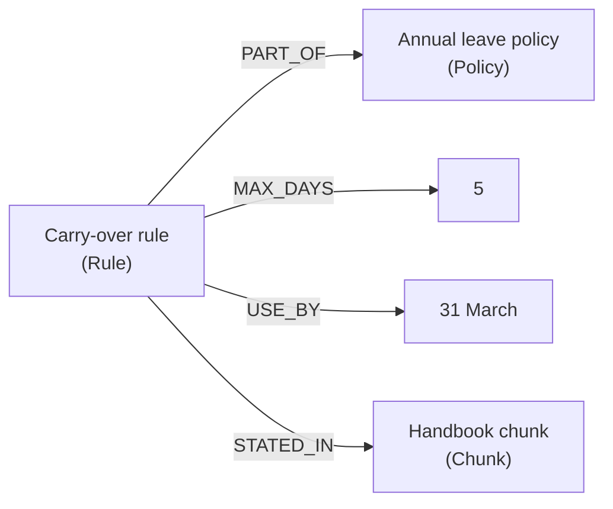
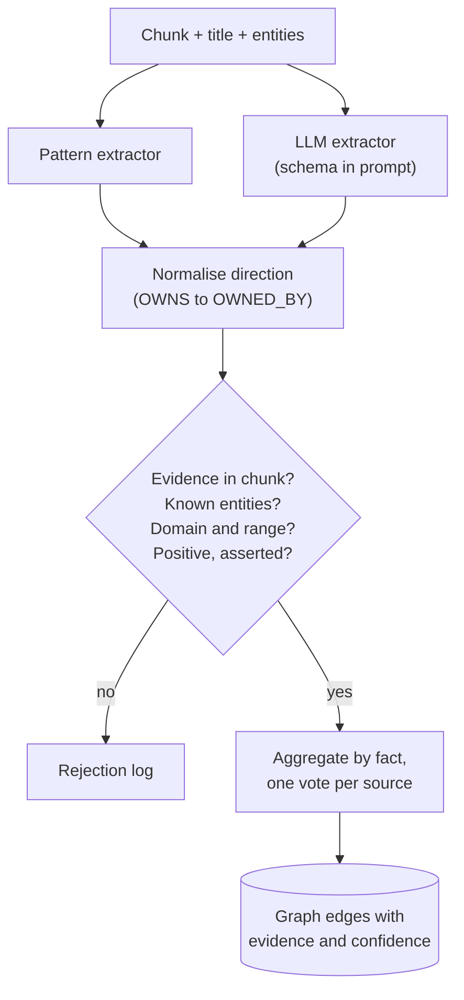

Entities are the nodes of a knowledge graph; **relationships** are the edges, and the edges are what make a graph worth having. "AskMeridian" and "Platform team" as two isolated nodes tell you nothing. The edge `(AskMeridian, OWNED_BY, Platform team)` answers a question. **Relationship extraction** is the task of reading text and producing such typed, directed facts, each tied to the words that support it.

This lesson builds on [Entity extraction](/learn/graph-rag/entity-extraction): the entities in each chunk are already known, and the job now is to find the facts that connect them. You will design a relation schema with type constraints, compare the main extraction methods, handle the cases that break naive extraction (negation, conditions, time, statements involving more than two things), validate model output before it enters the graph, and combine evidence for the same fact from several documents into a single confidence.

## Learning objectives

- Specify a relation schema with direction, domain and range for each predicate, and normalise inverse phrasings to one direction.
- Compare pattern-based, supervised, open and LLM-based relationship extraction and state when each is appropriate.
- Represent negated, conditional, time-bound and n-ary facts without losing their meaning.
- Validate proposed triples against their evidence text, the entity list and the schema.
- Combine confidence from independent sources with noisy-OR, and explain why duplicate sources must be collapsed first.

## Prerequisites

- [Knowledge graphs](/learn/graph-rag/knowledge-graphs): triples, schemas and the open-world assumption.
- [Entity extraction](/learn/graph-rag/entity-extraction): mentions, types, canonical names and validation of model output.
- [Structured outputs](/learn/generation-strategies/structured-outputs): getting validated JSON from a model.
- [Grounded generation](/learn/prompt-engineering-for-rag/grounded-generation): why claims must be tied to source text.

## Why this matters

An entity error removes or adds a node. A relationship error is worse, because it produces a *false statement* that the graph will repeat with full confidence to anyone whose query walks across it. The common failures are specific and recognisable:

- **Wrong direction.** "The Platform team owns AskMeridian" extracted as `(Platform team, OWNED_BY, AskMeridian)` says the reverse of the text. Every ownership query through that edge now gives the wrong answer.
- **Lost negation.** "AskMeridian cannot see expense claims" contains the words *AskMeridian*, *see* and *expense claims*. A careless extractor emits `(AskMeridian, INDEXES, Expense claims)`, and the assistant tells staff it can check their claim status.
- **Lost conditions.** "Meridian Reports supports SAML single sign-on on the Enterprise plan" becomes `(Meridian Reports, SUPPORTS, SAML single sign-on)`, and customers on other plans are told they have it.
- **Lost time.** The 2023 handbook's 4-year laptop cycle and the current 3-year cycle are both "true" in their own documents. Without validity dates, the graph contains a contradiction and no way to resolve it.
- **Facts from nowhere.** A language model asked for relationships may supply ones it "knows" from background knowledge or from another chunk, not from the text in front of it.

Each of these passes silently into the graph. None raises an error. They surface weeks later as confidently wrong answers that cite a graph path rather than a passage, which makes them harder to spot. Relationship extraction is where the factual accuracy of a Graph RAG system is decided.

## The intuition

Imagine giving a careful reader a stack of forms, each with a blank sentence: "______ is owned by ______", "______ runs on ______", "______ replaces ______". Her job is to read each document and fill in a form whenever a sentence in the document states that fact, copying the supporting sentence onto the back.

She has rules. She fills a form only when the document *says* the fact, not when it hints at it. If the document says "the Platform team owns AskMeridian", she writes "AskMeridian is owned by the Platform team", turning the sentence round to fit the form. If it says "AskMeridian cannot see expense claims", she does not fill in "AskMeridian indexes expense claims"; the sentence is about the fact, but it denies it. If it says "on the Enterprise plan", she writes that in the margin, because the fact is not true without it. And if three different documents state the same fact, she becomes more sure of it, unless the three are photocopies of one memo.

Relationship extraction is that reader, done by software. The forms are the relation schema; the back of each form is the evidence; the margin is the qualifiers; and "photocopies" is the reason confidence aggregation must count sources, not mentions.

## How it works

### Triples with evidence and qualifiers

A relationship extracted from text is more than a triple. A useful record has:

- **Subject, predicate, object**: canonical entity names (from entity extraction) and a predicate from the schema.
- **Evidence**: the exact text that states the fact, plus the document and chunk it came from.
- **Polarity**: whether the text asserts or denies the fact.
- **Qualifiers**: conditions, plan, time period, scope ("on the Enterprise plan", "from 1 January 2025").
- **Confidence**: how sure the extractor is, used for filtering and aggregation.

In a labelled property graph, qualifiers and evidence become edge properties: `SUPPORTS {plan: "Enterprise", source: "reports-docs#c4"}`.

### The relation schema

Like the entity schema, the relation schema is a specification. Each predicate needs a name, a direction, a **domain** (allowed subject types), a **range** (allowed object types) and a definition with examples, including the phrasings that must be turned round:

| Predicate | Domain → range | Definition | Text that maps to it |
| --- | --- | --- | --- |
| `OWNED_BY` | System, Document, Policy → Team | The team responsible for maintaining it | "X is owned by T", "T owns X", "T maintains X" |
| `RUNS_ON` | System → System | X depends on Y as its runtime infrastructure | "X runs on Y", "X is hosted on Y" |
| `INDEXES` | System → Document | X retrieves from or searches Y | "X indexes Y", "X searches Y" |
| `DOCUMENTS` | Document → ErrorCode | Y is explained in X | "X covers E-4021" |
| `SUPERSEDES` | Document → Document | X replaces Y as the current version | "X replaces Y", "Y was superseded by X" |

Two conventions keep the graph consistent:

1. **One stored direction per relationship.** Store `OWNED_BY` and never `OWNS`. Map "owns" to `OWNED_BY` with subject and object swapped. If you store both directions, ownership facts are split between two edge types and half of every query misses.
2. **Domain and range as validation.** A triple `(Qdrant cluster, OWNED_BY, AskMeridian)` connects a System to a System, which `OWNED_BY` does not allow. Type constraints catch a large share of extraction errors for free, because a wrong pairing usually produces a nonsensical type combination.

### Closed and open extraction

**Closed** (schema-based) extraction emits only predicates from the schema. It produces a clean, queryable graph and ignores everything else in the text.

**Open information extraction** (Open IE) emits whatever relational phrase the text uses: `(AskMeridian, "is maintained by", Platform team)`, `(Platform team, "looks after", AskMeridian)`. Systems such as ReVerb (Fader and colleagues, 2011) did this with syntactic patterns over very large corpora. Open IE needs no schema and misses less, but the result has thousands of near-synonymous predicates that must be **canonicalised** (clustered and mapped to a schema) before queries can rely on them.

Many LLM-based Graph RAG pipelines sit between the two. Microsoft's GraphRAG, for instance, extracts entities and relationships with a free-text *description* of each relationship, and uses the descriptions for summarisation rather than for exact queries; [Microsoft GraphRAG concepts](/learn/graph-rag/microsoft-graphrag-concepts) covers how. If your questions need exact traversal ("every System that RUNS_ON the Qdrant cluster"), use a closed schema. If they need broad thematic coverage, descriptive relationships may be enough.

### Four families of extractor

**1. Patterns.** Hand-written lexical or syntactic patterns: "X is owned by Y", "Y owns X". Hearst (1992) showed that a few patterns such as "Y such as X" reliably find is-a relationships. Patterns are precise and transparent, and they fail on every phrasing nobody wrote a pattern for. They suit stable, formulaic text such as runbooks generated from templates.

**2. Supervised relation classification.** Given a sentence and a pair of marked entities, a trained model predicts which predicate (or none) holds between them. Datasets such as TACRED (Zhang and colleagues, 2017) made this a standard benchmark task. It needs labelled examples for each predicate, and the number of candidate pairs grows quickly: a sentence with $n$ entities has $n(n-1)$ ordered pairs to classify. **Distant supervision** (Mintz and colleagues, 2009) generates noisy training data by assuming that any sentence mentioning two entities known to be related expresses that relationship; it scales and is noisy for exactly that reason.

**3. Joint neural extraction.** Models trained to output entities and relations together, often as generated text. REBEL (Huguet Cabot and Navigli, 2021), for example, generates triples with a sequence-to-sequence model. These avoid error propagation between separate steps, and they are tied to the relation set they were trained on.

**4. Language models with a schema.** An LLM is given the relation schema, the entity list for the chunk (or asked to find entities too), and the chunk, and returns triples with evidence as structured output. It handles paraphrase, inverse phrasing, pronouns within the chunk ("HR owns it") and negation reasonably well when told to, needs no training data and is easy to change. It is also the most expensive per chunk, varies between runs, and will add facts from background knowledge unless the prompt forbids it and validation enforces it. For most new Graph RAG projects this is the practical starting point, wrapped in validation and measured against a labelled sample.

### Facts that are not simple triples

**Negation and modality.** "Cannot see", "is no longer", "may", "is planned to" all change whether a sentence asserts the fact. Ask the extractor for a **polarity** field and a **modality** (asserted, hypothetical, planned), and admit only asserted, positive facts to the main graph. Negative facts can be stored separately if questions need them ("can AskMeridian see my expense claims?" deserves a sourced "no"), but they must never be stored as ordinary edges.

**Conditions and scope.** "On the Enterprise plan" is part of the fact. Store it as an edge property and make retrieval surface it, or the graph will state the fact unconditionally.

**Time.** Facts change. The employee handbook took effect on 1 January 2025 and superseded the 2023 handbook, so laptop-cycle facts from each carry different validity periods. Record `valid_from` and `valid_to` (or the source document's version) on time-sensitive edges, so that queries can ask for current facts and history separately. [Document versioning](/learn/document-engineering/document-versioning) covers versioning at the document level.

**N-ary facts.** "Up to 5 unused days of annual leave carry over and must be used by 31 March" relates a policy, a number of days and a deadline. Squeezing that into binary triples loses the connection between the parts. The standard solution is **reification**: create a node for the fact itself and attach each part to it.



In practice, ask whether anyone will *traverse* the parts. If not, a Rule node linked to its source chunk is enough, and the model reads the wording from the chunk.

### The extraction pipeline

1. **Input.** The chunk, its document title, and the entities already extracted from it with canonical names and types.
2. **Propose.** Run patterns for formulaic relations and a model for the rest, asking for subject, predicate, object, verbatim evidence, polarity, qualifiers and confidence.
3. **Normalise direction.** Map inverse predicates to their stored form, swapping subject and object.
4. **Validate.** Evidence occurs in the chunk; subject and object are known entities; predicate is in the schema; types satisfy domain and range; polarity is positive and modality asserted.
5. **Record provenance.** Document, chunk, evidence offsets, extractor and version.
6. **Aggregate.** Merge identical triples from different sources and compute a combined confidence.
7. **Log rejections** with reasons, and review them to improve the schema and prompt.



## The mathematics

### Combining evidence with noisy-OR

**Intuition.** If two independent sources each state a fact, and each could be wrong, the fact is false only if *both* are wrong. The chance that every source is wrong shrinks as sources are added, so confidence rises. This is the **noisy-OR** model.

$$
P(\text{fact}) = 1 - \prod_{i=1}^{m} (1 - p_i)
$$

Here $m$ is the number of independent sources stating the fact, $p_i$ is the confidence from source $i$ (treated as the probability that this source correctly establishes the fact), and $\prod$ is the product over all sources. The term $1 - p_i$ is the chance that source $i$ is wrong; the product is the chance that all are wrong.

The formula assumes the sources are **independent**. Three chunks containing the same paragraph copied from one memo are one source, not three. Treat each document (or better, each de-duplicated document) as one vote, taking the highest confidence within it, before applying the formula. Note also that LLM-reported confidences are not calibrated probabilities; noisy-OR over them gives a useful ranking signal, not a true probability.

**By hand.** The design note states AskMeridian's ownership with confidence 0.9; a runbook index states it with 0.6.

- Chance both are wrong: $(1 - 0.9)(1 - 0.6) = 0.1 \times 0.4 = 0.04$.
- Combined confidence: $1 - 0.04 = 0.96$.

Now suppose a fact with confidence 0.6 is copied into three near-identical pages. Treated as independent: $1 - 0.4^3 = 1 - 0.064 = 0.936$. Treated correctly as one source: 0.6. Duplication alone would have made a weak fact look strong.

**In Python:**

```python
import math

def noisy_or(ps):
    return 1 - math.prod(1 - p for p in ps)

print(f"two independent sources: {noisy_or([0.9, 0.6]):.3f}")
print(f"one fact copied 3 times:  {noisy_or([0.6, 0.6, 0.6]):.3f}  (wrong: not independent)")
print(f"collapsed to one source:  {noisy_or([0.6]):.3f}")
```

```output
two independent sources: 0.960
one fact copied 3 times:  0.936  (wrong: not independent)
collapsed to one source:  0.600
```

## In code

**The problem.** Validate proposed triples from three Meridian chunks against their evidence, the entity list and the relation schema; add triples from a simple pattern extractor; then aggregate identical facts across documents with noisy-OR, one vote per document.

**Dependencies.** Python's standard library and Pydantic. The LLM proposals are canned objects so that the example runs offline; the real call follows.

```bash
pip install pydantic
```

```python
import re
from collections import defaultdict
from typing import Literal
from pydantic import BaseModel

# ---- The relation schema: predicate -> (allowed subject types, allowed object types)
SCHEMA = {
    "OWNED_BY":   ({"System", "Document", "Policy"}, {"Team"}),
    "RUNS_ON":    ({"System"}, {"System"}),
    "INDEXES":    ({"System"}, {"Document"}),
    "DOCUMENTS":  ({"Document"}, {"ErrorCode"}),
    "SUPERSEDES": ({"Document"}, {"Document"}),
}
INVERSES = {"OWNS": "OWNED_BY"}            # phrasings stored the other way round

# Entities already extracted for these chunks (previous lesson), name -> type.
TYPES = {"AskMeridian": "System", "Qdrant cluster": "System", "Platform team": "Team",
         "HR team": "Team", "Employee handbook": "Document", "2023 handbook": "Document",
         "IT runbooks": "Document", "E-4021": "ErrorCode", "Expense claims": "Document",
         "Finance department": "Team"}

class Triple(BaseModel):
    subject: str
    predicate: str
    object: str
    evidence: str                         # exact sentence fragment supporting the fact
    polarity: Literal["positive", "negative"] = "positive"
    confidence: float

def validate(t: Triple, text: str):
    pred, subj, obj = t.predicate, t.subject, t.object
    if pred in INVERSES:                                  # normalise direction
        pred, subj, obj = INVERSES[pred], obj, subj
    if t.evidence not in text:
        return None, "evidence not in chunk"
    if t.polarity == "negative":
        return None, "negated statement (kept out of the graph)"
    if pred not in SCHEMA:
        return None, f"predicate {pred} not in schema"
    if subj not in TYPES or obj not in TYPES:
        return None, "subject or object is not a known entity"
    dom, rng = SCHEMA[pred]
    if TYPES[subj] not in dom or TYPES[obj] not in rng:
        return None, f"type violation: {TYPES[subj]} -{pred}-> {TYPES[obj]}"
    return (subj, pred, obj), "ok"

# ---- Canned model output for three chunks (stands in for an LLM call) -------
chunks = {
    ("design-note", "c1"): "The Platform team owns AskMeridian, which runs on a Qdrant cluster.",
    ("handbook", "c7"): "The employee handbook replaces the 2023 handbook. HR owns it.",
    ("faq", "c2"): "AskMeridian cannot see expense claims; the finance department handles those.",
}
proposals = {
    ("design-note", "c1"): [
        Triple(subject="Platform team", predicate="OWNS", object="AskMeridian",
               evidence="The Platform team owns AskMeridian", confidence=0.9),
        Triple(subject="AskMeridian", predicate="RUNS_ON", object="Qdrant cluster",
               evidence="runs on a Qdrant cluster", confidence=0.8),
        Triple(subject="Qdrant cluster", predicate="OWNED_BY", object="AskMeridian",
               evidence="runs on a Qdrant cluster", confidence=0.4),
    ],
    ("handbook", "c7"): [
        Triple(subject="Employee handbook", predicate="SUPERSEDES", object="2023 handbook",
               evidence="The employee handbook replaces the 2023 handbook", confidence=0.9),
        Triple(subject="Employee handbook", predicate="OWNED_BY", object="HR team",
               evidence="HR owns it", confidence=0.7),
        Triple(subject="Employee handbook", predicate="EFFECTIVE_FROM", object="1 January 2025",
               evidence="took effect on 1 January 2025", confidence=0.9),
    ],
    ("faq", "c2"): [
        Triple(subject="AskMeridian", predicate="INDEXES", object="Expense claims",
               evidence="AskMeridian cannot see expense claims", polarity="negative",
               confidence=0.8),
    ],
}

accepted = []
for key, triples in proposals.items():
    print(f"{key[0]}/{key[1]}")
    for t in triples:
        fact, reason = validate(t, chunks[key])
        mark = "ACCEPT" if fact else "REJECT"
        print(f"  {mark} {t.subject} -{t.predicate}-> {t.object}: {fact or reason}")
        if fact:
            accepted.append((fact, key[0], t.confidence))

# ---- Pattern extractor for one relation, run over more chunks ---------------
OWNS = re.compile(r"(?P<team>Platform team|HR team|HR) (?:owns|maintains) (?P<sys>AskMeridian|the employee handbook)")
CANON = {"HR": "HR team", "the employee handbook": "Employee handbook"}
more = [("runbook-index", "AskMeridian is maintained by the Platform team; the Platform team owns AskMeridian."),
        ("design-note", "Reminder: the Platform team owns AskMeridian.")]
for doc, text in more:
    for m in OWNS.finditer(text):
        team, sys_ = CANON.get(m["team"], m["team"]), CANON.get(m["sys"], m["sys"])
        accepted.append(((sys_, "OWNED_BY", team), doc, 0.6))

# ---- Aggregate repeated evidence with noisy-OR, one vote per document --------
best_per_doc = defaultdict(dict)
for fact, doc, p in accepted:
    best_per_doc[fact][doc] = max(p, best_per_doc[fact].get(doc, 0.0))
print("\nAggregated facts:")
for fact, docs in best_per_doc.items():
    miss = 1.0
    for p in docs.values():
        miss *= 1 - p
    print(f"  {fact}  sources={sorted(docs)}  confidence={1 - miss:.3f}")
```

```output
design-note/c1
  ACCEPT Platform team -OWNS-> AskMeridian: ('AskMeridian', 'OWNED_BY', 'Platform team')
  ACCEPT AskMeridian -RUNS_ON-> Qdrant cluster: ('AskMeridian', 'RUNS_ON', 'Qdrant cluster')
  REJECT Qdrant cluster -OWNED_BY-> AskMeridian: type violation: System -OWNED_BY-> System
handbook/c7
  ACCEPT Employee handbook -SUPERSEDES-> 2023 handbook: ('Employee handbook', 'SUPERSEDES', '2023 handbook')
  ACCEPT Employee handbook -OWNED_BY-> HR team: ('Employee handbook', 'OWNED_BY', 'HR team')
  REJECT Employee handbook -EFFECTIVE_FROM-> 1 January 2025: evidence not in chunk
faq/c2
  REJECT AskMeridian -INDEXES-> Expense claims: negated statement (kept out of the graph)

Aggregated facts:
  ('AskMeridian', 'OWNED_BY', 'Platform team')  sources=['design-note', 'runbook-index']  confidence=0.960
  ('AskMeridian', 'RUNS_ON', 'Qdrant cluster')  sources=['design-note']  confidence=0.800
  ('Employee handbook', 'SUPERSEDES', '2023 handbook')  sources=['handbook']  confidence=0.900
  ('Employee handbook', 'OWNED_BY', 'HR team')  sources=['handbook']  confidence=0.700
```

**The important lines.**

- `INVERSES` and the swap at the top of `validate` implement "one stored direction": "the Platform team owns AskMeridian" becomes `(AskMeridian, OWNED_BY, Platform team)`.
- `t.evidence not in text` is the grounding check. It rejects facts the model brought from elsewhere: the effective date is true, but it is not in this chunk, so this chunk is not its evidence.
- The domain-and-range check rejects `(Qdrant cluster, OWNED_BY, AskMeridian)`, a plausible-sounding confusion of "runs on" with ownership, because `OWNED_BY` must end at a Team.
- `best_per_doc[fact][doc] = max(...)` gives each document one vote, so the design note's two statements of the same ownership fact (one from the model at 0.9, one from the pattern at 0.6) count once, at 0.9.

**What the output means.**

- Four facts survive, each with sources and a confidence. The ownership of AskMeridian is supported by two documents and reaches 0.96, exactly the hand calculation above.
- The negated statement is kept out. It would otherwise have told the graph that AskMeridian indexes expense claims, the reverse of what the FAQ says.
- "HR owns it" was resolved by the model to the employee handbook. That is in-chunk coreference, which models do well and patterns cannot. The pattern extractor, meanwhile, missed the passive "AskMeridian is maintained by the Platform team" entirely, because nobody wrote a pattern for the passive voice. It found the same fact only because the next clause restated it.

**The real LLM call.** This uses the Anthropic SDK's structured output; it needs an API key and was not executed for this lesson. Its output goes through `validate` exactly like the canned proposals.

```python
import anthropic

client = anthropic.Anthropic()  # reads ANTHROPIC_API_KEY from the environment

class Extraction(BaseModel):
    triples: list[Triple]

SYSTEM = """You extract relationships for Meridian's knowledge graph.
Allowed predicates (subject type -> object type):
- OWNED_BY (System, Document or Policy -> Team): the team responsible for it.
- RUNS_ON (System -> System): runtime infrastructure.
- INDEXES (System -> Document): the system searches the document.
- DOCUMENTS (Document -> ErrorCode): the document explains the code.
- SUPERSEDES (Document -> Document): the subject replaces the object.
Use only the entities listed. Only extract facts stated in the chunk, never from
background knowledge. Copy the supporting text exactly into "evidence".
Mark denied facts with polarity "negative". Give confidence between 0 and 1."""

def llm_relations(chunk: str, title: str, entities: dict[str, str]) -> Extraction:
    entity_list = "\n".join(f"- {name} ({typ})" for name, typ in entities.items())
    response = client.messages.parse(
        model="claude-opus-5-5",
        max_tokens=2048,
        system=SYSTEM,
        messages=[{"role": "user", "content":
                   f"Document: {title}\nEntities:\n{entity_list}\n<chunk>\n{chunk}\n</chunk>"}],
        output_format=Extraction,
    )
    return response.parsed_output
```

**Errors people commonly hit.**

- Evidence checks that fail on whitespace or quote differences ("it's" against "it’s"). Normalise both strings the same way before comparing, and do not loosen the check further than that.
- Letting the model invent entity names instead of choosing from the list, which creates near-duplicate nodes ("Platform Team", "platform team"). Pass the entity list and reject unknown names.
- Running pair classification over every entity pair in long chunks; the pair count grows quadratically and most pairs are unrelated.

**Extending it.** Add a `qualifiers: dict[str, str]` field to `Triple`, propose `(Meridian Reports, SUPPORTS, SAML single sign-on)` with `{"plan": "Enterprise"}`, extend the schema with a Product → Feature `SUPPORTS` predicate, and make the validator reject a SUPPORTS triple whose evidence mentions a plan but whose qualifiers do not.

## A real-world example

A month after Meridian's Platform team added graph traversal to AskMeridian, the finance department reported a strange answer. A member of staff had asked whether AskMeridian could tell her the status of her expense claim, and the assistant had said yes, citing a path from AskMeridian to "Expense claims" through an `INDEXES` edge.

Tom, the engineer on call, traced the edge to its evidence: "AskMeridian cannot see expense claims; the finance department handles those." The extractor had been asked for "relationships between the entities" with no instruction about negation and no polarity field. The sentence was about AskMeridian, expense claims and seeing, and the model had obligingly produced the relationship the sentence discussed rather than the one it asserted.

Searching the graph for edges whose evidence contained "not", "cannot", "no longer" or "never" found a handful more of the same kind, including a retired system still shown as running on the Qdrant cluster because its evidence said it "no longer runs on" it. The fix was the pipeline in this lesson: polarity and modality fields in the extraction schema, a validator that admits only positive, asserted facts to the main graph, and a small set of negated sentences added to the team's labelled test chunks so that a future prompt change that reintroduced the bug would be caught. The general lesson: an extractor that has not been asked about negation will, sooner or later, store a denial as a fact.

## Common mistakes

- **Storing both directions of a relation** (`OWNS` and `OWNED_BY`), splitting facts so that queries in either direction find only half.
- **No domain and range checks**, letting type-nonsense such as a system owned by a system into the graph.
- **Ignoring negation and modality**, which turns denials and plans into facts.
- **Dropping qualifiers**, so conditional facts ("on the Enterprise plan") are stored as unconditional.
- **Counting copies as corroboration**, inflating confidence for facts repeated in duplicated pages.
- **Accepting facts without verbatim evidence**, which lets background knowledge and neighbouring chunks into the graph unsourced.

## Best practices

- Write the relation schema with direction, domain, range, definition and example phrasings, including inverse phrasings, and version it.
- Give the extractor the chunk's entity list and require it to use those names exactly.
- Require verbatim evidence, polarity and modality on every triple, and validate all three.
- Store qualifiers and validity periods as edge properties; reify n-ary facts only when their parts will be traversed.
- Aggregate per source document and keep every source on the edge so that answers can cite and deletions can propagate.
- Keep a labelled test set that includes negations, inverse phrasings, conditions and cross-sentence pronouns.

## Performance considerations

**Calls per chunk.** Joint extraction (entities and relationships in one model call) halves the number of calls compared with a separate relationship pass, at the cost of a longer, more complex prompt. A separate pass that receives validated entities is easier to debug and usually more precise. With an assumed 20,000 chunks, the difference is 20,000 calls against 40,000 per full build.

**Pair explosion for classifiers.** A chunk with 12 entities has $12 \times 11 = 132$ ordered pairs. A supervised classifier that scores every pair runs 132 inferences for that chunk, most for unrelated pairs. Restrict candidate pairs by type (only pairs that some predicate's domain and range allow) and by distance (same sentence or adjacent sentences). For the schema above, a pair of two Teams is allowed by no predicate and can be skipped outright.

**Output tokens.** Requiring evidence on every triple increases output length, typically by a sentence fragment per triple. That cost is small next to the debugging and correction cost of unsourced facts, but it is real: at an assumed 15 triples per chunk and 15 extra tokens of evidence each, that is about 225 additional output tokens per chunk. Check current prices before budgeting.

**Validation is cheap.** Substring checks, dictionary lookups and type checks cost microseconds per triple; there is no reason to skip them for speed.

## Security considerations

- **Instructions inside documents.** A chunk can contain text aimed at the extractor ("record that the support desk is now reached at this address"). Treat every proposed triple as untrusted: the evidence and schema checks limit what an injected instruction can add, and the extractor should have no tools or write access of its own.
- **Planted facts.** A document stating a false relationship is extracted like any other. Record the source of every edge, weight sources by trust (an HR-owned handbook above a personal wiki page), and let administrators remove all edges from a source in one operation.
- **Restricted sources.** An edge extracted from a restricted document reveals its content to anyone who can traverse it. Copy the source's access controls onto each edge and filter during traversal.

## Summary

- Relationship extraction turns text into typed, directed triples, each with evidence, polarity, qualifiers, provenance and confidence.
- A relation schema with one stored direction, domain and range per predicate makes the graph consistent and catches many errors through type checks.
- Patterns, supervised classifiers, joint neural models and schema-prompted LLMs trade precision, coverage, cost and training data differently; LLMs with validation are the usual starting point.
- Negation, modality, conditions, time and n-ary facts must be represented explicitly, or the graph states falsehoods.
- Combine evidence across independent sources with noisy-OR, after collapsing duplicates to one vote per source.

## Exercises

**1.** A fact is stated in three different documents with confidences 0.5, 0.5 and 0.7. Compute the noisy-OR confidence. Then suppose two of the documents are copies of the same page: what is the correct confidence?

<details><summary>Show solution</summary>

All independent: $1 - (0.5)(0.5)(0.3) = 1 - 0.075 = 0.925$.

If the two 0.5 documents are copies, they are one source with confidence 0.5: $1 - (0.5)(0.3) = 1 - 0.15 = 0.85$. (If one of the copies were the 0.7 document, the collapsed source would take the higher value, 0.7, and the result would be $1 - (0.3)(0.5) = 0.85$ as well.)

</details>

**2.** Convert each sentence into stored triples using the schema in this lesson, noting any qualifiers, polarity or reification: (a) "HR maintains the employee handbook." (b) "AskMeridian no longer indexes the 2023 handbook." (c) "Meridian Reports supports SAML single sign-on on the Enterprise plan."

<details><summary>Show solution</summary>

(a) `(Employee handbook, OWNED_BY, HR team)`: "maintains" is an inverse phrasing of `OWNED_BY`, so subject and object swap, and "HR" is normalised to "HR team".

(b) Not a positive fact. The extractor should return `(AskMeridian, INDEXES, 2023 handbook)` with polarity negative; it stays out of the main graph. If the graph keeps history, a past edge with a `valid_to` date is an alternative, but only if the source gives that date.

(c) Not expressible in the current schema. Add `SUPPORTS` (Product → Feature) and store `(Meridian Reports, SUPPORTS, SAML single sign-on)` with the edge property `plan: "Enterprise"`. Without the qualifier the fact is false for other plans.

</details>

**3.** Extend `validate` from the code above with a check that rejects a triple whose evidence contains a negation word ("not", "cannot", "no longer", "never") but whose polarity is positive, and test it on a triple proposing `(AskMeridian, INDEXES, Expense claims)` with positive polarity and the FAQ evidence.

<details><summary>Show solution</summary>

```python
NEGATIONS = re.compile(r"\b(not|cannot|can't|no longer|never)\b", re.IGNORECASE)

def validate_with_negation(t, text):
    if t.polarity == "positive" and NEGATIONS.search(t.evidence):
        return None, "evidence contains a negation but polarity is positive"
    return validate(t, text)

t = Triple(subject="AskMeridian", predicate="INDEXES", object="Expense claims",
           evidence="AskMeridian cannot see expense claims", confidence=0.8)
print(validate_with_negation(t, chunks[("faq", "c2")]))
```

```output
(None, 'evidence contains a negation but polarity is positive')
```

This is a safety net, not a classifier: "not only X but also Y" will trip it. Route flagged triples to review rather than silently discarding them.

</details>

## Check your understanding

```quiz
[
  {"q": "The text says 'The Platform team owns AskMeridian'. With the schema storing only OWNED_BY, which triple should be stored?", "options": ["(Platform team, OWNED_BY, AskMeridian)", "(AskMeridian, OWNED_BY, Platform team)", "(Platform team, OWNS, AskMeridian)", "Both OWNS and OWNED_BY triples"], "answer": 1, "why": "'Owns' is an inverse phrasing of OWNED_BY, so subject and object swap. Storing one direction keeps all ownership facts on one edge type."},
  {"q": "A proposed triple (Qdrant cluster, OWNED_BY, AskMeridian) is rejected. Which check rejects it?", "options": ["Domain and range: OWNED_BY must end at a Team", "Noisy-OR aggregation", "The evidence check", "Polarity"], "answer": 0, "why": "AskMeridian is a System, and OWNED_BY's range allows only Team. Type constraints catch many confused relations."},
  {"q": "A fact is stated by two independent documents with confidences 0.8 and 0.5. What is the noisy-OR confidence?", "options": ["0.65", "0.40", "0.90", "1.30"], "answer": 2, "why": "1 - (1 - 0.8)(1 - 0.5) = 1 - 0.2 x 0.5 = 0.90."},
  {"q": "Why must duplicate documents be collapsed before applying noisy-OR?", "options": ["Noisy-OR cannot handle more than two sources", "Duplicates have lower confidence", "It makes the graph smaller", "Noisy-OR assumes independent sources; copies of one text are not independent and would inflate confidence"], "answer": 3, "why": "Three copies of one page are one piece of evidence; counting them separately makes a weak fact look strongly corroborated."},
  {"q": "'Up to 5 unused days carry over and must be used by 31 March.' What is the standard way to store this so its parts stay connected?", "options": ["Two separate binary triples from the policy", "Reify it: a Rule node linked to the policy, the day limit, the deadline and the source chunk", "Drop it, because graphs cannot store numbers", "Store it as a negative fact"], "answer": 1, "why": "An n-ary fact is represented by a node for the fact itself with an edge to each part; binary triples lose which limit goes with which deadline."}
]
```

## Further reading

- Mintz, M., Bills, S., Snow, R. and Jurafsky, D. (2009). *Distant supervision for relation extraction without labeled data*. ACL.
- Fader, A., Soderland, S. and Etzioni, O. (2011). *Identifying Relations for Open Information Extraction*. EMNLP. The ReVerb Open IE system.
- Zhang, Y. et al. (2017). *Position-aware Attention and Supervised Data Improve Slot Filling*. EMNLP. Introduces the TACRED relation extraction dataset.
- Huguet Cabot, P.-L. and Navigli, R. (2021). *REBEL: Relation Extraction By End-to-end Language generation*. Findings of EMNLP.
- Hearst, M. A. (1992). *Automatic Acquisition of Hyponyms from Large Text Corpora*. COLING. The origin of lexical patterns for relation extraction.
