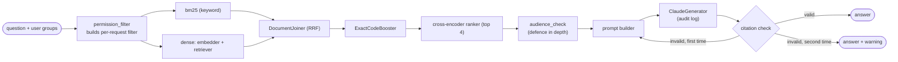

This assessment covers the whole Haystack and Other Frameworks module: Haystack's architecture, pipelines, components, document stores and retrieval pipelines, DSPy optimisation, framework comparisons, and the decision to build custom implementations. It has five parts: a multiple-choice quiz, conceptual questions, coding exercises, an architecture design challenge and troubleshooting scenarios. Aim for at least 14 of the 18 quiz questions (about 80%), and attempt every written part before opening its model answer. The coding solutions were run with `haystack-ai` 3.5.0 and `dspy` 3.5.0; they need no API key and no model download.

```quiz
[
  {"q": "In a Haystack RAG application, how does the query pipeline see the documents the indexing pipeline produced?", "options": ["The indexing pipeline's writer is connected to the query pipeline's retriever with `connect`", "Both pipelines hold components that reference the same document store", "The query pipeline re-runs the indexing pipeline on start-up", "Through the YAML file both pipelines load"], "answer": 1, "why": "The document store is shared state passed to components in both pipelines; pipelines never connect to each other."},
  {"q": "What does this print?\n```python\nfrom haystack import Document\na = Document(content=\"VPN is required on public Wi-Fi.\")\nb = Document(content=\"VPN is required on public Wi-Fi.\", meta={\"owner\": \"IT\"})\nprint(a.id == b.id)\n```", "options": ["True", "False", "It raises an error", "It depends on the document store"], "answer": 1, "why": "The default id hashes content and metadata, so different metadata gives a different id."},
  {"q": "A component's `run` is `def run(self, documents: list[Document], query: str, top_k: int = 5)`. The pipeline connects only `documents`. Which inputs appear in `pipeline.inputs()` for this component?", "options": ["`documents`, `query` and `top_k`", "`documents` only", "`query` and `top_k`", "`top_k` only"], "answer": 2, "why": "`inputs()` lists sockets not fed by a connection: `query` (mandatory) and `top_k` (optional)."},
  {"q": "Where should a custom Haystack component that wraps a local cross-encoder load the model?", "options": ["In an idempotent `warm_up` method", "In `__init__`", "In `to_dict`", "On every call to `run`"], "answer": 0, "why": "`__init__` runs whenever a pipeline is built or loaded and must be cheap; the pipeline calls `warm_up` before running."},
  {"q": "A component in a loop is re-entered on the second pass. It received `question` from `Pipeline.run` data and `documents` from a retriever on the first pass. What does it have on the second pass?", "options": ["Both `question` and `documents`", "Neither", "`documents` only", "`question` only, unless something on the loop sends `documents` again"], "answer": 3, "why": "Inputs from other components are consumed when a component runs; inputs supplied from outside the pipeline persist."},
  {"q": "Which component should sit at the entry of a loop that is first fed from outside the pipeline and later fed by a loop edge?", "options": ["`DocumentJoiner`", "`BranchJoiner`", "`ListJoiner`", "`ConditionalRouter`"], "answer": 1, "why": "A normal socket cannot take both an outside input and a connection; a greedy `BranchJoiner` accepts both and passes each value on."},
  {"q": "A `ConditionalRouter` has two routes, neither with a `{{ True }}` condition. A query matches neither. What happens?", "options": ["The router raises an error", "The first route is taken by default", "The router emits nothing, so downstream branches do not run and the expected output is missing", "The pipeline retries the router"], "answer": 2, "why": "The router fills only the outputs of the first matching route; with no match nothing is emitted. Always add a default route."},
  {"q": "With `max_runs_per_component=3`, a self-correcting loop's check always fails. What happens?", "options": ["The pipeline raises `PipelineMaxComponentRuns` when a component would run a fourth time", "The loop runs forever", "The pipeline returns the first answer", "The router switches to its default route"], "answer": 0, "why": "The bound is a per-component visit limit for one run; exceeding it raises an exception you should turn into a graceful response."},
  {"q": "Two retrievers both run on every question and are merged by a `BranchJoiner(list[Document])` before the prompt builder. What is the consequence?", "options": ["The lists are fused by rank", "Validation rejects the pipeline", "The pipeline deadlocks", "The joiner fires once per retriever instead of merging, so evidence can be silently dropped or downstream steps run twice"], "answer": 3, "why": "`BranchJoiner` is a greedy pass-through; branches that all run must be merged by a waiting joiner such as `DocumentJoiner`."},
  {"q": "A HR policy file is edited and re-indexed through `DocumentSplitter` and `DocumentWriter(policy=DuplicatePolicy.OVERWRITE)`. What happens to the old chunks?", "options": ["They remain in the store, because every new chunk has a new id", "They are overwritten", "The write fails with a duplicate error", "They are merged into the new chunks"], "answer": 0, "why": "Ids hash content and metadata, and the splitter adds the parent's hash as `source_id`, so even unchanged sentences get new ids. Delete by a stable key first."},
  {"q": "A retriever was built with a constructor filter `audience == all` and the default filter policy. A request passes `filters={\"field\": \"meta.dept\", \"operator\": \"==\", \"value\": \"HR\"}`. Which filter is applied?", "options": ["`audience == all` AND `dept == HR`", "Only `dept == HR`", "Only `audience == all`", "Neither"], "answer": 1, "why": "The default `FilterPolicy.REPLACE` replaces constructor filters with runtime filters; mandatory filters need `MERGE` or per-request construction."},
  {"q": "In Haystack's reciprocal rank fusion with two lists and default weights (k = 61, zero-based ranks), what is the score of a document ranked first in one list and absent from the other?", "options": ["1.0", "0.25", "0.5", "61"], "answer": 2, "why": "Each list has weight 0.5, and the first-ranked document earns 0.5 times 61/61 from that list only."},
  {"q": "In the module's evaluation, recall@1 after RRF fusion was lower than for dense retrieval alone. What is the right conclusion?", "options": ["Haystack's RRF is buggy", "Fusion rewards consensus and can demote a document that only one retriever ranked first; whether it helps must be measured on your data", "BM25 should always be dropped", "The evaluator compares the wrong field"], "answer": 1, "why": "Consensus between two middling rankings can beat one confident correct ranking; stage-by-stage evaluation is how you decide."},
  {"q": "In DSPy's `BootstrapFewShot`, which training examples become demonstrations?", "options": ["All of them, as labelled", "A random sample", "Those whose program run passed the metric, kept with the trace of every predictor's inputs and outputs", "Those the model answers fastest"], "answer": 2, "why": "The optimiser runs the program, scores each prediction, and turns passing traces into demonstrations, including retrieved context."},
  {"q": "A DSPy optimiser compares two candidates on 50 validation questions at about 80% accuracy and finds a 4-point difference. Roughly how large is the standard error of each score?", "options": ["About 0.006", "About 0.06", "About 0.6", "Exactly 0.04"], "answer": 1, "why": "The square root of 0.8 times 0.2 divided by 50 is about 0.057, so a 4-point gap is within the noise."},
  {"q": "In the module's micro-benchmark, framework orchestration overhead ranged from tens of microseconds to about a millisecond per call. What does this imply for a RAG system whose model call takes one second?", "options": ["Framework choice is the main latency driver", "Only the fastest framework should be used", "Overhead is below about 0.1% of request latency, so it rarely decides the choice", "Benchmarks of frameworks cannot be trusted"], "answer": 2, "why": "Sub-millisecond overhead is negligible next to model and retrieval latency; import time and concurrency model matter more."},
  {"q": "With build costs of 10 and 25 engineer-days and monthly maintenance of 2 and 1 days for a framework and a custom implementation respectively, when does the custom option become cheaper?", "options": ["After 15 months", "After 7.5 months", "Immediately", "Never"], "answer": 0, "why": "Break-even is (25 - 10) divided by (2 - 1), which is 15 months."},
  {"q": "Why does the module's custom RAG core check permissions again after fusing the retrievers' results?", "options": ["Fusion removes metadata", "The generator requires a filtered list", "To make the trace longer", "Defence in depth: a bug in any one retriever cannot leak a passage to the model"], "answer": 3, "why": "Every retriever filters, but the second check makes the property independent of every retriever being correct, and a test with a leaky retriever proves it."}
]
```

## Conceptual questions

**1.** Haystack separates a document store from the retrievers that search it, and the `DocumentStore` protocol has no search method. Explain why, and what this design costs you when you change databases.

<details><summary>Show model answer</summary>

Search is the most database-specific operation there is: BM25 in Elasticsearch is a Lucene query, in the in-memory store a Python implementation; vector search uses different index types, distance functions and filtering strategies; some stores support sparse or hybrid search and others do not. Putting search into a common protocol would force a lowest common denominator. Instead, the protocol covers what is genuinely common (write, filter, count, delete, serialise), and each store has its own retriever components that expose its real capabilities and parameters, while still producing standard `Document` lists. The cost is that a database change touches more than one line: you change the store class and its connection settings, every retriever class bound to it, and any filters or options that relied on the old store's behaviour. The rest of the pipeline (joiners, rankers, prompt builders, generators) is untouched, because it only sees `list[Document]`. Keeping store-specific code in one module limits the blast radius.

</details>

**2.** Explain the two gates a Haystack component must pass before it runs, and use them to explain why a component can silently never run without any error.

<details><summary>Show model answer</summary>

Gate one: all mandatory inputs (parameters of `run` without defaults) must have values. Gate two: the component must have a trigger: a predecessor has just delivered input to it, or input was supplied from outside the pipeline and it has not run yet, or it has no incoming connections and has not run yet. The scheduler runs components that pass both gates, ordered by priority. A component that is downstream of a router branch that was not taken never receives input from its predecessor, so it has no trigger and never runs; this is normal and not an error. The same silence occurs when a mandatory input is never produced, for example after a loop consumed it. When nothing can run, the pipeline simply returns the outputs it has (logging a warning if it looks blocked), so the symptom is a missing key in the result rather than an exception. That is why tests should assert on outputs from every branch.

</details>

**3.** DSPy treats prompts as parameters. What must a team provide before optimisation can work, and what are the two biggest risks of the approach?

<details><summary>Show model answer</summary>

The team must provide a program with clear steps (signatures and modules), a metric that captures what a good output is, and labelled examples split into training, validation and held-out test sets. The first risk is metric gaming: optimisers maximise the metric, so any gap between the metric and the real goal (for example, checking citation format but not content) is exploited, producing confident wrong behaviour. The second is overfitting and noise: with small validation sets, candidate scores differ by less than their standard error, the optimiser selects partly for luck, and gains shrink on held-out data or after a model change. Mitigations: write and review the metric carefully, include refusals and hard cases, use a few hundred held-out examples, and re-compile and re-evaluate when the model, retriever or data changes. Demonstrations also carry real training content into every prompt, a privacy consideration.

</details>

**4.** A colleague argues: "Frameworks are slow, so we should write our own RAG code." Using what this module measured, explain what is right and wrong in the claim, and what actually should drive the decision.

<details><summary>Show model answer</summary>

Wrong: orchestration overhead per call was tens of microseconds to about a millisecond, negligible next to model calls of hundreds of milliseconds to seconds and retrieval of milliseconds. Partly right: some framework constructs have run-time costs worth knowing (a parallel LCEL step costs more than a sequential one for trivial branches, though it wins when branches do I/O), and import time can be large (over a second for Haystack in an environment where it pulled in PyTorch), which matters for serverless cold starts and command-line tools. The decision should be driven by fit and ownership: how naturally the system's control flow maps onto the abstraction, how many integrations are needed, how many teams work on pipelines, auditability and permission requirements, dependency constraints, and total cost of ownership over the expected lifetime. And it need not be all-or-nothing: a custom core with framework components behind adapters is often the best of both.

</details>

## Coding exercises

### Exercise 1: an exact-code booster component

Dense retrieval sometimes ranks the passage for E-4012 above the passage for E-4021 when the question asks about E-4021, because the two codes look alike to an embedding model. Write a Haystack component `ExactCodeBooster` with inputs `query` and `documents` and outputs `documents` and `boosted` (the number of documents moved). If the query contains codes matching `E-` followed by four digits, it moves documents containing any of those codes to the front, keeping the original order within each group, and marks them with `meta["boosted"] = True`; otherwise it returns the documents unchanged. Put it after an embedding retriever and show its effect, using `MockTextEmbedder` with fixed vectors so that the dense order is deliberately wrong.

<details><summary>Show solution</summary>

```python
import re
from dataclasses import replace

from haystack import Document, Pipeline, component
from haystack.components.retrievers.in_memory import InMemoryEmbeddingRetriever
from haystack.components.embedders import MockTextEmbedder
from haystack.document_stores.in_memory import InMemoryDocumentStore

CODE = re.compile(r"\bE-\d{4}\b")


@component
class ExactCodeBooster:
    """Moves documents that contain an error code from the query to the front, keeping order otherwise."""

    @component.output_types(documents=list[Document], boosted=int)
    def run(self, query: str, documents: list[Document]):
        codes = set(CODE.findall(query))
        if not codes:
            return {"documents": documents, "boosted": 0}
        hit = [d for d in documents if codes & set(CODE.findall(d.content or ""))]
        rest = [d for d in documents if d not in hit]
        return {"documents": [replace(d, meta={**d.meta, "boosted": True}) for d in hit] + rest,
                "boosted": len(hit)}


docs = [
    Document(content="Error E-4012: the VPN certificate has expired.", embedding=[0.9, 0.1, 0.0]),
    Document(content="Error E-4021: the VPN client is out of date.", embedding=[0.8, 0.2, 0.0]),
    Document(content="The VPN is required on public Wi-Fi.", embedding=[0.7, 0.0, 0.3]),
]
store = InMemoryDocumentStore()
store.write_documents(docs)

pipe = Pipeline()
pipe.add_component("embedder", MockTextEmbedder(embedding=[1.0, 0.0, 0.0]))  # stands in for a real model
pipe.add_component("dense", InMemoryEmbeddingRetriever(store, top_k=3))
pipe.add_component("booster", ExactCodeBooster())
pipe.connect("embedder.embedding", "dense.query_embedding")
pipe.connect("dense.documents", "booster.documents")

for q in ["What does E-4021 mean?", "Do I need the VPN at a cafe?"]:
    out = pipe.run({"embedder": {"text": q}, "booster": {"query": q}}, include_outputs_from={"dense"})
    print(q)
    print("  dense:  ", [d.content[:16] for d in out["dense"]["documents"]])
    print("  boosted:", [d.content[:16] for d in out["booster"]["documents"]], "| moved:", out["booster"]["boosted"])
```

```output
What does E-4021 mean?
  dense:   ['Error E-4012: th', 'Error E-4021: th', 'The VPN is requi']
  boosted: ['Error E-4021: th', 'Error E-4012: th', 'The VPN is requi'] | moved: 1
Do I need the VPN at a cafe?
  dense:   ['Error E-4012: th', 'Error E-4021: th', 'The VPN is requi']
  boosted: ['Error E-4012: th', 'Error E-4021: th', 'The VPN is requi'] | moved: 0
```

For the first question the booster moved the E-4021 passage ahead of the dense ranking's wrong first choice. For the second, which contains no code, it returned the dense order unchanged (`moved: 0`). Only the one document that matched was copied with new metadata; the inputs were never mutated.

</details>

### Exercise 2: route error-code questions to the runbooks

Build a pipeline with two stores, one for IT runbooks and one for the handbook, each with its own BM25 retriever. A `ConditionalRouter` sends a question to the runbooks retriever if it contains an Atlas-style error code and to the handbook retriever otherwise. Merge the branches and print which branch answered each question. Use a custom Jinja filter for the regular expression.

<details><summary>Show solution</summary>

```python
import re

from haystack import Document, Pipeline
from haystack.components.joiners import BranchJoiner
from haystack.components.retrievers.in_memory import InMemoryBM25Retriever
from haystack.components.routers import ConditionalRouter
from haystack.document_stores.in_memory import InMemoryDocumentStore

runbooks, handbook = InMemoryDocumentStore(), InMemoryDocumentStore()
runbooks.write_documents([
    Document(content="Error E-4021: the VPN client is out of date; update it from the IT portal."),
    Document(content="Error E-4012: the VPN certificate has expired."),
])
handbook.write_documents([
    Document(content="Annual leave is 25 days."),
    Document(content="The home-office equipment budget is £400."),
])

def has_code(text: str) -> bool:
    return re.search(r"\bE-\d{4}\b", text) is not None

routes = [
    {"condition": "{{ query | has_code }}", "output": "{{ query }}",
     "output_name": "code_query", "output_type": str},
    {"condition": "{{ True }}", "output": "{{ query }}",
     "output_name": "text_query", "output_type": str},
]

pipe = Pipeline()
pipe.add_component("router", ConditionalRouter(routes, custom_filters={"has_code": has_code}))
pipe.add_component("runbooks", InMemoryBM25Retriever(runbooks, top_k=1))
pipe.add_component("handbook", InMemoryBM25Retriever(handbook, top_k=1))
pipe.add_component("join", BranchJoiner(list[Document]))
pipe.connect("router.code_query", "runbooks.query")
pipe.connect("router.text_query", "handbook.query")
pipe.connect("runbooks.documents", "join.value")
pipe.connect("handbook.documents", "join.value")

for q in ["My screen shows E-4012", "How much annual leave do I get?"]:
    out = pipe.run({"router": {"query": q}}, include_outputs_from={"runbooks", "handbook"})
    branch = "runbooks" if "runbooks" in out else "handbook"
    print(f"{q!r:<36} -> {branch:<8} {out['join']['value'][0].content}")
```

```output
'My screen shows E-4012'             -> runbooks Error E-4012: the VPN certificate has expired.
'How much annual leave do I get?'    -> handbook Annual leave is 25 days.
```

`BranchJoiner` is the right merge because exactly one branch runs per question. The branch that did not run is simply absent from the result, which is how the script detects which one answered; in production, record the router's decision in the trace instead. Custom filters are passed as Python callables, so a pipeline using them must be loaded with the module that defines `has_code` on the deserialisation allowlist.

</details>

### Exercise 3: a DSPy metric that shapes demonstrations

Write a DSPy metric that, during evaluation (`trace is None`), checks only that the gold answer appears in the prediction, but during optimisation also rejects hedged answers containing "I think", "probably" or "maybe". Use a `DummyLM` whose script hedges on two of four questions (one of them also wrong) and show the evaluation score and which demonstrations `BootstrapFewShot` keeps.

<details><summary>Show solution</summary>

```python
import dspy
from dspy.utils import DummyLM

CONTEXT = {
    "How long do I have to submit expenses?": "Expenses must be submitted within 30 days.",
    "How often are passwords rotated?": "Passwords must be rotated every 90 days.",
    "When is the support desk open?": "The support desk is open 08:00 to 18:00 UK time.",
    "How many remote days are allowed?": "Staff may work remotely up to 3 days a week.",
}

class Answer(dspy.Signature):
    """Answer from the context only."""
    context: str = dspy.InputField()
    question: str = dspy.InputField()
    answer: str = dspy.OutputField()

class Program(dspy.Module):
    def __init__(self):
        super().__init__()
        self.answer = dspy.Predict(Answer)

    def forward(self, question):
        return self.answer(context=CONTEXT[question], question=question)

HEDGES = ("i think", "probably", "maybe")

def grounded_and_confident(example, pred, trace=None):
    text = pred.answer.lower()
    correct = example.answer.lower() in text
    if trace is None:                       # evaluation: correctness only
        return correct
    return correct and not any(h in text for h in HEDGES)   # demos: also no hedging

lm = DummyLM({
    "How long do I have to submit expenses?": {"answer": "Within 30 days."},
    "How often are passwords rotated?": {"answer": "Probably every 90 days."},
    "When is the support desk open?": {"answer": "From 08:00 to 18:00 UK time."},
    "How many remote days are allowed?": {"answer": "I think 4 days."},
})
dspy.configure(lm=lm)

train = [dspy.Example(question=q, answer=a).with_inputs("question") for q, a in [
    ("How long do I have to submit expenses?", "30 days"),
    ("How often are passwords rotated?", "90 days"),
    ("When is the support desk open?", "08:00 to 18:00"),
    ("How many remote days are allowed?", "3 days"),
]]

score = dspy.Evaluate(devset=train, metric=grounded_and_confident, num_threads=1)(Program()).score
compiled = dspy.BootstrapFewShot(metric=grounded_and_confident, max_bootstrapped_demos=4,
                                 max_labeled_demos=0).compile(Program(), trainset=train)
print("evaluation score:", score)
print("demos kept:", [d.answer for d in compiled.answer.demos])
```

```output
2026/11/14 20:27:57 INFO dspy.evaluate.evaluate: Average Metric: 3 / 4 (75.0%)
Bootstrapped 2 full traces after 3 examples for up to 1 rounds, amounting to 4 attempts.
evaluation score: 75.0
demos kept: ['Within 30 days.', 'From 08:00 to 18:00 UK time.']
```

Evaluation counts "Probably every 90 days." as correct (the gold string is present), so the score is 3 of 4. Bootstrapping is stricter: the hedged answer is not kept as a demonstration, and neither is the wrong one, so the model will see only confident, correct examples. The asymmetry lets you measure what you care about while teaching the style you want.

</details>

## Architecture design challenge

Meridian is launching **AskMeridian for Contractors**, a variant of the assistant for its contractor workforce. Requirements:

- Contractors may see only documents with `audience` in `{"all", "contractors"}`; the employee handbook's employees-only sections must never reach the model for them.
- Questions about Atlas error codes must find the exact code's runbook entry; other questions should be answered from the handbook and product documentation.
- Answers must cite passages; an answer without a valid citation is regenerated at most once, then returned with a warning.
- The Platform team owns the system; two other teams will build variants, so pipeline definitions must be reviewable.
- p95 latency budget for retrieval is 200 ms on CPU; generation uses Claude.

Design the system: which framework or custom parts you use for what, the query pipeline's components and connections, where permissions are enforced, how the citation retry works, and how you will evaluate it.

<details><summary>Show reference design</summary>

**Choices.** Haystack for the query pipeline, because the flow has a branch, a fusion and a bounded loop, and pipeline YAML gives the other teams reviewable definitions. A small custom component owns permissions, and the generator is a custom component around the Anthropic SDK with an audit log. Qdrant (the existing cluster) via the Haystack integration. Ingestion stays as is, with `doc_key`, `audience` and `content_hash` on every chunk.



**Permissions.** A `permission_filter` component turns the authenticated user's groups into a Haystack filter (`meta.audience in [...]`), passed at run time to both retrievers, whose `filter_policy` is `MERGE` so no constructor filter can be replaced. An `audience_check` component after the ranker drops anything outside the allowed set and reports a count to tracing. Tests include a deliberately leaky retriever and assert that nothing disallowed reaches the prompt builder.

**Exact codes.** Hybrid retrieval with BM25 catches the literal code; the `ExactCodeBooster` from exercise 1 guarantees an exact-code match is ranked first before reranking. Error-code questions are not routed away from dense retrieval, because some ask "my VPN is broken" without a code.

**Citation retry.** A `ConditionalRouter` checks that each cited passage number exists in the context. The loop goes back to the prompt builder with feedback; documents are re-supplied by routing the reranked list through the router's retry output, since loop inputs from components are consumed. `max_runs_per_component=2`, and the second failure takes a route that returns the answer with a warning flag rather than raising.

**Latency.** With `run_async`, the BM25 and dense branches overlap (assume 10 ms and 35 ms); fusion and boosting take under a millisecond; reranking 20 candidates at an assumed 4 ms each takes 80 ms. Total about 120 ms, inside the 200 ms budget with room for the p95 tail.

**Evaluation.** A contractor golden set of at least 200 questions, including employees-only questions that must be refused, error-code questions and synonym questions; stage-by-stage recall and MRR with `include_outputs_from`; citation accuracy and refusal accuracy end to end. The security tests are a release gate.

**Trade-offs.** The framework adds a dependency and YAML ceremony; in exchange, variants are reviewable and the loop is explicit. Permission logic is in custom components so it can be read and tested in one place. The booster is a rule that encodes domain knowledge; it should be revisited if code formats change.

</details>

## Troubleshooting scenarios

**Scenario 1.** After a routine re-index, AskMeridian sometimes answers that unused leave "carries over without limit" and sometimes "up to 5 days". Both answers cite the handbook. The indexing pipeline uses `DocumentSplitter` and `DocumentWriter(policy=DuplicatePolicy.OVERWRITE)` and has run without errors for months.

<details><summary>Show diagnosis and fix</summary>

Diagnosis: stale chunks. Each edit to the handbook produced chunks with new ids (content and metadata hashes, including the parent's hash in `source_id`), so `OVERWRITE` never collided with the old chunks, and every past version is still in the store. Retrieval returns whichever version scores higher for a given question. Confirm by counting chunks per source key in the store and comparing with what the current file produces. Fix: add a stable `doc_key` (the source path) to each source document's metadata, re-index by key (delete all chunks with that key, then write), delete by key when a source is removed, and run a one-off clean-up that rebuilds the index or deletes all chunks whose `content_hash` does not match the current file. Add a nightly consistency check.

</details>

**Scenario 2.** A new "search only IT runbooks" toggle is released. A week later, a contractor reports seeing a managers-only HR document in an answer about leave approvals. The retriever was built with `filters={"field": "meta.audience", "operator": "in", "value": ["all", "contractors"]}`.

<details><summary>Show diagnosis and fix</summary>

Diagnosis: the toggle passes a runtime filter (`meta.source == it-runbooks`, or, when off, some other default filter) to the retriever, and the retriever uses the default `FilterPolicy.REPLACE`, so any runtime filter replaced the audience restriction. The leak needed no attacker, only a feature that passes filters. Fix immediately by setting `filter_policy=FilterPolicy.MERGE` on every retriever, then properly by building the permission filter per request from the authenticated user and combining it with any user-chosen filter in your own code, adding a post-retrieval audience check before the prompt, and adding a test that exercises every user-facing filter option as a contractor and asserts that no restricted document is returned. Review logs to find other affected answers.

</details>

**Scenario 3.** A Haystack query pipeline with a router and a citation loop sometimes returns a result dictionary with no `answer` key and no exception. The logs contain "Cannot run pipeline - the pipeline appears to be blocked" and name the prompt builder.

<details><summary>Show diagnosis and fix</summary>

Diagnosis: on the retry pass the prompt builder is triggered by the router's feedback, but its mandatory `documents` input was consumed on the first pass, and nothing on the loop sends documents again. It fails the first gate (mandatory inputs), nothing else can run, and the pipeline stops, returning whatever outputs it has. It happens only "sometimes" because the loop is only taken when the first answer fails the check. Fix: re-supply `documents` on the loop, for example by routing the question back through a `BranchJoiner` at the retriever's entry, or by having the router output the documents on its retry route; then add a test whose fake model fails the check once, so the loop path is always exercised. Also give the router a default route and catch `PipelineMaxComponentRuns`, so every path ends in an explicit answer or error.

</details>
