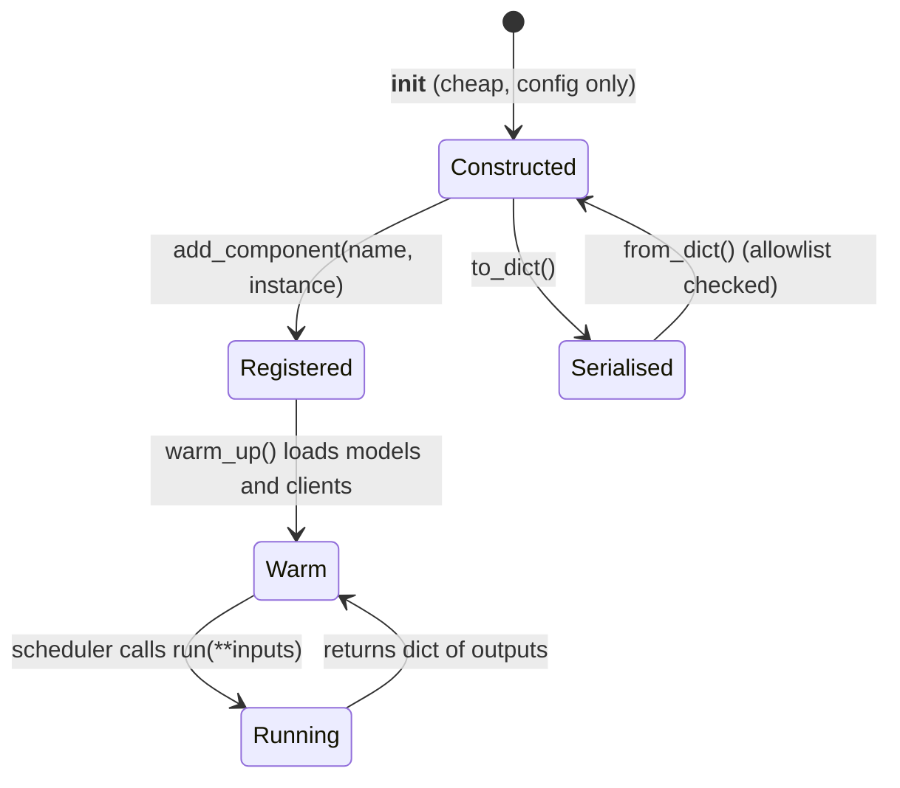

A Haystack pipeline is only as useful as the components inside it, and sooner or later every team needs one that does not exist: a wrapper for an in-house model, a business rule, a citation checker, or a client for a service no integration covers. This lesson is about the **component contract**: what makes a Python class a component, how its method signature becomes typed sockets, how it handles expensive resources, how it saves and restores itself, and how to test it. You will write a production-quality cross-encoder reranking component, run it alone and inside a pipeline, serialise it, and unit test it without downloading a model.

The [architecture lesson](/learn/haystack-and-other-frameworks/haystack-architecture) described components from the outside and the [pipelines lesson](/learn/haystack-and-other-frameworks/pipelines) described how they are scheduled. Here we look from the inside.

## Learning objectives

- State the component contract: the `@component` decorator, `run` returning a dictionary, declared output types, and the optional `warm_up`, `to_dict`, `from_dict` and `run_async` methods.
- Derive a component's input and output sockets from its source code, including which inputs are mandatory and which are optional.
- Write a custom component that loads a model in `warm_up`, does not mutate its inputs, serialises its configuration, and passes the deserialisation allowlist.
- Unit test a component in isolation by replacing its model with a fake.
- Decide when to wrap a sub-pipeline as a single component with `SuperComponent`.

## Prerequisites

- [Haystack architecture](/learn/haystack-and-other-frameworks/haystack-architecture) and [Pipelines](/learn/haystack-and-other-frameworks/pipelines).
- [Cross-encoders](/learn/reranking-fundamentals/cross-encoders): what the example component computes.
- [Dataclasses and Pydantic](/learn/python-for-rag-engineering/dataclasses-and-pydantic) and [Type hints](/learn/python-for-rag-engineering/type-hints): Haystack reads your annotations, so they must be right.

## Why this matters

The integrations catalogue is large, but a RAG system that matters to a business always contains logic that is specific to that business: Meridian's rule that contractor questions about the equipment budget get a fixed answer, its in-house access-control check, its Atlas error-code lookup. If that logic lives outside the pipeline, in code that runs before and after `pipeline.run`, you lose what the pipeline gives you: tracing per step, validation of connections, a serialisable definition, and the ability to rearrange steps without rewriting glue.

Writing components badly has its own costs. A component that loads a model in `__init__` makes every pipeline load, validation and test slow. One that mutates its input documents corrupts what a sibling branch sees. One whose constructor arguments cannot be serialised breaks `dumps()` for the whole pipeline. One without tests is a black box inside a graph whose other parts are well tested. The contract exists to prevent each of these, and following it is mostly a matter of knowing it.

## The intuition

A component is like an appliance built to a standard plug. The standard does not care what the appliance does inside; it fixes only the interface: the shape of the plug (the typed inputs and outputs), the rule that it may draw power only when switched on (models load at warm-up, not when the box is unpacked), the label on the back listing its settings (the init parameters that serialisation records), and the promise that it does not reach out and rewire the socket (it does not mutate shared inputs). Anything that honours the standard can be plugged into any pipeline, by anyone, and tested on the bench before it goes into the wall.

## How it works

### The contract

A class becomes a component when it satisfies five rules, two mandatory and three optional:

1. **It is decorated with `@component`.** The decorator registers the class and, when an instance is created, reads the class to build its sockets.
2. **It has a `run` method that returns a dictionary.** The keys are output names, the values are outputs. Returning anything that is not a mapping raises a `PipelineRuntimeError` naming the component; returning a key that was not declared as an output is also an error.
3. **Optionally, `warm_up(self)`.** The pipeline calls it on every component before the first run. Put model loading and client creation here, and guard it so calling it twice is harmless; the pipeline does not remember which components it has warmed.
4. **Optionally, `to_dict` and `from_dict`.** If you do not define them, the decorator records the arguments your `__init__` received and serialises those. Define them when an argument needs custom handling, such as a `Secret` or a callable.
5. **Optionally, `run_async(self, ...)`.** A coroutine with the same signature as `run`. `Pipeline.run_async` awaits it directly; without it, the pipeline runs your synchronous `run` in a worker thread.

### From a signature to sockets

The decorator turns code into sockets mechanically:

- **Input sockets** are the parameters of `run`, by name and annotation. A parameter without a default is **mandatory**: the component cannot run until it has a value. A parameter with a default is **optional**: the component can run without it, using the default.
- **Output sockets** come from `@component.output_types(name=type, ...)` on the `run` method. Each keyword is a socket.
- A parameter annotated as a list can receive from several senders only if the component declares it variadic (`Variadic[...]` or `GreedyVariadic[...]` from Haystack's type module), which is what joiners do. An ordinary list parameter accepts one sender.

Annotations are therefore part of the interface, not decoration. If `run` declares `documents: list` instead of `documents: list[Document]`, connections type-check loosely; if it declares `documents: str` by mistake, connecting a retriever fails at `connect` time.

Some components need sockets that depend on configuration. `PromptBuilder` and `ChatPromptBuilder` read the Jinja template you pass and create one input socket per template variable; that is how the prompt builder in earlier lessons came to have `question` and `documents` inputs. Such components call `component.set_input_types(self, name=type, ...)` in `__init__`, and accept the values through `**kwargs` in `run`. Use this sparingly: static sockets are easier to read and check.

### Init parameters and serialisation

Serialisation records configuration so the component can be rebuilt. The default mechanism is simple: whatever arguments `__init__` received become `init_parameters`, and `from_dict` calls `__init__` with them again. This works only if the arguments are JSON-friendly: strings, numbers, booleans, `None`, and lists and dictionaries of those. Three cases need care:

- **Objects** such as a document store: the store itself has `to_dict`, and the standard helpers call it. That is why the retriever's YAML in the architecture lesson contained a nested store definition.
- **Secrets**: accept a `Secret` (for example `Secret.from_env_var("ANTHROPIC_API_KEY")`) and serialise it with `secret.to_dict()`; the serialised form says which environment variable to read, never the value.
- **Callables**: store an importable path such as `"mypackage.module.function"`, not the function object.

`default_to_dict(self, **params)` and `default_from_dict(cls, data)` build and parse the standard `{"type": ..., "init_parameters": {...}}` shape. The `type` is the full import path of your class, and loading checks that path against the deserialisation allowlist (Haystack's own packages and `haystack_integrations` by default). Your own components therefore need their package added explicitly, with `allowed_modules=["yourpackage.*"]` on the load call or the `HAYSTACK_DESERIALIZATION_ALLOWLIST` environment variable. That friction is deliberate: loading YAML imports code.

### Lifecycle

Here is the life of a component instance, step by step:

1. **Construction.** `__init__` stores configuration and must be cheap. It runs when you build a pipeline, when a pipeline is loaded from YAML, and in tests.
2. **Registration.** `add_component` stores the instance under a name. An instance can belong to only one pipeline.
3. **Warm-up.** `pipeline.warm_up()`, or the first `run`, calls `warm_up()`. Expensive resources load here, once.
4. **Execution.** Each time the scheduler picks the component, it calls `run` with deep copies of its inputs and takes the returned dictionary.
5. **Serialisation.** At any point, `to_dict()` captures configuration (never loaded models or runtime state).
6. **Clean-up.** Components that hold connections can release them; `Pipeline.close()` exists for that purpose in recent releases.



### Purity: do not mutate inputs

The pipeline deep-copies inputs before calling `run`, so mutating them cannot corrupt another component's inputs within a run. It is still good practice to treat inputs as read-only and return new objects, for three reasons: the component may be called directly (in tests, or by your own code) where no copy is made; mutation makes the component's behaviour depend on what it was given before; and deep copies are a cost you may want to reduce later. Haystack's `Document` is a dataclass, so `dataclasses.replace(doc, score=s)` gives you a new document with one field changed.

### Wrapping pipelines: `SuperComponent`

Sometimes the right unit of reuse is not one component but a small pipeline: say, a hybrid retriever made of a query embedder, two retrievers, a joiner and a ranker. `SuperComponent(pipeline=..., input_mapping=..., output_mapping=...)` wraps a pipeline as a single component with the inputs and outputs you name. `input_mapping` maps a new input name to one or more sockets inside (for example `{"query": ["bm25.query", "embedder.text", "ranker.query"]}`), and `output_mapping` maps inner outputs to new names. The wrapper can be dropped into another pipeline, serialised, and tested as one unit. Haystack builds some of its own higher-level components this way. The cost is that the inner steps disappear from the outer graph; tracing still records them, but the outer pipeline's YAML shows one box.

## In code

The example is a reranking component built on a local cross-encoder from `sentence-transformers`. Reranking is a good first custom component because it has every concern in the contract: a model that is expensive to load, a typed list input and output, a configuration worth serialising, and logic worth testing. (In the 3.5.0 core package no local-model ranker ships, so this is also a component you might genuinely need.) It lives in a small package, `meridian_components`, because a component must be importable from a module to be serialised and loaded later.

```bash
pip install haystack-ai sentence-transformers pytest
```

```python
# meridian_components/ranker.py
from dataclasses import replace

from haystack import Document, component, default_from_dict, default_to_dict


@component
class CrossEncoderRanker:
    """Reorders documents by a cross-encoder's relevance score for the query."""

    def __init__(self, model: str = "cross-encoder/ms-marco-MiniLM-L-6-v2",
                 top_k: int = 3, score_threshold: float | None = None):
        # Cheap: only store configuration. The decorator records these as init_parameters.
        self.model = model
        self.top_k = top_k
        self.score_threshold = score_threshold
        self._encoder = None

    def warm_up(self):
        # Expensive: load the model once, and only once.
        if self._encoder is None:
            from sentence_transformers import CrossEncoder
            self._encoder = CrossEncoder(self.model)

    @component.output_types(documents=list[Document])
    def run(self, query: str, documents: list[Document], top_k: int | None = None):
        if self._encoder is None:
            raise RuntimeError("CrossEncoderRanker was not warmed up; call warm_up() first.")
        if not documents:
            return {"documents": []}
        top_k = top_k if top_k is not None else self.top_k
        scores = self._encoder.predict([(query, d.content or "") for d in documents])
        # Return new Document objects; never mutate the inputs.
        ranked = [replace(d, score=float(s)) for d, s in zip(documents, scores)]
        ranked.sort(key=lambda d: d.score, reverse=True)
        if self.score_threshold is not None:
            ranked = [d for d in ranked if d.score >= self.score_threshold]
        return {"documents": ranked[:top_k]}

    def to_dict(self):
        return default_to_dict(self, model=self.model, top_k=self.top_k,
                               score_threshold=self.score_threshold)

    @classmethod
    def from_dict(cls, data):
        return default_from_dict(cls, data)
```

The script below uses it three ways: called directly, inside a pipeline behind a BM25 retriever, and through a serialisation round trip.

```python
from haystack import Document, Pipeline
from haystack.components.retrievers.in_memory import InMemoryBM25Retriever
from haystack.document_stores.in_memory import InMemoryDocumentStore

from meridian_components.ranker import CrossEncoderRanker

docs = [
    Document(content="Annual leave is 25 days; up to 5 unused days carry over."),
    Document(content="Unused leave days that carry over must be used by 31 March."),
    Document(content="Passwords must be rotated every 90 days."),
]

# 1. The component on its own: a direct call, no pipeline needed.
ranker = CrossEncoderRanker(top_k=2)
ranker.warm_up()
out = ranker.run(query="When do I have to use my carried-over holiday?", documents=docs)
for d in out["documents"]:
    print(f"  {d.score:6.2f}  {d.content}")
print("inputs untouched:", all(d.score is None for d in docs))

# 2. Inside a pipeline: BM25 casts a wide net, the ranker reorders it.
store = InMemoryDocumentStore()
store.write_documents(docs + [
    Document(content="Staff may work remotely up to 3 days a week."),
    Document(content="Expenses must be submitted within 30 days."),
])
pipe = Pipeline()
pipe.add_component("bm25", InMemoryBM25Retriever(document_store=store, top_k=5))
pipe.add_component("ranker", CrossEncoderRanker(top_k=2))
pipe.connect("bm25.documents", "ranker.documents")
print("\nopen inputs:", {c: sorted(s) for c, s in pipe.inputs().items()})
print("outputs:    ", {c: sorted(s) for c, s in pipe.outputs().items()})

q = "What is the deadline for carried-over leave?"
res = pipe.run({"bm25": {"query": q}, "ranker": {"query": q}}, include_outputs_from={"bm25"})
print("\nBM25:  ", [d.content[:30] for d in res["bm25"]["documents"]])
print("ranked:", [d.content[:30] for d in res["ranker"]["documents"]])

# 3. Serialisation round trip.
print("\nserialised:", pipe.to_dict()["components"]["ranker"])
restored = Pipeline.from_dict(pipe.to_dict(), allowed_modules=["meridian_components.*"])
print("restored:", type(restored.get_component("ranker")).__name__,
      restored.get_component("ranker").top_k)
```

```output
    6.26  Unused leave days that carry over must be used by 31 March.
   -0.71  Annual leave is 25 days; up to 5 unused days carry over.
inputs untouched: True

open inputs: {'bm25': ['filters', 'query', 'scale_score', 'top_k'], 'ranker': ['query', 'top_k']}
outputs:     {'ranker': ['documents']}

BM25:   ['Annual leave is 25 days; up to', 'Unused leave days that carry o']
ranked: ['Unused leave days that carry o', 'Annual leave is 25 days; up to']

serialised: {'type': 'meridian_components.ranker.CrossEncoderRanker', 'init_parameters': {'model': 'cross-encoder/ms-marco-MiniLM-L-6-v2', 'top_k': 2, 'score_threshold': None}}
restored: CrossEncoderRanker 2
```

### Reading the code and the output

- **The sockets match the signature.** The pipeline's open inputs for `ranker` are `query` and `top_k`: `documents` is missing because the BM25 retriever supplies it. `query` is mandatory (no default); `top_k` is optional and, when given at run time, overrides the configured value. The single output socket, `documents`, comes from `@component.output_types`.
- **The scores are raw logits.** This MS MARCO cross-encoder outputs an unbounded relevance score; 6.26 against -0.71 is a confident preference, but neither number is a probability. A `score_threshold` must therefore be chosen for this model on your own data, which is why it defaults to `None`. See [score calibration](/learn/advanced-retrieval-optimisation/score-calibration) before setting one.
- **The cross-encoder fixed BM25's order.** BM25 ranked the 25-days passage first because it matches "leave" and is about leave in general. The cross-encoder reads query and passage together and recognises that only the second passage answers a question about a deadline. The other three passages scored zero on BM25 for this query and were never returned, which is a reminder that a reranker can only reorder what the first stage found.
- **`replace` kept inputs clean.** The original documents still have `score=None` after the direct call.
- **`warm_up` was called by hand in part 1, by the pipeline in part 2.** The direct call raises a clear error if you forget; inside a pipeline you never need to think about it.
- **Loading needed the allowlist.** Without `allowed_modules=["meridian_components.*"]`, `from_dict` raises a `DeserializationError` explaining that the module is not trusted and listing the three ways to trust it.

Errors you are likely to hit: forgetting `@component.output_types` (the pipeline then has no output socket to connect); returning a list instead of `{"documents": [...]}` (`PipelineRuntimeError` naming the component); annotating `documents: list` loosely and finding later that a mis-wired connection was accepted; and defining the component in a notebook or `__main__`, which works until you try to load the pipeline from YAML.

### Testing without the model

A component is a class with a method, so it can be tested with plain `pytest`. The trick is to replace the expensive dependency. Here the test sets the private `_encoder` to a fake whose `predict` counts word overlaps, which is deterministic and needs no download.

```python
# test_ranker.py
from haystack import Document

from meridian_components.ranker import CrossEncoderRanker


class FakeEncoder:
    """Scores a pair by how many query words appear in the document."""
    def predict(self, pairs):
        return [sum(w in doc.lower() for w in q.lower().split()) for q, doc in pairs]


def make_ranker(**kwargs):
    ranker = CrossEncoderRanker(**kwargs)
    ranker._encoder = FakeEncoder()       # skip warm_up: no model download in unit tests
    return ranker


def test_orders_by_score_and_truncates():
    docs = [Document(content="vpn"), Document(content="vpn error code"), Document(content="leave")]
    out = make_ranker(top_k=2).run(query="vpn error", documents=docs)["documents"]
    assert [d.content for d in out] == ["vpn error code", "vpn"]


def test_threshold_and_empty_input():
    ranker = make_ranker(top_k=5, score_threshold=1)
    assert ranker.run(query="vpn", documents=[Document(content="leave")])["documents"] == []
    assert ranker.run(query="vpn", documents=[])["documents"] == []


def test_runtime_top_k_overrides_init():
    docs = [Document(content=f"vpn {i}") for i in range(4)]
    assert len(make_ranker(top_k=3).run(query="vpn", documents=docs, top_k=1)["documents"]) == 1
```

```bash
python -m pytest -q -p no:warnings test_ranker.py
```

```output
...                                                                      [100%]Running teardown with pytest sessionfinish...

3 passed in 1.10s
```

The three tests pin the behaviours that matter: ordering and truncation, the edge cases (a threshold that removes everything, an empty input), and the runtime override. A fourth test worth adding in a real project is a slow, marked integration test that loads the real model and checks one known query, run nightly rather than on every commit.

### A generator component around the Anthropic SDK

The same contract wraps a model API. The component below calls Claude through the Anthropic Python SDK. It was not executed for this lesson because it needs an API key; it follows the SDK's documented call shape. It takes a rendered string prompt, so it pairs with `PromptBuilder` (the string version of the prompt builder).

```python
import anthropic
from haystack import component

SYSTEM = "Answer only from the provided context. If the answer is not there, say you don't know."


@component
class ClaudeGenerator:
    def __init__(self, model: str = "claude-opus-5-5", max_tokens: int = 1024, system: str = SYSTEM):
        self.model = model
        self.max_tokens = max_tokens
        self.system = system
        self._client = None

    def warm_up(self):
        if self._client is None:
            self._client = anthropic.Anthropic()  # reads ANTHROPIC_API_KEY from the environment

    @component.output_types(replies=list[str], meta=list[dict])
    def run(self, prompt: str):
        response = self._client.messages.create(
            model=self.model,
            max_tokens=self.max_tokens,
            system=self.system,
            messages=[{"role": "user", "content": prompt}],
        )
        answer = "".join(block.text for block in response.content if block.type == "text")
        usage = {"input_tokens": response.usage.input_tokens, "output_tokens": response.usage.output_tokens}
        return {"replies": [answer], "meta": [usage]}
```

The key never appears in configuration: the client reads it from the environment at warm-up, so `to_dict` (the decorator's default, here) records only the model name, token limit and system prompt. Returning token usage in `meta` lets a downstream component or your tracing backend do [cost tracking](/learn/rag-observability/cost-tracking). For an async service you would add a `run_async` that uses `anthropic.AsyncAnthropic` and `await`s the same call. In most projects you would use the maintained Anthropic integration instead; writing your own makes sense when you need behaviour it does not offer, such as a company-specific retry or audit policy.

## A real-world example

Meridian's security team requires that AskMeridian never shows a contractor content from documents marked `audience: employees-only`. The Platform team first enforced this in the web handler, after `pipeline.run` returned: it dropped forbidden documents from the answer's source list. A penetration test found the flaw at once. The documents had already been in the prompt, so the model's answer could quote them even though the citation list did not show them.

The fix was a component, `AudienceFilter`, placed between the ranker and the prompt builder. It takes `documents` and `user_groups: list[str]`, returns only documents whose `meta["audience"]` the user may see, and declares a second output, `removed_count: int`, which the team's tracing backend records. Because it is a component, it appears by name in every trace; because it has typed sockets, a pipeline that omits it fails a test that asserts the prompt builder's `documents` input comes from `audience_filter`; and because it is a class, it has unit tests for every audience value. (The stronger fix, filtering at retrieval time inside the document store, followed later; see [document-level permissions](/learn/access-control-and-privacy/document-level-permissions).)

## Common mistakes

- **Loading models or opening connections in `__init__`.** Every pipeline build, YAML load and test pays the cost, and serialisation may try to capture the loaded object.
- **Returning something other than a dictionary of declared outputs.** The pipeline raises `PipelineRuntimeError` at run time, often only on the path where the component is reached.
- **Mutating input documents.** Direct callers and tests see surprising state changes, and behaviour depends on call history.
- **Non-serialisable constructor arguments.** Passing a client object, a lambda or a plain-string API key to `__init__` breaks `to_dict()` for the whole pipeline.
- **Defining components in `__main__` or a notebook.** They cannot be imported by path, so pipelines that use them cannot be loaded from YAML.
- **Loose annotations.** `list` or `Any` where `list[Document]` is meant switches off the connect-time checks that catch wiring mistakes.

## Best practices

- Keep each component to one responsibility, and give it a docstring that says what goes in and what comes out.
- Make `warm_up` idempotent, and raise a clear error if `run` is called before it.
- Return new objects (`dataclasses.replace`) rather than mutating inputs.
- Accept secrets as `Secret` or read them from the environment at warm-up; never as plain constructor strings.
- Put components in a proper package with unit tests that fake the expensive dependency, plus a small number of integration tests against the real one.
- Add `run_async` to components that wait on the network, so `Pipeline.run_async` can overlap them.

## Performance considerations

A cross-encoder's cost is linear in the number of documents it scores, because it runs the full model once per (query, document) pair. On a CPU, a MiniLM-sized cross-encoder typically scores pairs at roughly a few milliseconds each in batches; treat that as an order-of-magnitude assumption and measure on your hardware. Scoring 50 BM25 candidates at an assumed 4 ms per pair costs about 200 ms; scoring 10 costs about 40 ms. The configuration that matters is therefore the upstream retriever's `top_k`, not the ranker's: the ranker's own `top_k` only truncates the output.

`warm_up` cost is paid once per process: loading a small cross-encoder takes on the order of a second and around 100 MB of memory, and a base-sized model several times that. In a web service with several worker processes, each worker loads its own copy, so memory scales with workers. Call `pipeline.warm_up()` at start-up so the first user request does not pay.

The pipeline deep-copies each component's inputs. For a ranker receiving 50 documents of about 1 KB each without embeddings, that is about 50 KB per call, which is negligible. With 768-dimensional embeddings attached it becomes about 150 KB more of floats per hop, which is still small but grows with every component in the chain; strip embeddings once they are no longer needed.

## Security considerations

- **Allowlist your own package narrowly.** Add `yourcompany_components.*`, not a broad prefix, and never enable unsafe deserialisation in services that load pipeline definitions from anywhere users can write.
- **Model names are code paths.** A component that loads `model` from configuration will download and run whatever model name it is given. If configuration can be edited by non-administrators, validate model names against a list, and consider `trust_remote_code=False` (the `sentence-transformers` default) a requirement.
- **Enforce access control inside the pipeline, before the prompt.** As the Meridian example shows, filtering after generation is too late.
- **Do not log full inputs by default.** A component that logs its `documents` input logs document contents, which may include personal data.

## Summary

- A component is an `@component` class whose `run` returns a dictionary; its parameters become input sockets and `@component.output_types` declares its output sockets.
- Parameters without defaults are mandatory inputs; parameters with defaults are optional and can be overridden at run time.
- Expensive resources load in an idempotent `warm_up`; `__init__` stores only serialisable configuration.
- Serialisation records the class path and init parameters, and loading your own components requires adding their package to the deserialisation allowlist.
- Components are tested like any class, by replacing their expensive dependency with a fake; `SuperComponent` packages a whole sub-pipeline as one reusable component.

## Exercises

1. Add a second output socket to `CrossEncoderRanker` called `dropped` (an `int`) that reports how many documents the threshold removed. What changes in the decorator, in `run`, and in the pipeline's `outputs()`?

<details><summary>Show solution</summary>

The decorator becomes `@component.output_types(documents=list[Document], dropped=int)`, and `run` must return both keys on every path, including the early return for empty input (`{"documents": [], "dropped": 0}`). Count before and after the threshold filter. `pipe.outputs()` now lists `['documents', 'dropped']` for the ranker, because both are unconnected. Forgetting the key on one path raises a runtime error only when that path is taken, which is why the empty-input test matters.

</details>

2. A colleague's component takes `client: QdrantClient` as an `__init__` argument. What breaks, and how would you restructure it?

<details><summary>Show solution</summary>

`to_dict()` cannot serialise a client object, so `pipeline.dumps()` fails for the whole pipeline, and the client is created before the pipeline decides to run. Restructure so `__init__` takes serialisable configuration (`url: str`, `collection: str`, `api_key: Secret | None`), and `warm_up` creates the client from it. Serialise the secret with `api_key.to_dict()` in a custom `to_dict`, and rebuild it with `Secret.from_dict` in `from_dict`.

</details>

3. Write a component `AudienceFilter` as described in the real-world example, with inputs `documents` and `user_groups` and outputs `documents` and `removed_count`. Documents without an `audience` field are visible to everyone. Test it with three documents.

<details><summary>Show solution</summary>

```python
from haystack import Document, component


@component
class AudienceFilter:
    @component.output_types(documents=list[Document], removed_count=int)
    def run(self, documents: list[Document], user_groups: list[str]):
        allowed = [
            d for d in documents
            if d.meta.get("audience") is None or d.meta["audience"] in user_groups
        ]
        return {"documents": allowed, "removed_count": len(documents) - len(allowed)}


docs = [
    Document(content="Leave is 25 days.", meta={"audience": "everyone"}),
    Document(content="Salary bands for 2025.", meta={"audience": "employees-only"}),
    Document(content="Support desk hours are 08:00 to 18:00."),
]
out = AudienceFilter().run(documents=docs, user_groups=["everyone", "contractors"])
assert [d.content for d in out["documents"]] == ["Leave is 25 days.", "Support desk hours are 08:00 to 18:00."]
assert out["removed_count"] == 1
```

The design choice "missing audience means visible to everyone" is a policy decision: for sensitive corpora, the safer default is the opposite (missing means hidden), so that a document indexed without metadata is never exposed.

</details>

4. Wrap a BM25 retriever followed by your `CrossEncoderRanker` as a `SuperComponent` with a single input `query` and a single output `documents`. Write the mappings, and state one advantage and one cost of doing so.

<details><summary>Show solution</summary>

```python
inner = Pipeline()
inner.add_component("bm25", InMemoryBM25Retriever(document_store=store, top_k=20))
inner.add_component("ranker", CrossEncoderRanker(top_k=3))
inner.connect("bm25.documents", "ranker.documents")

retriever = SuperComponent(
    pipeline=inner,
    input_mapping={"query": ["bm25.query", "ranker.query"]},
    output_mapping={"ranker.documents": "documents"},
)
```

Advantage: the outer pipeline has one `retriever` component with one input, so the query no longer has to be passed to two components, and the retrieve-then-rerank unit can be reused and tested as a whole. Cost: the outer graph and its YAML show one box, so the inner `top_k` values are less visible to reviewers, and debugging needs the trace rather than the outer pipeline's `include_outputs_from`.

</details>

## Check your understanding

```quiz
[
  {"q": "A component's `run` is declared as `def run(self, query: str, documents: list[Document], top_k: int | None = None)`. Which inputs must be supplied before it can run?", "options": ["`query` only", "`query` and `documents`", "All three", "None; all inputs are optional"], "answer": 1, "why": "Parameters without defaults are mandatory sockets; `top_k` has a default and is optional."},
  {"q": "Where should a component that wraps a 1 GB local model load it?", "options": ["In `__init__`, so it is ready immediately", "At module import time", "In `warm_up`, guarded so a second call does nothing", "In `to_dict`"], "answer": 2, "why": "`__init__` runs during building, loading and testing and must be cheap; the pipeline calls `warm_up` before running and does not track whether it already has."},
  {"q": "`Pipeline.from_dict` raises `DeserializationError` for your component `acme_rag.ranker.MyRanker`. What is the right fix in production?", "options": ["Pass `allowed_modules=[\"acme_rag.*\"]` (or set the allowlist environment variable)", "Set `unsafe=True` on every load", "Rename the package to start with `haystack`", "Remove `to_dict` from the component"], "answer": 0, "why": "Loading imports the class path, so only trusted modules are allowed; adding your own package narrowly keeps the protection for everything else."},
  {"q": "Why does the example ranker use `dataclasses.replace(d, score=...)` instead of setting `d.score`?", "options": ["`Document` is frozen and cannot be changed", "It returns new documents and leaves inputs untouched, which matters for direct callers and tests", "The pipeline requires a new object identity to route outputs", "`replace` is faster than assignment"], "answer": 1, "why": "Inside a pipeline inputs are deep-copied anyway, but direct callers get no copy; not mutating inputs keeps the component predictable."},
  {"q": "What does `SuperComponent` do?", "options": ["Runs a component on a GPU", "Merges two document stores", "Caches a component's outputs", "Wraps a whole pipeline as one component with mapped input and output names"], "answer": 3, "why": "It exposes a sub-pipeline through the component interface, so it can be reused, serialised and placed inside another pipeline."}
]
```

## Further reading

- [Haystack documentation: Creating custom components](https://docs.haystack.deepset.ai/docs/custom-components): the official guide to the component contract for the current release.
- [Haystack documentation](https://docs.haystack.deepset.ai/docs/intro): reference pages for `SuperComponent`, serialisation and secret handling.
- [Sentence Transformers documentation](https://www.sbert.net/): the `CrossEncoder` class and the pretrained cross-encoder models.
- Nogueira, R. and Cho, K. (2019). *Passage Re-ranking with BERT*. arXiv:1901.04085. The original demonstration of cross-encoder reranking on MS MARCO.
- [Anthropic API documentation](https://docs.anthropic.com/): the Messages API used by the generator component.
