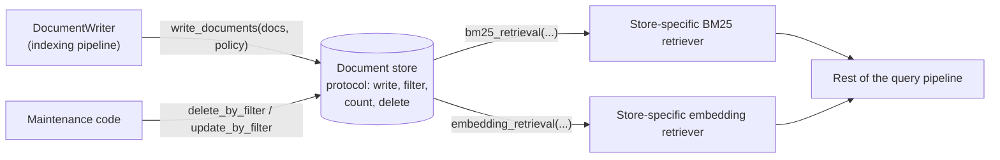

The document store is the one piece of state in a Haystack RAG system. The indexing pipeline writes to it, the query pipeline reads from it, and everything AskMeridian can ever say is bounded by what is inside it. This lesson covers Haystack's document store abstraction: the small protocol every store implements, how documents are identified, what the duplicate policies really do, the filter language, how retrievers bind to stores, and how to keep a store consistent as source documents change. You will see three failure modes that catch real teams (stale chunks after re-indexing, duplicates that are not detected, and a permission filter silently dropped) and the fix for each.

The general theory of vector databases is covered in the [vector database fundamentals](/learn/vector-database-fundamentals) module and the individual products in the [vector database ecosystem](/learn/vector-database-ecosystem) module. This lesson is about how Haystack wraps them.

## Learning objectives

- List the methods of Haystack's `DocumentStore` protocol and explain why retrievers, not stores, are the components in a pipeline.
- Explain how a `Document`'s default id is computed, and predict when two documents collide and when they do not.
- Choose a `DuplicatePolicy` for a write, and implement replace-by-key re-indexing that removes stale chunks.
- Write Haystack filters with comparison and logical operators, and choose a retriever `filter_policy` that cannot drop a mandatory filter.
- Select between the in-memory store and an integration store for a given workload.

## Prerequisites

- [Haystack architecture](/learn/haystack-and-other-frameworks/haystack-architecture), [Pipelines](/learn/haystack-and-other-frameworks/pipelines) and [Components](/learn/haystack-and-other-frameworks/components).
- [Document identifiers](/learn/document-engineering/document-identifiers): stable ids are the foundation of updates and deletes.
- [Metadata filtering](/learn/advanced-vector-database-engineering/metadata-filtering): what a filter does inside a vector database.
- [Incremental ingestion](/learn/understanding-document-ingestion/incremental-ingestion): keeping an index in step with its sources.

## Why this matters

A document store looks like plumbing, and teams treat it that way until it bites. Three examples, each common:

- The HR team edits the leave policy. The indexing pipeline re-runs. AskMeridian now sometimes says unused days "carry over" with no limit and sometimes says "up to 5", because the old chunk is still in the store next to the new one. Nothing failed; the write succeeded.
- A nightly job re-indexes all IT runbooks. After a month the store holds thirty copies of every chunk, retrieval returns the same passage five times in the top five, and nobody notices until the cloud bill arrives.
- Managers-only documents are protected by a filter set on the retriever. A product change adds a "search only HR documents" toggle, passed as a runtime filter. The toggle silently replaces the permission filter, and staff can now read managers-only material.

All three are consequences of how Haystack identifies documents, writes duplicates and combines filters. All three are invisible to tests that only check "the pipeline runs".

## The intuition

A document store is a library with a strict catalogue clerk. Every item that arrives gets a catalogue number computed from its exact contents and its label. Two identical items with identical labels get the same number, so the clerk notices the second one and follows the house rule for duplicates: refuse it, ignore it, or replace the old copy. But a revised edition of a book, even with one word changed, gets a new number. The clerk shelves it next to the old edition, because as far as the catalogue is concerned they are different items. Unless you tell the clerk "remove everything shelved under *Employee Handbook, leave chapter* before shelving the new edition", both editions stay on the shelf and readers find either.

And when a reader asks for help, the librarian (the retriever) applies the rules on the reading-room door ("staff only"), plus whatever the reader asks for ("only HR books"). Whether the reader's request is *added to* the door rules or *replaces* them is a setting, and the default is "replaces".

## How it works

### The protocol

Haystack defines `DocumentStore` as a Python protocol: any class with the right methods qualifies, with no base class required. The core methods are:

| Method | What it does |
| --- | --- |
| `write_documents(documents, policy)` | Writes documents; returns how many were written. |
| `filter_documents(filters)` | Returns all documents matching a filter (no ranking). |
| `count_documents()` | Returns the number of documents. |
| `delete_documents(document_ids)` | Deletes documents by id. |
| `to_dict()` / `from_dict()` | Serialises the store's configuration (not its contents). |

Many stores, including the in-memory one, add further operations such as `delete_by_filter`, `update_by_filter`, `count_documents_by_filter`, async variants of each, and metadata inspection helpers. Check which your chosen store implements before relying on one.

Notice what is missing: there is no `search` method in the protocol. Retrieval is store-specific (BM25 in one store is a Lucene query, in another a Python implementation; vector search uses different index types and options), so it is exposed through **retrievers**: components bound to one store class, such as `InMemoryBM25Retriever`, `InMemoryEmbeddingRetriever`, or an integration's own retrievers. A retriever takes the store in its constructor and calls the store's own search methods. That design keeps the protocol small and lets each retriever expose its store's real capabilities, at the cost that changing stores means changing retriever classes too.



### How documents are identified

A `Document` created without an explicit `id` gets one computed from its fields: a SHA-256 hash over the content, any binary blob and its MIME type, the metadata (serialised as JSON with sorted keys), and any embeddings. Three consequences follow:

1. **Identical content and metadata produce the same id.** Writing the same chunk twice is detectable.
2. **Any change produces a new id.** One edited word, one changed metadata value, even a new embedding, and the document is, to the store, a different document. There is no notion of "the same document, updated".
3. **Splitters add metadata.** `DocumentSplitter` adds `source_id` (the id of the parent document), `split_id`, `split_idx_start` and `page_number` to each chunk. Because `source_id` is the parent's content hash, editing *any* sentence of the parent changes the ids of *all* its chunks, including the unchanged ones.

You may set `id` yourself, for example from a source-system key and chunk number (`"handbook/leave.md#3"`). That makes updates in place possible, at the price of making you responsible for uniqueness.

### Duplicate policies

`write_documents` takes a `DuplicatePolicy` that says what to do when an incoming document's id already exists:

- `FAIL` raises a `DuplicateDocumentError`.
- `SKIP` keeps the existing document and ignores the new one (the in-memory store logs a warning).
- `OVERWRITE` replaces the existing document.
- `NONE`, the default, means "the store's default", which differs by store. In the in-memory store it means `FAIL`.

`DocumentWriter` takes the same policy. Because the default differs between stores, always set it explicitly: code that silently works on one store fails on another. And remember what the policies *cannot* do: they act only on id collisions. Since an edited document has a new id, no policy removes its old version.

### Re-indexing: replace by key

The standard fix is to give every chunk a stable **document key** in its metadata (the path or source-system id of the original, such as `doc_key: "handbook/leave.md"`), and re-index a changed source in two steps:

1. Delete every chunk whose `meta.doc_key` equals the source's key (`delete_by_filter`, or `filter_documents` followed by `delete_documents` on stores without it).
2. Write the new chunks with `OVERWRITE` (or `FAIL`, if you want to be told about surprises).

Between the two steps, retrieval sees no chunks for that source. For most internal assistants that brief gap is acceptable. Where it is not, write the new chunks first with a version field, switch queries to the new version, then delete the old one; or build a whole new index and switch an alias, as described in [index versioning](/learn/ci-cd-and-mlops/index-versioning).

### The filter language

Haystack filters are nested dictionaries, the same syntax for every store; each store translates them into its own query language. There are two kinds of node:

- A **comparison**: `{"field": "meta.dept", "operator": "==", "value": "HR"}`. Operators are `==`, `!=`, `>`, `>=`, `<`, `<=`, `in` and `not in`. Fields are `content`, `id` or `meta.<key>`.
- A **logical** node: `{"operator": "AND", "conditions": [ ... ]}` with `AND`, `OR` or `NOT`, whose conditions are further nodes.

So "HR documents for everyone, updated since 2025" is:

```json
{
  "operator": "AND",
  "conditions": [
    {"field": "meta.dept", "operator": "==", "value": "HR"},
    {"field": "meta.audience", "operator": "==", "value": "all"},
    {"field": "meta.updated", "operator": ">=", "value": "2025-01-01"}
  ]
}
```

Two practical cautions. First, comparing dates as strings works only for a consistent ISO format, and some stores compare date strings natively while others need numbers; check your store. Second, a filter on a field the store has not indexed (a payload index in Qdrant, a mapped keyword field in Elasticsearch) may be slow or, in some stores, rejected; filtering is only as good as the store's schema.

### Filter policies on retrievers

A retriever can hold filters from its constructor (`filters=...`) and also receive filters at run time. Its `filter_policy` decides how the two combine:

- `FilterPolicy.REPLACE` (the default): if runtime filters are given, they **replace** the constructor filters entirely.
- `FilterPolicy.MERGE`: runtime filters are combined with the constructor filters (with `AND` by default, and with runtime values overriding the constructor's for the same field).

`REPLACE` is convenient for a retriever whose default filter is just a default. It is dangerous for a retriever whose constructor filter is a rule, such as a tenant or audience restriction, because the first feature that passes a runtime filter removes the rule. For mandatory filters, use `MERGE`, or better, do not rely on constructor filters for security at all: build the permission filter per request from the authenticated user and pass it explicitly, as [document-level permissions](/learn/access-control-and-privacy/document-level-permissions) describes.

### The in-memory store and integration stores

`InMemoryDocumentStore` keeps documents in a Python dictionary and implements BM25 (default variant BM25L; `BM25Okapi` and `BM25Plus` are options) and brute-force embedding search (dot product by default, cosine as an option). Its `index` name and `shared=True` default mean that two instances created with the same index name in one process share their data, which matters when a pipeline is loaded from YAML and must see the documents another part of the program wrote. `save_to_disk` and `load_from_disk` give simple persistence. It is ideal for tests, prototypes and small corpora; it is single-process, has no access control, and its search cost grows linearly with the number of documents.

For production you use an integration, installed as its own package. At the time of writing these include, among others, Qdrant, Weaviate, Pinecone, Chroma, Milvus, pgvector (PostgreSQL), Elasticsearch, OpenSearch and MongoDB Atlas, each with its own retrievers: typically an embedding retriever, plus a BM25 or keyword retriever where the database supports full-text search, and sparse or hybrid retrievers where it supports those. The integrations catalogue lists the current set; capabilities differ, and that difference should drive the choice:

| If you need | Look for a store that offers |
| --- | --- |
| Keyword and vector search in one system | Native BM25 plus vectors (Elasticsearch, OpenSearch, pgvector with full-text search) |
| Strong metadata filtering with vector search | Filterable vector search with indexed payloads (Qdrant, Weaviate, and others) |
| Fewest new systems to operate | An extension to a database you already run (pgvector) |
| Zero infrastructure for tests | `InMemoryDocumentStore` |

Swapping stores changes three things in your code: the store class and its connection settings, the retriever classes, and any filter that relied on store-specific behaviour. The rest of the pipeline is untouched.

## In code

The script demonstrates the identity rules, the duplicate policies, the stale-chunk problem and its fix, and the filter-policy trap, all on the in-memory store so it runs anywhere.

```bash
pip install haystack-ai
```

```python
from haystack import Document
from haystack.components.preprocessors import DocumentSplitter
from haystack.components.retrievers.in_memory import InMemoryBM25Retriever
from haystack.document_stores.in_memory import InMemoryDocumentStore
from haystack.document_stores.types import DuplicatePolicy, FilterPolicy

# 1. Identity: the id is a hash of content and metadata.
a = Document(content="Laptops are refreshed every 3 years.", meta={"source": "handbook"})
b = Document(content="Laptops are refreshed every 3 years.", meta={"source": "handbook"})
c = Document(content="Laptops are refreshed every 3 years.", meta={"source": "runbook"})
print("same content+meta, same id:", a.id == b.id, "| different meta, same id:", a.id == c.id)

# 2. Duplicate policies.
store = InMemoryDocumentStore()
store.write_documents([a])
try:
    store.write_documents([b])                      # default policy: NONE -> FAIL here
except Exception as err:
    print("default policy:", type(err).__name__)
print("SKIP wrote:", store.write_documents([b], policy=DuplicatePolicy.SKIP),
      "| OVERWRITE wrote:", store.write_documents([b], policy=DuplicatePolicy.OVERWRITE),
      "| count:", store.count_documents())

# 3. Re-indexing an edited document: OVERWRITE is not enough.
splitter = DocumentSplitter(split_by="sentence", split_length=1)
def chunks(text):
    doc = Document(content=text, meta={"doc_key": "handbook/leave.md", "owner": "HR"})
    return splitter.run([doc])["documents"]

v1 = "Annual leave is 25 days. Unused days carry over. Carried-over days must be used by 31 March."
v2 = "Annual leave is 25 days. Up to 5 unused days carry over. Carried-over days must be used by 31 March."
kb = InMemoryDocumentStore()
kb.write_documents(chunks(v1), policy=DuplicatePolicy.OVERWRITE)
kb.write_documents(chunks(v2), policy=DuplicatePolicy.OVERWRITE)
key = {"field": "meta.doc_key", "operator": "==", "value": "handbook/leave.md"}
print("\nafter naive re-index:", kb.count_documents(), "chunks")
for d in sorted(kb.filter_documents(key), key=lambda d: d.content):
    print("   ", d.content.strip())

deleted = kb.delete_by_filter(key)                 # replace-by-key: delete, then write
kb.write_documents(chunks(v2), policy=DuplicatePolicy.OVERWRITE)
print(f"replace-by-key: deleted {deleted}, now {kb.count_documents()} chunks")

# 4. Filters and the filter policy.
hr = InMemoryDocumentStore()
hr.write_documents([
    Document(content="Leave requests go to your line manager.", meta={"audience": "all", "dept": "HR"}),
    Document(content="Leave approval thresholds for managers.", meta={"audience": "managers", "dept": "HR"}),
    Document(content="Leave for contractors is set in their contract.", meta={"audience": "all", "dept": "Legal"}),
])
everyone = {"field": "meta.audience", "operator": "==", "value": "all"}
only_hr = {"field": "meta.dept", "operator": "==", "value": "HR"}
for policy in (FilterPolicy.REPLACE, FilterPolicy.MERGE):
    r = InMemoryBM25Retriever(document_store=hr, filters=everyone, filter_policy=policy)
    hits = r.run(query="leave", filters=only_hr)["documents"]
    print(f"\n{policy.value}: init filter audience=all, runtime filter dept=HR")
    for d in hits:
        print(f"    [{d.meta['audience']:<8}] {d.content}")
```

```output
same content+meta, same id: True | different meta, same id: False
default policy: DuplicateDocumentError
ID '888a27f7fecb41049bab4d2e27f97763d760b60eeb2bdfbc2e553fe3b8efc2cb' already exists
SKIP wrote: 0 | OVERWRITE wrote: 1 | count: 1

after naive re-index: 6 chunks
    Annual leave is 25 days.
    Annual leave is 25 days.
    Carried-over days must be used by 31 March.
    Carried-over days must be used by 31 March.
    Unused days carry over.
    Up to 5 unused days carry over.
replace-by-key: deleted 6, now 3 chunks

replace: init filter audience=all, runtime filter dept=HR
    [managers] Leave approval thresholds for managers.
    [all     ] Leave requests go to your line manager.

merge: init filter audience=all, runtime filter dept=HR
    [all     ] Leave requests go to your line manager.
```

### What the output shows

- **Ids follow content and metadata.** The two identical documents share an id; changing only the `source` metadata gives a different id. The same sentence can therefore exist twice in a store if it arrives with different metadata, and no duplicate policy will notice.
- **The default policy failed; `SKIP` and `OVERWRITE` behaved as named.** The `ID '...' already exists` line is the in-memory store's warning for the skipped document. `SKIP` reported 0 written, `OVERWRITE` 1, and the store still holds one document.
- **The naive re-index doubled everything.** The edit changed one sentence, but all six chunks now coexist, including two copies of each unchanged sentence. The unchanged sentences got new ids because their `source_id` metadata (the parent's hash) changed. Both versions of the carry-over rule are now retrievable, which is exactly the contradictory-answer bug from the introduction.
- **Replace-by-key fixed it.** Deleting by the stable `doc_key` removed all six chunks regardless of their ids, and the rewrite left the three current ones.
- **`REPLACE` dropped the audience rule.** With the default policy the runtime `dept=HR` filter replaced the constructor's `audience=all` filter, and the managers-only document came back. With `MERGE` both conditions applied.

Common errors at this stage: a `DuplicateDocumentError` the first time a pipeline is re-run (set the writer's policy explicitly), filters that use `"dept"` instead of `"meta.dept"` (a filter on a field that does not exist returns nothing rather than raising, in many stores), and `delete_by_filter` missing on a store integration (fall back to `filter_documents` plus `delete_documents`).

### The same pattern against Qdrant

AskMeridian runs on Qdrant, so the production version uses the Qdrant integration. The snippet below follows the integration's documented API but was not executed for this lesson, because it needs the separately installed integration and a running Qdrant server; check the integration's page for current parameter names.

```bash
pip install qdrant-haystack
```

```python
from haystack.document_stores.types import DuplicatePolicy, FilterPolicy
from haystack.utils import Secret
from haystack_integrations.components.retrievers.qdrant import QdrantEmbeddingRetriever
from haystack_integrations.document_stores.qdrant import QdrantDocumentStore

store = QdrantDocumentStore(
    url="http://localhost:6333",
    index="askmeridian",
    embedding_dim=384,                 # must match the embedding model
    similarity="cosine",
    recreate_index=False,              # never True in production code paths
    api_key=Secret.from_env_var("QDRANT_API_KEY", strict=False),
)

retriever = QdrantEmbeddingRetriever(document_store=store, top_k=10, filter_policy=FilterPolicy.MERGE)

def reindex(doc_key: str, new_chunks):
    store.delete_by_filter({"field": "meta.doc_key", "operator": "==", "value": doc_key})
    store.write_documents(new_chunks, policy=DuplicatePolicy.OVERWRITE)
```

Everything that mattered in the in-memory example carries over: the explicit duplicate policy, the stable `doc_key`, and `MERGE` on the retriever. Two things are new. `embedding_dim` must equal the embedding model's output size, or writes fail. And `recreate_index=True`, convenient in a notebook, deletes the collection on start-up; keep it out of any code path that can run in production. For local experiments without a server, the Qdrant integration can also run against Qdrant's in-process mode (`location=":memory:"`).

## A real-world example

After the leave-policy incident, the Platform team audits AskMeridian's store. They count chunks per `doc_key` and compare with what the current source files would produce. About one source in eight has more chunks in the store than its current version produces: these are the documents edited since launch, each carrying the chunks of every past version.

They make three changes. Every source document gets a `doc_key` (its path in the HR or IT repository) and a `content_hash` of the whole file in metadata. The indexing job becomes incremental: for each source, it compares the file's hash with the `content_hash` stored on its chunks, and only for changed files runs delete-by-key then write. Deletions of source files trigger delete-by-key with no write. Finally, they add a nightly consistency check that recomputes the expected chunk count per key and alerts on any mismatch.

The same audit finds the filter-policy problem. AskMeridian's contractor-facing retriever had `filters={"field": "meta.audience", ...}` in its constructor and the default `REPLACE` policy, and the new "search only IT runbooks" option passed a runtime filter. The team switched to building the permission filter per request from the user's groups and combining it with any user-chosen filter in their own code, so that no retriever setting can drop it, and added a test that sends every user-facing filter option as a contractor and asserts no employees-only document is returned.

## Common mistakes

- **Relying on `OVERWRITE` to update edited documents.** An edit changes the id, so the old chunks remain and contradict the new ones.
- **Leaving the duplicate policy at `NONE`.** Behaviour then depends on the store, so code that works on one store raises or silently duplicates on another.
- **No stable document key in metadata.** Without one there is no way to find all chunks of a source, so deletions and updates leak stale data.
- **Security filters on a retriever with `FilterPolicy.REPLACE`.** Any runtime filter removes them, and the leak produces no error.
- **Filtering on unindexed fields in a large store.** Queries slow down sharply or fail, depending on the database.
- **Using `InMemoryDocumentStore` in a multi-process service.** Each worker process has its own copy, so writes in one are invisible to the others.

## Best practices

- Put a stable `doc_key`, a source-file hash and an ingestion timestamp in every chunk's metadata.
- Re-index by key: delete all chunks for a changed source, then write; delete by key when a source is removed.
- Set `DuplicatePolicy` explicitly on every `DocumentWriter`.
- Build permission filters per request from the authenticated identity, combine them yourself, and test them with every user-facing filter option.
- Index (in the database's own sense) every metadata field you filter on.
- Keep store-specific code (connection, retriever classes) in one module so a store change touches one file.

## Performance considerations

The in-memory store's embedding search compares the query with every stored vector. At 384 dimensions, one comparison is 384 multiply-adds; 100,000 chunks is 38.4 million operations per query, which NumPy does in the order of tens of milliseconds on one core. At 10 million chunks that becomes seconds, and the vectors alone occupy about $10^7 \times 384 \times 4$ bytes, roughly 15 GB of RAM. That is why production stores use approximate indexes such as [HNSW](/learn/vector-indexing-algorithms/hnsw).

Writes cost more than they appear. Each chunk written to a remote store is a network round trip unless batched; `DocumentWriter` and the integrations batch internally, but very large writes are still bounded by the database's ingest rate. Re-indexing by key adds one filtered delete per changed source; for a nightly job over a few thousand changed files this is negligible, but a full re-index of a large corpus should be done as a new index plus an alias switch rather than millions of deletes.

Filtered vector search can be faster or slower than unfiltered search depending on the database and the filter's selectivity. A very selective filter (one department out of fifty) can make approximate search return fewer than `top_k` results in some engines unless they handle filtering inside the index traversal. Measure recall with your real filters, not just without them.

## Security considerations

- **The store is the attack surface for data exposure.** Whatever a retriever can read, a crafted question can surface. Enforce permissions in the retrieval filter, built from the authenticated user, never from request parameters alone.
- **Filter policy is a security setting.** Treat `REPLACE` on a retriever with constructor filters as a defect unless those filters are genuinely optional.
- **Credentials as secrets.** Pass database keys as `Secret.from_env_var`, so they never appear in serialised pipeline YAML.
- **Deletion must reach the store.** When a source document is deleted for legal or privacy reasons, its chunks must be deleted by key from the store and from any backups or snapshots; see [secure deletion](/learn/enterprise-rag-governance/secure-deletion).
- **Poisoned documents persist.** A malicious document written once is retrieved until deleted; keep ingestion provenance (`doc_key`, source system, ingestion time) so you can find and remove everything it produced.

## Summary

- Haystack's `DocumentStore` is a small protocol (write, filter, count, delete, serialise); retrieval is done by store-specific retriever components.
- A default document id is a hash of content, metadata and embeddings, so any edit, including the parent hash a splitter adds, produces new ids.
- Duplicate policies only act on id collisions; updating an edited source needs a stable document key and delete-then-write.
- Filters are nested comparison and logical dictionaries that each store translates; a retriever's `filter_policy` decides whether runtime filters replace or merge with constructor filters.
- Use the in-memory store for tests and prototypes and an integration store, chosen by its retrieval and filtering capabilities, for production.

## Exercises

1. Without running anything, how many documents does the store hold after this sequence, and why? Write `Document(content="VPN is required on public Wi-Fi.")` with `OVERWRITE`; write `Document(content="VPN is required on public Wi-Fi.", meta={"owner": "IT"})` with `SKIP`; write the first document again with `SKIP`.

<details><summary>Show solution</summary>

Two. The first two documents have different metadata, so different ids; `SKIP` only skips id collisions, so the second is written. The third write repeats the first document's content and (empty) metadata, so its id already exists and `SKIP` ignores it.

</details>

2. Write a filter for "IT runbook chunks owned by the Platform team, or any chunk mentioning an Atlas error code in its `codes` metadata list containing E-4021". Assume the fields `meta.source`, `meta.owner` and `meta.codes`.

<details><summary>Show solution</summary>

```json
{
  "operator": "OR",
  "conditions": [
    {"operator": "AND", "conditions": [
      {"field": "meta.source", "operator": "==", "value": "it-runbooks"},
      {"field": "meta.owner", "operator": "==", "value": "Platform"}
    ]},
    {"field": "meta.codes", "operator": "in", "value": ["E-4021"]}
  ]
}
```

There is a trap in the last condition. In Haystack's filter semantics, `in` tests whether the document's field value is one of the values in the given list. It does not test whether a stored list contains a value: on the in-memory store, a document with `meta.codes == ["E-4021", "E-4012"]` does *not* match this condition, while one with `meta.codes == "E-4021"` does. Some integration stores translate list fields differently, so check yours; the portable design is to store one keyword field per code, or a separate boolean such as `meta.has_e4021`, for anything you need to filter on.

</details>

3. Extend the replace-by-key code so that it skips sources whose content has not changed, using a `content_hash` in metadata. Run it twice on the same text and show that the second run writes nothing.

<details><summary>Show solution</summary>

```python
import hashlib

def upsert_source(store, doc_key, text):
    digest = hashlib.sha256(text.encode()).hexdigest()
    key = {"field": "meta.doc_key", "operator": "==", "value": doc_key}
    existing = store.filter_documents(key)
    if existing and all(d.meta.get("content_hash") == digest for d in existing):
        return 0
    store.delete_by_filter(key)
    parent = Document(content=text, meta={"doc_key": doc_key, "content_hash": digest})
    return store.write_documents(splitter.run([parent])["documents"], policy=DuplicatePolicy.OVERWRITE)

kb = InMemoryDocumentStore()
print(upsert_source(kb, "handbook/leave.md", v2))   # 3
print(upsert_source(kb, "handbook/leave.md", v2))   # 0
```

The splitter copies `content_hash` to every chunk, so one filter call answers "has this source changed?". This is the core of [incremental ingestion](/learn/understanding-document-ingestion/incremental-ingestion).

</details>

4. Design decision: AskMeridian's store holds 2 million chunks. The team wants zero-downtime re-embedding with a new embedding model. Why is delete-then-write by key the wrong tool here, and what would you do instead?

<details><summary>Show solution</summary>

A model change alters every vector, so every key would be deleted and rewritten. During the hours that takes, the store would mix old-model and new-model vectors, and query embeddings (from one model) would be compared with documents from both: retrieval quality would collapse for the duration. Instead, build a complete new index (a new Qdrant collection) with the new model alongside the old, evaluate it, then switch the query pipeline (and its query embedder) to the new collection in one step, keeping the old one for rollback. That is blue-green indexing, covered in [index versioning](/learn/ci-cd-and-mlops/index-versioning).

</details>

## Check your understanding

```quiz
[
  {"q": "Why is there no `search` method in Haystack's `DocumentStore` protocol?", "options": ["Search is done by `filter_documents`", "Retrieval is store-specific, so it is exposed through retriever components bound to each store class", "Stores only support exact-match lookups", "Search is performed by the pipeline itself"], "answer": 1, "why": "Each store implements search differently, so store-specific retrievers expose it; the protocol stays small."},
  {"q": "A source document is edited and its chunks are re-written with `DuplicatePolicy.OVERWRITE`. What happens to the old chunks?", "options": ["They are overwritten because the source path is the same", "They are merged with the new ones", "The write fails", "They remain, because the edited chunks have new ids"], "answer": 3, "why": "Default ids hash content and metadata (including the parent's hash in `source_id`), so new chunks never collide with old ones; delete by a stable key first."},
  {"q": "A retriever is built with `filters={'field': 'meta.tenant', 'operator': '==', 'value': 'acme'}` and the default filter policy. A request passes `filters={'field': 'meta.lang', 'operator': '==', 'value': 'en'}`. What filter is applied?", "options": ["Only the language filter", "Both, combined with AND", "Only the tenant filter", "Neither; conflicting filters are ignored"], "answer": 0, "why": "The default `FilterPolicy.REPLACE` replaces constructor filters with runtime filters, which is why mandatory filters need `MERGE` or per-request construction."},
  {"q": "What does `DuplicatePolicy.NONE` mean when writing to a document store?", "options": ["Duplicates are always allowed", "Duplicates always raise an error", "Use the store's own default, which differs between stores", "Skip every document"], "answer": 2, "why": "`NONE` defers to the store; the in-memory store treats it as `FAIL`. Set the policy explicitly to avoid store-dependent behaviour."},
  {"q": "Why is `InMemoryDocumentStore` a poor choice for a web service with four worker processes?", "options": ["It cannot do BM25", "Each process holds its own copy, so writes in one process are invisible to the others", "It does not support filters", "It cannot store embeddings"], "answer": 1, "why": "Its data lives in one process's memory; `shared=True` shares an index only within a process."}
]
```

## Further reading

- [Haystack documentation: Document Store](https://docs.haystack.deepset.ai/docs/document-store): the protocol, duplicate policies and the list of available stores.
- [Haystack documentation: Metadata filtering](https://docs.haystack.deepset.ai/docs/metadata-filtering): the filter syntax and operator semantics.
- [Haystack integrations](https://haystack.deepset.ai/integrations): document store integrations with their retrievers and install commands.
- [Qdrant documentation](https://qdrant.tech/documentation/): payload indexes and filtered search, which determine how filters perform in AskMeridian's production store.
