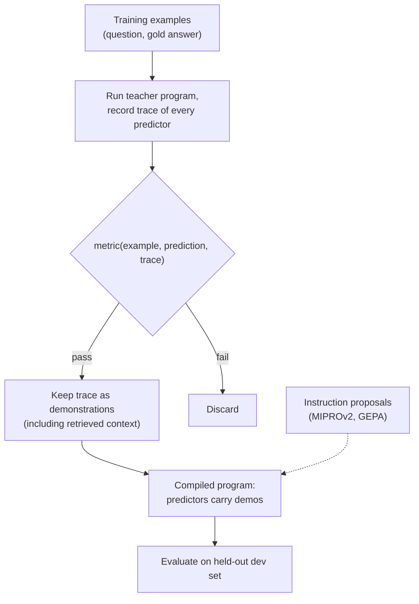

Every framework in this phase so far has treated the prompt as something you write. You write the system prompt, choose the few-shot examples, word the instructions for the query rewriter, and then change them by hand when evaluation numbers disappoint. **DSPy**, a framework that began as a Stanford NLP research project, takes a different position: the prompt is a *parameter* of your program, like a weight in a model, and it should be set by an optimiser that maximises a metric you define on examples you provide. This lesson explains that idea, the abstractions DSPy uses to make it work (signatures, modules, metrics and optimisers), what the optimisers actually do, how retrieval fits in, and when the approach is worth its cost for a RAG system.

The code in this lesson was run against `dspy` 3.5.0. Because the optimisation step needs many model calls, the runnable example uses DSPy's scripted test model so that you can watch the mechanism without an API key; the configuration for a real model is shown separately and was not executed.

## Learning objectives

- Explain what it means to treat prompts as parameters optimised against a metric, and what that requires from you.
- Write a DSPy signature and a module that combines retrieval with a prediction step, and define a metric for it.
- Describe how `BootstrapFewShot` builds demonstrations from traces, and how instruction-proposing optimisers such as MIPROv2 and GEPA extend the search.
- Estimate the number of model calls an optimisation run will make and the statistical noise in its evaluation score.
- Decide when DSPy optimisation is worth adopting for a RAG system, and how to use its output alongside Haystack or another framework.

## Prerequisites

- [Haystack architecture](/learn/haystack-and-other-frameworks/haystack-architecture): for comparison with a pipeline framework.
- [System prompts](/learn/prompt-engineering-for-rag/system-prompts) and [Grounded generation](/learn/prompt-engineering-for-rag/grounded-generation): what is being optimised.
- [Golden datasets](/learn/testing-and-benchmarking/golden-datasets): DSPy is only as good as the examples you give it. (Phase 12 covers these in depth; the basic idea is enough here.)
- [Precision@K](/learn/retrieval-fundamentals/precision-k): you should be comfortable with metrics as averages over a labelled set.

## Why this matters

Hand-written prompts have three problems that grow with the system.

They are **brittle**. A prompt tuned for one model often degrades on the next, so every model upgrade becomes a round of manual re-tuning. A RAG system with a query rewriter, an answer generator and a citation checker has three prompts to re-tune, and they interact.

They are **unmeasured**. Most prompt changes are judged by reading a handful of outputs. Without a metric over a fixed set of examples, you cannot tell an improvement from a change.

They are **monolithic**. A single long prompt mixes the task description, output format rules and examples. When one part is changed, nobody knows which part caused the difference.

DSPy's answer is to separate *what* each model call should do (a typed signature) from *how* it is phrased (instructions and demonstrations, which the framework renders), and to let an optimiser choose the phrasing by maximising your metric on your examples. If the model changes, you re-run the optimiser instead of re-tuning by hand. The price is that you must provide what the optimiser needs: a program with clear steps, a metric that captures quality, and labelled examples. For many teams that price is the real benefit, because it forces the evaluation discipline they should have had anyway.

## The intuition

Think of training a new member of the support desk. You could write them a long instruction manual and hope. Or you could give them a short job description, a checklist of what a good reply contains, and a pile of real past tickets. On the first day they answer the tickets; you mark each reply against the checklist; the replies that pass go into a binder labelled "how we do it here", and the next day they study that binder before answering. After a few rounds, the binder holds a set of good worked examples chosen by the checklist, not by whoever wrote the manual.

DSPy works the same way. The job description is the **signature**. The checklist is the **metric**. The pile of past tickets is the **training set**. The binder is the set of **demonstrations** the optimiser keeps. Some optimisers also rewrite the job description itself, trying several versions and keeping the one whose new starter scores best on the checklist.

## How it works

### Signatures: what a model call does

A **signature** declares the inputs and outputs of one model call, with types and short descriptions. It can be a string, `"context, question -> answer"`, or a class:

```python
class GroundedQA(dspy.Signature):
    """Answer the staff question using only the context. Keep it short."""
    context: list[str] = dspy.InputField(desc="handbook passages")
    question: str = dspy.InputField()
    answer: str = dspy.OutputField(desc="a short factual answer")
```

The docstring becomes the task instruction. The field names, types and descriptions tell DSPy how to format inputs and how to parse outputs. You do not write the prompt; an **adapter** renders the signature into messages for the model and parses the reply back into typed fields. In `dspy` 3.5.0 the default adapter marks each field with XML-style tags, as you will see in the output below; other adapters produce JSON. The exact format is an implementation detail that has changed across versions, which is the point: your program does not depend on it.

### Modules: how calls are composed

A **module** wraps a signature with a prompting strategy. `dspy.Predict(Sig)` makes a direct call. `dspy.ChainOfThought(Sig)` adds a reasoning output field before the answer. `dspy.ReAct` runs a tool-using loop. Your own program is a `dspy.Module` subclass whose `forward` method calls these modules and ordinary Python, much like a PyTorch module:

```text
AskMeridian.forward(question)        (pseudocode)
    context  = search(question, k)       # plain Python: any retriever
    return   generate(context, question) # a dspy.Predict over GroundedQA
```

Every `Predict` inside a module is a **predictor**, and each predictor has its own learnable state: its instruction text and its list of demonstrations. That state is what optimisers change and what `save` writes to disk.

### Metrics: what "good" means

A **metric** is a Python function `metric(example, prediction, trace=None)` that returns a number or a boolean. It can be exact match, a check that the answer contains the gold string, an F1 over tokens, a citation check, or a call to another model acting as a judge. The `trace` argument is set during optimisation and lets a metric be stricter when deciding whether a trace is good enough to become a demonstration. The metric is the most important thing you write: an optimiser will exploit any gap between the metric and what you actually want.

### Optimisers: what they search over

An **optimiser** (DSPy's older name was "teleprompter") takes a program, a training set and a metric, and returns a compiled copy of the program with new predictor state. The main families are:

- **`LabeledFewShot`** copies labelled examples straight into each predictor's demonstrations. It is the baseline.
- **`BootstrapFewShot`** runs a *teacher* (by default the program itself) on the training examples, records the full trace of every predictor's inputs and outputs, scores the final prediction with the metric, and keeps the traces that pass as demonstrations. Because traces include intermediate inputs, a bootstrapped demonstration for the answer step contains the context that was actually retrieved, not just a question and a gold answer.
- **`BootstrapFewShotWithRandomSearch`** builds several candidate demonstration sets that way, evaluates each candidate program on a validation set, and keeps the best.
- **`MIPROv2`** also optimises instructions. A *prompt model* proposes candidate instructions for each predictor, informed by a summary of the data, the program's code and bootstrapped examples; the optimiser then searches over combinations of instructions and demonstration sets with Bayesian optimisation, evaluating candidates on minibatches of the validation set. Its `auto` setting (`light`, `medium`, `heavy`) trades search budget against quality.
- **`GEPA`** evolves instructions by reflection: a *reflection model* reads traces and textual feedback from the metric (for example, "the answer cited a passage that does not contain the figure") and proposes revised instructions, keeping a set of candidates that are each best on some examples. It needs a metric that can return feedback text, not just a score.
- **`BootstrapFinetune`** uses bootstrapped traces as training data to fine-tune the weights of a smaller model, instead of putting them in the prompt.

Here is the `BootstrapFewShot` procedure step by step, since the others build on it:

1. For each training example, run the teacher program on its inputs, recording every predictor's inputs and outputs.
2. Score the final prediction against the example's labels with the metric (with `trace` set).
3. If it passes, turn each predictor's recorded inputs and outputs into a demonstration for that predictor.
4. Stop when each predictor has `max_bootstrapped_demos` demonstrations or the training set is exhausted; optionally top up with up to `max_labeled_demos` raw labelled examples.
5. Return a copy of the student program whose predictors carry these demonstrations.



### Where retrieval fits

DSPy does not prescribe a retriever. Inside `forward` you can call anything: a function over a local embedding index (as below), DSPy's own `dspy.Embeddings` retriever, a Qdrant client, or a whole Haystack retrieval pipeline. DSPy optimises the *language-model calls* around retrieval, which in RAG means three places:

- **The answer step**: instructions and demonstrations for grounded, cited, correctly formatted answers.
- **Query generation**: in multi-hop programs, a predictor that writes the search query for each hop is often where optimisation helps most, because good queries are hard to hand-write.
- **Checks and routers**: predictors that decide whether context is sufficient or which index to search.

Retriever settings such as `k`, or the choice of embedding model, are ordinary Python values. DSPy's optimisers do not tune them; you tune them with the stage-by-stage evaluation from [retrieval pipelines](/learn/haystack-and-other-frameworks/retrieval-pipelines). The two kinds of optimisation compose: fix the retriever by measurement, then compile the prompts around it.

### Established practice and open questions

DSPy's approach is well documented in its papers and widely used, and demonstration bootstrapping in particular is a simple, reliable technique. Two cautions keep it in proportion. First, the published gains were measured on specific benchmarks and models; how much optimisation improves *your* system can only be learned on your data. Second, optimised prompts can overfit the training and validation sets, especially small ones, and gains can shrink when the underlying model changes. Treat a compiled program like a trained model: evaluate it on held-out data, version it, and re-compile when the model or data changes.

## The mathematics

Optimisation in DSPy is search for the predictor state that maximises the average metric on a dataset:

$$
\Phi^{*} = \arg\max_{\Phi} \; \frac{1}{|D|} \sum_{(x,\, y) \in D} \mu\big(P_{\Phi}(x),\, y\big)
$$

- $\Phi$ is the program's learnable state: the instruction and demonstrations of every predictor.
- $P_{\Phi}(x)$ is the program's prediction for input $x$ using that state.
- $y$ is the label (the gold answer, or whatever your metric needs).
- $\mu$ is your metric, returning a score such as 0 or 1.
- $D$ is the dataset the optimiser evaluates on: the training set for bootstrapping, a validation set for selection.

The search is over discrete text, so there is no gradient: optimisers propose candidates and evaluate them. Because the evaluation is an average over a finite sample, it is noisy, and the noise decides how many examples you need. For a 0/1 metric with true accuracy $p$ on $n$ independent examples, the standard error of the measured accuracy is:

$$
\text{SE} = \sqrt{\frac{p\,(1 - p)}{n}}
$$

**Worked example.** With $p = 0.8$ and a validation set of $n = 50$, $\text{SE} = \sqrt{0.8 \times 0.2 / 50} = \sqrt{0.0032} = 0.057$. A rough 95% interval is $\pm 1.96 \times 0.057 = \pm 0.11$: a measured 0.80 is consistent with anything from about 0.69 to 0.91. If an optimiser reports that candidate A scored 0.82 and candidate B 0.78 on these 50 examples, the difference is well inside the noise. And when an optimiser compares many candidates on the same set and keeps the best, it is selecting partly for luck, which is why the winner's score on held-out data is usually lower.

```python
import math

def standard_error(p, n):
    return math.sqrt(p * (1 - p) / n)

for n in (20, 50, 200, 800):
    se = standard_error(0.80, n)
    print(f"n={n:<4} SE={se:.3f}  95% interval ~ 0.80 +/- {1.96 * se:.3f}")
```

```output
n=20   SE=0.089  95% interval ~ 0.80 +/- 0.175
n=50   SE=0.057  95% interval ~ 0.80 +/- 0.111
n=200  SE=0.028  95% interval ~ 0.80 +/- 0.055
n=800  SE=0.014  95% interval ~ 0.80 +/- 0.028
```

Halving the interval needs four times the examples. Two hundred labelled questions is a sensible minimum for trusting differences of a few points; twenty is enough to bootstrap demonstrations, not to choose between candidates.

## In code

The example builds `AskMeridian` as a DSPy program: a local MiniLM retriever over six handbook passages, and a `Predict` over the `GroundedQA` signature. It evaluates the program, compiles it with `BootstrapFewShot`, inspects what changed, and saves the result.

The model is DSPy's `DummyLM`, a scripted test model that returns a fixed answer for each question. Its script deliberately gets two of five training questions wrong (a superseded £250 budget, and "receipts are always required"), the way a weak model might. A scripted model does not learn from demonstrations, so this example cannot show a quality gain; what it shows exactly is the mechanism: which traces pass the metric, what a demonstration contains, and how the compiled prompt differs.

```bash
pip install dspy sentence-transformers
```

```python
import json, random
import dspy
from dspy.utils import DummyLM
from sentence_transformers import SentenceTransformer

random.seed(0)

DOCS = [
    "Annual leave is 25 days; up to 5 unused days carry over and must be used by 31 March.",
    "Staff may work remotely up to 3 days a week; the home-office equipment budget is £400.",
    "Expenses must be submitted within 30 days; anything over £75 needs a receipt.",
    "Passwords must be rotated every 90 days, and the VPN is required on public Wi-Fi.",
    "Laptops are refreshed every 3 years. The support desk is open 08:00 to 18:00 UK time.",
    "Error E-4021 means the VPN client is out of date; update it from the IT portal.",
]
encoder = SentenceTransformer("sentence-transformers/all-MiniLM-L6-v2")
doc_vecs = encoder.encode(DOCS, normalize_embeddings=True)

def search(query: str, k: int = 2) -> list[str]:
    q = encoder.encode([query], normalize_embeddings=True)[0]
    order = (doc_vecs @ q).argsort()[::-1][:k]
    return [DOCS[i] for i in order]

class GroundedQA(dspy.Signature):
    """Answer the staff question using only the context. Keep it short."""
    context: list[str] = dspy.InputField(desc="handbook passages")
    question: str = dspy.InputField()
    answer: str = dspy.OutputField(desc="a short factual answer")

class AskMeridian(dspy.Module):
    def __init__(self, k: int = 2):
        super().__init__()
        self.k = k
        self.generate = dspy.Predict(GroundedQA)

    def forward(self, question: str):
        context = search(question, self.k)
        return self.generate(context=context, question=question)

def answer_match(example, pred, trace=None) -> bool:
    return example.answer.lower() in pred.answer.lower()

trainset = [
    dspy.Example(question="How many days of annual leave do I get?", answer="25 days"),
    dspy.Example(question="What is the home-office equipment budget?", answer="£400"),
    dspy.Example(question="How often must I change my password?", answer="90 days"),
    dspy.Example(question="Above what amount do I need a receipt?", answer="£75"),
    dspy.Example(question="How often are laptops replaced?", answer="3 years"),
]
trainset = [ex.with_inputs("question") for ex in trainset]

# A scripted stand-in for a real model: keyed on the question text.
# Two of its five answers are wrong, as a weak model's would be.
scripted = DummyLM({
    "How many days of annual leave do I get?": {"answer": "You get 25 days of annual leave."},
    "What is the home-office equipment budget?": {"answer": "It is £250."},
    "How often must I change my password?": {"answer": "Every 90 days."},
    "Above what amount do I need a receipt?": {"answer": "Receipts are always required."},
    "How often are laptops replaced?": {"answer": "Every 3 years."},
    "When is the support desk open?": {"answer": "08:00 to 18:00 UK time."},
})
dspy.configure(lm=scripted)

program = AskMeridian()
evaluate = dspy.Evaluate(devset=trainset, metric=answer_match, num_threads=1)
print("baseline score:", evaluate(program).score)
new_q = "When is the support desk open?"
program(question=new_q)
print("messages in prompt before compiling:", len(scripted.history[-1]["messages"]))

optimizer = dspy.BootstrapFewShot(metric=answer_match, max_bootstrapped_demos=4, max_labeled_demos=0)
compiled = optimizer.compile(program, trainset=trainset)

demos = compiled.generate.demos
print(f"bootstrapped demos kept: {len(demos)} of {len(trainset)} training questions")
for d in demos:
    print(" -", d.question, "->", d.answer)

compiled(question=new_q)
messages = scripted.history[-1]["messages"]
print("messages in prompt after compiling: ", len(messages), [m["role"] for m in messages])
print("first demonstration, as the model sees it:")
print(messages[1]["content"])

compiled.save("askmeridian_compiled.json")
state = json.load(open("askmeridian_compiled.json"))
print("saved keys:", sorted(state.keys()))
print("demo fields:", sorted(state["generate"]["demos"][0].keys()))
```

```output
2026/11/14 20:16:53 INFO dspy.evaluate.evaluate: Average Metric: 3 / 5 (60.0%)
baseline score: 60.0
messages in prompt before compiling: 2
Bootstrapped 3 full traces after 4 examples for up to 1 rounds, amounting to 5 attempts.
bootstrapped demos kept: 3 of 5 training questions
 - How many days of annual leave do I get? -> You get 25 days of annual leave.
 - How often must I change my password? -> Every 90 days.
 - How often are laptops replaced? -> Every 3 years.
messages in prompt after compiling:  8 ['system', 'user', 'assistant', 'user', 'assistant', 'user', 'assistant', 'user']
first demonstration, as the model sees it:
<context>
["Annual leave is 25 days; up to 5 unused days carry over and must be used by 31 March.", "Staff may work remotely up to 3 days a week; the home-office equipment budget is £400."]
</context>

<question>
How many days of annual leave do I get?
</question>
saved keys: ['generate', 'metadata']
demo fields: ['answer', 'augmented', 'context', 'question']
```

### What the output shows

- **The baseline is measured before anything changes.** `dspy.Evaluate` runs the program over the examples and averages the metric: 3 of 5 answers contain the gold string. In a real project this would be a separate development set, not the training set.
- **Only passing traces became demonstrations.** The budget and receipt answers failed the metric and were discarded; the other three were kept. The metric is the filter, so a weak metric (for example one that accepted "£250") would have taught the model the superseded figure.
- **Demonstrations carry the retrieved context.** The demonstration's `context` field holds the two passages the retriever actually returned for that question, and the saved demo has `augmented: True`, DSPy's marker for a bootstrapped (rather than hand-labelled) demonstration. The model therefore sees examples of answering from retrieved passages, which is the behaviour you want, rather than bare question-answer pairs.
- **The compiled prompt is longer.** Before compiling, a call has two messages (system and user). After, it has eight: the system message, three user-assistant demonstration pairs, and the real question. That is the cost of few-shot demonstrations: every call now carries three extra retrieved contexts.
- **The program's state is a file.** `save` writes each predictor's demonstrations (and instructions) as JSON, which you can review in a pull request and load into the same program class with `load`. The retriever is not in it: it is code, not learned state.
- **The log line is DSPy's own summary** of the bootstrapping pass.

Errors you are likely to meet: forgetting `.with_inputs("question")` on examples (DSPy then cannot tell inputs from labels); a metric that raises on unexpected output instead of returning `False`; and running an optimiser against a real model without estimating the number of calls first (see performance considerations).

### Running it against Claude

With a real model, the only change is the configuration. DSPy addresses models by provider-prefixed names and reads the key from the environment. This snippet was not executed for this lesson; it needs an API key and makes many paid calls.

```python
import dspy

lm = dspy.LM("anthropic/claude-opus-5-5", max_tokens=1024)  # reads ANTHROPIC_API_KEY
dspy.configure(lm=lm)

devset = [...]  # held-out labelled examples, never used for compiling
optimizer = dspy.MIPROv2(metric=answer_match, auto="light")
compiled = optimizer.compile(AskMeridian(), trainset=trainset, valset=devset)
print(dspy.Evaluate(devset=devset, metric=answer_match)(compiled).score)
compiled.save("askmeridian_compiled.json")
```

Do not pass `temperature` when configuring a current Claude model: these models reject sampling parameters. Some optimisers vary sampling settings internally while bootstrapping, so check how your DSPy version handles parameters a model does not accept before a long run. MIPROv2's instruction proposals can come from a different, cheaper `prompt_model` than the `task_model` being optimised.

### Using a compiled program in Haystack

DSPy and Haystack solve different problems, so they combine well. Two patterns work:

- **Export the prompt.** Take the optimised instruction and demonstrations from the saved JSON and render them into a Haystack `ChatPromptBuilder` template. The Haystack pipeline stays the production system; DSPy is an offline tool for finding the prompt.
- **Wrap the program.** Write a Haystack component whose `warm_up` loads the compiled DSPy program and whose `run` calls it, with Haystack retrievers supplying the context. This keeps DSPy's adapter and parsing at run time.

The first is simpler to operate; the second keeps compiled programs and their runtime in sync.

## A real-world example

The Platform team's citation step in AskMeridian has a hand-written prompt that took weeks to tune for one model. When they move to a newer model, citation accuracy on their 300-question golden set drops noticeably, and two engineers spend a sprint re-tuning by hand.

For the next upgrade they try DSPy on that one step. They express it as a signature (`context, question -> answer, cited_passages`) and write a metric that checks that every cited passage number exists in the context and that the gold answer string appears in the answer. They split the golden set into 100 training and 200 held-out questions, run `BootstrapFewShot` first (cheap, and a useful baseline) and then MIPROv2 in `light` mode, and compare all three versions on the 200 held-out questions with the standard-error arithmetic above in mind.

Two findings shape their decision. The optimised prompt beats the hand-written one on held-out data by a margin larger than the noise, and re-compiling for a model change becomes a scheduled job instead of a sprint. But the optimiser also found a weakness in their metric: it accepted answers that cited the right passage number while quoting the wrong figure. They tightened the metric before trusting any result. They do not move the whole pipeline to DSPy; they keep Haystack for orchestration and export the compiled instruction and demonstrations into the existing prompt template, re-compiling when the model or the golden set changes.

## Common mistakes

- **Optimising against the evaluation set.** Scores on examples the optimiser saw are inflated; always report on held-out examples.
- **A metric that is easier to satisfy than the real goal.** Optimisers exploit gaps, so a metric that checks citation format but not content produces well-formatted wrong answers.
- **Too few validation examples.** With 20 examples the 95% interval is about plus or minus 17 points; choosing among candidates on that set mostly selects noise.
- **Not budgeting the run.** Instruction search makes hundreds or thousands of model calls; an unplanned run is an unplanned bill.
- **Treating the compiled prompt as permanent.** Optimised prompts are tied to the model, retriever and data; re-compile and re-evaluate when any of them changes.
- **Expecting DSPy to tune retrieval.** Retriever depth, embedding model and fusion weights are ordinary code; tune them by measurement separately.

## Best practices

- Start with a metric and a labelled set; if you cannot write either, you are not ready to optimise.
- Run `LabeledFewShot` and `BootstrapFewShot` before instruction search; they are cheap baselines.
- Keep training, validation and test examples separate, and report the test score with its standard error.
- Version compiled programs (the saved JSON) alongside the model name and data version they were compiled for.
- Optimise one step at a time in a multi-step RAG system, starting with the step whose errors matter most.
- Review the optimised instructions and demonstrations by eye before deploying: they are prompts, and they can contain surprising content drawn from your training data.

## Performance considerations

Optimisation cost is mostly model calls, and it is predictable with arithmetic. For `BootstrapFewShot`, each training example costs one run of the program: with one predictor, 100 training examples is about 100 calls. Evaluating a candidate program on a validation set costs one run per example. `BootstrapFewShotWithRandomSearch` with 16 candidate programs evaluated on 200 validation examples therefore costs about $16 \times 200 = 3{,}200$ program runs, plus bootstrapping. Instruction-search optimisers add proposal calls and evaluate on minibatches, and their totals depend on the `auto` setting and the number of trials, so read the optimiser's own estimate before confirming a run.

At run time, demonstrations cost tokens on every call. If each demonstration carries two retrieved passages of about 100 tokens plus a question and answer, three demonstrations add roughly 750 input tokens per call. At an assumed 1,000-token base prompt, that is a 75% increase in input tokens, and a corresponding increase in cost and time-to-first-token. Prompt caching can recover much of the cost, because demonstrations are a fixed prefix; see [caching strategies](/learn/cost-engineering/caching-strategies). An instruction-only optimisation, or fewer demonstrations, may be the better trade for a high-volume endpoint.

Caching during optimisation matters too: DSPy caches model responses by default, so re-running an experiment with the same inputs does not repeat paid calls. Disable or clear the cache deliberately when you want fresh samples.

## Security considerations

- **Demonstrations leak training data into every prompt.** Bootstrapped demonstrations contain real questions and retrieved passages. If your training set contains personal data or documents some users may not see, every user's prompt will carry them. Build training sets from content all users may read, or scrub them.
- **Optimised instructions are generated text.** An instruction proposed by a model could weaken grounding or refusal behaviour if the metric does not penalise that. Include refusal and unanswerable questions in the evaluation set, and review instructions before deployment.
- **Compiled programs are configuration.** Treat the saved JSON like code: review changes and control who can deploy them.
- **API keys** belong in the environment, never in notebooks or saved program state.

## Summary

- DSPy treats prompts as parameters: you declare signatures and compose modules, and an optimiser sets instructions and demonstrations to maximise a metric on labelled examples.
- `BootstrapFewShot` runs the program, keeps traces that pass the metric, and uses them (including retrieved context) as demonstrations; MIPROv2 and GEPA also search over instructions.
- Retrieval sits inside `forward` as ordinary code; DSPy optimises the language-model calls around it, not the retriever's settings.
- Evaluation scores are noisy: the standard error is $\sqrt{p(1-p)/n}$, so trustworthy comparisons need hundreds of held-out examples.
- DSPy pairs well with a pipeline framework: optimise offline, then export the prompt or wrap the compiled program as a component.

## Exercises

1. In the example, change the metric to `return True` (accept everything) and re-run. How many demonstrations are kept, and why is this dangerous with a real model?

<details><summary>Show solution</summary>

All traces pass, so the optimiser keeps four, the `max_bootstrapped_demos` cap: the first four training questions, including both wrong answers (the £250 budget and "receipts are always required"). With a real model, that demonstration teaches the model that answering with a figure not in the context (the superseded 2023 budget) is correct behaviour. The metric is the only thing standing between your training data and the prompt.

</details>

2. Write a stricter metric that, when `trace` is set (during optimisation), also requires the answer to be at most 15 words, but when `trace` is `None` (during evaluation) only checks the gold string. Explain why one might want this asymmetry.

<details><summary>Show solution</summary>

```python
def answer_match_strict(example, pred, trace=None):
    correct = example.answer.lower() in pred.answer.lower()
    if trace is None:
        return correct
    return correct and len(pred.answer.split()) <= 15
```

During optimisation the metric decides which traces become demonstrations, so it can demand exemplary outputs (correct and concise), shaping the style the model imitates. During evaluation you want to measure the property you care about (correctness), not penalise answers that are right but long.

</details>

3. Your team has 60 labelled questions. A colleague proposes running MIPROv2 with all 60 as both training and validation data and reporting the resulting score. What is wrong, and what split would you use?

<details><summary>Show solution</summary>

Reporting the score on the data used for selection overstates quality, because the optimiser chose the candidate that did best on exactly those examples, partly by luck. With 60 examples, a reasonable split is about 20 for training (bootstrapping needs few), 20 for validation (candidate selection), and 20 held out for the final report, accepting that the final score's 95% interval will be wide (about plus or minus 18 points at 80% accuracy). The honest conclusion may be that the team needs more labelled data before optimisation can show a reliable improvement.

</details>

4. Estimate the cost of a run: `BootstrapFewShotWithRandomSearch` with 10 candidate programs, a program of two predictors (query rewriter and answerer) each making one call per run, 50 training examples and 150 validation examples. Assume each call averages 1,500 input and 200 output tokens. How many calls and tokens?

<details><summary>Show solution</summary>

Bootstrapping: up to 50 program runs per candidate set; as an upper bound, $10 \times 50 = 500$ runs. Validation: $10 \times 150 = 1{,}500$ runs. Total about 2,000 program runs, each making 2 calls: about 4,000 calls. Tokens: $4{,}000 \times 1{,}500 = 6$ million input tokens and $4{,}000 \times 200 = 0.8$ million output tokens. Multiply by your model's current per-token prices (check the provider's pricing page) to get the bill, and note that DSPy's response cache will reduce the bootstrapping portion if candidate sets share examples.

</details>

## Check your understanding

```quiz
[
  {"q": "What does a DSPy signature specify?", "options": ["The exact prompt text sent to the model", "The inputs and outputs of one model call, with types and descriptions, leaving the prompt wording to the adapter", "The retriever's top-k", "The optimiser to use"], "answer": 1, "why": "Signatures separate what a call does from how it is phrased; adapters render them into messages."},
  {"q": "In `BootstrapFewShot`, which training examples become demonstrations?", "options": ["All of them", "A random sample", "Those whose program run produced a prediction that passed the metric, recorded with their full trace", "Those with the shortest answers"], "answer": 2, "why": "The optimiser runs the teacher, scores each prediction with the metric, and keeps passing traces as demonstrations."},
  {"q": "Why does a bootstrapped demonstration for the answer step contain retrieved passages?", "options": ["Because traces record each predictor's actual inputs, including the context retrieval produced", "Because DSPy re-runs retrieval at load time", "Because the metric requires it", "It does not; demonstrations only contain question and answer"], "answer": 0, "why": "Traces capture intermediate inputs, so demonstrations show the model how to answer from real retrieved context."},
  {"q": "A validation set has 50 questions and true accuracy is about 0.8. Candidate A scores 0.82 and candidate B 0.78. What should you conclude?", "options": ["A is clearly better", "B is clearly better", "The optimiser is broken", "The difference is within the noise; the standard error is about 0.057"], "answer": 3, "why": "With n = 50 the 95% interval is roughly plus or minus 0.11, so a 4-point gap is not evidence of a real difference."},
  {"q": "Which of these does DSPy optimisation tune?", "options": ["The embedding model used by the retriever", "Instructions and demonstrations of the language-model calls in the program", "The number of chunks the retriever returns", "The vector database's index parameters"], "answer": 1, "why": "Optimisers change predictor state; retrieval settings are ordinary code that you tune by measurement."}
]
```

## Further reading

- Khattab, O. et al. (2023). *DSPy: Compiling Declarative Language Model Calls into Self-Improving Pipelines*. [arXiv:2310.03714](https://arxiv.org/abs/2310.03714). The paper that introduced signatures, modules and teleprompters.
- Opsahl-Ong, K. et al. (2024). *Optimizing Instructions and Demonstrations for Multi-Stage Language Model Programs*. The paper behind MIPRO.
- Agrawal, L. A. et al. (2025). *GEPA: Reflective Prompt Evolution Can Outperform Reinforcement Learning*. The paper behind the GEPA optimiser.
- [DSPy documentation](https://dspy.ai/): tutorials, the optimiser catalogue and the current adapter and model configuration.
