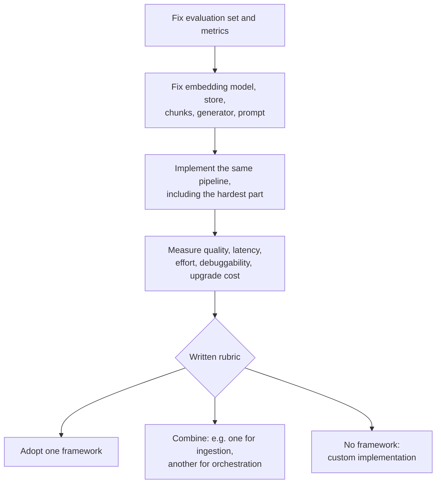

You have now worked with four frameworks in this phase: [LangChain](/learn/langchain-for-rag), [LlamaIndex](/learn/llamaindex), [Haystack](/learn/haystack-and-other-frameworks/haystack-architecture) and [DSPy](/learn/haystack-and-other-frameworks/dspy-for-optimisation). Each has enthusiasts who will tell you it is the right choice, and each has critics with stories of upgrades that broke everything. This lesson is an attempt at an honest comparison: what each framework is actually organised around, where each is strong and weak for RAG specifically, how to compare them on the dimensions that matter to an engineering team, and how to run a short, evidence-based evaluation of your own instead of choosing by reputation. A small benchmark measures what the frameworks themselves cost at run time and at start-up, so that one common argument can be settled with numbers.

The comparison here is about architecture and engineering trade-offs, which change slowly. Feature lists, integration counts and release details change monthly; for those, the frameworks' own documentation is the source of truth, and this lesson deliberately avoids claims that would date within a quarter.

## Learning objectives

- Describe the central abstraction and control-flow model of LangChain, LlamaIndex, Haystack and DSPy, and the kind of problem each abstraction suits.
- Compare the frameworks on a stated set of engineering criteria, distinguishing durable properties from version-specific features.
- Measure framework orchestration overhead and import time, and explain why they rarely decide the choice but sometimes do.
- Design a time-boxed bake-off that compares frameworks on your own RAG workload with a fixed evaluation set.
- Recommend a framework, a combination of frameworks, or none, for a described team and system, and justify it.

## Prerequisites

- [LangChain architecture](/learn/langchain-for-rag/langchain-architecture) and [LCEL](/learn/langchain-for-rag/lcel).
- [LlamaIndex index architecture](/learn/llamaindex/index-architecture) and [Query engines](/learn/llamaindex/query-engines).
- [Haystack architecture](/learn/haystack-and-other-frameworks/haystack-architecture) and [Pipelines](/learn/haystack-and-other-frameworks/pipelines).
- [DSPy for optimisation](/learn/haystack-and-other-frameworks/dspy-for-optimisation).

## Why this matters

Framework choice is one of the few decisions in a RAG project that is expensive to reverse. Once retrieval, prompting, tracing and evaluation code are written against a framework's types, moving away means rewriting most of the application. Teams therefore spend a surprising amount of time arguing about it, usually with the wrong evidence: GitHub stars, a blog post's benchmark, the framework a new hire used last job.

The cost of choosing badly shows up later and in specific ways. A team picks a framework whose abstraction fights their problem (a linear-chain library for a system full of loops and routing, or an index-centric library for a system that is mostly custom orchestration) and spends months writing workarounds. Or a team picks well, but does not pin versions or isolate the framework behind their own interfaces, and every upgrade breaks production. Or a team never notices that the framework adds almost nothing to their simple pipeline but a dependency tree, a slower cold start and an unfamiliar stack trace.

An engineer who can compare frameworks on durable criteria, measure the claims that can be measured, and run a short bake-off on real data turns a recurring argument into a decision with a paper trail.

## The intuition

Choosing a framework is like choosing a kitchen layout for a restaurant, not choosing a knife. A knife you can swap tomorrow. A layout decides how the cooks move for years.

- A **galley kitchen** (LangChain's chains) is superb when every dish moves along one line from station to station, and awkward when dishes need to loop back.
- A **kitchen built around a well-organised pantry** (LlamaIndex) makes finding and combining ingredients easy, because everything is indexed and labelled; the cooking itself follows a few standard recipes you can customise.
- A **kitchen with a posted floor plan** (Haystack) has every station and every pass between stations drawn on the wall, so new staff can see exactly where each plate goes, at the price of drawing the plan even for a sandwich.
- A **kitchen with a head chef who tastes and adjusts recipes** (DSPy) is not a layout at all; it is a way of improving recipes, and it can work in any of the other kitchens.

And a food truck (your own code) needs no layout decision at all, until the menu grows.

## How it works

### What each framework is organised around

The most useful way to compare frameworks is by their central abstraction, because it determines what is easy and what is awkward.

**LangChain** is organised around the `Runnable`: anything with `invoke`, `batch`, `stream` and their async forms, composed with the `|` operator into LCEL chains. Control flow is composition: a chain is a nested structure of callables, and running it walks that structure. Around this core sits the largest integration ecosystem of the four, a set of standard interfaces (loaders, splitters, embeddings, vector stores, retrievers), LangGraph for stateful graphs and agents with cycles, and LangSmith, a commercial tracing and evaluation service. Its history includes several reorganisations (the package split, the move of legacy chains into `langchain-classic`), which is why pinning versions matters more here than elsewhere.

**LlamaIndex** is organised around data: documents become **nodes**, nodes go into **indexes**, and **query engines** turn an index into answers through retrievers, node post-processors and **response synthesisers**. Its depth is in ingestion and retrieval-side structure: node parsers, hierarchical and recursive retrieval, routers and sub-question engines. Orchestration of arbitrary flows uses its event-driven Workflows. The company behind it offers commercial parsing and hosted indexing services.

**Haystack** is organised around an explicit, typed graph: components with declared sockets, connected in a pipeline that validates connections, schedules execution by data availability, supports branches and loops, and serialises to YAML. Its depth is in explicitness and operability: you can see, save and review the whole system. It is backed by deepset, which offers a commercial platform for building and running Haystack pipelines.

**DSPy** is organised around declarative signatures and modules, with optimisers that compile prompts against a metric. It is not an integration framework and makes no attempt to wrap every vector database; it is a way to program and improve the language-model calls inside a pipeline, including pipelines built with the others.

Other frameworks exist, such as Microsoft's Semantic Kernel (with .NET, Python and Java SDKs) and txtai, and the vector database vendors ship their own helpers. The comparison method below applies to any of them.

### Durable comparison criteria

These criteria change slowly, so a comparison built on them stays valid across releases:

| Criterion | LangChain | LlamaIndex | Haystack | DSPy |
| --- | --- | --- | --- | --- |
| Central abstraction | Composable runnables | Indexes over nodes, query engines | Typed component graph | Signatures, modules, optimisers |
| Control flow | Composition (LCEL); graphs with cycles in LangGraph | Query engines; event-driven Workflows | Scheduler over an explicit graph; branches and loops built in | Plain Python in `forward` |
| RAG-specific depth | Broad, via retrievers and integrations | Deepest on ingestion and retrieval structure | Retrieval, ranking and evaluation components | Prompt optimisation for each step |
| Integration breadth | Largest | Large | Moderate, curated | Minimal by design |
| Definition as data | Partial | Partial | Full YAML serialisation | Saved predictor state (JSON) |
| Main risk | API churn across versions; deep stack traces | Implicit defaults (global settings) | Ceremony for simple flows; smaller ecosystem | Needs labelled data and optimisation budget |

Read the table as a description of design centres, not a scoreboard. Every framework can do most RAG tasks; the question is how naturally your system maps onto its abstraction.

### What a framework actually gives you

When a framework helps, it helps in five ways. Use them as the checklist for whether you need one:

1. **Integrations**: tested clients for model APIs, vector databases and document formats, behind common interfaces.
2. **Structure**: a vocabulary and a shape for the code, which helps teams larger than a few people.
3. **Observability**: tracing of every step, with callbacks or spans, often with a hosted viewer.
4. **Patterns**: implementations of retrieval techniques (multi-query, parent-child, hybrid fusion, reranking) you would otherwise write.
5. **Portability**: swapping a model or store by changing one component.

And when it hurts, it hurts in five matching ways: dependency weight and conflicts, abstraction mismatch, opaque failures, upgrade churn, and the temptation to use a pattern because it exists rather than because evaluation shows it helps. The [next lesson](/learn/haystack-and-other-frameworks/when-to-use-custom-implementations) turns this into a decision procedure for building without a framework.

### Running a bake-off

Reputation is a poor guide; a short, controlled comparison on your own workload is a good one. Step by step:

1. **Fix the evaluation set first.** Use the same labelled questions for every candidate (at least a hundred, drawn from real or realistic traffic), with the same metrics: retrieval recall, answer correctness, citation accuracy, latency.
2. **Fix the components that are not under test.** Same embedding model, same vector store, same chunks, same generator model and prompt text. Otherwise you are comparing configurations, not frameworks.
3. **Implement the same pipeline in each candidate**, including the hardest part of your real system (the routing, the loop, the access-control filter), not just the happy path. Time-box it: two or three days per framework.
4. **Measure engineering properties as well as quality.** How long did each take? How many lines of glue? How did a deliberately introduced bug (a wrong filter, a mis-wired step) show up in tracing? What happens on a version upgrade?
5. **Decide with a written rubric** that weights the criteria for your team, and keep the code: the losing implementations are evidence for the next time the question is raised.



If every candidate scores the same on quality, which is common when the components are held fixed, then quality is not the deciding factor and the engineering properties are. That is itself a useful finding: it means the framework is a matter of team productivity and operability, not answer quality.

### Combining frameworks

The frameworks are not mutually exclusive. Common, sensible combinations include LlamaIndex for ingestion and parsing feeding a store that Haystack or LangChain queries; DSPy to optimise the prompts that a Haystack or LangChain pipeline runs; and LangGraph for an agent whose tools call a retrieval pipeline built with something else. The cost is two dependency trees and two mental models, so combine deliberately, at a clear boundary such as the document store or a prompt file.

## In code

A frequent argument against frameworks is that they are "slow". The script below settles what can be settled with a measurement. It implements one retrieve-then-generate step (BM25 retrieval over five Meridian passages, and a stand-in for the model call) in plain Python and in idiomatic LangChain, LlamaIndex and Haystack code, checks that all four give the same answer, and measures two things: the orchestration overhead per call (with model time removed, since it is identical for all) and the time to import each framework in a fresh process.

```bash
pip install rank-bm25 langchain-core llama-index-core haystack-ai
```

```python
"""The same retrieve-then-generate step, orchestrated four ways, timed."""
import statistics
import subprocess
import sys
import time

from rank_bm25 import BM25Okapi

DOCS = [
    "Annual leave is 25 days; up to 5 unused days carry over.",
    "Staff may work remotely up to 3 days a week.",
    "Expenses over £75 need a receipt.",
    "Passwords must be rotated every 90 days.",
    "Error E-4021 means the VPN client is out of date.",
]
bm25 = BM25Okapi([d.lower().split() for d in DOCS])

def retrieve(question: str, k: int = 2) -> list[str]:
    scores = bm25.get_scores(question.lower().split())
    return [DOCS[i] for i in sorted(range(len(DOCS)), key=lambda i: -scores[i])[:k]]

def generate(question: str, passages: list[str]) -> str:
    return f"Based on: {passages[0]}"           # stand-in for a model call

# 1. Plain Python
def plain(question):
    return generate(question, retrieve(question))

# 2. LangChain (LCEL)
from langchain_core.runnables import RunnableLambda, RunnablePassthrough
lc_chain = (
    {"passages": RunnableLambda(retrieve), "question": RunnablePassthrough()}
    | RunnableLambda(lambda x: generate(x["question"], x["passages"]))
)
lc_sequential = (                                # same steps, no parallel branch
    RunnableLambda(lambda q: {"question": q, "passages": retrieve(q)})
    | RunnableLambda(lambda x: generate(x["question"], x["passages"]))
)

# 3. LlamaIndex (custom query engine)
from llama_index.core.query_engine import CustomQueryEngine
class MeridianEngine(CustomQueryEngine):
    def custom_query(self, query_str: str) -> str:
        return generate(query_str, retrieve(query_str))
li_engine = MeridianEngine()

# 4. Haystack (two components in a pipeline)
from haystack import Pipeline, component
@component
class Retrieve:
    @component.output_types(passages=list[str])
    def run(self, question: str):
        return {"passages": retrieve(question)}
@component
class Generate:
    @component.output_types(answer=str)
    def run(self, question: str, passages: list[str]):
        return {"answer": generate(question, passages)}
hs_pipe = Pipeline()
hs_pipe.add_component("retrieve", Retrieve())
hs_pipe.add_component("generate", Generate())
hs_pipe.connect("retrieve.passages", "generate.passages")

runners = {
    "plain":      lambda q: plain(q),
    "langchain":  lambda q: lc_chain.invoke(q),
    "lc-seq":     lambda q: lc_sequential.invoke(q),
    "llamaindex": lambda q: str(li_engine.query(q)),
    "haystack":   lambda q: hs_pipe.run({"retrieve": {"question": q},
                                         "generate": {"question": q}})["generate"]["answer"],
}
q = "How many days of annual leave?"
assert len({run(q) for run in runners.values()}) == 1, "all four must give the same answer"
print("answer:", runners["plain"](q))

def per_call_us(run, n=2000):
    for _ in range(50):
        run(q)                                   # warm up
    samples = []
    for _ in range(5):
        t0 = time.perf_counter()
        for _ in range(n):
            run(q)
        samples.append((time.perf_counter() - t0) / n * 1e6)
    return statistics.median(samples)

def import_ms(module):
    code = f"import time; t=time.perf_counter(); import {module}; print((time.perf_counter()-t)*1000)"
    runs = [float(subprocess.run([sys.executable, "-c", code], capture_output=True, text=True).stdout)
            for _ in range(3)]
    return statistics.median(runs)

imports = {"plain": "rank_bm25", "langchain": "langchain_core.runnables", "lc-seq": "langchain_core.runnables",
           "llamaindex": "llama_index.core", "haystack": "haystack"}
print(f"\n{'framework':<11} {'per call (us)':>14} {'import (ms)':>12}")
for name, run in runners.items():
    print(f"{name:<11} {per_call_us(run):14.1f} {import_ms(imports[name]):12.0f}")
print("torch imported by haystack here:", "torch" in subprocess.run(
    [sys.executable, "-c", "import sys, haystack; print([m for m in sys.modules if m == 'torch'])"],
    capture_output=True, text=True).stdout)
```

```output
answer: Based on: Annual leave is 25 days; up to 5 unused days carry over.

framework    per call (us)  import (ms)
plain                 70.5          139
langchain           1192.2           77
lc-seq               292.6           76
llamaindex            73.6          875
haystack             142.6         1381
torch imported by haystack here: True
```

### What the measurements mean

These numbers come from one laptop run with `langchain-core` 1.8.0, `llama-index-core` 0.14.26 and `haystack-ai` 3.5.0, and they move by tens of percent between runs (an earlier run of the same script measured the plain version at 29 µs per call). Read orders of magnitude, not decimals.

- **Orchestration overhead is microseconds to about a millisecond.** The worst case here, the LCEL chain with a parallel branch, adds roughly 1 ms per call. A single call to a hosted model takes hundreds of milliseconds to seconds, and even a local query embedding takes milliseconds. Framework run-time overhead is under 1% of a RAG request in every case. "The framework is slow" is almost never true in the sense of orchestration cost.
- **Patterns inside a framework matter more than the framework.** The two LangChain chains do the same work. The one with a dictionary step runs its two branches in parallel through a thread pool, which costs about four times as much as the sequential version for functions this cheap. With real network calls in the branches the parallel version would win, because the branches would overlap. The lesson generalises: know what your framework's constructs do at run time.
- **Import time can matter.** Importing `haystack` took about 1.4 seconds here, and the last line shows why: in this environment Haystack's device utilities imported PyTorch, which was installed for other reasons. LlamaIndex's core took close to a second. For a long-running server this is a one-off cost at start-up and irrelevant. For a serverless function with frequent cold starts, or a command-line tool, a second or more per invocation is a real cost, and it depends on what else is installed, so measure in the environment you will deploy.
- **All four gave the same answer.** The assertion guarantees the comparison is fair: same retrieval, same generation, different orchestration.

What the script cannot measure is what usually decides the choice: how naturally your hardest flow is expressed, how quickly an engineer finds a bug in a trace, and how much breaks on upgrade. Those come from the bake-off procedure above, not from a microbenchmark.

Common mistakes when benchmarking frameworks: including model-call time (which swamps everything and is identical across frameworks), measuring the first call (which includes lazy initialisation), and measuring in a development environment whose installed packages differ from production.

## A real-world example

Meridian's Platform team has run AskMeridian on custom code for a year. With new requirements arriving (a Slack bot, a contractor-facing variant with different permissions, a self-correcting citation loop), the head of engineering asks for a framework recommendation and gives the team two weeks.

They follow the bake-off procedure. The evaluation set is 250 labelled questions from the support desk's history, including 40 about Atlas error codes and 30 that should be refused. Everything else is held fixed: Qdrant, MiniLM-family embeddings already in production, the same cross-encoder, Claude as generator, the same prompt text. Three engineers each implement the full query path, including the citation loop and the per-user permission filter, in LangChain with LangGraph for the loop, LlamaIndex with a Workflow for the loop, and Haystack.

Quality is indistinguishable across the three within the noise of 250 questions, which tells them the decision is about engineering. Their rubric weights operability and reviewability heavily, because two other teams will add variants of the pipeline. Haystack's YAML definitions and typed connections score highest there; LlamaIndex's ingestion components score highest for the indexing side, where the team has messy Confluence exports; LangChain scores highest on integrations, which matters less because their integrations are few and fixed.

The recommendation is a combination with a clear boundary: LlamaIndex's parsing and node parsers for ingestion, writing to Qdrant; Haystack for the query pipelines; and their own small interface around the generator call, so that the model client is not tied to either framework. They write down what would change the decision (a need for many more integrations, or a long-running agent), and they keep the three prototypes in the repository.

## Common mistakes

- **Choosing by popularity or a blog post.** Stars and anecdotes say nothing about how your hardest flow maps onto the abstraction; a bake-off on your data does.
- **Comparing frameworks with different components.** Changing the embedding model or prompt at the same time as the framework makes the comparison meaningless.
- **Prototyping only the happy path.** Every framework handles retrieve-then-generate; the differences appear in loops, routing, permissions and error handling.
- **Ignoring upgrade cost.** Not pinning versions, or scattering framework types through business logic, turns every upgrade into a rewrite.
- **Blaming the framework for latency.** Orchestration overhead is microseconds; slow systems are slow because of model calls, retrieval depth or reranking, which the framework does not change.
- **Adopting a framework's pattern because it exists.** A built-in multi-query retriever is not evidence that multi-query retrieval helps your questions; evaluate it.

## Best practices

- Write the evaluation set and the rubric before writing any prototype code.
- Hold every non-framework component fixed during a comparison, and implement the hardest flow, not just the simplest.
- Keep framework types at the edges: wrap the framework behind a small interface of your own (`retrieve(question, user) -> list[Passage]`), so the rest of the code does not import it.
- Pin exact versions of every framework package, and upgrade deliberately with the evaluation set as the regression test.
- Measure cold-start import time in the deployment environment if you run serverless or command-line workloads.
- Record the decision, the evidence and the conditions that would change it.

## Performance considerations

Run-time overhead, as measured above, is well under a millisecond per step for typical pipelines, so for a request with a 1-second generation it is below 0.1% of latency. Two framework-related costs are larger and worth arithmetic.

**Cold start.** If a serverless function imports a framework that takes 1.4 seconds to load and handles 100,000 cold starts a month, that is about 39 hours of compute a month spent importing, and 1.4 seconds of extra latency for each affected user. Reducing installed optional dependencies (here, not installing PyTorch in an image that does not need it) or keeping instances warm addresses it.

**Concurrency model.** How a framework runs concurrent steps decides whether branches overlap. Haystack's `run_async`, LangChain's parallel steps and async `ainvoke`, and LlamaIndex's async query methods all overlap I/O-bound work when used correctly; the synchronous paths do not. For a pipeline with two 50 ms retrieval calls, the difference is 50 ms versus 100 ms per request, far more than any orchestration overhead.

Memory is dominated by models and indexes, not frameworks, but dependency weight affects container image size and build time, which matters for teams that deploy many services.

## Security considerations

- **Supply chain.** Each framework brings a large dependency tree, and integration packages bring more. Pin versions, use a lock file, scan dependencies, and prefer the smallest set of packages that does the job.
- **Serialised definitions.** Frameworks that load pipelines or chains from files (Haystack's YAML, saved DSPy programs, LangChain's serialised objects) can execute or import code during loading. Load only trusted definitions and use any allowlist the framework offers.
- **Telemetry and hosted tracing.** Some frameworks send usage telemetry by default, and hosted tracing services receive prompts and documents. Check defaults and data-processing terms before production.
- **Prompt injection is framework-independent.** No framework makes retrieved text safe to put in a prompt; defences are your responsibility in all of them.

## Summary

- LangChain is organised around composable runnables, LlamaIndex around indexes and query engines, Haystack around a typed, serialisable component graph, and DSPy around signatures and prompt optimisation.
- Compare frameworks on durable criteria (abstraction, control flow, RAG depth, integrations, definition as data, main risk), not on feature counts that change monthly.
- Orchestration overhead is microseconds to about a millisecond per call and almost never decides the choice; import time can matter for serverless and command-line workloads.
- A time-boxed bake-off with a fixed evaluation set and fixed components, implementing the hardest flow, is the reliable way to choose.
- Combining frameworks at a clear boundary, or wrapping one behind your own interface, is often better than an all-or-nothing choice.

## Exercises

1. Re-run the benchmark script twice. Which numbers change most between runs, and which conclusions survive?

<details><summary>Show solution</summary>

Absolute per-call timings typically move by tens of percent (the plain version measured 29 µs in one run and 70 µs in another on the same machine), and import times vary with disk cache state. The conclusions survive: every framework's overhead stays far below model latency, the parallel LCEL chain stays several times more expensive than the sequential one for trivial functions, and import times stay in the same order of magnitude. Report ranges and orders of magnitude, never a single run's decimals.

</details>

2. For each of these systems, name the framework whose central abstraction fits best and give one sentence of justification: (a) a research assistant that repeatedly searches, reads and decides whether to search again; (b) a knowledge base over 50,000 messy PDFs where most of the work is parsing and hierarchical retrieval; (c) a regulated deployment where every pipeline change must be reviewed and audited; (d) an existing pipeline whose answer prompt keeps regressing on model upgrades.

<details><summary>Show solution</summary>

(a) LangGraph (LangChain's graph library) or Haystack: both express cycles explicitly; LangGraph's state-machine model is built for agent loops. (b) LlamaIndex: its strengths are ingestion, node parsing and hierarchical retrieval structures. (c) Haystack: pipelines are typed graphs serialised to YAML, so changes are reviewable diffs. (d) DSPy: re-compile the answer step against a metric for each model instead of hand-tuning, whatever framework runs the pipeline. Other answers can be defended; what matters is the justification from the abstraction.

</details>

3. Write a one-page bake-off plan for comparing two frameworks for AskMeridian's contractor variant: the evaluation set, what is held fixed, what is implemented, what is measured, and the rubric with weights.

<details><summary>Show solution</summary>

A reasonable plan: evaluation set of 200 contractor questions (including 40 that must be refused because they concern employees-only documents) with recall@5, answer correctness, refusal accuracy and p95 latency. Held fixed: Qdrant collection, embedding model, chunking, reranker, generator model and prompt text. Implemented in each: the full query path including the per-request permission filter and the citation retry loop, time-boxed to three days. Measured: the four metrics, lines of glue code, time to diagnose two seeded bugs (a dropped filter, a mis-wired loop) using only the framework's tracing, and effort to upgrade to the next minor version. Rubric: security correctness (refusals, no leaks) as a pass/fail gate; then debuggability 30%, reviewability 25%, effort 20%, quality 15%, ecosystem fit 10%. The gate matters: a framework that leaks a document in the bake-off is out regardless of score.

</details>

4. Your team runs RAG in a serverless function with frequent cold starts. Using the measured import times, estimate the monthly cold-start cost of importing Haystack in this environment at 200,000 cold starts, and propose two ways to reduce it.

<details><summary>Show solution</summary>

At about 1.4 s per cold start, $200{,}000 \times 1.4 = 280{,}000$ seconds, about 78 hours of billed compute a month, and 1.4 s of extra latency for every affected request. Reductions: remove optional heavy dependencies from the deployment image (here PyTorch, which the framework imported only because it was installed), and keep a pool of warm instances or move to a long-running service so imports happen once. Re-measure after each change in the actual deployment image.

</details>

## Check your understanding

```quiz
[
  {"q": "Which framework's central abstraction is a typed component graph that can be serialised to YAML?", "options": ["LangChain", "LlamaIndex", "Haystack", "DSPy"], "answer": 2, "why": "Haystack pipelines are explicit graphs of components with typed sockets, saved and loaded as YAML."},
  {"q": "In the benchmark, every framework's orchestration overhead was at most about a millisecond per call. What follows?", "options": ["Framework run-time overhead is negligible next to model and retrieval latency, so it rarely decides the choice", "The plain Python version should always be used", "Frameworks with lower overhead give better answers", "Benchmarks of frameworks are meaningless"], "answer": 0, "why": "A model call takes hundreds of milliseconds or more, so sub-millisecond orchestration overhead is a tiny fraction of request latency."},
  {"q": "Why did the LCEL chain with a dictionary step cost more per call than the sequential chain?", "options": ["It called the model twice", "Its two branches ran in parallel through a thread pool, which costs more than it saves when the branches are trivial", "LangChain caches results", "The dictionary step serialised the inputs to JSON"], "answer": 1, "why": "The parallel step dispatches branches to threads; with real I/O-bound branches this would overlap waits and win."},
  {"q": "In a bake-off between frameworks, what must be held fixed?", "options": ["Only the evaluation set", "Nothing; each framework should use its defaults", "Only the generator model", "The evaluation set, metrics, embedding model, store, chunks, generator and prompt"], "answer": 3, "why": "Otherwise differences come from configuration, not from the framework being compared."},
  {"q": "Which statement about DSPy's place in the ecosystem is correct?", "options": ["It replaces vector databases", "It is mainly an integrations library", "It optimises the language-model calls of a pipeline and can be combined with another orchestration framework", "It only works with OpenAI models"], "answer": 2, "why": "DSPy compiles prompts against a metric; its output can be used inside pipelines built with other frameworks."}
]
```

## Further reading

- [LangChain documentation](https://python.langchain.com/): LCEL, the integration packages, and LangGraph.
- [LlamaIndex documentation](https://docs.llamaindex.ai/): indexes, query engines and Workflows.
- [Haystack documentation](https://docs.haystack.deepset.ai/docs/intro): pipelines, components and serialisation.
- [DSPy documentation](https://dspy.ai/): signatures, modules and optimisers.
- Sculley, D. et al. (2015). *Hidden Technical Debt in Machine Learning Systems*. NeurIPS. On glue code, pipeline jungles and dependency debt, the costs that framework decisions trade against.
