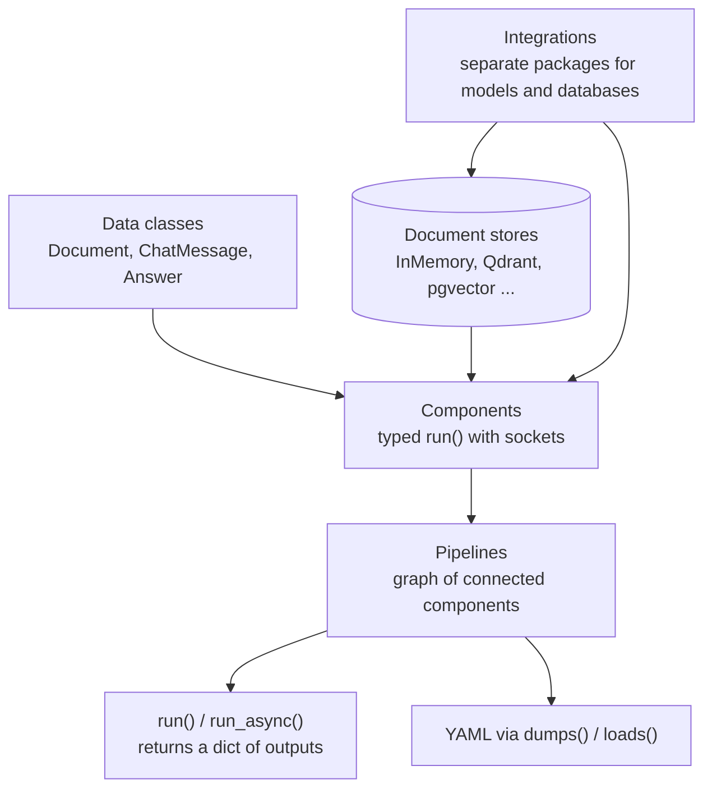
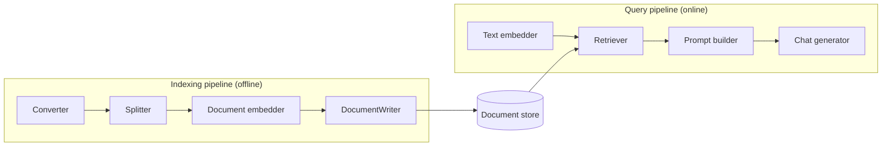

**Haystack** is an open-source Python framework from the Berlin company deepset for building retrieval and LLM applications. Where [LangChain](/learn/langchain-for-rag/langchain-architecture) is organised around a universal call protocol and [LlamaIndex](/learn/llamaindex/index-architecture) around indexes over nodes, Haystack is organised around one idea: an application is an explicit, typed graph of small processing units. This lesson is the map of that design. It names the handful of building blocks, shows how they divide the work of a RAG system, and explains the decisions behind them, so that the rest of the module can go deep on each block in turn.

The code in this module was run against `haystack-ai` 3.5.0. Haystack moves quickly and a few class names change between minor releases, so treat the official documentation as the authority on exact signatures. The architecture described here, however, has been stable since the 2.0 rewrite.

## Learning objectives

- Name Haystack's five building blocks (data classes, components, pipelines, document stores, integrations) and state the responsibility of each.
- Explain why a RAG application in Haystack is two pipelines that share a document store, and identify which components belong to each.
- Build and run a small indexing pipeline and query pipeline on the in-memory store, and read the result dictionary a pipeline returns.
- Serialise a pipeline to YAML and explain what the serialised form contains and what it deliberately leaves out.
- Contrast Haystack's architecture with LangChain's and LlamaIndex's in terms of where control flow lives.

## Prerequisites

- [Traditional RAG architecture](/learn/rag-architecture-fundamentals/traditional-rag-architecture): the indexing, retrieval and generation stages that Haystack gives names to.
- [Modular RAG](/learn/advanced-rag-patterns/modular-rag): the idea of swappable modules behind stable interfaces.
- [LangChain architecture](/learn/langchain-for-rag/langchain-architecture) and [LlamaIndex index architecture](/learn/llamaindex/index-architecture): useful for comparison, though not required.

## Why this matters

Every RAG system you have built in this course has the same skeleton: documents are cleaned, split, embedded and written to a store; later, a query is embedded, matched, perhaps reranked, placed in a prompt and sent to a model. The skeleton is simple. The trouble starts when the system grows.

A second retriever is added for keyword search, and the code that merges its results with the vector results is written inline. A router sends some questions to a different index. A validation step retries generation when the answer fails a check. After a year, the "pipeline" is a 600-line function whose control flow is a thicket of `if` statements, and the only way to know what happens to a given query is to run it under a debugger.

Haystack's response is to make the structure of the application a first-class object. Each step is a **component** with declared, typed inputs and outputs. Steps are joined by explicit **connections**, and the result is a **pipeline**: a directed graph you can print, draw, validate before running, save as YAML and load again elsewhere. Branches, merges and loops are visible as edges in the graph rather than buried in code.

Understanding this architecture matters for three practical reasons. First, it tells you where to put new behaviour: a new capability is a component, not an edit to someone else's function. Second, it tells you where to look when something fails: an error names the component that raised it, and you can inspect exactly what each component received. Third, it lets you judge honestly whether the framework fits your problem, which is the subject of [framework comparisons](/learn/haystack-and-other-frameworks/framework-comparisons) later in this module.

## The intuition

Think of a factory floor. Each machine does one job: one cuts, one drills, one paints. Every machine has labelled input chutes and output chutes, and a chute only accepts parts of the right shape: you cannot feed a sheet of glass into a slot built for steel rods. The floor plan, a drawing of which chute feeds which, is separate from the machines themselves. The same machines can be arranged into different floor plans for different products, and the floor plan can be filed away and rebuilt in another factory.

Haystack maps onto this almost exactly:

- The **parts** are data classes: `Document`, `ChatMessage`, `Answer`.
- The **machines** are components: a splitter, an embedder, a retriever, a prompt builder, a generator.
- The **chutes** are sockets: named, typed inputs and outputs on each component.
- The **floor plan** is the pipeline: the graph of connections, which can be serialised and rebuilt.
- The **warehouse** is the document store: where finished parts are kept between the night shift (indexing) and the day shift (answering questions).

The night shift and the day shift never run at the same time and do not share machines. They share only the warehouse. That separation is the most important structural fact about a Haystack RAG system.

## How it works

### The five building blocks



**Data classes** are the values that flow along the edges. The central one is `Document`, a dataclass with an `id`, `content` (text), `meta` (a dictionary of metadata), an optional `embedding`, an optional `sparse_embedding` and a `score` that retrievers fill in. Chat-based generation uses `ChatMessage`, which carries a role (system, user, assistant, tool) and content. Final outputs can be wrapped in `GeneratedAnswer`, which keeps the answer text alongside the query and the documents it was based on. Because every component in the ecosystem speaks these same few types, a retriever from one integration can feed a ranker from another without adapters.

**Components** are the units of work. A component is a Python class decorated with `@component` whose `run` method takes keyword arguments and returns a dictionary. The decorator reads the method's signature and its declared output types and turns them into **sockets**: the input socket `query: str`, the output socket `documents: list[Document]`. Components are deliberately small. A retriever retrieves; it does not also rerank or build prompts. The [components lesson](/learn/haystack-and-other-frameworks/components) covers the contract in full, including how to write your own.

**Pipelines** hold components and the connections between them. You add components under names, connect an output socket of one to an input socket of another, and call `run` with the inputs that are not supplied by any connection. The pipeline checks types when you connect, decides the order of execution at run time, and returns the outputs. Pipelines can branch, merge and loop; the [pipelines lesson](/learn/haystack-and-other-frameworks/pipelines) explains how the scheduler handles that.

**Document stores** are the persistence layer: a common interface for writing, filtering, counting and deleting `Document` objects, implemented by an in-memory store in the core package and by integrations for real databases. A document store is not a component. It is an object that components hold a reference to: a `DocumentWriter` writes to it, and a retriever reads from it. The [document stores lesson](/learn/haystack-and-other-frameworks/document-stores) covers the interface, filters and the duplicate policies.

**Integrations** are separate packages, mostly maintained in deepset's `haystack-core-integrations` repository, that supply components and stores for specific vendors: model providers (Anthropic, OpenAI, Cohere, Hugging Face, Ollama and others) and databases (Qdrant, Elasticsearch, OpenSearch, pgvector, Weaviate, Pinecone and others). They are imported from the `haystack_integrations` namespace. Keeping them out of the core package means the core stays small and its release cycle is not tied to dozens of third-party SDKs. One consequence worth knowing: which components ship in core changes between releases. In the 3.5.0 core package, for example, the only embedders are the OpenAI, Azure OpenAI and mock ones; local-model embedders and rankers live in integration packages. Check the integrations catalogue rather than assuming a class is in core.

### Two pipelines and a shared store

A Haystack RAG application is almost always two pipelines.

The **indexing pipeline** runs offline, whenever documents change. Typically it holds converters (PDF, HTML, DOCX to `Document`), a cleaner, a splitter, a document embedder and a `DocumentWriter`. Its output is a side effect: documents land in the store.

The **query pipeline** runs online, once per question. Typically it holds a text embedder for the query, one or more retrievers, perhaps a joiner and a ranker, a prompt builder, a chat generator and an answer builder. Its output is the answer.



The two pipelines meet only at the store. This has consequences you must respect. The embedding model in the document embedder and the text embedder must be the same model, or the query vectors and document vectors live in different spaces; nothing in the framework enforces this. The splitter configuration determines what a "document" in the store is, so the prompt builder's template must expect chunks, not whole files. And because the store is shared state, re-running the indexing pipeline on changed files needs a duplicate policy and a deletion strategy, or old chunks will linger next to new ones.

### What happens when you call `run`

Here is the sequence for a query pipeline, step by step:

1. **Warm-up.** The pipeline calls `warm_up()` on every component that defines it. This is where heavy resources (a local model, a client connection) are loaded, once, instead of in `__init__`.
2. **Input validation.** The pipeline normalises the `data` dictionary you passed (`{"retriever": {"query": ...}}`), checks that every mandatory input socket will receive a value, either from you or from a connection, and raises a `ValueError` before anything runs if one will not.
3. **Scheduling.** Components whose inputs are all available are placed in a priority queue. The pipeline repeatedly takes the next runnable component, so execution order follows data availability rather than the order in which you added components.
4. **Execution.** Each component's `run` is called with its inputs. Inputs are deep-copied first, so a component that mutates its input cannot corrupt what another component receives. Any exception is wrapped in a `PipelineRuntimeError` that names the component.
5. **Routing outputs.** Each output value is delivered to every input socket connected to it. An output with no outgoing connection is a pipeline output.
6. **Return.** When no component can run, `run` returns a dictionary keyed by component name containing the unconnected outputs (plus any component you listed in `include_outputs_from`).

This is a different shape from a LangChain LCEL chain, where `a | b | c` composes callables and the call stack is the control flow. In Haystack the graph is data, held by the pipeline, and control flow is decided by the scheduler. That difference is the source of both Haystack's strengths (inspection, validation, serialisation, branches and loops without special syntax) and its main cost (more ceremony for a simple linear chain).

### Serialisation: the pipeline as configuration

Because a pipeline is a graph of components, and each component records the arguments it was constructed with (its `init_parameters`), the whole pipeline can be written out with `to_dict()` or as YAML with `dumps()`, and rebuilt with `from_dict()` or `loads()`. The YAML lists each component's import path and init parameters, then the connections. This lets you keep pipeline definitions in version control as configuration, review changes to them in pull requests, and deploy the same definition in several services. It is also how deepset's hosted platform and the open-source Hayhooks server (which exposes pipelines as HTTP endpoints) load pipelines.

Serialisation stores *configuration*, not *state*. A serialised `InMemoryDocumentStore` records its index name and BM25 settings, not its documents. Secrets are a deliberate special case: API keys are passed as `Secret` objects, typically `Secret.from_env_var("ANTHROPIC_API_KEY")`, which serialise as "read this environment variable" rather than as the key itself. A component that holds a plain-string key cannot be serialised by design.

Loading YAML means importing the classes it names, which is a code-execution risk if the YAML comes from an untrusted source. Recent releases therefore check every import path against an allowlist (Haystack's own packages and `haystack_integrations` by default) and refuse anything else unless you widen the list explicitly. You will see this in the code below.

### Tracing and observability

Every component run is wrapped in a tracing span named after the component, nested inside a span for the pipeline run. The core package defines a `Tracer` interface and ships a `LoggingTracer` that writes spans to the Python log. Backends such as OpenTelemetry or Langfuse are wired in through integrations. By default spans record timing and metadata but not the inputs and outputs themselves, because those contain user questions and document text. Setting the environment variable `HAYSTACK_CONTENT_TRACING_ENABLED=true` turns content capture on, which is useful in development and a data-protection decision in production.

### Agents, briefly

Recent Haystack releases also include an `Agent` component: a chat generator that can call tools in a loop until it decides to stop. Architecturally it is just another component, so it can sit inside a pipeline, and a pipeline can be wrapped as a tool for it. Agentic retrieval is the subject of the [agentic RAG module](/learn/agentic-rag); this module stays with explicit pipelines, which is where Haystack's design is most distinctive.

> [!KEY]
> Haystack's architecture in one sentence: small typed components, joined into an explicit graph by a pipeline that validates, schedules, traces and serialises them, with a document store as the only state shared between indexing and querying.

## In code

The example builds both halves of a minimal RAG system on Meridian's handbook: an indexing pipeline that splits a document into sentence-sized chunks and writes them to an in-memory store, and a query pipeline that retrieves with BM25, builds a chat prompt, generates an answer and packages it with its sources. To keep the example free of API keys, the generator is Haystack's `MockChatGenerator` with a small function standing in for the model. The point is the architecture: every object you create maps to one of the five building blocks.

```bash
pip install haystack-ai
```

```python
from haystack import Document, Pipeline
from haystack.components.builders import AnswerBuilder, ChatPromptBuilder
from haystack.components.generators.chat import MockChatGenerator
from haystack.components.preprocessors import DocumentSplitter
from haystack.components.retrievers.in_memory import InMemoryBM25Retriever
from haystack.components.writers import DocumentWriter
from haystack.dataclasses import ChatMessage
from haystack.document_stores.in_memory import InMemoryDocumentStore

# 1. The shared state: one document store used by both pipelines.
store = InMemoryDocumentStore()

# 2. Indexing pipeline: split -> write.
indexing = Pipeline()
indexing.add_component("splitter", DocumentSplitter(split_by="sentence", split_length=1))
indexing.add_component("writer", DocumentWriter(document_store=store))
indexing.connect("splitter.documents", "writer.documents")

handbook = Document(
    content=(
        "Annual leave is 25 days. Up to 5 unused days carry over and must be used by 31 March. "
        "Staff may work remotely up to 3 days a week. The home-office equipment budget is £400. "
        "Expenses must be submitted within 30 days. Anything over £75 needs a receipt."
    ),
    meta={"source": "employee-handbook", "owner": "HR"},
)
print("indexing:", indexing.run({"splitter": {"documents": [handbook]}}))
print("chunks in store:", store.count_documents())

# 3. Query pipeline: retrieve -> build prompt -> generate -> package answer.
template = [
    ChatMessage.from_system("Answer only from the context. If the answer is not there, say you don't know."),
    ChatMessage.from_user(
        "Context:\n[{{ loop.index }}] {{ d.content }}\n"
        "\nQuestion: {{ question }}"
    ),
]

def fake_llm(messages):
    # Stands in for a real chat model: echoes the first context line it was given.
    first_line = messages[-1].text.split("\n")[1]
    return f"From the context: {first_line}"

querying = Pipeline()
querying.add_component("retriever", InMemoryBM25Retriever(document_store=store, top_k=2))
querying.add_component("prompt", ChatPromptBuilder(template=template, required_variables=["question", "documents"]))
querying.add_component("llm", MockChatGenerator(response_fn=fake_llm))
querying.add_component("answer", AnswerBuilder())
querying.connect("retriever.documents", "prompt.documents")
querying.connect("prompt.prompt", "llm.messages")
querying.connect("llm.replies", "answer.replies")
querying.connect("retriever.documents", "answer.documents")

print("\nopen inputs:", {c: sorted(s) for c, s in querying.inputs().items()})

question = "How many days of annual leave do I get?"
result = querying.run({
    "retriever": {"query": question},
    "prompt": {"question": question},
    "answer": {"query": question},
})
answer = result["answer"]["answers"][0]
print("\nanswer:", answer.data)
for doc in answer.documents:
    print(f"  {doc.score:.3f}  {doc.content}  ({doc.meta['source']})")

spec = querying.to_dict()
print("\nserialised:", len(querying.dumps().splitlines()), "lines of YAML")
for name, comp in sorted(spec["components"].items()):
    print(f"  {name:<9} {comp['type']}")
for edge in spec["connections"]:
    print(f"  {edge['sender']} -> {edge['receiver']}")
```

```output
indexing: {'writer': {'documents_written': 6}}
chunks in store: 6

open inputs: {'retriever': ['filters', 'query', 'scale_score', 'top_k'], 'prompt': ['question', 'template', 'template_variables'], 'llm': ['generation_kwargs', 'streaming_callback', 'tools', 'tools_strict'], 'answer': ['expand_reference_ranges', 'meta', 'pattern', 'query', 'reference_pattern']}

answer: From the context: [1] Annual leave is 25 days. 
  4.933  Annual leave is 25 days.   (employee-handbook)
  0.574  Expenses must be submitted within 30 days.   (employee-handbook)

serialised: 72 lines of YAML
  answer    haystack.components.builders.answer_builder.AnswerBuilder
  llm       haystack.components.generators.chat.mock.MockChatGenerator
  prompt    haystack.components.builders.chat_prompt_builder.ChatPromptBuilder
  retriever haystack.components.retrievers.in_memory.bm25_retriever.InMemoryBM25Retriever
  retriever.documents -> prompt.documents
  retriever.documents -> answer.documents
  prompt.prompt -> llm.messages
  llm.replies -> answer.replies
```

### Reading the code and the output

- **The store is created first and handed to two components.** `DocumentWriter` and `InMemoryBM25Retriever` both receive the same `store` object. That reference is the only link between the two pipelines.
- **The indexing pipeline returns a count, not documents.** `{'writer': {'documents_written': 6}}` is the output of the leaf component. The splitter's output was consumed by the writer, so it does not appear. The one handbook document became six sentence chunks, and each chunk kept the parent's `meta`, which is why `source` is still available at query time.
- **`connect` uses `component.socket` strings.** `"retriever.documents"` names the output socket; `"prompt.documents"` the input socket. When a component has exactly one compatible socket you may write just the component name, but spelling out both sides makes the graph readable and catches mistakes earlier.
- **One output can feed two inputs.** `retriever.documents` goes to the prompt builder and to the answer builder, so the final answer carries its sources without any extra code. This fan-out is a plain edge in the graph.
- **`inputs()` lists the open sockets.** These are the inputs no connection supplies, and therefore the ones you may pass to `run`. `prompt.documents` is missing from the list because a connection fills it. This is the quickest way to find out what a pipeline you did not write expects.
- **The result is keyed by component.** `result["answer"]["answers"]` is the `answers` output of the component named `answer`. Only leaf outputs are returned by default. If you also want the retriever's documents in the result, pass `include_outputs_from={"retriever"}`.
- **The scores are BM25 scores.** The in-memory store's default variant is BM25L. "Annual leave" matches strongly; the second chunk scores 0.574 only on incidental overlap ("days"). Scores are unnormalised and should not be read as probabilities.
- **The YAML records types and connections.** Each component appears with its full import path; the connections are the four edges you made. The store appears nested inside the retriever's parameters, as configuration only.

Two errors are common at this stage. Passing a document list straight to `DocumentWriter` without a splitter works, but then each whole file is one retrievable unit, which defeats retrieval on long documents. And forgetting one of the open inputs (here, `answer.query`) raises a `ValueError` listing the missing input before any component runs, which is the validation step doing its job.

If you try to load this pipeline back with `Pipeline.loads(querying.dumps())`, you get a `DeserializationError`. The mock generator's `response_fn` serialised as the import path `__main__.fake_llm`, and `__main__` is not on the deserialisation allowlist. `Pipeline.loads(..., allowed_modules=["__main__"])` succeeds. The lesson is general: anything you plug in that is not part of Haystack must be importable from a module you have explicitly trusted.

### Swapping in a real model

Replacing the mock with Claude means replacing one component. Anthropic's chat generator lives in an integration package. The snippet below follows the integration's documented usage but was not executed here, because it needs an API key and the separately installed integration; check the integration page for the current class and parameter names.

```bash
pip install anthropic-haystack
```

```python
from haystack.utils import Secret
from haystack_integrations.components.generators.anthropic import AnthropicChatGenerator

llm = AnthropicChatGenerator(
    model="claude-opus-5-5",
    api_key=Secret.from_env_var("ANTHROPIC_API_KEY"),
)
querying.remove_component("llm")
querying.add_component("llm", llm)
querying.connect("prompt.prompt", "llm.messages")
querying.connect("llm.replies", "answer.replies")
```

Nothing else changes: the prompt builder still produces a `list[ChatMessage]`, and the generator still returns `replies: list[ChatMessage]`. That is the payoff of the shared data classes. If you prefer to call the Anthropic SDK directly, you can wrap it in a component of your own; the [components lesson](/learn/haystack-and-other-frameworks/components) does exactly that.

## A real-world example

Meridian's Platform team runs AskMeridian as a hand-written Python service. The query path is one function, `answer_question`, that has grown to about 500 lines: a vector search against Qdrant, a keyword search added after users complained that error codes such as E-4021 were not found, a merge step, a cross-encoder rerank, a prompt, a call to Claude, a citation check and a retry if the check fails. Three engineers have changed it in the past quarter, and twice a change to the merge step silently altered which chunks reached the model.

The team prototypes the same query path in Haystack. Each step becomes a component with a name: `bm25`, `dense`, `joiner`, `ranker`, `prompt`, `llm`, `citation_check`. The retry becomes an edge from the citation checker back to the prompt builder, bounded by `max_runs_per_component`. The YAML definition goes into the repository, so a change to the joiner's mode or the ranker's `top_k` is a one-line configuration diff that reviewers can read. Tracing gives a span per component, so when an answer is wrong they can see what the ranker received and what it kept.

The prototype also surfaces costs. The team's hand-written Qdrant code used a payload filter on `department` that they must now express in Haystack's filter syntax, and they need an integration package and a version pin for the Qdrant store. Two components (the citation checker and their in-house reranker wrapper) have to be written as custom components. The decision they reach is the one the rest of this module equips you to make: adopt the framework for orchestration and keep their own code inside custom components where it is genuinely specific to Meridian. The [when to use custom implementations](/learn/haystack-and-other-frameworks/when-to-use-custom-implementations) lesson covers the opposite decision.

## Common mistakes

- **Using different embedding models in the indexing and query pipelines.** The framework does not check; retrieval silently returns poor results because query and document vectors are not comparable.
- **Treating the document store as a component.** It cannot be added to a pipeline or connected; it is passed to the components that read and write it. Trying to connect it produces confusing errors.
- **Loading heavy models in a component's `__init__`.** Construction happens during pipeline building, deserialisation and validation; models belong in `warm_up()`, which the pipeline calls once before running.
- **Expecting intermediate outputs in the result.** Only unconnected outputs are returned. Debugging code that reads `result["retriever"]` fails unless `include_outputs_from` names that component.
- **Assuming a component is in core.** Class locations change between major versions and between core and integrations; copying an import from an old tutorial is the most common source of `ImportError`.
- **Hardcoding API keys as strings.** It blocks serialisation and leaks secrets into saved YAML or logs; use `Secret.from_env_var`.

## Best practices

- Keep indexing and query pipelines in separate modules, and define the embedding model name once in shared configuration that both import.
- Name components after their role (`bm25`, `dense`, `ranker`), not their class; names appear in results, errors, traces and YAML.
- Use fully qualified `component.socket` strings in `connect`, so that adding a socket to a component later cannot silently change which one is used.
- Store pipeline YAML in version control and load it in production, so pipeline changes are reviewed like code.
- Pin `haystack-ai` and every integration package to exact versions and upgrade them together.
- Turn on content tracing in development, and decide deliberately (with your data-protection rules in mind) whether to enable it in production.

## Performance considerations

The framework's own overhead per component is small compared with the work components do. Each run involves dictionary handling, a deep copy of inputs, a tracing span and a scheduler step. For a five-component query pipeline that adds up to well under a millisecond on a modern machine, against tens of milliseconds for a query embedding and hundreds of milliseconds to seconds for generation. The deep copy is the one overhead that scales with data: copying 50 retrieved documents, each with a 384-dimensional embedding, means copying about 19,200 floats per hop. If retrievers return embeddings you do not need, turn that off (`return_embedding=False` is the in-memory retrievers' default) to keep hops cheap.

Warm-up matters more. A local embedding model takes seconds to load. Because `warm_up()` runs on the first `run()` call, the first request after deployment is slow unless you call `pipeline.warm_up()` at service start. In a web service, build the pipeline once at start-up and reuse it; never construct a pipeline per request.

For throughput, `Pipeline.run_async` runs independent branches concurrently (two retrievers waiting on two network calls overlap instead of queueing), and `run` blocks the calling thread. In an async web framework, use the async path, or run the synchronous one in a worker thread, so one slow generation does not stall the event loop.

## Security considerations

- **Pipeline YAML is code.** Loading it imports and constructs the classes it names. Load only YAML from trusted sources, keep the deserialisation allowlist as narrow as possible, and never set the unsafe-deserialisation switch in a service that loads user-supplied definitions.
- **Content tracing exports sensitive data.** With content tracing on, user questions, retrieved handbook text and model answers flow to your tracing backend. Treat that backend as holding personal data.
- **Documents are untrusted input.** Retrieved text goes into the prompt. A component-based architecture makes it easy to add a sanitising or classification step before the prompt builder; it does not add one for you. See [indirect prompt injection](/learn/rag-security-fundamentals/indirect-prompt-injection).
- **Telemetry.** Haystack sends anonymous usage telemetry about which components are used. It can be disabled with the `HAYSTACK_TELEMETRY_ENABLED=False` environment variable; many organisations require this.

## Summary

- Haystack builds applications from five blocks: data classes, components, pipelines, document stores and integrations.
- A component is a class with a typed `run` method whose parameters and declared outputs become sockets; components are small and single-purpose.
- A pipeline is an explicit graph that validates inputs, schedules components by data availability, traces each run, and serialises to YAML.
- A RAG system is an indexing pipeline and a query pipeline that share only a document store, and must share an embedding model.
- Serialised pipelines carry configuration, not data, and loading them is gated by an import allowlist because YAML can name arbitrary code.

## Exercises

1. Run the example, then add `include_outputs_from={"retriever", "prompt"}` to the `run` call. What new keys appear in the result, and what does the prompt builder's output look like?

<details><summary>Show solution</summary>

The result gains `result["retriever"]["documents"]` (the two retrieved chunks with scores) and `result["prompt"]["prompt"]`, a list of two `ChatMessage` objects: the system message and the user message with the context lines and question filled in by the Jinja template. Reading the rendered prompt is the fastest way to debug a template.

</details>

2. Without running it, predict what happens if you delete the line `querying.connect("retriever.documents", "prompt.documents")` and call `run` with the same data. Then check.

<details><summary>Show solution</summary>

`documents` is now an open input of the prompt builder, and it is listed in `required_variables`. The pipeline's input validation sees that a mandatory input will never be supplied and raises a `ValueError` naming `prompt` and `documents` before any component runs. The retriever's `documents` output is still connected to the answer builder, so that part of the graph is unaffected.

</details>

3. Meridian wants AskMeridian to index both the employee handbook and the IT runbooks, and to let the query pipeline restrict a search to one of them. Using only the building blocks in this lesson, where does each part of the change go?

<details><summary>Show solution</summary>

In the indexing pipeline, each source document gets a `meta` field such as `{"source": "it-runbooks"}`; the splitter copies `meta` to every chunk, so nothing else in indexing changes. In the query pipeline, the retriever accepts a `filters` input at run time: `{"field": "meta.source", "operator": "==", "value": "it-runbooks"}`. No new component is needed; the restriction is data passed to an open input. The filter syntax is covered in the document stores lesson.

</details>

4. Design question: a colleague proposes running indexing and querying in one pipeline "so there's only one thing to deploy". Give two concrete reasons this is a poor design.

<details><summary>Show solution</summary>

First, the two have different triggers and rates: indexing runs when documents change (minutes to days apart, in batches) and querying runs per request (many per second), so combining them forces every query to carry indexing components and inputs it never uses, and makes scaling them independently impossible. Second, indexing performs side effects on shared state (writes and deletes in the store), and a query path that can write is both a reliability risk (a bug corrupts the index) and a security risk (a query path should have read-only credentials to the store).

</details>

## Check your understanding

```quiz
[
  {"q": "In a Haystack RAG application, what connects the indexing pipeline to the query pipeline?", "options": ["A connection made with `Pipeline.connect`", "The document store object that components in both pipelines hold", "A shared `warm_up()` call", "The YAML file both pipelines are loaded from"], "answer": 1, "why": "The two pipelines never connect directly; the writer in one and the retriever in the other hold references to the same document store."},
  {"q": "A pipeline's `run` returns `{'answer': {...}}` but you need the retriever's documents for debugging. What do you do?", "options": ["Read `result['retriever']`, which is always present", "Call `retriever.run` again after the pipeline finishes", "Pass `include_outputs_from={'retriever'}` to `run`", "Disconnect the retriever from the prompt builder"], "answer": 2, "why": "By default only leaf outputs are returned; `include_outputs_from` adds the named components' outputs to the result."},
  {"q": "Where should a custom component load a 400 MB local model?", "options": ["In `warm_up()`", "In `__init__`", "At the top of `run`, every call", "In the pipeline's YAML"], "answer": 0, "why": "`__init__` runs during building, validation and deserialisation and must be cheap; the pipeline calls `warm_up()` once before execution."},
  {"q": "Why does `Pipeline.loads` refuse a YAML file whose component references `__main__.fake_llm`?", "options": ["YAML cannot store functions", "The function was not decorated with `@component`", "Mock generators cannot be serialised", "Loading imports the named module, and `__main__` is not on the deserialisation allowlist"], "answer": 3, "why": "Deserialisation imports whatever the YAML names, so recent Haystack releases only allow trusted modules unless you widen the list with `allowed_modules`."},
  {"q": "Which statement best contrasts Haystack with an LCEL chain in LangChain?", "options": ["Haystack cannot express branches", "In Haystack the graph is data held by the pipeline and execution order is decided by a scheduler; in LCEL composition of callables forms the control flow", "LCEL validates socket types at connect time and Haystack does not", "Haystack components return objects, LCEL runnables return dictionaries"], "answer": 1, "why": "Haystack pipelines are explicit graphs scheduled at run time; LCEL composes runnables so the call structure is the control flow."}
]
```

## Further reading

- [Haystack documentation](https://docs.haystack.deepset.ai/docs/intro): the official guides to components, pipelines and document stores, versioned by release.
- [Haystack integrations](https://haystack.deepset.ai/integrations): the catalogue of model and database integrations and their package names.
- [deepset-ai/haystack on GitHub](https://github.com/deepset-ai/haystack): source code and release notes; the release notes are the best record of which classes moved between versions.
- [Hayhooks](https://github.com/deepset-ai/hayhooks): serving Haystack pipelines as REST endpoints.
- Lewis, P. et al. (2020). *Retrieval-Augmented Generation for Knowledge-Intensive NLP Tasks*. NeurIPS. The paper that named the pattern Haystack's pipelines implement.
