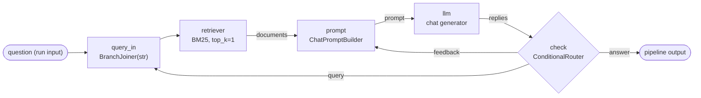

The [previous lesson](/learn/haystack-and-other-frameworks/haystack-architecture) introduced the Haystack `Pipeline` as the object that holds components and the connections between them. This lesson opens it up. You will learn exactly what a connection is, how the pipeline decides which component runs next, how branches, merges and loops are expressed as edges, and how a loop is kept from running forever. The worked example is a self-correcting query pipeline for AskMeridian that rejects answers without citations and tries again.

Knowing the execution model is what separates using a pipeline from debugging one. Most confusing Haystack behaviour, such as a component that silently never runs, a "pipeline appears to be blocked" warning, or a loop that dies with `PipelineMaxComponentRuns`, follows directly from a handful of rules that this lesson makes explicit.

## Learning objectives

- Explain what a socket connection is, which type checks happen at `connect` time, and when one input socket may receive from several senders.
- Describe the two gates a component must pass before it runs (all mandatory inputs present, and a trigger) and use them to predict execution order.
- Build a branching pipeline with `ConditionalRouter` and a loop closed with `BranchJoiner`, and bound the loop with `max_runs_per_component`.
- Diagnose a blocked pipeline from its symptoms, and fix it by changing where inputs come from.
- Choose between `run`, `run_async` and streaming for a given serving context.

## Prerequisites

- [Haystack architecture](/learn/haystack-and-other-frameworks/haystack-architecture): components, sockets, document stores and the two-pipeline layout.
- [Corrective RAG](/learn/advanced-rag-patterns/corrective-rag): the idea of checking an intermediate result and retrying, which the loop example implements.
- [Async programming](/learn/python-for-rag-engineering/async-programming): needed for the section on asynchronous execution.

## Why this matters

A straight-line RAG pipeline (retrieve, prompt, generate) is easy in any framework, or in none. Real systems are not straight lines. AskMeridian needs to send questions that contain an Atlas error code to keyword search and others to vector search; to merge two result lists; to check that an answer cites its sources and regenerate if not; and to give up cleanly after a few attempts. Each of those is a branch, a merge or a loop.

When such logic is hand-written, the control flow is spread across `if` statements and `while` loops, and the only record of what happened is whatever was logged. In a Haystack pipeline the same logic is a graph, and the pipeline's scheduler decides what runs. That gives you validation before running, a trace of every step, and a definition you can save and review. It also means that when the graph is wrong, the failure is a scheduling failure: a component that waits for an input that will never arrive, or a loop that cannot exit. You cannot fix those without knowing the scheduler's rules.

## The intuition

Picture a kitchen during service. Each cook stands at a station and starts a dish only when two things are true: every ingredient the recipe requires is on the counter, and somebody has actually sent something to the station (a new order, or a plate handed back). Ingredients arrive on the counter from other stations, and once used they are gone; if a plate comes back to be redone, the cook needs fresh ingredients for the second attempt. The standing order sheet from the front of house is different: it stays pinned up for the whole service.

A pass at the end of the line checks each plate. A good plate goes out to the dining room. A bad plate goes back to an earlier station with a note. And the head chef has a rule: no station cooks the same dish more than three times; after that, the order is cancelled.

That is the Haystack scheduler. Stations are components, ingredients on the counter are inputs from other components (consumed when used), the pinned order sheet is the input you pass to `run` (it persists), the pass is a router, the returned plate is a loop edge, and the head chef's rule is `max_runs_per_component`.

## How it works

### Sockets and connections

Every component has named **input sockets** (from the parameters of its `run` method) and **output sockets** (from its declared output types). `pipeline.connect("a.out", "b.in")` creates a directed edge from one output socket to one input socket. At connect time the pipeline checks:

1. **Both components and both sockets exist.** A typo fails immediately, not at run time.
2. **The types are compatible.** An output of `list[Document]` can feed an input of `list[Document]`; it cannot feed `str`. `Any` on either side is compatible with everything. Recent releases also apply a few documented automatic conversions, such as wrapping a single value into a one-element list, or converting between `ChatMessage` and `str`; check the documentation for your version before relying on one. Type checking can be switched off with `Pipeline(connection_type_validation=False)`, which is occasionally useful for components with loose annotations and otherwise a bad idea.
3. **The input socket is not already taken.** A normal input socket accepts exactly one sender. A socket can take several senders only if it is **variadic**, which in practice means its type is a list (or the component explicitly declares it variadic). This is why joiners exist: `DocumentJoiner.documents` is variadic, so two retrievers can both connect to it.

An output socket, by contrast, may fan out to any number of inputs. The value is delivered to each of them.

If you write only a component name, as in `connect("retriever", "prompt")`, the pipeline picks the unique pair of type-compatible sockets, and fails if there is more than one candidate. Writing both socket names is clearer and safer.

### The two gates: when a component runs

At run time the pipeline keeps a store of inputs waiting for each component, and a priority queue of components. A component can run only when it passes two gates:

1. **All mandatory inputs are present.** A mandatory input is one with no default value in `run`'s signature. Optional inputs do not block.
2. **It has a trigger.** There are exactly three triggers: a predecessor in the graph has just delivered an input to it; or input was provided from outside the pipeline (in the `data` you pass to `run`) and the component has not run yet; or the component has no incoming connections at all and has not run yet.

The second gate is what stops infinite loops of re-execution: a trigger from outside, or from having no inputs, can start a component only once. After that, only fresh input from a predecessor can trigger it again.

Inputs are then **consumed**. When a component runs, every input that came from another component is removed from its waiting store. Inputs that came from outside the pipeline are kept, so they are available again if the component is visited a second time in a loop. This asymmetry is the single most important rule for designing loops, and the example below depends on it.

### The scheduling loop

Putting the gates together, the sequence for one `run` call is:

1. Validate the `data` you passed: every mandatory socket must be either connected or supplied, and you may not supply a value to a socket that a connection already feeds (unless it is variadic).
2. Place every component in a priority queue. Its priority is computed from its inputs: **highest** for a component with a greedy variadic input that has received a value, **ready** when all its predecessors have finished, **defer** when it could run but some optional or variadic input may still arrive, and **blocked** when it cannot run.
3. Take the best component from the queue. If it is blocked, stop: nothing else can make progress. If it is deferred and several components are deferred, break the tie by topological order (upstream first), so a joiner waits for all its branches.
4. Consume its inputs, run it, and count the visit. If the visit count exceeds `max_runs_per_component` (100 by default), raise `PipelineMaxComponentRuns`.
5. Deliver its outputs along every outgoing edge. Unconnected outputs become pipeline outputs.
6. Recompute priorities and go back to step 3.

Two consequences are worth remembering. Execution order is determined by data, not by the order in which you called `add_component`; components are sorted by name only to make ties deterministic. And a component on a branch that the router did not take simply never runs. It is not an error; its outputs are absent from the result.

### Branches: routers

A **router** is a component with several output sockets, of which it fills only some on each run. The general-purpose one is `ConditionalRouter`. You give it a list of routes, each with a Jinja2 `condition`, an `output` expression, an `output_name` (the socket) and an `output_type`. On each run it evaluates the conditions in order and fills the outputs of the **first** route whose condition is true. A final route with condition `{{ True }}` acts as the default. A route may also declare several outputs, as lists, which the example uses to send two values back into a loop.

The variables a condition uses (`replies`, `question`) automatically become input sockets of the router. Conditions run in Jinja's sandboxed environment; `unsafe=True` lifts the sandbox, which allows arbitrary code and must never be combined with route definitions from untrusted sources.

Haystack also ships specialised routers: `MetadataRouter` routes documents by metadata filters, `FileTypeRouter` routes files by MIME type in indexing pipelines, and `DocumentLengthRouter` routes documents by length. A component you write can be a router too: it just declares several outputs and returns only some of them.

### Merges: joiners

Branches must often come back together. Haystack has two families of joiner, and choosing the wrong one is a classic bug:

- **Waiting joiners** have a lazy variadic input: they defer until every connected predecessor has run (or been skipped), then run once with all the values. `DocumentJoiner`, `ListJoiner` and `StringJoiner` are of this kind. Use them to combine the outputs of branches that *all* run, such as two retrievers in hybrid search.
- **Greedy joiners** have a greedy variadic input: they run as soon as one value arrives. `BranchJoiner` is the important one. Use it where *exactly one* of several branches produces a value per pass: after a router, or at the entry point of a loop.

If you put a `BranchJoiner` after two branches that both run, it fires once per branch, and each firing delivers a separate list downstream. A component after it whose socket accepts one value does not merge the two lists; in the test behind the real-world example below, the prompt builder ran once and only one retriever's documents reached it, with no error. A waiting joiner after a router, by contrast, is safe: the scheduler treats the skipped branch as finished, and the joiner runs with the one list it received. `BranchJoiner` is still the clearer choice there, because it states the intent (one branch per pass) and it is the only kind that works at a loop entry.

### Loops

A loop is an edge from a later component back to an earlier one. Loops implement retries, iterative retrieval and agent-like refinement. Three rules make them work:

1. **The loop's entry needs a joiner.** The first component in the loop receives input from outside on the first pass and from the loop edge on later passes. A normal socket cannot have both a connection and an outside input, so put a `BranchJoiner` at the entry: you send the outside value to the joiner, and the loop edge connects to the joiner too.
2. **Re-supply consumed inputs.** On the second pass, every input that came from another component has been consumed. If the component re-entered needs one of them again (the prompt builder needs `documents`), something on the loop must produce it again. Inputs you passed in `data` are still there.
3. **Bound it.** Set `max_runs_per_component` to the most visits any component may legitimately make. When the bound is hit, the pipeline raises `PipelineMaxComponentRuns`; catch it and return a graceful failure.



### Outputs, breakpoints and snapshots

By default `run` returns only unconnected outputs. Add component names to `include_outputs_from` to see intermediate values; for a component that ran several times in a loop, you get its last output.

For debugging longer pipelines, `run` accepts a `break_point` naming a component and a visit count. When execution reaches it, the pipeline raises a `BreakpointException` carrying a snapshot of the pipeline's state (inputs waiting for each component, visit counts and outputs so far), which can be saved as JSON and later passed back to `run` as `pipeline_snapshot` to resume. When a component raises an ordinary exception, the pipeline also attaches a snapshot to the `PipelineRuntimeError`, which makes a production failure reproducible: you can resume from the failing component with the same inputs.

### Synchronous, asynchronous and streaming execution

`Pipeline.run` executes one component at a time and blocks the calling thread. `Pipeline.run_async` is a coroutine that runs components whose inputs are ready concurrently: in a hybrid pipeline, a BM25 retriever and an embedding retriever that each wait on a network call overlap instead of queueing. Components that define a `run_async` method are awaited directly; synchronous components are run in a thread pool so they do not block the event loop. `run_async_generator` yields each component's output as it finishes, and `Pipeline.stream` yields the generator's tokens as they arrive. In a FastAPI service, use the async methods; in a batch job, `run` is simpler and adequate.

> [!WARNING]
> A loop pipeline that calls a model is a cost multiplier. With `max_runs_per_component=3`, the worst case is three generations per question, not one. Set the bound from your latency and cost budget, not from a guess about how often the check will fail.

## In code

The example builds the loop in the diagram above. A BM25 retriever finds a passage, a prompt builder renders it with the question, a model answers, and a `ConditionalRouter` checks whether the answer contains a citation marker such as `[1]`. If it does, the answer leaves the pipeline. If not, the router sends the question back to the loop entry (so retrieval runs again and re-supplies `documents`) and sends feedback to the prompt builder. A tiny custom tracer records the order in which components run, so you can watch the scheduler work.

The model is a `MockChatGenerator` with a function that forgets to cite on the first attempt and cites once it sees the feedback. That makes the run deterministic. The second half replaces it with a model that never cites, to show the loop bound.

```bash
pip install haystack-ai
```

```python
from haystack import Document, Pipeline
from haystack.components.builders import ChatPromptBuilder
from haystack.components.generators.chat import MockChatGenerator
from haystack.components.joiners import BranchJoiner
from haystack.components.retrievers.in_memory import InMemoryBM25Retriever
from haystack.components.routers import ConditionalRouter
from haystack.dataclasses import ChatMessage
from haystack.document_stores.in_memory import InMemoryDocumentStore
from haystack.tracing import Span, Tracer, enable_tracing
import contextlib

class OrderTracer(Tracer):
    """Records the name of every component the pipeline runs, in order."""
    def __init__(self):
        self.order = []

    @contextlib.contextmanager
    def trace(self, operation_name, tags=None, parent_span=None):
        if operation_name == "haystack.component.run":
            self.order.append(tags["haystack.component.name"])
        yield NoopSpan()

    def current_span(self):
        return None

class NoopSpan(Span):
    def set_tag(self, key, value):
        pass

tracer = OrderTracer()
enable_tracing(tracer)

store = InMemoryDocumentStore()
store.write_documents([
    Document(content="Passwords must be rotated every 90 days.", meta={"source": "it-runbooks"}),
    Document(content="The VPN is required on public Wi-Fi.", meta={"source": "it-runbooks"}),
    Document(content="Error E-4021 means the VPN client is out of date; update it from the IT portal.",
             meta={"source": "atlas-error-codes"}),
])

template = [
    ChatMessage.from_system("Answer from the context and cite sources as [1], [2]."),
    ChatMessage.from_user(
        "[{{ loop.index }}] {{ d.content }}\n"
        "Question: {{ question }}"
        "\nYour previous answer was rejected: {{ feedback }}"
    ),
]

calls = []
def flaky_model(messages):
    # Forgets to cite on the first attempt, cites once told off.
    calls.append(len(calls) + 1)
    if "rejected" in messages[-1].text:
        return "Update the VPN client from the IT portal [1]."
    return "Update the VPN client from the IT portal."

routes = [
    {   # accept: the reply contains a citation marker
        "condition": "{{ '[' in replies[0].text and ']' in replies[0].text }}",
        "output": "{{ replies[0].text }}",
        "output_name": "answer",
        "output_type": str,
    },
    {   # otherwise: send feedback back to the prompt builder
        "condition": "{{ True }}",
        "output": ["{{ question }}", "The answer has no [n] citation. Cite the passage you used."],
        "output_name": ["query", "feedback"],
        "output_type": [str, str],
    },
]

pipe = Pipeline(max_runs_per_component=3)
pipe.add_component("query_in", BranchJoiner(str))
pipe.add_component("retriever", InMemoryBM25Retriever(document_store=store, top_k=1))
pipe.add_component("prompt", ChatPromptBuilder(template=template, required_variables=["question", "documents"]))
pipe.add_component("llm", MockChatGenerator(response_fn=flaky_model))
pipe.add_component("check", ConditionalRouter(routes=routes))
pipe.connect("query_in.value", "retriever.query")
pipe.connect("retriever.documents", "prompt.documents")
pipe.connect("prompt.prompt", "llm.messages")
pipe.connect("llm.replies", "check.replies")
pipe.connect("check.query", "query_in.value")       # loop edge 1: retrieve again
pipe.connect("check.feedback", "prompt.feedback")   # loop edge 2: add the feedback

question = "What does error E-4021 mean?"
result = pipe.run(
    {"query_in": {"value": question}, "prompt": {"question": question}, "check": {"question": question}},
    include_outputs_from={"prompt"},
)
print("run order:", " -> ".join(tracer.order))
print("model calls:", len(calls))
print("final answer:", result["check"]["answer"])
print("last prompt sent:\n" + result["prompt"]["prompt"][-1].text)

# A model that never cites: the loop must stop somewhere.
pipe.remove_component("llm")
pipe.add_component("llm", MockChatGenerator(responses="Update the VPN client."))
pipe.connect("prompt.prompt", "llm.messages")
pipe.connect("llm.replies", "check.replies")
tracer.order.clear()
try:
    pipe.run({"query_in": {"value": question}, "prompt": {"question": question}, "check": {"question": question}})
except Exception as err:
    print(f"\n{type(err).__name__}: {err}")
    print("llm ran", tracer.order.count("llm"), "times")
```

```output
run order: query_in -> retriever -> prompt -> llm -> check -> query_in -> retriever -> prompt -> llm -> check
model calls: 2
final answer: Update the VPN client from the IT portal [1].
last prompt sent:
[1] Error E-4021 means the VPN client is out of date; update it from the IT portal.
Question: What does error E-4021 mean?
Your previous answer was rejected: The answer has no [n] citation. Cite the passage you used.

PipelineMaxComponentRuns: Maximum run count 3 reached for component 'query_in'
llm ran 3 times
```

### What the output shows

- **The run order is the data order.** Two full passes: `query_in` (triggered by your input), the retriever, the prompt builder, the model, the check; then the check's `query` output re-triggers `query_in` and the pass repeats. On the second pass the check takes the first route and the loop ends.
- **The prompt builder kept `question` but needed `documents` again.** `question` came from outside the pipeline, so it was not consumed and is still there on the second pass. `documents` came from the retriever and was consumed; that is why the retry route sends the question back through the retriever rather than straight to the prompt builder. Try connecting only `check.feedback` to the prompt: the second pass blocks, and Haystack logs that the pipeline "appears to be blocked", listing the prompt builder as waiting on an input that will never arrive.
- **`feedback` is an optional input.** The template uses ``, and `feedback` is not in `required_variables`, so on the first pass the prompt builder ran without it. Optional inputs never block.
- **The router's inputs come from two places.** `replies` arrives from the model on each pass; `question` was passed in `data` once and persists. The router's second route outputs two values at once, each to its own socket.
- **`include_outputs_from` returned the last prompt.** The prompt builder ran twice; the result holds the second rendering, which is the one with the feedback.
- **The bound fired on `query_in`.** With a model that never cites, each pass increments every component's visit count. `query_in` is the first to be scheduled for a fourth visit, so it is the one named in the error, after the model had already run three times. In a service, catch `PipelineMaxComponentRuns` and return a "could not produce a cited answer" response instead of a 500.

Common errors when building loops: connecting the loop edge straight to the retriever's `query` socket and also passing `query` in `data` (rejected at validation: a connected socket cannot also take outside input, which is exactly why `query_in` exists); using `DocumentJoiner` instead of `BranchJoiner` at the loop entry (it waits for a predecessor that is downstream of itself); and forgetting the default route in the router, so that when no condition matches, nothing is emitted and the pipeline ends with no answer.

To extend the example, replace the bracket check with a real citation validator (a custom component that checks each cited number exists and that the cited passage contains the key terms of the answer), or route the retry to a different retriever with a larger `top_k`, as [corrective RAG](/learn/advanced-rag-patterns/corrective-rag) suggests.

## A real-world example

The Platform team ports AskMeridian's query path to Haystack. Their first draft has a router that sends questions containing an Atlas error code to a BM25 retriever and everything else to a dense retriever, merged with a `BranchJoiner(list[Document])`. It works. A month later, after complaints that some questions are answered from the wrong passage, they switch to hybrid search: the router is removed and both retrievers now run on every question. Nobody changes the joiner.

Answers get no better, and an engineer comparing traces notices something odd. A tracer like the one in the code above shows the run order `bm25 -> emb -> join -> dense -> join -> prompt -> llm`: the joiner fires once for each retriever, but the prompt builder runs once and renders only one of the two lists. Half of the retrieved evidence never reaches the model, and nothing fails. Type checks pass, because each list is a valid `list[Document]`, and the result looks like a normal answer.

The fix is a waiting joiner: `DocumentJoiner` with `join_mode="reciprocal_rank_fusion"`, which defers until both retrievers have run and then fuses their rankings into one list. The team also adds two tests: one that asserts each component's visit count for a hybrid query (exactly one visit for the joiner and the prompt builder), and one that asserts documents from both retrievers can appear in the rendered prompt. "Evidence silently dropped" is invisible to type checks, so it has to be checked by tests that look at what the pipeline actually did.

## Common mistakes

- **Using `BranchJoiner` where several branches all run.** It fires once per incoming value instead of merging, so downstream components either run several times (several generations) or keep only one of the lists, silently dropping evidence.
- **Using a `BranchJoiner` anywhere but a loop entry or after a router.** It is a pass-through for one value per pass; for merging results, use a waiting joiner such as `DocumentJoiner`.
- **Expecting consumed inputs to survive a loop.** A component re-entered in a loop does not see the values other components gave it last time; the pipeline blocks or the component runs with defaults.
- **No default route in `ConditionalRouter`.** When no condition is true, nothing is emitted and the pipeline finishes without the expected output and without an error.
- **Leaving `max_runs_per_component` at the default for model loops.** The default of 100 allows up to 100 generations per question before failing.
- **Passing outside input to a connected socket.** Validation rejects it; use a `BranchJoiner` at the loop entry.

## Best practices

- Draw the graph before you build it, and mark every loop entry and every merge as "one branch" or "all branches".
- Bound every loop with the smallest `max_runs_per_component` your design needs, and turn `PipelineMaxComponentRuns` into a graceful response.
- Give every router a final `{{ True }}` route, even if it only emits a "no route matched" value you can test for.
- In tests, run at least one input down every branch and assert on `include_outputs_from` outputs, not only on the final answer.
- Prefer the async path in services, and make network-bound custom components implement `run_async` so they overlap.
- Keep routing conditions simple and side-effect free; put complex decisions in a custom component you can unit test.

## Performance considerations

The scheduler's cost is negligible next to model calls. What matters is how many times expensive components run and whether independent ones overlap.

For loops, the expected number of generations per question is a geometric sum. If each attempt independently fails the check with probability $p$ and the loop allows $n$ attempts, the expected number of model calls is $1 + p + p^2 + \dots + p^{n-1}$. With $p = 0.2$ and $n = 3$ that is $1 + 0.2 + 0.04 = 1.24$, a 24% increase in generation cost and a matching increase in mean latency. The tail is worse: 4% of questions ($p^2$) need all three attempts and take roughly three times as long. Measure $p$ on your own traffic before choosing $n$.

For branches, `run_async` turns a sum into a maximum. If a BM25 call takes 20 ms and a dense retrieval (query embedding plus vector search) takes 60 ms, sequential execution costs 80 ms and concurrent execution about 60 ms. With a reranker and a generator after the join, the saving is small in relative terms, but it is free.

Deep-copying inputs at each hop costs memory proportional to the data in flight. Pass documents without embeddings between components unless a later component needs them.

## Security considerations

- **Router conditions are templates.** Keep `ConditionalRouter` in its sandboxed default. With `unsafe=True`, a route definition loaded from a user-editable YAML file can execute arbitrary Python.
- **Loops amplify abuse.** A user who can craft questions that always fail the check can make every request cost the maximum number of generations. The loop bound is also a cost-control and denial-of-service control; pair it with per-user rate limits.
- **Snapshots contain data.** Pipeline snapshots saved on error include the inputs waiting for each component, which means user questions and retrieved document text. Store them where you would store request logs, with the same retention and access rules.

## Summary

- A connection joins one output socket to one input socket; types are checked at `connect` time, and only variadic (list-typed) inputs accept several senders.
- A component runs when all mandatory inputs are present and it has a trigger; inputs from components are consumed when it runs, inputs passed to `run` persist.
- Routers fill only some outputs; `BranchJoiner` merges branches where one runs, waiting joiners merge branches where all run.
- Loops need a `BranchJoiner` at their entry, a way to re-supply consumed inputs, and a `max_runs_per_component` bound.
- `run` is sequential and blocking; `run_async` overlaps independent components, and the streaming methods yield partial results.

## Exercises

1. Run the example, then change the first route's condition so that it never matches (for example `{{ False }}`). Predict the run order and the exception, then check.

<details><summary>Show solution</summary>

Every pass ends at the default route, exactly as with the stubborn model. Each component runs three times; when `query_in` is scheduled for a fourth visit, the pipeline raises `PipelineMaxComponentRuns: Maximum run count 3 reached for component 'query_in'`. The model is called three times even though the first answer cited correctly, which shows why a check must be tested on good answers as well as bad ones.

</details>

2. Remove the `check.query -> query_in.value` connection and the `query` output from the retry route, keeping only `feedback`. Explain the result using the two gates.

<details><summary>Show solution</summary>

On the second pass the prompt builder receives `feedback` from the router, which is a trigger, and `question` is still present because it came from outside. But `documents` is mandatory (it is in `required_variables`) and was consumed on the first pass, and the retriever has no trigger to run again. The prompt builder fails gate 1, nothing else can run, and the pipeline stops with the "appears to be blocked" warning. There is no `answer` in the result.

</details>

3. Sketch, as a list of components and connections, a pipeline that routes questions containing an Atlas error code (pattern `E-\d{4}`) to a BM25 retriever and all other questions to an embedding retriever, then generates an answer. Which joiner do you use and why?

<details><summary>Show solution</summary>

Components: `router` (`ConditionalRouter` with a regex-based condition, which needs a custom Jinja filter passed through `custom_filters`, or a small custom router component), `bm25` (`InMemoryBM25Retriever`), `embedder` (a text embedder), `dense` (`InMemoryEmbeddingRetriever`), `join` (`BranchJoiner(list[Document])`), `prompt`, `llm`. Connections: `router.code_query -> bm25.query`; `router.text_query -> embedder.text`; `embedder.embedding -> dense.query_embedding`; `bm25.documents -> join.value`; `dense.documents -> join.value`; `join.value -> prompt.documents`; `prompt.prompt -> llm.messages`. `BranchJoiner` fits because exactly one branch runs per question, and it says so. A `DocumentJoiner` would also work here, since the scheduler treats the skipped branch as finished; what you must not do is keep the `BranchJoiner` if you later make both retrievers run.

</details>

4. Your team's policy allows at most 1.5 seconds of generation time per question at the 95th percentile. One generation takes about 0.8 seconds, and the citation check fails on about 25% of first attempts and about 25% of retries. What is the largest loop bound you can allow, and what should happen when it is reached?

<details><summary>Show solution</summary>

With one attempt, all questions take about 0.8 s. With two attempts allowed, 25% of questions need a second, taking about 1.6 s. Since 25% is more than 5%, the 95th percentile is 1.6 s, over budget. So the bound is one attempt, unless retries are made cheaper (a smaller, faster model for the retry, or a cheaper repair prompt). When the check fails, the pipeline should return a graceful response, for example the answer flagged as uncited, or a refusal, rather than retry. This is the kind of arithmetic that should decide `max_runs_per_component`.

</details>

## Check your understanding

```quiz
[
  {"q": "Which input sockets may receive connections from more than one sender?", "options": ["Any socket with a default value", "Variadic sockets, which in practice means list-typed inputs such as `DocumentJoiner.documents`", "Any socket of type `str`", "Only sockets on the first component of the pipeline"], "answer": 1, "why": "A normal socket accepts one sender; variadic inputs collect values from several, which is why joiners exist."},
  {"q": "A component in a loop is re-entered. Which of its inputs are still available on the second pass?", "options": ["Inputs that were passed to `Pipeline.run` from outside", "All inputs from the first pass", "Only inputs with default values", "None; every input is consumed"], "answer": 0, "why": "Inputs from other components are consumed when the component runs; inputs supplied from outside the pipeline persist."},
  {"q": "Two retrievers both run on every question and are merged with a `BranchJoiner(list[Document])` before the prompt builder. What happens?", "options": ["The two lists are concatenated", "Validation rejects the pipeline", "The joiner fires once per retriever and the evidence is not merged, so documents can be silently dropped", "The pipeline deadlocks"], "answer": 2, "why": "`BranchJoiner` is a greedy pass-through for one value at a time; merging the outputs of branches that all run needs a waiting joiner such as `DocumentJoiner`."},
  {"q": "What does `max_runs_per_component=3` guarantee?", "options": ["The pipeline runs at most three components", "Each run takes at most three seconds", "The model is called exactly three times", "No component runs more than three times in one `run` call; exceeding it raises `PipelineMaxComponentRuns`"], "answer": 3, "why": "It is a per-component visit limit for a single run, the standard way to bound loops."},
  {"q": "Why does `run_async` reduce latency for a hybrid pipeline with a BM25 retriever and an embedding retriever?", "options": ["It runs the two independent retrievers concurrently, so their latencies overlap", "It skips the deep copy of inputs", "It caches retriever results", "It runs the generator before the retrievers"], "answer": 0, "why": "Components whose inputs are ready are run concurrently, so total time approaches the slower branch rather than the sum."}
]
```

## Further reading

- [Haystack documentation: Pipelines](https://docs.haystack.deepset.ai/docs/pipelines): connections, loops, branching, breakpoints and serialisation for the current release.
- [Haystack documentation](https://docs.haystack.deepset.ai/docs/intro): reference pages for `ConditionalRouter`, `BranchJoiner` and the other routers and joiners.
- [Haystack tutorials](https://haystack.deepset.ai/tutorials): worked examples of self-correcting loops and conditional routing.
- Yan, S.-Q. et al. (2024). *Corrective Retrieval Augmented Generation*. arXiv:2401.15884. The retrieve-check-retry pattern the loop example implements in its simplest form.
