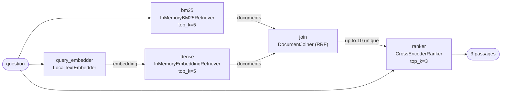

The earlier lessons in this module built the parts: [pipelines](/learn/haystack-and-other-frameworks/pipelines), [components](/learn/haystack-and-other-frameworks/components) and [document stores](/learn/haystack-and-other-frameworks/document-stores). This lesson assembles them into the thing most Haystack projects exist for: a retrieval pipeline that takes a question and returns the few passages most likely to answer it. You will build the standard production shape (keyword and vector retrieval in parallel, fused with reciprocal rank fusion, then reranked with a cross-encoder), instrument every stage so it can be measured, and evaluate each stage on a small labelled set of Meridian questions with Haystack's own evaluators.

The ideas behind each stage are taught elsewhere in the course: [hybrid retrieval architecture](/learn/hybrid-search/hybrid-retrieval-architecture), [Reciprocal Rank Fusion](/learn/hybrid-search/reciprocal-rank-fusion) and [two-stage retrieval](/learn/advanced-retrieval-optimisation/two-stage-retrieval). Here the focus is on expressing them as a Haystack graph and on the engineering habit that matters most: measuring each stage rather than assuming the pipeline helps.

## Learning objectives

- Build a hybrid retrieval pipeline in Haystack with BM25 and embedding retrievers, a `DocumentJoiner` and a reranker, and explain the role of every connection.
- Compute Haystack's reciprocal rank fusion score by hand, including the effect of join weights.
- Evaluate each stage of a retrieval pipeline separately with `DocumentRecallEvaluator` and `DocumentMRREvaluator` using `include_outputs_from`.
- Interpret stage-by-stage metrics to decide which stages earn their latency and cost.
- Choose among Haystack's other retrieval-stage components (metadata rankers, sentence-window and auto-merging retrieval, multi-query retrieval) for a stated problem.

## Prerequisites

- [Pipelines](/learn/haystack-and-other-frameworks/pipelines), [Components](/learn/haystack-and-other-frameworks/components) and [Document stores](/learn/haystack-and-other-frameworks/document-stores).
- [Reciprocal Rank Fusion](/learn/hybrid-search/reciprocal-rank-fusion): the fusion method used here.
- [Two-stage retrieval](/learn/advanced-retrieval-optimisation/two-stage-retrieval): why a cheap first stage is followed by an expensive second one.
- [Recall@K](/learn/retrieval-evaluation/recall-k) and [MRR](/learn/retrieval-evaluation/mrr): the metrics used to evaluate the pipeline.

## Why this matters

Retrieval sets the ceiling on answer quality. If the passage that answers a question is not among the ones handed to the model, no prompt can recover it. Teams know this, and so they add stages: a keyword retriever next to the vector one, a fusion step, a reranker, perhaps a recency boost. Each stage costs latency and money, and each one can make things worse as well as better. Fusion can push a document that one retriever ranked first below documents that both ranked middling. A reranker trained on web search can misjudge internal jargon.

The engineering question is never "is hybrid retrieval good?" in general. It is "on our questions, with our documents, does each stage of our pipeline improve the result enough to pay for itself?" Answering it needs two things: a pipeline built so that every stage's output can be observed, and a labelled set of questions to score those outputs against. Haystack makes the first easy, because every stage is a named component and `include_outputs_from` exposes intermediate results, and ships evaluators for the second. This lesson uses both.

## The intuition

Think of hiring. A recruiter cannot interview every applicant, so the process has stages. Two screeners each read the applications quickly: one checks for exact keywords from the job description ("Kubernetes", "PostgreSQL"), the other reads for general fit, and each produces a shortlist. The two shortlists are merged: applicants on both lists rise to the top, applicants on only one are kept but lower down. Then a senior interviewer, slow and careful, interviews only the merged shortlist and picks the best three.

Each stage has a known weakness. The keyword screener misses the candidate who wrote "container orchestration" instead of "Kubernetes". The fit screener can overlook a crucial exact skill. Merging rewards consensus, which is usually right but can demote the one screener who spotted the obvious best candidate. The interviewer is accurate but can only judge who reaches them. A good hiring manager checks each stage's hit rate separately, not just whether the final hire worked out.

## How it works

### The shape of the pipeline



Step by step, for one question:

1. **Both first-stage retrievers start.** The BM25 retriever needs only the question text, so it can run at once. The dense branch first embeds the question (`LocalTextEmbedder`), then searches by vector (`InMemoryEmbeddingRetriever`). With `run_async`, the two branches overlap.
2. **Each returns its own top-k.** Here, five each, with scores on incompatible scales: BM25 scores are unbounded positive numbers, cosine similarities lie between -1 and 1.
3. **The joiner waits for both, then fuses.** `DocumentJoiner` has a lazy variadic input, so it defers until both retrievers have run. In `reciprocal_rank_fusion` mode it ignores the original scores, scores each document by its ranks, and removes duplicates (a document found by both retrievers appears once), producing up to ten unique documents.
4. **The reranker rescores the fused list.** The cross-encoder from the components lesson reads the question and each candidate together and keeps the top three.
5. **The output goes on to prompting.** In a full RAG pipeline the ranker's output connects to a prompt builder; here we stop at retrieval so that it can be evaluated on its own.

The question must be passed to three components (`bm25`, `query_embedder`, `ranker`). In a service you would either pass it three times in `run`, as the code below does, or wrap the whole retrieval graph as a `SuperComponent` with one `query` input mapped to all three.

### Join modes

`DocumentJoiner` supports several modes, and choosing one is a modelling decision:

- `concatenate`: keep every document; for duplicates, keep the one with the highest score. Scores from different retrievers are then compared directly, which is meaningless across BM25 and cosine.
- `merge`: combine duplicates by a weighted sum of their scores. Same caveat: only sensible when the retrievers' scores are on comparable scales.
- `reciprocal_rank_fusion`: score by rank, not by score, so incompatible scales do not matter. The robust default for hybrid search.
- `distribution_based_rank_fusion`: normalise each list's scores using that list's own distribution before combining, an attempt to keep score information while fixing scale.

Weights (`weights=[...]`) apply per input list, in the order the lists arrive, which follows connection order. A `top_k` on the joiner truncates the fused list.

### The other retrieval-stage components

Haystack has many components for this stage; knowing they exist saves writing your own. In the 3.5.0 release these include:

- **`MetaFieldRanker`** reorders documents by a metadata field (such as `updated_at` or a popularity score), optionally fused with the existing order. Use it for "prefer recent policies".
- **`LostInTheMiddleRanker`** reorders already-ranked documents so the strongest sit at the start and end of the context and the weakest in the middle, addressing the [lost-in-the-middle problem](/learn/context-engineering/lost-in-the-middle-problem). It changes order only, not membership.
- **`SentenceWindowRetriever`** takes retrieved chunks and fetches their neighbouring chunks from the store, using the `source_id` and split position metadata that the splitter adds, so that a precise small match arrives with surrounding context.
- **`AutoMergingRetriever`** works with `HierarchicalDocumentSplitter`: when enough child chunks of the same parent are retrieved, it returns the parent instead, an implementation of [parent-child retrieval](/learn/hierarchical-rag/parent-child-retrieval).
- **`QueryExpander`** with **`MultiQueryTextRetriever`** or **`MultiQueryEmbeddingRetriever`** uses a chat model to rewrite the question several ways and retrieves for each in parallel: [multi-query retrieval](/learn/advanced-retrieval/multi-query-retrieval).
- **`TopPSampler`** keeps documents until their cumulative normalised score passes a threshold, a dynamic alternative to a fixed `top_k`.

Each of these is a component with typed sockets, so each can be inserted between the joiner and the ranker, or after the ranker, without changing the rest of the graph.

### Evaluating stage by stage

Haystack's evaluators are components too. `DocumentRecallEvaluator` takes, for each question, a list of ground-truth documents and a list of retrieved documents, and reports recall: in the default single-hit mode, the fraction of questions for which at least one relevant document was retrieved. `DocumentMRREvaluator` reports the mean reciprocal rank of the first relevant document. Both compare documents by a field, `content` by default, so ground truth can be written as plain `Document(content=...)` objects without knowing store ids.

To evaluate stages separately, run the pipeline once per question with `include_outputs_from` naming every stage, collect each stage's documents, truncate each list to the same depth, and score each stage. One pipeline run per question gives you all four rows of the comparison.

## The mathematics

Reciprocal rank fusion scores a document by the ranks it achieved in each list. The original formulation (Cormack, Clarke and Büttcher, 2009) sums $1/(k + \text{rank})$ over lists with a constant $k$ around 60. Haystack's implementation uses a weighted and rescaled version so that the scores lie in a convenient range:

$$
\text{score}(d) = \sum_{i \,:\, d \in L_i} w_i \cdot \frac{k}{k + r_i(d)}
$$

- $L_i$ is the $i$-th ranked list (here $L_1$ from BM25 and $L_2$ from the dense retriever); the sum runs only over lists that contain $d$.
- $r_i(d)$ is the **zero-based** rank of $d$ in $L_i$: 0 for the top document.
- $k = 61$, which corresponds to the paper's 60 with one-based ranks.
- $w_i$ is the weight of list $i$; by default every $w_i = 1/n$ for $n$ lists, so the weights sum to 1.

Multiplying by $k$ means a document ranked first in every list scores exactly 1. A document ranked first in only one of two equally weighted lists scores 0.5 from that list.

**Worked example.** For the question "Can I keep vacation days I didn't use?", the code below shows that the passwords passage is second in both lists, while the correct carry-over passage is first in the dense list and fifth in the BM25 list. With $n = 2$ and $w_1 = w_2 = 0.5$:

$$
\text{score}(\text{passwords}) = 0.5 \cdot \tfrac{61}{62} + 0.5 \cdot \tfrac{61}{62} = 0.984
$$

$$
\text{score}(\text{carry-over}) = 0.5 \cdot \tfrac{61}{65} + 0.5 \cdot \tfrac{61}{61} = 0.469 + 0.5 = 0.969
$$

Consensus wins: the passage both retrievers ranked second beats the passage one retriever ranked first. The gap is tiny because $k$ is large, which flattens the curve: with $k = 61$, rank 0 and rank 4 differ by only about 6%. Giving the dense list weight 0.8 changes the result: $0.2 \cdot \tfrac{61}{65} + 0.8 \cdot 1 = 0.988$ for the carry-over passage against $0.2 \cdot \tfrac{61}{62} + 0.8 \cdot \tfrac{61}{62} = 0.984$ for passwords. A weight of 0.7 is not enough (0.982).

```python
def haystack_rrf(ranks, weights=None, k=61):
    """ranks: zero-based rank of the document in each list, or None if absent."""
    weights = weights or [1 / len(ranks)] * len(ranks)
    return sum(w * k / (k + r) for r, w in zip(ranks, weights) if r is not None)

print(f"passwords (2nd, 2nd):     {haystack_rrf([1, 1]):.3f}")
print(f"carry-over (5th, 1st):    {haystack_rrf([4, 0]):.3f}")
print(f"carry-over, dense 0.8:    {haystack_rrf([4, 0], weights=[0.2, 0.8]):.3f}")
print(f"passwords, dense 0.8:     {haystack_rrf([1, 1], weights=[0.2, 0.8]):.3f}")
```

```output
passwords (2nd, 2nd):     0.984
carry-over (5th, 1st):    0.969
carry-over, dense 0.8:    0.988
passwords, dense 0.8:     0.984
```

The numbers match the joiner's scores in the pipeline output below.

```playground
rrf
```

## In code

The example indexes a 15-passage Meridian knowledge base with a local embedding model, builds the hybrid pipeline from the diagram, runs twelve labelled questions through it, and scores every stage. Haystack 3.5.0's core package has no local-model embedders, so the example includes two small embedding components following the contract from the [components lesson](/learn/haystack-and-other-frameworks/components); the reranker is the `CrossEncoderRanker` written there.

```bash
pip install haystack-ai sentence-transformers
```

```python
# meridian_components/embedders.py
from dataclasses import replace

from haystack import Document, component


class _MiniLM:
    """Loads the sentence-transformers model once per process, shared by both embedders."""
    _models: dict = {}

    @classmethod
    def get(cls, name):
        if name not in cls._models:
            from sentence_transformers import SentenceTransformer
            cls._models[name] = SentenceTransformer(name)
        return cls._models[name]


@component
class LocalDocumentEmbedder:
    def __init__(self, model: str = "sentence-transformers/all-MiniLM-L6-v2", batch_size: int = 32):
        self.model, self.batch_size, self._st = model, batch_size, None

    def warm_up(self):
        self._st = self._st or _MiniLM.get(self.model)

    @component.output_types(documents=list[Document])
    def run(self, documents: list[Document]):
        vecs = self._st.encode([d.content or "" for d in documents], batch_size=self.batch_size,
                               normalize_embeddings=True)
        return {"documents": [replace(d, embedding=v.tolist()) for d, v in zip(documents, vecs)]}


@component
class LocalTextEmbedder:
    def __init__(self, model: str = "sentence-transformers/all-MiniLM-L6-v2"):
        self.model, self._st = model, None

    def warm_up(self):
        self._st = self._st or _MiniLM.get(self.model)

    @component.output_types(embedding=list[float])
    def run(self, text: str):
        return {"embedding": self._st.encode([text], normalize_embeddings=True)[0].tolist()}
```

Both embedders read their model through one shared loader, so the indexing and query pipelines in one process hold one copy of the model, and the default model name is defined in one place, which protects against the mismatched-model mistake from the architecture lesson.

```python
from haystack import Document, Pipeline
from haystack.components.evaluators import DocumentMRREvaluator, DocumentRecallEvaluator
from haystack.components.joiners import DocumentJoiner
from haystack.components.retrievers.in_memory import InMemoryBM25Retriever, InMemoryEmbeddingRetriever
from haystack.components.writers import DocumentWriter
from haystack.document_stores.in_memory import InMemoryDocumentStore
from haystack.document_stores.types import DuplicatePolicy

from meridian_components.embedders import LocalDocumentEmbedder, LocalTextEmbedder
from meridian_components.ranker import CrossEncoderRanker

CORPUS = [
    "Annual leave is 25 days per year for all permanent staff.",
    "Up to 5 unused leave days carry over and must be used by 31 March.",
    "Staff may work remotely up to 3 days a week with their manager's agreement.",
    "The home-office equipment budget is £400; contractors are not eligible.",
    "Expenses must be submitted within 30 days; anything over £75 needs a receipt.",
    "Passwords must be rotated every 90 days.",
    "The VPN is required whenever you connect from public Wi-Fi.",
    "Laptops are refreshed every 3 years; report a lost laptop to the support desk at once.",
    "The support desk is open 08:00 to 18:00 UK time.",
    "Error E-4021: the VPN client is out of date; update it from the IT portal.",
    "Error E-4012: the VPN certificate has expired; request a new one from IT.",
    "Error E-4030: your user lacks permission for this operation in Atlas; request access.",
    "Error E-4100: too many sessions; disconnect another device.",
    "Meridian Reports can export dashboards to PDF or CSV.",
    "SAML single sign-on is available on the Meridian Reports Enterprise plan.",
]
# (question, index of the one relevant passage)
QUERIES = [
    ("How much holiday do I get each year?", 0),
    ("Can I keep vacation days I didn't use?", 1),
    ("How many days can I work from home?", 2),
    ("Is there an allowance for a home desk?", 3),
    ("Do I need a receipt for a £120 taxi?", 4),
    ("What does E-4012 mean?", 10),
    ("My VPN says E-4021", 9),
    ("Is the helpdesk open at 5:30 in the evening?", 8),
    ("E-4100", 12),
    ("Atlas shows E-4030", 11),
    ("Can Reports do SSO?", 14),
    ("How do I get my dashboard into a spreadsheet?", 13),
]

store = InMemoryDocumentStore(embedding_similarity_function="cosine")
indexing = Pipeline()
indexing.add_component("embedder", LocalDocumentEmbedder())
indexing.add_component("writer", DocumentWriter(store, policy=DuplicatePolicy.OVERWRITE))
indexing.connect("embedder.documents", "writer.documents")
docs = [Document(content=t, meta={"doc_key": f"kb/{i}"}) for i, t in enumerate(CORPUS)]
indexing.run({"embedder": {"documents": docs}})

hybrid = Pipeline()
hybrid.add_component("bm25", InMemoryBM25Retriever(store, top_k=5))
hybrid.add_component("query_embedder", LocalTextEmbedder())
hybrid.add_component("dense", InMemoryEmbeddingRetriever(store, top_k=5))
hybrid.add_component("join", DocumentJoiner(join_mode="reciprocal_rank_fusion"))
hybrid.add_component("ranker", CrossEncoderRanker(top_k=3))
hybrid.connect("query_embedder.embedding", "dense.query_embedding")
hybrid.connect("bm25.documents", "join.documents")
hybrid.connect("dense.documents", "join.documents")
hybrid.connect("join.documents", "ranker.documents")

stages = ["bm25", "dense", "join", "ranker"]
retrieved = {s: [] for s in stages}
truth = []
for question, gold in QUERIES:
    out = hybrid.run(
        {"bm25": {"query": question}, "query_embedder": {"text": question}, "ranker": {"query": question}},
        include_outputs_from=set(stages),
    )
    for s in stages:
        retrieved[s].append(out[s]["documents"])
    truth.append([Document(content=CORPUS[gold])])
    hit = lambda s: "+" if out[s]["documents"][0].content == CORPUS[gold] else "-"
    print(f"{question:<47} top-1 bm25 {hit('bm25')} dense {hit('dense')} rrf {hit('join')} rerank {hit('ranker')}")

recall, mrr = DocumentRecallEvaluator(), DocumentMRREvaluator()
def score(evaluator, stage, k):
    return evaluator.run(ground_truth_documents=truth,
                         retrieved_documents=[docs[:k] for docs in retrieved[stage]])["score"]

print(f"\n{'stage':<7} recall@1  recall@3  MRR@3")
for s in stages:
    print(f"{s:<7} {score(recall, s, 1):8.3f}  {score(recall, s, 3):8.3f}  {score(mrr, s, 3):5.3f}")

q = "Can I keep vacation days I didn't use?"
out = hybrid.run({"bm25": {"query": q}, "query_embedder": {"text": q}, "ranker": {"query": q}},
                 include_outputs_from={"bm25", "dense", "join"})
for s in ["bm25", "dense", "join"]:
    print(f"\n{s}:")
    for d in out[s]["documents"][:3]:
        print(f"  {d.score:6.3f}  {d.content[:50]}")
```

```output
How much holiday do I get each year?            top-1 bm25 + dense + rrf + rerank +
Can I keep vacation days I didn't use?          top-1 bm25 - dense + rrf - rerank +
How many days can I work from home?             top-1 bm25 + dense + rrf + rerank +
Is there an allowance for a home desk?          top-1 bm25 + dense + rrf + rerank +
Do I need a receipt for a £120 taxi?            top-1 bm25 + dense + rrf + rerank +
What does E-4012 mean?                          top-1 bm25 + dense + rrf + rerank +
My VPN says E-4021                              top-1 bm25 + dense + rrf + rerank +
Is the helpdesk open at 5:30 in the evening?    top-1 bm25 + dense + rrf + rerank +
E-4100                                          top-1 bm25 + dense + rrf + rerank +
Atlas shows E-4030                              top-1 bm25 + dense + rrf + rerank +
Can Reports do SSO?                             top-1 bm25 - dense + rrf - rerank -
How do I get my dashboard into a spreadsheet?   top-1 bm25 - dense + rrf - rerank +

stage   recall@1  recall@3  MRR@3
bm25       0.750     0.833  0.792
dense      1.000     1.000  1.000
join       0.750     1.000  0.875
ranker     0.917     1.000  0.958

bm25:
   3.190  Meridian Reports can export dashboards to PDF or C
   1.519  Passwords must be rotated every 90 days.
   1.373  Annual leave is 25 days per year for all permanent

dense:
   0.425  Up to 5 unused leave days carry over and must be u
   0.354  Passwords must be rotated every 90 days.
   0.333  Annual leave is 25 days per year for all permanent

join:
   0.984  Passwords must be rotated every 90 days.
   0.969  Up to 5 unused leave days carry over and must be u
   0.968  Annual leave is 25 days per year for all permanent
```

### Reading the results honestly

The table does not say what a hybrid-search tutorial would like it to say, and that is the most useful thing about it.

- **BM25 failed on vocabulary mismatch.** "Vacation" versus "leave", "SSO" versus "single sign-on", "spreadsheet" versus "CSV": exactly the failures [query-document matching](/learn/rag-architecture-fundamentals/query-document-matching) predicts. Its top hit for the vacation question is the Reports passage, which shares only common words such as "can".
- **Dense retrieval was perfect on this set.** The small MiniLM model handled the synonyms and, on a corpus this small, also distinguished the error codes. Twelve questions over fifteen passages is a smoke test, not a benchmark; on a corpus of thousands of runbook pages with many near-identical codes, the balance usually shifts, which is why you measure on your own data.
- **Fusion made top-1 worse than dense alone.** Recall@1 fell from 1.000 to 0.750. The vacation question shows why: the worked example above, where consensus between two mediocre rankings beat one confident correct ranking. Fusion did keep every relevant passage in the top three (recall@3 of 1.000), which is what a reranker needs.
- **The reranker recovered most of the loss.** It restored the correct passage to first place for two of the three questions fusion got wrong. It failed on "Can Reports do SSO?", ranking the export passage first; the MS MARCO cross-encoder does not reliably map "SSO" to "single sign-on" for a question this short.
- **Each row is one pipeline run per question.** `include_outputs_from` gave every stage's output from the same run, so the comparison is exact: the same query embedding, the same BM25 call, the same fused list.

What would you conclude for Meridian? Not "drop BM25": its value shows up on exact identifiers in large corpora, which this set barely tests. The conclusions are procedural. Build a larger labelled set with many more error-code and product-name questions; try fusion weights favouring dense, as the mathematics section suggests; and compare "dense plus reranker" against "hybrid plus reranker", since the hybrid branch adds latency. The pipeline makes each of those a configuration change and a re-run.

Errors people commonly hit with this code: using `embedding_similarity_function="dot_product"` (the in-memory default) with unnormalised embeddings, which makes long passages win; forgetting to pass the question to the ranker (validation error naming `ranker.query`); and using `concatenate` mode, which compares BM25 scores against cosine similarities directly so that BM25 documents nearly always come first.

## A real-world example

Meridian's Platform team adds a hybrid pipeline like this one to AskMeridian, and in the first week support staff report that answers about the expenses policy sometimes quote the superseded 2023 handbook. Both versions are in the index, deliberately, because staff occasionally ask "what did the old policy say?".

The team's first instinct is to add a `MetaFieldRanker` on `effective_date` after the reranker. They evaluate it before shipping, using the stage-by-stage method from this lesson with a labelled set of 120 questions drawn from real traffic, about a fifth of which concern policies that changed in 2025. Placing the meta-field ranker after the cross-encoder fixes the superseded-version answers but demotes the right passage for several historical questions. They settle on a different design: current-version filtering by default (a metadata filter on `status == "current"`), with a router that removes the filter only when the question explicitly mentions an earlier year or "old policy". The evaluation set now contains both kinds of question, and the stage table is part of every pull request that changes the retrieval graph.

## Common mistakes

- **Evaluating only the final output.** A good final number can hide a stage that costs 100 ms and contributes nothing; a bad one cannot tell you which stage to fix. Use `include_outputs_from` and score every stage.
- **Comparing scores across retrievers.** `concatenate` and `merge` modes compare BM25 scores with cosine similarities as if they were on one scale; use rank-based fusion unless you have normalised the scores.
- **Reranking too few candidates.** The reranker can only promote what the first stage found; if the relevant passage is at rank 20 and you rerank 10, it is lost.
- **Mismatched embedding models between indexing and querying.** Nothing errors; dense results are simply poor. Define the model name once.
- **Drawing conclusions from a dozen questions.** One question changes recall@1 by about 0.08 in the example; small sets justify experiments, not decisions.
- **Treating the joiner's `top_k` as free.** Truncating the fused list before reranking can remove exactly the candidates the reranker would have promoted.

## Best practices

- Name every stage and keep `include_outputs_from` for all of them in your evaluation harness.
- Maintain a labelled question set that reflects real traffic, including identifiers, synonyms and questions with no answer.
- Choose first-stage `top_k` from measured recall at that depth, and reranker input size from the latency budget.
- Prefer RRF for combining retrievers whose scores are on different scales; tune weights only with an evaluation set.
- Put mandatory filters (permissions, current-version) in every retriever's filters, not in a later ranking stage.
- Record per-stage latency in tracing so that quality and cost can be weighed together.

## Performance considerations

Latency in this pipeline is dominated by three things: the query embedding, the reranker and, at scale, vector search.

With `run_async`, the BM25 branch and the dense branch run concurrently, so first-stage latency is roughly the maximum of the two rather than the sum. Suppose (as assumptions to be measured) BM25 takes 5 ms, the query embedding 10 ms on CPU and the vector search 5 ms: the dense branch takes 15 ms, the sequential pipeline 20 ms, the concurrent one about 15 ms.

The reranker is linear in its input. With two first-stage lists of 5 and full overlap removed, it scores at most 10 pairs; at an assumed 4 ms per pair on CPU (batched, so often less), that is up to 40 ms. Raise both retrievers' `top_k` to 25 and the reranker sees up to 50 pairs, about 200 ms. This is usually the decision that matters: retrieve deep enough that recall is high, but rerank only as many as the latency budget allows. Measure recall@k of the fused list at several depths and choose the smallest depth whose recall is close to the maximum.

Memory: the in-memory store holds every embedding as a Python list of floats, several times larger than a NumPy array of the same numbers. For more than a few tens of thousands of passages, move to an integration store.

## Security considerations

- **Permission filters must be applied in every branch.** In a hybrid pipeline, forgetting the filter on one retriever leaks documents through that branch, and fusion happily ranks them. Pass the same per-request filter to every retriever, with `FilterPolicy.MERGE` if constructor filters are also used.
- **Rerankers read untrusted text.** A cross-encoder scores whatever text it is given; a document crafted to look relevant to many questions can rise to the top. Ingestion-time controls and provenance metadata matter more than ranking tricks; see [retrieval manipulation](/learn/rag-security-fundamentals/retrieval-manipulation).
- **Evaluation sets contain real questions.** A labelled set drawn from traffic contains employee questions; store and share it under the same rules as logs.

## Summary

- A Haystack hybrid retrieval pipeline runs BM25 and embedding retrievers in parallel, fuses them with a waiting `DocumentJoiner`, and reranks the fused list.
- Haystack's RRF scores a document as the weighted sum of $k/(k + r)$ over the lists containing it, with $k = 61$ and zero-based ranks; consensus is rewarded and the curve is flat.
- `include_outputs_from` plus `DocumentRecallEvaluator` and `DocumentMRREvaluator` let you score every stage from a single run per question.
- Stages must earn their place: in the example, fusion lowered top-1 accuracy relative to dense alone, and the reranker recovered most of it.
- Haystack ships further retrieval-stage components (meta-field and lost-in-the-middle rankers, sentence-window and auto-merging retrieval, multi-query retrieval) that slot into the same graph.

## Exercises

1. Using the formula, compute by hand the RRF score of a document ranked third (zero-based rank 2) by BM25 and absent from the dense list, with default weights. Would it beat a document ranked tenth (rank 9) in both lists?

<details><summary>Show solution</summary>

Only one list contributes: $0.5 \cdot 61/63 = 0.484$. The document at rank 9 in both lists scores $2 \cdot 0.5 \cdot 61/70 = 0.871$. Yes, the consensus document wins by a wide margin, even though it is only tenth in each list. This is why RRF with large $k$ strongly favours documents found by both retrievers.

</details>

2. Change the joiner to `DocumentJoiner(join_mode="reciprocal_rank_fusion", weights=[0.2, 0.8])` and re-run. What happens to the `join` row, and why is the order of the weights tied to the order of the `connect` calls?

<details><summary>Show solution</summary>

With the dense list weighted 0.8, the carry-over passage now beats the passwords passage for the vacation question (0.988 against 0.984, as computed in the mathematics section). In the run behind this lesson, the `join` row rose to 1.000 for recall@1, recall@3 and MRR@3: all three questions that equal-weight fusion got wrong were fixed. The `ranker` row stayed at 0.917, because the cross-encoder still puts the export passage above the SSO passage. With these weights, the reranker became the stage that *lowers* top-1 accuracy, which is exactly the kind of finding stage-by-stage evaluation exists to surface. On a corpus with many exact identifiers, heavy dense weighting can demote BM25's correct exact matches, so re-check with a larger set before adopting it. The weights apply to the input lists in the order they arrive at the variadic socket, which Haystack sorts by connection order: `bm25.documents` was connected first, so it gets 0.2.

</details>

3. Add a `LostInTheMiddleRanker` after the cross-encoder and raise the ranker's `top_k` to 5. Predict what happens to recall@3 and MRR@3 for the final stage, and explain why that is the wrong way to evaluate this component.

<details><summary>Show solution</summary>

`LostInTheMiddleRanker` places the strongest documents at the beginning and end of the list and the weakest in the middle, so the second-best document moves to the last position. Recall@3 and MRR@3 computed on its output can fall, because the metric assumes position 2 is better than position 5. But the component's purpose is not ranking quality; it is ordering for the language model's attention over a whole context, which these metrics do not measure. Evaluate the reranker's output for retrieval quality, and evaluate the effect of reordering with an end-to-end answer-quality metric instead.

</details>

4. Design question: AskMeridian's latency budget for retrieval is 150 ms at the 95th percentile on CPU. Measurements show BM25 at 10 ms, query embedding at 15 ms, vector search at 20 ms, and reranking at about 4 ms per candidate. Recall@k of the fused list is 0.80 at 10 candidates, 0.90 at 20, 0.93 at 30 and 0.94 at 50. How many candidates do you rerank, and do you run the branches concurrently?

<details><summary>Show solution</summary>

Run the branches concurrently: the first stage then costs about max(10, 15 + 20) = 35 ms instead of 45 ms. That leaves about 115 ms for reranking, about 28 candidates at 4 ms each. Twenty candidates (80 ms, total about 115 ms) gives recall 0.90 with headroom for the 95th percentile; thirty (120 ms, total 155 ms) breaks the budget for a three-point recall gain. Choose 20, and revisit if a GPU or a smaller reranker cuts the per-candidate cost.

</details>

## Check your understanding

```quiz
[
  {"q": "Why does a hybrid pipeline use `DocumentJoiner` rather than `BranchJoiner` to combine the BM25 and dense retrievers?", "options": ["`BranchJoiner` cannot handle documents", "Both retrievers run on every question, and `DocumentJoiner` waits for both lists and fuses them; `BranchJoiner` passes one value at a time", "`DocumentJoiner` is faster", "`BranchJoiner` only works in loops"], "answer": 1, "why": "Waiting joiners merge branches that all run; `BranchJoiner` is a pass-through for one branch per pass."},
  {"q": "With Haystack's RRF and default weights, what is the score of a document ranked first in both of two lists?", "options": ["0.5", "2.0", "1.0", "61"], "answer": 2, "why": "Each list contributes 0.5 times 61/61, so the total is 1.0; Haystack's scaling makes a unanimous top document score exactly 1."},
  {"q": "In the lesson's evaluation, recall@1 fell from 1.000 (dense) to 0.750 after fusion. What is the best interpretation?", "options": ["RRF is broken in Haystack", "BM25 should always be removed", "The evaluator is miscounting", "Fusion rewards consensus, which can demote a document only one retriever ranked first; the stage must be justified by measurement on your own data"], "answer": 3, "why": "The worked example shows consensus beating a single confident ranking; whether fusion helps depends on the corpus and questions."},
  {"q": "Which component would you add so that a precisely matching small chunk is returned together with its neighbouring chunks?", "options": ["`SentenceWindowRetriever`", "`MetaFieldRanker`", "`LostInTheMiddleRanker`", "`TopPSampler`"], "answer": 0, "why": "It fetches adjacent chunks using the source and position metadata that splitters add."},
  {"q": "Why does the code pass `include_outputs_from=set(stages)` to every run?", "options": ["To make the pipeline run faster", "So that each stage's documents from the same run can be scored separately", "Because the ranker requires it", "To serialise the pipeline"], "answer": 1, "why": "Intermediate outputs are not returned by default; exposing them lets one run per question produce all four rows of the comparison."}
]
```

## Further reading

- Cormack, G. V., Clarke, C. L. A. and Büttcher, S. (2009). *Reciprocal Rank Fusion outperforms Condorcet and individual rank learning methods*. SIGIR. The origin of RRF.
- [Haystack documentation](https://docs.haystack.deepset.ai/docs/intro): reference pages for `DocumentJoiner`, the rankers, the retrievers and the evaluators.
- [Haystack tutorials](https://haystack.deepset.ai/tutorials): hybrid retrieval and evaluation walkthroughs for the current release.
- Liu, N. F. et al. (2023). *Lost in the Middle: How Language Models Use Long Contexts*. arXiv:2307.03172. The study behind `LostInTheMiddleRanker`.
- [Sentence Transformers documentation](https://www.sbert.net/): the embedding and cross-encoder models used in the example.
