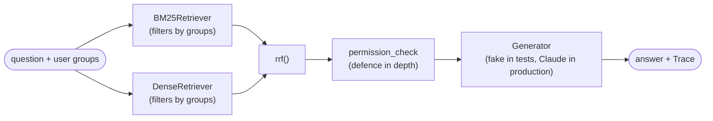

The [previous lesson](/learn/haystack-and-other-frameworks/framework-comparisons) compared frameworks with each other. This one asks the question that comparison leaves open: should you use a framework at all? Many of the most reliable production RAG systems are a few hundred lines of the team's own code around a vector database client, an embedding model and a model API. Others would have taken years to build without a framework's integrations and patterns. This lesson gives you a way to decide, a cost model for the decision, an architecture for a custom RAG core that stays small, and migration paths in both directions. The worked example is a complete, tested, framework-free hybrid retrieval core for AskMeridian that is under 120 lines.

This is the closing lesson of the frameworks phase, so it draws on everything before it. It does not re-teach any framework; it teaches the judgement of when each kind of tool is the right one.

## Learning objectives

- List the signals that favour a custom implementation and the signals that favour a framework, and apply them to a described system.
- Estimate total cost of ownership for both options with a simple break-even model, and state its assumptions.
- Design a custom RAG core around small typed interfaces, with permission enforcement, tracing and tests built in.
- Use framework components inside custom code (and custom code inside a framework) through adapters at a clear boundary.
- Plan an incremental migration in either direction without a rewrite.

## Prerequisites

- [Framework comparisons](/learn/haystack-and-other-frameworks/framework-comparisons): what each framework is organised around.
- [Components](/learn/haystack-and-other-frameworks/components) and [Retrieval pipelines](/learn/haystack-and-other-frameworks/retrieval-pipelines): what a framework gives you, concretely.
- [Functions and classes](/learn/python-for-rag-engineering/functions-and-classes) and [Type hints](/learn/python-for-rag-engineering/type-hints): the custom core uses `Protocol` and dataclasses.
- [Reciprocal Rank Fusion](/learn/hybrid-search/reciprocal-rank-fusion): implemented by hand in the example.

## Why this matters

Two failure stories recur in RAG teams, and they are mirror images.

In the first, a team adopts a large framework for a pipeline that is, in the end, embed, search, prompt, call. They inherit a deep dependency tree, an abstraction they use a tenth of, stack traces six layers deep, and a breaking upgrade every few months. When a bug appears in how the framework renders the prompt, they cannot see the prompt without reading framework source. The framework did not give them anything their 200 lines would not have.

In the second, a team writes everything themselves "to stay in control", and a year later maintains their own PDF parsing, their own retry logic for four model providers, their own tracing, their own hybrid fusion, their own evaluation harness, each with its own bugs and none with tests as thorough as a widely used library's. They spent their time rebuilding commodity parts instead of the parts specific to their business.

Neither team made a stupid choice; they made an unexamined one. The skill is to decide deliberately, per part of the system, and to structure the code so the decision can change later without a rewrite.

## The intuition

Think about a kitchen again. A restaurant buys its oven, its refrigerators and its dishwasher: commodity equipment, built by specialists, tested by thousands of kitchens, and pointless to build yourself. It does not buy its recipes: those are what make the restaurant itself, and they are written, tested and refined in-house. And it designs its own pass, the counter where plates are checked before they go out, because that is where its standards are enforced.

The equivalent split for RAG: buy (use libraries for) the commodity parts, such as model clients, vector database clients, document parsers and embedding models. Own the parts that encode your business: the retrieval logic tuned to your documents, the permission rules, the prompts, the evaluation. Frameworks sit in between, offering a whole kitchen layout. Sometimes that layout matches how you cook. Sometimes you only need the oven.

## How it works

### Signals for each choice

The decision is clearer when you look at concrete signals instead of preferences.

**Signals that favour a custom implementation:**

- The pipeline is simple and stable: a handful of steps, few integrations, unlikely to change shape.
- Control and visibility are requirements: regulated environments where every transformation of a prompt must be auditable, or latency-critical paths where every millisecond and allocation is examined.
- The framework's abstraction fights the problem: you find yourself writing adapters around the framework more than code inside it.
- Dependency constraints: restricted environments, small container images, fast cold starts, or a security review that must cover every package.
- The team is small, experienced and expects to own the system for years.

**Signals that favour a framework:**

- Many integrations: several model providers, several stores, many document formats.
- Complex control flow with branches, loops and agents, where a framework's graph model, validation and tracing do real work.
- Several teams building variants of pipelines, who benefit from a shared vocabulary and serialisable definitions.
- Speed to a credible prototype matters more than long-term control.
- You want the framework's implementations of retrieval patterns rather than writing and testing your own.

Most real systems show signals from both lists, which is why the answer is often "both, at a boundary".

### A cost model

Cost of ownership can be reasoned about with arithmetic, even when the inputs are estimates. Model each option as a build cost plus a monthly maintenance cost. Maintenance for a framework includes upgrades, workarounds and debugging through layers; for custom code it includes fixing your own bugs and adding features the framework would have had. The details are in the next section.

### The custom core: small interfaces, everything else swappable

If you build your own, the design that keeps it small is a **core of typed interfaces** with implementations plugged in. The core knows about passages, retrievers, a fusion function, a permission check and a generator, and nothing about any vendor. In Python the interfaces are `typing.Protocol` classes: any object with the right methods satisfies them, so a BM25 class, a Qdrant client wrapper and a Haystack retriever wrapper can all be retrievers.

The steps of one request in such a core are:

1. **Receive the question and the authenticated user's groups.** Permissions enter the core as data, never as an afterthought.
2. **Call each retriever with the permission set.** Every branch filters, so no branch can leak.
3. **Fuse the ranked lists** with reciprocal rank fusion, which needs only ranks.
4. **Check permissions again on the fused list.** Defence in depth: if one retriever implementation has a bug, the check still holds.
5. **Generate** with the passages that survive, through a generator interface.
6. **Record a trace entry for every step**: name, duration, item count. This is the core's built-in observability, and it can be exported to OpenTelemetry later.



Everything outside the core, such as the embedding model, the vector database client and the model API, is a library used through an adapter class that satisfies one interface. That is what keeps the decision reversible.

### Adapters in both directions

The boundary works both ways.

**Framework parts inside custom code.** A Haystack retriever, a LlamaIndex node parser or a LangChain document loader can sit behind your interface. An adapter class with a `retrieve(query, k, allowed)` method that calls `InMemoryBM25Retriever.run(query=..., filters=...)` and converts Haystack `Document` objects into your `Passage` type lets you use the framework's implementation without letting its types spread through your code.

**Custom code inside a framework.** The opposite also works: your core's functions can become a Haystack component (as in the [components lesson](/learn/haystack-and-other-frameworks/components)), a LangChain `Runnable` or a LlamaIndex query engine, when another team's pipeline wants to call them.

The rule in both directions: framework types stop at the adapter. If a framework's `Document` class appears in your business logic, the boundary has leaked.

### Migration paths

Decisions change, so plan for change.

- **From framework to custom** (the framework has become a burden): put your interfaces in front of the framework first, so all callers go through `retrieve` and `generate`; then replace the implementations behind the interfaces one at a time, each validated against the evaluation set. This is the "strangler fig" pattern: the new code grows around the old until the old can be removed.
- **From custom to framework** (you need its integrations or graph model): wrap your core's steps as framework components and build the framework pipeline from them, so behaviour is unchanged; then replace individual components with framework-provided ones where they are better.

In both directions, the evaluation set is what makes each step safe: every replacement must match or beat the old scores before the next one starts.

> [!KEY]
> Own the parts that encode your business (retrieval logic, permissions, prompts, evaluation); use libraries for commodity parts; adopt a framework where its abstraction does real work for your control flow. Keep framework types behind adapters so the choice can change.

## The mathematics

The break-even model compares two options by cumulative cost over time. For each option, total effort after $t$ months is:

$$
C(t) = B + M \cdot t
$$

- $B$ is the build cost (engineer-days to reach production).
- $M$ is the maintenance cost per month (engineer-days spent on upgrades, workarounds, bug fixes and features).
- $t$ is the number of months the system will be owned.

If a framework is cheaper to build ($B_f < B_c$) but more expensive to maintain ($M_f > M_c$), the custom option catches up at the break-even time:

$$
t^{*} = \frac{B_c - B_f}{M_f - M_c}
$$

If $M_f \le M_c$, the custom option never catches up and the framework wins on cost at every horizon.

**Worked example.** Suppose (these are assumptions to replace with your team's estimates) that the framework version takes $B_f = 10$ days to build and $M_f = 2$ days a month to maintain, and the custom version $B_c = 25$ days and $M_c = 1$ day a month. Then $t^{*} = (25 - 10)/(2 - 1) = 15$ months. After 12 months the framework option has cost $10 + 2 \times 12 = 34$ days and the custom one $25 + 12 = 37$; after 36 months, 82 against 61.

```python
def total_cost(build_days, monthly_days, months):
    return build_days + monthly_days * months

def break_even_months(build_framework, monthly_framework, build_custom, monthly_custom):
    if monthly_framework <= monthly_custom:
        return None                      # custom never catches up
    return (build_custom - build_framework) / (monthly_framework - monthly_custom)

print("break-even:", break_even_months(10, 2.0, 25, 1.0), "months")
for months in (6, 12, 24, 36):
    f, c = total_cost(10, 2.0, months), total_cost(25, 1.0, months)
    print(f"{months:>2} months: framework {f:5.1f} days, custom {c:5.1f} days")
```

```output
break-even: 15.0 months
 6 months: framework  22.0 days, custom  31.0 days
12 months: framework  34.0 days, custom  37.0 days
24 months: framework  58.0 days, custom  49.0 days
36 months: framework  82.0 days, custom  61.0 days
```

The model is crude, and its value is in what it makes you estimate. The sensitive input is usually $M_f - M_c$: if the framework's maintenance is only slightly higher, the break-even moves out by years; if a framework's upgrades are frequent and breaking, it moves in. The model also leaves out things that are hard to put in days, such as the framework's integrations you would otherwise build later (which raises $M_c$ as requirements grow) and hiring (engineers who already know a popular framework). Use it to structure the discussion, not to end it.

## In code

The example is the custom core from the diagram: typed `Passage`, `Retriever` and `Generator` interfaces, a BM25 retriever and a dense retriever that both filter by the user's groups, hand-written reciprocal rank fusion, a second permission check, a deterministic fake generator for tests, and a `Trace` recorded for every step. It answers three questions, including the same question for a staff member and for a manager, to show permissions in action.

```bash
pip install rank-bm25 numpy sentence-transformers pytest
```

```python
"""A small, framework-free RAG core: typed interfaces, swappable parts, built-in tracing."""
from __future__ import annotations

import time
from dataclasses import dataclass, field
from typing import Protocol

import numpy as np
from rank_bm25 import BM25Okapi


@dataclass(frozen=True)
class Passage:
    id: str
    text: str
    meta: dict = field(default_factory=dict)


@dataclass
class Trace:
    steps: list[tuple[str, float, int]] = field(default_factory=list)

    def record(self, name: str, started: float, n: int) -> None:
        self.steps.append((name, (time.perf_counter() - started) * 1000, n))


class Retriever(Protocol):
    def retrieve(self, query: str, k: int, allowed: set[str]) -> list[Passage]: ...


class Generator(Protocol):
    def generate(self, question: str, passages: list[Passage]) -> str: ...


class BM25Retriever:
    def __init__(self, passages: list[Passage]):
        self.passages = passages
        self.index = BM25Okapi([p.text.lower().split() for p in passages])

    def retrieve(self, query, k, allowed):
        scores = self.index.get_scores(query.lower().split())
        order = np.argsort(-scores)
        return [self.passages[i] for i in order if self.passages[i].meta["audience"] in allowed][:k]


class DenseRetriever:
    def __init__(self, passages: list[Passage], model):
        self.passages, self.model = passages, model
        self.vectors = model.encode([p.text for p in passages], normalize_embeddings=True)

    def retrieve(self, query, k, allowed):
        q = self.model.encode([query], normalize_embeddings=True)[0]
        order = np.argsort(-(self.vectors @ q))
        return [self.passages[i] for i in order if self.passages[i].meta["audience"] in allowed][:k]


def rrf(lists: list[list[Passage]], k: int = 60) -> list[Passage]:
    scores: dict[str, float] = {}
    by_id: dict[str, Passage] = {}
    for ranked in lists:
        for rank, p in enumerate(ranked, start=1):
            scores[p.id] = scores.get(p.id, 0.0) + 1.0 / (k + rank)
            by_id[p.id] = p
    return [by_id[i] for i in sorted(scores, key=scores.get, reverse=True)]


class FakeGenerator:
    """Deterministic stand-in for a model: quotes the top passage and cites it."""
    def generate(self, question, passages):
        if not passages:
            return "I don't know."
        return f"{passages[0].text} [{passages[0].id}]"


def answer(question: str, user_groups: set[str], retrievers: list[Retriever],
           generator: Generator, k: int = 3) -> tuple[str, Trace]:
    trace = Trace()
    lists = []
    for r in retrievers:
        t = time.perf_counter()
        lists.append(r.retrieve(question, k, user_groups))   # permission filter in every branch
        trace.record(type(r).__name__, t, len(lists[-1]))
    t = time.perf_counter()
    fused = rrf(lists)
    trace.record("rrf", t, len(fused))
    t = time.perf_counter()                                   # defence in depth: check again
    fused = [p for p in fused if p.meta.get("audience") in user_groups][:k]
    trace.record("permission_check", t, len(fused))
    t = time.perf_counter()
    text = generator.generate(question, fused)
    trace.record(type(generator).__name__, t, 1)
    return text, trace


if __name__ == "__main__":
    from sentence_transformers import SentenceTransformer

    corpus = [
        Passage("hb-1", "Annual leave is 25 days; up to 5 unused days carry over.", {"audience": "all"}),
        Passage("hb-2", "The home-office equipment budget is £400; contractors are not eligible.", {"audience": "all"}),
        Passage("hb-3", "Manager guide: approve leave requests within 5 working days.", {"audience": "managers"}),
        Passage("it-1", "Error E-4021 means the VPN client is out of date; update it from the IT portal.", {"audience": "all"}),
        Passage("it-2", "Passwords must be rotated every 90 days.", {"audience": "all"}),
    ]
    model = SentenceTransformer("sentence-transformers/all-MiniLM-L6-v2")
    retrievers = [BM25Retriever(corpus), DenseRetriever(corpus, model)]
    gen = FakeGenerator()

    for q, groups in [("How much holiday do I get?", {"all"}),
                      ("How fast must leave requests be approved?", {"all"}),
                      ("How fast must leave requests be approved?", {"all", "managers"})]:
        text, trace = answer(q, groups, retrievers, gen)
        print(f"{q}  groups={sorted(groups)}\n  -> {text}")
        for name, ms, n in trace.steps:
            print(f"     {name:<22} {ms:7.2f} ms  {n} item(s)")
```

```output
How much holiday do I get?  groups=['all']
  -> Annual leave is 25 days; up to 5 unused days carry over. [hb-1]
     BM25Retriever             0.16 ms  3 item(s)
     DenseRetriever           23.89 ms  3 item(s)
     rrf                       0.02 ms  4 item(s)
     permission_check          0.00 ms  3 item(s)
     FakeGenerator             0.00 ms  1 item(s)
How fast must leave requests be approved?  groups=['all']
  -> Passwords must be rotated every 90 days. [it-2]
     BM25Retriever             0.11 ms  3 item(s)
     DenseRetriever           20.26 ms  3 item(s)
     rrf                       0.01 ms  3 item(s)
     permission_check          0.00 ms  3 item(s)
     FakeGenerator             0.00 ms  1 item(s)
How fast must leave requests be approved?  groups=['all', 'managers']
  -> Manager guide: approve leave requests within 5 working days. [hb-3]
     BM25Retriever             0.09 ms  3 item(s)
     DenseRetriever           17.65 ms  3 item(s)
     rrf                       0.01 ms  3 item(s)
     permission_check          0.00 ms  3 item(s)
     FakeGenerator             0.00 ms  1 item(s)
```

### Reading the output

- **Permissions changed the answer, as they should.** For a staff member, the managers-only guide never left the retrievers, so the answer came from what remained. For a manager, the same question found the guide. The core enforces this at retrieval and again after fusion.
- **The second answer exposes a missing feature, not a leak.** The fake generator always quotes the top passage, so for a staff member it quoted an irrelevant one (passwords). A real model with a grounding prompt should refuse here, but a production core should not rely on that: add a relevance threshold on the fused list (see [retrieval thresholding](/learn/advanced-retrieval-optimisation/retrieval-thresholding)) so that "nothing relevant" becomes an explicit "I don't know" before generation. Owning the core means seeing and fixing this directly.
- **The trace is the core's observability.** Every step recorded its duration and item count. Dense retrieval (query embedding plus a matrix product) takes milliseconds; BM25, fusion and the checks take fractions of a millisecond. In the first question, fusion produced four unique passages from two lists of three, and the permission check trimmed to `k = 3`.
- **Nothing here is vendor-specific.** Replacing `DenseRetriever` with a Qdrant-backed class, or `FakeGenerator` with a Claude-backed one, means writing one class that satisfies the protocol.

### Tests that pin the important behaviour

Because every part is a small class or function, the core is easy to test without any model. The last test is the important one: it uses a deliberately broken retriever that ignores permissions, and checks that nothing disallowed reaches the generator.

```python
# test_core.py  (the code above saved as rag_core.py)
from rag_core import BM25Retriever, FakeGenerator, Passage, answer, rrf

CORPUS = [
    Passage("a", "leave is 25 days", {"audience": "all"}),
    Passage("b", "manager leave approval rules", {"audience": "managers"}),
]


class LeakyRetriever:
    """A broken retriever that ignores the permission filter."""
    def retrieve(self, query, k, allowed):
        return list(reversed(CORPUS))[:k]


class RecordingGenerator:
    """Records exactly what would have been sent to the model."""
    def __init__(self):
        self.seen = []

    def generate(self, question, passages):
        self.seen.extend(passages)
        return "ok"


def test_permission_filter_applies_in_bm25():
    hits = BM25Retriever(CORPUS).retrieve("manager leave", 5, {"all"})
    assert [p.id for p in hits] == ["a"]


def test_rrf_deduplicates_and_rewards_consensus():
    a, b, c = CORPUS[0], CORPUS[1], Passage("c", "x", {"audience": "all"})
    assert [p.id for p in rrf([[a, b], [c, a]])] == ["a", "c", "b"]


def test_no_passages_means_refusal():
    text, trace = answer("anything", set(), [BM25Retriever(CORPUS)], FakeGenerator())
    assert text == "I don't know."
    assert [s[0] for s in trace.steps] == ["BM25Retriever", "rrf", "permission_check", "FakeGenerator"]


def test_leaky_retriever_never_reaches_the_model():
    gen = RecordingGenerator()
    answer("manager leave", {"all"}, [LeakyRetriever()], gen)
    assert gen.seen and all(p.meta["audience"] == "all" for p in gen.seen)
```

```bash
python -m pytest -q -p no:warnings test_core.py
```

```output
....                                                                     [100%]Running teardown with pytest sessionfinish...

4 passed in 0.05s
```

Delete the `permission_check` line from `answer` and run the tests again: the last test fails, because the leaky retriever's managers-only passage now reaches the generator. A test that fails when the defence is removed is a test that actually protects you; it is worth writing that check for every security property of the core.

### The production generator

The production implementation of `Generator` calls Claude through the Anthropic SDK. It was not executed for this lesson, because it needs an API key.

```python
import anthropic

SYSTEM = "Answer only from the provided context. If the answer is not there, say you don't know."


class ClaudeGenerator:
    def __init__(self, model: str = "claude-opus-5-5", max_tokens: int = 1024):
        self.client = anthropic.Anthropic()  # reads ANTHROPIC_API_KEY from the environment
        self.model, self.max_tokens = model, max_tokens

    def generate(self, question, passages):
        context = "\n".join(f"[{p.id}] {p.text}" for p in passages)
        prompt = f"Context:\n{context}\n\nQuestion: {question}\nCite passage ids in brackets."
        response = self.client.messages.create(
            model=self.model,
            max_tokens=self.max_tokens,
            system=SYSTEM,
            messages=[{"role": "user", "content": prompt}],
        )
        return "".join(block.text for block in response.content if block.type == "text")
```

It satisfies the `Generator` protocol without inheriting from anything, so `answer(question, groups, retrievers, ClaudeGenerator())` works unchanged. An adapter for a Haystack retriever would be equally short: a class whose `retrieve` calls the Haystack component's `run` with a filter built from `allowed` and converts each returned `Document` into a `Passage`.

## A real-world example

The Platform team's recommendation from the framework bake-off (LlamaIndex for ingestion, Haystack for query pipelines) goes to review, and the security lead raises a point the rubric missed. AskMeridian's permission logic is the most sensitive code in the system, and in the prototypes it is spread across framework filter syntax, a retriever's `filter_policy` and a custom component. She asks for one place where it can be read and tested in isolation.

The team adopts a hybrid design. A small custom core, shaped like the one in this lesson, owns the request flow: authenticate, build the permission set, call retrievers, fuse, re-check permissions, generate, record the trace. The retrievers inside it are adapters around Haystack retrievers on Qdrant, because the team wants Haystack's store integrations and filter translation; ingestion stays in LlamaIndex. The generator is their own class around the Anthropic SDK, because they need a company-specific audit log of every prompt and response. The permission tests, including the leaky-retriever test, run on every commit and do not need a model or a database.

Six months later, a Haystack upgrade changes a retriever's default behaviour. The change is caught by the evaluation set in CI, confined to one adapter class, and fixed in an afternoon. The core never imported Haystack, so nothing else was touched. That is the payoff the break-even model cannot capture: the boundary turned a framework upgrade from a project into a task.

## Common mistakes

- **Deciding once for the whole system.** Ingestion, orchestration, generation and evaluation can each have a different answer; a single all-or-nothing choice usually fits one part badly.
- **Rebuilding commodity parts.** Writing your own PDF parser, model-provider retry logic or vector index is rarely the best use of a RAG team's time.
- **Letting framework types leak into business logic.** Once a framework's document class is everywhere, replacing the framework is a rewrite.
- **Custom code without tests or tracing.** A custom core is only better than a framework if it is at least as observable and better tested.
- **Permission logic spread across layers.** Filters in framework syntax, retriever settings and post-processing make the rule impossible to audit; keep it in one place, enforced at retrieval and re-checked before generation.
- **Treating the cost model's output as fact.** Its inputs are estimates; use it to compare scenarios, not to produce a number for a slide.

## Best practices

- Write down, per part of the system, which of the signals above apply, and decide part by part.
- Define your own small interfaces first (`Retriever`, `Generator`, `Passage`), and put every framework or vendor behind an adapter.
- Keep permission enforcement in your own code, applied in every retrieval branch and re-checked before generation, with tests that fail when it is removed.
- Build tracing into the core from day one: a step name, duration and item count per step is enough to start.
- Use the evaluation set as the gate for every replacement during a migration, in either direction.
- Revisit the decision when the signals change: more integrations, more teams, or more complex control flow.

## Performance considerations

A custom core has the lowest possible orchestration overhead, but as the [framework comparison](/learn/haystack-and-other-frameworks/framework-comparisons) measured, framework overhead is already far below model latency, so performance is rarely a good reason to go custom on its own. The real performance advantages of owning the core are elsewhere.

Control over concurrency: in the example, the two retrievers run sequentially, costing about 0.1 ms plus about 20 ms. With `asyncio.gather` over async retriever implementations, the cost becomes the maximum rather than the sum. With remote retrievers of, say, 20 ms and 30 ms (assumptions), that is 30 ms instead of 50 ms, a saving you implement in a few lines and can see in the trace.

Control over cold start and footprint: a core that imports only NumPy, a BM25 library, the embedding model's library and the model SDK starts faster and builds smaller images than one that imports a framework and its optional dependencies. Measure import time in your deployment image, as in the previous lesson.

Control over batching and caching: you decide exactly where to cache query embeddings, retrieval results or generations, and the trace shows the effect of each cache directly.

## Security considerations

- **Own the permission path.** It is the code most likely to cause a data breach, so it should be the code you can read end to end and test without a database or model.
- **Fewer dependencies, smaller attack surface.** A custom core reduces the packages in your security review; the libraries you still use should be pinned and scanned.
- **Defence in depth is cheap in your own code.** The second permission check in the example costs microseconds and catches whole classes of retriever bugs.
- **Audit logging belongs at the generator boundary.** Logging exactly what was sent to the model and what came back is straightforward when the generator is your own class; treat those logs as sensitive data.

## Summary

- Decide per part of the system: use libraries for commodity parts, own the parts that encode your business, and adopt a framework where its abstraction does real work.
- A break-even model, $t^{*} = (B_c - B_f)/(M_f - M_c)$, structures the cost discussion; its value is in the estimates it forces you to make.
- A custom RAG core can be small: typed interfaces, retrievers that filter by permissions, rank fusion, a second permission check, a generator interface and a trace per step.
- Adapters let framework components work inside custom code and custom code inside frameworks; framework types should stop at the adapter.
- Migrate incrementally in either direction behind your interfaces, with the evaluation set as the gate for each step.

## Exercises

1. Add a relevance threshold to `answer` so that the staff member's question about leave approvals returns "I don't know." instead of an irrelevant passage. Which retriever's scores would you threshold on, and why not the RRF scores?

<details><summary>Show solution</summary>

Threshold on the dense retriever's cosine similarity (returned alongside each passage), because it is on a fixed, interpretable scale for a given model; RRF scores depend only on ranks, so the top fused passage gets a similar score whether or not it is relevant. One approach: have `DenseRetriever.retrieve` return `(passage, score)` pairs, and in `answer` drop fused passages whose dense score is below a threshold chosen on a labelled set (see [score calibration](/learn/advanced-retrieval-optimisation/score-calibration)); if none remain, the generator receives an empty list and returns "I don't know.". Passages found only by BM25 need a policy too, for example keeping them only when they contain a rare query term such as an error code.

</details>

2. Make retrieval concurrent: write async versions of the two retrievers' calls and use `asyncio.gather` in an `answer_async` function. What does the trace need to record so that you can see the concurrency?

<details><summary>Show solution</summary>

Wrap each synchronous retriever call in `asyncio.to_thread(r.retrieve, question, k, user_groups)` (or write native async retrievers for network-bound stores), and gather them: `lists = await asyncio.gather(*(asyncio.to_thread(r.retrieve, question, k, user_groups) for r in retrievers))`. To see concurrency, record start and end timestamps per step (not only durations), plus the total wall-clock time of the retrieval phase; concurrent execution shows as overlapping intervals and a phase time close to the slowest branch rather than the sum.

</details>

3. Write an adapter class that lets a Haystack `InMemoryBM25Retriever` satisfy the core's `Retriever` protocol, including the permission filter.

<details><summary>Show solution</summary>

```python
from haystack.components.retrievers.in_memory import InMemoryBM25Retriever


class HaystackBM25Adapter:
    def __init__(self, retriever: InMemoryBM25Retriever):
        self.retriever = retriever

    def retrieve(self, query, k, allowed):
        filters = {"field": "meta.audience", "operator": "in", "value": sorted(allowed)}
        docs = self.retriever.run(query=query, top_k=k, filters=filters)["documents"]
        return [Passage(id=d.meta.get("passage_id", d.id), text=d.content, meta=d.meta) for d in docs]
```

Haystack types stop inside the adapter: callers see only `Passage`. The permission filter is built from `allowed` per call and passed at run time; if the retriever also had constructor filters, it would need `FilterPolicy.MERGE` so they are not replaced. The core's second permission check still applies on top.

</details>

4. Using the break-even model, a team estimates $B_f = 15$, $M_f = 3$, $B_c = 40$, $M_c = 1.5$ (engineer-days), and expects to own the system for 12 months before a planned platform migration. Which option is cheaper over that horizon, and what single estimate would you challenge first?

<details><summary>Show solution</summary>

$t^{*} = (40 - 15)/(3 - 1.5) = 16.7$ months, beyond the 12-month horizon. At 12 months the framework costs $15 + 36 = 51$ days and custom $40 + 18 = 58$, so the framework is cheaper. Challenge $M_f - M_c$ first: if framework maintenance were 4 days a month instead of 3, break-even would fall to 10 months and the answer would flip. Also ask whether the planned migration is real; a horizon that keeps extending favours the option with lower maintenance.

</details>

## Check your understanding

```quiz
[
  {"q": "Which situation most strongly favours a custom implementation over a framework?", "options": ["Many model providers and stores must be supported", "A simple, stable pipeline in a regulated environment where every prompt transformation must be auditable", "Several teams need to build pipeline variants quickly", "The control flow has many loops and branches"], "answer": 1, "why": "Simple, stable flows gain little from a framework, and auditability favours code the team owns and can read end to end."},
  {"q": "A framework option costs 10 engineer-days to build and 2 a month to maintain; a custom option costs 25 to build and 1 a month. When does the custom option become cheaper?", "options": ["Never", "After 7.5 months", "Immediately", "After 15 months"], "answer": 3, "why": "Break-even is (25 - 10) / (2 - 1) = 15 months; before that the framework's lower build cost dominates."},
  {"q": "Why does the example core check permissions again after fusion, when every retriever already filters?", "options": ["Defence in depth: a bug in any retriever implementation cannot leak a passage to the model", "RRF removes the filters", "The generator requires it", "To make the trace longer"], "answer": 0, "why": "The second check is cheap and makes the security property independent of every retriever being correct, which the leaky-retriever test verifies."},
  {"q": "What is the main rule for using framework components inside custom code?", "options": ["Import the framework everywhere for consistency", "Use only one framework per project", "Framework types stop at an adapter that satisfies your own interface", "Never use framework components in custom code"], "answer": 2, "why": "Adapters keep the framework replaceable; if its types spread through business logic, replacing it becomes a rewrite."},
  {"q": "What makes an incremental migration between a framework and custom code safe?", "options": ["Doing it in one large release", "Putting your own interfaces in front, replacing one implementation at a time, and gating each step on the evaluation set", "Freezing all framework versions forever", "Rewriting the prompts first"], "answer": 1, "why": "The strangler-fig approach with an evaluation gate ensures each replacement matches or beats the old behaviour before the next."}
]
```

## Further reading

- Sculley, D. et al. (2015). *Hidden Technical Debt in Machine Learning Systems*. NeurIPS. Glue code, pipeline jungles and abstraction debt in ML systems.
- Fowler, M. (2004). *StranglerFigApplication*. martinfowler.com. The incremental replacement pattern used for migrations in either direction.
- [Python documentation: typing.Protocol](https://docs.python.org/3/library/typing.html#typing.Protocol): structural typing, the basis of the core's interfaces.
- [Anthropic API documentation](https://docs.anthropic.com/): the Messages API used by the production generator.
- [Haystack documentation](https://docs.haystack.deepset.ai/docs/intro): the retriever components an adapter would wrap.
