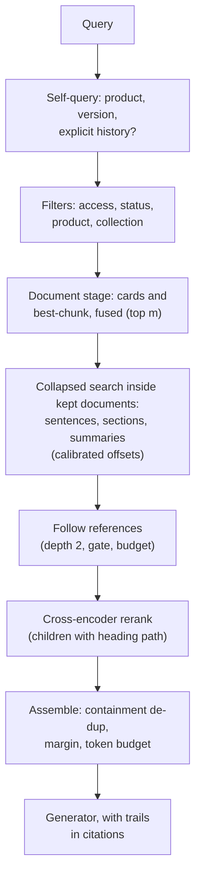

This assessment covers the Hierarchical RAG module: [parent-child retrieval](/learn/hierarchical-rag/parent-child-retrieval), [document-level retrieval](/learn/hierarchical-rag/document-level-retrieval), [hierarchical indexes](/learn/hierarchical-rag/hierarchical-indexes), [summary indexes](/learn/hierarchical-rag/summary-indexes), [recursive retrieval](/learn/hierarchical-rag/recursive-retrieval) and [multi-resolution retrieval](/learn/hierarchical-rag/multi-resolution-retrieval). The quiz has 18 questions; aim for at least 14 correct (about 75%) before moving on. Then work through the open questions, coding exercises, design challenge and troubleshooting scenarios without looking at the hidden answers first. The coding solutions use only NumPy and the Python standard library, so they run in seconds.

```quiz
[
  {
    "q": "In the vocabulary of this module, what does it mean to say a system matches at the child level and returns at the parent level?",
    "options": [
      "It searches parents and sends children to the generator",
      "It scores small units against the query and sends the larger units containing them to the generator",
      "It uses two embedding models",
      "It searches twice with different queries"
    ],
    "answer": 1,
    "why": "The match level is what is scored; the return level is what the generator reads. Parent-child retrieval separates the two."
  },
  {
    "q": "Three handbook sections end with the identical sentence \"Requests are made in the HR portal.\" A child-only retriever is asked where to request a sabbatical. What happens to the three copies?",
    "options": [
      "The sabbatical copy scores highest because of its position",
      "They are merged into one node at query time",
      "They score exactly the same, so which one wins is arbitrary",
      "The retriever refuses to answer"
    ],
    "answer": 2,
    "why": "Identical text gives identical vectors and identical scores; only parent context, such as a title prefix or a parent term, can separate them."
  },
  {
    "q": "What does this code print?\n```python\nchild = [0.4, 0.4]\nparent = [0.7, 0.2]\na = 0.5\nprint([round(a * c + (1 - a) * p, 2) for c, p in zip(child, parent)])\n```",
    "options": [
      "[0.4, 0.4]",
      "[0.7, 0.2]",
      "[0.45, 0.45]",
      "[0.55, 0.3]"
    ],
    "answer": 3,
    "why": "Each child's score is 0.5 x 0.4 plus 0.5 x its parent's score: 0.2 + 0.35 = 0.55 and 0.2 + 0.1 = 0.3."
  },
  {
    "q": "With interpolated child-parent scoring, what happens to the relative order of two children of the same parent as the weight on the parent changes?",
    "options": [
      "Nothing: both receive the same parent term",
      "It reverses when the parent weight exceeds 0.5",
      "The longer child moves up",
      "They always tie"
    ],
    "answer": 0,
    "why": "The parent term is identical for siblings, so their order depends only on their own similarities (unless the child weight is zero, when they tie)."
  },
  {
    "q": "Your parents average 3,000 tokens and your cross-encoder truncates query-passage pairs at 512 tokens. Where should reranking happen?",
    "options": [
      "On whole parents, because they carry the most context",
      "Nowhere; cross-encoders cannot be used with parent-child retrieval",
      "On children, each paired with its parent's title or heading path",
      "On the query alone"
    ],
    "answer": 2,
    "why": "Whole parents would be judged on their first few hundred tokens; children with a context prefix fit the limit and keep the context that makes them meaningful."
  },
  {
    "q": "A two-stage system keeps the right document in its top m 90% of the time, and finds the right chunk 85% of the time when the document was kept. What is its end-to-end recall?",
    "options": [
      "0.765",
      "0.85",
      "0.875",
      "0.90"
    ],
    "answer": 0,
    "why": "Both stages must succeed: 0.90 x 0.85 = 0.765."
  },
  {
    "q": "The current and superseded handbooks state different laptop refresh cycles. Which approach reliably answers from the current handbook?",
    "options": [
      "Embed the year into every chunk",
      "Store a status field on each document and filter superseded documents out unless the question asks about history",
      "Use the document centroid for ranking",
      "Increase the document gate to m = 10"
    ],
    "answer": 1,
    "why": "Embeddings barely distinguish versions; a metadata filter is deterministic."
  },
  {
    "q": "Three product guides contain near-identical procedure chunks that never name the product. Which document representation best selects the guide named in a question?",
    "options": [
      "The best chunk of each guide",
      "The longest chunk of each guide",
      "A random sample of chunks",
      "A document card containing the title, product and headings"
    ],
    "answer": 3,
    "why": "The card carries the identifying context that the chunks omit, and the question uses exactly that context."
  },
  {
    "q": "A balanced tree has branching factor 10 and 3 levels; beam search keeps 2 nodes per level. How many nodes does it score, and how many leaves would flat search score?",
    "options": [
      "30 and 1,000",
      "50 and 1,000",
      "20 and 100",
      "50 and 300"
    ],
    "answer": 1,
    "why": "Beam: f + (L - 1) b f = 10 + 2 x 2 x 10 = 50. Flat: 10^3 = 1,000 leaves."
  },
  {
    "q": "A top-down search fails mostly at the first level. Logging shows internal nodes are embedded from their headings alone. What is the most effective change?",
    "options": [
      "Represent internal nodes with outlines, child centroids or summaries",
      "Reduce the beam width",
      "Use smaller leaves",
      "Tune the HNSW graph parameters"
    ],
    "answer": 0,
    "why": "Headings are too thin to route questions; richer descriptions of what lies below fix routing at the top."
  },
  {
    "q": "Which payload design makes \"search only within this section and everything under it\" a single filter condition?",
    "options": [
      "A parent_id field only",
      "A separate collection per section",
      "An ancestors array on every node, filtered for the section's ID",
      "Storing the section text on every leaf"
    ],
    "answer": 2,
    "why": "With all ancestor IDs stored on each node, descendant-of-X is one match on an array field."
  },
  {
    "q": "How does RAPTOR build the upper levels of its tree?",
    "options": [
      "From the documents' heading structure",
      "By clustering embeddings with a Gaussian mixture (soft assignment, cluster count by BIC) and summarising each cluster, recursively",
      "By splitting documents into fixed-size windows",
      "By asking users to label topics"
    ],
    "answer": 1,
    "why": "RAPTOR reduces dimensions, clusters with a Gaussian mixture, summarises clusters with a language model, and repeats on the summaries."
  },
  {
    "q": "Leaves total 4,000,000 tokens and each summary is a quarter the length of its input. Roughly how many output tokens does a deep summary tree generate?",
    "options": [
      "4,000,000",
      "1,000,000",
      "5,333,333",
      "1,333,333"
    ],
    "answer": 3,
    "why": "Output is bounded by N / (c - 1) = 4,000,000 / 3, about 1.33 million tokens."
  },
  {
    "q": "A source sentence changes. Which summaries in a summary tree become stale?",
    "options": [
      "Those on the path from that sentence to the top",
      "Every summary in the tree",
      "Only summaries at the top level",
      "None, if the change is small"
    ],
    "answer": 0,
    "why": "Staleness propagates through the changed node's ancestors only: at most one summary per level."
  },
  {
    "q": "What does this code print?\n```python\nrefs = {\"a\": [\"b\"], \"b\": [\"c\", \"a\"], \"c\": []}\nseen, order = set(), []\ndef visit(n):\n    if n in seen:\n        return\n    seen.add(n)\n    order.append(n)\n    for r in refs[n]:\n        visit(r)\nvisit(\"a\")\nprint(order)\n```",
    "options": [
      "['a', 'b', 'c', 'a']",
      "It loops forever",
      "['a', 'b', 'c']",
      "['a', 'b']"
    ],
    "answer": 2,
    "why": "The visited set stops the cycle b -> a; each node is recorded once, in depth-first order."
  },
  {
    "q": "A recursive retriever starts from 2 nodes, follows at most 2 references per node, and has depth limit 2. What is the maximum number of nodes it can visit?",
    "options": [
      "8",
      "14",
      "6",
      "12"
    ],
    "answer": 1,
    "why": "2 x (1 + 2 + 4) = 14."
  },
  {
    "q": "A collapsed multi-level index selects a document summary for a broad question, and the sections beneath it are then skipped as duplicates. What is wrong?",
    "options": [
      "The summary should have been reranked",
      "The budget is too small",
      "Collapsed search cannot include summaries",
      "De-duplication used tree ancestry instead of text containment; a summary describes its sections but does not contain them"
    ],
    "answer": 3,
    "why": "Only a node whose text includes another node's text should suppress it."
  },
  {
    "q": "Per-level calibration offsets are 0.10 for sentences and 0.18 for summaries. A query scores 0.50 with a sentence and 0.56 with a summary. Which ranks higher after calibration?",
    "options": [
      "The sentence (0.40 against 0.38)",
      "The summary (0.56 against 0.50)",
      "They tie",
      "The summary (0.46 against 0.40)"
    ],
    "answer": 0,
    "why": "Calibrated scores are 0.50 - 0.10 = 0.40 and 0.56 - 0.18 = 0.38; the summary's lead was its level's typical advantage."
  }
]
```

## Conceptual questions

**1.** Explain, with an example from Meridian, why a retrieval system can score well on child-level recall while handing the generator incomplete context, and why the reverse can also happen. What should you report?

<details><summary>Show answer</summary>

Child-level recall asks whether the answering sentence was among the top children; the generator reads what was *delivered*. A child can be retrieved and then lost: in parent-child retrieval it is lifted to a parent that does not fit the remaining budget, so it never reaches the generator. A question such as "Can contractors claim the home-office budget?" may retrieve the contractor sentence, but if the remote-work parent is skipped for budget, the answer is missing.

The reverse: the answering child is not retrieved, but a sibling is, and the sibling's parent contains the answer. "Who approves a sabbatical request?" may retrieve the sabbatical topic sentence rather than the approval sentence, and the sabbatical section still delivers the approval rule.

Report both child-level and delivered-context (parent-level) recall, with ties counted pessimistically, and inspect the queries that change between configurations rather than averages alone.

</details>

**2.** Every top-down method in this module has a "gate": a decision at a higher level that limits what lower levels can find. Name three places the gate appears and the shared defences.

<details><summary>Show answer</summary>

The gate appears in document-first retrieval (stage 2 searches only the top $m$ documents), in beam search through a hierarchical index (only children of the kept nodes are scored at the next level), in recursive retrieval with index references (the query enters only the sub-indexes whose catalogue entries were retrieved), and in resolution routing (only the chosen level is searched).

The shared defences are: better representations at the gating level (document cards, outlines, centroids or summaries, rich catalogue entries); a wider gate where it is cheap (larger $m$, wider beam at the top, larger top-level $k$); fusion of two signals into the gating decision; and a fallback to a flat search when the gated result is much weaker. End-to-end recall is the product of per-stage recalls, so each stage must be measured separately.

</details>

**3.** Compare using a summary node as a pointer and as content. When is each appropriate, and what controls does using summaries as content require?

<details><summary>Show answer</summary>

As a **pointer**, the summary is matched against the query and the source text beneath it goes to the generator and is cited. This is the safe default: errors in the summary affect only what is retrieved, not what is asserted. As **content**, the summary itself enters the context. This is needed when the sources would not fit the budget, such as "summarise all our security policies", and it is how RAPTOR's collapsed tree uses summaries.

Using summaries as content requires: retrieval-oriented, faithful summaries (scope, all topics, identifiers verbatim, exceptions, no new facts); a build-time check that numbers and codes in the summary appear in its sources; staleness tracking by source fingerprints with regeneration before serving; labelling summaries as such in the prompt; citations that point to the underlying sources; and access labels at least as strict as the most restricted source.

</details>

**4.** How does recursive retrieval differ from an agent's iterative search? Give one question better served by each.

<details><summary>Show answer</summary>

Recursive retrieval follows **stored** references (sub-index pointers, node pointers, object references, cross-references extracted at ingestion) with the **same** query, by fixed rules: visited set, depth limit, relevance gate and budget. It is deterministic, cheap and testable, and limited to connections someone recorded. An agent decides at query time, with a model, what to search for next and may write new queries based on what it found.

"I lost my laptop at 8 p.m., what should I do?" suits recursive retrieval: the lost-laptop rule refers to the support desk's hours, which refer to the out-of-hours procedure. "Which team owns the service that raised E-5718, and who is on call for it this week?" suits an agent: the second search depends on a team name found by the first, and no stored reference links them.

</details>

**5.** Why do scores need calibration in collapsed multi-resolution search but not in single-level search, and why should calibration statistics come from many queries?

<details><summary>Show answer</summary>

Within one level, all nodes are the same kind of text and ranking depends only on order, so a level-wide shift in scores changes nothing. Across levels, the shift matters: if summaries or long sections score systematically higher against any query, they outrank more relevant sentences. Calibration subtracts each level's typical score (or standardises it) so that nodes compete on relevance.

The statistics must come from many queries because a single query sees few nodes at the upper levels (three documents in the lesson's example), so a per-query mean or standard deviation is noise. Offsets measured offline on hundreds of queries are stable, and should be remeasured when the embedding model or the summary prompt changes.

</details>

## Coding exercises

**1. The gate is final.** Write `two_stage(doc_scores, chunk_scores, chunk_doc, m, k)` that keeps the top-$m$ documents and returns the top-$k$ chunks inside them. Using three documents whose best chunk lives in the lowest-ranked document, show for which values of $m$ the gold chunk is found, and compare with flat search.

<details><summary>Show solution</summary>

```python
import numpy as np

def two_stage(doc_scores, chunk_scores, chunk_doc, m, k):
    """Keep the top-m documents, then return the top-k chunks inside them."""
    keep = set(np.argsort(-doc_scores)[:m])
    allowed = [int(i) for i in np.argsort(-chunk_scores) if chunk_doc[i] in keep]
    return allowed[:k]

doc_scores = np.array([0.62, 0.55, 0.31])              # three documents
chunk_scores = np.array([0.40, 0.71, 0.66, 0.52, 0.69, 0.20])
chunk_doc = np.array([0, 0, 1, 1, 2, 2])               # document of each chunk
gold_chunk = 4                                         # lives in document 2

for m in (1, 2, 3):
    got = two_stage(doc_scores, chunk_scores, chunk_doc, m, k=2)
    print(f"m={m}: chunks {got}  gold found: {gold_chunk in got}")
print("flat top-2:", [int(i) for i in np.argsort(-chunk_scores)[:2]])
```

```output
m=1: chunks [1, 0]  gold found: False
m=2: chunks [1, 2]  gold found: False
m=3: chunks [1, 4]  gold found: True
flat top-2: [1, 4]
```

The gold chunk (index 4, score 0.69) is the second-best chunk overall, so flat top-2 finds it. But its document has the lowest document score (0.31), so with $m = 1$ or $m = 2$ the gate removes it before chunk search begins, and no chunk score can bring it back. Only $m = 3$, which keeps every document here, recovers it. This is the reason to keep $m$ generous and to fuse a best-chunk signal into the document ranking.

</details>

**2. Precise staleness.** The [summary indexes](/learn/hierarchical-rag/summary-indexes) lesson stored one hash per summary, which says that a source changed but not which. Store one hash per child instead, and write `stale` so that it returns, for each stale summary, the set of leaves whose change caused it, propagating upwards through a two-level tree.

<details><summary>Show solution</summary>

```python
import hashlib

def h(text):
    return hashlib.sha256(text.encode()).hexdigest()[:12]

leaves = {"l1": "The home-office equipment budget is £400.",
          "l2": "Contractors are not eligible for the equipment budget.",
          "l3": "Staff may work remotely up to 3 days a week."}
# Each summary records one hash per child, so the cause of staleness is precise.
summaries = {"s1": {"children": ["l1", "l2"]}, "s2": {"children": ["l3"]},
             "top": {"children": ["s1", "s2"]}}
texts = dict(leaves)
for sid in ["s1", "s2", "top"]:                      # build bottom-up
    texts[sid] = f"summary of {'+'.join(summaries[sid]['children'])}"
    summaries[sid]["child_hashes"] = {c: h(texts[c]) for c in summaries[sid]["children"]}

def stale(summaries, texts):
    """Return {summary: set of changed leaves}, propagating upwards."""
    out = {}
    for sid in ["s1", "s2", "top"]:                  # children before parents
        causes = set()
        for c, old in summaries[sid]["child_hashes"].items():
            if c in out:
                causes |= out[c]
            elif h(texts[c]) != old:
                causes.add(c)
        if causes:
            out[sid] = causes
    return out

texts["l1"] = "The home-office equipment budget is £500."   # a source changes
print(stale(summaries, texts))
```

```output
{'s1': {'l1'}, 'top': {'l1'}}
```

Only `s1` and `top` are stale, and both are attributed to `l1` alone: per-child hashes identify the changed source, so `l2` is not reported. `top` is stale because a child summary is stale, even though `top`'s own child texts have not been regenerated yet. Regenerate in level order (`s1`, then `top`) so that `top` is rebuilt from the new `s1`.

</details>

**3. Containment-aware context assembly.** Write `assemble(candidates, contains, size, budget, margin)` that selects nodes greedily by score within a margin of the best, skips nodes already contained in a selected node, and lets a containing node replace what it contains while paying only the difference. Run it on a section, its three sentences and a document outline (which contains nothing), with budgets of 40 and 30.

<details><summary>Show solution</summary>

```python
def assemble(candidates, contains, size, budget, margin):
    """candidates: list of (node, score), any order. Greedy by score within a
    margin of the best; skip covered nodes; containing nodes replace what they
    contain and pay only for the difference."""
    ranked = sorted(candidates, key=lambda x: -x[1])
    best = ranked[0][1]
    chosen, used = [], 0
    for node, score in ranked:
        if score < best - margin:
            break
        if any(node == c or node in contains.get(c, ()) for c in chosen):
            continue
        freed = [c for c in chosen if c in contains.get(node, ())]
        cost = size[node] - sum(size[c] for c in freed)
        if used + cost > budget:
            continue
        chosen = [c for c in chosen if c not in freed] + [node]
        used += cost
    return chosen, used

contains = {"sec-remote": ["s1", "s2", "s3"], "doc-handbook": []}
size = {"s1": 10, "s2": 8, "s3": 9, "sec-remote": 31, "doc-handbook": 7}
candidates = [("s2", 0.61), ("doc-handbook", 0.58), ("sec-remote", 0.57),
              ("s1", 0.55), ("s3", 0.40)]
print(assemble(candidates, contains, size, budget=40, margin=0.10))
print(assemble(candidates, contains, size, budget=30, margin=0.10))
```

```output
(['doc-handbook', 'sec-remote'], 38)
(['s2', 'doc-handbook', 's1'], 25)
```

With a budget of 40: `s2` (8) and the outline (7) are taken; the section then replaces `s2` and costs only $31 - 8 = 23$, for 38 in total; `s1` is skipped because the section contains it; `s3` is below the margin ($0.40 < 0.61 - 0.10$). With a budget of 30, the section's marginal cost would take the total to 38, so it is skipped, and `s1` is added instead, for 25. The outline is never treated as containing the section, because its `contains` list is empty.

</details>

## Architecture design challenge

Meridian wants one AskMeridian retrieval layer over three collections: the employee handbook (current and superseded versions, owned by HR, well structured), the IT runbooks (140 Markdown files with deep headings and many cross-references) and the product documentation for Meridian Sync, Relay and Reports (near-identical procedures across products). Traffic mixes error-code lookups, how-to procedures, product-specific configuration questions, and overview questions from new starters. Some HR sections are restricted to managers. Design the indexing and retrieval, and state the trade-offs.

<details><summary>Show reference design</summary>

**Index.** One Qdrant collection of nodes at three levels: paragraphs or sentences, sections (heading path plus their text), and documents (a model-written, retrieval-oriented summary used as the document card). Every node carries `level`, `doc_id`, `collection`, `product`, `status`, `effective_from`, `ancestors`, `contains` and `access`, with payload indexes on the filtered fields. Summaries carry source fingerprints. Cross-references in runbooks are extracted at ingestion and stored as typed edges (prerequisite or see-also).



**Retrieval.** Filters first: access labels, `status = current` unless the question asks about history, and a product filter when the question names one. A document stage keeps the top $m = 5$ documents by fused card and best-chunk rankings, which resolves near-identical product procedures. Inside those documents, collapsed multi-resolution search scores all levels with per-level offsets measured on logged queries; error-code questions settle on sentences, procedures on sections, overviews on summaries. For runbooks, references are followed to depth 2 (prerequisites always, see-also only through the relevance gate, glossary hubs excluded) within a 3,000-token budget. A cross-encoder reranks the combined candidates, using each node's heading path as context, and assembly de-duplicates by containment with a margin.

**Trade-offs.** The document stage adds a gate that can be final; $m = 5$ and fusion keep its recall high, and per-stage recall is monitored. Summaries cost model calls at ingestion and need staleness tracking; they are used as pointers except for overview questions. Collapsed search avoids a breadth classifier but needs calibration, which must be remeasured when the summary prompt changes. Restricted HR sections are split into their own parents and summarised separately, so no summary mixes access labels. A simpler alternative, flat section chunks with a product filter, would cost less to run but would answer error-code questions with whole sections and overview questions poorly.

</details>

## Troubleshooting scenarios

**1.** After the HR team restructured the handbook, AskMeridian began answering "Who approves parental leave?" with text from the sabbatical section, and the answer changed when the handbook was re-ingested. Parent-level recall on the evaluation set did not move.

<details><summary>Show diagnosis and fix</summary>

**Diagnosis.** The restructured handbook ends each leave section with the same approval sentence. Children are embedded without context, so the copies have identical scores, and the winner depends on insertion order, which changed on re-ingestion. Parent-level recall stayed flat because the topic sentence of the right section usually ranks first, and the evaluation broke ties optimistically.

**Fix.** Give children parent context: re-embed with a heading-path prefix, or, as a quick fix, interpolate child and parent similarities with a weight tuned on labelled questions, checking the queries that get worse. Change the evaluation to count ties pessimistically, and add child-level questions about boilerplate sentences.

</details>

**2.** A hierarchical index over the IT runbooks uses beam search with a beam of 2. Many questions return an irrelevant leaf with a low score, while a flat search over leaves finds the right one. A larger embedding model made little difference.

<details><summary>Show diagnosis and fix</summary>

**Diagnosis.** Log the first wrong turn per query. If it is at the top level, internal nodes are poorly represented, probably by heading paths alone ("Network – misc."), so the descent enters the wrong runbook and nothing below can recover. A larger model cannot fix a representation that does not contain the information.

**Fix.** Represent internal nodes with outlines (path plus child headings plus opening text), child centroids or summaries. Widen the beam at the top level, where nodes are few and cheap to score. Add a flat fallback that fires when the descent's best leaf scores well below the flat best, and log how often it fires. If descent is not needed for scoping or latency, use bottom-up search with an `ancestors` filter instead.

</details>

**3.** After cross-reference following was enabled for runbooks, answer latency and cost rose sharply, and many answers included a paragraph from the glossary that had nothing to do with the question.

<details><summary>Show diagnosis and fix</summary>

**Diagnosis.** The glossary is a hub: almost every runbook refers to it. Without a relevance gate or a hub exclusion, every query follows those references, and with a depth limit as the only control the number of fetched nodes grows geometrically ($k (f^{D+1} - 1)/(f - 1)$). If the budget was applied per branch rather than per query, the context grew further.

**Fix.** Add a relevance gate on see-also references, exclude hub targets from following (retrieve glossary entries directly when a defined term appears in the question), enforce a per-query token budget with directly retrieved nodes added first, and keep a per-query visited set. Log every early stop with its reason, and cache hub nodes so that the remaining fetches are cheap.

</details>
