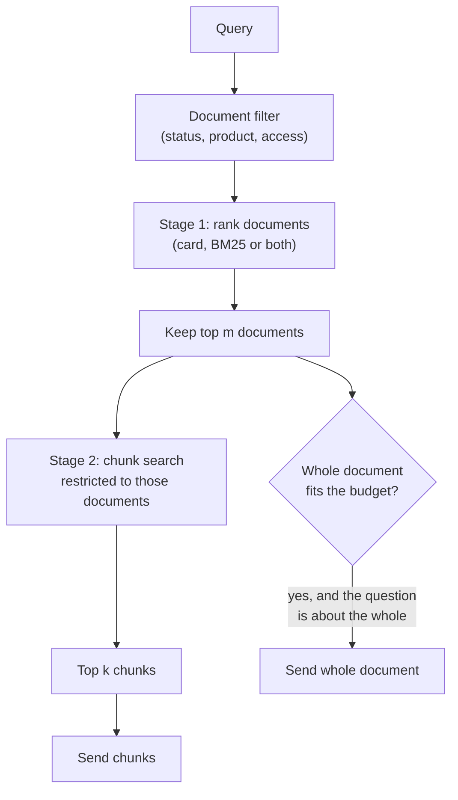

Most RAG systems never ask which *document* a question is about. They search a flat pool of chunks and let the best-scoring chunks win, wherever they come from. That works until the same sentence, or nearly the same sentence, appears in several documents: three product guides that each explain how to rotate an API token, a current handbook and the superseded one it replaced, a contract template and twenty signed variants of it. Then a chunk can match the question perfectly and still come from the wrong document.

**Document-level retrieval** puts the document back into the search. It ranks whole documents, either to return them as they are or to restrict a second, chunk-level search to the documents that won. This lesson covers when the document is the right unit, how to represent a document for retrieval, the two-stage document-then-chunk pipeline and its one unforgiving failure mode, and the role of document metadata such as version and status. You will measure all of it on a small Meridian collection in which flat chunk search gets three questions in seven wrong.

## Learning objectives

- Identify the query types for which the document, not the chunk, should be the first unit of retrieval.
- Build and compare three document representations (best chunk, chunk centroid and a document card) and explain the bias of each.
- Implement two-stage document-then-chunk retrieval and calculate how stage-one recall caps end-to-end recall.
- Combine document-level metadata filters with document ranking to handle versions and superseded documents.
- Decide when to return a whole document to the generator and estimate what it costs.

## Prerequisites

- [Parent-child retrieval](/learn/hierarchical-rag/parent-child-retrieval): match level, return level, and lifting children to parents.
- [Document embeddings](/learn/embedding-fundamentals/document-embeddings): why one vector for a long document truncates and dilutes, and the ways to pool chunk vectors.
- [Metadata-aware retrieval](/learn/advanced-retrieval/metadata-aware-retrieval): using structured fields alongside similarity.
- [RAG versus long-context prompting](/learn/introduction-to-rag/rag-versus-long-context-prompting): when sending whole documents is an option at all.

## Why this matters

A chunk is a fragment, and fragments are often ambiguous about where they belong. In product documentation, procedures are written to a house style, so "To rotate an API token, open … and choose Rotate" appears in every product's guide with a different menu path. The chunk rarely names the product, because the reader of the guide already knows which product they are in. The embedding of that chunk is therefore nearly the same across products, and a question that names one product can be answered with another product's menu path. The answer reads well, cites a real document, and is wrong.

Versions cause the same failure. Meridian's 2023 handbook said the laptop refresh cycle was 4 years; the current handbook, in force since 1 January 2025, says 3. Both sentences match "How often are laptops replaced?" equally well. Unless something at the document level says which handbook is current, the retriever has a coin to toss.

A third group of questions is about documents as wholes: "Summarise the travel policy", "Which runbook covers VPN certificates?", "What changed between the 2023 and 2025 handbooks?" No single chunk answers these, and a chunk retriever returns scattered fragments from wherever the words happened to match.

## The intuition

Think of how you find something in a filing cabinet. You do not pull every page out of every folder, shuffle them, and search the pile. You first pick the folder by its label ("Meridian Relay admin guide"), then search inside it. The label is short, but it carries exactly the information that the pages inside leave out, because inside the folder it goes without saying.

Two things can go wrong with that habit. If you pick the wrong folder, no amount of careful searching inside it will find the page; the first decision is final. And if the label is poor ("Misc. guides"), the folder choice is a guess. Document-level retrieval inherits both properties: it is only as good as the document representation, and its first stage must not throw the right document away.

## How it works

### When the document should come first

Use a document-level stage when at least one of these holds:

- **Disambiguation.** Chunks are only meaningful relative to their document: product guides, per-customer contracts, per-service runbooks, versioned policies.
- **Whole-document questions.** The user asks for a summary, a comparison of documents, or which document covers a subject.
- **Consistency.** An answer should come from one authoritative document, not stitched from several that may disagree.
- **Scale.** The collection is large and most documents are irrelevant to most questions, so narrowing to a few documents first saves work in later stages.

For a collection of short, self-contained, single-topic documents (FAQ entries, for instance) the document and the chunk are the same thing, and none of this is needed.

### Representing a document

A document needs a representation that can be scored against a query. Three families are common; the trade-offs of single vectors for long texts are covered in [document embeddings](/learn/embedding-fundamentals/document-embeddings), so here the question is narrower: which representation best *selects the right document*?

- **Best chunk (max).** A document's score is its best chunk's score. No extra index is needed, but the representation knows only what chunks know. If no chunk names the product, neither does the document. This is the max aggregation of [multi-vector retrieval](/learn/advanced-retrieval/multi-vector-retrieval).
- **Chunk centroid.** The normalised mean of the document's chunk vectors. It describes the document's overall subject and favours documents whose chunks are all on topic, but it dilutes distinctive details.
- **Document card.** A short text written for the purpose of being matched, embedded as one vector: the title, the product or system, the version and effective date, the section headings, and either the opening paragraph or a summary. The card supplies exactly the identifying context that chunks leave out. Cards built from model-written summaries are covered in [summary indexes](/learn/hierarchical-rag/summary-indexes); this lesson uses title plus opening line, which needs no model.

Lexical scoring of the whole document text with [BM25](/learn/sparse-retrieval/bm25) is a fourth, strong option for names and identifiers, and fusing it with a card score is common. A card is a document-level index; a long-context embedding of the full text is a different thing, and is subject to the truncation and dilution problems mentioned above.

### The two-stage pipeline



The mechanism, step by step:

1. **Filter documents by metadata.** Remove documents the user may not see, superseded versions (unless the question asks about history), and documents outside an explicit scope such as a product named in a filter.
2. **Rank the remaining documents** with the document representation.
3. **Keep the top $m$.** This is the gate. $m$ is usually small (2 to 10), but never smaller than the number of documents a question can legitimately need.
4. **Search chunks inside the gate.** In a vector database this is an ordinary filtered search on a `doc_id` field (an "is one of" condition on the payload in Qdrant, a `WHERE doc_id = ANY(...)` clause in pgvector). Because it is a filter, it works with the same index as flat search.
5. **Return** the top $k$ chunks, or, for whole-document questions, the documents themselves.

### The gate is final

Stage 2 can only find chunks in documents that stage 1 kept. If the right document is ranked $m+1$, the system cannot recover it, however good the chunk search is. This is the defining risk of every top-down hierarchical method, and it comes back in [hierarchical indexes](/learn/hierarchical-rag/hierarchical-indexes) with more levels. Three defences:

- **Keep $m$ generous.** Stage 2 is cheap once the filter exists; a few extra documents cost little.
- **Score with two signals.** Fuse the card ranking with a best-chunk ranking (for example with [Reciprocal Rank Fusion](/learn/hybrid-search/reciprocal-rank-fusion)), so that a document can enter the gate either because its card matches or because one of its chunks matches strongly.
- **Fall back.** If the best chunk inside the gate scores far below the best chunk in the flat index, run the flat search too and merge. This catches documents whose card is poor.

### Versions and status are metadata, not similarity

An embedding model is a poor judge of "current versus superseded". The years in "2023" and "2025" barely move a sentence vector, and "superseded" in a title is one word among many. In the experiment below, the document card picks the 2023 handbook for "How often are laptops replaced?". The fix is to store `status` (current, superseded, draft) and `effective_from` on each document and filter on them before ranking. When a question explicitly asks about the past ("What did the 2023 handbook say?"), the filter is relaxed. Detecting that from the question is a job for [self-query retrieval](/learn/advanced-retrieval/self-query-retrieval); the code uses a one-line rule as a stand-in.

### Returning whole documents

When the question concerns the whole document and the document fits in the context budget, the simplest correct answer is to send the document. A 6,000-token policy fits comfortably in the context window of current models; a 300-page manual does not, and neither do ten 6,000-token policies at once. Whole-document return is a per-query decision:

- Send the whole document when the question is about the whole (summarise, compare, list everything about), the document is under a size threshold, and only one or two documents are involved.
- Otherwise descend to chunks, or use a precomputed summary of the document, which is the subject of [summary indexes](/learn/hierarchical-rag/summary-indexes).

Recognising whole-document questions is a routing problem; a classifier or a model call can label the question, and the details are in [query routing](/learn/agentic-rag/query-routing).

## The mathematics

### Two-stage recall is a product

**Intuition.** To find the right chunk, a two-stage system must first keep the right document and then find the chunk inside it. Both must succeed.

$$
R_{\text{2-stage}}@k = R_{\text{doc}}@m \times R_{\text{chunk} \mid \text{doc}}@k
$$

$R_{\text{doc}}@m$ is the fraction of queries whose gold document is in the top $m$ documents; $R_{\text{chunk} \mid \text{doc}}@k$ is the fraction, among those queries, whose gold chunk is in the top $k$ chunks of the gated search. Strictly the product holds when the two are measured on the same queries in sequence, which is how you should measure them.

**By hand.** Suppose document recall at $m = 3$ is 0.95 and, given the right document is kept, chunk recall at $k = 5$ is 0.90. End-to-end recall is $0.95 \times 0.90 = 0.855$. Raising $m$ to 5 might lift document recall to 0.98, giving $0.98 \times 0.90 = 0.882$, as long as the extra documents do not crowd the right chunk out of the top 5. The flat system's recall is not in the formula; two-stage wins only if gating raises the second factor (by removing look-alike chunks from other documents) by more than the first factor costs.

### Work saved by the gate

With $N$ documents of on average $c$ chunks, a flat exact search scores $N c$ chunks. A two-stage search scores $N$ cards and then $m c$ chunks:

$$
\text{work}_{\text{2-stage}} = N + m c \quad \text{versus} \quad \text{work}_{\text{flat}} = N c
$$

For $N = 10{,}000$ documents, $c = 40$ and $m = 5$: flat scores 400,000 vectors; two-stage scores $10{,}000 + 200 = 10{,}200$, about 39 times fewer. With an approximate index the flat search does not score every vector, so the real saving is smaller; the gain that matters is usually accuracy, not speed.

```python
R_doc, R_chunk_given_doc = 0.95, 0.90
print("end-to-end recall:", round(R_doc * R_chunk_given_doc, 3))
N, c, m = 10_000, 40, 5
print("flat:", N * c, " two-stage:", N + m * c, " ratio:", round(N * c / (N + m * c), 1))
```

```output
end-to-end recall: 0.855
flat: 400000  two-stage: 10200  ratio: 39.2
```

## In code

**The problem.** Six Meridian documents, three chunks each. Three product guides share a token-rotation procedure that differs only in its menu path, and two handbooks state different laptop cycles, equipment budgets and support hours. Compare three document representations at selecting the right document, then compare flat chunk search with document-first search, each with and without a status filter.

**Dependencies.**

```bash
pip install sentence-transformers numpy
```

```python
import re
import numpy as np
from sentence_transformers import SentenceTransformer

# Each document: title, status, chunks. As in most real indexes, the chunk text
# does not repeat the document title.
DOCS = {
    "sync-admin": ("Meridian Sync administration guide", "current", [
        "Keeps project folders in step between laptops and cloud storage.",
        "To rotate an API token, open Admin > Tokens and choose Rotate. "
        "The old token keeps working for 24 hours.",
        "Edit conflicts are resolved by keeping both copies and renaming the older one.",
    ]),
    "relay-admin": ("Meridian Relay administration guide", "current", [
        "Routes webhooks from customer systems to internal services.",
        "To rotate an API token, open Settings > Credentials and choose Rotate. "
        "The old token stops working immediately.",
        "Failed deliveries are retried for up to 24 hours.",
    ]),
    "reports-user": ("Meridian Reports user guide", "current", [
        "Builds dashboards and exports them to PDF or CSV.",
        "To rotate an API token, open Profile > API access and choose Rotate. "
        "Tokens expire after 90 days.",
        "SAML single sign-on is available on the Enterprise plan.",
    ]),
    "handbook-2025": ("Employee handbook, effective 1 January 2025", "current", [
        "The laptop refresh cycle is 3 years.",
        "The home-office equipment budget is £400; contractors are not eligible.",
        "The support desk is open 08:00 to 18:00 UK time.",
    ]),
    "handbook-2023": ("Employee handbook 2023", "superseded", [
        "The laptop refresh cycle is 4 years.",
        "The home-office equipment budget is £250.",
        "The support desk is open 09:00 to 17:00 UK time.",
    ]),
    "vpn-runbook": ("IT runbook: VPN errors", "current", [
        "E-4021 means the VPN client is out of date; update it from the IT portal.",
        "E-4012 means the VPN certificate has expired.",
        "The VPN is required on public Wi-Fi.",
    ]),
}
QUERIES = [  # (question, gold document, gold chunk index)
    ("How do I rotate an API token in Meridian Relay?", "relay-admin", 1),
    ("How do I rotate an API token in Meridian Sync?", "sync-admin", 1),
    ("How do I rotate an API token in Meridian Reports?", "reports-user", 1),
    ("How often are laptops replaced?", "handbook-2025", 0),
    ("What are the support desk hours?", "handbook-2025", 2),
    ("What was the equipment budget in the 2023 handbook?", "handbook-2023", 1),
    ("What does VPN error E-4012 mean?", "vpn-runbook", 1),
]

model = SentenceTransformer("sentence-transformers/all-MiniLM-L6-v2")
enc = lambda texts: model.encode(texts, normalize_embeddings=True)
doc_ids = list(DOCS)
chunks = [(d, i, t) for d, (_, _, cs) in DOCS.items() for i, t in enumerate(cs)]
C = enc([t for _, _, t in chunks])
chunk_doc = np.array([doc_ids.index(d) for d, _, _ in chunks])

# Three document-level representations, one row per document
card = enc([f"{title}. {cs[0]}" for title, _, cs in DOCS.values()])   # title + opening
centroid = np.array([C[chunk_doc == j].mean(axis=0) for j in range(len(doc_ids))])
centroid /= np.linalg.norm(centroid, axis=1, keepdims=True)

def doc_scores(q, rep):
    if rep == "max-chunk":
        return np.array([(C[chunk_doc == j] @ q).max() for j in range(len(doc_ids))])
    return (card if rep == "card" else centroid) @ q

def allowed_status(query):
    """Toy version filter: superseded documents only when the query names an
    earlier year. A production system extracts this with self-query retrieval."""
    return {"current", "superseded"} if re.search(r"\b20(1\d|2[0-4])\b", query) else {"current"}

def retrieve(query, doc_first, use_status, m=1):
    q = enc([query])[0]
    ok = np.ones(len(doc_ids), dtype=bool)
    if use_status:                                    # metadata filter on documents
        ok &= np.array([DOCS[d][1] in allowed_status(query) for d in doc_ids])
    if doc_first:                                     # stage 1: keep the top-m documents
        s = np.where(ok, doc_scores(q, "card"), -np.inf)
        ok = np.zeros(len(doc_ids), dtype=bool)
        ok[np.argsort(-s)[:m]] = True
    s = np.where(ok[chunk_doc], C @ q, -np.inf)       # stage 2: chunks inside them
    return chunks[int(np.argmax(s))][:2]

print("document recall@1 by document representation")
for rep in ["max-chunk", "centroid", "card"]:
    hits = sum(doc_ids[int(np.argmax(doc_scores(enc([q])[0], rep)))] == d
               for q, d, _ in QUERIES)
    print(f"  {rep:<10} {hits}/{len(QUERIES)}")

print("\nchunk hit@1")
for doc_first in [False, True]:
    for use_status in [False, True]:
        hits = [retrieve(q, doc_first, use_status) == (d, i) for q, d, i in QUERIES]
        name = ("document-first" if doc_first else "flat chunks") + \
               (" + status filter" if use_status else "")
        print(f"  {name:<32} {sum(hits)}/{len(QUERIES)}  "
              + "".join("." if h else "x" for h in hits))
```

```output
document recall@1 by document representation
  max-chunk  4/7
  centroid   5/7
  card       6/7

chunk hit@1
  flat chunks                      4/7  x.xx...
  flat chunks + status filter      5/7  x.x....
  document-first                   6/7  ...x...
  document-first + status filter   7/7  .......
```

**The important lines.** `card` embeds each document's title together with its opening chunk: the cheapest useful card. `centroid` averages a document's chunk vectors and re-normalises them, so the cosine remains meaningful. `retrieve` runs the pipeline in the order of the diagram: the status filter removes documents, stage 1 keeps the top $m$ by card score, and stage 2 searches only chunks whose document survived, by masking every other chunk's score to minus infinity, which is what a `doc_id` filter does inside a vector database. The string of dots and crosses shows which of the seven queries succeeded, in order.

**What the output means.**

- **Representations.** Best-chunk scoring selects the right document for only 4 of 7 queries: the three token chunks are near-identical and none names its product. The centroid does better, because a product's *other* chunks pull the centroid towards that product's subject. The card does best, because it carries the title, which is precisely the information the question uses to disambiguate.
- **Flat chunks** get queries 1, 3 and 4 wrong: two token questions answered from the Sync guide, and the laptop question answered from the 2023 handbook ("4 years").
- **The status filter alone** fixes the laptop question, because the 2023 handbook can no longer be returned, but cannot help with products.
- **Document-first alone** fixes the products but still picks the 2023 handbook for the laptop question: the card "Employee handbook 2023" matches "How often are laptops replaced?" as well as the 2025 card does, and the year carries no weight in the embedding.
- **Both together** answer all seven. Query 6, which asks about 2023 explicitly, still works, because the filter relaxes when an earlier year is named.

Seven queries prove nothing statistically; the output demonstrates two independent failure modes and that each needs its own fix. Ranking cannot fix versions, and filtering cannot fix products.

**Common errors.** Building cards that omit the title or product name, which defeats their purpose. Filtering chunks by document *after* retrieving a fixed top $k$ from the flat index (post-filtering), which can leave zero results; filter inside the search. Setting $m = 1$ in production; it is used here only to make the gate's effect visible.

**Extending it.** Add BM25 over the full document text as a second stage-1 signal and fuse it with the card ranking; add a fourth product guide with a poor title ("Admin guide v2") and watch the card fail, then rescue it with the fusion.

## A real-world example

Meridian's customer-support team used AskMeridian to answer configuration questions about all three products. A support engineer noticed that answers to "How do I rotate the API token in Relay?" sometimes said that the old token keeps working for 24 hours. That is true for Sync; in Relay the old token stops working immediately, and a customer following the answer kept a revoked token in their webhook configuration for a day.

The Platform team found the cause in the chunk index: the three procedures were near-duplicates differing in a menu path and one sentence, and none of the chunks mentioned the product. They considered prefixing every chunk with its product name, which would have required re-embedding all product documentation, and instead added a document stage: a card per guide (title, product, version, headings), a `product` field on every chunk, and a stage-1 search keeping the top 3 guides, fused with a best-chunk ranking so that a question naming a feature unique to one product could still pull its guide into the gate. When the user named a product explicitly, a self-query step turned it into a hard filter on `product`.

They also learnt the second lesson of this module the hard way: their first version used $m = 1$, and questions comparing two products ("Do Sync and Relay handle token rotation differently?") lost one of the two guides at the gate. They raised $m$ to 3 and routed comparison questions to whole-document return for each named product.

## Common mistakes

- **Searching a flat chunk pool when chunks are ambiguous across documents.** Near-identical procedures, templates and versions get mixed, and the answer cites a real but wrong document.
- **Relying on embeddings to choose versions.** Years and words such as "superseded" barely affect similarity; use status and date metadata.
- **A tight gate.** With $m = 1$, any stage-1 error is final, and multi-document questions are impossible.
- **Post-filtering instead of filtering inside the search.** Retrieving the global top $k$ and then dropping chunks outside the chosen documents often leaves too few results.
- **Embedding whole long documents as their representation.** The vector covers the opening and blurs the rest; use a card or a summary.
- **Sending whole documents for specific questions.** A 40-page manual in the context to answer one factual question wastes budget and invites [lost-in-the-middle](/learn/context-engineering/lost-in-the-middle-problem) errors.

## Best practices

- Give every document a card: title, product or system, version, effective date, section headings and a short description or summary.
- Store `doc_id`, `status`, `effective_from` and the document's access labels on every chunk, so that any document-level decision can be applied as a filter.
- Fuse two stage-1 signals (card and best chunk, or card and BM25) and keep $m$ generous.
- Measure document recall@m separately from end-to-end recall, so that you know which stage fails.
- Decide between whole-document return and chunk return per query, by question type and document size.

## Performance considerations

The card index is tiny: one vector per document. For 10,000 documents at 384 dimensions in float32 it is $10{,}000 \times 384 \times 4 = 15.4$ MB, against 614 MB for 400,000 chunk vectors. Stage 1 can therefore run as an exact search in memory.

Stage 2 is a filtered vector search. Vector databases implement filters differently, and very selective filters can make approximate indexes slower or less accurate than unfiltered search; Qdrant, for example, recommends a payload index on every filtered field and uses it to plan filtered searches. With $m$ documents of $c$ chunks, a selective filter leaves $m c$ candidates (200 in the example arithmetic), few enough to score exactly.

Whole-document return dominates cost when used: a 6,000-token document sent with every such query costs 6,000 input tokens per call, compared with perhaps 1,500 for five chunks. If one query in ten is a whole-document question, the average input grows from 1,500 to $0.9 \times 1{,}500 + 0.1 \times 6{,}000 = 1{,}950$ tokens, a 30% increase.

## Security considerations

Document-level access control is usually the natural unit (a contract, a personnel file), which makes it straightforward to enforce: filter documents by the user's permissions in stage 1, and copy the same labels onto every chunk so stage 2 cannot widen access. Cards and summaries are derived from documents and must carry the same labels; a card for a confidential document that is visible to everyone leaks its title, headings and opening paragraph. Whole-document return sends more text from each source, so a document containing injected instructions has more room to act; keep the usual separation between retrieved data and instructions in the prompt.

## Summary

- Rank documents first when chunks are ambiguous across documents, when the question is about a document as a whole, or when answers must come from one authoritative source.
- A **document card** (title, product, version, headings, opening or summary) selects documents better than best-chunk or centroid scores when chunks omit identifying context.
- In two-stage retrieval, **end-to-end recall is document recall times conditional chunk recall**; the gate is final, so keep $m$ generous and fuse two signals.
- Versions and status belong in **metadata filters**, not in similarity scores.
- Return whole documents only for whole-document questions that fit the budget.

## Exercises

**1.** Document recall@5 is 0.92 and conditional chunk recall@5 is 0.95. Flat chunk recall@5 is 0.86. Is the two-stage system better? What would document recall need to be for the two to tie?

<details><summary>Show solution</summary>

Two-stage recall is $0.92 \times 0.95 = 0.874$, which beats 0.86. They tie when $R_{\text{doc}} \times 0.95 = 0.86$, so $R_{\text{doc}} = 0.86 / 0.95 \approx 0.905$. Below about 0.905 document recall, the gate loses more than it gains.

</details>

**2.** Explain why the centroid representation selected the right product more often than the best-chunk representation in the experiment, and give a document for which the centroid would be the *worst* of the three.

<details><summary>Show solution</summary>

The three token chunks are near-identical, so the best chunk of each product guide scores about the same and cannot separate them. The centroid averages in each guide's other chunks (webhooks for Relay, folder sync for Sync, dashboards for Reports), which pull the vector towards that product's subject. The centroid is worst for a long multi-topic document, such as the employee handbook covering leave, expenses, security and equipment, where averaging many unrelated topics dilutes each one, so no specific question matches the centroid well.

</details>

**3.** Add a fourth product guide titled "Admin guide v2" (the product is Meridian Relay's successor, but the title does not say so) to the code, with a token chunk in the same house style. Run document-first retrieval for a question about it. Then fix the card without changing the title.

<details><summary>Show solution</summary>

With the title alone, the card "Admin guide v2. <opening chunk>" has nothing tying it to the question's product name, so stage 1 picks whichever card happens to be closest, often Relay's. The fix is to build cards from fields, not just the title: `f"{title}. Product: {product}. Replaces: Meridian Relay. Sections: {', '.join(headings)}. {opening}"`. Store `product` as metadata at ingestion, where it is usually known from the source system. The lesson is that a card is an engineered text: whatever identifies the document must be in it, whether or not the author put it in the title.

</details>

**4.** Design decision. Meridian's legal team wants AskMeridian to answer questions over 3,000 supplier contracts, all generated from four templates. Typical questions: "What is the termination notice period in the Acme contract?" and "Which contracts allow termination with less than 30 days' notice?". Design the document-level part of the retrieval.

<details><summary>Show solution</summary>

The first question names a contract, so stage 1 is a filter, not a ranking: extract the supplier name with self-query retrieval and restrict to that contract's `doc_id`. Without it, near-identical template clauses from 3,000 contracts compete and the wrong supplier's notice period is returned. Cards should hold the supplier name, contract number, template, dates and status.

The second question is not a retrieval question at all; it asks for a filter over every contract. Extract key terms (notice period in days, governing law, renewal date) into structured fields at ingestion and answer it with a query over those fields, then retrieve the relevant clause from each matching contract for citation. Trying to answer it with top-k retrieval would return a handful of contracts and miss the rest.

</details>

## Check your understanding

```quiz
[
  {
    "q": "Three product guides contain near-identical token-rotation chunks that do not name the product. Which document representation is most likely to pick the right guide for a question naming the product?",
    "options": [
      "The best chunk of each guide",
      "A document card containing the title and product name",
      "The longest chunk of each guide",
      "A random chunk of each guide"
    ],
    "answer": 1,
    "why": "The card carries exactly the identifying context the chunks leave out, so the product name in the question can match it."
  },
  {
    "q": "Document recall@3 is 0.90 and recall of the right chunk, given the right document was kept, is 0.80. What is end-to-end recall?",
    "options": [
      "0.72",
      "0.85",
      "0.80",
      "0.90"
    ],
    "answer": 0,
    "why": "Both stages must succeed, so recall is the product: 0.90 x 0.80 = 0.72."
  },
  {
    "q": "The current and superseded handbooks both state a laptop refresh cycle. What is the most reliable way to answer from the current one?",
    "options": [
      "Add the word current to the query",
      "Use a larger embedding model",
      "Raise m in the document gate",
      "Store a status field on each document and filter on it"
    ],
    "answer": 3,
    "why": "Embeddings barely distinguish versions; a metadata filter excludes the superseded document deterministically."
  },
  {
    "q": "A two-stage system uses m = 1. Which problem is it most likely to have?",
    "options": [
      "It is slower than flat search",
      "Questions needing two documents, and any stage-1 mistake, cannot be recovered",
      "It cannot apply metadata filters",
      "It returns duplicate chunks"
    ],
    "answer": 1,
    "why": "Stage 2 only searches kept documents, so a tight gate makes every stage-1 error final and rules out multi-document answers."
  },
  {
    "q": "When is returning a whole document to the generator a good choice?",
    "options": [
      "For every query, because more context is always better",
      "When the document is long and the question is a specific fact",
      "When the question concerns the document as a whole and it fits the budget",
      "Never, because RAG must use chunks"
    ],
    "answer": 2,
    "why": "Whole-document return suits summaries and comparisons of documents small enough to fit; specific questions are better served by chunks."
  }
]
```

## Further reading

- J. P. Callan (1994), "Passage-level evidence in document retrieval", *Proceedings of SIGIR 1994*: document and passage evidence in classical retrieval.
- [Qdrant documentation: filtering](https://qdrant.tech/documentation/concepts/filtering/): payload filters and their interaction with the vector index.
- [LlamaIndex documentation](https://docs.llamaindex.ai/): document summary indexes and metadata filters.
- [Sentence Transformers documentation](https://www.sbert.net/): encoding, normalisation and maximum sequence length.
