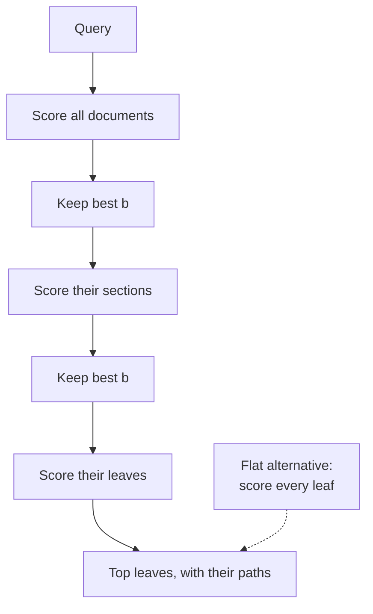

Documents are not flat. A handbook has parts, sections and paragraphs; a runbook has incident types, procedures and steps; a product guide has chapters, pages and sections. The previous two lessons used one step of this structure each: [parent-child retrieval](/learn/hierarchical-rag/parent-child-retrieval) lifted sentences to their sections, and [document-level retrieval](/learn/hierarchical-rag/document-level-retrieval) chose documents before chunks. A **hierarchical index** stores the whole tree, every level of it, and lets retrieval move through it.

This lesson covers how to build such an index from document structure, how to represent the internal nodes (the decision that matters most, and the one most often got wrong), the two ways of querying a tree (descending from the top with a beam, or searching the leaves and climbing), why errors compound as you descend, and how to store a tree in a vector database so that "everything under this node" is a single filter. You will build a three-level index over Meridian documents and watch a beam search fail at the very first level when internal nodes are represented by their headings alone.

## Learning objectives

- Build a tree of nodes with levels, parents and materialised paths from a document's heading structure.
- Compare three representations of internal nodes (heading path, outline and child centroid) and explain why heading-only nodes route poorly.
- Implement top-down beam search over a tree and compute its cost and its end-to-end recall from per-level recall.
- Diagnose at which level a top-down search goes wrong.
- Store a tree in a vector database so that subtree restriction and ancestor lookup are single operations.

## Prerequisites

- [Parent-child retrieval](/learn/hierarchical-rag/parent-child-retrieval): match level, return level, lift, expand and descend.
- [Document-level retrieval](/learn/hierarchical-rag/document-level-retrieval): two-stage retrieval and why the gate is final.
- [Heading-based chunking](/learn/advanced-chunking-strategies/heading-based-chunking): splitting documents along their headings.
- [Payload indexes](/learn/advanced-vector-database-engineering/payload-indexes): making filtered vector search fast.

## Why this matters

Two-level structures answer two-level questions. Real questions vary in scope. "What does E-4012 mean?" needs one sentence. "What do I do about VPN errors?" needs a section. "What does the IT runbook cover?" needs the top of a document. A flat index of sentences or chunks has one granularity and loses the structure that would let a system serve all three.

The structure is also information. That a sentence sits under *IT runbook > VPN* says something its text may not; a section heading summarises what its children share. A flat index throws this away at ingestion, and the earlier lessons in this module showed what that costs: identical children that cannot be told apart, and chunks that match the right words in the wrong document.

Finally, at large scale a tree offers a way to search without touching every leaf. Library catalogues, file systems and tables of contents all work this way. Whether that saving is worth its risk is the central trade-off of this lesson: a search that descends a tree must commit at each level, and a wrong turn near the top cannot be undone.

## The intuition

You are looking for the rule on lost laptops in a printed binder. You open the table of contents and see three part titles: "Employee handbook", "IT runbook", "Meridian Relay guide". You pick "IT runbook", then within it "Devices", then read two sentences. Eight things looked at, instead of every sentence in the binder.

Now imagine the table of contents lists only the part titles, with no sections underneath. "Can I buy a desk for working from home?" Which part? A desk is equipment; the IT runbook deals with devices; you guess IT runbook and never find the equipment budget, which lives in the handbook under *Remote work*. The tree was fine; the *labels* on its upper levels were too thin to route a question. That is exactly the failure the code below reproduces.

## How it works

### The tree

A hierarchical index is a set of nodes, each with:

- an **ID** that is stable across re-ingestion (derived from the document ID and the node's position, as [document identifiers](/learn/document-engineering/document-identifiers) recommends);
- a **level** (0 for documents, 1 for sections, 2 for subsections or chunks, and so on);
- a **parent ID** and an ordered list of **child IDs**;
- a **materialised path**: the list of ancestor IDs, or the heading path as text ("IT runbook > Devices");
- its **text** (leaves) or a **representation** (internal nodes), and an embedding.

The tree is built from structure where structure exists: headings in Markdown and HTML, bookmarks or detected headings in PDFs, chapters in manuals. [Structure-aware chunking](/learn/advanced-chunking-strategies/structure-aware-chunking) produces exactly the leaves and paths you need. Where documents have no structure, a tree can be built by clustering and summarising instead; that is the RAPTOR approach, covered in [summary indexes](/learn/hierarchical-rag/summary-indexes).

Do not confuse this with **HNSW**, the [hierarchical graph index](/learn/vector-indexing-algorithms/hnsw) inside many vector databases. HNSW's layers are a data structure for fast nearest-neighbour search over one set of vectors; they have no meaning to a reader. A hierarchical index in the sense of this lesson is a hierarchy of *content*, and its upper nodes are things a reader would recognise.

### Representing internal nodes

A leaf is embedded from its own text. An internal node has no text of its own beyond a heading, so you must decide what it is. Three choices:

- **Heading path.** Embed "IT runbook > Devices". Cheap, but headings are short and written for readers who already know the context. "IT runbook" says almost nothing about lost laptops.
- **Outline.** Embed the heading path together with the text of the node's children: for a document, its section headings; for a section, its sentences (truncated if long). It is richer, but for large nodes it runs into the embedding model's input limit (256 word pieces for `all-MiniLM-L6-v2`), and what survives truncation is the opening.
- **Child centroid.** The normalised mean of the children's vectors, computed bottom-up. It needs no model calls or text, it covers every child, and it lives in the same space as the leaves. Its weakness is the [dilution of averaging](/learn/embedding-fundamentals/document-embeddings): a node with many diverse children gets a blurred vector.

A fourth option, a model-written summary of the node, combines the coverage of the outline with a length that fits; it is the subject of [summary indexes](/learn/hierarchical-rag/summary-indexes).

### Two ways to query a tree

**Top-down beam search** starts at the top level and descends:

1. Score every node at level 0 against the query.
2. Keep the best $b$ nodes (the **beam width**).
3. Collect all their children and score those.
4. Keep the best $b$ again, and repeat until reaching the leaves.
5. Return the best leaves (or the best node at whichever level the question needs).



LlamaIndex's `TreeIndex` implements this idea with a language model choosing the branch at each level (its `child_branch_factor` is the beam width), or with embeddings in its `select_leaf_embedding` mode.

**Bottom-up search** scores the leaves directly, as a flat index would, and then uses the tree for everything else: lifting to a section or document, expanding to siblings, attaching the path as context, or grouping results by section. It is the same mechanism as parent-child retrieval with more levels available.

The two are not exclusive. A common hybrid restricts a flat leaf search to a subtree chosen by some other means, for instance a metadata filter or a document-level stage, which is the document-first pipeline of the previous lesson generalised to any level.

### Errors compound on the way down

Beam search commits at every level. If the right document is not in the beam at level 0, nothing below can recover it. With $L$ levels and per-level probability $r_\ell$ that the correct node survives, the chance of reaching the right leaf is the product of all of them, which falls quickly. The levels near the top are the most dangerous for two reasons: their nodes are the broadest and hardest to represent, and an error there discards the most leaves.

Three defences, in order of effectiveness:

- **Better upper-node representations**, so that the top levels route well. The experiment shows how much this matters.
- **A wider beam** at the top levels, where nodes are few and scoring them is cheap.
- **Backtracking or a flat fallback.** If the best leaf found scores far below what a flat search finds, the descent went wrong; take the flat result.

### Storing a tree in a vector database

Put every node, at every level, in one collection with these payload fields: `level`, `parent_id`, `doc_id`, `ancestors` (an array of ancestor IDs) and `path` (the heading path as text, for display and prompts). With a payload index on `level` and `ancestors`:

- **Search one level**: filter `level == 2`.
- **Search a subtree**: filter `ancestors` contains the subtree root's ID. Array fields in Qdrant, Elasticsearch and PostgreSQL (with a GIN index on an array column) support this as a single condition.
- **Find a node's ancestors**: read its `ancestors` field; no traversal needed.
- **Find a node's children**: filter `parent_id == id`.

Storing the full ancestor list on every node costs a little space and saves a chain of lookups at query time. It also makes re-ingestion of a document a single delete by `doc_id` followed by inserting its new tree, which keeps the tree consistent.

## The mathematics

### End-to-end recall of a descent

**Intuition.** Each level is a gate. Passing all of them requires passing each.

$$
R_{\text{tree}} = \prod_{\ell=1}^{L} r_\ell(b)
$$

$L$ is the number of levels searched, and $r_\ell(b)$ is the probability that the correct node at level $\ell$ is among the $b$ kept, given that its parent was kept.

**By hand.** With $L = 3$ levels and the same per-level recall $r$ at each: $r = 0.99$ gives $0.99^3 = 0.970$; $r = 0.95$ gives $0.857$; $r = 0.90$ gives $0.729$. A per-level recall that sounds excellent (95%) loses one query in seven end to end.

### Cost of a descent

**Intuition.** A beam search scores the first level in full and then only the children of what it kept.

For a balanced tree with branching factor $f$ (children per node, and $f$ nodes at the top) and $L$ levels, the leaves number $f^L$, so flat search scores $f^L$ vectors. Beam search scores

$$
C_{\text{beam}} = f + (L - 1)\, b\, f
$$

**By hand.** With $f = 20$, $L = 3$, $b = 3$: flat scores $20^3 = 8{,}000$ leaves; beam search scores $20 + 2 \times 3 \times 20 = 140$ nodes, 57 times fewer. Combined with the recall formula, the trade is clear: you pay for those savings with the product of per-level recalls.

```python
f, L, b = 20, 3, 3
leaves = f ** L
beam_cost = f + (L - 1) * b * f
print("leaves (flat cost):", leaves, " beam cost:", beam_cost)
for r in (0.99, 0.95, 0.90):
    print(f"per-level recall {r}: end-to-end {r ** L:.3f}")
```

```output
leaves (flat cost): 8000  beam cost: 140
per-level recall 0.99: end-to-end 0.970
per-level recall 0.95: end-to-end 0.857
per-level recall 0.9: end-to-end 0.729
```

An approximate nearest-neighbour index already makes a flat search over millions of vectors fast, so the cost saving of descent matters less than these numbers suggest. Use descent for what it is good at (navigating structure, scoping, choosing a granularity), not mainly for speed.

## In code

**The problem.** Build a three-level index (document, section, sentence) over three Meridian documents, represent internal nodes in three ways, and compare top-down beam search with flat leaf search on eight questions, counting the nodes scored. Then locate the level at which each failed descent took its first wrong turn.

**Dependencies.**

```bash
pip install sentence-transformers numpy
```

```python
import numpy as np
from sentence_transformers import SentenceTransformer

# document -> section -> leaf sentences
TREE = {
    "Employee handbook": {
        "Annual leave": ["Staff receive 25 days of annual leave a year.",
                         "Up to 5 unused days carry over and must be used by 31 March."],
        "Remote work": ["Staff may work remotely up to 3 days a week.",
                        "The home-office equipment budget is £400.",
                        "Contractors are not eligible for the equipment budget."],
        "Expenses": ["Claims must be submitted within 30 days.",
                     "Anything over £75 needs a receipt."],
    },
    "IT runbook": {
        "VPN": ["The VPN is required on public Wi-Fi.",
                "E-4021 means the VPN client is out of date; update it from the IT portal.",
                "E-4012 means the VPN certificate has expired."],
        "Accounts": ["Passwords must be rotated every 90 days.",
                     "Locked accounts are unlocked by the support desk."],
        "Devices": ["The laptop refresh cycle is 3 years.",
                    "Report a lost laptop to the support desk at once."],
    },
    "Meridian Relay guide": {
        "Tokens": ["Rotate an API token under Settings > Credentials.",
                   "The old token stops working immediately."],
        "Deliveries": ["Failed deliveries are retried for up to 24 hours.",
                       "Deliveries that still fail after that are moved to a dead-letter queue, kept for 14 days."],
    },
}
QUERIES = [  # (question, gold leaf text)
    ("How many holiday days do I get?", "Staff receive 25 days of annual leave a year."),
    ("Can I buy a desk for working from home?", "The home-office equipment budget is £400."),
    ("Do I need a receipt for a £120 dinner?", "Anything over £75 needs a receipt."),
    ("What does E-4012 mean?", "E-4012 means the VPN certificate has expired."),
    ("I am locked out of my account", "Locked accounts are unlocked by the support desk."),
    ("I lost my laptop on the train", "Report a lost laptop to the support desk at once."),
    ("Where do webhooks go once they have kept failing for a day?",
     "Deliveries that still fail after that are moved to a dead-letter queue, kept for 14 days."),
    ("How long does an old Relay token keep working?", "The old token stops working immediately."),
]

model = SentenceTransformer("sentence-transformers/all-MiniLM-L6-v2")
enc = lambda texts: model.encode(texts, normalize_embeddings=True)

# Flatten the tree into nodes with a level, a parent and a path.
nodes = []                                     # dicts: id, level, parent, text, path
def add(level, parent, text, path):
    nodes.append({"id": len(nodes), "level": level, "parent": parent,
                  "text": text, "path": path})
    return len(nodes) - 1
for doc, sections in TREE.items():
    d = add(0, None, doc, doc)
    for sec, leaves in sections.items():
        s = add(1, d, sec, f"{doc} > {sec}")
        for leaf in leaves:
            add(2, s, leaf, f"{doc} > {sec}")
children = {n["id"]: [m["id"] for m in nodes if m["parent"] == n["id"]] for n in nodes}
leaf_vecs = enc([n["text"] for n in nodes])     # every node's own text

def node_vectors(mode):
    """How internal nodes are represented. 'path': the heading path only.
    'outline': the path plus the text of the node's children.
    'centroid': the normalised mean of the children's vectors."""
    V = leaf_vecs.copy()
    for n in sorted(nodes, key=lambda n: -n["level"]):  # bottom-up
        if n["level"] == 2:
            continue
        if mode == "path":
            V[n["id"]] = enc([n["path"]])[0]
        elif mode == "outline":
            below = "; ".join(nodes[c]["text"] for c in children[n["id"]])
            V[n["id"]] = enc([f"{n['path']}: {below}"])[0]
        else:
            v = V[children[n["id"]]].mean(axis=0)
            V[n["id"]] = v / np.linalg.norm(v)
    return V

def flat(q, V):
    leaves = [n["id"] for n in nodes if n["level"] == 2]
    return leaves[int(np.argmax(V[leaves] @ q))], len(leaves)

def beam(q, V, width):
    frontier = [n["id"] for n in nodes if n["level"] == 0]
    scored = len(frontier)
    for _ in range(2):                                     # descend two levels
        frontier = sorted(frontier, key=lambda i: -(V[i] @ q))[:width]
        frontier = [c for i in frontier for c in children[i]]
        scored += len(frontier)
    return max(frontier, key=lambda i: V[i] @ q), scored

print(f"{'strategy':<26}{'leaf hit@1':>11}{'nodes scored/query':>20}")
for mode in ["path", "outline", "centroid"]:
    V = node_vectors(mode)
    runs = [("flat leaves", lambda q: flat(q, V))] if mode == "path" else []
    runs += [(f"beam={w}, {mode}", lambda q, w=w: beam(q, V, w)) for w in (1, 2)]
    for name, fn in runs:
        hits, cost = 0, 0
        for question, gold in QUERIES:
            leaf, scored = fn(enc([question])[0])
            hits += nodes[leaf]["text"] == gold
            cost += scored
        print(f"{name:<26}{hits:>7}/{len(QUERIES)}{cost / len(QUERIES):>16.1f}")

def ancestors(i):
    out = []
    while nodes[i]["parent"] is not None:
        i = nodes[i]["parent"]
        out.append(i)
    return out[::-1]                               # [document, section]

print("\nwhere beam=1 goes wrong (level of the first wrong turn)")
for mode in ["path", "outline", "centroid"]:
    V = node_vectors(mode)
    wrong = {"document": 0, "section": 0, "leaf": 0}
    for question, gold in QUERIES:
        leaf, _ = beam(enc([question])[0], V, 1)
        gold_id = next(n["id"] for n in nodes if n["text"] == gold)
        got, want = ancestors(leaf), ancestors(gold_id)
        if got[0] != want[0]:
            wrong["document"] += 1
        elif got[1] != want[1]:
            wrong["section"] += 1
        elif leaf != gold_id:
            wrong["leaf"] += 1
    print(f"  {mode:<9} {wrong}")
```

```output
strategy                   leaf hit@1  nodes scored/query
flat leaves                     7/8            18.0
beam=1, path                    3/8             8.0
beam=2, path                    5/8            13.2
beam=1, outline                 5/8             8.1
beam=2, outline                 5/8            13.1
beam=1, centroid                7/8             8.0
beam=2, centroid                7/8            12.6

where beam=1 goes wrong (level of the first wrong turn)
  path      {'document': 4, 'section': 0, 'leaf': 1}
  outline   {'document': 2, 'section': 0, 'leaf': 1}
  centroid  {'document': 0, 'section': 0, 'leaf': 1}
```

**The important lines.** `add` gives each node a level, a parent and a heading path; the `children` dictionary is the downward link. `node_vectors` builds the internal-node vectors bottom-up (sorting by descending level), which matters for the centroid: a document's centroid is the mean of its *sections'* centroids, so it is computed after them. `beam` scores the documents, keeps `width` of them, expands to their children, and repeats; `scored` counts every node it touched. `ancestors` walks up the parent links, and the diagnostic compares the beam's path with the gold leaf's path level by level.

**What the output means.**

- **Flat leaf search** finds 7 of 8 answers by scoring all 18 leaves. Its one miss, "How many holiday days do I get?", returns the neighbouring carry-over sentence in the right section, which a parent-level return would have recovered.
- **Heading paths** route badly: 3 of 8 at beam 1. The diagnostic shows that every routing failure is at the *document* level. "IT runbook" and "Meridian Relay guide" are poor descriptions of what is inside them; "Can I buy a desk?" goes to the IT runbook, and "webhooks that kept failing for a day" goes there too, rather than to the Relay guide. Widening the beam to 2 recovers two of them at the cost of more scoring.
- **Outlines** (headings plus the children's text) halve the document-level failures. Documents still route by a list of section headings, which is better but thin.
- **Centroids** match flat search, 7 of 8 with no routing failures at all, while scoring 8 nodes instead of 18. Every leaf contributes to its ancestors' vectors, so the upper levels know what is below them.

The ratio 8 to 18 is not impressive on a toy; the arithmetic above shows how it grows with the tree. What carries over to real collections is the pattern: **descent is limited by the representation of the top levels**, and a failure there looks like a retrieval failure at the bottom.

**Common errors.** Computing centroids top-down, before the children exist. Forgetting to re-normalise a mean vector, which makes its cosine scores smaller than the leaves' and biases mixed-level comparisons. Scoring internal nodes with headings embedded alone and concluding that hierarchical retrieval does not work.

**Extending it.** Add a fallback that runs flat search when the best leaf found by descent scores more than 0.1 below the flat best, and count how often it fires. Then grow the tree (copy each document's sections with altered wording) and plot nodes scored against tree size for flat and beam search.

## A real-world example

Meridian's IT team had 140 runbooks, each a Markdown file with three or four levels of headings, and asked the Platform team for a way to answer "which runbook and which step?" questions with the path shown, so engineers could jump to the source. The Platform team built a hierarchical index in Qdrant: one collection, every heading and paragraph a node, with `level`, `doc_id`, `parent_id` and `ancestors` in the payload.

The first version descended with a beam of 2 and embedded each internal node's heading path. In testing, too many questions failed, and the team's first instinct was to try a larger embedding model. Logging the first wrong turn per query, as the code above does, showed that nearly all failures were at the runbook level: titles such as "Network – misc." and "Laptop fleet" did not route questions like "my Wi-Fi drops every hour" anywhere sensible.

They changed two things. Internal nodes got outline text (path plus child headings plus the first paragraph), and the top level was searched with a beam of 8, because there were only 140 runbooks and scoring them all was trivial. They also kept a flat leaf search as a fallback and as a comparison in their evaluation: the descent was justified not by speed, which flat search on 30,000 leaves already had, but by returning a coherent path and letting engineers scope a query to one runbook with the `ancestors` filter.

## Common mistakes

- **Embedding internal nodes from headings alone.** Upper levels route on a few words and send queries down the wrong branch.
- **A narrow beam at the top.** The top levels have the fewest nodes and the highest cost of error; a beam of 1 there throws away most of the collection on one comparison.
- **Measuring only leaf recall.** Without locating the first wrong turn, a routing failure is misdiagnosed as a leaf-matching problem.
- **Confusing a content hierarchy with HNSW.** Tuning the vector index's graph parameters will not fix routing between documents.
- **Storing only parent pointers.** Every subtree filter or ancestor lookup becomes a chain of queries; store the ancestor list.
- **Rebuilding nodes without stable IDs.** Re-ingesting a document leaves orphaned nodes whose ancestors no longer exist.

## Best practices

- Build the tree from real document structure and keep the heading path on every node, for routing, filtering and display.
- Represent internal nodes with outlines, centroids or summaries, and test the representation with a per-level diagnostic.
- Use a wide beam at the top, narrower below, and keep a flat fallback.
- Store `level`, `doc_id`, `parent_id` and `ancestors` with payload indexes, and re-ingest documents as whole subtrees.
- Evaluate end-to-end recall and per-level recall together, so that you know where the descent is lost.

## Performance considerations

A tree adds internal nodes: for branching factor $f$, a tree with $f^L$ leaves has $f + f^2 + \dots + f^{L-1}$ internal nodes, about $1/(f-1)$ of the leaf count. For $f = 20$ that is roughly 5% more vectors; at 384 dimensions and 4 bytes each, a million leaves need about 1.5 GB and the internal nodes another 80 MB or so.

Descent replaces one search with $L$ sequential searches. Each is small (the children of $b$ nodes), but sequential round trips to a database add latency: three levels at 3 ms each cost 9 ms, against perhaps 5 ms for one flat approximate search. Hold the upper levels in application memory (they are small) and query the database only for the leaf level, restricted with an `ancestors` filter, and the descent costs about one round trip.

Centroids and paths are free to compute at ingestion; outlines need one extra embedding per internal node; summaries need a model call per internal node, which the next lesson costs out.

## Summary

- A hierarchical index stores every level of a document's structure as nodes with levels, parents and paths, built from headings where they exist.
- **Internal node representation decides routing**: heading paths are too thin, outlines are better, and child centroids or summaries cover everything below.
- **Top-down beam search** scores far fewer nodes but multiplies per-level recalls; the top levels are where it fails.
- **Bottom-up search** scores leaves and uses the tree to lift, group, scope and explain; most production systems use it, with descent as an option for scoping.
- Store `ancestors` on every node so that subtree filters and ancestor lookups are single operations.

## Exercises

**1.** A tree has 4 levels and branching factor 10, and beam search keeps $b = 2$ at each level. How many nodes does it score, how many leaves does flat search score, and what per-level recall gives 90% end-to-end recall?

<details><summary>Show solution</summary>

Beam: $f + (L - 1) b f = 10 + 3 \times 2 \times 10 = 70$. Flat: $10^4 = 10{,}000$. For end-to-end 0.90 with equal per-level recall, $r^4 = 0.90$, so $r = 0.90^{1/4} \approx 0.974$. Every level must keep the right node about 97.4% of the time.

</details>

**2.** In the output, why does a beam of 2 rescue some heading-path failures but not all?

<details><summary>Show solution</summary>

With two of the three documents kept, the right document survives whenever it is ranked second, which is what happened for the desk and receipt questions. When the heading path ranks the right document third, a beam of 2 still drops it: "What does E-4012 mean?" still descends into the Employee handbook, and the webhook question still goes to the IT runbook, because "Meridian Relay guide" says nothing about webhooks. Widening the beam treats the symptom; better representations treat the cause.

</details>

**3.** Add the fallback described in "Extending it": run descent with heading paths and beam 1, and if its best leaf scores more than 0.1 below the flat search's best leaf, use the flat result. How many queries does it rescue?

<details><summary>Show solution</summary>

```python
def descent_with_fallback(q, V, width=1, margin=0.1):
    leaf, scored = beam(q, V, width)
    flat_leaf, n = flat(q, V)
    if V[flat_leaf] @ q - V[leaf] @ q > margin:
        return flat_leaf, scored + n
    return leaf, scored
```

On the eight queries with heading-path vectors it rescues all four document-level failures (desk, receipt, E-4012 and webhooks) and reaches 7 of 8, the same as flat search; the holiday question stays wrong because its descent reached the right section, so the margin was small. But it fired on half the queries, and each firing scores every leaf as well. A fallback that fires that often means the descent is not earning its keep and the representation needs fixing.

</details>

**4.** Design decision. Meridian's product documentation has 3 products, about 60 pages per product, and 10 to 30 sections per page. Users sometimes ask about one product and sometimes across products. Do you use top-down descent, bottom-up search, or a hybrid? Specify what each node stores.

<details><summary>Show solution</summary>

A hybrid. The collection is small enough (a few thousand sections) for flat search to be fast, so descent buys nothing in speed and adds routing risk. Use bottom-up search over leaves, restricted with an `ancestors` filter when the query names a product (extracted with self-query retrieval), and no restriction for cross-product questions. Lift results to sections or pages as the question needs, and show the path in citations.

Each node stores: a stable ID, `level`, `doc_id`, `product`, `parent_id`, `ancestors`, the heading path, its text (leaves) or outline (internal nodes) and its vector. Internal-node vectors are still useful for questions about a whole page or product, which the [multi-resolution retrieval](/learn/hierarchical-rag/multi-resolution-retrieval) lesson takes up.

</details>

## Check your understanding

```quiz
[
  {
    "q": "A top-down search over a 3-level tree keeps the right node at each level with probability 0.92. What is its end-to-end recall?",
    "options": [
      "0.92",
      "0.78",
      "0.85",
      "0.97"
    ],
    "answer": 1,
    "why": "The levels are gates in sequence: 0.92 cubed is about 0.779."
  },
  {
    "q": "Beam search with heading-path node vectors fails mostly at the document level. What is the most effective fix?",
    "options": [
      "Represent internal nodes with outlines, centroids or summaries of what lies below",
      "Narrow the beam to 1",
      "Use smaller leaves",
      "Increase the HNSW ef parameter"
    ],
    "answer": 0,
    "why": "The routing failure comes from thin upper-level representations; richer node vectors let the top levels route queries correctly."
  },
  {
    "q": "Which payload design lets you restrict a vector search to everything under a given section with one condition?",
    "options": [
      "Store only parent_id on each node",
      "Store each level in a separate database",
      "Store an ancestors array on each node and filter on it containing the section ID",
      "Store the heading text only"
    ],
    "answer": 2,
    "why": "An ancestors array makes 'descendant of X' a single match condition instead of a traversal."
  },
  {
    "q": "How does a hierarchical index in this lesson differ from HNSW?",
    "options": [
      "They are the same thing",
      "HNSW stores summaries at its upper layers",
      "A hierarchical index cannot use vectors",
      "HNSW layers are a search data structure with no meaning to readers; a hierarchical index organises content such as documents and sections"
    ],
    "answer": 3,
    "why": "HNSW's hierarchy exists to speed up nearest-neighbour search; a content hierarchy mirrors document structure."
  },
  {
    "q": "Why compute centroid vectors for internal nodes bottom-up?",
    "options": [
      "Because a node's centroid is the mean of its children's vectors, which must exist first",
      "Because top-down computation is slower on GPUs",
      "Because leaves are normalised and internal nodes are not",
      "It makes no difference"
    ],
    "answer": 0,
    "why": "Each internal node's vector depends on its children's, so children must be computed before parents."
  }
]
```

## Further reading

- P. Sarthi, S. Abdullah, A. Tuli, S. Khanna, A. Goldie and C. D. Manning (2024), "RAPTOR: Recursive Abstractive Processing for Tree-Organized Retrieval", ICLR 2024 ([arXiv:2401.18059](https://arxiv.org/abs/2401.18059)): tree traversal versus searching all levels at once.
- [LlamaIndex documentation](https://docs.llamaindex.ai/): `TreeIndex` and its retriever modes.
- [Qdrant documentation: filtering](https://qdrant.tech/documentation/concepts/filtering/): matching array payload fields and payload indexes.
- Y. A. Malkov and D. A. Yashunin (2018), "Efficient and robust approximate nearest neighbor search using Hierarchical Navigable Small World graphs" ([arXiv:1603.09320](https://arxiv.org/abs/1603.09320)): for the contrast with content hierarchies.
