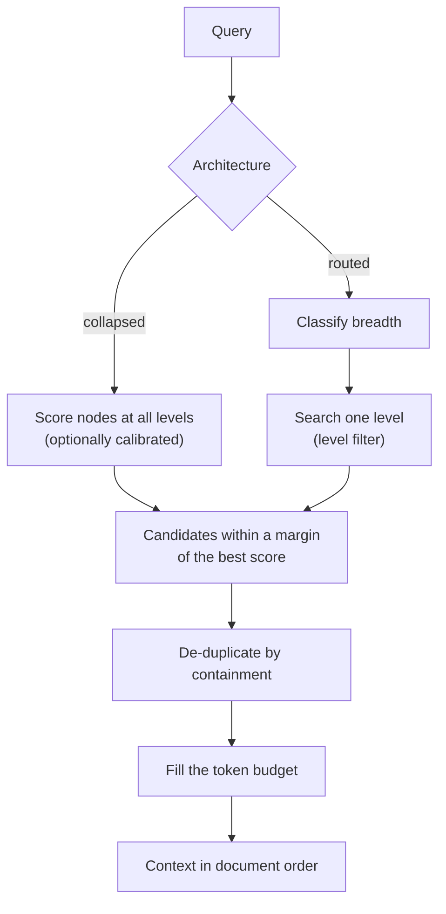

Every lesson in this module has chosen the level of detail somewhere. [Parent-child retrieval](/learn/hierarchical-rag/parent-child-retrieval) fixed it in advance: match sentences, return sections. [Hierarchical indexes](/learn/hierarchical-rag/hierarchical-indexes) descended to a fixed level. But questions do not come in one size. "What does E-4012 mean?" is answered by one sentence; "What are the rules for working from home?" by a section; "What does the IT runbook cover?" by an outline of a whole document. A system with one resolution answers one of these well and the other two badly.

**Multi-resolution retrieval** indexes several levels of detail together and lets each question find the level that fits it. This lesson covers the two ways of doing that (one search across all levels, or a choice of level before searching), the three problems that appear when nodes of different sizes compete in one ranking (scores on different scales, overlapping text, and a shared token budget), and how to assemble a context that mixes resolutions without sending anything twice. You will compare single-resolution and multi-resolution retrieval on narrow, medium and broad questions under a fixed budget.

## Learning objectives

- Explain why a single retrieval granularity fails on some question types, and give an example of each failure.
- Implement collapsed multi-level search with containment-aware de-duplication and a token budget.
- Calibrate scores across levels with per-level offsets and explain when calibration is needed.
- Compare collapsed search with query-time resolution routing and choose between them.
- Measure answer completeness and tokens used as the joint criterion for a multi-resolution system.

## Prerequisites

- [Hierarchical indexes](/learn/hierarchical-rag/hierarchical-indexes): trees of nodes, levels and paths.
- [Summary indexes](/learn/hierarchical-rag/summary-indexes): summary nodes and RAPTOR's collapsed tree.
- [Small-to-big retrieval](/learn/chunking-optimisation/small-to-big-retrieval): auto-merging, an adaptive choice of level.
- [Score calibration](/learn/advanced-retrieval-optimisation/score-calibration): why raw similarity scores are not comparable across sources.

## Why this matters

Granularity is usually fixed once, at chunking time, by someone guessing the typical question. The guess is always wrong for part of the traffic:

- **Too fine for broad questions.** With sentence-sized units, "rules for working from home" retrieves the remote-days sentence and perhaps the budget sentence, and the budget fills with fragments before the contractor exception arrives. The answer is incomplete, and nothing tells the user so.
- **Too coarse for narrow questions.** With section-sized units, "What does E-4012 mean?" retrieves the whole VPN section. The answer is in there, but the context is several times larger than needed, which costs tokens and gives the generator more irrelevant text to be distracted by.
- **No level for overview questions.** Neither sentences nor sections answer "What does the IT runbook cover?"; only a document-level node (an outline or summary) does.

Research supports the general point that the unit of retrieval matters: Chen and colleagues (2023) compared passage, sentence and *proposition* (a single atomic fact) units for dense retrieval and found that the choice of unit changed retrieval and downstream accuracy. Which unit is best depends on the question, which is the argument for indexing more than one.

## The intuition

Think of an online map. You do not choose a single zoom level for every trip. To find a café you zoom in to street level; to plan a drive between cities you zoom out until both fit on the screen. The map holds every zoom level, and you pick the one at which your question is answered on one screen.

Two details of maps carry over. The zoom levels overlap: a city view contains the streets you might also view close up, so you would never print both and call it two maps. And the screen is fixed: zooming out shows more area in less detail, zooming in the reverse. A multi-resolution retriever holds every level, avoids sending the same text twice, and fills a fixed context budget with whichever level answers the question most economically.

## How it works

### Two architectures

**Collapsed search.** Every node from every level goes into one index, distinguished by a `level` field. A query is scored against all of them at once, and the ranking decides which levels appear in the result. This is RAPTOR's collapsed tree, and its authors found it worked better than descending the tree level by level ([summary indexes](/learn/hierarchical-rag/summary-indexes) has the details).

**Resolution routing.** A classifier (or a model call, or simple rules) reads the question and chooses a level first: sentences for lookups of a fact or code, sections for "how do I" and "what are the rules", documents or summaries for "overview" and "compare". Search then runs at that level only, using a `level` filter. Routing itself is covered in [query routing](/learn/agentic-rag/query-routing).



Collapsed search needs no classifier and handles questions that fall between categories, but it must make scores comparable across levels. Routing keeps each search within one level, where scores are comparable, but a routing mistake is final, and it needs labelled examples to build. A hybrid is common: route only when the classifier is confident, and otherwise search collapsed.

### Problem 1: scores on different scales

A sentence, a section and a document outline are different kinds of text, and an embedding model's similarity scores for them have different typical ranges. Longer texts often score higher against *any* query because they touch more subjects; outlines full of headings may score higher against generic questions. If one level's scores run systematically higher, it dominates the collapsed ranking regardless of relevance.

**Calibration** removes the systematic difference. Measure, offline, each level's typical score against a set of questions that are unrelated to the content (or a sample of real queries), and subtract that level's mean from its scores at query time. A z-score (also dividing by each level's standard deviation) is the fuller version; it needs enough nodes and queries per level for the standard deviation to be stable, and a level with three documents does not have that. Calibrate with many queries, not with the few nodes a single query sees. The [score calibration](/learn/advanced-retrieval-optimisation/score-calibration) lesson covers the general technique.

### Problem 2: overlapping text

In a hierarchy, a section *contains* its sentences. If the collapsed ranking selects the remote-work section and then its budget sentence, the budget sentence is sent twice. De-duplication must follow containment:

1. Before adding a node, skip it if a selected node already contains it.
2. When adding a node that contains nodes already selected, remove them and count only the extra text against the budget.

**Containment is not ancestry.** A document node built as an outline or a summary *describes* its sections but does not contain their text. Selecting it must not suppress its sections, or a broad question would receive the outline and lose the content. Record on each node which nodes' text it actually contains, and de-duplicate on that, not on the tree's parent links.

### Problem 3: one budget for all sizes

A section costs several times as many tokens as a sentence. Greedy selection by score, skipping what does not fit, is the usual approach: it is simple, and with a margin (only candidates within some distance of the best score are eligible) it stops the budget from being padded with weak matches just because space remains. More elaborate selection maximises total relevance per token, a knapsack problem; the greedy rule is a reasonable approximation for the handful of candidates involved.

The margin also gives the system a way to stop. A narrow question has one strong match and nothing else nearby, so the context is one sentence; a broad question has several candidates of similar score, and the context grows to include them.

### Where adaptive merging fits

[Auto-merging](/learn/chunking-optimisation/small-to-big-retrieval) is a form of multi-resolution retrieval that starts from the finest level and moves up when enough of a parent's children are retrieved. It infers the right level from the evidence at the bottom, without scoring upper-level nodes. Collapsed search scores the upper levels directly, which is what lets overview questions find a document outline that no sentence matches. They combine well: collapsed search for candidates, then merging of sibling sentences into their section when several are selected.

Do not confuse multi-resolution retrieval with **Matryoshka embeddings**, which offer several *vector* resolutions (truncated dimensions) of the same text; see [Matryoshka embeddings](/learn/embedding-optimisation/matryoshka-embeddings). That is about the precision of a vector, not the size of the text it represents.

## The mathematics

### Calibrating levels with offsets

**Intuition.** Subtract each level's typical score so that a node is ranked by how much better it matches than its level usually does.

$$
\tilde{s}(q, n) = s(q, n) - \mu_{\ell(n)}, \qquad \mu_\ell = \frac{1}{|Q_c|\,|N_\ell|} \sum_{q' \in Q_c} \sum_{m \in N_\ell} s(q', m)
$$

$s(q, n)$ is the cosine between query $q$ and node $n$; $\ell(n)$ is the node's level; $Q_c$ is a set of calibration queries; $N_\ell$ is the set of nodes at level $\ell$; $\mu_\ell$ is that level's mean score over all calibration queries and nodes.

**By hand.** The code below measures $\mu_{\text{sentence}} = 0.111$ and $\mu_{\text{document}} = 0.149$. Suppose a query scores 0.42 with a sentence and 0.45 with a document outline. Raw, the document wins. Calibrated: $0.42 - 0.111 = 0.309$ and $0.45 - 0.149 = 0.301$, so the sentence wins. A 0.04 difference in level means is enough to reverse a close decision.

### The marginal cost of a containing node

**Intuition.** If you already hold some of a section's sentences, adding the section only costs the text you do not yet have.

$$
\Delta T(n) = T(n) - \sum_{m \in S,\; n \supseteq m} T(m)
$$

$T(n)$ is the size of node $n$ in tokens (words, in the code), $S$ is the set of selected nodes, and $n \supseteq m$ means that $n$'s text contains $m$'s.

**By hand.** A section of 36 words containing two selected sentences of 7 and 9 words costs $36 - (7 + 9) = 20$ more words to add.

```python
offset = {"sentence": 0.111, "document": 0.149}
raw = {"sentence": 0.42, "document": 0.45}
for level in raw:
    print(f"{level:<9} raw {raw[level]:.3f}  calibrated {raw[level] - offset[level]:.3f}")
# Marginal cost of a section that contains two already-selected sentences
section, sentences = 36, [7, 9]
print("marginal cost of the section:", section - sum(sentences), "words")
```

```output
sentence  raw 0.420  calibrated 0.309
document  raw 0.450  calibrated 0.301
marginal cost of the section: 20 words
```

## In code

**The problem.** Index the Meridian tree from the [hierarchical indexes](/learn/hierarchical-rag/hierarchical-indexes) lesson at three levels: sentences, sections (heading path plus all their sentences) and documents (an outline of section headings). Ask six questions: two narrow, two section-sized and two overviews. For each, a complete answer needs specific nodes. Compare four strategies under a 40-word budget: sentences only, sections only, all levels with raw scores, and all levels with calibrated scores. Count complete answers and words used.

**Dependencies.**

```bash
pip install sentence-transformers numpy
```

```python
import numpy as np
from sentence_transformers import SentenceTransformer

TREE = {
    "Employee handbook": {
        "Annual leave": ["Staff receive 25 days of annual leave a year.",
                         "Up to 5 unused days carry over and must be used by 31 March."],
        "Remote work": ["Staff may work remotely up to 3 days a week.",
                        "The home-office equipment budget is £400.",
                        "Contractors are not eligible for the equipment budget."],
        "Expenses": ["Claims must be submitted within 30 days.",
                     "Anything over £75 needs a receipt."],
    },
    "IT runbook": {
        "VPN": ["The VPN is required on public Wi-Fi.",
                "E-4021 means the VPN client is out of date; update it from the IT portal.",
                "E-4012 means the VPN certificate has expired."],
        "Accounts": ["Passwords must be rotated every 90 days.",
                     "Locked accounts are unlocked by the support desk."],
        "Devices": ["The laptop refresh cycle is 3 years.",
                    "Report a lost laptop to the support desk at once."],
    },
    "Meridian Relay guide": {
        "Tokens": ["Rotate an API token under Settings > Credentials.",
                   "The old token stops working immediately."],
        "Deliveries": ["Failed deliveries are retried for up to 24 hours.",
                       "Deliveries that still fail after that are moved to a dead-letter queue, kept for 14 days."],
    },
}

# One node per document, section and sentence. A section's text contains its
# sentences; a document node is an outline (its section headings), which
# describes its content but does not contain it.
nodes = []                                    # dicts: id, level, contains, text
for doc, sections in TREE.items():
    nodes.append({"id": doc, "level": "document", "contains": [],
                  "text": f"{doc}: " + "; ".join(sections)})
    for sec, sents in sections.items():
        sid = f"{doc} > {sec}"
        sent_ids = [f"{sid} #{i}" for i in range(len(sents))]
        nodes.append({"id": sid, "level": "section", "contains": sent_ids,
                      "text": f"{sid}. " + " ".join(sents)})
        for nid, s in zip(sent_ids, sents):
            nodes.append({"id": nid, "level": "sentence", "contains": [], "text": s})
by_id = {n["id"]: n for n in nodes}
LEVELS = ["sentence", "section", "document"]

def covers(a, b):
    """Node a covers node b if a is b or a's text contains b's text."""
    return a == b or b in by_id[a]["contains"]

QUERIES = [  # (question, the nodes a complete answer needs)
    ("What does E-4012 mean?", ["IT runbook > VPN #2"]),
    ("Do I need a receipt for a £120 dinner?", ["Employee handbook > Expenses #1"]),
    ("What are the rules for working from home?",
     [f"Employee handbook > Remote work #{i}" for i in range(3)]),
    ("Tell me about VPN problems and error codes",
     [f"IT runbook > VPN #{i}" for i in range(3)]),
    ("What does the Meridian Relay guide cover?", ["Meridian Relay guide"]),
    ("Give me an overview of the IT runbook", ["IT runbook"]),
]
CALIBRATION = ["How do I reset my password?", "When is the office closed?",
               "What is the parking policy?", "How do I book travel?",
               "Who do I contact about payroll?", "Can I bring a dog to work?",
               "How do I set up two-factor authentication?", "What is a webhook?"]

model = SentenceTransformer("sentence-transformers/all-MiniLM-L6-v2")
enc = lambda texts: model.encode(texts, normalize_embeddings=True)
V = enc([n["text"] for n in nodes])
level_of = np.array([n["level"] for n in nodes])

# Offline calibration: each level's mean score over unrelated questions.
cal = enc(CALIBRATION) @ V.T
offset = {lv: cal[:, level_of == lv].mean() for lv in LEVELS}

def select(question, allowed, calibrate, budget=40, margin=0.15):
    """Greedy context assembly under a word budget. Candidates must score within
    `margin` of the best. A node already covered by a selected node is skipped;
    selecting a node that covers earlier picks replaces them."""
    s = V @ enc([question])[0]
    if calibrate:
        s = s - np.array([offset[lv] for lv in level_of])
    s = np.where(np.isin(level_of, list(allowed)), s, -np.inf)
    chosen, used = [], 0
    for i in np.argsort(-s):
        n = nodes[i]
        if s[i] < s.max() - margin:
            break
        if any(covers(c, n["id"]) for c in chosen):
            continue
        freed = [c for c in chosen if covers(n["id"], c)]
        cost = len(n["text"].split()) - sum(len(by_id[c]["text"].split()) for c in freed)
        if used + cost > budget:
            continue
        chosen = [c for c in chosen if c not in freed] + [n["id"]]
        used += cost
    return chosen, used

STRATEGIES = [("sentences only", {"sentence"}, False),
              ("sections only", {"section"}, False),
              ("all levels, raw", set(LEVELS), False),
              ("all levels, calibrated", set(LEVELS), True)]

print("level offsets:", {k: round(float(v), 3) for k, v in offset.items()})
print(f"\n{'strategy':<24}{'complete':>9}{'words used':>12}")
for name, allowed, calibrate in STRATEGIES:
    complete, words = 0, 0
    for question, needed in QUERIES:
        chosen, used = select(question, allowed, calibrate)
        complete += all(any(covers(c, x) for c in chosen) for x in needed)
        words += used
    print(f"{name:<24}{complete:>5}/{len(QUERIES)}{words / len(QUERIES):>12.1f}")

print()
for question, _ in [QUERIES[0], QUERIES[2], QUERIES[5]]:
    chosen, used = select(question, set(LEVELS), calibrate=False)
    print(f"{question}\n   {used} words: {chosen}")
```

```output
level offsets: {'sentence': 0.111, 'section': 0.112, 'document': 0.149}

strategy                 complete  words used
sentences only              3/6        21.0
sections only               4/6        30.3
all levels, raw             6/6        19.7
all levels, calibrated      6/6        19.7

What does E-4012 mean?
   7 words: ['IT runbook > VPN #2']
What are the rules for working from home?
   36 words: ['Employee handbook', 'Employee handbook > Remote work']
Give me an overview of the IT runbook
   26 words: ['IT runbook', 'IT runbook > Devices']
```

**The important lines.** Each node lists the nodes whose text it `contains`: a section contains its sentences, and a document outline contains nothing, because it only names its sections. `covers` uses that list, so an outline never suppresses content. `offset` is the per-level mean over eight unrelated calibration questions. `select` is the whole context-assembly policy: restrict to the allowed levels, stop when scores fall more than `margin` below the best, skip anything already covered, and when a containing node is added, replace what it contains and charge only the difference against the budget. Completeness is checked with the same `covers` relation: every needed node must be in the context, directly or inside a selected section.

**What the output means.**

- **Sentences only** completes 3 of 6. It answers the two narrow questions and the VPN question, but for "rules for working from home" it returns only the remote-days sentence (the budget and contractor sentences fall outside the margin), and it cannot answer the overview questions, because no sentence is an outline.
- **Sections only** completes 4 of 6: every narrow and section-sized question, because sections contain the sentences, but at a higher average cost (30.3 words), and it still has nothing for overviews.
- **All levels** completes 6 of 6 and uses the fewest words on average (19.7). The three examples show why: "What does E-4012 mean?" gets one 7-word sentence, because nothing else scores within the margin; "rules for working from home" gets the remote-work section plus the handbook outline; the IT runbook overview gets the outline plus one section.
- **Calibration** changes neither completeness nor cost here (19.7 words either way). The offsets are close (0.111, 0.112, 0.149), so the levels were already nearly comparable for this model and corpus. The document level does score higher on unrelated questions, the bias calibration exists to remove; with summaries of several hundred words, or a different embedding model, the gap can be much larger. Measure the offsets before deciding whether you need them.

The comparison is the right one to make on your own data: completeness *and* cost, per question type. A single-resolution system can always buy completeness with a larger budget; multi-resolution retrieval earns its place by being complete at a smaller one.

**Common errors.** De-duplicating on tree ancestry, which lets an outline suppress the sections a broad question needs. Calibrating with the scores of the current query's few nodes, which makes the document level's statistics meaningless with three documents. No margin, so the greedy loop pads every context to the budget with weak matches.

**Extending it.** Add a sentence-level merge: if two or more sentences of one section are selected, replace them with the section when the marginal cost is below some threshold. Then add a resolution router that sends questions containing an error code straight to the sentence level, and compare it with collapsed search on the same six questions.

## A real-world example

The Platform team at Meridian ran AskMeridian on section-sized chunks, chosen when most questions were "how do I" questions about procedures. Two changes in traffic exposed the limits. The support desk started forwarding error codes pasted from screenshots, which returned whole VPN sections when one line would do; and new starters asked overview questions ("what's in the IT runbook?") during onboarding, which no section answered.

The team considered a resolution router, but did not have labelled examples of question breadth, and the support desk's questions often mixed a code with a broad request ("E-4012 again, what should we be doing about certificates generally?"). They chose collapsed search over sentences, sections and the document summaries they had already built for their summary index, all in one Qdrant collection with a `level` field, de-duplicated by containment, with a margin and a token budget.

The first week's review found summaries winning too often for specific questions. Measuring per-level means against a sample of 500 logged queries showed that summaries scored noticeably higher than sections on unrelated questions: they were dense with topic words and matched everything a little. After subtracting per-level offsets measured on that sample, summaries appeared mainly for overview questions. They recomputed the offsets whenever the summary prompt changed, since the offsets are a property of the summaries as much as of the model.

## Common mistakes

- **One fixed granularity for all traffic.** Narrow questions pay for whole sections, broad questions get fragments, and overview questions get nothing useful.
- **Mixing levels with uncalibrated scores without checking.** A level whose scores run high crowds out the others.
- **De-duplicating on parent links instead of text containment.** Outlines and summaries suppress the content beneath them, or overlapping text is sent twice.
- **Filling the budget because it is there.** Without a margin or threshold, every context grows to the budget with marginal matches.
- **Calibrating per query on a handful of nodes.** The statistics are noise; calibrate offline on many queries.
- **Evaluating completeness or cost alone.** Either can be maximised by making the other worse; report both, per question type.

## Best practices

- Index the levels your questions need (at least the unit that answers facts, the unit that answers procedures, and a document-level outline or summary), all with a `level` field.
- Record text containment explicitly on each node and de-duplicate on it.
- Measure per-level score offsets on a large query sample; apply them if they differ materially, and remeasure when the model or summaries change.
- Use a relevance margin and a token budget together, and charge containing nodes only for their extra text.
- Route by resolution only when the router is confident; fall back to collapsed search.
- Evaluate completeness and tokens together, broken down by question type.

## Performance considerations

Indexing all levels adds vectors in proportion to the internal nodes: with sections of about 5 sentences and documents of about 20 sections, the extra levels add roughly $1/5 + 1/100 = 21\%$ to the sentence count. Storage grows the same way; text storage grows more, because each section repeats its sentences' text, roughly doubling stored text for two content levels. Store sections as references to their sentences if that matters.

Query latency is one search over a slightly larger index for collapsed search, or one filtered search for routing; the de-duplication and budget logic runs over a few dozen candidates in microseconds. Ask the index for enough candidates (for example 30) that the margin, not the candidate limit, decides when to stop.

The gain shows in generation cost. In the experiment, all-level retrieval averaged 19.7 words of context against 30.3 for sections only, about a third less, while answering more questions. At real chunk sizes the same ratio applies to input tokens on every generation call.

## Summary

- Questions need different levels of detail; multi-resolution retrieval indexes several and lets each question find its own.
- **Collapsed search** scores all levels at once and needs comparable scores; **resolution routing** picks a level first and depends on a reliable classifier.
- Calibrate with per-level offsets measured offline on many queries, when the levels' score distributions differ.
- De-duplicate by **text containment**, not tree ancestry, and charge a containing node only for its extra text.
- Use a margin and a budget together, and evaluate completeness and cost together, per question type.

## Exercises

**1.** Calibration offsets are 0.10 for sentences, 0.12 for sections and 0.20 for summaries. A query scores 0.55 with a sentence, 0.58 with a section and 0.64 with a summary. Rank the three before and after calibration.

<details><summary>Show solution</summary>

Raw: summary (0.64), section (0.58), sentence (0.55). Calibrated: sentence $0.55 - 0.10 = 0.45$, section $0.58 - 0.12 = 0.46$, summary $0.64 - 0.20 = 0.44$. After calibration the section ranks first, the sentence second and the summary last: the summary's lead was entirely the level's typical advantage.

</details>

**2.** Explain why the code stores `contains` instead of de-duplicating with parent links, and describe the failure that parent links would cause in the "rules for working from home" example.

<details><summary>Show solution</summary>

The document node is an outline of section headings; it names "Remote work" but does not contain its sentences. With parent links, selecting the handbook outline first (it ranked first under raw scores for that question) would mark the remote-work section and its sentences as already covered and skip them. The context would be the outline alone: 7 words that say a remote-work section exists without saying what it contains. The answer would be incomplete although the right section ranked second.

</details>

**3.** Implement the router suggested in "Extending it": if the question contains a pattern like `E-\d{4}`, allow only the sentence level; otherwise allow all levels. Does it change completeness or words used on the six questions?

<details><summary>Show solution</summary>

```python
import re

def routed(question):
    allowed = {"sentence"} if re.search(r"E-\d{4}", question) else set(LEVELS)
    return select(question, allowed, calibrate=False)
```

Only "What does E-4012 mean?" is affected, and collapsed search already returned the single sentence for it, so neither completeness nor words change. The router would matter for a question such as "E-4012 again, what should we do about certificates generally?", where restricting to sentences would *hurt*: that question is broad despite containing a code. Rules that look at surface features route confidently and wrongly on mixed questions, which is why routing should apply only when the classifier is confident.

</details>

**4.** Design decision. Meridian's product documentation for Meridian Reports has 80 pages, each with 5 to 15 sections. The traffic is roughly a third quick feature lookups, a third how-to procedures, and a third "what can Reports do for my team?" Plan the levels, the node text for each, the calibration and the evaluation.

<details><summary>Show solution</summary>

Levels: paragraphs (for feature lookups), sections (for procedures, containing their paragraphs), pages (as summaries with a retrieval-oriented prompt) and one product-level summary (for the capability questions). Node text: paragraphs as written with a heading-path prefix; sections as heading path plus their paragraphs; page and product summaries as described in [summary indexes](/learn/hierarchical-rag/summary-indexes), with fingerprints for staleness. Containment: sections contain paragraphs; summaries contain nothing.

Calibration: measure per-level offsets over a few hundred logged queries; expect summaries to need a larger offset. Evaluation: label 50 questions of each type with the nodes a complete answer needs, and report completeness and context tokens per type for collapsed search, calibrated collapsed search and the best single level. Adopt multi-resolution only if it is at least as complete as sections-only on procedures, while being cheaper on lookups and more complete on capability questions.

</details>

## Check your understanding

```quiz
[
  {
    "q": "Which question is best served by a document-level outline or summary node?",
    "options": [
      "What does error E-4012 mean?",
      "Do I need a receipt for a £120 dinner?",
      "What does the IT runbook cover?",
      "How many days of annual leave do I get?"
    ],
    "answer": 2,
    "why": "An overview question asks about a document as a whole; no single sentence or section answers it."
  },
  {
    "q": "A collapsed index mixes sentences and summaries. Summaries score higher than sentences on almost every query, including unrelated ones. What is the standard fix?",
    "options": [
      "Delete the summaries",
      "Subtract per-level offsets measured on many calibration queries",
      "Increase the top-k",
      "Use a larger token budget"
    ],
    "answer": 1,
    "why": "Offsets remove each level's systematic score advantage, so nodes compete on relevance rather than on their level's typical score."
  },
  {
    "q": "A section of 50 tokens contains two already-selected sentences of 10 and 12 tokens. How many extra tokens does selecting the section cost?",
    "options": [
      "50",
      "72",
      "22",
      "28"
    ],
    "answer": 3,
    "why": "The section replaces the sentences it contains, so its marginal cost is 50 - (10 + 12) = 28."
  },
  {
    "q": "Why should de-duplication use text containment rather than parent links?",
    "options": [
      "Outline and summary nodes are parents of their sections but do not contain their text",
      "Parent links are slower to look up",
      "Containment makes scores comparable",
      "Parent links do not exist in vector databases"
    ],
    "answer": 0,
    "why": "If a summary suppressed its children, a broad question would get the summary and lose the content it describes."
  },
  {
    "q": "What is the main risk of resolution routing compared with collapsed search?",
    "options": [
      "It cannot use metadata filters",
      "It always uses more tokens",
      "A routing mistake restricts the search to the wrong level and cannot be recovered",
      "It requires a cross-encoder"
    ],
    "answer": 2,
    "why": "Routing commits to one level before searching, so a misclassified question never sees nodes at the right level."
  }
]
```

## Further reading

- T. Chen, H. Wang, S. Chen, W. Yu, K. Ma, X. Zhao, H. Zhang and D. Yu (2023), "Dense X Retrieval: What Retrieval Granularity Should We Use?" ([arXiv:2312.06648](https://arxiv.org/abs/2312.06648)).
- P. Sarthi and colleagues (2024), "RAPTOR: Recursive Abstractive Processing for Tree-Organized Retrieval" ([arXiv:2401.18059](https://arxiv.org/abs/2401.18059)): collapsed-tree retrieval.
- [LlamaIndex documentation](https://docs.llamaindex.ai/): `HierarchicalNodeParser` and `AutoMergingRetriever`.
- [Qdrant documentation: filtering](https://qdrant.tech/documentation/concepts/filtering/): a `level` field as a payload filter for routed search.
