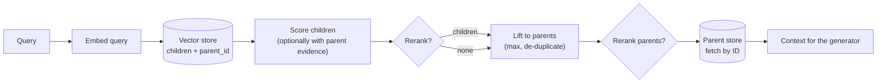

Phase 5 built a two-level index: [parent-child chunking](/learn/chunking-optimisation/parent-child-chunking) split each document into small children for matching and larger parents for reading, and [small-to-big retrieval](/learn/chunking-optimisation/small-to-big-retrieval) covered what to hand the generator once children have been found. This module treats that two-level structure as the simplest member of a larger family: **hierarchical retrieval**, in which a collection is organised into levels of detail (chunks, sections, documents, summaries) and a query can be matched at one level and answered from another.

This lesson sets up the vocabulary the rest of the module uses and then looks at the part of parent-child retrieval the chunking lessons left alone: **where the hierarchy enters the scoring**. A plain parent-child retriever scores each child in isolation and only consults the parent afterwards, to decide what to return. You will see why that fails on the repetitive, boilerplate sentences real handbooks are full of, how mixing parent evidence into child scores fixes some of those failures and causes others, where a reranker belongs in the pipeline, and how permissions and evaluation work when there are two levels.

## Learning objectives

- Describe a hierarchical retriever in terms of its match level, its return level and the operations (lift, expand, descend) that move between them.
- Explain why scoring children in isolation cannot separate identical or near-identical children that belong to different parents.
- Implement interpolated child-parent scoring, choose its weight on a labelled set, and predict the queries it will hurt.
- Decide whether to rerank children or parents, given the reranker's input limit and the size of the parents.
- Evaluate a parent-child retriever at both levels and enforce access control so that no level leaks the other.

## Prerequisites

- [Parent-child chunking](/learn/chunking-optimisation/parent-child-chunking): how children and parents are defined, linked and stored.
- [Small-to-big retrieval](/learn/chunking-optimisation/small-to-big-retrieval): the four ways of turning retrieved children into context, and parent scoring with max, sum and coverage.
- [Cross-encoders](/learn/reranking-fundamentals/cross-encoders): how a reranker scores a query and a passage together.
- [Recall@K](/learn/retrieval-fundamentals/recall-k): the basic retrieval metric used for evaluation here.

## Why this matters

Parent-child retrieval is the hierarchical technique most teams deploy first, and usually the only one. It is also where the habits that matter for deeper hierarchies are formed or not formed. Three problems show up in production that the basic recipe does not address.

First, **children lose their context**. A sentence such as "Requests are made in the HR portal and approved by your line manager" appears, word for word, under annual leave, parental leave and sabbaticals. Its embedding is identical in all three places. When someone asks who approves a sabbatical, the retriever has three children with exactly the same score and no principled way to choose. Whichever one wins, it wins by accident: the order of insertion or the internals of the index decide.

Second, **the reranker sees the wrong unit**. Teams add a cross-encoder after retrieval and point it at whatever the retriever returned. If that is children, the reranker is blind to the parent context that made the child relevant; if it is parents, long parents are silently truncated to the reranker's input limit and judged on their first few hundred tokens.

Third, **evaluation and access control are done at one level only**. A retriever can score well on child-level recall while handing the generator parents that do not contain the answer, and a permission filter applied to children can still release a parent that contains restricted text. Each of these is a correctness problem, not a tuning problem.

## The intuition

Imagine a binder of policies cut into index cards, one sentence per card, shuffled. The card "Requests are made in the HR portal and approved by your line manager" turns up three times. You know one of them is the sabbatical card, but nothing on the cards tells you which.

Now staple to each card a one-line label: the title of the page it came from. The three identical cards are now distinguishable, because each label says "Annual leave", "Parental leave" or "Sabbaticals". You still read the card to decide whether it answers the question, but the label breaks the tie.

That is the idea of this lesson in one picture. A child's score should depend mostly on the child, because the child is the precise evidence, but partly on the parent, because the parent says what the child is about. How much weight the label gets is a design decision with a real cost: lean on it too hard and a card is judged by its page title rather than its content.

## How it works

### The module's vocabulary

Every technique in this module is described by the same few terms.

- A **node** is any retrievable unit: a sentence, a chunk, a section, a document, or a summary of any of these.
- A **level** is a set of nodes of the same kind. Children are one level, parents the next one up. Deeper hierarchies have more.
- The **match level** is the level whose nodes are scored against the query. The **return level** is the level whose nodes are handed to the generator. Parent-child retrieval matches at the child level and returns at the parent level.
- **Lift** maps a node to its ancestor at a higher level (child to parent). **Expand** maps a node to its neighbours at the same level (a sentence window). **Descend** maps a node to its descendants (a document to its chunks).

[Document-level retrieval](/learn/hierarchical-rag/document-level-retrieval) matches whole documents and descends into them. [Hierarchical indexes](/learn/hierarchical-rag/hierarchical-indexes) descend level by level through a tree. [Summary indexes](/learn/hierarchical-rag/summary-indexes) add model-written nodes. [Recursive retrieval](/learn/hierarchical-rag/recursive-retrieval) follows references between nodes, and [multi-resolution retrieval](/learn/hierarchical-rag/multi-resolution-retrieval) matches at several levels at once. Parent-child retrieval is the two-level case of all of them.

### The retrieve-then-resolve architecture

In production, children (which need vector search) and parents (which only need fetching by ID) usually live in different stores.



The steps are:

1. **Embed the query** with the same model used for the children.
2. **Search the child level**, over-fetching (for example 20 to 50 children), because many children will collapse into the same parent. Apply metadata and permission filters here, inside the search, not afterwards.
3. **Score** each candidate child. In the plain recipe this is just the vector similarity. Below, parent evidence is added.
4. **Lift** children to parents, taking each parent's best child score (max), and de-duplicate.
5. **Optionally rerank** at whichever level suits the reranker (discussed below).
6. **Resolve** the top parent IDs against the parent store in one batched fetch, and assemble the context, as [small-to-big retrieval](/learn/chunking-optimisation/small-to-big-retrieval) described.

### Why children need their parents when scoring

A child embedding is computed from the child's text alone. Two consequences follow.

- **Identical children are indistinguishable.** If the same sentence appears under three parents, all three children have the same vector and the same score for every query. Boilerplate is everywhere in real collections: "Contact the support desk for help", "Approval is from your line manager", standard warnings in runbooks, the licence paragraph at the end of every product page.
- **Context-dependent children are under-described.** "They must be used by 31 March" does not say what "they" are. Its vector is about deadlines in general. The parent knows it is about carried-over leave.

There are three established remedies, and they differ in when the context is added:

- **At indexing time, in the text.** Prepend the parent's title or a generated sentence of context to each child before embedding. This is the approach of [context preservation](/learn/chunking-optimisation/context-preservation) and [contextual retrieval](/learn/advanced-retrieval/contextual-retrieval). It is effective and costs nothing per query, but changing how much context to add means re-embedding everything.
- **At query time, in the score.** Keep children and parents embedded separately and combine their similarities when scoring. This is **interpolated child-parent scoring**, the subject of the code below. Its weight can be tuned without re-indexing, and it is an old idea: combining passage-level and document-level evidence was studied in classical information retrieval long before dense retrieval (Callan, 1994).
- **After retrieval, in a reranker.** Give the reranker the child together with its parent's title or text, so its judgement includes the context.

These are not exclusive. A common, sound arrangement is a short title prefix on every child at indexing time plus a reranker; interpolation is useful when you cannot afford to re-embed, or when you want a tunable knob.

### Interpolated scoring

For a query $q$, a child $c$ and its parent $p(c)$, the interpolated score is a weighted average of the two similarities:

$$
s(q, c) = \alpha \cdot \text{sim}(q, c) + (1 - \alpha) \cdot \text{sim}(q, p(c))
$$

With $\alpha = 1$ it is plain child scoring. With $\alpha = 0$ every child inherits its parent's score, so the children of one parent all tie and the method cannot pick a sentence within a section at all. Values between trade the precision of the child against the context of the parent. The parent term is the same for all children of one parent, so interpolation never changes the order *within* a parent; it only moves whole families of children up or down relative to each other.

### Where to rerank

A cross-encoder reads the query and a passage together and is much more accurate than a bi-encoder similarity, but it has a fixed input limit. The two cross-encoders used in this course, `cross-encoder/ms-marco-MiniLM-L-6-v2` and `BAAI/bge-reranker-base`, both truncate the query-plus-passage pair at 512 tokens. That makes the choice of level concrete:

| Rerank | Reads | Good when | Risk |
| --- | --- | --- | --- |
| Children, then lift | Each child alone | Parents are long; children are self-contained | Same blindness to context as the retriever; identical children still tie |
| Children with a context prefix, then lift | Child plus parent title or summary | Most collections | A slightly longer input per pair |
| Parents, after lifting | Whole parent | Parents fit comfortably in the limit | Long parents are truncated and judged on their opening |

A related trap affects the parent vectors themselves: `all-MiniLM-L6-v2` reads at most 256 word pieces, so a parent of 2,000 tokens embedded with it is represented by its first eighth. If you interpolate with parent vectors, embed parent *titles and summaries*, or use a model with a longer input, rather than embedding long parents whole.

### Filters and permissions at two levels

Access control must hold at every level, because the generator reads parents even though the search ran over children. Three rules keep it correct:

1. Every child carries the access labels of its parent (copied at ingestion), so the filter inside the child search excludes children of restricted parents.
2. A parent whose content is mixed (some paragraphs restricted, some not) is split into separate parents with separate labels. Otherwise a permitted child lifts to a parent containing restricted text.
3. The parent fetch re-checks the labels. It is a second line of defence against a stale child index, for example after a document's permissions changed but before its children were re-indexed.

### Evaluating at two levels

A child-level metric asks "was the answering sentence among the top $k$ children?" A parent-level metric asks "was the answering section among the top $k$ parents delivered?" They answer different questions and can disagree in both directions:

- **Child hit, parent miss.** The right child was retrieved but lifted into a budget already filled by other parents, so it was never delivered.
- **Child miss, parent hit.** A sibling child matched, and its parent contains the answer. For the generator, this is a success.

Report both. The parent-level number tells you what the generator received; the child-level number tells you whether the matching is sound or getting lucky through siblings. For queries whose answer is spread over the parent (a rule and its exception), label the parent as the gold unit, not a single child.

## The mathematics

### Interpolated child-parent scores

**Intuition.** A child's score is a blend of "does this sentence match?" and "is this sentence's section about the right thing?". The weight $\alpha$ says how much to trust the sentence over its section.

$$
s(q, c) = \alpha \cdot \cos(\mathbf{q}, \mathbf{c}) + (1 - \alpha) \cdot \cos(\mathbf{q}, \mathbf{p}_{c})
$$

Here $\mathbf{q}$ is the query embedding, $\mathbf{c}$ the child's embedding, $\mathbf{p}_c$ the embedding of the child's parent, $\cos$ the cosine similarity (a dot product, since all vectors are normalised) and $\alpha \in [0, 1]$ the child weight.

**By hand.** For the query "Who approves a sabbatical request?", the code below finds that the sentence "Requests are made in the HR portal and approved by your line manager" has cosine 0.3499 with the query in all three places it occurs. The three parents have cosines 0.6309 (sabbaticals), 0.3083 (parental leave) and 0.2602 (annual leave). With $\alpha = 0.5$:

- Sabbatical child: $0.5 \times 0.3499 + 0.5 \times 0.6309 = 0.17495 + 0.31545 = 0.4904$.
- Parental-leave child: $0.5 \times 0.3499 + 0.5 \times 0.3083 = 0.17495 + 0.15415 = 0.3291$.
- Annual-leave child: $0.5 \times 0.3499 + 0.5 \times 0.2602 = 0.17495 + 0.1301 = 0.30505$.

The tie is broken, in the right direction, by a margin of 0.16.

### Lifting with max

After scoring, each parent receives the score of its best child:

$$
S(q, P) = \max_{c \in \text{children}(P)} s(q, c)
$$

where $P$ is a parent. Substituting the interpolation shows something useful:

$$
S(q, P) = \alpha \cdot \max_{c \in P} \cos(\mathbf{q}, \mathbf{c}) + (1 - \alpha)\cos(\mathbf{q}, \mathbf{p}_P)
$$

because the parent term is constant across the children of $P$ and comes out of the max. The parent ranking is therefore *also* an interpolation, between the best-child score and the parent's own score. At $\alpha = 1$ you have pure max-lifting; at $\alpha = 0$ you are ranking parents by their own embeddings and the children play no part.

```python
import numpy as np

child_sim = 0.3499
parent_sim = {"sabbatical": 0.6309, "parental-leave": 0.3083, "annual-leave": 0.2602}
alpha = 0.5
for parent, p in parent_sim.items():
    print(f"{parent:<15} {alpha * child_sim + (1 - alpha) * p:.4f}")

# Lifting: the parent term is constant, so it comes out of the max.
child_sims, p = np.array([0.5815, 0.3499]), 0.6309
print(round(max(alpha * child_sims + (1 - alpha) * p), 4),
      round(alpha * child_sims.max() + (1 - alpha) * p, 4))
```

```output
sabbatical      0.4904
parental-leave  0.3291
annual-leave    0.3050
0.6062 0.6062
```

Python prints 0.30505 as 0.3050 because the binary float sits just below it. The last line confirms the identity: max-lifting interpolated child scores equals interpolating the best child with the parent.

## In code

**The problem.** Measure what interpolated scoring does to a small Meridian handbook in which three sections share the sentence "Requests are made in the HR portal and approved by your line manager", and see which queries it helps and which it hurts. Rank is counted pessimistically: a child tied with others gets the worst rank in the tie, so an arbitrary tie-break can never look like a success.

**Dependencies.**

```bash
pip install sentence-transformers numpy
```

The first run downloads `all-MiniLM-L6-v2` (about 90 MB).

```python
import re
import numpy as np
from sentence_transformers import SentenceTransformer

# Parents: handbook sections ("Heading. Body"). Children: the body's sentences.
PARENTS = {
    "annual-leave": "Annual leave. Staff receive 25 days a year, and up to 5 unused days "
                    "carry over until 31 March. Requests are made in the HR portal and "
                    "approved by your line manager.",
    "parental-leave": "Parental leave. Staff with 6 months' service can take up to 26 weeks "
                      "of parental leave. Requests are made in the HR portal and approved "
                      "by your line manager.",
    "sabbatical": "Sabbaticals. After 5 years' service you may take an unpaid sabbatical "
                  "of up to 3 months. Requests are made in the HR portal and approved by "
                  "your line manager.",
    "remote-work": "Remote work. Staff may work remotely up to 3 days a week, and the "
                   "home-office equipment budget is £400. Equipment claims are made in "
                   "the HR portal.",
    "expenses": "Expenses. Claims must be submitted within 30 days, and anything over £75 "
                "needs a receipt. Claims are made in the finance portal.",
    "travel": "Travel. Book rail travel through the travel portal; first class needs a "
              "director's approval. Bookings are made in the travel portal.",
}

children = []                                   # (child_id, parent_id, text)
for pid, text in PARENTS.items():
    heading, body = text.split(". ", 1)
    for i, sentence in enumerate(re.split(r"(?<=\.)\s+", body)):
        children.append((f"{pid}#{i}", pid, sentence))

QUERIES = [  # (question, the child sentence that answers it)
    ("How many days of annual leave do I get?", "annual-leave#0"),
    ("Who approves a sabbatical request?", "sabbatical#1"),
    ("Where do I request parental leave?", "parental-leave#1"),
    ("Who approves annual leave?", "annual-leave#1"),
    ("Where do I claim for a home office chair?", "remote-work#1"),
    ("Where do I submit expense claims?", "expenses#1"),
]

model = SentenceTransformer("sentence-transformers/all-MiniLM-L6-v2")
child_vecs = model.encode([t for _, _, t in children], normalize_embeddings=True)
parent_vecs = {pid: v for pid, v in zip(
    PARENTS, model.encode(list(PARENTS.values()), normalize_embeddings=True))}

def child_scores(query, alpha):
    """alpha * sim(query, child) + (1 - alpha) * sim(query, child's parent)."""
    q = model.encode([query], normalize_embeddings=True)[0]
    return np.array([alpha * float(cv @ q) + (1 - alpha) * float(parent_vecs[pid] @ q)
                     for (_, pid, _), cv in zip(children, child_vecs)])

def pessimistic_rank(scores, gold_idx):
    """Number of children scoring at least as high as the gold child (itself
    included). Ties count against us, so a lucky tie-break never looks like success."""
    return int(np.sum(scores >= scores[gold_idx] - 1e-9))

def top_parent(scores):
    """Lift children to parents with max: the parent of the best child."""
    return children[int(np.argmax(scores))][1]

ids = [cid for cid, _, _ in children]
print("rank of the answering child (1 = top)")
print("alpha  q1  q2  q3  q4  q5  q6    MRR  parent hit@1")
for alpha in [1.0, 0.7, 0.5, 0.3, 0.0]:
    ranks, parent_hits = [], 0
    for q, gold in QUERIES:
        scores = child_scores(q, alpha)
        ranks.append(pessimistic_rank(scores, ids.index(gold)))
        parent_hits += top_parent(scores) == gold.split("#")[0]
    mrr = np.mean([1 / r for r in ranks])
    print(f"{alpha:>5.1f}  " + "  ".join(f"{r:>2}" for r in ranks)
          + f"  {mrr:.3f}  {parent_hits}/{len(QUERIES)}")

query = "Who approves a sabbatical request?"
for alpha in [1.0, 0.5]:
    s = child_scores(query, alpha)
    print(f"\n{query}  (alpha={alpha})")
    for i in np.argsort(-s, kind="stable")[:4]:
        print(f"  {s[i]:.4f}  {ids[i]:<16} {children[i][2][:48]}")
```

```output
rank of the answering child (1 = top)
alpha  q1  q2  q3  q4  q5  q6    MRR  parent hit@1
  1.0   1   4   4   7   1   1  0.607  5/6
  0.7   1   2   2   4   2   1  0.625  5/6
  0.5   1   2   2   3   3   1  0.611  5/6
  0.3   1   2   2   2   3   1  0.639  5/6
  0.0   2   2   2   2   4   2  0.458  5/6

Who approves a sabbatical request?  (alpha=1.0)
  0.5815  sabbatical#0     After 5 years' service you may take an unpaid sa
  0.3499  annual-leave#1   Requests are made in the HR portal and approved 
  0.3499  parental-leave#1 Requests are made in the HR portal and approved 
  0.3499  sabbatical#1     Requests are made in the HR portal and approved 

Who approves a sabbatical request?  (alpha=0.5)
  0.6062  sabbatical#0     After 5 years' service you may take an unpaid sa
  0.4904  sabbatical#1     Requests are made in the HR portal and approved 
  0.3291  parental-leave#1 Requests are made in the HR portal and approved 
  0.3050  annual-leave#1   Requests are made in the HR portal and approved 
```

**The important lines.** The children are the body sentences only: the heading is split off, just as a real chunker often stores headings as metadata rather than in the text. `child_scores` implements the interpolation for every child at once. `pessimistic_rank` counts how many children score at least as high as the gold one, so a three-way tie at the top gives rank 3, not 1. `top_parent` is max-lifting, which by the identity in the mathematics section is the same as interpolating the best child with its parent.

**What the output means.** Read the rows from the top.

- At $\alpha = 1.0$ (plain child scoring), queries 2, 3 and 4 ask about the shared sentence. The bottom block shows why their ranks are poor: the three copies score exactly 0.3499. The retriever cannot tell them apart, and for "Who approves annual leave?" (q4) the tie, together with other leave sentences, pushes the answering child to rank 7.
- At $\alpha = 0.5$ the copies separate, with the right one first among them. Queries 2 and 3 improve from 4 to 2: still behind their own section's first sentence, which is fine, because both lift to the right parent.
- Query 5, "Where do I claim for a home office chair?", moves the other way: from rank 1 to 3. The remote-work section is mostly about remote days, so its parent vector is a weak match for a question about *claiming*, while the expenses section, all about claims, gets a boost. Parent evidence penalises a child whose section is mostly about something else.
- At $\alpha = 0.0$ every child ties with its siblings, so no query can rank better than 2 (every parent here has two children). Parent-only scoring can find the section but never the sentence.
- Parent hit@1 is 5/6 in every row, but not for the same reason: at $\alpha = 1$ query 4 lifts to the parental-leave parent (wrong), and from $\alpha = 0.5$ downwards query 5 lifts to expenses (wrong). The aggregate hides a swap.

Six queries are far too few to choose $\alpha$; the experiment shows the shape of the behaviour. On a real collection, tune $\alpha$ on a few hundred labelled queries and inspect the queries that change.

**Common errors.** Comparing ranks with an optimistic tie-break (`argsort` silently orders ties) makes plain child scoring look better than it is. Embedding long parents with a 256-token model and interpolating with a vector of their first paragraph. Interpolating similarities from two different embedding models, whose scales differ.

**Extending it.** Add a third variant that prefixes each child with its heading before embedding and compare it with interpolation; then add a cross-encoder stage that reranks the top 10 children with the heading prefixed to each.

## A real-world example

The Platform team at Meridian runs AskMeridian over the employee handbook with a parent-child index in Qdrant: sentences as children, handbook sections as parents in a separate key-value store. After the HR team restructured the handbook in 2025, every leave policy ended with the same approval sentence, and the support desk began forwarding complaints that AskMeridian answered "who approves my sabbatical?" with text from the parental-leave section.

An engineer reproduced it and found three identical children with identical scores; the one returned depended on insertion order, which had changed when the sections were re-ingested in a different order. The parent-level dashboard had not moved, because the top-scoring child was usually the topic sentence of the right section.

Re-embedding every child with a heading prefix was the cleanest fix but needed a full re-index; interpolation could ship that week behind a flag. They shipped interpolation with $\alpha = 0.7$, chosen on 300 labelled questions, and inspected every query whose answer moved. Two equipment-claim questions got worse, as query 5 did above, because the remote-work section was mostly about remote days. The heading prefix went into the next scheduled re-index, after which they removed interpolation rather than keep two overlapping mechanisms.

## Common mistakes

- **Scoring children with no context at all.** Identical boilerplate children tie, and the winner is decided by insertion order.
- **Breaking ties optimistically in evaluation.** Sorting functions order ties arbitrarily, and an evaluation that counts a lucky tie-break as a hit overstates quality.
- **Choosing $\alpha$ on aggregate numbers alone.** The aggregate can stay flat while individual queries swap from right to wrong, as parent hit@1 did above.
- **Reranking long parents with a 512-token cross-encoder.** The reranker judges the opening of each parent and never sees the rest.
- **Filtering only the child search.** A permitted child lifts to a parent with restricted paragraphs, which then reaches the generator.
- **Fetching parents one by one.** Ten sequential round trips per query where one batched lookup would do.

## Best practices

- Give every child a piece of its parent's identity, either as a title prefix at indexing time or as a parent term in the score.
- Over-fetch children (20 to 50) before lifting, so that de-duplication does not leave you short of parents.
- Use pessimistic tie handling in evaluation, and inspect the queries that change between configurations, not just the averages.
- Report child-level and parent-level recall side by side, and label gold answers at the level the generator needs.
- Copy access labels from parents to children at ingestion, split mixed-permission parents, and re-check labels when fetching parents.
- Rerank at the level that fits the reranker's input limit, and give child-level reranking the parent's title.

## Performance considerations

Interpolation costs one extra 384-dimensional dot product per candidate child, negligible next to embedding the query. Parent vectors must be stored, but there are far fewer parents than children: a handbook of 2,000 sentences in 150 sections needs 150 extra vectors of $384 \times 4 = 1{,}536$ bytes, about 230 KB.

The parent fetch is one batched key lookup. Done one at a time over a network with a 2 ms round trip, ten parents add 20 ms; batched, about 2 ms.

Reranking cost scales with pairs times length: 20 children of about 50 tokens with the query is roughly 1,000 tokens; 5 parents of about 410 is roughly 2,050. Both are small for a MiniLM-sized cross-encoder.

## Security considerations

The generator reads parents, so a parent is the unit of disclosure. A document from an untrusted source (a ticket, a wiki page anyone can edit) can carry instructions aimed at the model; parent-child retrieval delivers *more* of such a document than a child-only system would, because a small matching child pulls in its whole parent. Treat retrieved text as data, mark its source in the prompt, and keep untrusted and trusted collections in separate parents with separate labels. The permission rules in "Filters and permissions at two levels" are the main control; test them with a user who can see a child's parent only partly.

## Summary

- Hierarchical retrieval separates the **match level** from the **return level**; parent-child retrieval matches children and returns parents, and the rest of the module generalises this.
- A child scored in isolation cannot be told apart from an identical child elsewhere, and boilerplate makes this common.
- **Interpolated scoring** mixes child and parent similarity; it breaks ties and fixes context-poor children, but penalises children whose section is mostly about something else, and it never reorders children within one parent.
- Rerank at the level that fits the reranker's input limit, and give child-level reranking the parent's title.
- Evaluate at both levels with pessimistic ties, and enforce permissions at both levels.

## Exercises

**1.** A child has cosine 0.42 with the query and its parent has cosine 0.70. Another child, in a different parent, has cosine 0.55 and its parent 0.30. For which values of $\alpha$ does the first child rank higher?

<details><summary>Show solution</summary>

First child: $0.42\alpha + 0.70(1 - \alpha) = 0.70 - 0.28\alpha$. Second: $0.55\alpha + 0.30(1 - \alpha) = 0.30 + 0.25\alpha$. The first is higher when $0.70 - 0.28\alpha > 0.30 + 0.25\alpha$, that is $0.40 > 0.53\alpha$, so $\alpha < 0.755$. Below about 0.75 the parent evidence outweighs the second child's better sentence match.

</details>

**2.** Explain why, in the output above, no query reaches rank 1 at $\alpha = 0.0$, and why that would still be true if the embedding model were perfect.

<details><summary>Show solution</summary>

At $\alpha = 0$ each child's score is its parent's similarity, so the children of one parent tie. Every parent here has two children, and the pessimistic rank of a child in a two-way tie at the top is 2. A perfect model would rank the right *parent* first, but the score still carries no information about which of the parent's sentences answers the query. Parent-only scoring is a parent retriever, not a child retriever.

</details>

**3.** Modify the code to embed each child with its heading prefixed (`f"{heading}: {sentence}"`) and keep $\alpha = 1$. Compare the rank row with the interpolation rows.

<details><summary>Show solution</summary>

Store the heading in the tuple and embed `f"{heading}: {sentence}"`:

```python
children.append((f"{pid}#{i}", pid, sentence, f"{heading}: {sentence}"))
...
child_vecs = model.encode([c[3] for c in children], normalize_embeddings=True)
```

Adjust the tuple unpacking elsewhere. The three copies of the approval sentence now have different vectors, because "Sabbaticals: Requests are made…" and "Parental leave: Requests are made…" differ, so the tie at 0.3499 disappears without any parent term. Expect the shared-sentence queries to improve much as they did with interpolation; check query 5 in particular, since a heading prefix "Remote work:" carries the same risk as the parent term in a milder form. Your exact ranks depend on the run; the point is to compare the change per query, not just the MRR.

</details>

**4.** Design decision. Meridian's IT runbooks have parents of 1,500 to 3,000 tokens (one per incident type) and children of about 60 tokens. You have `BAAI/bge-reranker-base` and a budget of one reranker call per query over at most 30 pairs. Where do you rerank, and what text goes into each pair?

<details><summary>Show solution</summary>

Rerank children, not parents. Parents of 1,500 to 3,000 tokens would be truncated to roughly the first 500 tokens of each pair, so the reranker would judge each runbook on its introduction. Over-fetch about 50 children, keep the top 30 by vector score, and pair each with the query as `"<runbook title> > <section heading>: <child text>"`, so the reranker sees the context that makes the child meaningful. Lift the reranked children to parents with max, de-duplicate, and deliver the matching parts of the parents through the small-to-big strategy that fits the budget, since whole 3,000-token parents will rarely fit more than one or two at a time.

</details>

## Check your understanding

```quiz
[
  {
    "q": "In parent-child retrieval, what are the match level and the return level?",
    "options": [
      "Both are the parent level",
      "Match at the parent level, return children",
      "Match at the child level, return parents",
      "Match at the document level, return sentences"
    ],
    "answer": 2,
    "why": "Small children are scored against the query for precision; their larger parents are what the generator reads."
  },
  {
    "q": "Three sections end with the identical sentence \"Approval is from your line manager.\" With plain child scoring, how do the three copies rank for any query?",
    "options": [
      "They tie exactly, so the order among them is arbitrary",
      "The copy in the most relevant section always wins",
      "The copy in the longest section wins",
      "They are automatically merged into one child"
    ],
    "answer": 0,
    "why": "Each copy is embedded from the same text alone, so the vectors and scores are identical; only parent context can separate them."
  },
  {
    "q": "With interpolated scoring s = a*sim(q,child) + (1-a)*sim(q,parent), what does changing a do to the order of children within one parent?",
    "options": [
      "It reverses the order",
      "It sorts them by length",
      "It puts the first sentence first",
      "Nothing: the parent term is the same for all of them"
    ],
    "answer": 3,
    "why": "Adding the same parent term to every sibling shifts them together, so their relative order depends only on their own similarities."
  },
  {
    "q": "Your parents average 2,500 tokens and your cross-encoder truncates pairs at 512 tokens. What is the main risk of reranking parents?",
    "options": [
      "The reranker will refuse to run",
      "Each parent is judged on its opening and relevant text later on is never seen",
      "Reranking parents always costs more than retrieval",
      "Scores become probabilities"
    ],
    "answer": 1,
    "why": "Truncation is silent: the model scores only the first few hundred tokens of each parent."
  },
  {
    "q": "A permission filter is applied to the child search. Which situation can still leak restricted text?",
    "options": [
      "A restricted child is excluded by the filter",
      "A user has no access to any document",
      "A permitted child belongs to a parent that also contains restricted paragraphs",
      "Children are fetched in a batch"
    ],
    "answer": 2,
    "why": "The generator reads the whole parent, so a mixed-permission parent must be split or re-checked when fetched."
  }
]
```

## Further reading

- J. P. Callan (1994), "Passage-level evidence in document retrieval", *Proceedings of SIGIR 1994*: the classic study of combining passage and document evidence.
- [LlamaIndex documentation](https://docs.llamaindex.ai/): node relationships, `HierarchicalNodeParser` and `AutoMergingRetriever`.
- [LangChain documentation](https://python.langchain.com/): the `ParentDocumentRetriever` pattern.
- [Sentence Transformers documentation](https://www.sbert.net/): bi-encoders, cross-encoders and their maximum sequence lengths.
- Anthropic (2024), "Introducing Contextual Retrieval", on adding document context to chunks before embedding.
