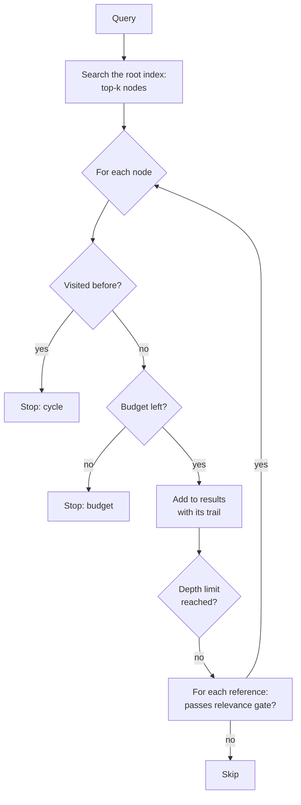

So far in this module, every retrieved node has been content: a sentence, a section, a document or a summary of one. **Recursive retrieval** lets a retrieved node be a *reference* instead, a pointer to something else that can itself be retrieved: another node, a whole sub-index, a table that should be queried rather than read. When the retriever meets a reference it follows it, and if the thing it reaches contains references in turn, it follows those too, until it arrives at content or a limit stops it.

Documents are full of such pointers. Policies say "claims follow the expenses rules"; runbooks say "renew the certificate as described in the portal guide"; a collection of documents is itself a set of pointers from a catalogue to each document's own index. This lesson covers the kinds of reference worth following, the control a recursive retriever needs (depth limits, cycle guards, relevance gates and budgets), how to keep a trail of hops for citations, and how recursive retrieval differs from an agent that decides what to search next. You will build a recursive retriever that follows cross-references in Meridian documents, then run LlamaIndex's `RecursiveRetriever` and see two behaviours that matter in production.

## Learning objectives

- Distinguish content nodes from reference nodes and name four kinds of reference a RAG system can follow.
- Implement a recursive retriever with a depth limit, a cycle guard, a relevance gate and a budget, and record the trail of hops for each result.
- Bound the number of nodes a recursive retrieval can fetch from its fan-out and depth.
- Use LlamaIndex's `IndexNode` and `RecursiveRetriever`, and correct their output ordering.
- Decide when stored references should be followed deterministically and when the decision should be left to an agent.

## Prerequisites

- [Hierarchical indexes](/learn/hierarchical-rag/hierarchical-indexes): nodes, levels and descent.
- [Document-level retrieval](/learn/hierarchical-rag/document-level-retrieval): choosing documents before chunks, and why that gate is final.
- [Summary indexes](/learn/hierarchical-rag/summary-indexes): document summaries as pointers.
- [Context windows](/learn/context-engineering/context-windows): the budget that every retrieval strategy must fit.

## Why this matters

Writers avoid repeating themselves. The remote-work policy states the equipment budget and then says that claims follow the expenses rules; it does not restate the 30-day deadline or the £75 receipt threshold. A question such as "How do I claim for a home-office chair?" therefore has its answer split across two places, linked by a sentence that a retriever treats as just more text. A similarity search finds the equipment section and stops. The generator either answers without the claims rules or guesses them.

The same pattern appears at larger scale. A collection of 200 product manuals can be indexed as one flat pool, or as a catalogue whose entries point to each manual's own index, so that a question is routed to the right manual and answered inside it. And some content should not be read at all: a pricing table of 10,000 rows is better *queried* (with SQL or a dataframe) than embedded in chunks. In each case the system needs to treat a retrieved item as "go there next", and do so safely: without loops, without fetching half the corpus, and without losing track of where each piece of text came from.

## The intuition

A paper encyclopaedia has two kinds of entry. Most are articles. Some just say "Leave, annual: *see* Holidays". When you look up "annual leave" and land on a *see* entry, you do not stop there; you turn to "Holidays". If "Holidays" says "for carry-over rules, *see also* Leave year", you may follow that too, if it seems relevant to your question. You would not follow every "see also" in every article you touch, or you would read the whole encyclopaedia, and you would notice if two entries sent you back and forth between each other.

A recursive retriever is a reader with those three habits written down as rules: follow references, follow only those that look relevant, and stop at a loop or after enough reading.

## How it works

### Content nodes and reference nodes

A **content node** holds text to be read. A **reference node** holds (or contains) a pointer to something else. Four kinds of reference are common:

1. **Index references.** A node stands for a whole sub-index: a catalogue entry for one document, whose target is that document's own retriever. Retrieving the entry means searching the sub-index with the same query. This is the document-first pattern of [document-level retrieval](/learn/hierarchical-rag/document-level-retrieval), expressed as a reference.
2. **Node references.** A small node points to a larger one: a sentence to its section, a summary to its source. Retrieving the small node returns the larger. This is [parent-child retrieval](/learn/hierarchical-rag/parent-child-retrieval) expressed as a reference.
3. **Object references.** A node describes something that should be *executed*, not read: a table to be queried with SQL, an API to be called. Retrieving it hands the query to that engine and returns the engine's answer.
4. **Cross-references in text.** The document itself says "see section 4.2" or "as defined in the expenses policy". These are extracted at ingestion, resolved to node IDs, and stored as edges.

The first three are created by the system builder; the fourth comes from authors and is the most valuable and the messiest: references can be vague ("as above"), broken (the target was renamed) or circular.

### The algorithm



Step by step:

1. **Search** the root index for the top $k$ nodes.
2. For each node, **check the cycle guard**: if it has been visited in this query, stop this branch. References form a graph, not a tree, and two sections that refer to each other are common.
3. **Check the budget**: a cap on nodes or tokens across the whole query.
4. **Add** the node to the results with its **trail**, the list of hops that led to it (`contractors -> equipment -> expenses`). The trail is what makes a followed node citable: the answer can say where the text came from and why it was included.
5. If the **depth limit** has not been reached, consider each reference. A **relevance gate** follows a reference only if its target is similar enough to the query, which stops the retriever wandering into "see also" material that has nothing to do with the question.
6. **Follow** the references that pass, with depth increased by one, and repeat from step 2.
7. **Order** the results for the generator: typically the directly retrieved nodes first, each followed by what it led to, or all of them re-scored against the query.

### Scoring followed nodes

A directly retrieved node has a similarity score. A followed node was included because something pointed to it, and its own similarity to the query may be low, as with a definitions section that a policy refers to. Three options:

- **Inherit** the score of the node that referred to it, possibly multiplied by a decay factor per hop.
- **Score it directly** against the query, as the relevance gate does.
- **Rerank everything** at the end with a cross-encoder, which is the most robust when results come from several sub-indexes whose scores are not comparable.

Whatever you choose, do not merge scores from different sub-indexes as if they were on one scale; the LlamaIndex output below shows what happens when nobody re-sorts.

### Recursive retrieval is not an agent

An agent decides at query time, with a model, what to search for next, and may write new queries. Recursive retrieval follows **stored** references with the **same** query, by fixed rules. That makes it fast, deterministic and testable, and limits it to connections someone recorded. When the next step depends on what was found ("the answer names a team; now find that team's on-call rota"), the decision belongs to an agent; see [iterative search](/learn/agentic-rag/iterative-search). Many systems use both: recursive retrieval for the structure the documents declare, an agent for the reasoning they do not.

## The mathematics

### How much can a recursive retrieval fetch?

**Intuition.** Each followed node may lead to several more, so the number of nodes grows geometrically with depth. The cycle guard prevents infinite loops, but it does not prevent a large finite explosion.

With $k$ starting nodes, at most $f$ references followed per node (the **fan-out**) and depth limit $D$, the number of nodes visited is at most

$$
n_{\max} = k \sum_{d=0}^{D} f^{d} = k \, \frac{f^{D+1} - 1}{f - 1}
$$

**By hand.** With $k = 5$, $f = 3$ and $D = 2$: $5 \times (1 + 3 + 9) = 5 \times 13 = 65$ nodes. With $D = 3$: $5 \times 40 = 200$. At 150 tokens per node, depth 3 could deliver 30,000 tokens, far more than a typical context budget. The cycle guard and the overlap between branches usually keep the real number much lower, but the bound is what you must design for, which is why a hard budget is not optional.

```python
k, f = 5, 3
for D in range(4):
    bound = k * (f ** (D + 1) - 1) // (f - 1)
    print(f"depth {D}: at most {bound:>3} nodes, {bound * 150:>6,} tokens at 150 each")
```

```output
depth 0: at most   5 nodes,    750 tokens at 150 each
depth 1: at most  20 nodes,  3,000 tokens at 150 each
depth 2: at most  65 nodes,  9,750 tokens at 150 each
depth 3: at most 200 nodes, 30,000 tokens at 150 each
```

The relevance gate reduces the effective fan-out $f$: if only one reference in three passes the gate, the depth-3 bound falls from 200 nodes to $5 \times 4 = 20$.

## In code

**The problem.** Ten Meridian nodes with cross-references written as `[see X]`, including a cycle (contractors refer to equipment, which refers to expenses, which refers back to contractors). Three questions each need a node that is reachable only by following references. Compare no following, depth 1, depth 3, and depth 3 with a relevance gate, and print the trails.

**Dependencies.**

```bash
pip install sentence-transformers numpy
```

```python
import re
import numpy as np
from sentence_transformers import SentenceTransformer

# Content nodes. "[see X]" marks a cross-reference to node X.
NODES = {
    "equipment":   "The home-office equipment budget is £400. Claims follow the expenses "
                   "rules [see expenses].",
    "expenses":    "Expense claims must be submitted within 30 days; anything over £75 needs "
                   "a receipt. Contractors claim differently [see contractors].",
    "contractors": "Contractors are not eligible for the home-office equipment budget "
                   "[see equipment]. They claim expenses through their agency.",
    "lost-laptop": "Report a lost laptop to the support desk at once [see desk-hours].",
    "desk-hours":  "The support desk is open 08:00 to 18:00 UK time. Outside these hours "
                   "[see out-of-hours].",
    "out-of-hours": "Outside support hours, raise a ticket in the IT portal; urgent security "
                    "issues such as a lost device can be phoned in to the on-call engineer.",
    "e4012":       "E-4012 means the VPN certificate has expired [see cert-renewal].",
    "cert-renewal": "Renew the VPN certificate in the IT portal under Certificates "
                    "[see portal-login].",
    "portal-login": "The IT portal uses single sign-on with your Meridian account.",
    "leave":       "Staff receive 25 days of annual leave a year.",
}
REFS = {k: re.findall(r"\[see ([\w-]+)\]", v) for k, v in NODES.items()}

model = SentenceTransformer("sentence-transformers/all-MiniLM-L6-v2")
ids = list(NODES)
V = dict(zip(ids, model.encode(list(NODES.values()), normalize_embeddings=True)))

def recursive_retrieve(query, k=1, max_depth=2, min_sim=None, budget=6):
    """Retrieve the top-k nodes, then follow their references depth-first.
    Each result carries the trail of hops that led to it; `stops` records
    where and why following stopped early."""
    q = model.encode([query], normalize_embeddings=True)[0]
    sim = {i: float(V[i] @ q) for i in ids}
    results, visited, stops = [], set(), []

    def visit(node, depth, trail):
        if node in visited:                          # cycle guard
            stops.append((trail, "already visited"))
            return
        if len(results) >= budget:                   # hard budget
            stops.append((trail, "budget"))
            return
        visited.add(node)
        results.append((node, trail))
        if depth == max_depth:
            return
        for ref in REFS[node]:
            if min_sim is None or sim[ref] >= min_sim:  # relevance gate
                visit(ref, depth + 1, trail + [ref])
            else:
                stops.append((trail + [ref], f"gate: sim {sim[ref]:.2f}"))

    for start in sorted(ids, key=sim.get, reverse=True)[:k]:
        visit(start, 0, [start])
    return results, stops

QUERIES = [  # (question, the node that holds the answer)
    ("I lost my laptop at 8pm, what should I do?", "out-of-hours"),
    ("How do I fix VPN error E-4012?", "cert-renewal"),
    ("Can contractors claim the home-office budget?", "contractors"),
]
SETTINGS = [("no following", dict(max_depth=0)),
            ("depth 1", dict(max_depth=1)),
            ("depth 3", dict(max_depth=3)),
            ("depth 3, gated 0.25", dict(max_depth=3, min_sim=0.25))]

for name, kw in SETTINGS:
    row = []
    for question, gold in QUERIES:
        got = [n for n, _ in recursive_retrieve(question, **kw)[0]]
        row.append(f"{'found' if gold in got else 'miss '} ({len(got)} nodes)")
    print(f"{name:<20} " + "   ".join(row))

print()
for question, _ in QUERIES:
    print(question)
    results, stops = recursive_retrieve(question, max_depth=3, min_sim=0.25)
    for node, trail in results:
        print("   " + " -> ".join(trail))
    for trail, reason in stops:
        print("   stopped: " + " -> ".join(trail) + f"  ({reason})")
```

```output
no following         miss  (1 nodes)   miss  (1 nodes)   found (1 nodes)
depth 1              miss  (2 nodes)   found (2 nodes)   found (2 nodes)
depth 3              found (3 nodes)   found (3 nodes)   found (3 nodes)
depth 3, gated 0.25  found (3 nodes)   found (2 nodes)   found (3 nodes)

I lost my laptop at 8pm, what should I do?
   lost-laptop
   lost-laptop -> desk-hours
   lost-laptop -> desk-hours -> out-of-hours
How do I fix VPN error E-4012?
   e4012
   e4012 -> cert-renewal
   stopped: e4012 -> cert-renewal -> portal-login  (gate: sim 0.16)
Can contractors claim the home-office budget?
   contractors
   contractors -> equipment
   contractors -> equipment -> expenses
   stopped: contractors -> equipment -> expenses -> contractors  (already visited)
```

**The important lines.** `REFS` extracts the cross-references with a regular expression; in a real pipeline this is an ingestion step that resolves each reference to a node ID and records unresolved ones for authors to fix. `visit` is the recursion: the cycle guard comes first, then the budget, then the node is recorded with its `trail`, and its references are followed only if the depth limit allows and the target passes the relevance gate. `stops` keeps a record of every branch that was cut and why, which is what you log in production to tune the limits.

**What the output means.**

- **No following** finds only the contractor answer, which happens to be the top hit. The lost-laptop question retrieves "Report a lost laptop to the support desk", which is right but useless at 8 p.m.; the E-4012 question retrieves the meaning of the error but not the fix.
- **Depth 1** follows one hop: the E-4012 question now reaches the renewal procedure, but the lost-laptop question reaches the desk's hours and stops one hop short of what to do outside them.
- **Depth 3** finds all three answers.
- **The gate** keeps depth 3's answers while dropping the portal-login node from the E-4012 results: its similarity to the question is 0.16, below the gate of 0.25. Whether that is right depends on the user; a user who has never used the portal would want it. The gate threshold is a product decision as much as a tuning one.
- **The cycle guard** fires on the contractor question: expenses refers back to contractors, which is already in the results. Without the guard the retriever would loop until the depth limit, adding the same three nodes again.

The trails are what you would put in citations. "Outside support hours, raise a ticket… (reached from: Lost laptop → Support desk hours)" tells the user why a paragraph about ticketing appeared in an answer about a lost laptop.

**Common errors.** Following references before the cycle check, which fetches the node twice. Applying the budget per branch instead of per query. Using the depth limit as the only safeguard, which permits the geometric growth computed above.

### LlamaIndex: `IndexNode` and `RecursiveRetriever`

LlamaIndex represents a reference as an `IndexNode`, whose `index_id` names the target, and `RecursiveRetriever` follows them using a dictionary of retrievers (or query engines, for object references). The example below wraps the same MiniLM model in a small custom retriever so that it runs locally without an API key, and builds a catalogue of two documents, each pointing to its own sub-index. It was run with `llama-index-core` 0.14.

```bash
pip install llama-index-core sentence-transformers numpy
```

```python
import numpy as np
from sentence_transformers import SentenceTransformer
from llama_index.core.retrievers import BaseRetriever, RecursiveRetriever
from llama_index.core.schema import IndexNode, NodeWithScore, QueryBundle, TextNode

model = SentenceTransformer("sentence-transformers/all-MiniLM-L6-v2")

class MiniLMRetriever(BaseRetriever):
    """A tiny in-memory vector retriever over LlamaIndex nodes."""
    def __init__(self, nodes, k=2):
        super().__init__()
        self.nodes, self.k = nodes, k
        self.vecs = model.encode([n.get_content() for n in nodes], normalize_embeddings=True)

    def _retrieve(self, query_bundle: QueryBundle):
        q = model.encode([query_bundle.query_str], normalize_embeddings=True)[0]
        s = self.vecs @ q
        return [NodeWithScore(node=self.nodes[i], score=float(s[i]))
                for i in np.argsort(-s)[: self.k]]

handbook = [TextNode(id_="hb-1", text="Staff may work remotely up to 3 days a week."),
            TextNode(id_="hb-2", text="The home-office equipment budget is £400.")]
runbook = [TextNode(id_="rb-1", text="E-4012 means the VPN certificate has expired."),
           TextNode(id_="rb-2", text="The VPN is required on public Wi-Fi.")]
# Top level: one IndexNode per document, pointing at that document's retriever.
top = [IndexNode(id_="top-hb", index_id="handbook",
                 text="Employee handbook: leave, remote work, equipment, expenses."),
       IndexNode(id_="top-rb", index_id="runbook",
                 text="IT runbook: VPN errors, passwords, laptops.")]

for top_k in (1, 2):
    retriever = RecursiveRetriever(
        "root",
        retriever_dict={"root": MiniLMRetriever(top, k=top_k),
                        "handbook": MiniLMRetriever(handbook),
                        "runbook": MiniLMRetriever(runbook)},
    )
    print(f"top-level k={top_k}")
    for hit in retriever.retrieve("What does E-4012 mean?"):
        print(f"  {hit.score:.3f}  {hit.node.node_id}  {hit.node.get_content()}")
```

```output
top-level k=1
  0.094  hb-2  The home-office equipment budget is £400.
  0.089  hb-1  Staff may work remotely up to 3 days a week.
top-level k=2
  0.094  hb-2  The home-office equipment budget is £400.
  0.089  hb-1  Staff may work remotely up to 3 days a week.
  0.698  rb-1  E-4012 means the VPN certificate has expired.
  0.149  rb-2  The VPN is required on public Wi-Fi.
```

Two behaviours are visible. With `k=1` at the top level, the catalogue entry "IT runbook: VPN errors, passwords, laptops" scores below the handbook entry for "What does E-4012 mean?", so the retriever enters the wrong sub-index and returns two irrelevant nodes with scores below 0.1. That is the [gate-is-final](/learn/hierarchical-rag/document-level-retrieval) problem again, and the fixes are the same: better catalogue text (include the error codes the runbook covers) and a wider top-level $k$. With `k=2`, the right node is found (0.698), but it comes back *third*: in this version the results are returned in the order the sub-indexes were visited, not sorted by score. Sort the results, or better, rerank them with a cross-encoder, before building the context.

## A real-world example

Meridian's IT runbooks were written by many engineers over several years and are dense with cross-references: "If the certificate is the cause, follow the renewal procedure in the VPN runbook", "see Access requests". AskMeridian's flat retrieval kept answering the first half of multi-step procedures. The support desk measured it informally: engineers reading AskMeridian's answers to VPN tickets often had to open the runbook to find the step it had left out.

The Platform team added cross-reference extraction to ingestion. Links in the Markdown source were resolved to node IDs directly; phrases such as "the renewal procedure in the VPN runbook" were resolved by matching against headings, and anything unresolved went to a weekly report for the runbook owners. Retrieval followed references to depth 2, with a relevance gate and a budget of 3,000 tokens per query, and the trail was shown under each citation.

Two problems followed. A "Glossary" runbook was referenced from almost everything, and with a low gate it appeared in every answer; they excluded glossary targets from following and instead retrieved glossary entries directly when the query contained a defined term. And two runbooks referred to each other in a loop that, before the cycle guard was fixed to be per query rather than per branch, produced duplicated text. Both were caught by logging the `stops` records and the size of each context.

## Common mistakes

- **No cycle guard, or a guard per branch.** References form graphs, and two documents referring to each other loop or duplicate text.
- **Depth limit as the only control.** Geometric growth means depth 3 can fetch hundreds of nodes; a token budget per query is needed.
- **Following every reference.** "See also" and glossary links pull in text unrelated to the question; gate on relevance or exclude hub targets.
- **Merging scores across sub-indexes unsorted or as if comparable.** The most relevant node ends up mid-list, as the LlamaIndex output showed.
- **Dropping the trail.** A followed node with no explanation of why it is there confuses users and makes citations unverifiable.
- **Unresolved references ignored.** Broken pointers silently stop the recursion; report them to document owners.
- **Thin catalogue entries for index references.** The first hop routes on a sentence; if it is vague, the query enters the wrong sub-index.

## Best practices

- Extract and resolve references at ingestion, store them as edges with stable target IDs, and report the unresolved ones.
- Enforce, per query, a visited set, a depth limit, a relevance gate and a token budget, and log every early stop with its reason.
- Keep the trail for each result and surface it in citations.
- Rerank the combined results before context assembly when they come from several indexes.
- Write catalogue entries for index references like document cards: scope, topics and identifiers.
- Use recursive retrieval for declared structure; leave open-ended multi-step reasoning to an agent.

## Performance considerations

Each hop that reaches a different index is a separate search, and hops at the same depth can run in parallel but hops along one chain are sequential. Two hops at 5 ms each add 10 ms; a node reference that is a key lookup in a document store costs about a millisecond. An object reference that runs a SQL query or an LLM-backed query engine can cost seconds, so cap them separately and run them concurrently where possible.

The main cost is context, not latency. The bound above shows how quickly followed nodes accumulate; a token budget of a few thousand tokens per query keeps the generator's input, and so its cost and latency, predictable. Cache resolved reference targets, because hub nodes (glossaries, common procedures) are fetched again and again.

## Security considerations

A reference is an instruction to fetch something, so it must not become a way around access control. Check permissions at every hop, not only at the root: a public policy may refer to a restricted HR procedure, and following that reference for a user who cannot see it leaks it. References in untrusted documents (wiki pages, tickets) should be followed only to targets within an allowed set of collections, and never to external URLs fetched at query time, which would let anyone who can edit a page make the retriever fetch arbitrary content into the model's context. Object references that execute queries need the usual protections for generated SQL: read-only credentials, row-level permissions and timeouts.

## Summary

- Recursive retrieval treats some retrieved nodes as references and follows them: to sub-indexes, larger nodes, executable objects, or cross-referenced sections.
- A safe recursive retriever needs a per-query visited set, a depth limit, a relevance gate and a budget, and records a trail for each result.
- Fetched nodes can grow as $k (f^{D+1} - 1)/(f - 1)$; the gate reduces the fan-out and the budget caps the total.
- Results from several indexes must be re-sorted or reranked; LlamaIndex's `RecursiveRetriever` returned them in visit order.
- Recursive retrieval follows stored structure deterministically; deciding what to search next is an agent's job.

## Exercises

**1.** A recursive retriever starts from $k = 4$ nodes, follows at most 2 references per node, and has a depth limit of 3. What is the maximum number of nodes it can visit? If each node is 200 tokens, what token budget would you set, and why not simply the bound?

<details><summary>Show solution</summary>

$n_{\max} = 4 \times (2^4 - 1)/(2 - 1) = 4 \times 15 = 60$ nodes, or 12,000 tokens. The budget should be set from the generator's context allowance for retrieved text (perhaps 3,000 to 4,000 tokens), not from the bound: the bound describes the worst case the retriever *could* fetch, while the budget says how much the generator should read. Directly retrieved nodes should be added first, so that if the budget cuts anything, it cuts the most distant followed nodes.

</details>

**2.** In the output, the gate dropped `portal-login` for the E-4012 question. Propose a rule that would include it for users who need it without lowering the gate for everyone.

<details><summary>Show solution</summary>

Make the gate depend on the kind of reference rather than only on similarity. A reference that the author marked as a *prerequisite* ("you must first sign in to the portal") is followed regardless of similarity, up to the budget; a "see also" reference must pass the gate. The type can be recorded at ingestion from the wording or from link markup. An alternative is to follow it but place it last in the context with its trail, so the generator can mention it briefly; this costs tokens on every E-4012 question.

</details>

**3.** Modify the code so that followed nodes inherit a score: the score of the node that referred to them multiplied by 0.8 per hop. Sort the results by this score and compare the order with the trail order for the lost-laptop question.

<details><summary>Show solution</summary>

Pass a score into `visit` and record it:

```python
def visit(node, depth, trail, score):
    ...
    results.append((node, trail, score))
    for ref in REFS[node]:
        if min_sim is None or sim[ref] >= min_sim:
            visit(ref, depth + 1, trail + [ref], score * 0.8)
...
for start in sorted(ids, key=sim.get, reverse=True)[:k]:
    visit(start, 0, [start], sim[start])
```

With a single starting node, the order by inherited score is the same as the trail order, because each hop multiplies by 0.8: lost-laptop, then desk-hours at 0.8 times its score, then out-of-hours at 0.64 times. The node holding the answer comes last. That is a reason to rerank followed nodes against the query, or at least to make sure the budget does not cut the end of a chain that the question needs.

</details>

**4.** Design decision. Suppose Meridian's finance team adds a mileage policy and wants AskMeridian to answer "What is the mileage rate for a 2025 trip?". The policy says "Mileage is reimbursed at the rate in the current rates table", where the rates table is a spreadsheet with a row per year and vehicle type. Design the retrieval.

<details><summary>Show solution</summary>

Treat the rates table as an object reference. At ingestion, create a node for the policy sentence with an edge to a "rates table" object node whose description names what it contains (years, vehicle types, rate per mile). The object's target is a query engine over the spreadsheet loaded into a small database with read-only access. At query time, retrieval finds the policy sentence, follows the reference, and the query engine runs a parameterised query (year 2025, and the vehicle type if the question gives one), returning the row. The context contains the policy sentence, the returned row and a trail ("Mileage policy → rates table, row 2025/car"). Embedding the table as chunks would work poorly: rows of numbers embed badly, and the year in the question would barely influence similarity.

</details>

## Check your understanding

```quiz
[
  {
    "q": "What distinguishes a reference node from a content node?",
    "options": [
      "A reference node is always longer",
      "A reference node points to something else to retrieve or execute, such as a sub-index, a larger node or a table",
      "A reference node has no embedding",
      "A reference node is generated by a language model"
    ],
    "answer": 1,
    "why": "Retrieving a reference node means following it to its target rather than reading it as the answer."
  },
  {
    "q": "Two policy sections refer to each other. Which control stops a recursive retriever from looping between them?",
    "options": [
      "A relevance gate",
      "A larger top-k",
      "A per-query set of visited nodes",
      "A cross-encoder"
    ],
    "answer": 2,
    "why": "The visited set stops any node from being processed twice in one query, which breaks cycles."
  },
  {
    "q": "A recursive retriever starts from 3 nodes, follows up to 2 references per node, with depth limit 2. What is the maximum number of nodes visited?",
    "options": [
      "21",
      "12",
      "9",
      "6"
    ],
    "answer": 0,
    "why": "3 x (1 + 2 + 4) = 21."
  },
  {
    "q": "In the LlamaIndex example with k=2 at the top level, the most relevant node came back third. Why?",
    "options": [
      "The embedding model failed",
      "The cycle guard removed it",
      "The node was too long",
      "Results were returned in the order sub-indexes were visited, not sorted by score"
    ],
    "answer": 3,
    "why": "The handbook sub-index was visited first; results must be re-sorted or reranked before use."
  },
  {
    "q": "How does recursive retrieval differ from an agent's iterative search?",
    "options": [
      "Recursive retrieval follows stored references with the same query by fixed rules; an agent decides at query time what to search next",
      "Recursive retrieval always uses a language model at each hop",
      "An agent cannot use references",
      "They are identical"
    ],
    "answer": 0,
    "why": "Recursive retrieval is deterministic over recorded structure; an agent reasons about what to do next and may write new queries."
  }
]
```

## Further reading

- [LlamaIndex documentation](https://docs.llamaindex.ai/): `IndexNode`, `RecursiveRetriever` and the recursive retriever examples.
- [Sentence Transformers documentation](https://www.sbert.net/): bi-encoders and cross-encoders for scoring and reranking followed nodes.
- R. Nogueira and K. Cho (2019), "Passage Re-ranking with BERT" ([arXiv:1901.04085](https://arxiv.org/abs/1901.04085)): the cross-encoder reranking used to order results from several indexes.
