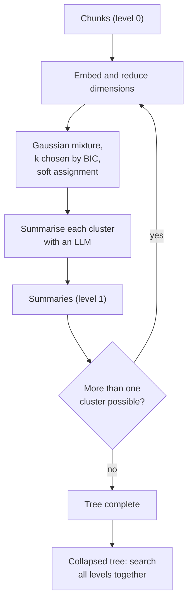

The [previous lesson](/learn/hierarchical-rag/hierarchical-indexes) found that a hierarchy is only as good as its internal nodes, and that a heading is a poor description of what lies beneath it. A **summary index** gives internal nodes text of their own, written by a language model: a summary of each document, each section, or each cluster of related chunks. Those summaries are embedded and searched like any other node, so that a broad question can match the node that is about its subject as a whole, and a document can be found by what it says rather than by what its title happens to call it.

Summaries are also the first thing in this course that the retrieval index *invents*. Every other node so far has been a piece of a source document. A summary is a model's paraphrase, and it can omit, distort or go out of date. This lesson covers the two ways to organise summary nodes (along document structure, or by clustering, as in RAPTOR), how to write summaries for retrieval rather than for reading, what a summary index costs to build, and how to keep it faithful and fresh. You will build a RAPTOR-style tree, query it as a collapsed tree, and detect stale summaries after a source changes.

## Learning objectives

- Explain what a summary node adds to a hierarchy and the difference between using a summary to *match* and using it to *answer*.
- Build a summary tree by soft clustering and summarisation, and describe how RAPTOR chooses clusters.
- Write a retrieval-oriented summary prompt and state what it must preserve.
- Estimate the token cost of building a multi-level summary tree from the compression ratio.
- Detect and propagate staleness when a source changes, and decide what to regenerate.

## Prerequisites

- [Hierarchical indexes](/learn/hierarchical-rag/hierarchical-indexes): nodes, levels and internal-node representations.
- [Document-level retrieval](/learn/hierarchical-rag/document-level-retrieval): document cards and two-stage retrieval.
- [Multi-vector retrieval](/learn/advanced-retrieval/multi-vector-retrieval): a summary as one of several representations of a unit.
- [Grounded generation](/learn/prompt-engineering-for-rag/grounded-generation): why answers must rest on retrieved source text.

## Why this matters

Some questions have no good chunk. "What are the rules for working from home?" is answered by four or five sentences spread across a section, and possibly by a line in the expenses policy and another in the IT runbook. Each individual sentence matches the question weakly; no single chunk is *about* the question. A summary of the remote-work section is about exactly that, and it matches.

Other questions concern a whole document or a theme that cuts across documents: "What does the IT runbook cover?", "What do our policies say about contractors?". Chunk retrieval returns fragments; a document summary or a summary of a cluster of related chunks returns an overview with pointers into the detail.

Without care, though, summary nodes do harm. A summary that drops the exception ("contractors are not eligible") matches the question and hands the generator an incomplete rule. A summary written before the budget changed from £400 to £500 keeps saying £400, and it is retrieved precisely because it is a good match. Summary indexes are worth building only together with the discipline that keeps them faithful.

## The intuition

A summary index is the set of chapter abstracts at the front of a long report. A reader with a broad question reads the abstracts first, finds the chapter that is about their question, and then reads that chapter. A reader with a narrow question ("what is the error code for an expired certificate?") skips the abstracts and goes to the index at the back.

Two cautions come with abstracts, and they are the cautions of this lesson. An abstract was written at a particular time; if the chapter has since been revised, the abstract may say something the chapter no longer says. And an abstract is a pointer, not a source: you quote the chapter, not the abstract. A good RAG system uses summaries the same way.

## How it works

### Summaries along structure

The simplest summary index follows the document structure you already have:

- **Document summaries.** One summary per document, embedded and searched. A query matches documents by their summaries, and retrieval then descends into the chosen documents. LlamaIndex packages this as `DocumentSummaryIndex`, with an embedding-based and a model-based retriever for choosing documents. It is a document card, from the [document-level retrieval](/learn/hierarchical-rag/document-level-retrieval) lesson, written by a model.
- **Section summaries.** One summary per section, giving the internal nodes of a [hierarchical index](/learn/hierarchical-rag/hierarchical-indexes) a description of everything below them, which is the best of the internal-node representations discussed there.

Structure-based summaries are easy to reason about: each summary has exactly one source, and the tree is the document's own outline.

### Summaries by clustering: RAPTOR

When documents have little structure, or when related material is scattered across documents, a tree can be built from the content itself. **RAPTOR** (Recursive Abstractive Processing for Tree-Organized Retrieval; Sarthi and colleagues, 2024) does this bottom-up:

1. **Chunk** the corpus into small leaves (the paper uses chunks of about 100 tokens) and embed them.
2. **Reduce dimensions** of the embeddings (the paper uses UMAP), because clustering in hundreds of dimensions is unreliable.
3. **Cluster with a Gaussian mixture model**, choosing the number of clusters by the Bayesian Information Criterion (BIC), which rewards fit and penalises extra clusters. Assignment is **soft**: a chunk joins every cluster whose probability exceeds a threshold, so a sentence relevant to two topics can appear under both.
4. **Summarise** each cluster with a language model. Each summary becomes a node one level up.
5. **Repeat** on the summaries, until clustering no longer produces more than one group.



The paper evaluates two ways of querying the result. **Tree traversal** descends level by level, as in the previous lesson. **Collapsed tree** puts every node from every level into one pool and takes the best matches up to a token budget. The authors report that the collapsed tree performed better in their experiments; it lets each question find its own level, which is the subject of [multi-resolution retrieval](/learn/hierarchical-rag/multi-resolution-retrieval). RAPTOR is a research method published in 2024, and its gains were reported on long-document question-answering benchmarks; treat it as a strong idea to test on your own data, not an established default.

A related use of model-written summaries over clusters is the community summaries of Microsoft's GraphRAG, where the clusters come from a knowledge graph rather than from embeddings; see [Microsoft GraphRAG concepts](/learn/graph-rag/microsoft-graphrag-concepts).

### Writing summaries for retrieval

A summary written for a reader and a summary written for a retriever are different texts. A reader wants fluent prose and the gist. A retriever needs the *handles* by which someone might ask for the content. A retrieval-oriented prompt asks for:

- **Scope first**: what the source is (document title, section, product, version).
- **Every distinct topic**, each named in the words a user would use, not just the most prominent one.
- **Identifiers verbatim**: error codes, product names, form names, numbers and dates.
- **Exceptions and conditions** stated explicitly ("contractors are not eligible").
- **No new facts**: nothing that is not in the source, and no advice.
- **A length limit** that fits the embedding model's input (for `all-MiniLM-L6-v2`, well under 256 word pieces).

### Match on summaries, answer from sources

A summary node can be used in two ways.

- **As a pointer.** The summary is matched, and the generator receives the source text below it (the section, or the cluster's chunks). Citations point at sources. This is the safe default.
- **As content.** The summary itself goes into the context. This is the only practical option for questions whose sources would not fit in the budget ("summarise all our security policies"), and it is how RAPTOR's collapsed tree uses summaries. When you do this, label summaries as such in the prompt, cite the underlying sources, and accept that the answer inherits any error in the summary.

### Faithfulness and freshness

Two failure modes need active controls.

**Unfaithful summaries.** A model can omit a condition, merge two numbers, or add a plausible fact. Check summaries at build time: confirm that every number, code and named entity in the summary occurs in the source, and sample summaries for human review. A numeric check is cheap and catches the most damaging errors.

**Stale summaries.** A summary is derived data with a dependency on its sources. Store with each summary a fingerprint (a hash) of the exact text it was generated from. When a source changes, its fingerprint no longer matches, and the staleness propagates upward: a level-2 summary built from a stale level-1 summary is stale too. Regenerate stale summaries before serving them, or exclude them from retrieval until they are regenerated.

## The mathematics

### Cost of building a summary tree

**Intuition.** Each level summarises the level below and makes it shorter. The total work is the leaves, plus a shorter copy of them, plus a shorter copy of that, and so on, which is a geometric series.

If the leaves total $N$ tokens and every summary is $1/c$ the length of its input (the **compression ratio** $c$), then level $k$ totals about $N / c^k$ tokens. Building $K$ levels reads every level except the last as input and writes every level above the leaves as output:

$$
T_{\text{in}} = \sum_{k=0}^{K-1} \frac{N}{c^k} \;\le\; \frac{N c}{c - 1},
\qquad
T_{\text{out}} = \sum_{k=1}^{K} \frac{N}{c^k} \;\le\; \frac{N}{c - 1}
$$

Here $T_{\text{in}}$ and $T_{\text{out}}$ are the input and output tokens across all summarisation calls; the bounds are the sums with infinitely many levels. Soft clustering adds a little, since a chunk in two clusters is read twice, and each call also pays for its prompt.

**By hand.** A corpus of $N = 2{,}000{,}000$ tokens with $c = 5$: the input is at most $2{,}000{,}000 \times 5 / 4 = 2{,}500{,}000$ tokens and the output at most $2{,}000{,}000 / 4 = 500{,}000$ tokens. With four levels the sums are 2,496,000 and 499,200, already within 0.2% of the limits. At assumed prices of 3 US dollars per million input tokens and 15 per million output tokens (check the provider's pricing page; these are not quoted prices), that is $2.496 \times 3 + 0.4992 \times 15 \approx 14.98$ dollars. The output tokens cost as much as the input tokens, despite being a fifth as many.

```python
N, c = 2_000_000, 5          # leaf tokens; each summary is 1/c of its input
levels = 4
inp = sum(N / c**k for k in range(levels))
out = sum(N / c**k for k in range(1, levels + 1))
print(f"input tokens  {inp:,.0f}  (limit {N * c / (c - 1):,.0f})")
print(f"output tokens {out:,.0f}  (limit {N / (c - 1):,.0f})")
price_in, price_out = 3.0, 15.0   # USD per million tokens: an assumption
print(f"cost at assumed prices: USD {inp / 1e6 * price_in + out / 1e6 * price_out:.2f}")
```

```output
input tokens  2,496,000  (limit 2,500,000)
output tokens 499,200  (limit 500,000)
cost at assumed prices: USD 14.98
```

The build cost is dominated by the first level: summarising the leaves accounts for 80% of input tokens when $c = 5$. Higher levels are nearly free, which is why multi-level trees are not much more expensive than single-level summary indexes.

## In code

**The problem.** Build a RAPTOR-style summary tree over fifteen Meridian sentences that arrive with no structure, query it as a collapsed tree with a narrow and a broad question, then change one source sentence and find every summary that is now stale.

The summariser is pluggable. The runnable version uses a stand-in, **extractive** summariser (it keeps the member texts closest to the cluster's centroid), so that the clustering, the tree and the staleness logic can be run and checked without an API key. It cannot abstract or compress meaning the way a language model does; the model-based summariser that a real system uses is shown afterwards.

**Dependencies.**

```bash
pip install sentence-transformers scikit-learn numpy
```

```python
import hashlib
import numpy as np
from sklearn.decomposition import PCA
from sklearn.mixture import GaussianMixture
from sentence_transformers import SentenceTransformer

LEAVES = [
    "Staff receive 25 days of annual leave a year.",
    "Up to 5 unused leave days carry over and must be used by 31 March.",
    "Parental leave is up to 26 weeks for staff with 6 months' service.",
    "Staff may work remotely up to 3 days a week.",
    "The home-office equipment budget is £400.",
    "Contractors are not eligible for the home-office equipment budget.",
    "Expense claims must be submitted within 30 days.",
    "Any expense over £75 needs a receipt.",
    "Passwords must be rotated every 90 days.",
    "The VPN is required on public Wi-Fi.",
    "E-4021 means the VPN client is out of date; update it from the IT portal.",
    "E-4012 means the VPN certificate has expired.",
    "The laptop refresh cycle is 3 years.",
    "Report a lost laptop to the support desk at once.",
    "The support desk is open 08:00 to 18:00 UK time.",
]

model = SentenceTransformer("sentence-transformers/all-MiniLM-L6-v2")
enc = lambda texts: model.encode(texts, normalize_embeddings=True)

def extractive_summary(texts, vecs, max_sentences=3):
    """Stand-in summariser that needs no API key: keep the sentences closest to
    the cluster centroid, in their original order."""
    centre = vecs.mean(axis=0)
    keep = sorted(np.argsort(-(vecs @ centre))[:max_sentences])
    return " ".join(texts[i] for i in keep)

def cluster(vecs, seed=0, max_k=8, threshold=0.2):
    """RAPTOR-style soft clustering: reduce dimensions, fit Gaussian mixtures,
    pick the number of clusters by BIC, and let a node join every cluster whose
    probability exceeds the threshold."""
    X = PCA(n_components=min(5, len(vecs) - 1), random_state=seed).fit_transform(vecs)
    fits = [GaussianMixture(k, covariance_type="diag", random_state=seed).fit(X)
            for k in range(1, min(max_k, len(vecs) // 2) + 1)]
    best = min(fits, key=lambda g: g.bic(X))
    probs = best.predict_proba(X)
    return [np.where(probs[:, c] > threshold)[0] for c in range(best.n_components)]

def digest(nodes, members):
    """Fingerprint of the exact text a summary was written from."""
    joined = "\x1f".join(nodes[i]["text"] for i in members)
    return hashlib.sha256(joined.encode()).hexdigest()[:12]

def build_tree(texts, summarise=extractive_summary, levels=2):
    nodes = [{"text": t, "level": 0, "children": []} for t in texts]
    current = list(range(len(nodes)))
    for level in range(1, levels + 1):
        vecs = enc([nodes[i]["text"] for i in current])
        groups = [g for g in cluster(vecs) if len(g) > 0]
        if len(groups) <= 1:
            break
        nxt = []
        for g in groups:
            members = [current[i] for i in g]
            text = summarise([nodes[i]["text"] for i in members], vecs[g])
            nodes.append({"text": text, "level": level, "children": members,
                          "source_hash": digest(nodes, members)})
            nxt.append(len(nodes) - 1)
        current = nxt
    return nodes

nodes = build_tree(LEAVES)
for i, n in enumerate(nodes):
    if n["level"] > 0:
        print(f"L{n['level']} node {i:>2} <- {n['children']}")

# Collapsed-tree retrieval: every node, at every level, in one flat search.
V = enc([n["text"] for n in nodes])
for question in ["What does E-4012 mean?",
                 "What are the rules for working from home?"]:
    scores = V @ enc([question])[0]
    print(f"\n{question}")
    for i in np.argsort(-scores)[:3]:
        print(f"  {scores[i]:.3f}  L{nodes[i]['level']} node {i:>2}  {nodes[i]['text'][:60]}")

# A source changes: which summaries are now stale?
nodes[4]["text"] = "The home-office equipment budget is £500."
def stale(nodes):
    """A summary is stale if its children's text changed or a child is stale."""
    out = set()
    for i, n in enumerate(nodes):                     # children precede parents
        if n["level"] > 0 and (digest(nodes, n["children"]) != n["source_hash"]
                               or any(c in out for c in n["children"])):
            out.add(i)
    return sorted(out)
print("\nstale after editing leaf 4:", stale(nodes))
```

```output
L1 node 15 <- [8, 12]
L1 node 16 <- [9, 10, 11]
L1 node 17 <- [6, 7]
L1 node 18 <- [4, 5]
L1 node 19 <- [13]
L1 node 20 <- [0, 1, 2, 3]
L1 node 21 <- [14]
L2 node 22 <- [16, 17, 18]
L2 node 23 <- [15, 19, 21]
L2 node 24 <- [20]

What does E-4012 mean?
  0.698  L0 node 11  E-4012 means the VPN certificate has expired.
  0.521  L1 node 16  The VPN is required on public Wi-Fi. E-4021 means the VPN cl
  0.452  L0 node 10  E-4021 means the VPN client is out of date; update it from t

What are the rules for working from home?
  0.429  L0 node  3  Staff may work remotely up to 3 days a week.
  0.314  L0 node  5  Contractors are not eligible for the home-office equipment b
  0.287  L1 node 18  The home-office equipment budget is £400. Contractors are no

stale after editing leaf 4: [18, 22]
```

**The important lines.** `cluster` follows RAPTOR's recipe with two substitutions: PCA instead of UMAP (UMAP is a separate package, and on fifteen points the difference does not matter), and diagonal covariances so that a Gaussian mixture can be fitted to so few points. `min(..., key=lambda g: g.bic(X))` picks the number of clusters, and `probs[:, c] > threshold` makes the assignment soft. `build_tree` summarises each cluster and records `source_hash`, the fingerprint of exactly the text the summary was written from. `stale` walks the nodes in creation order, so children are checked before their parents, and marks a summary stale if its sources changed or any child is stale.

**What the output means.**

- **The tree.** Level 1 has seven clusters: passwords with the laptop cycle, the three VPN sentences, the two expense rules, the two equipment-budget sentences, the lost-laptop rule, the leave rules (which also took "Staff may work remotely up to 3 days a week", a mistake a human would not make), and the support hours. Level 2 groups those into three. Clustering finds topics approximately; it does not know your organisation's categories.
- **Narrow question.** "What does E-4012 mean?" is matched best by the leaf that states it (0.698). The VPN summary comes second: a collapsed tree lets the precise leaf win when one exists.
- **Broad question.** "What are the rules for working from home?" is a hard case for this corpus, because the remote-days sentence was clustered with leave. The best match is that leaf (0.429), then a contractor rule, then the equipment-budget summary (node 18). With an abstractive summary of a well-formed remote-work cluster, the summary would carry the phrase "working from home" and the full rule; the extractive stand-in can only copy sentences.
- **Staleness.** Changing leaf 4 (£400 to £500) makes node 18 stale, because its source text changed, and node 22 stale, because it was built from node 18. Nothing else is touched. Without this check, node 18 would keep saying £400, and it is exactly the node a broad equipment question retrieves.

**Common errors.** Fitting a full-covariance Gaussian mixture to a few points in many dimensions, which fails or overfits. Asking for more clusters than points (scikit-learn raises an error; the code caps $k$ at half the number of nodes). Hashing a node's *ID* instead of its text, which never detects an edit.

### The model-based summariser

This version uses the Anthropic SDK and was **not executed** here, because it needs an API key. It has the same signature as the stand-in, so `build_tree(LEAVES, summarise=claude_summary)` uses it.

```python
import anthropic

client = anthropic.Anthropic()  # reads ANTHROPIC_API_KEY from the environment

SYSTEM = (
    "You write summaries that a search engine will match against user questions. "
    "Use only facts stated in the passages. Start with the scope (what the passages are "
    "about). Name every distinct topic in the words an employee would use. Copy numbers, "
    "dates, error codes and product names exactly. State every exception and condition. "
    "At most 80 words. No advice, no facts that are not in the passages."
)

def claude_summary(texts, vecs=None):
    passages = "\n".join(f"- {t}" for t in texts)
    response = client.messages.create(
        model="claude-opus-5-5",
        max_tokens=300,
        system=SYSTEM,
        messages=[{"role": "user", "content": f"Passages:\n{passages}\n\nSummary:"}],
    )
    return "".join(block.text for block in response.content if block.type == "text")
```

Pair it with a build-time check that every number and code in the summary appears in the passages, for example by extracting tokens with a regular expression such as `r"£?\d[\d,.:]*|E-\d{4}"` from both and comparing the sets. A summary that fails is regenerated or flagged for review.

## A real-world example

Meridian's HR team asked for AskMeridian to handle broad questions ("What changes when I go part-time?") that touch leave, pension, remote work and equipment, spread across the handbook. Chunk retrieval returned four or five fragments, each matching a word, and the answers were incomplete.

The Platform team added section summaries to the handbook's hierarchical index, generated with a retrieval-oriented prompt, matched alongside chunks, and used as pointers: a matched summary brought its section's source text into the context. Broad questions improved. Two weeks later the HR team raised the equipment budget, re-published the handbook, and the chunk index updated within the hour. The summaries did not, because summarisation ran in a weekly batch, and the remote-work summary, which matched every broad equipment question, kept saying £400. Since summaries were used only as pointers, the generator received the new section text and answered correctly; but the citation preview, which showed the summary, displayed the old figure.

The fix was to treat summaries as derived data with dependencies: each stored the hash of its sources, the ingestion pipeline marked dependants stale on any change, and stale summaries were excluded from retrieval until regenerated, which happened on the same day. They also stopped showing summaries in citation previews.

## Common mistakes

- **Answering from summaries and citing them as sources.** The summary is a paraphrase; errors in it become errors in the answer, with a citation that hides where the error came from.
- **Reader-style summaries.** Fluent prose that keeps the gist and drops identifiers, exceptions and secondary topics, which are what questions match on.
- **No staleness tracking.** Summaries outlive the text they describe and keep matching well while saying the wrong thing.
- **No faithfulness check.** A summary that adds or changes a number is not caught until a user complains.
- **Summaries longer than the embedding model's input.** The tail of the summary is silently truncated, often the secondary topics.
- **Clustering into the organisation's categories by assumption.** Clusters are statistical; inspect them before relying on them for scoping or permissions.

## Best practices

- Use summaries primarily as pointers: match on them, answer from the sources below them, cite the sources.
- Write summaries for retrieval: scope, every topic, identifiers verbatim, exceptions, a length that fits the embedder.
- Store a source fingerprint with every summary, propagate staleness upward, and regenerate before serving.
- Check numbers, codes and names in each summary against its sources at build time.
- Prefer structure-based summaries when documents have structure; use clustering when they do not, or to connect related material across documents.
- Carry the strictest access label of any source onto each summary node (see below).

## Performance considerations

Build cost is the formula above, dominated by the first level. For a corpus that changes, the ongoing cost is what matters: a change to one leaf invalidates one summary per level above it, so with $K$ levels each edit triggers at most $K$ regenerations. Batch the regenerations (many edits share ancestors) and the cost per edit falls further.

Summary nodes add few vectors: with compression ratio 5 and 100-token leaves, a summary over five leaves stands for five vectors, so the summary levels add about $1/4$ of the leaf count in total, summed over all levels. Query latency is unchanged in a collapsed tree (one search over all nodes) and adds one level per step in a traversal.

Summarisation calls are slow compared with embedding: seconds per call against milliseconds per batch of embeddings. Run them asynchronously in the ingestion pipeline, with retries, and never on the query path.

## Security considerations

A summary mixes the content of its sources. If a cluster contains one restricted chunk and nine public ones, the summary can leak the restricted content to everyone who can see the summary. Give each summary node the most restrictive access label among its sources, or cluster within permission boundaries so that a summary never mixes labels. Untrusted sources (tickets, wiki pages) can contain text crafted to steer the summariser; the summariser's output then enters the index with the authority of a system-written node. Summarise untrusted sources separately, treat their summaries as untrusted, and keep the summarisation prompt's instruction to use only facts stated in the passages.

## Summary

- Summary nodes give internal nodes real descriptions, so broad questions can match the node that is about their subject.
- Build them along document structure, or bottom-up by clustering and summarising as in RAPTOR; RAPTOR's collapsed-tree querying worked better than traversal in its authors' experiments.
- Write summaries for retrieval, use them as pointers, and answer and cite from sources.
- Build cost is a geometric series dominated by the first level; ongoing cost is at most one regeneration per level per edit.
- Track source fingerprints and propagate staleness upward; check numbers and codes for faithfulness; inherit the strictest access label.

## Exercises

**1.** A corpus has 500,000 tokens of leaves, and summaries compress by a factor of 4. Estimate the total input and output tokens for a tree of unlimited depth, and the share of input tokens spent on the first level.

<details><summary>Show solution</summary>

$T_{\text{in}} \le 500{,}000 \times 4 / 3 \approx 666{,}667$; $T_{\text{out}} \le 500{,}000 / 3 \approx 166{,}667$. The first level reads 500,000 tokens, which is $500{,}000 / 666{,}667 = 75\%$ of all input.

</details>

**2.** In the output, the broad question did not retrieve a summary first. Give two reasons from the code and data, and say which a model-based summariser would fix.

<details><summary>Show solution</summary>

First, clustering put "Staff may work remotely up to 3 days a week" with the leave rules, so no cluster is about remote work as a whole. Second, the extractive summariser copies sentences, so node 18 contains "home-office equipment budget" but nothing like "working from home" or "remote". A model-based summariser fixes the second: it would describe node 18's content in a user's words and could name its scope. It does not fix the first; a clustering error has to be addressed by better clustering, structure-based summaries, or soft assignment with a lower threshold so that the remote-work sentence also joins the equipment cluster.

</details>

**3.** Extend `stale` to return, for each stale summary, the list of leaves whose change caused it. Use it to print a regeneration plan.

<details><summary>Show solution</summary>

```python
def stale_with_causes(nodes):
    causes = {}
    for i, n in enumerate(nodes):
        if n["level"] == 0:
            continue
        mine = set()
        if digest(nodes, n["children"]) != n["source_hash"]:
            mine |= {c for c in n["children"] if nodes[c]["level"] == 0}
        for c in n["children"]:
            mine |= causes.get(c, set())
        if mine or any(c in causes for c in n["children"]):
            causes[i] = mine
    return causes

for node, leaves in sorted(stale_with_causes(nodes).items()):
    print(f"regenerate node {node} (level {nodes[node]['level']}) because of leaves {sorted(leaves)}")
```

After editing leaf 4 it prints `regenerate node 18 (level 1) because of leaves [4, 5]` and the same causes for node 22. Leaf 5 is listed because one hash over all of a summary's sources says *that* something changed, not *which* source; to pin the cause to leaf 4, store one hash per child instead. Regenerate in increasing level order, so that node 22 is rebuilt from the new node 18.

</details>

**4.** Design decision. Meridian's IT runbooks (140 files, well structured) and its support tickets (60,000, unstructured, written by staff) are both to be searchable. Design the summary layer for each.

<details><summary>Show solution</summary>

**Runbooks.** Structure-based summaries: one per runbook and one per top-level section, generated with the retrieval-oriented prompt, used as pointers in a hierarchical index. They are trusted sources, the structure is meaningful, and staleness tracking is cheap because runbooks change rarely.

**Tickets.** Clustering-based summaries, because tickets have no shared structure and the useful unit is a recurring problem ("VPN drops after sleep"), which appears across many tickets. Cluster within permission boundaries, since tickets can contain personal data. Treat the summaries as untrusted (the sources are staff-written free text), never answer from them as authoritative, and use them to point to the runbook section that resolves the problem, or to report emerging issues to the IT team. Regenerate on a schedule, because tickets arrive continuously and individual edits do not matter.

</details>

## Check your understanding

```quiz
[
  {
    "q": "What is the safest default use of a summary node in a RAG system?",
    "options": [
      "Send the summary to the generator and cite it as the source",
      "Match the query against the summary, then send and cite the source text beneath it",
      "Use summaries only for display, never for retrieval",
      "Replace the leaves with summaries to save storage"
    ],
    "answer": 1,
    "why": "Summaries are paraphrases; using them as pointers keeps answers grounded in the original text."
  },
  {
    "q": "In RAPTOR, how is the number of clusters at each level chosen?",
    "options": [
      "It is fixed at 10",
      "By the number of documents",
      "By fitting Gaussian mixtures and choosing the count with the best BIC",
      "By the length of the longest chunk"
    ],
    "answer": 2,
    "why": "The Bayesian Information Criterion balances goodness of fit against the number of clusters."
  },
  {
    "q": "Leaves total 1,000,000 tokens and summaries compress by 5. Roughly how many output tokens does a deep summary tree produce?",
    "options": [
      "250,000",
      "200,000",
      "1,250,000",
      "5,000,000"
    ],
    "answer": 0,
    "why": "The output is bounded by N/(c-1) = 1,000,000/4 = 250,000 tokens."
  },
  {
    "q": "One leaf changes in a 3-level summary tree. Which summaries must be regenerated?",
    "options": [
      "All summaries in the tree",
      "None, because summaries are approximate anyway",
      "Only the leaf",
      "The summaries on the path from that leaf to the top, at most one per level"
    ],
    "answer": 3,
    "why": "Staleness propagates upward through the leaf's ancestors only."
  },
  {
    "q": "A cluster contains nine public chunks and one restricted chunk. What access label should its summary carry?",
    "options": [
      "Public, because most sources are public",
      "Restricted, the most restrictive label among its sources",
      "No label, because summaries are generated",
      "The label of the first chunk"
    ],
    "answer": 1,
    "why": "A summary can reveal any of its sources, so it must be at least as restricted as the most restricted one."
  }
]
```

## Further reading

- P. Sarthi, S. Abdullah, A. Tuli, S. Khanna, A. Goldie and C. D. Manning (2024), "RAPTOR: Recursive Abstractive Processing for Tree-Organized Retrieval", ICLR 2024 ([arXiv:2401.18059](https://arxiv.org/abs/2401.18059)).
- D. Edge and colleagues (2024), "From Local to Global: A Graph RAG Approach to Query-Focused Summarization" ([arXiv:2404.16130](https://arxiv.org/abs/2404.16130)): community summaries over a knowledge graph.
- [LlamaIndex documentation](https://docs.llamaindex.ai/): `DocumentSummaryIndex` and its retrievers.
- [scikit-learn user guide: Gaussian mixture models](https://scikit-learn.org/stable/modules/mixture.html): fitting mixtures and selecting the number of components with BIC.
- [Anthropic API documentation](https://docs.anthropic.com/): the Messages API used by the summariser.
