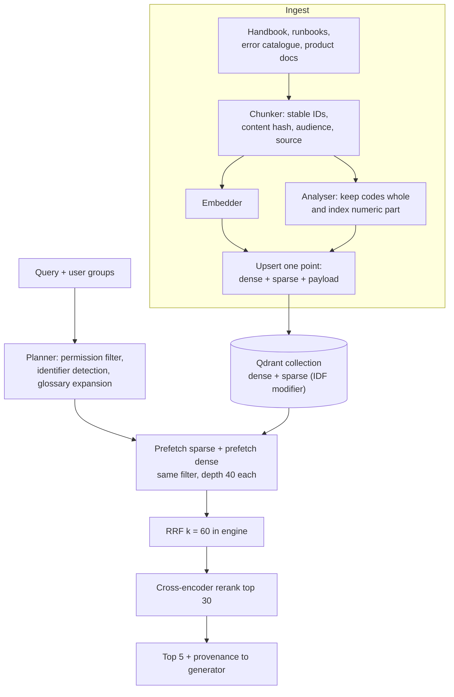

This assessment covers the whole Hybrid Search module: how dense and sparse retrieval fail differently, Reciprocal Rank Fusion, weighted score fusion and normalisation, query expansion, fusion of many lists, the architecture of a production hybrid, and how to tune it with evidence. It mixes recall questions with hand calculations, code-reading and production scenarios. Aim for at least 70% on the quiz (13 of 18) before moving on, and write an answer to each open question before opening the model answer. The coding exercises use only the Python standard library and NumPy.

```quiz
[
  {"q": "Which query is BM25 most likely to answer and a dense bi-encoder most likely to miss at rank 1?", "options": ["E-4021", "Can I work from a café?", "How much time off do I get?", "What should I do if my laptop is stolen?"], "answer": 0, "why": "Exact identifiers are matched literally by BM25, while a dense model tends to confuse codes that share most subword pieces and a subject."},
  {"q": "Sparse recall@5 is 0.72, dense recall@5 is 0.78 and union recall@5 is 0.80. What does this suggest?", "options": ["A hybrid will add at least 8 points of recall", "RRF will reach 0.80 exactly", "The dense retriever is broken", "The retrievers mostly find the same queries, so a hybrid has little headroom at this depth"], "answer": 3, "why": "Union recall is the ceiling for fusing the two top-5 lists. It is only 2 points above dense alone."},
  {"q": "What does this print?\n```python\nscores = {}\nfor ranking in [[\"a\", \"b\"], [\"b\", \"c\"]]:\n    for r, d in enumerate(ranking, start=1):\n        scores[d] = scores.get(d, 0) + 1 / (60 + r)\nprint(max(scores, key=scores.get))\n```", "options": ["a", "c", "b", "It raises KeyError"], "answer": 2, "why": "b collects 1/62 + 1/61, more than a's 1/61 or c's 1/62."},
  {"q": "With RRF at k = 60, a chunk ranked r in both of two lists beats a chunk ranked 1 in only one list whenever:", "options": ["r < 2", "r < 62", "r < 31", "never"], "answer": 1, "why": "2/(k + r) > 1/(k + 1) simplifies to r < k + 2, so r < 62 for k = 60."},
  {"q": "BM25 returns [p, q] and dense returns [q, p]. Under plain RRF:", "options": ["p wins", "q wins", "both are dropped", "p and q tie exactly"], "answer": 3, "why": "Each scores 1/61 + 1/62. A deterministic tie-break, weights or a reranker must decide."},
  {"q": "Why can you not threshold fused RRF scores to detect 'no answer in the corpus'?", "options": ["They depend only on ranks, so the best of irrelevant chunks scores like a correct answer at the same ranks", "RRF scores are negative", "RRF scores exceed 1", "Thresholds need k = 0"], "answer": 0, "why": "A first-ranked chunk always gets 1/(k+1). Absolute relevance needs a calibrated score."},
  {"q": "Min-max normalise the scores [4.0, 2.0, 1.0]. What is the middle value?", "options": ["0.5", "0.25", "0.333", "0.667"], "answer": 2, "why": "(2 - 1) / (4 - 1) = 1/3."},
  {"q": "Normalised scores: chunk X (dense 1.0, sparse 0.0), chunk Y (dense 0.6, sparse 1.0). Above which alpha (dense weight) does X win?", "options": ["0.5", "0.714", "0.6", "0.8"], "answer": 1, "why": "alpha > 0.6 alpha + (1 - alpha) gives 1.4 alpha > 1, so alpha > 0.714."},
  {"q": "What is the main weakness of min-max normalisation in score fusion?", "options": ["It always gives each list's best candidate 1 and its worst 0, so results depend on how deep the list was fetched and how weak its best match is", "It cannot handle negative scores", "It is too slow", "It requires labelled data"], "answer": 0, "why": "The extremes define the scale, so the floor moves with depth and a weak best match still gets full credit."},
  {"q": "In a hybrid, where should query expansion terms usually be sent?", "options": ["To the dense query only", "To the reranker", "To both equally", "To the sparse query, with the original query sent to the dense retriever"], "answer": 3, "why": "BM25 matches literal terms, so added terms change its results; the dense retriever already handles synonyms."},
  {"q": "On the Meridian set, using the dense retriever's top chunk as pseudo-relevance feedback for BM25 turned the E-4021 query into an exact tie in the fused scores. Why?", "options": ["BM25 cannot take weighted queries", "Feedback always lowers recall", "It copied the dense retriever's mistake into the sparse query, so the sibling code E-4022 joined BM25's list and the two retrievers stopped disagreeing independently", "The dense retriever was too slow"], "answer": 2, "why": "For the query E-4021 the dense top chunk was E-4022, so e-4022 was added to a BM25 query that had been right. Both chunks then scored 1/61 + 1/62."},
  {"q": "CombMNZ differs from CombSUM by:", "options": ["Using ranks", "Multiplying the summed normalised score by the number of lists containing the chunk", "Taking the maximum", "Ignoring single-list chunks"], "answer": 1, "why": "CombMNZ = n(d) x CombSUM(d), rewarding consensus more strongly."},
  {"q": "Adding a third, lexical retriever to BM25 + dense lowered min-max CombSUM recall but not RRF recall. The best explanation is:", "options": ["RRF cannot use three lists", "CombSUM needs alpha", "The dense retriever changed", "The new list was noisy on paraphrase queries and duplicated BM25's evidence; min-max gave its weak top hit full credit, RRF only one vote"], "answer": 3, "why": "Correlated or noisy lists double-count evidence; rank-based fusion limits how loudly a weak list can speak."},
  {"q": "A team filters out restricted chunks after fusing the top 20 from each retriever. What goes wrong?", "options": ["Users with narrow permissions get few or no results, and restricted text passes through the application", "Nothing; it is equivalent to filtering in each retriever", "Fusion becomes slower", "RRF scores become negative"], "answer": 0, "why": "Permitted chunks below the cut-off were never fetched, and restricted chunks were. Filter inside each retriever."},
  {"q": "Two independent retrievers each finish within 100 ms on 95% of queries. What fraction of hybrid queries have both within 100 ms?", "options": ["95%", "97.5%", "90.25%", "100%"], "answer": 2, "why": "0.95 x 0.95 = 0.9025. Fan-out amplifies tail latency."},
  {"q": "Your engine stores BM25 sparse vectors you computed, with IDF baked in. What happens as the corpus grows?", "options": ["Nothing", "IDF values become stale because document frequencies change", "Dense vectors stop matching", "Fusion fails"], "answer": 1, "why": "IDF is a corpus-wide statistic. Engines that apply IDF at query time, or periodic reindexing, keep it current."},
  {"q": "Configuration B beats A on 1 query and loses on 0 out of 40. What should you conclude?", "options": ["There is no evidence of a difference (sign test p = 1)", "B is significantly better", "A is better", "Recall cannot be compared"], "answer": 0, "why": "With one disagreeing query, the sign test p-value is 1."},
  {"q": "Error analysis shows that most failures have the answer missing from both retrievers' top 50. What should you change first?", "options": ["RRF's k", "alpha", "The reranker's input size", "Coverage: analyser, indexed fields, chunking or embedding model"], "answer": 3, "why": "Fusion only reorders what the retrievers return; it cannot recover an answer neither returned."}
]
```

## Conceptual questions

**1.** Explain, in terms of how each representation is built, why dense and sparse retrieval fail on different queries. Give one Meridian query each retriever handles that the other does not.

<details><summary>Show model answer</summary>

Sparse retrieval represents a chunk by the terms it contains after analysis, weighted by frequency and rarity. It can only score terms the query and chunk share, so it fails on vocabulary mismatch: "How much holiday do I get?" shares no term with "Annual leave is 25 days per year". Dense retrieval represents a chunk by a learned vector of a few hundred numbers, trained to place paraphrases close together. That compression handles "holiday" versus "annual leave" but blurs fine distinctions between similar strings: `E-4021` and `E-4022` share three of four subword pieces and a subject, so their chunks' embeddings sit close and the query `E-4021` can retrieve E-4022 first. BM25, with an analyser that keeps codes whole, matches only the right one. Because the failure mechanisms differ, the queries they fail on differ, which is what makes fusion worthwhile.

</details>

**2.** Compare RRF and weighted score fusion: what information each uses, what each needs to be set up, and the characteristic failure of each.

<details><summary>Show model answer</summary>

RRF uses only each chunk's rank in each list: it sums $1/(k + \text{rank})$. It needs no labelled data and is immune to incompatible score scales, which makes it the right default. It discards confidence: a retriever's large margin and a whisker look the same. Its characteristic failures are exact ties when two lists disagree symmetrically and coincidental consensus, where a wrong chunk ranked moderately by both beats a right chunk ranked first by one.

Weighted score fusion normalises each list's scores per query and combines them as $\alpha \cdot \text{dense} + (1-\alpha) \cdot \text{sparse}$. It uses margins and so can let a confident retriever win, but it needs labelled data to choose $\alpha$, and its result depends on the normalisation, the list depth and the policy for chunks missing from one list. Its characteristic failures are over-trusting a weak best match (min-max gives it 1.0) and an $\alpha$ overfitted to a small tuning set.

</details>

**3.** What is query drift, and why is expanding the sparse query with terms from the dense retriever's results especially risky in a hybrid?

<details><summary>Show model answer</summary>

Query drift is the expanded query moving away from the user's intent, because expansion terms are ambiguous, too many, too heavily weighted, or taken from wrong feedback. In a hybrid, fusion is valuable because the two retrievers make independent mistakes. If the sparse query is expanded with terms from the dense retriever's top chunks, the sparse retriever inherits the dense retriever's mistakes: for an identifier query where dense ranks the sibling code first, the sibling code's terms are added to a BM25 query that was right. The errors become correlated: on the Meridian set the fused scores of the two sibling codes became an exact tie, and in a corpus where the sibling sorted first the hybrid would end up worse than without expansion. Safer sources are a curated glossary, feedback from the sparse retriever's own results, or an LLM with vocabulary filtering, always with expansion weights below the original terms and no expansion for identifiers.

</details>

**4.** When does adding a further ranked list to a fusion help, and when does it hurt? How would you decide whether to add one?

<details><summary>Show model answer</summary>

It helps when the new list is accurate on some queries and wrong in different ways from the existing lists (independent evidence: the chorus and dark-horse effects). It hurts when it duplicates an existing list's evidence (two lexical retrievers, two similar embedding models), which double-counts that evidence and outvotes the other retriever, or when it is noisy on queries where another list was the only correct one. To decide: measure its top-k overlap with existing lists, count its unique wins on a labelled set, and compare fused quality with and without it on held-out queries, per query type. If it helps only some types, add it at a reduced weight or route it to those types. Prefer rank-based fusion when adding noisy or heterogeneous sources.

</details>

**5.** Why are one-query differences between tuned configurations on a 30-query set usually not evidence, and what procedure gives trustworthy tuning results?

<details><summary>Show model answer</summary>

Recall on 30 queries has a standard error of several points (around 0.06 at 0.85 recall), and choosing the best of many configurations on the same queries rewards chance fits, so one-query gains are well within noise and in-sample results are optimistic. A trustworthy procedure: do error analysis first and fix coverage problems; precompute retriever scores; tune few parameters with a dev/test split or k-fold cross-validation stratified by query type; report held-out results; compare finalists with the baseline query by query using a sign test; prefer the cheapest configuration within noise of the best; and grow the labelled set before adding parameters.

</details>

## Coding exercises

### Exercise 1: RRF with depth, weights, duplicates and provenance

Write `rrf(rankings, k=60, weights=None, depth=None)` that returns `(chunk_id, score, ranks)` tuples, best first, where `ranks` maps list index to the chunk's rank in that list. It must ignore duplicate IDs within one list (keep the first occurrence), apply `depth` per list, weight each list's contributions, and break ties by chunk ID. Test it on the lists for the query `E-4021`, with a duplicate in the sparse list: sparse `["e4021", "e4021", "e4012"]` and dense `["e4022", "e4021", "e4012", "expenses"]`.

<details><summary>Show solution</summary>

```python
from collections import defaultdict

def rrf(rankings, k=60, weights=None, depth=None):
    weights = weights or [1.0] * len(rankings)
    scores, ranks = defaultdict(float), defaultdict(dict)
    for i, (ranking, w) in enumerate(zip(rankings, weights)):
        seen = set()
        for doc_id in ranking[:depth]:
            if doc_id in seen:          # duplicate within one list: keep the first
                continue
            seen.add(doc_id)
            rank = len(seen)
            scores[doc_id] += w / (k + rank)
            ranks[doc_id][i] = rank
    order = sorted(scores, key=lambda d: (-scores[d], d))
    return [(d, round(scores[d], 5), ranks[d]) for d in order]

sparse = ["e4021", "e4021", "e4012"]          # note the duplicate
dense = ["e4022", "e4021", "e4012", "expenses"]
for row in rrf([sparse, dense]):
    print(row)
print("depth=2:", [d for d, _, _ in rrf([sparse, dense], depth=2)])
print("sparse x2:", rrf([["p", "q"], ["q", "p"]], weights=[2, 1])[0][0])
```

```output
('e4021', 0.03252, {0: 1, 1: 2})
('e4012', 0.032, {0: 2, 1: 3})
('e4022', 0.01639, {1: 1})
('expenses', 0.01562, {1: 4})
depth=2: ['e4021', 'e4022']
sparse x2: p
```

The duplicate `e4021` counts once, so `e4012` takes sparse rank 2 rather than 3, and its two contributions ($\frac{1}{62} + \frac{1}{63} = 0.032$) put it second, ahead of dense search's first choice `e4022`. The `ranks` dictionaries are the provenance a log needs. With `depth=2` the cut-off is applied to the raw list before duplicates are dropped, so the duplicate wastes a slot and `e4012` disappears from both lists: depth and de-duplication interact, which is why you de-duplicate before applying the depth. Weighting the first list by 2 breaks the symmetric `p`/`q` tie in its favour.

</details>

### Exercise 2: Score fusion with missing chunks and a break-even weight

Write `fuse(sparse, dense, alpha)` taking two `{chunk_id: raw_score}` dictionaries, min-max normalising each over its own entries, giving chunks missing from a list that list's normalised minimum (0), and returning the fused ranking. Run it at $\alpha = 0.3, 0.5, 0.7$ on the "desk and chair" lists below, and compute the $\alpha$ above which `equipment` beats `support`.

<details><summary>Show solution</summary>

```python
import numpy as np

def fuse(sparse: dict, dense: dict, alpha: float, missing: str = "min") -> list:
    """Min-max convex fusion. missing='min' gives absent chunks the list minimum."""
    ids = sorted(set(sparse) | set(dense))
    def norm(scores):
        vals = np.array(list(scores.values()))
        lo, hi = vals.min(), vals.max()
        out = {d: (s - lo) / (hi - lo) if hi > lo else 1.0 for d, s in scores.items()}
        return {d: out.get(d, 0.0) for d in ids}   # absent -> 0, the normalised minimum
    s, d = norm(sparse), norm(dense)
    fused = {i: alpha * d[i] + (1 - alpha) * s[i] for i in ids}
    return sorted(fused.items(), key=lambda kv: (-kv[1], kv[0]))

sparse = {"support": 1.70, "laptop": 1.70, "e4210": 0.40}
dense = {"equipment": 0.48, "support": 0.27, "expenses": 0.25, "laptop": 0.10}
for alpha in (0.3, 0.5, 0.7):
    top = fuse(sparse, dense, alpha)[:2]
    print(alpha, [(i, round(float(v), 3)) for i, v in top])
print("break-even:", round(1 / (2 - (0.27 - 0.10) / (0.48 - 0.10)), 3))
```

```output
0.3 [('support', 0.834), ('laptop', 0.7)]
0.5 [('support', 0.724), ('equipment', 0.5)]
0.7 [('equipment', 0.7), ('support', 0.613)]
break-even: 0.644
```

`support` has normalised scores sparse 1 and dense $0.17/0.38 = 0.447$; `equipment` has dense 1 and, being absent from the sparse list, sparse 0. `equipment` wins when $\alpha > 0.447\alpha + (1 - \alpha)$, that is $\alpha > 1/(2 - 0.447) = 0.644$. The missing-chunk policy is visible: had `equipment` been fully scored by BM25 it would still be 0 here (it shares no term), but a chunk just below the sparse cut-off would also have been forced to 0.

</details>

## Architecture design challenge

Meridian wants one hybrid search service shared by AskMeridian and the support desk's tools. It must search the employee handbook (HR team), the IT runbooks and Atlas error-code catalogue (IT), and the product documentation for Meridian Sync, Relay and Reports (documentation team, currently in a separate keyword search service). Contractors must not see employee-only content. Support engineers paste error codes, sometimes without the `E-` prefix; HR users ask conversational questions. The retrieval stage (before generation) has a 250 ms budget at the 95th percentile. Design the system: topology, ingestion, query path, fusion, expansion, failure handling and how you will tune and monitor it.

<details><summary>Show reference design</summary>



**Topology.** One Qdrant collection holding a dense vector and a sparse BM25 vector (IDF applied by the engine) per chunk, with payload fields `source`, `owner_team`, `audience`, `superseded` and `content_hash`. The product docs are ingested into the same collection rather than fused from the separate keyword service, removing a second filter language, a second delete path and cross-engine score problems. Trade-off: the documentation team's tuned analyser features are lost; their synonym list moves into the planner's glossary.

**Ingestion.** Deterministic chunk IDs from document ID and section path; one upsert writes both representations; deletes go through the same pipeline; a nightly job reconciles IDs against the source stores. Duplicate content across sources is merged by hash, with the owning team's copy canonical. The analyser keeps `e-4021` whole and also indexes `4021`, so bare numbers match. Embedding-model changes go to a new collection behind an alias.

**Query path.** The planner turns the user's groups into a filter (`audience` allowed for this user, `superseded` false) applied to both prefetches. Queries with identifier patterns skip expansion; others get glossary expansion on the sparse side only, weight 0.5, from a glossary owned by HR, IT and documentation. Both retrievers run in one engine call with depth 40 each, fused by RRF with explicit $k = 60$, then a cross-encoder reranks the top 30.

**Latency.** Budget roughly: query embedding plus engine call within about 100 ms, reranking 30 candidates within about 120 ms (an assumption to verify by measuring the chosen cross-encoder on the target hardware; reduce the input size if it does not fit), leaving headroom. An application-level deadline wraps the engine call; if reranking is late, return the RRF order and mark the response degraded. Fallbacks never relax filters.

**Fusion choice.** RRF to start, because there is no large labelled set yet and RRF is robust to the new product-doc content. Score fusion or routed weights are candidates later.

**Tuning and monitoring.** A labelled set from logged queries, stratified by HR, identifier and product types; error analysis first; cross-validated tuning of depth and reranker input; sign tests against the current configuration. Production dashboards for degraded rate, empty-sparse rate by query type, per-source share of final results, and latency percentiles per stage. Provenance (rank per prefetch, rerank score) logged per result.

**Trade-offs.** One engine simplifies consistency and security but couples all teams' content to one cluster's capacity; RRF is robust but cannot use confidence margins; the reranker improves the top positions at the largest share of the latency budget.

</details>

## Troubleshooting scenarios

**1.** After switching AskMeridian's fusion from RRF to min-max score fusion with $\alpha = 0.5$, HR questions improved but support engineers report that pasting an error code with a description ("E-4021 after password reset") often returns the wrong code first. What is likely happening, and how do you fix it?

<details><summary>Show diagnosis and fix</summary>

The description words give BM25 a long tail of partial matches and the dense retriever ranks the sibling code first by a small margin. Under min-max, the dense side's small margin is stretched to the full 0 to 1 range, while BM25's decisive identifier match is just one of several high scores, so at $\alpha = 0.5$ the dense side's preference can win. Check by logging raw and normalised scores per side for failing queries. Fixes, in order: route identifier-shaped queries to a lower $\alpha$ (more sparse weight) or back to RRF; normalise with a z-score or theoretical floor so a peaked BM25 distribution speaks louder; increase depth so the min-max floor is stable. Validate on a held-out set split by query type, since the change was evaluated only on HR questions.

</details>

**2.** A week after a policy document was withdrawn, users still receive answers quoting it. The vector store shows the chunks deleted. Diagnose and fix.

<details><summary>Show diagnosis and fix</summary>

The system has two indexes and the delete reached only one: the keyword index still holds the chunks, so lexical queries retrieve them and fusion passes them on. Confirm by searching the keyword index for the chunk IDs and checking the ingestion logs for a failed or unretried delete. Immediate fix: delete from the keyword index and purge any response or retrieval caches. Lasting fix: drive deletes for both indexes from one pipeline with retries and an acknowledgement record per index; add a scheduled reconciliation comparing chunk IDs in each index with the source of truth; or move both representations into one engine so one delete removes both.

</details>

**3.** Retrieval p99 latency doubled after a third source, the product-docs search service, was added to the fan-out, though each service's own p99 is unchanged. Explain and fix.

<details><summary>Show diagnosis and fix</summary>

The hybrid waits for the slowest source, and the probability that at least one of three independent sources is in its slow tail is higher than for two: with each at 0.99 within its p99, all three are within it only $0.99^3 = 0.97$ of the time. The new service's tail now sets the hybrid's tail on about one query in a hundred more often. Fixes: give each source its own deadline, cancel late calls, and fuse whatever arrived, marking responses degraded; route the product-docs source only to queries likely to need it; consider hedged requests to a replica; or ingest the product docs into the main engine to remove the extra hop. Monitor the degraded rate per source so the deadline does not silently remove a source from many queries.

</details>
