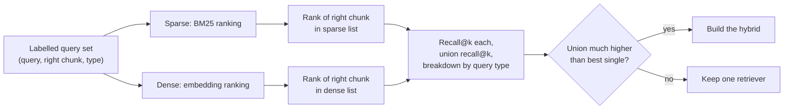

You have met both retrievers already. [Dense retrieval](/learn/dense-retrieval) embeds a query and finds the chunks whose vectors point the same way; [sparse retrieval](/learn/sparse-retrieval) looks the query's terms up in an inverted index and scores the chunks that contain them with BM25. Each module studied one retriever on its own terms. This lesson puts them side by side, as an engineer has to when deciding what to build: what each representation keeps and throws away, which queries each one fails on and why, and how to measure whether their failures are different enough to be worth combining.

That last question is the foundation of the whole module. Hybrid search only pays if the two retrievers make *different* mistakes. You will measure that directly on a small Meridian corpus and see a result that recurs in real systems: neither retriever wins, and, at rank 1, the union of their results beats both.

## Learning objectives

- Compare dense and sparse representations of the same chunk along dimensionality, who chooses the features, index structure and exactness.
- Explain the mechanism behind each retriever's characteristic failures, including vocabulary mismatch, identifier confusion and the "always returns something" property of dense search.
- Classify a query by type and predict which retriever is more likely to find its answer.
- Measure complementarity with per-query ranks, recall@k of each retriever and the recall of their union, and interpret the gap as fusion headroom.
- Estimate the memory and per-query cost of running both retrievers over a given corpus.

## Prerequisites

- [Query-document matching](/learn/rag-architecture-fundamentals/query-document-matching): lexical and semantic scoring, and the vocabulary-mismatch problem.
- [Dense vector search](/learn/dense-retrieval/dense-vector-search): how a bi-encoder index answers a query.
- [BM25](/learn/sparse-retrieval/bm25) and [Inverted indexes](/learn/sparse-retrieval/inverted-indexes): the sparse side.
- [Recall@K](/learn/retrieval-fundamentals/recall-k): the metric used throughout this module.

## Why this matters

When a retriever misses, the usual reaction is to tune it: a bigger embedding model, different chunk sizes. Often that cannot work, because the failure is structural. An embedding model compresses a chunk into a few hundred numbers chosen during training; it was never asked to keep the difference between `E-4021` and `E-4022`, and no amount of tuning the chunking will make it. BM25 matches strings; it will never know that "holiday" and "annual leave" are the same thing, however its parameters are set.

Knowing which failures belong to which retriever saves weeks. It tells you when to stop tuning one side and add the other, and it tells you which queries to put in your evaluation set so that the comparison is honest. A team that evaluates only on natural-language questions will conclude that dense retrieval is all they need, then ship a system that cannot find an error code. A team that evaluates only on keyword lookups will conclude the opposite.

Running two retrievers also costs two indexes and two queries per request, worth paying only if the second finds answers the first misses. This lesson shows how to measure that.

## The intuition

Picture the reference section of a library with two ways in.

The first is the **index at the back of every book**: an alphabetical list of terms, each with the pages that mention it. If you know the exact word, it is unbeatable. Look up "E-4021" and you get page 212 and nothing else. But it only knows the words the author used. Look up "holiday" in a book that says "annual leave" throughout and the index has no entry.

The second is the **subject librarian**. You describe what you want in your own words and she walks you to the shelf about it. She understands that "time off", "holiday" and "annual leave" are one subject. But she thinks in subjects, not strings. Ask her for error E-4021 and she takes you to the shelf about Atlas errors, where E-4021, E-4022 and E-4012 sit side by side, and hands you whichever she reaches first.

A good researcher uses both, and a RAG system, which cannot see inside the user's head, never knows which situation it is in. That is the case for hybrid search.

## How it works

### Two representations of one chunk

Take the Meridian chunk *"Atlas error E-4021: the VPN client is out of date. Update it from the IT portal."* Each retriever turns it into a vector, and the two vectors could hardly be more different.

| Property | Sparse (BM25) | Dense (all-MiniLM-L6-v2) |
| --- | --- | --- |
| Length | One slot per vocabulary term: tens of thousands or more | 384 |
| Non-zero entries | Only the chunk's own terms: here about ten | All 384 |
| Who chooses the features | The tokeniser (analyser) and a fixed formula | A neural network, learned during training |
| What a feature means | "Contains term *t*, weighted by rarity and frequency" | Nothing individually interpretable |
| Index | Inverted index: term → list of chunks | Vector index such as [HNSW](/learn/vector-indexing-algorithms/hnsw) |
| Search is | Exact for the given scoring formula | Usually approximate |
| Query side | The query's terms after the same analysis | The query's embedding from the same model |

Two consequences follow from that table and drive everything else.

**Sparse retrieval can only score what it can spell.** A chunk earns BM25 score only through terms it shares with the query, after both have passed through the same tokeniser. If they share none, the score is zero and, in a real inverted index, the chunk is not even visited. This is the source of both its precision and its blindness.

**Dense retrieval scores everything, through a bottleneck.** The query and every chunk sit in the same 384-dimensional space, so every chunk has a similarity to every query. Nothing is ever "not found"; it is merely further away. But the 384 numbers were fitted to make paraphrases land close together, which means fine distinctions between strings that look alike are exactly what training taught the model to ignore. [Dense retrieval limitations](/learn/dense-retrieval/dense-retrieval-limitations) covers the full catalogue; here the point is how those limits interact with the sparse side's limits.

### Where each one fails, and why

Each failure below has a mechanism, and the mechanism tells you which side will catch it.

1. **Vocabulary mismatch** (sparse fails). The user and the author used different words for the same thing: "holiday" against "annual leave", "new computer" against "laptops are refreshed". BM25 has no shared term to score. Dense retrieval handles it, because paraphrase is what its training data was full of.
2. **Identifier confusion** (dense fails). Error codes, ticket numbers, part numbers, version strings and names. The WordPiece tokeniser behind all-MiniLM-L6-v2 splits `E-4021` into `e`, `-`, `402`, `##1` and `E-4022` into `e`, `-`, `402`, `##2`: three of four pieces identical. The two chunks are also about the same subject (access to the VPN), so their embeddings are close and the query embedding cannot reliably separate them. BM25, given a tokeniser that keeps `e-4021` whole, sees two unrelated terms and matches only the right one.
3. **Rare jargon and abbreviations** (both are at risk). "WFH" is tokenised by MiniLM as `w`, `##f`, `##h`. If the model saw "WFH" often enough in training next to "working from home", dense retrieval copes; if not, it does not. BM25 fails unless some chunk literally contains "WFH". Neither side is reliable, and this is where [Query expansion](/learn/hybrid-search/query-expansion) earns its place.
4. **Tokeniser mismatch** (sparse fails, silently). If the query says "4021" but the index stored `e-4021` as one term, BM25 finds nothing. Analyser design is part of sparse retrieval quality; [Hybrid search optimisation](/learn/hybrid-search/hybrid-search-optimisation) returns to it.
5. **Long or conversational queries** (sparse degrades). A thirty-word question contains many weak terms, each adding a little BM25 score to unrelated chunks; dense retrieval summarises the whole question into one vector.
6. **Out-of-domain text** (dense degrades). A model trained mostly on web text may represent internal names or legal phrasing poorly, while BM25's statistics come from your own corpus. The BEIR benchmark (Thakur and colleagues, 2021) showed BM25 to be a hard baseline for dense models evaluated outside their training domain; newer models have narrowed that gap, so treat it as a tendency to check.
7. **Negation and logic** (both fail). "Which plans do *not* include SSO?" Neither a bag of terms nor a single pooled vector represents "not" reliably. That is a job for a [cross-encoder](/learn/reranking-fundamentals/cross-encoders) or for the generator.

> [!KEY]
> Sparse retrieval fails when the right chunk uses **different words**. Dense retrieval fails when the right chunk uses **almost the same words as a wrong one**. Those are different queries, which is why combining the two works.

### "Nothing matched" is information

There is an asymmetry in failure behaviour that matters in production. When BM25 finds no shared term, it returns an empty or short list: a clear signal that the lexical side has nothing to say. Dense search returns its top *k* regardless. For the query "holiday", the dense top result is the leave chunk, which is right; for a query about something Meridian has no document on, the dense top result is still *something*, with a similarity score that may look ordinary.

So a hybrid must cope with one list being empty, and can use emptiness as evidence. [Reciprocal Rank Fusion](/learn/hybrid-search/reciprocal-rank-fusion) and [Weighted score fusion](/learn/hybrid-search/weighted-score-fusion) each decide what a missing chunk contributes.

### Measuring complementarity

Three measurements on a labelled query set (each query paired with the chunk that answers it) tell you whether a hybrid is worth building:

1. **The rank of the right chunk in each list**, per query. Sparse rank 1 and dense rank 4 is a query fusion can rescue.
2. **Recall@k of each retriever alone.**
3. **Union recall@k**: the fraction of queries whose answer is in the top *k* of *either* list. This is the **headroom**, the best any method choosing from those two lists could do.

If union recall barely exceeds the better retriever's, the second adds little.



Break the numbers down by **query type**. An average hides the story: a dense retriever can score well overall while failing every identifier query, and identifier queries are often the ones support engineers care most about.

### Learned sparse: a middle path

**Learned sparse** models such as SPLADE (Formal and colleagues, 2021) use a transformer to produce a sparse vector over a vocabulary, giving weight to related terms the chunk does not contain while still living in an inverted index ([Sparse representations](/learn/sparse-retrieval/sparse-representations)). For this module, treat one as another sparse list: the fusion methods apply unchanged. Test its handling of codes like `E-4021` rather than assuming it inherits BM25's exactness, because its vocabulary is a subword vocabulary.

## The mathematics

### Union recall as an upper bound

**Intuition.** If you fuse two top-*k* lists and keep *k* results, every result you keep came from one of the two lists. So the fused list can contain the answer only if at least one list did. The union is a ceiling.

**The formula.** For a set $Q$ of labelled queries, let $g_q$ be the chunk that answers query $q$, and $S_k(q)$, $D_k(q)$ the top-$k$ sparse and dense results. Then

$$
\text{Recall@}k_{\text{sparse}} = \frac{1}{|Q|}\sum_{q \in Q} \mathbb{1}\left[g_q \in S_k(q)\right],
\qquad
\text{Recall@}k_{\cup} = \frac{1}{|Q|}\sum_{q \in Q} \mathbb{1}\left[g_q \in S_k(q) \cup D_k(q)\right]
$$

where $\mathbb{1}[\cdot]$ is 1 when the condition holds and 0 otherwise, and $|Q|$ is the number of queries. Any fusion that keeps $k$ results drawn only from $S_k(q) \cup D_k(q)$ satisfies

$$
\text{Recall@}k_{\text{fused}} \le \text{Recall@}k_{\cup}.
$$

In practice you fetch deeper lists (say 50 from each side) and fuse them down to $k$. The ceiling then becomes the union of the two top-50 lists, which is higher, and fusion's job is to lift the answer from deep in one list into the final top $k$. By inclusion-exclusion,

$$
|S \cup D| = |S| + |D| - |S \cap D|,
$$

so the union adds most when the lists overlap least. The **overlap** $|S_k \cap D_k| / k$ is a cheap diagnostic you can compute without labels: if two retrievers return nearly the same top 10 for most queries, fusing them cannot change much.

**Worked by hand.** Four queries, $k = 1$. Sparse finds the answer for queries 2, 3 and 4; dense for queries 1 and 2. Sparse recall is $3/4 = 0.75$, dense recall is $2/4 = 0.5$, and the union covers queries 1, 2, 3 and 4, so union recall is $4/4 = 1.0$. The second retriever is worse on average, yet it raises the ceiling from 0.75 to 1.0, because its one unique success (query 1) is a query the better retriever missed.

**In Python.**

```python
sparse_hits = [False, True, True, True]
dense_hits = [True, True, False, False]
union = [s or d for s, d in zip(sparse_hits, dense_hits)]
print(sum(sparse_hits) / 4, sum(dense_hits) / 4, sum(union) / 4)
```

```output
0.75 0.5 1.0
```

## In code

**The problem.** Decide, with evidence, whether AskMeridian needs both retrievers. The script runs BM25 and a dense bi-encoder over the same sixteen Meridian chunks, finds where each puts the right chunk for fourteen labelled queries of four types, and reports recall@1, recall@3 and union recall.

**Dependencies.**

```bash
pip install rank-bm25 sentence-transformers numpy
```

The first run downloads all-MiniLM-L6-v2 (about 90 MB). Later lessons in this module reuse the corpus, so save it as `meridian_corpus.py`:

```python
"""A small Meridian corpus with labelled queries, shared by the hybrid-search lessons."""
import re

DOCS = {
    "leave":     "Annual leave is 25 days per year. Up to 5 unused days carry over and must be used by 31 March.",
    "remote":    "Staff may work remotely up to 3 days a week with their manager's agreement.",
    "equipment": "The home-office equipment budget is £400 per employee. Contractors are not eligible.",
    "expenses":  "Submit expenses within 30 days. Any claim over £75 needs a receipt.",
    "password":  "Passwords must be rotated every 90 days.",
    "vpn":       "Use the VPN whenever you connect from public Wi-Fi, such as in a café or airport.",
    "laptop":    "Laptops are refreshed every 3 years. Report a lost laptop to the support desk at once.",
    "support":   "The support desk is open 08:00 to 18:00 UK time, Monday to Friday.",
    "e4021":     "Atlas error E-4021: the VPN client is out of date. Update it from the IT portal.",
    "e4012":     "Atlas error E-4012: the VPN certificate has expired. Renew it from the IT portal.",
    "e4022":     "Atlas error E-4022: the VPN access was revoked by an administrator. Ask IT to reissue access.",
    "e4210":     "Atlas error E-4210: Meridian Sync lost its connection mid-transfer. Check the network and retry.",
    "sso":       "Meridian Reports supports SAML single sign-on on the Enterprise plan.",
    "export":    "Meridian Reports can export any report as PDF or CSV from the Share menu.",
    "relay":     "Meridian Relay forwards webhook events to your endpoint and retries failed deliveries.",
    "old":       "2023 handbook (superseded): laptops are refreshed every 4 years and the equipment budget is £250.",
}

# (query, id of the one chunk that answers it, query type)
QUERIES = [
    ("How much holiday do I get?",               "leave",     "paraphrase"),
    ("money for a desk and chair at home",       "equipment", "paraphrase"),
    ("When can I get a new computer?",           "laptop",    "paraphrase"),
    ("download my dashboard as a spreadsheet",   "export",    "paraphrase"),
    ("Can I work from home on Fridays?",         "remote",    "paraphrase"),
    ("What time does the IT helpdesk close?",    "support",   "paraphrase"),
    ("WFH policy",                               "remote",    "jargon"),
    ("E-4021",                                   "e4021",     "identifier"),
    ("E-4012",                                   "e4012",     "identifier"),
    ("Atlas E-4021 error",                       "e4021",     "identifier"),
    ("VPN access revoked",                       "e4022",     "keyword"),
    ("SAML",                                     "sso",       "keyword"),
    ("receipt over £75",                         "expenses",  "keyword"),
    ("VPN certificate expired",                  "e4012",     "keyword"),
]

STOP = set("""a an the is are am do does did i my me we you your to of in on at for from by
with and or can how what when where who why which it its this that be as any get must there""".split())

def tokenise(text: str) -> list[str]:
    """Lower-case, keep hyphenated codes such as e-4021 whole, drop stop words."""
    return [t for t in re.findall(r"[a-z0-9£]+(?:-[a-z0-9]+)*", text.lower()) if t not in STOP]
```

Then save and run `compare.py`:

```python
import numpy as np
from rank_bm25 import BM25Okapi
from sentence_transformers import SentenceTransformer
from meridian_corpus import DOCS, QUERIES, tokenise

ids = list(DOCS)
texts = [DOCS[i] for i in ids]

# Sparse side: BM25 over an in-memory inverted index.
bm25 = BM25Okapi([tokenise(t) for t in texts])

# Dense side: a bi-encoder; document vectors are computed once.
model = SentenceTransformer("sentence-transformers/all-MiniLM-L6-v2")
doc_vecs = model.encode(texts, normalize_embeddings=True)

def sparse_ranking(query: str) -> list[str]:
    scores = bm25.get_scores(tokenise(query))
    order = np.argsort(-scores, kind="stable")
    return [ids[i] for i in order if scores[i] > 0]  # no shared term: not retrieved

def dense_ranking(query: str) -> list[str]:
    sims = doc_vecs @ model.encode([query], normalize_embeddings=True)[0]
    return [ids[i] for i in np.argsort(-sims, kind="stable")]  # always ranks everything

def rank_of(gold: str, ranking: list[str]) -> str:
    return str(ranking.index(gold) + 1) if gold in ranking else "-"

print(f"{'query':40s} {'type':10s} sparse dense")
rows = []
for query, gold, qtype in QUERIES:
    s, d = sparse_ranking(query), dense_ranking(query)
    rows.append((s, d, gold))
    print(f"{query:40s} {qtype:10s} {rank_of(gold, s):>6s} {rank_of(gold, d):>5s}")

for k in (1, 3):
    sp = sum(g in s[:k] for s, d, g in rows)
    de = sum(g in d[:k] for s, d, g in rows)
    either = sum(g in s[:k] or g in d[:k] for s, d, g in rows)
    print(f"Recall@{k}: sparse {sp}/{len(rows)}, dense {de}/{len(rows)}, "
          f"either list {either}/{len(rows)}")
```

```output
query                                    type       sparse dense
How much holiday do I get?               paraphrase      -     1
money for a desk and chair at home       paraphrase      -     1
When can I get a new computer?           paraphrase      -     2
download my dashboard as a spreadsheet   paraphrase      -     1
Can I work from home on Fridays?         paraphrase      1     1
What time does the IT helpdesk close?    paraphrase      1     1
WFH policy                               jargon          -     2
E-4021                                   identifier      1     2
E-4012                                   identifier      1     1
Atlas E-4021 error                       identifier      1     1
VPN access revoked                       keyword         1     1
SAML                                     keyword         1     1
receipt over £75                         keyword         1     1
VPN certificate expired                  keyword         1     1
Recall@1: sparse 9/14, dense 11/14, either list 12/14
Recall@3: sparse 9/14, dense 14/14, either list 14/14
```

**The important lines.**

- `tokenise` is the sparse retriever's analyser. The regular expression keeps `e-4021` as one term and the stop list removes words like "how" and "do" that would otherwise give BM25 score to unrelated chunks. Query and documents must go through the *same* function.
- `if scores[i] > 0` makes the sparse list behave like a real inverted index: a chunk with no shared term is not retrieved at all. Without it, `argsort` would rank zero-score chunks in arbitrary order and you would credit BM25 with lucky "hits".
- `normalize_embeddings=True` makes the dot product equal the cosine, as in [Dense vector search](/learn/dense-retrieval/dense-vector-search).

**What the output means.**

- **Sparse fails on four of six paraphrases and on the jargon query**, each time with a dash: "holiday", "computer", "dashboard" and "spreadsheet" occur nowhere in the corpus. It gets "Can I work from home on Fridays?" only because "work" appears in the remote-work chunk.
- **Dense never returns a dash** (it ranks everything) and is right at rank 1 on most paraphrases, but **it misses rank 1 on the identifier query `E-4021`**: the top dense result is E-4022 (cosines 0.315 against 0.311, a near tie), and the E-4012 chunk is third (0.252). Only the longer query "Atlas E-4021 error" gets it right, because the extra words add a little context. This is the identifier confusion described above, visible in one line. It is not guaranteed to strike every code: for the query `E-4012` dense search does put the right chunk first (0.339 against 0.257 for E-4022), so the failure depends on the particular code, the neighbouring chunks and the model, which is a reason to measure it rather than assume it.
- **Recall@1: sparse 9, dense 11, union 12.** Close on average, right on different queries: the gap between 11 and 12 is the headroom fusion can try to capture, and it is modest because dense search is already strong on this sixteen-chunk corpus. On a real corpus with thousands of look-alike codes the identifier gap is usually wider.
- **Recall@3: sparse 9, dense 14, union 14.** At depth 3 dense recovers every labelled answer, so at this depth the union adds nothing over dense. Sparse matters most for **the very top of the list**, which is what a RAG prompt with a small context budget consumes.
- **"When can I get a new computer?"**: dense ranks the 2023 superseded handbook first. That is not a dense-versus-sparse problem; it is a filtering problem, solved with metadata ([Filtered retrieval](/learn/advanced-retrieval/filtered-retrieval)).

**Errors people commonly hit.**

- *Different tokenisation for query and corpus.* Calling `.split()` on the query but `tokenise` on the documents leaves "E-4021?" with its question mark, which matches nothing.
- *Counting zero-score BM25 results as retrieved.* Gives sparse retrieval credit it did not earn, as described above.

**Extending it.** Add queries from your own domain of each type, and increase `k` to see how deep each list must be fetched before union recall approaches 1.

## A real-world example

Meridian's Platform team launched AskMeridian with dense retrieval only. HR questions such as "can I carry holiday into next year?" worked well. Then the support desk began pasting error codes from tickets and got answers about the wrong error, with confident citations to a runbook section for a different code.

Before trying a larger embedding model, one engineer sampled a few hundred logged queries, labelled the right runbook section for each and tagged each by type. The breakdown made the decision. On natural-language questions, dense retrieval was strong and BM25 weak. On identifier queries the positions swapped: BM25 found the exact code at rank 1 almost every time, while dense retrieval frequently put a sibling code first. Union recall was clearly above both.

A larger embedding model could not close a gap that came from how codes are tokenised and pooled. The team added a BM25 index over the same chunks, kept the labelled set as a regression suite, and moved on to the question the rest of this module answers: how to merge two ranked lists into one.

## Common mistakes

- **Evaluating on one query type.** A test set of natural-language questions makes dense retrieval look sufficient; the system then fails on the identifiers users paste in production.
- **Tuning the wrong retriever.** Swapping embedding models to fix error-code lookups, or adding BM25 synonyms to fix conversational questions, spends effort against a structural limit.
- **Treating "no sparse results" as a bug.** An empty BM25 list is correct behaviour and a useful signal; padding it with zero-score chunks pollutes the fused ranking.
- **Different analysers at index and query time.** A stemmer applied to documents but not queries, or a tokeniser that splits `E-4021` differently on each side, makes sparse retrieval fail silently.

## Best practices

- Build a labelled query set that reflects real traffic, tag each query by type, and report recall per type as well as overall.
- Compute union recall before building a hybrid; it is the ceiling on what fusion can achieve.
- Use the same text, chunking and chunk IDs for both indexes, so results from each side refer to the same units and can be merged by ID.
- Design the sparse analyser deliberately: keep identifiers whole, decide on case folding, stemming and stop words, and test it on your own codes.
- Measure top-of-list metrics (recall@1, recall@3) as well as recall@10; the second retriever often matters most at the top.

## Performance considerations

The two retrievers have different cost shapes, and a hybrid pays both.

**Memory.** A dense index stores one vector per chunk. With 384 dimensions in 32-bit floats, that is $384 \times 4 = 1{,}536$ bytes per chunk, so one million chunks need about 1.5 GB for raw vectors, plus the graph overhead of an HNSW index. A 1,024-dimensional model needs about 4 GB for the same chunks. A BM25 inverted index stores one posting (a chunk ID and a term frequency) per distinct term per chunk. A 200-token chunk has perhaps 120 distinct terms; at a few bytes per compressed posting, that is a few hundred bytes per chunk, often less than the dense vector. Measure on your engine.

**Query cost.** Dense retrieval runs the embedding model on every query, a transformer forward pass. Sparse retrieval needs only tokenisation and posting-list reads; queries of very common terms are its expensive case, because their posting lists are long (engines use early-termination algorithms such as WAND for this).

**Two queries, one deadline.** Run the two retrievers in parallel; the hybrid's latency is then the slower of the two plus fusion, not their sum. [Hybrid retrieval architecture](/learn/hybrid-search/hybrid-retrieval-architecture) covers this, including what to do when one side times out.

**Indexing.** Dense indexing costs a model forward pass per chunk; sparse indexing is tokenisation and posting appends, far cheaper. Re-embedding for a new model is the expensive event.

## Security considerations

- **Access control must hold on both sides.** If the vector index filters by the user's permissions but the BM25 index does not, a keyword query leaks restricted chunks into the fused results. Apply the same permission filter in both retrievers, before fusion ([Metadata filtering](/learn/advanced-vector-database-engineering/metadata-filtering)).
- **Deletion must reach both indexes.** A document removed for legal or privacy reasons must disappear from the inverted index and the vector index together; a deletion pipeline that updates one leaves the text retrievable through the other.
- **Exact matching retrieves exact secrets.** Sparse retrieval is very good at finding a pasted API key, account number or personal identifier if one was ingested. Scrub secrets and personal data at ingestion; the lexical index makes them easier to find, not harder.

## Summary

- Sparse retrieval represents a chunk by the terms it contains; it can only score what it can spell, and it returns nothing when no term matches.
- Dense retrieval represents a chunk by a learned vector; it handles paraphrase but compresses away fine distinctions between similar strings, such as `E-4021` and `E-4022`, and it always returns something.
- Their characteristic failures, vocabulary mismatch for sparse and identifier confusion for dense, occur on different queries, so their results are complementary.
- Union recall@k is the ceiling for any fusion of the two top-*k* lists; compare it with each retriever's recall, per query type, before deciding to build a hybrid.
- A hybrid pays for two indexes and two queries; run the queries in parallel, apply access control on both sides, and keep the labelled query set for tuning.

## Exercises

**1.** For each query, say which retriever is more likely to rank the right Meridian chunk first, and why: (a) "PDF", (b) "time off allowance", (c) "Meridian Relay webhook", (d) "what happens if my VPN access is cancelled by an admin".

<details><summary>Show solution</summary>

(a) Sparse: "PDF" is a rare exact term that appears in one chunk. Dense also does well here because it is a single distinctive word, but sparse is the safer bet. (b) Dense: "time off" and "allowance" do not appear in the leave chunk, so BM25 has nothing to score. (c) Both: the query shares rare terms with the relay chunk and is also semantically close. (d) Dense is more likely to find the E-4022 chunk first: "cancelled" does not match "revoked", but "VPN", "access" and "admin" partly overlap, so BM25 may also score it; a long natural-language query plays to dense retrieval's strength.

</details>

**2.** Two retrievers are evaluated at $k = 5$ on 200 queries. Retriever A has recall 0.80, retriever B 0.70, and their top-5 lists contain the answer for the same 135 queries. What is union recall@5, and is a hybrid worth building?

<details><summary>Show solution</summary>

A finds 160 queries, B finds 140, and 135 are found by both. By inclusion-exclusion the union finds $160 + 140 - 135 = 165$ queries: union recall is $165/200 = 0.825$. The ceiling rises only 2.5 points above A alone, and real fusion will capture only part of that. Unless those 5 queries are especially important (for example, all identifier lookups by support engineers), the hybrid is hard to justify on these numbers. Check the per-type breakdown before deciding.

</details>

**3.** Extend `compare.py` to print, for each query type, recall@1 for sparse, dense and the union. Which type gains most from the union?

<details><summary>Show solution</summary>

```python
from collections import defaultdict

by_type = defaultdict(lambda: [0, 0, 0, 0])  # n, sparse, dense, union
for (query, gold, qtype), (s, d, _) in zip(QUERIES, rows):
    t = by_type[qtype]
    t[0] += 1
    t[1] += gold in s[:1]
    t[2] += gold in d[:1]
    t[3] += gold in s[:1] or gold in d[:1]
for qtype, (n, sp, de, un) in by_type.items():
    print(f"{qtype:10s} n={n}  sparse {sp}/{n}  dense {de}/{n}  union {un}/{n}")
```

With the corpus above, paraphrases are carried by dense and identifiers by sparse; each type's union equals its stronger retriever, and the overall gain comes from combining the two types. The jargon query ("WFH policy") is missed by both at rank 1, which points to query expansion rather than fusion as the fix.

</details>

**4.** A colleague proposes dropping the stop-word list from `tokenise` "because BM25's IDF already down-weights common words". Run the script without it and explain what changes and why.

<details><summary>Show solution</summary>

Sparse recall@1 falls from 9/14 to 8/14. IDF down-weights common words but does not zero them, and on a sixteen-chunk corpus a word such as "can" or "from" occurs in only a few chunks, so it carries real weight. "Can I work from home on Fridays?" drops from rank 1 to rank 3 as other chunks score through those words, and "download my dashboard as a spreadsheet" now returns a wrong chunk first instead of an honest empty list. On a large corpus IDF handles function words better, which is why many production analysers keep a short stop list or none; evaluate analyser choices on your own corpus.

</details>

## Check your understanding

```quiz
[
  {"q": "Why does all-MiniLM-L6-v2 often fail to put the E-4021 chunk above the E-4022 chunk for the query `E-4021`?", "options": ["The model's maximum sequence length truncates the code", "Cosine similarity cannot distinguish vectors of the same length", "Dense retrieval removes numbers during tokenisation", "The codes share most of their subword pieces and the chunks share a subject, so their embeddings are close"], "answer": 3, "why": "WordPiece splits the codes into e, -, 402 and a final piece, so three of four pieces match, and both chunks are about access to the VPN. The pooled embeddings end up close together."},
  {"q": "Sparse recall@5 is 0.70, dense recall@5 is 0.75 and union recall@5 is 0.92. What does 0.92 represent?", "options": ["The recall that RRF is guaranteed to achieve", "The average of the two retrievers", "The ceiling for any fusion that keeps five results drawn from the two top-5 lists", "The recall of the dense retriever after reranking"], "answer": 2, "why": "A fused top 5 built from the two top-5 lists can contain the answer only if one of them did, so union recall bounds fused recall from above. Fusion may achieve less."},
  {"q": "A BM25 query returns an empty list. What is the best interpretation?", "options": ["The inverted index is corrupt", "No chunk shares a term with the query after analysis, which is a useful signal for the hybrid", "BM25 should be replaced, since dense search never returns empty lists", "The query should be padded with zero-score chunks before fusion"], "answer": 1, "why": "An empty sparse list means no shared terms. That is normal for paraphrased queries, and the fused ranking should simply rely on the dense side."},
  {"q": "Which query is most likely to be handled by sparse retrieval and missed at rank 1 by dense retrieval?", "options": ["How much time off do I get each year?", "Can I expense a taxi?", "Is working from a café allowed?", "INC-20931"], "answer": 3, "why": "An exact ticket identifier is a string to match, not a meaning to approximate. Dense retrieval tends to confuse it with similar identifiers."},
  {"q": "Two retrievers return nearly identical top-10 lists for most queries. What follows?", "options": ["Fusing them cannot change the top 10 much, so a hybrid adds little", "Fusing them will give a large improvement", "One of them must be broken", "Reciprocal Rank Fusion should be replaced by score fusion"], "answer": 0, "why": "Fusion can only reorder and select from what the lists contain. High overlap means the union is barely larger than either list."}
]
```

## Further reading

- Stephen Robertson and Hugo Zaragoza (2009), "The Probabilistic Relevance Framework: BM25 and Beyond", *Foundations and Trends in Information Retrieval*. The theory behind BM25 from its authors.
- Vladimir Karpukhin and colleagues (2020), "Dense Passage Retrieval for Open-Domain Question Answering", [arXiv:2004.04906](https://arxiv.org/abs/2004.04906). The paper that made dense bi-encoder retrieval standard; it also reports BM25 and dense combinations.
- Nandan Thakur and colleagues (2021), "BEIR: A Heterogeneous Benchmark for Zero-shot Evaluation of Information Retrieval Models", [arXiv:2104.08663](https://arxiv.org/abs/2104.08663). Why BM25 remains a strong baseline outside the domain a dense model was trained on.
- Thibault Formal, Benjamin Piwowarski and Stéphane Clinchant (2021), "SPLADE: Sparse Lexical and Expansion Model for First Stage Ranking", [arXiv:2107.05720](https://arxiv.org/abs/2107.05720). The learned sparse middle path.
- Christopher Manning, Prabhakar Raghavan and Hinrich Schütze (2008), *Introduction to Information Retrieval*, Cambridge University Press, chapters 1 to 6. Inverted indexes, term weighting and the vector space model.
