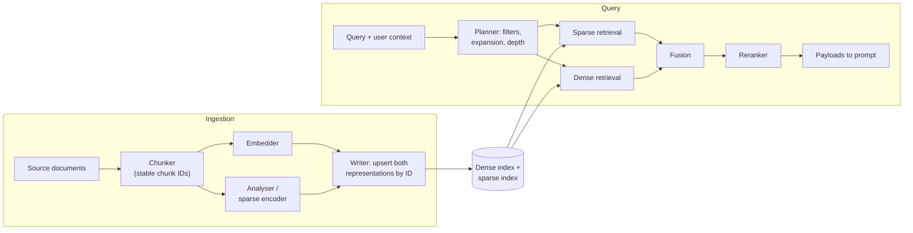
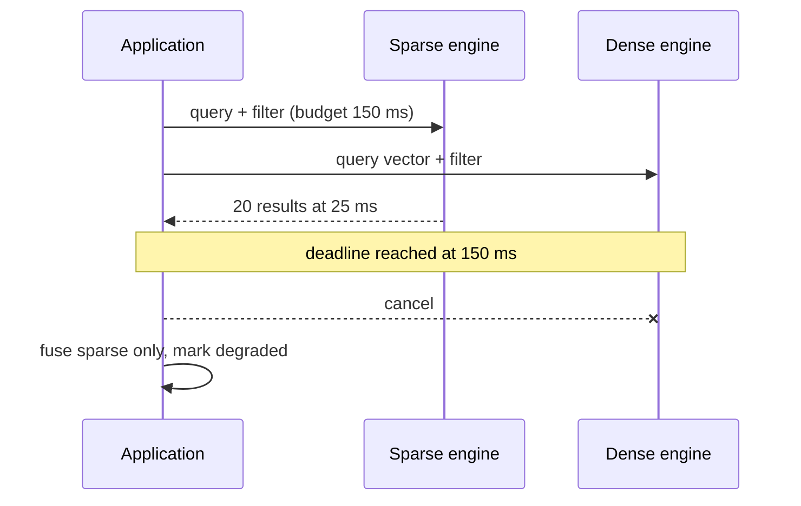

The earlier lessons in this module treated hybrid search as an algorithm: two ranked lists in, one fused list out. In production it is a system. Two indexes must be built from the same chunks and kept in step as documents change. Every query fans out to two retrievers that may sit in different services, each with its own latency, failure modes and filters. Fusion has to happen somewhere, a reranker usually follows, and when one side is slow or down the system must still answer.

This lesson is about that system. It compares the two main topologies (one engine that holds both representations, or two engines fused by the application), walks through the ingestion path and the query path, and shows how to make the whole thing degrade gracefully. You will build a working hybrid collection in Qdrant's in-memory mode, with a filter applied on both sides and fusion inside the engine, and an application-side fan-out that keeps answering when one retriever misses its deadline.

## Learning objectives

- Draw the ingestion and query paths of a hybrid retrieval system and name the responsibility of each component.
- Compare single-engine and two-engine topologies on consistency, operations, flexibility and latency, and choose one for a given organisation.
- Explain why sparse statistics such as IDF are corpus-wide, and how this affects incremental indexing.
- Apply filters and access control inside each retriever rather than after fusion, and explain the failure that the alternative causes.
- Implement a parallel hybrid query with a latency budget, cancellation and a degraded mode, and compute how fan-out affects tail latency.

## Prerequisites

- [Reciprocal Rank Fusion](/learn/hybrid-search/reciprocal-rank-fusion) and [Search fusion](/learn/hybrid-search/search-fusion): the fusion step this architecture hosts.
- [Qdrant](/learn/vector-database-ecosystem/qdrant): named vectors, sparse vectors and the Query API.
- [Metadata filtering](/learn/advanced-vector-database-engineering/metadata-filtering): filtered search inside a vector index.
- [Async programming](/learn/python-for-rag-engineering/async-programming): `asyncio` tasks and timeouts.

## Why this matters

Most hybrid search incidents are not fusion bugs. They are architecture bugs:

- A document is deleted from the vector store but not from the keyword index, and keeps appearing in answers through the lexical side.
- A permission filter is applied to the dense query but forgotten on the BM25 query, so restricted chunks leak whenever a user types the right keyword.
- The re-embedding job for a new model finishes on half the corpus; for a day, half the chunks are in one embedding space and half in another.
- The keyword engine has a slow garbage-collection pause, and because the application waits for both lists, every query's latency spikes with it.

Each of these comes from treating the two retrievers as independent systems that happen to be queried together. A hybrid is one retrieval system with two indexes, and its design must guarantee that both indexes describe the same chunks, obey the same filters, and fail in a controlled way.

## The intuition

Think of a restaurant kitchen with two stations, grill and garnish, that both work on every plate. The head chef has three jobs. First, both stations must work from the same order ticket: if the customer changes the order, both stations hear about it, or the plate goes out half-changed. Second, both stations follow the same rules: if a customer has a nut allergy, the garnish station must know, not just the grill. Third, plates leave on time: if the garnish station falls behind, the chef sends the plate with the grill's work and a simpler garnish, rather than holding every table.

Those are the three concerns of a hybrid architecture: one source of truth for both indexes, the same filters on both sides, and a deadline that does not let one side hold the whole request hostage.

## How it works

### The components



- **Chunker.** Produces chunks with **stable IDs** derived from the source (for example document ID plus section path plus position). Both indexes key on this ID; fusion matches on it.
- **Embedder and sparse encoder.** Turn each chunk into a dense vector and a sparse representation (BM25 term weights, or a learned sparse vector).
- **Writer.** Writes both representations for a chunk together, ideally as one record, and handles deletes for both.
- **Planner.** Builds the per-request query: the user's permission filter, any metadata filters, the expanded sparse query ([Query expansion](/learn/hybrid-search/query-expansion)), and how deep each side should fetch.
- **Retrievers, fusion, reranker.** The pipeline from the earlier lessons, now with deadlines.

### Topology: one engine or two

| | One engine with both representations | Two engines, fused in the application |
| --- | --- | --- |
| Examples | Qdrant dense + sparse vectors; Elasticsearch or OpenSearch BM25 + kNN; Weaviate hybrid; Milvus hybrid search; PostgreSQL with pgvector and full-text search | A vector database plus a separate Elasticsearch or OpenSearch cluster |
| Consistency | One record holds both; a write or delete updates both together | Two writes; needs a pipeline that guarantees both happen |
| Filters and access control | One filter definition applied to both sub-queries | Two filter languages that must express the same rule |
| Fusion | Built-in methods (usually RRF, often a score-based option) | Any method you can code |
| Operations | One system to run, secure and back up | Two of everything |
| Lexical features | Varies: some engines have full analysers, phrase queries, synonyms; a sparse vector field has only what you encode | A mature search engine's full feature set |
| Network | One round trip | Two round trips, run in parallel |

The one-engine design is the default for new RAG systems, because it removes the consistency problem at the source. The two-engine design is right when an organisation already runs a search engine with years of tuned analysers and synonyms, or needs lexical features the vector database lacks. The database lessons ([Elasticsearch](/learn/vector-database-ecosystem/elasticsearch), [OpenSearch](/learn/vector-database-ecosystem/opensearch), [Weaviate](/learn/vector-database-ecosystem/weaviate), [PostgreSQL with pgvector](/learn/vector-database-ecosystem/postgresql-with-pgvector)) show each engine's hybrid API; the architecture questions below apply to all of them.

### The ingestion path

1. **Chunk and assign IDs.** The same chunk ID must reach both indexes. Derive it deterministically so re-ingesting a document overwrites rather than duplicates.
2. **Compute both representations.** Batch the embedding calls; the sparse side is cheap.
3. **Write both in one operation** when the engine allows (Qdrant points with named dense and sparse vectors, an Elasticsearch document with a text field and a `dense_vector` field). In a two-engine design, write through a queue with retries, and record per-chunk what each index has acknowledged, so a reconciliation job can find chunks present in one and missing in the other.
4. **Delete from both.** Deletion is the step most often forgotten. Drive it from the same pipeline, and reconcile periodically.

**Sparse statistics are corpus-wide.** A BM25 weight needs the term's IDF, which depends on how many chunks contain the term across the whole collection, and on the average chunk length. A search engine computes these at query time from its own index, so they stay current. If instead you compute BM25 weights in your own code and store them as sparse vectors, the IDF you baked in goes stale as the corpus grows. Qdrant addresses this with an IDF **modifier** on a sparse vector field: you store only the term-frequency part and the engine applies IDF from current collection statistics at query time, which is what the code below does. Whichever engine you use, know where IDF is computed.

**Versioning the dense side.** Changing the embedding model invalidates every dense vector, and queries must be embedded with the same model as the index. Build the new vectors into a new collection (or a new named vector) while the old one serves, switch over atomically (Qdrant and Elasticsearch both support collection or index **aliases**), and only then drop the old one. Never mix two models' vectors in one field.

### The query path

1. **Plan.** Attach the user's permission filter and any metadata filters; build the sparse query (with expansion if used) and embed the dense query.
2. **Fan out in parallel** to both retrievers, each with the **same filter** and a fetch depth (tens of candidates per side is common).
3. **Wait with a deadline.** When the budget expires, cancel what has not returned.
4. **Fuse** whatever arrived. If one side is missing, the fused list is the other side's list, and the response is marked **degraded**.
5. **Rerank** the fused top candidates, if a reranker is used ([Two-stage retrieval](/learn/advanced-retrieval-optimisation/two-stage-retrieval)).
6. **Fetch payloads** (chunk text, source, title) for the final few, and log provenance: each chunk's rank in each list, and which sides were missing.

**Filter inside each retriever, never after fusion.** If you fetch the top 20 from each side and then remove chunks the user may not see, a user with narrow permissions can be left with two or three results, or none, even though many permitted chunks exist further down. Worse, the unfiltered text has already passed through your application and possibly its logs. Every engine discussed in this course supports filtering during search; use it on both sub-queries.

**Where to fuse.** Inside the engine when it offers the method you need: one round trip, and the engine can apply the filter and fusion in one plan. In the application when you need a method the engine lacks, when the lists come from different engines, or when you want per-side deadlines, which only the application can enforce across two services.



### Failure modes and degraded mode

Degrading to one retriever is almost always better than failing the request: the earlier lessons showed each retriever alone answers a good share of queries. But a degraded answer is a different product, so make it visible:

- Mark the response and log which side was missing.
- Alert on the **degraded rate**, not just errors. A retriever that times out on 5 per cent of queries is silently turning 5 per cent of the hybrid into a single retriever.
- Decide whether caches should store degraded results. Usually not, or only briefly, so that a transient outage is not frozen into the cache.

## The mathematics

### Fan-out and tail latency

**Intuition.** A hybrid query waits for the slower of two calls. Even if each call is usually fast, the chance that *at least one* is slow is higher than the chance that a particular one is.

**The formula.** Let $T_s$ and $T_d$ be the latencies of the two retrievers, assumed independent, with cumulative distribution functions $F_s(t) = P(T_s \le t)$ and $F_d(t) = P(T_d \le t)$. The hybrid's retrieval latency is $T = \max(T_s, T_d)$, so

$$
P(T \le t) = F_s(t)\,F_d(t).
$$

**Worked by hand.** Suppose each retriever finishes within 80 ms on 99 per cent of queries, so $F_s(80) = F_d(80) = 0.99$. Then $P(T \le 80) = 0.99 \times 0.99 = 0.9801$: about 2 per cent of hybrid queries exceed 80 ms, double each retriever's rate. With $m$ independent sources each at 0.99, the probability is $0.99^m$; for five sources, $0.951$, so roughly one query in twenty is slow. This is why fan-out systems need per-source deadlines.

```python
for m in (1, 2, 5, 10):
    print(m, "sources: P(all within their p99) =", round(0.99 ** m, 4))
```

```output
1 sources: P(all within their p99) = 0.99
2 sources: P(all within their p99) = 0.9801
5 sources: P(all within their p99) = 0.951
10 sources: P(all within their p99) = 0.9044
```

The independence assumption is optimistic in one direction (shared network or hardware makes slowdowns correlated, so they coincide) and the arithmetic is still the right first estimate.

## In code

### A hybrid collection in Qdrant

**The problem.** Store dense and BM25-style sparse vectors for the Meridian chunks in one Qdrant collection, then run a hybrid query that applies the same filter to both sides (excluding the superseded 2023 handbook) and fuses with RRF inside the engine.

**Dependencies.** `qdrant-client` runs a local in-memory mode with no server, which is what this example uses. `meridian_corpus.py` comes from [Dense versus sparse retrieval](/learn/hybrid-search/dense-versus-sparse-retrieval).

**Shared corpus.** The code below reuses `meridian_corpus.py`, the shared Meridian chunks and labelled queries defined in lesson 1, [Dense versus sparse retrieval](/learn/hybrid-search/dense-versus-sparse-retrieval); save that file next to the scripts and do not redefine it.

```bash
pip install qdrant-client sentence-transformers
```

```python
import zlib
from collections import Counter
from qdrant_client import QdrantClient, models
from sentence_transformers import SentenceTransformer
from meridian_corpus import DOCS, tokenise

K1, B = 1.2, 0.75
SOURCE = {"old": "handbook-2023"}            # everything else is current
model = SentenceTransformer("sentence-transformers/all-MiniLM-L6-v2")

def term_id(term: str) -> int:
    """Stable sparse dimension for a term (same function at index and query time)."""
    return zlib.crc32(term.encode("utf-8")) & 0x7FFFFFFF

doc_tokens = {cid: tokenise(text) for cid, text in DOCS.items()}
avgdl = sum(len(t) for t in doc_tokens.values()) / len(doc_tokens)

def doc_sparse(tokens):
    """BM25 document side: saturated, length-normalised tf. IDF is added by Qdrant."""
    tf = Counter(tokens)
    norm = K1 * (1 - B + B * len(tokens) / avgdl)
    return models.SparseVector(
        indices=[term_id(t) for t in tf],
        values=[f * (K1 + 1) / (f + norm) for f in tf.values()])

def query_sparse(text):
    tf = Counter(tokenise(text))
    return models.SparseVector(indices=[term_id(t) for t in tf], values=[float(v) for v in tf.values()])

client = QdrantClient(":memory:")
client.create_collection(
    "askmeridian",
    vectors_config={"dense": models.VectorParams(size=384, distance=models.Distance.COSINE)},
    sparse_vectors_config={"bm25": models.SparseVectorParams(modifier=models.Modifier.IDF)},
)
vectors = model.encode(list(DOCS.values()), normalize_embeddings=True)
client.upsert("askmeridian", points=[
    models.PointStruct(
        id=n,
        vector={"dense": vectors[n].tolist(), "bm25": doc_sparse(doc_tokens[cid])},
        payload={"chunk_id": cid, "source": SOURCE.get(cid, "handbook-2025"), "text": DOCS[cid]},
    )
    for n, cid in enumerate(DOCS)
])

current_only = models.Filter(must_not=[
    models.FieldCondition(key="source", match=models.MatchValue(value="handbook-2023"))])

def hybrid(query: str, depth: int = 10, limit: int = 3):
    return client.query_points(
        "askmeridian",
        prefetch=[
            models.Prefetch(query=query_sparse(query), using="bm25", filter=current_only, limit=depth),
            models.Prefetch(query=model.encode(query, normalize_embeddings=True).tolist(),
                            using="dense", filter=current_only, limit=depth),
        ],
        query=models.RrfQuery(rrf=models.Rrf(k=60)),
        limit=limit,
    ).points

for q in ("E-4021", "When can I get a new computer?", "VPN access revoked"):
    print(q)
    for p in hybrid(q):
        print(f"   {p.payload['chunk_id']:9s} {p.score:.4f}")
```

```output
E-4021
   e4021     0.0331
   e4022     0.0167
   e4012     0.0161
When can I get a new computer?
   laptop    0.0167
   support   0.0164
   password  0.0161
VPN access revoked
   e4022     0.0333
   e4012     0.0328
   e4021     0.0323
```

**The important lines.**

- `vectors_config={"dense": ...}` and `sparse_vectors_config={"bm25": ...}` declare two **named** representations on one point. One `upsert` writes both, so they cannot drift apart, and one delete removes both.
- `modifier=models.Modifier.IDF` tells Qdrant to apply inverse document frequency from the collection's current statistics at query time. The stored values are only the BM25 term-frequency part, computed in `doc_sparse` with $k_1 = 1.2$ and $b = 0.75$. (`avgdl` is still computed client-side at indexing time; for a growing corpus it drifts slowly, and is the kind of statistic to recompute on a full reindex.)
- `term_id` maps each term to a sparse dimension with a CRC32 hash. Index and query must use the same function and the same `tokenise`, or nothing matches. Hash collisions between terms are possible but rare at this range; a vocabulary table avoids them at the cost of maintaining it.
- Each `Prefetch` is one retriever with its own `filter` and `limit` (the depth). The **same** `current_only` filter is passed to both.
- `models.RrfQuery(rrf=models.Rrf(k=60))` fuses the prefetches with RRF at $k = 60$. Plain `models.FusionQuery(fusion=models.Fusion.RRF)` also works but uses the engine's default constant; in this client version (1.20) the top result scored 0.5 with the default, so the default constant is small, not 60. Check the documentation for your version.

**What the output means.**

- **`E-4021`** is fused correctly, as in the RRF lesson: BM25 ranks `e4021` first, dense search ranks it second behind `e4022`, so it collects two contributions. The scores are slightly different from our own implementation (0.0331 here, 0.0325 in the RRF lesson): Qdrant counts rank from 0 in this formula, so its $k = 60$ behaves like $k = 59$ in the 1-based convention. Orders are unaffected; compare scores only within one implementation.
- **"When can I get a new computer?"** now returns the current laptop chunk first. In the first lesson the dense retriever's top answer was the superseded 2023 handbook; the filter removed it inside both retrievers, so it could not reach fusion.
- **"VPN access revoked"** is answered decisively: `e4022` scores 0.0333, which is $2/60$, the most any chunk can score from two prefetches, because both retrievers rank it first. The order of the two chunks below it is an implementation detail of the engine's sparse scoring; do not read meaning into it.

**Errors people commonly hit.**

- *Using the default fusion and assuming $k = 60$.* Check the engine's documented default.
- *Different tokenisation at index and query time*, so query term IDs never match document term IDs.
- *Forgetting the filter on one prefetch.* The other side then carries filtered-out chunks into fusion.

**Running against a server.** Replace `QdrantClient(":memory:")` with `QdrantClient(url=os.environ["QDRANT_URL"], api_key=os.environ.get("QDRANT_API_KEY"))`; the collection and query code are unchanged. That variant was not run here.

### Fan-out with a deadline

When the two retrievers are separate services, the application owns the deadline. The sketch below uses stand-in retrievers that sleep, so it runs anywhere, and shows the degraded path.

```python
import asyncio
from collections import defaultdict

async def sparse_search(query, delay):
    await asyncio.sleep(delay)               # stands in for a call to the search engine
    return ["e4021"]

async def dense_search(query, delay):
    await asyncio.sleep(delay)               # stands in for embedding + vector search
    return ["e4022", "e4021", "e4012"]

def rrf(lists, k=60):
    scores = defaultdict(float)
    for ranking in lists:
        for rank, d in enumerate(ranking, start=1):
            scores[d] += 1 / (k + rank)
    return sorted(scores, key=lambda d: (-scores[d], d))

async def hybrid(query, sparse_delay, dense_delay, budget=0.15):
    tasks = {"sparse": asyncio.create_task(sparse_search(query, sparse_delay)),
             "dense": asyncio.create_task(dense_search(query, dense_delay))}
    done, pending = await asyncio.wait(tasks.values(), timeout=budget)
    for t in pending:
        t.cancel()                            # do not leave work running after the deadline
    lists, missing = [], []
    for name, task in tasks.items():
        if task in done and task.exception() is None:
            lists.append(task.result())
        else:
            missing.append(name)
    return rrf(lists)[:3], missing

for sd, dd in ((0.02, 0.05), (0.02, 0.40), (0.40, 0.05)):
    results, missing = asyncio.run(hybrid("E-4021", sd, dd))
    print(f"sparse {sd*1000:.0f} ms, dense {dd*1000:.0f} ms -> {results}  degraded: {missing or 'no'}")
```

```output
sparse 20 ms, dense 50 ms -> ['e4021', 'e4022', 'e4012']  degraded: no
sparse 20 ms, dense 400 ms -> ['e4021']  degraded: ['dense']
sparse 400 ms, dense 50 ms -> ['e4022', 'e4021', 'e4012']  degraded: ['sparse']
```

The third case is the instructive one: with the sparse service late, the dense list alone puts `e4022` first for `E-4021`, so a degraded response is not just slower or poorer, it can be *wrong* in exactly the way the first lesson described. That is why `missing` must reach the log and the metrics. `asyncio.wait(..., timeout=budget)` returns when both finish or the budget expires, whichever is first; it does not raise on timeout. Pending tasks are cancelled so a slow service is not kept busy for a result nobody will use. A task that raised (a connection error) is treated the same as a late one: its side is missing and the response is marked degraded. In a real service, `missing` goes into the log and a metric.

## A real-world example

Meridian's Platform team originally ran AskMeridian's lexical side on the company's existing Elasticsearch cluster, which the intranet search already used, and the dense side on Qdrant, fusing in the application. Two incidents in one quarter changed the design.

In the first, HR removed a draft policy that had been published by mistake. The ingestion job deleted it from Qdrant, but the Elasticsearch delete failed on a mapping error and was not retried. For a week, keyword queries about the policy kept retrieving it. In the second, the team added a filter so that contractors could not see employee-only benefits pages. It was written in Qdrant's filter syntax and translated by hand into an Elasticsearch query; the translation missed one field, and the lexical side leaked the pages to contractors until a reviewer noticed.

Both incidents came from the two-engine topology, not from hybrid search itself. The team moved the lexical side into Qdrant as a sparse vector field with the IDF modifier, so each chunk became one record with both representations and one filter applied to both prefetches. They lost some Elasticsearch features they had never used for AskMeridian (phrase queries, a tuned synonym analyser), and moved the synonym list into their query-expansion step. They kept an application-level deadline around the whole Qdrant call and added a nightly reconciliation that compares chunk IDs in the index with the source-of-truth document store. The intranet search stayed on Elasticsearch, where its features were actually used.

## Common mistakes

- **Two writes without reconciliation.** In a two-engine design, any failed write or delete leaves the indexes describing different corpora.
- **Filtering after fusion.** Users with narrow permissions get too few results, and restricted text passes through the application.
- **Different filter logic on each side.** Hand-translated filters drift; a missed clause becomes a data leak through one retriever.
- **Waiting for both sides without a deadline.** The hybrid inherits the worse tail latency of the two, and an outage of one side takes down search.
- **Baking IDF into stored sparse vectors and never refreshing it.** Term weights go stale as the corpus grows and its vocabulary shifts.
- **Mixing embedding models in one index during a migration.** Half the corpus becomes unreachable by dense search.

## Best practices

- Prefer one engine that stores both representations per record, unless you have a concrete need for a separate search engine.
- Give chunks stable, deterministic IDs and use them as the key in both indexes and in fusion.
- Define access-control and metadata filters once and apply them inside both retrievers.
- Fan out in parallel with a per-request budget, cancel late work, fuse what arrived, and mark and count degraded responses.
- Migrate embedding models with a new collection and an alias switch; reconcile the indexes against the source of truth regularly.
- Log per-side ranks, missing sides and timings for every query.

## Performance considerations

**Latency budget.** A typical breakdown for one query: embed the query (a small model on CPU: a few to tens of milliseconds; a hosted embedding API: a network round trip), dense search and sparse search in parallel (milliseconds each for collections that fit in memory), fusion (microseconds), reranking (often the largest stage, growing with the number of candidates), payload fetch. Embedding can start immediately and the sparse search does not need it, so start the sparse search first.

**Tail latency.** As the mathematics showed, fan-out multiplies the probability of hitting some source's slow tail. Per-source deadlines bound it; hedged requests (sending a duplicate request to a second replica if the first is slow) are a further option for replicated engines.

**Memory.** One engine holding both representations stores the dense vector, the sparse vector and the payload per chunk. The sparse part is usually much smaller than the dense part (see [Dense versus sparse retrieval](/learn/hybrid-search/dense-versus-sparse-retrieval)), so adding a sparse field to an existing vector collection is cheap in memory.

**Indexing throughput.** The embedder dominates ingestion cost; the sparse encoder is negligible. Batch embeddings, and on a bulk load disable or defer index building where the engine allows, then build once.

## Security considerations

- **One authorisation rule, enforced in every retriever.** The user's identity and groups should be turned into a filter once, by the planner, and passed to every sub-query. Test it with a user who should see nothing in a collection, through both retrievers.
- **Deletes are a compliance feature.** Removal requests for personal data must reach every index and every cache. Reconcile and keep evidence that it happened.
- **Degraded mode must not weaken security.** A fallback path (for example, "if the filtered query times out, run an unfiltered one") is a leak. Fallbacks change which retrievers run, never which filters apply.
- **Credentials per service.** In a two-engine design each engine needs its own credentials from the environment, with read-only keys for the query path.

## Summary

- A hybrid retrieval system has an ingestion path that must write both representations of each chunk under one stable ID, and a query path that fans out, fuses, reranks and fetches.
- A single engine holding dense and sparse vectors per record removes most consistency and filter-drift problems; two engines are justified by existing search infrastructure or lexical features you need.
- Sparse statistics such as IDF are corpus-wide; know whether your engine computes them at query time or you baked them in.
- Apply the same filters inside both retrievers, never after fusion.
- Fan-out raises tail latency; use a budget, cancel late work, fuse what arrived, and monitor the degraded rate.

## Exercises

**1.** A hybrid fans out to BM25, a dense retriever and a title search, each within 100 ms on 98 per cent of queries, independently. What fraction of queries see all three within 100 ms?

<details><summary>Show solution</summary>

$0.98^3 = 0.941$. About 5.9 per cent of queries wait longer than 100 ms for at least one source, nearly three times the per-source rate. A per-source deadline of 100 ms would make roughly 6 per cent of responses degraded, so either raise the budget, speed up the slowest source, or accept and monitor that rate.

</details>

**2.** Your team fetches the top 20 from each retriever, fuses, then removes chunks the user cannot see. A contractor asks a benefits question and gets one result. Explain what happened and fix the design.

<details><summary>Show solution</summary>

Most of the 40 candidates were employee-only benefits pages, so post-fusion filtering removed nearly all of them; permitted chunks ranked below 20 on each side were never fetched. The restricted text also passed through the application. Fix: build the contractor's permission filter in the planner and pass it into both retrievers' queries, so each returns its top 20 *permitted* chunks.

</details>

**3.** Extend the Qdrant example so that each point also stores an `audience` payload (`"all"` or `"employees"`), and a `hybrid` call takes a `user_is_contractor` flag that excludes employee-only chunks on both sides. Mark the equipment chunk as employee-only and show that a contractor's query for "money for a desk and chair at home" no longer returns it.

<details><summary>Show solution</summary>

```python
client.set_payload("askmeridian", payload={"audience": "employees"},
                   points=[list(DOCS).index("equipment")])

def hybrid_for(query, user_is_contractor, depth=10, limit=3):
    must_not = [models.FieldCondition(key="source", match=models.MatchValue(value="handbook-2023"))]
    if user_is_contractor:
        must_not.append(models.FieldCondition(key="audience", match=models.MatchValue(value="employees")))
    flt = models.Filter(must_not=must_not)
    return client.query_points(
        "askmeridian",
        prefetch=[
            models.Prefetch(query=query_sparse(query), using="bm25", filter=flt, limit=depth),
            models.Prefetch(query=model.encode(query, normalize_embeddings=True).tolist(),
                            using="dense", filter=flt, limit=depth),
        ],
        query=models.RrfQuery(rrf=models.Rrf(k=60)),
        limit=limit,
    ).points

q = "money for a desk and chair at home"
print("employee:  ", [p.payload["chunk_id"] for p in hybrid_for(q, False)])
print("contractor:", [p.payload["chunk_id"] for p in hybrid_for(q, True)])
```

```output
employee:   ['support', 'laptop', 'equipment']
contractor: ['support', 'laptop', 'expenses']
```

The equipment chunk is excluded on both sides for the contractor, which matches the canonical fact that contractors are not eligible for the equipment budget. Points without an `audience` field are not matched by the `must_not` condition, so they stay visible. In production, prefer an explicit allow-list (`must` match on the user's groups) so that a chunk missing the field is hidden rather than shown.

</details>

**4.** Your organisation runs a large Elasticsearch cluster for intranet search with tuned analysers, and wants to add dense retrieval for a RAG assistant over the same documents. Argue for one topology and state the safeguards it needs.

<details><summary>Show solution</summary>

A strong option is to add a `dense_vector` field to the existing Elasticsearch indexes and use its built-in hybrid query with RRF: one record per chunk, one filter, the tuned analysers kept. Safeguards: confirm that kNN performance and memory on the cluster are acceptable (vectors need memory for the HNSW graph), version the embedding model through a new index and alias switch, and fan out with a budget at the application level. If adding vectors to the shared cluster is not acceptable (capacity or ownership), use a separate vector database with application-side fusion, and then add a single ingestion pipeline that writes and deletes in both with retries, a nightly reconciliation of chunk IDs, and a single filter definition compiled into both query languages with tests that run the same permission cases against both.

</details>

## Check your understanding

```quiz
[
  {"q": "What is the main advantage of storing dense and sparse representations as one record in one engine?", "options": ["Queries no longer need embeddings", "BM25 becomes more accurate", "A single write or delete updates both, and one filter applies to both sub-queries, removing a class of consistency and leak bugs", "Fusion is no longer needed"], "answer": 2, "why": "Most hybrid incidents come from the two indexes drifting apart or applying different filters. One record and one filter avoid both."},
  {"q": "Why should permission filters be applied inside each retriever rather than after fusion?", "options": ["Filtering after fusion is slower", "After fusion, few permitted chunks may remain from the fetched candidates, and restricted text has already passed through the application", "Fusion requires all chunks to be visible", "Engines do not support filters"], "answer": 1, "why": "Post-filtering truncates results for narrow-permission users and exposes restricted text. In-retriever filtering returns the best permitted candidates."},
  {"q": "You compute BM25 weights in your own code, including IDF, and store them as sparse vectors. The corpus doubles over a year. What goes wrong?", "options": ["Nothing; IDF is fixed per term", "The dense side becomes slower", "Sparse vectors stop matching", "The stored IDF values reflect the old corpus, so term weights become stale"], "answer": 3, "why": "IDF depends on corpus-wide document frequencies. Engines that apply IDF at query time, or periodic reindexing, keep it current."},
  {"q": "Two independent retrievers each answer within 50 ms on 99 per cent of queries. Roughly what fraction of hybrid queries wait more than 50 ms for retrieval?", "options": ["2 per cent", "1 per cent", "0.5 per cent", "10 per cent"], "answer": 0, "why": "P(both within 50 ms) = 0.99 x 0.99 = 0.9801, so about 2 per cent exceed it."},
  {"q": "The dense retriever times out. What should a well-designed hybrid do?", "options": ["Fail the request", "Retry until it succeeds", "Return the fused result of the lists that arrived, mark it degraded, and record the missing side", "Run the sparse query again without filters"], "answer": 2, "why": "One retriever alone still answers many queries. Degrade visibly, never by relaxing filters."}
]
```

## Further reading

- Qdrant documentation, hybrid and multi-stage queries, and sparse vectors with the IDF modifier: [qdrant.tech/documentation](https://qdrant.tech/documentation/).
- Elastic documentation, hybrid search with retrievers and RRF: [elastic.co/docs](https://www.elastic.co/docs).
- OpenSearch documentation, hybrid search and search pipelines: [opensearch.org/docs](https://opensearch.org/docs/latest/).
- Jeffrey Dean and Luiz André Barroso (2013), "The Tail at Scale", *Communications of the ACM* 56(2). Why fan-out amplifies tail latency, and techniques such as hedged requests.
