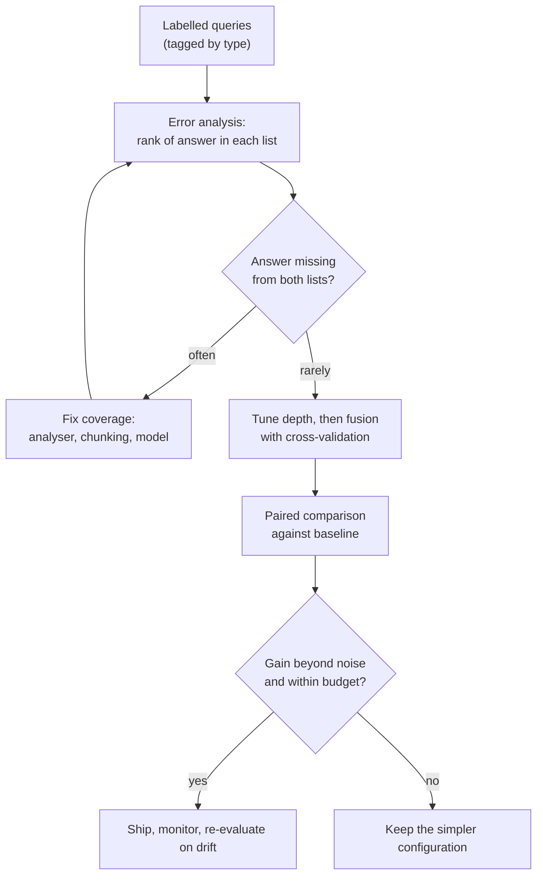

A hybrid search system has many settings: the lexical analyser, BM25's $k_1$ and $b$, how deep each retriever fetches, the fusion method and its $k$ or $\alpha$, whether the weight changes with the query, query expansion, and how many candidates go to the reranker. Each earlier lesson in this module introduced one of them. This lesson is about tuning them **together, with evidence**: which settings tend to matter most, how to search them without fooling yourself, and how to tell a real improvement from noise on a labelled set of a few dozen queries.

The central message is methodological. On small evaluation sets, most fusion-parameter "improvements" are a query or two, well within noise, while a fix to a structural problem (an analyser that cannot match half your identifiers) shows up clearly. You will see both in one run.

## Learning objectives

- List the tunable settings of a hybrid retriever and order them by typical impact and cost of change.
- Tune fusion parameters with held-out evaluation (a dev/test split or k-fold cross-validation) and explain why in-sample results are optimistic.
- Implement query-dependent fusion weights with a simple routing rule and evaluate whether they earn their complexity.
- Judge whether a difference between two configurations is meaningful, using a paired per-query comparison, a sign test and the standard error of recall.
- Optimise within latency and cost budgets by reasoning about candidate depth and reranker load.

## Prerequisites

- [Weighted score fusion](/learn/hybrid-search/weighted-score-fusion) and [Reciprocal Rank Fusion](/learn/hybrid-search/reciprocal-rank-fusion): the parameters being tuned.
- [Query expansion](/learn/hybrid-search/query-expansion) and [Hybrid retrieval architecture](/learn/hybrid-search/hybrid-retrieval-architecture): further settings, and where they live.
- [Recall@K](/learn/retrieval-fundamentals/recall-k): the metric used throughout.

## Why this matters

Hybrid search is easy to tune badly. The typical failure looks like diligence: a team builds a labelled set of 40 queries, sweeps $\alpha$ in steps of 0.05, picks the best value, reports a two-point gain over RRF, and ships. Three months later the gain is gone, or reversed, on new traffic. Nothing was broken; the "gain" was one query that happened to flip at that $\alpha$, and the tuning procedure had no way to tell.

The opposite failure is tuning nothing because the defaults "seem fine", while a structural problem goes unnoticed. If the analyser stores `E-4021` as one token, then a support engineer who types just "4021" gets nothing from BM25, and no fusion setting can repair that. Optimisation means finding the settings that matter, changing them on evidence, and leaving the rest at sensible defaults.

## The intuition

Tuning a hybrid is like seasoning a dish while tasting from one spoonful. If the dish is badly undersalted, one spoonful is enough to tell. If you are deciding between a pinch and a pinch and a half of pepper, one spoonful cannot tell you, and if you keep adjusting until that spoonful tastes perfect, you have tuned the dish to the spoonful.

Your labelled query set is the spoonful. Big structural problems show up even on a small set. Fine adjustments need either more queries or a way to taste a *different* spoonful than the one you adjusted on. That is what held-out evaluation is.

## How it works

### The settings, in rough order of impact

1. **Coverage problems in either retriever.** An analyser that splits or merges tokens wrongly, a missing field (titles not indexed), chunks the embedding model truncates. These cause whole query types to fail and are usually the biggest wins.
2. **Candidate depth per retriever.** Too shallow and fusion cannot rescue answers ranked just below the cut-off ([Dense versus sparse retrieval](/learn/hybrid-search/dense-versus-sparse-retrieval) showed union recall growing with depth).
3. **The reranker and its input size**, if you have one. A cross-encoder over the fused top candidates often moves top-1 quality more than any fusion setting ([Two-stage retrieval](/learn/advanced-retrieval-optimisation/two-stage-retrieval)).
4. **Fusion method and its parameter**: RRF or score fusion, $\alpha$, weights. Usually a broad plateau of good values.
5. **Query-dependent weighting**: different fusion weights for different query types.
6. **Query expansion**: large gains for some query types, harm for others; evaluate per type.
7. **BM25 $k_1$ and $b$.** The defaults (around 1.2 and 0.75) are robust; changes matter mostly for unusual chunk-length distributions.

This order is a heuristic from practice, not a law; your labelled set decides. But it suggests where to look first: errors analysis before parameter sweeps.

### Error analysis before sweeps

Before tuning anything, list the queries the current system gets wrong and, for each, find the rank of the right chunk in each retriever's list. Group the failures:

- **Neither retriever has it in its top 50.** A coverage problem: analyser, chunking, embedding model, or the answer is not in the corpus. Fusion cannot help.
- **One retriever has it high, the fused list buries it.** A fusion problem: weights, method, ties.
- **It is in the fused top 20 but not top 3.** A precision problem: reranker territory.

Each group points at different settings. Sweeping $\alpha$ when most failures are in the first group is wasted effort.

### Held-out evaluation

**In-sample** evaluation tunes and scores on the same queries; it is always optimistic, because the tuning picks whichever setting happened to fit those queries' quirks. The more settings you try and the fewer queries you have, the larger the optimism.

Two standard remedies:

- **A dev/test split.** Tune on the dev queries, then evaluate once on the test queries. Do not tune again after looking at test results, or the test set becomes a second dev set.
- **k-fold cross-validation.** Split the queries into $k$ folds; for each fold, tune on the others and score the held-out fold; add up the held-out scores. Every query is scored exactly once by a configuration that did not see it. With small sets this uses data more efficiently than a single split. The result estimates the quality of the **tuning procedure**, not of one particular $\alpha$.

Stratify both by query type, so each fold contains identifiers, paraphrases and keywords in similar proportions.

### Query-dependent weighting

Identifier queries want the sparse side; paraphrases want the dense side. So instead of one $\alpha$, use one per query type, chosen by a **router**:

- **Rules**: a regular expression for code-shaped tokens (letters and digits, hyphenated numbers), quoted phrases, or very short queries. Transparent and cheap.
- **A classifier** trained on labelled query types. More flexible, needs data and maintenance.
- **Signals from the retrievers themselves**: for example, whether BM25 returned anything, or how far its top score stands above the rest. These are available after retrieval, before fusion, at no extra cost.

Routing doubles (or more) the number of parameters, which raises overfitting risk on small sets. It must beat a single well-tuned weight on held-out queries to be worth keeping.

### Optimising under budgets

Quality is not the only objective. Each setting has a cost:

- Deeper candidate lists cost retrieval time and payload transfer, and grow the reranker's input if you rerank more.
- A reranker's cost is roughly linear in the number of candidates it scores.
- Expansion with an LLM adds a generation call to the critical path.

Evaluate configurations on quality **and** latency, and prefer the cheapest configuration within noise of the best. A sweep that reports only recall will always favour the most expensive option.

### The procedure

1. **Build a labelled set** from real queries, tagged by type, with a held-out part or a cross-validation plan.
2. **Do error analysis** on the current system and fix coverage problems first.
3. **Set depth** so union recall at that depth is close to its plateau.
4. **Tune the fusion parameter** with held-out evaluation; prefer the middle of a plateau.
5. **Try routing** only if per-type analysis shows types wanting very different weights; keep it only if held-out results improve.
6. **Compare finalists query by query**, check the difference against noise, and choose the cheapest configuration within noise of the best.
7. **Monitor in production** and re-run when the corpus, models or traffic mix change.



## The mathematics

### Is the difference real? The sign test

**Intuition.** Compare two configurations query by query. Ignore queries where both agree; among the rest, if the new one were no better, wins and losses would be like coin flips. The sign test asks how surprising the observed split is under that assumption.

**The formula.** With $w$ wins and $l$ losses ($n = w + l$ disagreeing queries), the two-sided p-value is

$$
p = \min\left(1,\; 2 \sum_{i=\max(w,l)}^{n} \binom{n}{i} \left(\tfrac{1}{2}\right)^{n}\right)
$$

- $\binom{n}{i}$ is the number of ways to choose which $i$ of the $n$ disagreements are wins.
- A small $p$ (conventionally below 0.05) means the split would be unlikely if the configurations were equally good.

**Worked by hand.** One win, no losses: $n = 1$, $p = \min(1, 2 \times \frac{1}{2}) = 1$. No evidence at all. Eight wins, one loss: $n = 9$, $p = 2 \times \frac{\binom{9}{8} + \binom{9}{9}}{2^9} = 2 \times \frac{10}{512} = 0.039$. Evidence of a real difference.

### How precise is a recall estimate?

**Intuition.** Recall@1 on $n$ queries is a proportion, so it has the sampling uncertainty of a proportion.

$$
\text{SE}(\hat p) = \sqrt{\frac{\hat p\,(1 - \hat p)}{n}}
$$

where $\hat p$ is the measured recall and $n$ the number of queries. Roughly, a 95 per cent interval is $\hat p \pm 2\,\text{SE}$.

**Worked by hand.** Recall $26/28 = 0.929$: $\text{SE} = \sqrt{0.929 \times 0.071 / 28} = \sqrt{0.00237} = 0.049$. The interval is about $0.93 \pm 0.10$. A difference of one query ($1/28 = 0.036$) is far inside it. Paired comparisons are more sensitive than comparing two such intervals, because both configurations are scored on the same queries, which is why the sign test is the better tool.

```python
from math import comb, sqrt

def sign_test(wins, losses):
    """Two-sided sign test p-value; ties are dropped."""
    n = wins + losses
    tail = sum(comb(n, i) for i in range(max(wins, losses), n + 1)) / 2 ** n
    return min(1.0, 2 * tail)

print("1 win, 0 losses :", sign_test(1, 0))
print("8 wins, 1 loss  :", round(sign_test(8, 1), 4))
p, n = 26 / 28, 28
print("recall 26/28 = %.3f, standard error %.3f" % (p, sqrt(p * (1 - p) / n)))
```

```output
1 win, 0 losses : 1.0
8 wins, 1 loss  : 0.0391
recall 26/28 = 0.929, standard error 0.049
```

## In code

**The problem.** On a 28-query Meridian set (the fourteen from earlier lessons plus fourteen more, including bare numbers such as "4021"), compare two analysers, then tune score fusion with a single $\alpha$ and with a routed $\alpha$ (one for code-like queries, one for the rest), using 4-fold cross-validation, and compare the result with plain RRF query by query.

**Dependencies.** As before, with `meridian_corpus.py` from [Dense versus sparse retrieval](/learn/hybrid-search/dense-versus-sparse-retrieval).

**Shared corpus.** The code below reuses `meridian_corpus.py`, the shared Meridian chunks and labelled queries defined in lesson 1, [Dense versus sparse retrieval](/learn/hybrid-search/dense-versus-sparse-retrieval); save that file next to the scripts and do not redefine it.

```bash
pip install rank-bm25 sentence-transformers numpy
```

```python
import re
from collections import defaultdict
import numpy as np
from rank_bm25 import BM25Okapi
from sentence_transformers import SentenceTransformer
from meridian_corpus import DOCS, QUERIES, tokenise

MORE = [
    ("4021", "e4021", "identifier"), ("error 4210", "e4210", "identifier"),
    ("E-4022 what now", "e4022", "identifier"), ("E-4210", "e4210", "identifier"),
    ("my VPN client is out of date", "e4021", "paraphrase"), ("my VPN certificate ran out", "e4012", "paraphrase"),
    ("how long do I have to claim a train ticket", "expenses", "paraphrase"),
    ("working in an airport lounge", "vpn", "paraphrase"), ("forward events to my server", "relay", "paraphrase"),
    ("CSV export", "export", "keyword"), ("Enterprise plan single sign-on", "sso", "keyword"),
    ("90 days password", "password", "keyword"), ("lost laptop", "laptop", "keyword"),
    ("support desk opening hours", "support", "keyword"),
]
queries = QUERIES + MORE
ids = list(DOCS)
texts = [DOCS[i] for i in ids]

def tokenise_split(text):
    """Variant analyser: also index the parts of hyphenated codes (e-4021 -> e-4021, 4021)."""
    out = []
    for t in tokenise(text):
        out.append(t)
        if "-" in t:
            out += [p for p in t.split("-") if len(p) > 1]
    return out

model = SentenceTransformer("sentence-transformers/all-MiniLM-L6-v2")
D = model.encode(texts, normalize_embeddings=True) @ model.encode([q for q, _, _ in queries], normalize_embeddings=True).T
gold = np.array([ids.index(g) for _, g, _ in queries])
is_id = np.array([bool(re.search(r"\d{3,}", q)) for q, _, _ in queries])  # rule: contains a code

def sparse_matrix(analyser):
    bm = BM25Okapi([analyser(t) for t in texts])
    return np.array([bm.get_scores(analyser(q)) for q, _, _ in queries]).T

def minmax(x):
    span = x.max() - x.min()
    return (x - x.min()) / span if span > 0 else np.zeros_like(x)

def hits(S, alphas, rows):
    """Recall@1 hits per query for score fusion; ties count as misses."""
    out = []
    for j in rows:
        f = alphas[j] * minmax(D[:, j]) + (1 - alphas[j]) * minmax(S[:, j])
        out.append(int((f >= f[gold[j]]).sum() == 1))
    return np.array(out)

def rrf_hits(S, rows, k=60):
    out = []
    for j in rows:
        score = np.zeros(len(ids))
        for col in (S[:, j], D[:, j]):
            order = [i for i in np.argsort(-col, kind="stable") if col is D[:, j] or col[i] > 0]
            for r, i in enumerate(order, start=1):
                score[i] += 1 / (k + r)
        out.append(int((score >= score[gold[j]]).sum() == 1))
    return np.array(out)

n = len(queries)
grid = np.round(np.arange(0, 1.01, 0.1), 1)
for name, analyser in (("standard", tokenise), ("split codes", tokenise_split)):
    S = sparse_matrix(analyser)
    print(f"analyser: {name}   RRF recall@1 {rrf_hits(S, range(n)).sum()}/{n}")

S = sparse_matrix(tokenise_split)
def best_global(rows):
    return float(max(grid, key=lambda a: (hits(S, np.full(n, a), rows).sum(), -abs(a - 0.5))))
def best_routed(rows):
    best, best_h = None, -1
    for a_id in grid:
        for a_nl in grid:
            al = np.where(is_id, a_id, a_nl)
            h = hits(S, al, rows).sum()
            if h > best_h:
                best, best_h = (float(a_id), float(a_nl)), h
    return best

# The whole curve for one global alpha, tuned and scored on all queries (in-sample)
print("\nglobal alpha sweep:", {float(a): int(hits(S, np.full(n, a), range(n)).sum()) for a in grid})
a_all, r_all = best_global(range(n)), best_routed(range(n))
print(f"in-sample  best global alpha {a_all}: {hits(S, np.full(n, a_all), range(n)).sum()}/{n}, "
      f"best routed (id, other) {r_all}: {hits(S, np.where(is_id, *r_all), range(n)).sum()}/{n}")

# 4-fold cross-validation: tune on three folds, score the held-out fold
rng = np.random.default_rng(0)
folds = np.array_split(rng.permutation(n), 4)
cv = defaultdict(int)
for fold in folds:
    train = [j for j in range(n) if j not in fold]
    a, r = best_global(train), best_routed(train)
    cv["global alpha"] += hits(S, np.full(n, a), fold).sum()
    cv["routed alpha"] += hits(S, np.where(is_id, *r), fold).sum()
    cv["RRF"] += rrf_hits(S, fold).sum()
print("held-out   " + ", ".join(f"{k} {v}/{n}" for k, v in cv.items()))

# Paired comparison, query by query: routed (tuned on all) against RRF
routed_h, rrf_h = hits(S, np.where(is_id, *r_all), range(n)), rrf_hits(S, range(n))
print(f"routed vs RRF: wins {(routed_h > rrf_h).sum()}, losses {(routed_h < rrf_h).sum()}, "
      f"same {(routed_h == rrf_h).sum()}")
```

```output
analyser: standard   RRF recall@1 23/28
analyser: split codes   RRF recall@1 26/28

global alpha sweep: {0.0: 21, 0.1: 26, 0.2: 26, 0.3: 26, 0.4: 26, 0.5: 26, 0.6: 26, 0.7: 26, 0.8: 26, 0.9: 26, 1.0: 22}
in-sample  best global alpha 0.5: 26/28, best routed (id, other) (0.0, 0.1): 26/28
held-out   global alpha 26/28, routed alpha 26/28, RRF 26/28
routed vs RRF: wins 0, losses 0, same 28
```

**The important lines.**

- `tokenise_split` keeps `e-4021` as a term and also adds `4021`, so a query of just the number can match. It also splits other hyphenated words ("home-office" gains "home" and "office").
- `D` and `S` hold every query's scores against every chunk, computed **once**. All tuning below reuses them, so the sweeps cost arithmetic, not retrieval. This is how you make tuning cheap enough to do properly.
- `is_id` is the router: a query containing three or more consecutive digits is treated as an identifier query. It is a rule, not a model, and you can read exactly what it does.
- `hits` counts a query as a hit only if the gold chunk is strictly first; ties count as misses, the same honesty rule as before.
- `best_global` breaks ties between equally good $\alpha$ values in favour of the one nearest 0.5, a mild preference for the middle of a plateau.
- The cross-validation loop calls `best_global` and `best_routed` on three folds and scores only the fourth. The held-out totals therefore measure the **procedure** "tune on what you have, apply to new queries".

**What the output means.**

- **The analyser change is the largest gain: RRF goes from 23 to 26**, with no fusion tuning at all. "4021" and "error 4210" now match, and "money for a desk and chair at home" now reaches the equipment chunk because "home-office" also indexes "home". This is a coverage fix: it changes what BM25 *can* match. (Splitting hyphenated words could also create new false matches on another corpus; it must be evaluated, as here, not assumed.)
- **The global $\alpha$ curve is a plateau.** Every value from 0.1 to 0.9 gives 26, and only the endpoints are worse (21 and 22). The trustworthy conclusion is "any mixture in the middle works"; there is no peak to pick. `best_global` returns 0.5 only because the tie-break prefers the middle.
- **In-sample and held-out results agree: 26 and 26.** That is the correct outcome when the curve has no peak: there is nothing for the procedure to over-fit, so tuning finds no gain and held-out data confirms it. RRF, with nothing to tune, also scores 26. (A sweep with a one-query peak would show a gap here, as the real-world story below does; the point of cross-validating is to find out which case you are in.)
- **Routing also scores 26 held out**, and the routed configuration sends identifier queries to pure BM25 ($\alpha = 0$), which is sensible. But the paired comparison with RRF is no wins, no losses, 28 identical, so there is no evidence of any difference. On this evidence routing has not earned its extra parameters; it is a candidate to re-test on a larger set.
- **Two queries still fail under every configuration**: "When can I get a new computer?" (the superseded handbook, a filtering problem) and "WFH policy" (vocabulary, an expansion problem). Neither is a fusion problem, which is why no fusion setting fixes them. This is the error-analysis step paying off.

**Errors people commonly hit.**

- *Re-running retrieval inside the sweep.* Precompute scores once per query and configuration of the retrievers; sweep fusion settings over the cached scores.
- *Tuning on the full set and reporting the same number.* Always report held-out results for a tuned configuration.
- *Comparing averages across different query sets.* Compare configurations on the same queries, pairwise.

**Extending it.** Add candidate depth as a tuned parameter (truncate each column to the top $d$ before fusion, as in the weighted score fusion exercise) and report recall alongside the number of candidates passed on. Replace the regular-expression router with "BM25 returned at least one result" and compare.

## A real-world example

After moving to a single Qdrant collection, Meridian's Platform team planned an "optimisation sprint" for AskMeridian's hybrid retrieval. The original plan was a grid over $\alpha$, RRF $k$, depth and BM25 $k_1$ and $b$: several hundred configurations against their 120 labelled queries.

The engineer leading it started with error analysis instead. Of the queries the system got wrong at rank 1, the largest group were queries where neither retriever had the answer in its top 50. Most were support-desk queries typing error numbers without the "E-" prefix, and HR queries about the 2023 handbook's figures that the filter now correctly excluded but which users still asked about. The first group was an analyser fix (index the numeric part of codes). The second was not a retrieval failure at all; the team added an answer-side note explaining that the 2023 figures were superseded.

Only then did they sweep. They precomputed both retrievers' scores for all 120 queries, ran 5-fold cross-validation over $\alpha$ and over a two-way routed $\alpha$, and compared with RRF using a sign test. The analyser fix produced a clear, significant gain. The fusion sweep found a broad plateau; routing won a handful of queries and lost a few, with a sign-test p-value far from significant. They kept RRF with $k = 60$, raised depth from 20 to 40 where union recall stopped improving, and recorded in the design note that routing should be re-tested when the labelled set reached several hundred queries. The sprint's real deliverables were the analyser change and a tuning harness that made the next evaluation take minutes.

## Common mistakes

- **Sweeping parameters before error analysis.** Effort goes into fusion settings while the failures are coverage problems no setting can fix.
- **Reporting in-sample results for tuned settings.** The reported gain is optimistic, sometimes entirely.
- **Treating one-query differences as improvements.** On a few dozen queries, a one- or two-query difference is usually noise.
- **Grids over many parameters at once on a small set.** Hundreds of configurations on 40 queries guarantee that something looks good by chance.
- **Optimising recall only.** The winning configuration is often the deepest and slowest; quality within noise at lower cost is the better choice.
- **Never re-evaluating.** A new corpus section, a new embedding model or a new user group changes the best settings.

## Best practices

- Start with error analysis: find the rank of each failure's answer in each retriever's list, and fix coverage problems first.
- Precompute and cache per-query scores so sweeps are fast enough to run with cross-validation.
- Tune with held-out evaluation, stratified by query type; report held-out numbers.
- Prefer defaults and the middle of plateaus; add parameters (routing, weights) only when held-out paired comparisons support them.
- Compare finalists query by query, with a sign test, and choose the cheapest configuration within noise of the best.
- Keep the labelled set growing from production failures, and re-run the harness whenever models, analysers or traffic change.

## Performance considerations

**Tuning cost is dominated by retrieval, so do it once.** For $Q$ labelled queries, computing both retrievers' scores costs $Q$ embedding calls and $2Q$ searches. A sweep of $A$ fusion settings over cached scores costs $A \times Q$ fusions of a few dozen candidates: for $A = 121$ (a routed $11 \times 11$ grid) and $Q = 500$, about 60,000 small fusions, seconds of CPU. Re-running retrieval for each setting would cost $121 \times 1{,}500$ searches instead.

**Depth trades quality against everything downstream.** Doubling depth from 20 to 40 per side roughly doubles the candidates to de-duplicate and fetch, and doubles reranker cost if the reranker scores all of them. If a cross-encoder takes, as an assumption to replace with your own measurement, 2 ms per candidate on your hardware, reranking 40 fused candidates is 80 ms and 80 is 160 ms. Choose depth from the point where union recall stops rising, and the reranker input from the point where reranked top-k stops improving.

**Routing is nearly free at query time** when it is a rule or a signal already computed (BM25 result count). A learned classifier adds a model call; keep it small.

**Online confirmation.** Offline gains on a labelled set should be confirmed on live traffic, for example with an A/B test on a proxy metric such as user feedback or click-through on citations ([A/B testing](/learn/testing-and-benchmarking/a-b-testing)), especially for changes that alter many queries at once.

## Summary

- Hybrid search has many settings; coverage fixes (analyser, fields, chunking) and candidate depth usually matter more than fusion parameters, so do error analysis before sweeping.
- In-sample tuning is optimistic; use a dev/test split or k-fold cross-validation and report held-out results.
- On the Meridian set, an analyser change gained three queries (23 to 26), while fusion tuning and routing gained none, so a sign test has nothing to test.
- Query-dependent weighting is cheap at query time but adds parameters; keep it only if paired held-out comparisons support it.
- Precompute scores to make tuning cheap, choose the cheapest configuration within noise of the best, and re-evaluate when anything changes.

## Exercises

**1.** Configuration B beats A on 6 queries and loses on 2, with 92 queries the same. Compute the sign-test p-value. Would you switch?

<details><summary>Show solution</summary>

$n = 8$, $\max(w, l) = 6$: $p = 2 \times \frac{\binom{8}{6} + \binom{8}{7} + \binom{8}{8}}{2^8} = 2 \times \frac{28 + 8 + 1}{256} = 2 \times 0.1445 = 0.289$. Not significant. Switch only if B is no more expensive and you have another reason to prefer it; otherwise collect more labelled queries, particularly of the types where the two disagree.

</details>

**2.** A team tunes $\alpha$, RRF $k$, depth and a two-way routing weight on 30 queries with a grid of 2,000 configurations, and reports a gain of 4 queries over the default. List the problems with this result and how to fix the procedure.

<details><summary>Show solution</summary>

With 2,000 configurations and 30 queries, the best in-sample configuration will look good by chance; the 4-query gain is in-sample and therefore optimistic, perhaps entirely. Many of the parameters are likely irrelevant on a plateau, so the grid mostly fits noise. Fix: do error analysis first; tune one or two parameters that error analysis implicates; use cross-validation (or a separate test set collected independently) and report held-out results; compare with the default query by query and apply a sign test; grow the labelled set before tuning more parameters.

</details>

**3.** Change the router in the code to "use $\alpha_{\text{id}}$ when BM25 returned at least one result, otherwise $\alpha_{\text{other}}$" and report held-out recall with the same folds.

<details><summary>Show solution</summary>

```python
is_id = (S > 0).any(axis=0)   # BM25 matched something for this query

cv = 0
for fold in folds:
    train = [j for j in range(n) if j not in fold]
    r = best_routed(train)
    cv += hits(S, np.where(is_id, *r), fold).sum()
print(f"held-out routed-by-BM25-signal {cv}/{n}")
```

```output
held-out routed-by-BM25-signal 21/28
```

21: worse than RRF, the global $\alpha$ and the code-pattern router. Two things go wrong. First, the signal splits on a condition fusion already handles: when BM25 returns nothing, min-max gives every chunk 0 on the sparse side, so $\alpha_{\text{other}}$ barely matters, and all the tuning pressure falls on $\alpha_{\text{id}}$, which now covers every query with any lexical match, paraphrases included. Second, `best_routed` keeps the *first* best pair it meets, so among equally good training scores it picks the lowest $\alpha$, an extreme value (close to pure BM25) that does not generalise; `best_global` avoided this by preferring the middle. Lessons: a router helps only if it separates queries that want genuinely different weights, and tie-breaking in a tuner should favour robust middle values.

</details>

**4.** Design an optimisation plan for a hybrid system with 300 labelled queries (one third identifiers), a cross-encoder reranker, and a latency budget of 300 ms for retrieval plus reranking.

<details><summary>Show solution</summary>

1. Error analysis on all 300: classify failures as coverage, fusion or precision.
2. Fix coverage issues (analyser for codes, missing fields), re-run.
3. Precompute per-query scores for both retrievers at a generous depth (say 100 per side) and the reranker's scores for the fused candidates.
4. Using 5-fold cross-validation stratified by query type, tune depth per side (20, 40, 60, 100), fusion (RRF $k = 60$ versus score fusion with $\alpha$) and reranker input size (20, 40, 60).
5. Measure latency for each depth and reranker size on production-like hardware, and discard configurations above 300 ms at the 95th or 99th percentile.
6. Among the rest, compare the top few with the current configuration query by query, sign test, and choose the cheapest within noise of the best.
7. Only then test routing for identifier queries, with the same held-out comparison.
8. Ship behind an online comparison and keep the harness for re-evaluation.

</details>

## Check your understanding

```quiz
[
  {"q": "Error analysis shows most failures have the answer missing from both retrievers' top 50. What should you tune first?", "options": ["The RRF constant k", "Coverage: the analyser, indexed fields, chunking or embedding model", "The fusion weight alpha", "The reranker's batch size"], "answer": 1, "why": "Fusion can only reorder what the retrievers return. If neither list contains the answer, the fix is in what the retrievers can match."},
  {"q": "Why is in-sample evaluation of a tuned alpha optimistic?", "options": ["Because alpha is always overestimated", "Because recall cannot be computed in-sample", "Because cross-validation uses fewer queries", "Because the tuning picks the value that best fits those particular queries, including their noise"], "answer": 3, "why": "Choosing the best of many settings on the same queries you score rewards chance fits. Held-out evaluation measures the procedure on queries it did not see."},
  {"q": "A routed configuration beats RRF on 1 query and loses on none, out of 28. What does the sign test say?", "options": ["p = 1, no evidence of a difference", "p is about 0.04, a significant gain", "p cannot be computed without ties", "p = 0, the routed configuration is strictly better"], "answer": 0, "why": "With one disagreement, a single win is as likely as a coin flip: p = 2 x 0.5 = 1."},
  {"q": "What makes a sweep over fusion settings cheap?", "options": ["Using a smaller embedding model", "Running the sweep on the test set", "Precomputing each query's retriever scores once and fusing the cached scores for every setting", "Reducing the number of labelled queries"], "answer": 2, "why": "Fusion is arithmetic on candidate scores; retrieval is the expensive part. Cache retrieval results, then sweep."},
  {"q": "Two configurations are within noise on recall; one fetches 20 candidates per side, the other 60. Which should you prefer?", "options": ["The 60-candidate one, since more is better", "The 20-candidate one, since it is cheaper and not measurably worse", "Neither; average them", "Whichever has the higher in-sample score"], "answer": 1, "why": "When quality is indistinguishable, the cheaper configuration lowers latency and reranker cost at no measurable loss."}
]
```

## Further reading

- Sebastian Bruch, Siyu Gai and Amir Ingber (2023), "An Analysis of Fusion Functions for Hybrid Retrieval", *ACM Transactions on Information Systems*. Parameter sensitivity of RRF and convex combination, and how few labelled queries tuning needs.
- Mark D. Smucker, James Allan and Ben Carterette (2007), "A Comparison of Statistical Significance Tests for Information Retrieval Evaluation", *Proceedings of CIKM 2007*. Sign test, t-test, bootstrap and randomisation tests for comparing retrieval systems.
- Tetsuya Sakai (2014), "Statistical Reform in Information Retrieval?", *SIGIR Forum* 48(1). Why small evaluation differences need effect sizes and significance testing.
- Christopher Manning, Prabhakar Raghavan and Hinrich Schütze (2008), *Introduction to Information Retrieval*, Cambridge University Press, chapter 8, "Evaluation in information retrieval".
