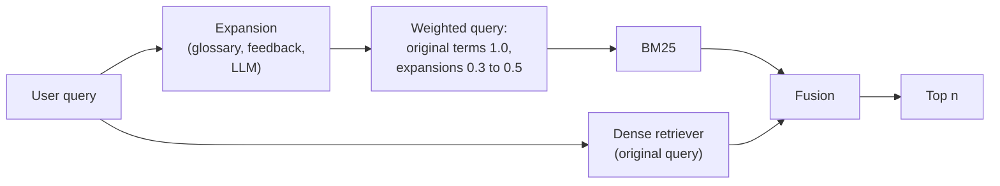

Fusion can only choose among chunks that at least one retriever found. When a user asks "How much holiday do I get?" and the handbook says "annual leave", BM25 finds nothing and contributes nothing to the fused list; the hybrid is then just dense retrieval. **Query expansion** attacks that gap at its source: before searching, add terms to the query that a matching document is likely to contain, so the sparse retriever has something to match.

This lesson covers expansion as a hybrid-search tool: where the extra terms come from (a curated glossary, the top results of a first search, a language model, or the documents themselves), how to weight them so they help without taking over the query, and a failure that is specific to hybrid systems. Expansion terms taken from one retriever's results can copy that retriever's mistakes into the other, destroying the independence that made fusion worth doing. Rewriting the whole query, issuing several paraphrases and generating hypothetical answers are related techniques with their own lessons in [Advanced Retrieval](/learn/advanced-retrieval); here the focus is on adding terms.

## Learning objectives

- Explain how query expansion reduces vocabulary mismatch for sparse retrieval, and why it matters less for the dense side.
- Build a weighted expanded query from a glossary and score it with BM25, by hand and in code.
- Implement pseudo-relevance feedback and explain query drift and how term weights limit it.
- Show how expansion terms drawn from the dense retriever's results correlate the two retrievers' errors and can make fusion worse.
- Choose between curated, feedback-based, LLM-generated and document-side expansion for a given corpus and latency budget.

## Prerequisites

- [Dense versus sparse retrieval](/learn/hybrid-search/dense-versus-sparse-retrieval): vocabulary mismatch, and the `meridian_corpus.py` file used below.
- [Reciprocal Rank Fusion](/learn/hybrid-search/reciprocal-rank-fusion): the fusion method used to measure the hybrid effect.
- [BM25](/learn/sparse-retrieval/bm25) and [Inverse document frequency](/learn/sparse-retrieval/inverse-document-frequency): how term weights are computed.

## Why this matters

In the first lesson of this module, BM25 returned nothing for four of six paraphrased Meridian queries. Each empty list is a query where the hybrid has only one opinion, and where a dense mistake goes uncorrected. Expansion turns empty sparse lists into informative ones.

It matters most for corpora full of internal vocabulary. Staff say "WFH", "helpdesk" and "new laptop"; the handbook says "remote working", "support desk" and "refresh cycle". Product users say "single sign-on"; the docs say "SAML". A dense model may or may not have learned those equivalences from web text; a glossary that your HR and IT teams already maintain encodes them exactly.

Done badly, expansion is one of the easiest ways to make retrieval worse. Every added term is a new way for a wrong chunk to score. "Leave" expands helpfully to "annual leave" in an HR question and harmfully in "how do I leave a Slack channel?". Expansion is therefore not a switch to turn on but a component to evaluate per query type, like the rest of the hybrid.

## The intuition

You are looking up "holiday" in the index at the back of the Meridian handbook, and there is no entry. A helpful colleague says: "Try 'annual leave'. That's what HR calls it." You look that up and find the page.

The colleague did not change your question; they added the words the book's author would have used. That is query expansion. Two things can go wrong. If the colleague suggests too many words ("try 'leave', 'absence', 'time', 'days', 'year'..."), you end up on pages about everything. If they guess what you want by glancing at the first page you already found, and that page was wrong, their suggestions lead you further down the wrong path. Good expansion is a few well-chosen words, weighted below the ones you actually said, from a source that does not share your mistakes.

## How it works

### Where expansion acts

Expansion is mainly a **sparse-side** technique. BM25 scores only the exact terms in the query, so adding "annual" and "leave" to a "holiday" query changes its results completely. A dense retriever already places "holiday" near "annual leave" in embedding space; appending synonyms to its query text changes the query vector a little and can help or hurt, so most hybrid systems send the **original** query to the dense retriever and the **expanded** query to the sparse one.



There is also a **document-side** variant, applied once at indexing time instead of per query: generate, for each chunk, extra text that users might type, and index it with the chunk. Doc2query (Nogueira and colleagues, 2019) trained a sequence-to-sequence model to predict questions a passage answers and appended them before BM25 indexing. Document expansion costs nothing at query time but must be redone when chunks change, and it enlarges the index.

### Where expansion terms come from

1. **A curated glossary or synonym list.** Pairs such as "holiday → annual leave", "WFH → remote", "helpdesk → support desk", maintained by people who know the domain. Search engines support this directly: Elasticsearch and OpenSearch have synonym token filters (such as `synonym_graph`) that can be applied at query time. Precise and predictable, but it covers only what someone thought to write down, and it needs an owner.
2. **Pseudo-relevance feedback (PRF).** Run the query, assume the top few results are relevant, and add their most distinctive terms to the query. This is old and well studied: Rocchio's relevance feedback (1971) moved a query vector towards documents judged relevant; the "pseudo" version skips the judging. RM3 (from relevance-model work by Lavrenko and Croft, 2001, in the form described by Abdul-Jaleel and colleagues, 2004) is the standard strong PRF baseline for BM25 in research. It needs no glossary, but it trusts that the first search was right.
3. **A language model.** Ask an LLM for terms, or a short pseudo-answer, that a relevant document would contain. Query2doc (Wang, Yang and Wei, 2023) generated a pseudo-document with an LLM and appended it to the query, reporting gains for BM25 on several benchmarks; Jagerman and colleagues (2023) studied prompting styles for the same purpose. It handles vocabulary no glossary anticipated, at the cost of an LLM call per query and the risk of invented terms. (Generating a hypothetical answer and *embedding* it for dense search is [HyDE](/learn/advanced-retrieval/hyde), a different lesson.)
4. **Embedding neighbours of query terms.** Add vocabulary terms whose word embeddings are close to the query's terms. It is cheap, but neighbours in embedding space are often related rather than synonymous ("holiday" near "Christmas"), so it drifts easily.

### Weighting: keep the user's words in charge

Expansion terms should count for less than the user's own terms. The standard way is a **weighted query**: each term carries a weight, and the score is the weighted sum of single-term BM25 scores. With original terms at 1.0 and expansion terms at 0.3 to 0.5, a chunk that matches the user's words still beats a chunk that matches only the additions, but a chunk that matches only the additions can now be found at all. Engines express this as query-time boosts on clauses; `rank_bm25` has no weights, so the code below adds weighted single-term scores itself.

### Query drift, and the hybrid-specific trap

**Query drift** is the expanded query moving away from the user's intent. It happens when expansion terms are ambiguous ("leave" the policy and "leave" the channel), too numerous, or drawn from wrong feedback. PRF is the most prone: if the first search's top chunk was wrong, its terms pull the second search further towards it.

In a hybrid there is a sharper version of this. It is tempting to use the **dense** retriever's top results as feedback for BM25, because dense retrieval handles paraphrases and BM25 does not. It works for paraphrases. But for identifier queries the dense retriever's top result is often the sibling code (`E-4022` for `E-4021`), so PRF adds `e-4022` to the BM25 query, and BM25, which was right, is now partly wrong in the same way as dense retrieval. Fusion was valuable because the two retrievers made **independent** mistakes; feeding one retriever's output into the other makes their mistakes correlated. The code below measures exactly this.

### The procedure

1. **Decide which side to expand.** Usually only the sparse query.
2. **Generate candidate terms** from your chosen source.
3. **Filter them**: drop terms not in the index vocabulary (they cannot match), terms already in the query, and, for identifier queries, anything at all.
4. **Weight them** below the original terms.
5. **Run the expanded sparse query and the original dense query**, then fuse.
6. **Evaluate per query type** against the unexpanded system, and keep expansion only where it helps.

## The mathematics

### Weighted BM25 query

**Intuition.** Score each term on its own, multiply by how much you trust it, and add.

$$
\text{score}(q', d) = \sum_{t \in q'} w_t \cdot \text{BM25}(t, d)
$$

- $q'$ is the expanded query: the original terms plus expansion terms.
- $w_t$ is the weight of term $t$: 1 for original terms, typically 0.3 to 0.5 for expansions.
- $\text{BM25}(t, d)$ is the single-term BM25 contribution of $t$ to chunk $d$ (the summand in the BM25 formula, IDF times saturated term frequency).

Because BM25 is already a sum over query terms, this is exactly BM25 with per-term multipliers; with all weights 1 it is ordinary BM25.

**Worked by hand.** For "How much holiday do I get?", the glossary adds "annual" and "leave" at weight 0.5. Over the Meridian corpus, "holiday" occurs nowhere, so $\text{BM25}(\text{holiday}, d) = 0$ for every chunk. "annual" and "leave" each occur only in the leave chunk, each contributing 1.893 to it. The leave chunk scores

$$
1.0 \times 0 + 0.5 \times 1.893 + 0.5 \times 1.893 = 1.893,
$$

and every other chunk scores 0 from these terms. The empty list has become a one-chunk list with the right answer.

```python
import numpy as np
from rank_bm25 import BM25Okapi
from meridian_corpus import DOCS, tokenise
ids = list(DOCS)
bm25 = BM25Okapi([tokenise(DOCS[i]) for i in ids])
leave = ids.index("leave")
for t in ("holiday", "annual", "leave"):
    s = bm25.get_scores([t])
    print(f"{t:8s} leave chunk {s[leave]:.3f}   max over corpus {s.max():.3f}")
query = {"holiday": 1.0, "annual": 0.5, "leave": 0.5}
total = sum(w * bm25.get_scores([t]) for t, w in query.items())
print("weighted score of leave chunk:", round(total[leave], 3))
```

```output
holiday  leave chunk 0.000   max over corpus 0.000
annual   leave chunk 1.893   max over corpus 1.893
leave    leave chunk 1.893   max over corpus 1.893
weighted score of leave chunk: 1.893
```

### Rocchio feedback

**Intuition.** Move the query vector towards the average of documents you believe are relevant, and away from those you believe are not.

$$
\vec q\,' = a\,\vec q + \frac{b}{|R|}\sum_{\vec d \in R} \vec d - \frac{c}{|N|}\sum_{\vec d \in N} \vec d
$$

- $\vec q$ is the original query's term-weight vector; $\vec q\,'$ the expanded one.
- $R$ is the set of documents treated as relevant (in pseudo-relevance feedback, the top few results), $N$ those treated as non-relevant (often empty, so $c = 0$).
- $a$, $b$, $c$ are non-negative weights; $a$ large relative to $b$ keeps the user's terms in charge.

In practice you keep only the few highest-weighted new terms from the centroid, as the code below does with $n$ terms at weight $b$. With $a = 1$, $b = 0.3$, one feedback chunk and its three most distinctive terms, the holiday query fed back with the leave chunk gains $\{\text{annual}: 0.3, \text{leave}: 0.3, 25: 0.3\}$ alongside its original terms at weight 1, which is what the code prints.

## In code

**The problem.** Compare three versions of the sparse query on the fourteen labelled Meridian queries: unexpanded, glossary-expanded, and expanded by pseudo-relevance feedback from the dense retriever's top chunk. Measure sparse recall@1 and, more importantly, the recall@1 of the RRF hybrid built on each.

**Dependencies.** As in the earlier lessons, with `meridian_corpus.py` from [Dense versus sparse retrieval](/learn/hybrid-search/dense-versus-sparse-retrieval).

**Shared corpus.** The code below reuses `meridian_corpus.py`, the shared Meridian chunks and labelled queries defined in lesson 1, [Dense versus sparse retrieval](/learn/hybrid-search/dense-versus-sparse-retrieval); save that file next to the scripts and do not redefine it.

```bash
pip install rank-bm25 sentence-transformers numpy
```

```python
import math
from collections import Counter, defaultdict
import numpy as np
from rank_bm25 import BM25Okapi
from sentence_transformers import SentenceTransformer
from meridian_corpus import DOCS, QUERIES, tokenise

ids = list(DOCS)
doc_tokens = [tokenise(DOCS[i]) for i in ids]
bm25 = BM25Okapi(doc_tokens)
model = SentenceTransformer("sentence-transformers/all-MiniLM-L6-v2")
doc_vecs = model.encode([DOCS[i] for i in ids], normalize_embeddings=True)

def bm25_weighted(terms: dict[str, float]) -> np.ndarray:
    """BM25 for a weighted query: sum of weight x single-term BM25 score."""
    total = np.zeros(len(ids))
    for term, weight in terms.items():
        total += weight * bm25.get_scores([term])
    return total

def ranking(scores):
    return [ids[i] for i in np.argsort(-scores, kind="stable") if scores[i] > 0]

# 1. Dictionary expansion: a glossary maintained by the HR and IT teams.
GLOSSARY = {
    "holiday": ["annual", "leave"], "computer": ["laptop", "laptops"],
    "wfh": ["remote", "remotely"], "helpdesk": ["support", "desk"],
    "spreadsheet": ["csv"], "dashboard": ["report"],
}
def expand_glossary(query, weight=0.5):
    terms = Counter(tokenise(query))
    for t in list(terms):
        for syn in GLOSSARY.get(t, []):
            terms[syn] += weight
    return dict(terms)

# 2. Pseudo-relevance feedback, using the dense retriever's top chunks as feedback.
N = len(ids)
df = Counter(t for toks in doc_tokens for t in set(toks))
def expand_prf(query, fb_docs=1, n_terms=3, weight=0.3):
    terms = Counter(tokenise(query))
    sims = doc_vecs @ model.encode([query], normalize_embeddings=True)[0]
    feedback = np.argsort(-sims)[:fb_docs]
    cand = defaultdict(float)
    for i in feedback:
        for t, tf in Counter(doc_tokens[i]).items():
            if t not in terms:
                cand[t] += tf * math.log(N / df[t])  # tf-idf within feedback chunks
    for t, _ in sorted(cand.items(), key=lambda kv: -kv[1])[:n_terms]:
        terms[t] += weight
    return dict(terms)

def dense_ranking(query):
    sims = doc_vecs @ model.encode([query], normalize_embeddings=True)[0]
    return [ids[i] for i in np.argsort(-sims, kind="stable")]

def rrf_scores(rankings, k=60):
    scores = defaultdict(float)
    for r in rankings:
        for rank, d in enumerate(r, start=1):
            scores[d] += 1 / (k + rank)
    return scores

def rrf_top(rankings, k=60):
    scores = rrf_scores(rankings, k)
    return min(scores, key=lambda d: (-scores[d], d))

def report(name, expander):
    sparse_hits = hybrid_hits = 0
    for q, gold, _ in QUERIES:
        s = ranking(bm25_weighted(expander(q)))
        sparse_hits += bool(s) and s[0] == gold
        hybrid_hits += rrf_top([s, dense_ranking(q)]) == gold
    print(f"{name:20s} sparse R@1 {sparse_hits:2d}/{len(QUERIES)}   RRF hybrid R@1 {hybrid_hits:2d}/{len(QUERIES)}")

report("no expansion", lambda q: dict(Counter(tokenise(q))))
report("glossary", expand_glossary)
report("dense-feedback PRF", expand_prf)
for q in ("How much holiday do I get?", "E-4021"):
    print(f"  PRF {q!r}: {expand_prf(q)}")

# The hybrid's view of the identifier query, without and with dense-feedback PRF
q = "E-4021"
for name, terms in (("plain", dict(Counter(tokenise(q)))), ("PRF", expand_prf(q))):
    s = ranking(bm25_weighted(terms))
    fused = sorted(rrf_scores([s, dense_ranking(q)]).items(), key=lambda kv: (-kv[1], kv[0]))[:2]
    print(f"  {name:5s} sparse {s[:2]}  fused {[(d, round(v, 4)) for d, v in fused]}")
```

```output
no expansion         sparse R@1  9/14   RRF hybrid R@1 11/14
glossary             sparse R@1 13/14   RRF hybrid R@1 13/14
dense-feedback PRF   sparse R@1 12/14   RRF hybrid R@1 12/14
  PRF 'How much holiday do I get?': {'much': 1, 'holiday': 1, 'annual': 0.3, 'leave': 0.3, '25': 0.3}
  PRF 'E-4021': {'e-4021': 1, 'access': 0.3, 'e-4022': 0.3, 'was': 0.3}
  plain sparse ['e4021']  fused [('e4021', 0.0325), ('e4022', 0.0164)]
  PRF   sparse ['e4021', 'e4022']  fused [('e4021', 0.0325), ('e4022', 0.0325)]
```

**The important lines.**

- `bm25_weighted` implements the weighted-query formula: one `get_scores` call per term, multiplied by its weight. Calling `get_scores` with a list containing a term twice would also double its weight, but explicit weights are clearer and allow fractions.
- `expand_glossary` adds synonyms at weight 0.5 and leaves the original terms at 1. `Counter` accumulates weights, so a synonym that is also an original term is boosted, not duplicated.
- `expand_prf` takes the dense retriever's top chunk as feedback and adds its three highest tf-idf terms not already in the query, at weight 0.3. `math.log(N / df[t])` is a plain IDF; a term in every chunk scores 0 and is never added.
- `rrf_top` is the RRF of the previous lesson, returning only the winner. The dense side always receives the **original** query.

**What the output means.**

- **The glossary lifts sparse recall@1 from 9 to 13 and the hybrid from 11 to 13.** "holiday", "computer", "WFH", "dashboard" and "spreadsheet" now map to terms the corpus uses, so BM25 has opinions on queries where it was silent. The hybrid's one remaining miss is the RRF consensus case from the previous lesson ("money for a desk and chair at home", where `support` is second in both lists), which expansion does not touch.
- **Dense-feedback PRF improves sparse recall (9 to 12) and, on these fourteen queries, the hybrid too (11 to 12).** The first printed expansion shows why it helps: the dense top chunk for the holiday query is the leave chunk, so "annual" and "leave" are added. It also repairs "money for a desk and chair at home", because dense search was right there and its chunk's terms ("£400", "home-office") pull the equipment chunk to the top of BM25's list. The improvement is real but it comes from BM25 *copying what dense search already knew*.
- **The second printed expansion shows the cost, even though recall did not drop.** For the identifier query `E-4021` the dense top chunk is E-4022, so `e-4022` and "access" are added to a BM25 query that was already right. BM25's list was `[e4021]`; it is now `[e4021, e4022]`. The fused lines show the effect: without PRF `e4021` scores $\frac{1}{61} + \frac{1}{62} = 0.0325$ and `e4022` scores only $\frac{1}{61} = 0.0164$; with PRF both score exactly 0.0325, because each is first in one list and second in the other. The hybrid still answers correctly, but only because the tie-break by ID happens to put `e4021` first. A decisive lead has become a coin toss, which is what correlated errors look like. On a corpus where the sibling code sorted first, or where BM25's margin was smaller, the same mechanism would flip the answer.
- **The lesson is about independence, not about PRF in general.** Classical PRF from BM25's *own* top results does not copy the dense retriever's errors (it can drift in its own ways). Feedback from the other retriever does, and the aggregate recall figure hides it: always look at the fused scores of the queries where the two retrievers disagree.

> [!WARNING]
> The glossary above was written by someone who had seen these fourteen queries, so its 13 out of 14 is optimistic. A real glossary must be built from the domain (HR and IT terminology, logged queries that failed) and evaluated on queries collected separately. The PRF result has no such bias, since PRF uses no knowledge of the queries.

**Errors people commonly hit.**

- *Expanding with terms not in the index.* An expansion term the analyser never produced matches nothing; check that expansions go through the same `tokenise` and exist in the vocabulary.
- *Expanding identifiers.* "E-4021" has no synonyms. Detect identifier-shaped tokens and skip expansion for them.
- *Expanding the dense query as well*, then wondering why paraphrase queries got worse.

**Extending it: LLM-generated expansions.** When no glossary exists, a language model can propose terms. The sketch below uses the Anthropic SDK's validated structured output. It needs an `ANTHROPIC_API_KEY` and was **not executed** for this lesson; treat any output as illustrative.

```python
import anthropic
from pydantic import BaseModel

class Expansion(BaseModel):
    terms: list[str]

client = anthropic.Anthropic()  # reads ANTHROPIC_API_KEY from the environment

SYSTEM = (
    "You expand search queries for a keyword index over a company's employee handbook "
    "and IT runbooks. Return up to 6 single words that a passage answering the query "
    "is likely to contain but the query does not. Never change or add codes, "
    "identifiers or product names."
)

def llm_expand(query: str, weight: float = 0.3) -> dict[str, float]:
    response = client.messages.parse(
        model="claude-opus-5-5",
        max_tokens=256,
        system=SYSTEM,
        messages=[{"role": "user", "content": query}],
        output_format=Expansion,
    )
    terms = dict(Counter(tokenise(query)))
    vocabulary = bm25.idf.keys()  # rank_bm25 stores IDF per indexed term
    for t in response.parsed_output.terms:
        for tok in tokenise(t):
            if tok in vocabulary and tok not in terms:
                terms[tok] = weight
    return terms
```

For "How much holiday do I get?" a model would typically propose words such as "annual", "leave", "allowance" and "entitlement"; only those present in the index vocabulary survive the filter. Cache the result per normalised query, since the same questions recur.

## A real-world example

Meridian's Platform team noticed that AskMeridian's BM25 list was empty for a large share of HR questions, so the hybrid behaved like dense-only for exactly the users who had praised it least. An engineer proposed "free" expansion: take the dense retriever's top two chunks, extract their key terms, add them to the BM25 query. Offline results on HR questions looked good.

The support desk lead objected after testing it on her team's queries: pasted error codes now came back with the sibling code first more often than before the change, and fused scores for the two sibling codes were frequently tied. The team traced it to the mechanism in this lesson: the dense retriever's confusion between neighbouring codes was being written into the BM25 query. They replaced the feedback approach with two narrower measures. First, a glossary owned jointly by HR and IT, seeded from logged queries whose BM25 list was empty, reviewed monthly, applied at query time with weight 0.5. Second, a rule that skips expansion entirely for queries containing identifier-shaped tokens (error codes, ticket numbers). Their evaluation, split by query type, showed the HR gains kept and the error-code regression gone. The broader decision they recorded: no stage may feed one retriever's results into the other's query without an evaluation of the effect on fusion.

## Common mistakes

- **Expanding with the other retriever's results.** It correlates the two retrievers' errors, and the hybrid can end up worse than without expansion.
- **Giving expansion terms full weight.** Chunks that match only the expansions then compete equally with chunks that match the user's words, and the query drifts.
- **Expanding everything.** Identifier queries, exact phrases and names have no useful synonyms; expanding them only adds noise.
- **An unowned glossary.** Synonym lists rot as products and policies change, and a stale mapping silently sends queries to retired content.
- **Evaluating on the queries the glossary was written from.** The measured gain is inflated; evaluate on separately collected queries.
- **Putting an LLM call on the critical path without a cache or timeout.** Retrieval latency then depends on a generation call, and an outage blocks search.

## Best practices

- Expand the sparse query only, and send the original query to the dense retriever.
- Weight expansion terms below original terms; 0.3 to 0.5 is a common starting range to tune.
- Filter expansions to the index vocabulary and skip expansion for identifier-shaped queries.
- Prefer a curated glossary where the domain has stable jargon; seed it from logged queries with empty BM25 results.
- If you use PRF, take feedback from the sparse retriever's own results, use few documents and few terms, and measure the fused result, not just the sparse one.
- Evaluate expansion per query type, keep it only where it helps, and log the expanded query for every request.

## Performance considerations

**Glossary expansion** is a dictionary lookup: microseconds. Its cost appears in BM25: each added term is another posting list to read. Adding two terms to a three-term query reads five lists instead of three; if the additions are common words with long lists, that can dominate query time. Prefer rare, specific expansion terms.

**PRF** costs a second search. Feedback from BM25's own results means BM25 runs twice in sequence, so sparse latency roughly doubles. Feedback from dense results avoids the sequential BM25 run but, as shown, harms quality.

**LLM expansion** puts a generation call before retrieval. Even a fast model adds hundreds of milliseconds to a few seconds of latency, which is often more than the retrieval itself. Mitigations: cache by normalised query (repeated questions are common in internal assistants), run the dense retriever in parallel with the expansion call since it does not need it, and set a timeout after which the sparse side runs unexpanded. Per-query cost is small in tokens (a short prompt and a short list), but it multiplies by traffic; estimate it as queries per day times tokens per call times the provider's price, and check the current price list.

**Document expansion** moves all the cost to indexing: one generation per chunk, repeated when chunks change, and a larger inverted index. Query time is unaffected.

## Security considerations

- **Feedback from documents lets documents steer queries.** With PRF, terms from retrieved chunks are added to the query. Anyone who can write content into the corpus (a wiki page, a shared document) can plant terms that hijack expansions for certain queries. Restrict PRF to trusted sources or avoid it on user-editable corpora.
- **LLM expansion sees the raw user query.** Treat its output as untrusted: filter it to the index vocabulary, cap the number of terms, and never let it alter filters or access-control parameters.
- **Access control still applies after expansion.** An expanded query must carry the same permission filters as the original; expansion must not run as a privileged component that bypasses them.
- **Glossaries can leak.** A synonym list built from logged queries may contain names, project codes or personal details; review it before sharing it beyond the owning team.

## Summary

- Query expansion adds terms a matching document is likely to contain, turning the sparse retriever's empty or wrong lists into useful ones; it mainly helps the sparse side of a hybrid.
- Expansion terms come from curated glossaries, pseudo-relevance feedback, language models or document-side generation, each trading precision, coverage, latency and maintenance differently.
- Weight expansion terms below the user's own terms and skip expansion for identifiers, to limit query drift.
- Expanding the sparse query with the dense retriever's results correlates their errors; on the Meridian set it raised recall on the paraphrases but turned the decisive lead on the `E-4021` identifier query into an exact tie.
- Evaluate expansion on the fused result, per query type, using queries the glossary or prompt was not built from.

## Exercises

**1.** Explain why adding "annual" and "leave" to the dense query "How much holiday do I get?" is less useful than adding them to the BM25 query.

<details><summary>Show solution</summary>

BM25 gave the leave chunk a score of 0 because "holiday" does not occur in it; adding "annual" and "leave" gives it a non-zero score and changes the ranking from empty to correct. The dense retriever already ranks the leave chunk first for the original query, because the embedding model places "holiday" near "annual leave". Appending synonyms changes the query vector only slightly and risks shifting it, so the expected gain on the dense side is small and the risk is not zero.

</details>

**2.** A query has three original terms with single-term BM25 scores for chunk $d$ of 1.2, 0 and 0.8, and two expansion terms with scores 2.0 and 0.5. Compute the weighted score with expansion weight 0.4, and compare with the unexpanded score.

<details><summary>Show solution</summary>

Unexpanded: $1.2 + 0 + 0.8 = 2.0$. Expanded: $2.0 + 0.4 \times (2.0 + 0.5) = 2.0 + 1.0 = 3.0$. The expansions add 1.0, half of what the original terms contribute, so a chunk matching only the expansion terms (score 1.0) would still rank below this one.

</details>

**3.** Change `expand_prf` to take feedback from BM25's own top chunk instead of the dense retriever's, falling back to no expansion when BM25 returns nothing. Re-run the report. What happens, and why?

<details><summary>Show solution</summary>

```python
def expand_prf_sparse(query, n_terms=3, weight=0.3):
    terms = Counter(tokenise(query))
    s = bm25_weighted(dict(terms))
    if s.max() <= 0:
        return dict(terms)          # nothing to learn from
    top = int(np.argmax(s))
    cand = {t: tf * math.log(N / df[t])
            for t, tf in Counter(doc_tokens[top]).items() if t not in terms}
    for t, _ in sorted(cand.items(), key=lambda kv: -kv[1])[:n_terms]:
        terms[t] += weight
    return dict(terms)

report("sparse-feedback PRF", expand_prf_sparse)
```

```output
sparse-feedback PRF  sparse R@1  9/14   RRF hybrid R@1 11/14
```

Nothing changes on this corpus: sparse and hybrid recall equal the unexpanded figures (9 and 11). Where BM25 found nothing, there is no feedback, so the paraphrase queries stay unsolved; where BM25 found the right chunk, adding that chunk's terms only reinforces it. Self-feedback cannot fix vocabulary mismatch on a corpus this small; on a large corpus with many partial matches it can, by pulling in terms from the top documents that the query lacked. Crucially, it did not change the hybrid at all (11 of 14, as with no expansion), and it left the `E-4021` fused scores untouched, because it does not import the dense retriever's errors.

</details>

**4.** Design an expansion policy for Meridian that covers HR questions, pasted error codes and product questions about Meridian Reports. State what is expanded, from which source, with what weight, and how you would evaluate it.

<details><summary>Show solution</summary>

One reasonable design:

- **Classify the query** with simple rules: if it contains an identifier pattern (such as `E-` followed by digits, or a ticket number), skip expansion entirely.
- **Otherwise expand the sparse query only**, from a glossary owned by HR, IT and the Reports product team, seeded from logged queries whose BM25 list was empty and reviewed monthly. Weight 0.5 to start.
- **Optionally** add LLM expansion for queries the glossary does not touch and whose BM25 list is still empty, with a cache, a timeout of a few hundred milliseconds and expansion weight 0.3, filtered to the index vocabulary.
- **Never** use dense results as feedback for the sparse query.
- **Evaluate** on a held-out labelled set split by type (HR, identifier, product), reporting hybrid recall@k with and without expansion per type; ship only if no type regresses.

</details>

## Check your understanding

```quiz
[
  {"q": "In a hybrid system, which query does the expansion usually go to?", "options": ["The dense query only", "Neither; expansion replaces fusion", "Both queries equally", "The sparse query only, while the dense retriever receives the original query"], "answer": 3, "why": "BM25 scores only literal terms, so added terms change its results most. The dense retriever already handles synonyms and can be pushed off course by appended terms."},
  {"q": "Why can using the dense retriever's top chunks as feedback for BM25 make the hybrid worse?", "options": ["It makes the sparse list repeat the dense retriever's mistakes, so the two retrievers stop making independent errors", "BM25 cannot accept extra terms", "Dense chunks have no terms", "Feedback always lowers recall"], "answer": 0, "why": "Fusion works because the retrievers fail on different queries. Copying dense results into the sparse query correlates their failures, as with E-4022 being added to an E-4021 query."},
  {"q": "Original query terms have weight 1 and expansion terms weight 0.4. What is the main purpose of the lower weight?", "options": ["To make queries faster", "To satisfy BM25's requirement that weights sum to 1", "To keep chunks that match the user's own words ahead of chunks that match only the additions, limiting query drift", "To reduce index size"], "answer": 2, "why": "Expansion should make new chunks findable without letting them outrank chunks matching what the user actually said."},
  {"q": "Which query should normally not be expanded?", "options": ["How much holiday do I get?", "E-4021", "WFH policy", "new computer"], "answer": 1, "why": "Identifiers have no synonyms. Expanding them only adds terms that can match the wrong chunk."},
  {"q": "What is the main operational cost of LLM-based query expansion?", "options": ["A generation call before retrieval adds latency and per-query cost, so it needs caching and a timeout", "It doubles the size of the inverted index", "It requires re-embedding the corpus", "It prevents the use of RRF"], "answer": 0, "why": "Expansion happens per query before the sparse search, so the generation call sits on the critical path. Caching repeated queries and a fallback timeout contain the cost."}
]
```

## Further reading

- Joseph J. Rocchio (1971), "Relevance Feedback in Information Retrieval", in *The SMART Retrieval System: Experiments in Automatic Document Processing*, Prentice-Hall. The original feedback formula.
- Victor Lavrenko and W. Bruce Croft (2001), "Relevance-Based Language Models", *Proceedings of SIGIR 2001*. The basis of RM3 pseudo-relevance feedback.
- Liang Wang, Nan Yang and Furu Wei (2023), "Query2doc: Query Expansion with Large Language Models", [arXiv:2303.07678](https://arxiv.org/abs/2303.07678).
- Rodrigo Nogueira, Wei Yang, Jimmy Lin and Kyunghyun Cho (2019), "Document Expansion by Query Prediction", [arXiv:1904.08375](https://arxiv.org/abs/1904.08375). Doc2query, the document-side alternative.
- Christopher Manning, Prabhakar Raghavan and Hinrich Schütze (2008), *Introduction to Information Retrieval*, Cambridge University Press, chapter 9, "Relevance feedback and query expansion".
