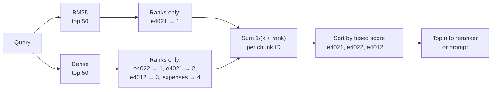

[Dense versus sparse retrieval](/learn/hybrid-search/dense-versus-sparse-retrieval) showed that BM25 and an embedding model get different queries right, so at rank 1 the union of their results beats either alone. The union is only a set, though. A RAG prompt needs one ordered list, and the retrievers' scores cannot simply be compared to produce it: a BM25 score of 4.5 and a cosine of 0.62 are on unrelated scales. **Reciprocal Rank Fusion** (RRF) sidesteps the problem by throwing the scores away and using only each chunk's position in each list.

This lesson derives RRF from first principles, works through its single parameter $k$ and what it really controls, shows the consensus behaviour that is both its strength and its characteristic failure, and implements it in a dozen lines that you will reuse for the rest of the module.

## Learning objectives

- Compute an RRF score by hand for a chunk that appears in one, several or none of the input lists.
- Explain what the constant $k$ does to the balance between "ranked first by one retriever" and "ranked moderately by several", and derive the rank at which consensus wins.
- Implement RRF for any number of lists, with optional per-list weights, list depth and deterministic tie-breaking.
- Diagnose the two typical RRF failures, exact ties and consensus on a wrong chunk, from the input lists.
- Decide when RRF's indifference to score magnitude is an advantage and when it discards useful information.

## Prerequisites

- [Dense versus sparse retrieval](/learn/hybrid-search/dense-versus-sparse-retrieval): why the two lists differ, and the `meridian_corpus.py` file used below.
- [Query-document similarity](/learn/retrieval-fundamentals/query-document-similarity): why scores from different retrievers are on unrelated scales.
- [Top-K retrieval](/learn/retrieval-fundamentals/top-k-retrieval): ranked lists and cut-offs.

## Why this matters

Suppose that for the query `E-4021` BM25 returns `[e4021: 2.43]` and dense search returns `[e4022: 0.315, e4021: 0.311, e4012: 0.252, expenses: 0.213]`. You need one list. The obvious approaches all fail:

- **Sort by raw score.** BM25 scores are unbounded and often several units; cosines for this model sit well below 1. Every BM25 hit outranks every dense hit, so the "hybrid" is BM25 with dense results appended. On another query, with weak BM25 matches scoring 0.3, the opposite happens.
- **Concatenate.** Sparse first, then dense. The order of concatenation is a hidden, query-independent decision that one retriever always wins.
- **Interleave.** Take one from each in turn. Better, but a chunk both retrievers ranked first gets no more credit than a chunk one of them ranked first, and duplicates must be handled.

What you want is a combination that rewards chunks ranked highly by either retriever, rewards agreement between retrievers even more, and does not care what units each retriever counts in. RRF does exactly that, needs no training data, and has one parameter whose default almost everyone uses. That is why it is the default fusion method in many engines and frameworks, and the right first choice for a new hybrid system.

## The intuition

Imagine a bake-off judged by two judges who score in incompatible ways. One gives marks out of 100 and is generous; the other gives marks out of 10 and is stingy. Adding their marks would let the generous judge decide everything. So the organiser ignores the marks and asks each judge only for their ranking: first, second, third.

Then each judge awards points by position, but not the usual 3-2-1. The organiser uses a rule where first place is worth only a little more than second, and second a little more than third. Under that rule, a cake both judges placed second collects nearly twice the points of a cake one judge placed first and the other did not rank at all. Agreement matters more than one judge's enthusiasm.

That is RRF: positions instead of marks, and a gently sloping points table so that consensus wins.

## How it works

### The procedure

You have $m$ ranked lists of chunk IDs, one per retriever (or per query variant; [Search fusion](/learn/hybrid-search/search-fusion) generalises this). For each list, position 1 is the best.

1. **Choose a constant** $k$ (the standard value is 60) and, optionally, a **depth**: how many results from each list to consider.
2. **For each list and each chunk in it**, compute $\frac{1}{k + \text{rank}}$, where rank is the chunk's 1-based position in that list.
3. **Sum** these contributions per chunk across all lists. A chunk missing from a list contributes nothing for that list.
4. **Sort** chunks by their summed score, highest first, breaking exact ties by a fixed rule (for example by chunk ID).
5. **Keep the top** $n$ for the next stage: a reranker or the prompt.



The trace below runs the procedure on two three-item lists. Watch chunk `b`: second in the first list and first in the second, it finishes ahead of `a`, which only one list ranked first.

```trace
{"title": "RRF with k = 60 on two lists", "code": ["lists = [[\"a\", \"b\", \"c\"], [\"b\", \"c\", \"d\"]]", "scores = {}", "for ranking in lists:", "    for rank, doc in enumerate(ranking, start=1):", "        scores[doc] = scores.get(doc, 0) + 1 / (60 + rank)", "fused = sorted(scores, key=scores.get, reverse=True)", "print(fused)"], "steps": [{"line": 1, "vars": {"lists": "[[a, b, c], [b, c, d]]"}, "note": "Two retrievers' rankings. Only the order matters; no scores are passed in."}, {"line": 5, "vars": {"rank": "1", "doc": "a", "scores": "{a: 0.01639}"}, "note": "First list, rank 1: a gets 1/61."}, {"line": 5, "vars": {"rank": "2", "doc": "b", "scores": "{a: 0.01639, b: 0.01613}"}, "note": "Rank 2 is worth 1/62, only slightly less than rank 1."}, {"line": 5, "vars": {"rank": "3", "doc": "c", "scores": "{a: 0.01639, b: 0.01613, c: 0.01587}"}, "note": "Rank 3 is worth 1/63."}, {"line": 5, "vars": {"rank": "1", "doc": "b", "scores": "{a: 0.01639, b: 0.03252, c: 0.01587}"}, "note": "Second list, rank 1: b adds 1/61 to what it already had and now has nearly twice a's score."}, {"line": 5, "vars": {"rank": "2", "doc": "c", "scores": "{a: 0.01639, b: 0.03252, c: 0.03200}"}, "note": "c appears in both lists too, so it also overtakes a."}, {"line": 5, "vars": {"rank": "3", "doc": "d", "scores": "{a: 0.01639, b: 0.03252, c: 0.03200, d: 0.01587}"}, "note": "d appears only in the second list, at rank 3."}, {"line": 7, "vars": {"fused": "[b, c, a, d]"}, "out": ["['b', 'c', 'a', 'd']"], "note": "Chunks found by both retrievers lead. Among single-list chunks, the higher rank wins."}]}
```

### Where RRF came from

RRF was introduced by Gordon Cormack, Charles Clarke and Stefan Büttcher in a short SIGIR 2009 paper, "Reciprocal Rank Fusion outperforms Condorcet and individual Rank Learning Methods". They were fusing the result lists of many different search systems in TREC evaluations, and found that this very simple formula, with $k = 60$ fixed in a pilot experiment, did as well as or better than more elaborate fusion methods on the collections they tested. The method spread because it needs nothing but ranks. Today Elasticsearch, OpenSearch, Qdrant, Milvus, Azure AI Search and others offer it as a built-in fusion option, typically with $k = 60$ as the default; [Hybrid retrieval architecture](/learn/hybrid-search/hybrid-retrieval-architecture) shows how the engines expose it.

### What k controls

The constant $k$ sets how steeply the points table falls with rank.

- With $k = 0$, rank 1 is worth 1, rank 2 is worth 0.5 and rank 10 is worth 0.1. The top of each list dominates; RRF behaves almost like "take each retriever's favourite".
- With $k = 60$, rank 1 is worth $1/61 \approx 0.0164$ and rank 10 is worth $1/70 \approx 0.0143$. The table is nearly flat across the top ten, so **how many lists include a chunk** matters far more than **where** in each list it sits.

The next section turns that into an exact statement: with $k = 60$, a chunk at rank 50 in two lists beats a chunk at rank 1 in only one. That is a strong bias towards consensus, and it is deliberate. Different retrievers that independently agree on a chunk are good evidence; one retriever's top pick, unconfirmed, is weaker evidence.

In practice $k$ is rarely the most sensitive setting. With two lists, the fused order changes with $k$ only in the comparisons where "high in one list" competes with "lower in both", and the default works well enough that most teams never tune it. The depth of each input list and the per-list weights usually matter more; [Hybrid search optimisation](/learn/hybrid-search/hybrid-search-optimisation) measures all three.

### Missing chunks, depth and ties

**A chunk missing from a list contributes zero for that list.** That is the natural behaviour of the sum, and it is right for a sparse list that came back empty or short: no shared term, no evidence.

**Depth matters because of this.** If you fetch 10 from each retriever, a chunk at dense rank 11 contributes nothing, exactly as if the dense retriever had never seen it. If you fetch 100, it contributes $1/71$. So the depth of each input list is a real parameter: too shallow and you lose chunks that one retriever ranked moderately; too deep and you pay for retrieving and fusing many chunks that will never reach the top. Fetching 20 to 100 per retriever and fusing down to a smaller set for a reranker is common practice.

**Ties are common with two lists.** Rank 1 in one list and rank 2 in the other gives exactly the same score as rank 2 in one and rank 1 in the other: $\frac{1}{61} + \frac{1}{62}$ either way. RRF has no information to break that tie, so the order comes from whatever tie-break your sort uses. Make it explicit and deterministic (for example by chunk ID, or by preferring a designated retriever), so the same query always gives the same answer, and know that a tie at the top is a signal the retrievers disagree.

### Weighted RRF

A common extension multiplies each list's contributions by a weight $w_i$:

$$
\text{RRF}_w(d) = \sum_{i=1}^{m} \frac{w_i}{k + r_i(d)}
$$

A weight of 1.5 on the sparse list means "when the retrievers disagree, lean towards BM25". It also breaks the symmetric ties described above. Qdrant's Python client, for example, accepts per-prefetch `weights` alongside `k` in its RRF query; check your engine's documentation for whether, and how, it supports weights. Weights must be tuned on labelled queries, which makes weighted RRF a supervised method, losing part of RRF's appeal of needing no data.

### What RRF throws away

RRF discards score magnitude, and magnitude sometimes carries information.

- **Confidence.** BM25 finding `e4021` with a large margin over everything else is strong evidence; RRF sees only "rank 1". A retriever whose top result is barely better than its tenth gets the same credit.
- **Absolute relevance.** For a query with no answer in the corpus, RRF still produces a confident-looking fused list. Fused RRF scores are not relevance estimates and cannot be thresholded meaningfully across queries (see [Retrieval thresholding](/learn/advanced-retrieval-optimisation/retrieval-thresholding)).

When labelled data is available, score-based methods can exploit that information; that is the subject of [Weighted score fusion](/learn/hybrid-search/weighted-score-fusion).

```playground
rrf
```

## The mathematics

### The RRF score

**Intuition.** Each list awards a chunk points that shrink slowly with rank; the fused score is the total.

**The formula.**

$$
\text{RRF}(d) = \sum_{i=1}^{m} \frac{\mathbb{1}\left[d \in L_i\right]}{k + r_i(d)}
$$

- $d$ is a chunk; $m$ is the number of input lists $L_1, \dots, L_m$.
- $r_i(d)$ is the 1-based rank of $d$ in list $L_i$.
- $\mathbb{1}[d \in L_i]$ is 1 if $d$ appears in $L_i$ (within the chosen depth) and 0 otherwise, so missing chunks add nothing.
- $k \ge 0$ is the smoothing constant, conventionally 60.

The largest possible score is $m/(k+1)$, reached by a chunk ranked first everywhere.

**Worked by hand.** For the query `E-4021`, BM25 returns `[e4021]` and dense search returns `[e4022, e4021, e4012, expenses, ...]`. With $k = 60$:

- `e4021`: rank 1 in BM25, rank 2 in dense: $\frac{1}{61} + \frac{1}{62} = 0.016393 + 0.016129 = 0.032522$.
- `e4022`: rank 1 in dense only: $\frac{1}{61} = 0.016393$.
- `e4012`: rank 3 in dense only: $\frac{1}{63} = 0.015873$.

The right chunk wins by almost a factor of two, even though dense search put it second, because both retrievers found it.

### When consensus beats a first place

**Intuition.** A chunk at rank $r$ in two lists collects $\frac{2}{k+r}$; a chunk at rank 1 in one list collects $\frac{1}{k+1}$. Find where the first overtakes the second.

**The derivation.**

$$
\frac{2}{k + r} > \frac{1}{k + 1}
\iff 2(k + 1) > k + r
\iff r < k + 2.
$$

So with $k = 60$, appearing anywhere in the top 61 of both lists beats being first in only one. With $k = 1$, only ranks 1 and 2 in both lists beat a single first place. With $k = 0$, only rank 1 in both wins; at $r = 2$ the two are exactly tied, and a single first place beats anything deeper. This one inequality is the clearest statement of what $k$ does.

**In Python.**

```python
for k in (0, 1, 10, 60):
    deepest = max(r for r in range(1, 1000) if 2 / (k + r) > 1 / (k + 1))
    print(f"k={k:<3d} rank-1-in-one = {1/(k+1):.4f}; consensus wins down to rank {deepest}")
print(f"E-4021 example: {1/61 + 1/62:.6f} vs {1/61:.6f}")
```

```output
k=0   rank-1-in-one = 1.0000; consensus wins down to rank 1
k=1   rank-1-in-one = 0.5000; consensus wins down to rank 2
k=10  rank-1-in-one = 0.0909; consensus wins down to rank 11
k=60  rank-1-in-one = 0.0164; consensus wins down to rank 61
E-4021 example: 0.032522 vs 0.016393
```

## In code

**The problem.** Fuse the BM25 and dense rankings for the fourteen labelled Meridian queries, see which queries fusion fixes and which it breaks, and measure the effect of $k$ and of a sparse weight on recall@1.

**Dependencies.** The same as the previous lesson, plus `meridian_corpus.py` from [Dense versus sparse retrieval](/learn/hybrid-search/dense-versus-sparse-retrieval) in the same folder.

**Shared corpus.** The code below reuses `meridian_corpus.py`, the shared Meridian chunks and labelled queries defined in lesson 1, [Dense versus sparse retrieval](/learn/hybrid-search/dense-versus-sparse-retrieval); save that file next to the scripts and do not redefine it.

```bash
pip install rank-bm25 sentence-transformers numpy
```

```python
import numpy as np
from collections import defaultdict
from rank_bm25 import BM25Okapi
from sentence_transformers import SentenceTransformer
from meridian_corpus import DOCS, QUERIES, tokenise

def rrf(rankings, k=60, weights=None, depth=None):
    """Fuse ranked lists of IDs. Returns [(id, score)] best first."""
    weights = weights or [1.0] * len(rankings)
    scores = defaultdict(float)
    for ranking, w in zip(rankings, weights):
        for rank, doc_id in enumerate(ranking[:depth], start=1):
            scores[doc_id] += w / (k + rank)
    # Sort by score; break exact ties by ID so the output is deterministic.
    return sorted(scores.items(), key=lambda item: (-item[1], item[0]))

ids = list(DOCS)
texts = [DOCS[i] for i in ids]
bm25 = BM25Okapi([tokenise(t) for t in texts])
model = SentenceTransformer("sentence-transformers/all-MiniLM-L6-v2")
doc_vecs = model.encode(texts, normalize_embeddings=True)

def sparse_ranking(query):
    s = bm25.get_scores(tokenise(query))
    return [ids[i] for i in np.argsort(-s, kind="stable") if s[i] > 0]

def dense_ranking(query):
    sims = doc_vecs @ model.encode([query], normalize_embeddings=True)[0]
    return [ids[i] for i in np.argsort(-sims, kind="stable")]

lists = [(q, gold, sparse_ranking(q), dense_ranking(q)) for q, gold, _ in QUERIES]

# 1. Fuse every query and show the top result
for q, gold, s, d in lists:
    top_id, top_score = rrf([s, d])[0]
    mark = "ok  " if top_id == gold else "MISS"
    print(f"{mark} {q:38s} sparse {str(s[:2]):24s} dense {str(d[:2]):24s} -> {top_id} ({top_score:.4f})")

# 2. Recall@1 for the single retrievers and for RRF variants
n = len(lists)
print(f"\nrecall@1 of {n}: sparse {sum(bool(s) and s[0] == g for _, g, s, _ in lists)}, "
      f"dense {sum(d[0] == g for _, g, _, d in lists)}")
for k in (1, 10, 60, 1000):
    print(f"  RRF k={k:<4d}             {sum(rrf([s, d], k=k)[0][0] == g for _, g, s, d in lists)}")
print(f"  RRF k=60, sparse x1.5  {sum(rrf([s, d], weights=[1.5, 1])[0][0] == g for _, g, s, d in lists)}")
```

```output
ok   How much holiday do I get?             sparse []                       dense ['leave', 'expenses']    -> leave (0.0164)
MISS money for a desk and chair at home     sparse ['laptop', 'support']    dense ['equipment', 'support'] -> support (0.0323)
MISS When can I get a new computer?         sparse []                       dense ['old', 'laptop']        -> old (0.0164)
ok   download my dashboard as a spreadsheet sparse []                       dense ['export', 'e4021']      -> export (0.0164)
ok   Can I work from home on Fridays?       sparse ['remote']               dense ['remote', 'support']    -> remote (0.0328)
ok   What time does the IT helpdesk close?  sparse ['support']              dense ['support', 'relay']     -> support (0.0328)
MISS WFH policy                             sparse []                       dense ['password', 'remote']   -> password (0.0164)
ok   E-4021                                 sparse ['e4021']                dense ['e4022', 'e4021']       -> e4021 (0.0325)
ok   E-4012                                 sparse ['e4012']                dense ['e4012', 'e4022']       -> e4012 (0.0328)
ok   Atlas E-4021 error                     sparse ['e4021', 'e4012']       dense ['e4021', 'e4022']       -> e4021 (0.0328)
ok   VPN access revoked                     sparse ['e4022', 'vpn']         dense ['e4022', 'e4012']       -> e4022 (0.0328)
ok   SAML                                   sparse ['sso']                  dense ['sso', 'password']      -> sso (0.0328)
ok   receipt over £75                       sparse ['expenses', 'leave']    dense ['expenses', 'equipment'] -> expenses (0.0328)
ok   VPN certificate expired                sparse ['e4012', 'vpn']         dense ['e4012', 'e4022']       -> e4012 (0.0328)

recall@1 of 14: sparse 9, dense 11
  RRF k=1                11
  RRF k=10               11
  RRF k=60               11
  RRF k=1000             11
  RRF k=60, sparse x1.5  11
```

**The important lines.**

- `rrf` takes lists of IDs, never scores. It works unchanged for three, four or ten lists.
- `ranking[:depth]` applies the depth cut-off; `None` means "use the whole list".
- `w / (k + rank)` is the whole method. `enumerate(..., start=1)` matters: starting at 0 would give rank 1 the value $1/k$ and, with $k = 0$, divide by zero.
- The sort key `(-score, id)` makes ties deterministic. Without it, Python's stable sort would order tied chunks by insertion order, which depends on which list you passed first.

**What the output means.**

- **Fusion fixes the one identifier query dense search got wrong, and breaks a paraphrase it got right.** For `E-4021` dense search ranks `e4022` first and `e4021` second, BM25 ranks `e4021` first, so `e4021` collects $\frac{1}{61} + \frac{1}{62}$ and beats `e4022`'s single first place: the derivation above, in action. The two rows for the other codes (`E-4012`, "VPN certificate expired") were already right in both lists and stay right.
- **Fusion keeps every paraphrase that dense retrieval got right except one**, because an empty sparse list adds nothing and the dense order passes through unchanged (the scores of 0.0164 are a single $1/61$).
- **"money for a desk and chair at home" shows consensus on a wrong chunk.** BM25 matched "desk" to "support desk" and ranked `support` second; dense search also ranked `support` second. `support` appears in both lists, so its $\frac{1}{62} + \frac{1}{62}$ beats `equipment`'s single $\frac{1}{61}$. RRF trusts agreement even when the agreement is coincidental. This is the one query where fusion made things worse than dense search alone.
- **Plain RRF is not better than dense search here.** Recall@1 is 11 for RRF, 11 for dense alone and 9 for BM25, against a union ceiling of 12 (from the previous lesson). RRF gained `E-4021` and lost "money for a desk and chair at home", so on this small set the gain and the loss cancel. The two queries the union cannot reach ("When can I get a new computer?" and "WFH policy") are a filtering problem and a vocabulary problem that fusion cannot solve. Do not expect fusion to beat the best single retriever on every corpus; measure it, as [Hybrid search optimisation](/learn/hybrid-search/hybrid-search-optimisation) does.
- **Weighting sparse by 1.5 does not help either** (11): the consensus on `support` is still stronger than the nudge, and no labelled query ties.
- **$k$ makes no difference here.** With lists this short and only two retrievers, no comparison at the top of any query falls in the range where $k$ changes the winner. This is a common finding and the reason $k = 60$ is rarely tuned.

**Seeing a tie.** None of the fourteen labelled queries produces an exact tie with this corpus, so the next snippet (appended to the same script) uses one extra query where the two lists swap their top two results: BM25 puts the revoked-access chunk first because of "administrator", dense search puts the general VPN chunk first.

```python
q = "VPN administrator"   # not in the labelled set; chosen because the two lists swap their top two
s, d = sparse_ranking(q), dense_ranking(q)
print("sparse", s[:2], "dense", d[:2])
for label, w in (("equal weights", [1, 1]), ("sparse x1.5", [1.5, 1]), ("dense x1.5", [1, 1.5])):
    print(f"{label:14s}", [(i, round(sc, 5)) for i, sc in rrf([s, d], weights=w)[:2]])
```

```output
sparse ['e4022', 'vpn'] dense ['vpn', 'e4022']
equal weights  [('e4022', 0.03252), ('vpn', 0.03252)]
sparse x1.5    [('e4022', 0.04072), ('vpn', 0.04059)]
dense x1.5     [('vpn', 0.04072), ('e4022', 0.04059)]
```

With equal weights `e4022` and `vpn` score exactly $\frac{1}{61} + \frac{1}{62} = 0.03252$; the ID tie-break happens to put `e4022` first because "e" sorts before "v", which is luck rather than evidence. Weighting sparse by 1.5 makes BM25's preference decisive and weighting dense by 1.5 reverses it. Which weighting is right depends on the query type, which is why a tie at the top is worth logging.

**Errors people commonly hit.**

- *Fusing lists of different units.* Chunk IDs in one list and document IDs in another never match, so nothing is ever "found by both". Fuse at the same granularity.
- *Passing scores instead of ranks*, or sorting a list ascending by distance and then treating position 1 as the worst.
- *Duplicate IDs within one list* (two vectors for the same chunk). The chunk collects two contributions from one retriever. De-duplicate each list first.

**Extending it.** Add a third list, such as a dense retriever run on a rewritten query, and watch how the consensus effect grows ([Search fusion](/learn/hybrid-search/search-fusion)). Return the per-list ranks alongside the fused score so that logs show *why* a chunk won.

## A real-world example

Meridian's Platform team added BM25 to AskMeridian after the support desk's error-code complaints, and the first version merged the two lists by sorting on raw score. For most error-code queries it looked fixed, because BM25 scores were several units and cosines below one, so every BM25 hit came first. Then HR staff noticed that natural-language questions had become worse. A question like "can I work from a café on Fridays?" shares the word "café" with the VPN chunk, so BM25 scored that chunk and it now always came first, ahead of the dense retriever's correct answer about remote work. The hybrid had silently become "BM25, then dense".

The team replaced score sorting with RRF at $k = 60$, fetching 50 results from each retriever and fusing down to 20 for the reranker. They re-ran their labelled query set grouped by type: identifier queries kept their gains, and natural-language queries recovered to their dense-only level. Reviewing the remaining misses, they found two patterns: exact ties between sibling error codes, and coincidental agreement on chunks that shared a common word such as "desk". Both were left to the cross-encoder reranker that follows fusion, which reads the query and chunk together. RRF's job, they wrote in the design note, is to make sure the right chunk is *in* the twenty, not that it is first.

## Common mistakes

- **Sorting the merged list by raw scores.** Whichever retriever has the larger numeric scale wins every query; the hybrid silently becomes one retriever.
- **Fetching too shallow a list from each retriever.** A chunk at rank 15 of a 10-deep list contributes nothing, so fusion cannot rescue it.
- **Leaving ties to chance.** Tied chunks come out in input order, so swapping the order of the lists changes results; logs then become impossible to reproduce.
- **Thresholding fused RRF scores.** RRF scores depend only on ranks, so a "minimum fused score" cannot tell a query with a good answer from one with none.
- **Fusing at mismatched granularity.** Fusing chunk-level and document-level lists, or lists with duplicate IDs, double-counts or never matches.
- **Tuning $k$ first.** It is usually the least sensitive setting; depth and weights matter more.

## Best practices

- Start every new hybrid with plain RRF at $k = 60$; it needs no labelled data and is hard to get badly wrong.
- Fetch 20 to 100 candidates per retriever and fuse down to what the reranker or prompt needs; measure union recall at that depth.
- De-duplicate each input list by chunk ID before fusing, and break ties deterministically.
- Log each chunk's rank in every input list alongside its fused score, so a bad answer can be traced to the retriever that caused it.
- Put a reranker after RRF when the top one or two positions matter; RRF is a candidate-merging step, not a final judge.
- Move to weighted RRF or score fusion only when a labelled query set shows a measurable gain.

## Performance considerations

RRF itself is negligible. Fusing two lists of 50 is 100 dictionary updates and a sort of at most 100 entries: microseconds in Python, far below the milliseconds of the retrieval calls. The costs of a hybrid live elsewhere.

**Depth multiplies retrieval cost.** Fetching 100 instead of 20 per retriever makes HNSW search do more work (a larger candidate list) and BM25 score more postings, and, more importantly, any per-candidate step after fusion (fetching chunk text, a cross-encoder) grows with the fused list. If the reranker scores the top 50 fused candidates at, say, 2 ms each on a CPU (an assumption; measure your own), that is 100 ms, far more than retrieval.

**Engine-side fusion saves round trips.** Running both retrievers and RRF inside one engine (Qdrant prefetch with an RRF query, an Elasticsearch RRF retriever) avoids shipping two candidate lists over the network to the application. With 100 candidates of a few hundred bytes of metadata each, the saving is small in bytes but removes a round trip per query.

**Parallelism.** RRF must wait for both lists, so the fused latency is the slower retriever's latency. A timeout on one side should not stall the request; fuse whatever arrived ([Hybrid retrieval architecture](/learn/hybrid-search/hybrid-retrieval-architecture)).

## Summary

- RRF fuses ranked lists by summing $1/(k + \text{rank})$ for each chunk across lists, ignoring raw scores, so it is immune to incompatible score scales and needs no training data.
- With $k = 60$ the points table is nearly flat, so chunks found by several retrievers win: a chunk in the top 61 of two lists beats a chunk ranked first in only one.
- Missing chunks contribute nothing, which makes list depth a real parameter; symmetric disagreements produce exact ties that need a deterministic tie-break or weights.
- RRF's characteristic failures are coincidental consensus on a wrong chunk and ties between siblings; a reranker after fusion handles both.
- RRF discards confidence and absolute relevance, so its scores cannot be thresholded; when labelled data exists, score fusion may do better.

## Exercises

**1.** With $k = 60$, compute the RRF scores and fused order for BM25 `[x, y, z]` and dense `[z, w, x]`.

<details><summary>Show solution</summary>

- `x`: $\frac{1}{61} + \frac{1}{63} = 0.016393 + 0.015873 = 0.032266$
- `z`: $\frac{1}{63} + \frac{1}{61} = 0.032266$ (an exact tie with `x`)
- `y`: $\frac{1}{62} = 0.016129$
- `w`: $\frac{1}{62} = 0.016129$ (tied with `y`)

Order: `x` and `z` tied first, then `y` and `w` tied. The two retrievers disagree symmetrically, so RRF alone cannot separate them; a tie-break rule or weights decide.

</details>

**2.** A chunk is ranked 5th by BM25 and 8th by dense retrieval. Another is ranked 1st by dense retrieval and absent from BM25. Which wins at $k = 60$, and at $k = 2$?

<details><summary>Show solution</summary>

At $k = 60$: $\frac{1}{65} + \frac{1}{68} = 0.015385 + 0.014706 = 0.030090$ against $\frac{1}{61} = 0.016393$. The consensus chunk wins.

At $k = 2$: $\frac{1}{7} + \frac{1}{10} = 0.142857 + 0.1 = 0.242857$ against $\frac{1}{3} = 0.333333$. The single first place wins. A small $k$ makes the top of each list dominate.

</details>

**3.** Modify `rrf` to return, for each fused chunk, its rank in every input list (or `None`), and print this for "money for a desk and chair at home". Explain from the output why `support` won.

<details><summary>Show solution</summary>

```python
def rrf_explained(rankings, k=60):
    ranks = defaultdict(lambda: [None] * len(rankings))
    for i, ranking in enumerate(rankings):
        for rank, doc_id in enumerate(ranking, start=1):
            ranks[doc_id][i] = rank
    score = {d: sum(1 / (k + r) for r in rs if r) for d, rs in ranks.items()}
    return sorted(((d, score[d], ranks[d]) for d in ranks), key=lambda t: (-t[1], t[0]))

q, gold, s, d = lists[1]
for doc_id, sc, rs in rrf_explained([s, d])[:3]:
    print(doc_id, round(sc, 5), rs)
```

```output
support 0.03226 [2, 2]
laptop 0.03132 [1, 7]
equipment 0.01639 [None, 1]
```

`support` is second in both lists; `equipment`, the right answer, is first in dense only. Two moderate votes beat one first place, as the consensus inequality predicts. BM25's "desk" match is coincidental, which RRF has no way to know.

</details>

**4.** Your team wants to show "No relevant documents found" when the top fused RRF score is below 0.02. Explain why this will not work, and propose an alternative.

<details><summary>Show solution</summary>

RRF scores depend only on positions. Any chunk ranked first by one retriever scores $1/61 \approx 0.0164$, whether it is a perfect answer or the best of irrelevant chunks; any chunk in both top lists scores above 0.03. So the threshold would reject every correct answer found by only one retriever (such as paraphrases with an empty BM25 list) and accept wrong chunks that both retrievers happened to rank. Instead, threshold on a calibrated relevance score: a cross-encoder reranker's output after fusion, calibrated on labelled data ([Score calibration](/learn/advanced-retrieval-optimisation/score-calibration)).

</details>

## Check your understanding

```quiz
[
  {"q": "What does RRF use from each input list?", "options": ["Only the position of each chunk", "The raw scores, normalised to the range 0 to 1", "The scores and the positions, multiplied", "The number of query terms each chunk matched"], "answer": 0, "why": "RRF sums 1/(k + rank) per chunk. Scores are ignored, which is why incompatible score scales do not matter."},
  {"q": "With k = 60, retriever 1 ranks chunk A first and retriever 2 does not return A. Both retrievers rank chunk B 20th. Which wins?", "options": ["A, because rank 1 always wins", "They tie", "B, because 2/80 is greater than 1/61", "It depends on the raw scores"], "answer": 2, "why": "B collects 1/80 + 1/80 = 0.025, A collects 1/61, about 0.0164. With k = 60, consensus anywhere in the top 61 beats a single first place."},
  {"q": "What happens to a chunk that is ranked 30th by dense search if you fetch only the top 20 from each retriever?", "options": ["It contributes 1/90 from the dense list", "It contributes nothing from the dense list, as if dense search had not found it", "RRF fetches it automatically", "It is assigned the lowest rank in the list"], "answer": 1, "why": "Missing chunks contribute zero. List depth therefore decides which chunks fusion can rescue."},
  {"q": "BM25 returns [p, q] and dense returns [q, p]. Which statement is true under plain RRF?", "options": ["p and q have exactly the same score, so the order depends on the tie-break", "q wins because dense is listed second", "p wins because BM25 is more precise", "Both are discarded as contradictory"], "answer": 0, "why": "Both score 1/61 + 1/62. Plain RRF has no information to separate them; a deterministic tie-break or per-list weights must decide."},
  {"q": "Why is a threshold on fused RRF scores a poor way to detect 'no answer in the corpus'?", "options": ["RRF scores are always below 0.01", "Thresholds only work with k = 0", "RRF scores are negative for irrelevant chunks", "RRF scores depend only on ranks, so the best of a set of irrelevant chunks scores the same as a correct answer at the same ranks"], "answer": 3, "why": "Any first-placed chunk gets 1/(k+1) regardless of how relevant it is. Absolute relevance needs a calibrated score, such as a reranker's."}
]
```

## Further reading

- Gordon V. Cormack, Charles L. A. Clarke and Stefan Büttcher (2009), "Reciprocal Rank Fusion outperforms Condorcet and individual Rank Learning Methods", *Proceedings of SIGIR 2009*. The original two-page paper.
- Sebastian Bruch, Siyu Gai and Amir Ingber (2023), "An Analysis of Fusion Functions for Hybrid Retrieval", *ACM Transactions on Information Systems*. A careful comparison of RRF with score-based fusion, including the sensitivity of RRF to $k$.
- Qdrant documentation, "Hybrid and multi-stage queries": [qdrant.tech/documentation](https://qdrant.tech/documentation/). Prefetch and RRF fusion inside the engine.
- Elastic documentation, "Reciprocal rank fusion", in the Elasticsearch reference: [elastic.co/docs](https://www.elastic.co/docs). The RRF retriever, `rank_constant` and `rank_window_size`.
