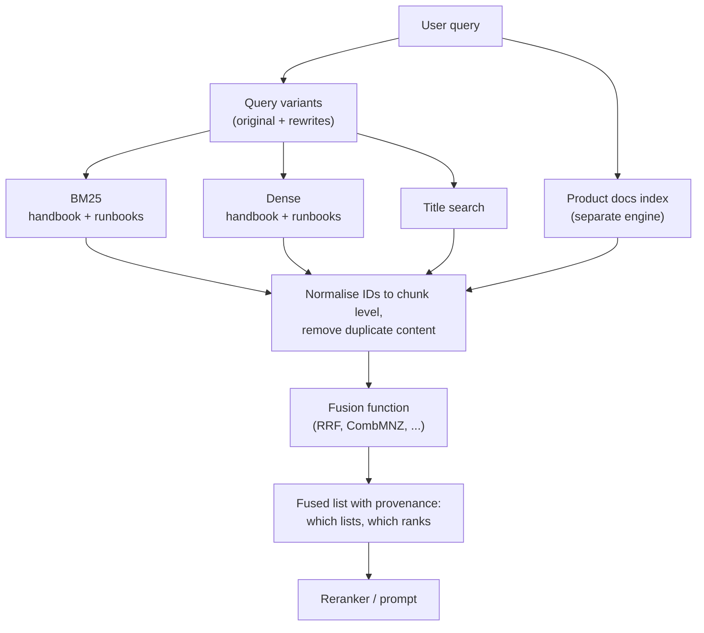

The previous lessons fused exactly two lists: one sparse, one dense. Real systems often have more. A second embedding model, a learned sparse model, a search over titles only, several rewordings of the user's question, separate indexes for the handbook and the runbooks: each produces its own ranked list, and all of them must become one. **Search fusion** is the general problem of merging any number of ranked lists, and it has a longer history than RAG. Metasearch engines in the 1990s merged results from several web search engines, and the information retrieval community studied the problem under the name *data fusion*.

This lesson takes the general view. It introduces the classic family of fusion functions (CombSUM, CombMNZ, Borda count and RRF), explains when adding a list helps and when it hurts, and covers the practical problems that appear only with many sources: lists that are not independent, lists at different granularities, the same content under different IDs, and keeping track of where each result came from.

## Learning objectives

- Compute CombSUM, CombMNZ, Borda and RRF scores by hand for three lists, and explain why they can disagree.
- Name the sources of multiple ranked lists in a RAG system and the fusion issues each raises.
- Explain the chorus, skimming and dark-horse effects, and predict when an extra list will help or hurt.
- Show with a measurement that adding a list correlated with an existing one can lower fused quality, and choose a method that is robust to it.
- Handle granularity, duplicates and provenance when fusing results from several collections.

## Prerequisites

- [Reciprocal Rank Fusion](/learn/hybrid-search/reciprocal-rank-fusion) and [Weighted score fusion](/learn/hybrid-search/weighted-score-fusion): the two-list methods this lesson generalises.
- [Query expansion](/learn/hybrid-search/query-expansion): why the independence of retrievers matters.
- [Dense versus sparse retrieval](/learn/hybrid-search/dense-versus-sparse-retrieval): the `meridian_corpus.py` file used below.

## Why this matters

Adding retrievers is the easiest way to make a hybrid look more sophisticated, and it is not free. Each list costs a query, latency and maintenance. Worse, a list can reduce quality. If you add a second lexical retriever that agrees with BM25 most of the time, every chunk BM25 likes now gets two votes, and the dense retriever is outvoted on the paraphrase queries where it was the only one right. The fused result can fall below the two-list hybrid you started with.

Multi-source systems also hit problems that two-list fusion hides. A chunk-level index and a document-level index return IDs that never match. A policy copied into both the handbook and a team wiki appears twice under different IDs and fills two of the five context slots with the same text. A result that cannot be traced to the list that produced it cannot be debugged. These are routine in production, and the fusion function is only one part of handling them.

## The intuition

A newspaper wants to know which restaurant in town is best, and asks several critics for their top ten. Three patterns appear.

- When several critics independently list the same restaurant, that is strong evidence. This is the **chorus effect**.
- When one critic puts a restaurant first and nobody else lists it, it may be a hidden gem that only that critic knows about. A good combination should not bury it. This is the **dark-horse effect**.
- Each critic's top few are usually better than their bottom few, so taking the tops of many lists is a good way to collect strong candidates. This is the **skimming effect**.

Now suppose two of the critics are a married couple who always eat together and mostly agree. Their two votes are not two independent opinions; they are one opinion counted twice. A simple vote-count lets them outvote a third critic who knows the town's cuisine better. Fusing more lists is only as good as their independence.

These three effect names come from Vogt and Cottrell's studies of fusion in the late 1990s and are still the standard vocabulary.

## How it works

### Where multiple lists come from

1. **Different retrievers over the same index**: BM25, one or two dense models, a learned sparse model, a character n-gram matcher. The classic hybrid.
2. **Different fields of the same chunks**: a search over titles or headings as well as body text. Titles are short and precise, so a title match is strong evidence.
3. **Different versions of the query**: the original question plus several rewordings or sub-questions, each searched separately. This is [Multi-query retrieval](/learn/advanced-retrieval/multi-query-retrieval); fusing the resulting lists with RRF is the core of the "RAG-Fusion" pattern covered in [Fusion-based RAG](/learn/advanced-rag-patterns/fusion-based-rag).
4. **Different collections**: separate indexes for the handbook, the IT runbooks and the product docs, perhaps in different engines, searched in parallel. This is **federated search**.

The fusion function is the same in every case. What changes is how independent the lists are, whether their IDs refer to the same units, and whether their scores are comparable.



### The fusion family

All of these take $m$ lists and produce one score per chunk. Let $\tilde s_i(d)$ be chunk $d$'s normalised score in list $i$ and $r_i(d)$ its rank, with a chunk absent from a list contributing nothing for it.

| Method | Score of chunk $d$ | Uses | Character |
| --- | --- | --- | --- |
| CombSUM | $\sum_i \tilde s_i(d)$ | Normalised scores | The weighted score fusion of the previous lesson, with equal weights |
| CombMNZ | $n(d) \cdot \sum_i \tilde s_i(d)$, where $n(d)$ is the number of lists containing $d$ | Scores and list membership | Rewards appearing in many lists even more than CombSUM |
| CombMAX | $\max_i \tilde s_i(d)$ | Normalised scores | Trusts each chunk's best list; favours dark horses |
| Borda count | $\sum_i (D - r_i(d) + 1)$ for lists of depth $D$ | Ranks | Voting with linearly falling points |
| RRF | $\sum_i \frac{1}{k + r_i(d)}$ | Ranks | Voting with slowly falling points, $k = 60$ by default |

CombSUM and CombMNZ were introduced by Fox and Shaw (1994) and remained standard baselines for years; Borda count was proposed for metasearch by Aslam and Montague (2001), who also studied a **Condorcet** method in which chunks are ordered by pairwise majority votes ("more lists rank $x$ above $y$ than the reverse"). Condorcet fusion is principled but more complex and rarely used in RAG systems; RRF has largely displaced it.

The methods differ in how strongly they reward consensus:

- **CombMAX** ignores consensus entirely.
- **CombSUM** and **Borda** reward it linearly.
- **CombMNZ** rewards it more than linearly: being in three lists multiplies the sum by three.
- **RRF** with large $k$ rewards it strongly, because its points table is nearly flat.

More consensus is good when lists are independent and individually decent. It is bad when lists are correlated (the married critics) or when one list is the only one that can find a type of query (the dark horse).

### When an extra list helps, and when it hurts

An extra list helps when it is **accurate on some queries** and **wrong in different ways** from the lists you already have. It hurts when it is wrong in the same ways (it double-counts their errors) or noisy on queries where another list was the only one right (it outvotes the lone correct list).

Two practical checks before adding a source:

1. **Overlap with existing lists.** If its top 10 overlaps heavily with BM25's top 10 for most queries, it mostly adds BM25's votes again.
2. **Unique wins.** On a labelled set, count queries where the new list has the answer at the top and no existing list does. If that number is near zero, the list adds cost and correlation, not coverage.

You can also **weight** a list, as in weighted RRF, to count a correlated or noisy list as a fraction of a vote. That fixes the double-counting partially and needs tuning.

### Granularity, duplicates and provenance

**Fuse at one granularity.** If one index returns chunks (`handbook#leave-3`) and another returns whole documents (`handbook`), their IDs never match, so nothing gets credit for agreement. Map everything to the granularity the next stage needs. To go from chunks to documents, aggregate per document, usually by the **maximum** chunk score or rank (a document is as relevant as its best passage); summing over chunks favours long documents with many weakly matching chunks.

**Remove duplicate content across sources.** The same paragraph can live in two collections with different IDs. Fusion treats them as different chunks, so they split the votes they would have pooled, and both may reach the prompt. Compute a content hash of normalised text at ingestion and use it as a secondary key: merge entries with the same hash before fusion, keeping the best rank from each list. Near-duplicates need fuzzier methods covered in [Duplicate removal](/learn/advanced-retrieval-optimisation/duplicate-removal).

**Keep provenance.** Record, for every fused result, which lists contained it and at what rank and score. Without that, a bad answer cannot be traced to the source that caused it, and you cannot compute the overlap and unique-win checks above from production logs.

### Federated search across engines

When the lists come from different engines or collections, their scores are even less comparable than BM25 against cosine: each collection has its own term statistics, so the same chunk would get a different BM25 score in each. Rank-based fusion (RRF) is the safe default. Two further issues are specific to federation:

- **Unequal collection quality.** A small, authoritative collection (the current handbook) and a large, noisy one (a team wiki) contribute equally under plain RRF. Weight lists by source authority, or cap how many results each collection may contribute.
- **Unequal latency.** A slow collection delays every query. Set a per-source timeout and fuse what arrived; [Hybrid retrieval architecture](/learn/hybrid-search/hybrid-retrieval-architecture) covers the mechanics.

### The procedure

1. **List the sources** and, for each, decide whether its IDs map to the target granularity.
2. **Retrieve in parallel**, with a per-source depth and timeout.
3. **Normalise IDs** to one granularity and merge duplicate content by hash.
4. **Fuse** with a method chosen for the sources' independence and score comparability; RRF unless you have evidence for another.
5. **Attach provenance** to every fused result.
6. **Evaluate each source's marginal value** on a labelled set: fused quality with and without it.

## The mathematics

### CombMNZ and Borda count

**Intuition.** CombMNZ multiplies a chunk's summed evidence by the number of lists that found it; Borda gives each list a fixed points table by position.

$$
\text{CombMNZ}(d) = n(d) \sum_{i=1}^{m} \tilde s_i(d),
\qquad
\text{Borda}(d) = \sum_{i=1}^{m} \mathbb{1}\left[d \in L_i\right]\left(D - r_i(d) + 1\right)
$$

- $m$ is the number of lists $L_1, \dots, L_m$, and $n(d)$ the number of lists containing $d$.
- $\tilde s_i(d)$ is the min-max normalised score of $d$ in list $i$ (0 if absent).
- $D$ is the list depth, so rank 1 earns $D$ points and rank $D$ earns 1.
- $r_i(d)$ is $d$'s rank in list $i$.

**Worked by hand.** Three lists of depth 3:

- BM25: $a$ 6.0, $b$ 3.0, $c$ 1.0. Min-max: $a = 1$, $b = 0.4$, $c = 0$.
- Dense: $b$ 0.60, $c$ 0.55, $d$ 0.30. Min-max: $b = 1$, $c = 0.25/0.30 = 0.833$, $d = 0$.
- Character n-grams: $a$ 0.40, $d$ 0.35, $b$ 0.10. Min-max: $a = 1$, $d = 0.25/0.30 = 0.833$, $b = 0$.

CombSUM: $a = 2$, $b = 0.4 + 1 + 0 = 1.4$, $c = 0.833$, $d = 0.833$. Winner $a$.

CombMNZ: $a$ is in 2 lists, $2 \times 2 = 4.0$; $b$ is in all 3, $3 \times 1.4 = 4.2$; $c$ and $d$ are in 2, $2 \times 0.833 = 1.667$. Winner $b$.

Borda: $a = 3 + 3 = 6$, $b = 2 + 3 + 1 = 6$, $c = 1 + 2 = 3$, $d = 1 + 2 = 3$. A tie between $a$ and $b$.

RRF: $a = \frac{2}{61} = 0.0328$; $b = \frac{1}{62} + \frac{1}{61} + \frac{1}{63} = 0.0484$; $c = d = \frac{1}{63} + \frac{1}{62} = 0.0320$. Winner $b$.

Four reasonable methods give three different answers. $a$ is first in two lists and absent from one; $b$ is in every list but first in only one. CombSUM backs the strong pair of first places; CombMNZ and RRF back the chunk every list found. Neither is wrong in general: which is right depends on whether the third list's omission of $a$ is informative.

**In Python.**

```python
from collections import defaultdict

lists = [
    [("a", 6.0), ("b", 3.0), ("c", 1.0)],      # BM25
    [("b", 0.60), ("c", 0.55), ("d", 0.30)],   # dense
    [("a", 0.40), ("d", 0.35), ("b", 0.10)],   # character n-grams
]
comb_sum, hits, borda, rrf = (defaultdict(float) for _ in range(4))
for lst in lists:
    lo, hi = lst[-1][1], lst[0][1]
    for rank, (d, s) in enumerate(lst, start=1):
        comb_sum[d] += (s - lo) / (hi - lo)
        hits[d] += 1
        borda[d] += len(lst) - rank + 1
        rrf[d] += 1 / (60 + rank)
comb_mnz = {d: comb_sum[d] * hits[d] for d in comb_sum}
for name, sc in [("CombSUM", comb_sum), ("CombMNZ", comb_mnz), ("Borda", borda), ("RRF", rrf)]:
    print(f"{name:8s}", {d: round(sc[d], 4) for d in sorted(sc)})
```

```output
CombSUM  {'a': 2.0, 'b': 1.4, 'c': 0.8333, 'd': 0.8333}
CombMNZ  {'a': 4.0, 'b': 4.2, 'c': 1.6667, 'd': 1.6667}
Borda    {'a': 6.0, 'b': 6.0, 'c': 3.0, 'd': 3.0}
RRF      {'a': 0.0328, 'b': 0.0484, 'c': 0.032, 'd': 0.032}
```

## In code

**The problem.** Add a third retriever to the Meridian hybrid, a character n-gram TF-IDF matcher that should help with misspellings and partial codes, and measure whether it improves fusion. Compare all four fusion methods on one, two and three lists, over the fourteen labelled queries plus three new ones: a bare number ("4021 VPN") and two misspellings.

**Dependencies.**

```bash
pip install rank-bm25 sentence-transformers scikit-learn numpy
```

**Shared corpus.** The code below reuses `meridian_corpus.py`, the shared Meridian chunks and labelled queries defined in lesson 1, [Dense versus sparse retrieval](/learn/hybrid-search/dense-versus-sparse-retrieval); save that file next to the scripts and do not redefine it.

```python
from collections import defaultdict
import numpy as np
from rank_bm25 import BM25Okapi
from sentence_transformers import SentenceTransformer
from sklearn.feature_extraction.text import TfidfVectorizer
from meridian_corpus import DOCS, QUERIES, tokenise

ids = list(DOCS)
texts = [DOCS[i] for i in ids]
EXTRA = [("4021 VPN", "e4021", "identifier"), ("pasword expiry", "password", "misspelling"),
         ("laptp refresh", "laptop", "misspelling")]
queries = QUERIES + EXTRA

bm25 = BM25Okapi([tokenise(t) for t in texts])
model = SentenceTransformer("sentence-transformers/all-MiniLM-L6-v2")
doc_vecs = model.encode(texts, normalize_embeddings=True)
chars = TfidfVectorizer(analyzer="char_wb", ngram_range=(3, 4), sublinear_tf=True)
char_mat = chars.fit_transform(texts)

def as_list(scores, keep_zero=False):
    """(id, score) pairs, best first; zero scores mean 'not retrieved'."""
    order = np.argsort(-scores, kind="stable")
    return [(ids[i], float(scores[i])) for i in order if keep_zero or scores[i] > 0]

def retrieve(q):
    return {
        "bm25":  as_list(bm25.get_scores(tokenise(q))),
        "dense": as_list(doc_vecs @ model.encode([q], normalize_embeddings=True)[0], keep_zero=True),
        "char":  as_list((char_mat @ chars.transform([q]).T).toarray().ravel()),
    }

# ---- fusion methods: each takes a list of [(id, score)] lists ----------------
def _minmax(lst):
    s = np.array([x for _, x in lst]); lo, hi = s.min(), s.max()
    return {d: (x - lo) / (hi - lo) if hi > lo else 1.0 for d, x in lst}

def comb_sum(lists):
    out = defaultdict(float)
    for lst in lists:
        for d, x in _minmax(lst).items() if lst else []:
            out[d] += x
    return out

def comb_mnz(lists):
    total, hits = comb_sum(lists), defaultdict(int)
    for lst in lists:
        for d, _ in lst:
            hits[d] += 1
    return {d: total[d] * hits[d] for d in total}

def borda(lists, depth=10):
    out = defaultdict(float)
    for lst in lists:
        for rank, (d, _) in enumerate(lst[:depth], start=1):
            out[d] += depth - rank + 1
    return out

def rrf(lists, k=60):
    out = defaultdict(float)
    for lst in lists:
        for rank, (d, _) in enumerate(lst, start=1):
            out[d] += 1 / (k + rank)
    return out

def top(scores):
    return min(scores, key=lambda d: (-scores[d], d)) if scores else None

runs = [(q, g, retrieve(q)) for q, g, _ in queries]
METHODS = {"CombSUM": comb_sum, "CombMNZ": comb_mnz, "Borda": borda, "RRF": rrf}
print(f"recall@1 of {len(runs)} queries")
print(f"{'lists':18s}" + "".join(f"{m:>9s}" for m in METHODS))
for combo in (["bm25"], ["dense"], ["char"], ["bm25", "dense"], ["bm25", "dense", "char"]):
    cells = [sum(top(fuse([r[name] for name in combo])) == g for _, g, r in runs)
             for fuse in METHODS.values()]
    print(f"{'+'.join(combo):18s}" + "".join(f"{c:>9d}" for c in cells))

q, g, r = runs[0]
print(f"\n{q!r}: top of each list:", {name: lst[0][0] if lst else None for name, lst in r.items()})
```

```output
recall@1 of 17 queries
lists               CombSUM  CombMNZ    Borda      RRF
bm25                      9        9        9        9
dense                    13       13       13       13
char                     11       11       11       11
bm25+dense               14       14       14       14
bm25+dense+char          13       13       13       14

'How much holiday do I get?': top of each list: {'bm25': None, 'dense': 'leave', 'char': 'support'}
```

**The important lines.**

- `TfidfVectorizer(analyzer="char_wb", ngram_range=(3, 4))` represents text as overlapping 3- and 4-character fragments within word boundaries, so "pasword" still shares most fragments with "passwords". It is a third retriever with a genuinely different representation.
- Every retriever returns `(id, score)` pairs, so all four fusion functions accept any number of lists. Zero scores mean "not retrieved" for the two lexical retrievers, while the dense list keeps everything.
- `_minmax` returns 1.0 for every entry of a one-score list. That is a choice: a single hit is treated as that list's best. Weighted score fusion discussed the alternatives.
- `top` breaks ties by ID so results are reproducible.

**What the output means.**

- **One list each.** Dense retrieval is the best single retriever here (13). The character matcher (11) beats BM25 (9): it matches identifiers exactly, like BM25, and tolerates misspellings and a bare number, like dense retrieval, but it fails on paraphrases where it is not a good lexical match. Each list wins by a different route.
- **Two lists.** BM25 plus dense reaches 14 with every method, one more than dense alone. Fusion fixes `E-4021` and "4021 VPN" (the two queries where dense search puts a sibling or the wrong chunk first) and loses "money for a desk and chair at home" to the coincidental `support` consensus from the RRF lesson.
- **Three lists are worse than two for three of the four methods.** CombSUM, CombMNZ and Borda drop from 14 to 13; only RRF holds at 14. The last line shows the mechanism: for "How much holiday do I get?" the character matcher's top chunk is , because "holiday" shares fragments such as "day" with "Monday to Friday". On paraphrase queries where BM25 was silent and dense retrieval was the lone correct voice, the new list outvotes it. And because character n-grams and BM25 are both lexical, they agree on most keyword queries, so lexical evidence is counted twice.
- **Why RRF suffers least.** Under min-max, the character list's best chunk gets a full 1.0 even when its raw score is weak; under RRF it gets $1/61$, the same as dense retrieval's first place, and dense retrieval's first place on these queries is usually right. Rank-based fusion limits how loudly a noisy list can shout.
- **The third list added nothing the pair had missed.** The character list alone answers the bare number "4021 VPN" and the two misspellings, but BM25 plus dense already answers all three, so its unique wins are zero while its cost is one regression for three methods. Extra lists help where they add independent evidence, and hurt where they add noise or duplicate existing evidence.

The engineering conclusion is not "never add a third list". It is: measure a new source's marginal value on the fused result, check whether it is correlated with an existing source, and consider adding it at a reduced weight or only for the query types it is good at (here, queries with digits or out-of-vocabulary words).

**Errors people commonly hit.**

- *Fusing lists with different ID schemes.* A chunk ID in one list and a document ID in another never match.
- *Running query variants through every retriever and fusing all the lists flat.* With four variants and two retrievers you have eight lists, and the retriever that varies least across variants gets the most consistent votes.
- *Normalising a list of one score* by min-max without a rule for the zero range.

**Extending it.** Weight the character list at 0.5 in RRF, or include it only when the query contains a digit or a token not in BM25's vocabulary, and re-run (Exercise 3). Add a "title" field retriever by searching the first sentence of each chunk.

## A real-world example

Meridian's Platform team extended AskMeridian to answer product questions as well as HR and IT ones. The product documentation for Meridian Sync, Relay and Reports lived in a separate search service run by the documentation team, with its own BM25 settings and no vector index. The Platform team now had three lists per query: BM25 and dense over the handbook and runbooks in Qdrant, and the documentation service's results.

The first version fused all three with min-max CombSUM, since it had worked well for the original two lists. Product questions improved, but HR questions regressed: the documentation service always returned *something*, and its best result, normalised to 1.0, regularly outscored the right handbook chunk. A question about expenses would surface a Meridian Reports page about exporting expense reports.

The fix had three parts. They switched to RRF, so the documentation service's weak top result counted as one vote rather than a full-strength score. They added provenance logging and found that the documentation service was the only source with the answer for product questions and almost never for HR ones, so they weighted it lower for queries a lightweight classifier labelled as HR. And they found the same SSO paragraph in both the IT runbooks and the Reports docs; a content hash at ingestion now merges such duplicates before fusion, so the prompt no longer contains the same paragraph twice.

## Common mistakes

- **Adding lists without measuring their marginal value.** A correlated or noisy list can lower fused quality, as the three-list result shows.
- **Score-based fusion across collections or engines.** Each has its own score distribution and statistics; min-max hides the difference but does not remove it.
- **Fusing at mixed granularity.** Chunk and document IDs never match, so agreement goes unrewarded.
- **Ignoring duplicate content.** The same text under two IDs splits its votes and wastes context slots.
- **Summing chunk scores to rank documents.** Long documents with many weak matches outrank short documents with one strong match; use the maximum.
- **No provenance.** Without per-list ranks in the logs, you cannot tell which source caused a bad result.

## Best practices

- Default to RRF when fusing more than two lists or lists from different engines.
- Before adding a source, check its overlap with existing sources and count its unique wins on a labelled set.
- Weight, or route, sources that are correlated with others or reliable only for some query types.
- Normalise IDs to the granularity the next stage consumes, and merge duplicate content by hash before fusion.
- Cap the number of results any single source can contribute when one source is much larger or noisier than the others.
- Log provenance for every fused result: source, rank and raw score.

## Performance considerations

**Each list is a query.** Fusing $m$ lists means $m$ retrieval calls; run them concurrently so latency is the slowest call, not the sum. With query variants the count multiplies: three variants against two retrievers is six searches per user query, and each dense variant also needs an embedding forward pass (batch them into one `encode` call).

**Depth multiplies post-fusion work.** Six lists of depth 50 can produce up to 300 unique candidates. If a cross-encoder reranks the fused top 50, the reranker cost is unchanged, but fetching payloads and de-duplicating 300 candidates is not free. Choose per-list depth so the union is a few times larger than what the reranker consumes, not dozens of times.

**The slowest source sets the latency.** In federated search, one slow collection delays everything. A per-source timeout with "fuse what arrived" bounds the tail; log how often each source times out, since a source that is frequently missing is silently changing your results.

**Fusion itself remains cheap**: a dictionary update per candidate per list and one sort, microseconds even for hundreds of candidates.

## Security considerations

- **Every source must enforce the caller's permissions.** Federated search across collections with different access models is a classic leak: one collection filters by the user's groups, another does not. Apply access control in each source before fusion, never once on the fused list (by then restricted text may already be in logs or caches).
- **Untrusted sources can dominate fusion.** A source that anyone can write to (a wiki) can be stuffed with content designed to rank first for common queries. Weight such sources lower and cap their contribution.
- **Provenance is also an audit trail.** Keep it, so you can show which source supplied the text behind an answer.

## Summary

- Search fusion merges any number of ranked lists from different retrievers, fields, query variants or collections into one ranking.
- CombSUM, CombMNZ, Borda and RRF differ in how much they reward appearing in several lists; on the same input they can pick different winners.
- Extra lists help when they are accurate and independent; correlated or noisy lists double-count evidence and can lower fused quality, and rank-based RRF is the most robust to this.
- Fuse at one granularity, merge duplicate content by hash, aggregate chunks to documents by the maximum, and log provenance for every result.
- Measure each source's marginal value on a labelled set, and weight or route sources that help only for some query types.

## Exercises

**1.** Three lists: L1 = $[x, y]$, L2 = $[y, z]$, L3 = $[z, x]$. Compute RRF ($k = 60$) and Borda (depth 2) scores. What does the result tell you?

<details><summary>Show solution</summary>

RRF: every chunk is first in one list and second in another, so each scores $\frac{1}{61} + \frac{1}{62} = 0.032522$. Borda: each scores $2 + 1 = 3$. All three tie under both methods. The lists form a cycle (each chunk beats one other and loses to one other), a situation known from voting theory as a Condorcet cycle. No rank-based fusion can separate them without extra information such as scores, weights or a reranker.

</details>

**2.** A new dense model agrees with your current dense model on the top 5 for 90 per cent of queries in a labelled set. Should you add it as a third list? What would you check?

<details><summary>Show solution</summary>

Probably not as a full-weight list. With 90 per cent overlap its votes mostly duplicate the existing dense list, which would double the dense retriever's influence relative to BM25, much like the second lexical list in this lesson. Check its unique wins (queries where it alone has the answer near the top) and the fused quality with and without it, per query type. If it has meaningful unique wins, consider replacing the old model rather than adding the new one, or adding it at a reduced weight.

</details>

**3.** Modify the code so that the character list is included only when the query contains a digit or a token not in BM25's vocabulary (`bm25.idf`). Report RRF and CombSUM recall@1.

<details><summary>Show solution</summary>

```python
def routed(q, r):
    toks = tokenise(q)
    use_char = any(ch.isdigit() for ch in q) or any(t not in bm25.idf for t in toks)
    return [r["bm25"], r["dense"]] + ([r["char"]] if use_char else [])

for name, fuse in (("CombSUM", comb_sum), ("RRF", rrf)):
    print(name, sum(top(fuse(routed(q, r))) == g for q, g, r in runs))
```

```output
CombSUM 13
RRF 14
```

Routing does not help here (13 and 14 are exactly the three-list figures): almost every paraphrase query contains a word outside BM25's vocabulary ("holiday", "computer", "dashboard"), which is exactly the condition that switches the character list on, so the noisy list is still used on the queries it harms. The routing rule needs to separate "misspelt word" from "different word", for example by checking whether the out-of-vocabulary token is within a small edit distance of a vocabulary term. Designing the routing rule is as much part of the work as choosing the fusion function.

</details>

**4.** Design the fusion stage for a system that searches three collections: the current handbook (small, authoritative), a team wiki (large, user-edited) and a ticket archive (very large, noisy). State the fusion method, weights or caps, duplicate handling and provenance you would use.

<details><summary>Show solution</summary>

A reasonable design: run hybrid (BM25 plus dense) inside each collection, then fuse the per-collection lists with weighted RRF across collections. Give the handbook weight 1.0, the wiki 0.6 and the tickets 0.4 as starting points to tune, and cap the tickets at 3 of the final 10 candidates so they cannot crowd out policy. Hash normalised paragraph text at ingestion and merge identical content, preferring the handbook copy as the canonical source. Apply each user's permissions inside every collection's query. Record for each fused result its collection, its rank in each list, and its content hash, and track per-collection unique wins over time to revisit the weights.

</details>

## Check your understanding

```quiz
[
  {"q": "What is the difference between CombSUM and CombMNZ?", "options": ["CombMNZ uses ranks instead of scores", "CombMNZ takes the maximum score instead of the sum", "CombMNZ multiplies the summed normalised score by the number of lists that contain the chunk", "CombMNZ ignores chunks found by only one list"], "answer": 2, "why": "CombMNZ = n(d) times CombSUM(d), so chunks found by many lists get an extra boost beyond the sum."},
  {"q": "Adding a character n-gram list to BM25 and dense lowered CombSUM recall@1 from 14 to 13 on the Meridian set. What was the main cause?", "options": ["Character n-grams cannot match identifiers", "The new list was noisy on paraphrase queries and largely duplicated BM25's lexical evidence, outvoting the dense retriever where it was the only correct list", "CombSUM cannot handle three lists", "The dense model was changed"], "answer": 1, "why": "On queries like 'How much holiday do I get?' the character list's top chunk was wrong and, under min-max, counted as a full 1.0, outvoting dense retrieval."},
  {"q": "Why is rank-based fusion the safer default for federated search across different engines?", "options": ["Each engine has its own score distribution and statistics, so normalised scores still are not comparable, while ranks are", "Ranks are faster to transmit", "Engines do not return scores", "Rank-based fusion needs no network calls"], "answer": 0, "why": "Even the same chunk would get different BM25 scores in collections with different term statistics. Ranks avoid comparing those scales."},
  {"q": "To turn chunk-level results into a document ranking, which aggregation is usually preferred?", "options": ["Sum of chunk scores", "Number of chunks retrieved", "Average chunk length", "Maximum chunk score or best chunk rank"], "answer": 3, "why": "A document is as relevant as its best passage. Summing favours long documents with many weak matches."},
  {"q": "The same SSO paragraph is indexed in two collections under different IDs. What happens under fusion without de-duplication?", "options": ["Fusion merges them automatically", "The second copy is ignored", "They are treated as different chunks, split the votes they would have pooled, and may both reach the prompt", "RRF assigns them the same rank"], "answer": 2, "why": "Fusion matches by ID. A content hash at ingestion lets you merge such duplicates before fusing."}
]
```

## Further reading

- Edward A. Fox and Joseph A. Shaw (1994), "Combination of Multiple Searches", *Proceedings of TREC-2*. CombSUM, CombMNZ and their relatives.
- Javed A. Aslam and Mark Montague (2001), "Models for Metasearch", *Proceedings of SIGIR 2001*. Borda fusion and a Bayesian alternative.
- Mark Montague and Javed A. Aslam (2002), "Condorcet Fusion for Improved Retrieval", *Proceedings of CIKM 2002*.
- Christopher C. Vogt and Garrison W. Cottrell (1999), "Fusion via a Linear Combination of Scores", *Information Retrieval* 1(3). The chorus, skimming and dark-horse effects.
- Gordon V. Cormack, Charles L. A. Clarke and Stefan Büttcher (2009), "Reciprocal Rank Fusion outperforms Condorcet and individual Rank Learning Methods", *Proceedings of SIGIR 2009*.
