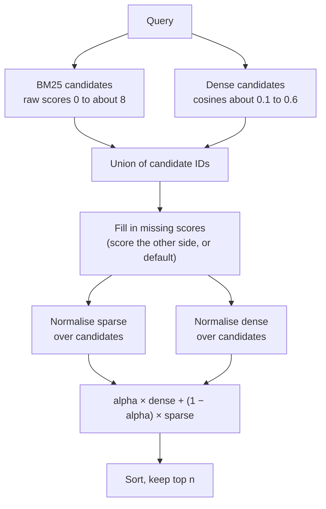

[Reciprocal Rank Fusion](/learn/hybrid-search/reciprocal-rank-fusion) merges two ranked lists by position alone, which makes it robust and parameter-light but blind to how *confident* each retriever was. **Weighted score fusion** keeps the scores. It puts each retriever's scores on a common scale, then adds them with a weight that says how much to trust each side. Done well, it can use information RRF throws away; done carelessly, it lets one retriever's arbitrary score scale decide every query.

This lesson covers the two decisions that define a score-fusion method, **how to normalise** and **how to weight**, plus a third that is easy to overlook: what score to give a chunk that one retriever did not return. You will tune the weight on the Meridian query set and see both why score fusion can beat RRF and why that result must be checked on queries the weight was not tuned on.

## Learning objectives

- Normalise a list of retrieval scores with min-max and z-score normalisation, by hand and in NumPy, and explain what each preserves and distorts.
- Compute a convex combination of normalised dense and sparse scores and find the break-even weight at which two chunks swap places.
- Choose a policy for chunks missing from one retriever's list, and explain how the choice biases the fused ranking.
- Tune the fusion weight on a labelled query set, read the resulting curve, and explain why the tuned value needs held-out validation.
- Compare score fusion with RRF and decide which to use given the labelled data available.

## Prerequisites

- [Reciprocal Rank Fusion](/learn/hybrid-search/reciprocal-rank-fusion): rank-based fusion, the baseline this lesson competes with.
- [Query-document similarity](/learn/retrieval-fundamentals/query-document-similarity): per-query normalisation and why scores are relative to the query.
- [Dense versus sparse retrieval](/learn/hybrid-search/dense-versus-sparse-retrieval): the `meridian_corpus.py` file used below.

## Why this matters

RRF gives the same credit for "rank 1 by a mile" and "rank 1 by a whisker". Consider the query "money for a desk and chair at home". The dense retriever's best chunk, the equipment budget, has cosine 0.48; its second, the support-desk chunk, has 0.27. That is a large, confident gap. BM25 meanwhile gives the support-desk chunk a modest score through the single word "desk". RRF sees only "dense rank 1" against "rank 2 in both lists" and picks the support desk. A method that could see the size of the dense retriever's margin would pick the equipment budget.

Score fusion is also what several engines and services expose directly, through a parameter usually called `alpha`: Weaviate's relative score fusion, OpenSearch's normalisation processor, Pinecone's sparse-dense weighting. Those lessons ([Weaviate](/learn/vector-database-ecosystem/weaviate), [OpenSearch](/learn/vector-database-ecosystem/opensearch), [Pinecone](/learn/vector-database-ecosystem/pinecone)) showed how to set it; this one explains what you are actually setting, so you can choose a value from evidence rather than leaving the default.

The risk is equally real. Normalisation choices that look harmless (normalise over the top 10 or the top 50? what score for a missing chunk?) change the fused order, and a weight tuned on a handful of queries can be a fit to noise.

## The intuition

Two scouts rate football players. One rates out of 100 and rarely goes below 60; the other rates out of 5 and uses the whole range. You cannot add their numbers directly: a 70 from the first scout is a lukewarm verdict, a 4 from the second is enthusiastic.

So you rescale each scout's ratings to a common range. The simplest way is to say "each scout's best player this week is a 1 and their worst is a 0" and place everyone else proportionally in between. Now the numbers are comparable, and you can decide how much to trust each scout: 70 per cent the experienced one, 30 per cent the newcomer. A player both scouts rate highly ends up top; a player one scout loves and the other dislikes ends up in the middle, nearer the trusted scout's view.

Notice the weakness in "best this week is a 1": if a scout watched only mediocre players this week, their best still gets a 1. Rescaling makes ratings comparable *within a week*; it does not tell you whether the week was any good.

## How it works

### The procedure

For each query:

1. **Retrieve** a candidate list from each retriever, with scores.
2. **Fill in missing scores**, if you can: for a chunk returned by only one retriever, compute the other retriever's score for it (see below), or apply a default.
3. **Normalise** each retriever's scores over the candidate set, so both lie on a comparable scale.
4. **Combine**: $\text{fused} = \alpha \cdot \text{dense} + (1 - \alpha) \cdot \text{sparse}$, with $0 \le \alpha \le 1$.
5. **Sort** by fused score and keep the top $n$.



### Normalisation choices

**Min-max** maps each list onto $[0, 1]$: best becomes 1, worst becomes 0. It is the most common choice (Weaviate's relative score fusion uses it) and easy to reason about. Its weaknesses all come from depending on the two extreme values:

- The best chunk always gets 1, however poor. A BM25 list whose best match is one incidental word contributes a full 1.0 to that chunk.
- The worst chunk always gets 0, and which chunk is worst depends on how deep you fetched. Fetch 10 and the 10th chunk sets the floor; fetch 50 and the floor drops, so everyone above it moves up. The fused order can change with list depth, a point the [OpenSearch](/learn/vector-database-ecosystem/opensearch) lesson demonstrated.
- One outlier stretches the range and squashes everyone else together.

**Z-score** subtracts the list's mean and divides by its standard deviation, measuring "how far above the crowd". It is less dominated by the single best and worst values, but the result is unbounded and depends on the list's spread; a list of nearly equal scores gets inflated differences.

**Theoretical bounds.** Instead of the observed minimum, use a known one: BM25 cannot go below 0, cosine cannot go below $-1$. Bruch, Gai and Ingber (2023) analysed this "theoretical min-max" variant and found it more stable than plain min-max, because the floor no longer moves with list depth. The observed maximum still moves.

**Distribution-based.** Qdrant offers a fusion mode it calls distribution-based score fusion (DBSF), which, per its documentation, normalises each list using its mean plus and minus three standard deviations as the limits before summing. It is a z-score idea expressed as a bounded range.

No normalisation turns scores into probabilities of relevance. All of them describe a chunk *relative to the other candidates for this query*.

### What score does a missing chunk get?

BM25 returns `e4021` for the query `E-4021`; dense search returns `e4022` first and `e4021` second. That one is easy, since both retrievers scored both chunks. But often a chunk is in only one list. There are three policies.

1. **Score it on the other side.** For a BM25-only chunk, take its stored embedding and compute the cosine with the query vector: one dot product. For a dense-only chunk, compute its BM25 score (engines can score a specific set of document IDs for a query). This **full scoring** of the candidate union is the most faithful and is what the code below does.
2. **Use the list's minimum** (0 after min-max). Simple, and what you get by default in many implementations. It says "this retriever thinks the chunk is as bad as its worst candidate", which can be harsh for a chunk just below the cut-off.
3. **Leave it out of the sum** and re-weight. This rewards chunks found by one retriever relative to policy 2 and makes fused scores harder to compare.

Policy 2 is the hidden reason min-max fusion is sensitive to depth: a chunk at dense rank 11 in a 10-deep list gets 0 from the dense side instead of a near-floor score.

### Combining and weighting

With both sides normalised, the **convex combination** $\alpha \cdot \tilde s_{\text{dense}} + (1-\alpha)\cdot \tilde s_{\text{sparse}}$ is the standard form; $\alpha = 1$ is pure dense, $\alpha = 0$ pure sparse. There are older alternatives from the data-fusion literature, such as CombSUM (add normalised scores) and CombMNZ (add, then multiply by the number of lists that returned the chunk), which [Search fusion](/learn/hybrid-search/search-fusion) covers for more than two lists.

The weight $\alpha$ must be chosen from labelled data. The natural range for a two-retriever hybrid depends on your corpus, query mix and normalisation, so there is no universal good value. What you can say in general:

- $\alpha$ is not "the percentage of dense". After min-max, a weight of 0.5 means "equal weight to two scores each stretched over $[0, 1]$", and how often each side wins depends on how its scores are spread.
- Changing the normalisation or the list depth changes the best $\alpha$. Re-tune after either.
- A curve of quality against $\alpha$ that is flat over a wide range is good news: the system is robust. A sharp peak at one value is a warning of overfitting.

### Score fusion or RRF?

| | RRF | Weighted score fusion |
| --- | --- | --- |
| Needs labelled data | No | Yes, to choose $\alpha$ |
| Uses confidence margins | No | Yes |
| Sensitive to score scale | No | Through the normaliser |
| Sensitive to list depth | Through missing chunks | Through missing chunks and the min-max floor |
| Typical failure | Coincidental consensus, ties | Over-trusting one side's weak best match; overfitted $\alpha$ |

Bruch, Gai and Ingber (2023) compared the two across several benchmarks and reported that a convex combination with a tuned weight generally matched or beat RRF, and that a small number of labelled queries was enough to choose the weight; they also found RRF more sensitive to its $k$ than its reputation suggests. That is a research result on public benchmarks; on your corpus, the labelled set decides. A sensible path is RRF on day one, then score fusion once you have a few dozen labelled queries and can show a held-out gain.

```playground
hybrid-retrieval
```

## The mathematics

### Min-max normalisation and the convex combination

**Intuition.** Stretch each list so its best is 1 and worst is 0, then take a weighted average.

**The formulas.**

$$
\tilde s_i(d) = \frac{s_i(d) - \min_{d' \in C} s_i(d')}{\max_{d' \in C} s_i(d') - \min_{d' \in C} s_i(d')}
\qquad
F(d) = \alpha\,\tilde s_{\text{dense}}(d) + (1 - \alpha)\,\tilde s_{\text{sparse}}(d)
$$

- $s_i(d)$ is retriever $i$'s raw score for chunk $d$.
- $C$ is the candidate set being normalised over (the union of both lists, after filling in scores).
- $\tilde s_i(d)$ is the normalised score in $[0, 1]$. If the maximum equals the minimum, the denominator is zero; define $\tilde s_i = 0$ for every chunk, since the list carries no ordering information.
- $\alpha \in [0, 1]$ is the dense weight; $F(d)$ is the fused score.

**Worked by hand.** Four chunks. BM25 scores $(3.10, 1.20, 0.00, 0.40)$, cosines $(0.31, 0.52, 0.48, 0.20)$.

- Sparse: min 0, max 3.10, so $\tilde s = (1, 0.387, 0, 0.129)$.
- Dense: min 0.20, max 0.52, range 0.32, so $\tilde s = (0.11/0.32, 1, 0.28/0.32, 0) = (0.344, 1, 0.875, 0)$.
- At $\alpha = 0.5$: $F = (0.672, 0.694, 0.4375, 0.065)$.

Chunk $b$ wins narrowly: it is the dense favourite and has a middling BM25 score. Chunk $a$, the clear BM25 favourite with a weak cosine, comes second.

### The break-even weight

**Intuition.** Two chunks swap places at the $\alpha$ where their fused scores are equal; solving for it shows exactly how much trust each side needs.

For the Meridian query "money for a desk and chair at home", after min-max over all sixteen chunks, `equipment` has $\tilde s_{\text{dense}} = 1$, $\tilde s_{\text{sparse}} = 0$, and `support` has $\tilde s_{\text{dense}} = 0.6215$, $\tilde s_{\text{sparse}} = 1$. `equipment` wins when

$$
\alpha \cdot 1 > \alpha \cdot 0.6215 + (1 - \alpha) \cdot 1
\iff \alpha\,(2 - 0.6215) > 1
\iff \alpha > \frac{1}{1.3785} \approx 0.725.
$$

Below 0.725, BM25's coincidental "desk" match is trusted enough to win; above it, the dense margin decides.

**In Python.**

```python
import numpy as np

bm25 = np.array([3.10, 1.20, 0.00, 0.40])    # BM25 scores of chunks a, b, c, d
cos = np.array([0.31, 0.52, 0.48, 0.20])     # cosine scores of the same chunks

def minmax(x):
    return (x - x.min()) / (x.max() - x.min())

alpha = 0.5
fused = alpha * minmax(cos) + (1 - alpha) * minmax(bm25)
print("bm25 norm", minmax(bm25).round(3))
print("cos  norm", minmax(cos).round(3))
print("fused    ", fused.round(3), "->", "abcd"[int(fused.argmax())])
print("break-even alpha for 'desk' query:", round(1 / (2 - 0.6215), 3))
```

```output
bm25 norm [1.    0.387 0.    0.129]
cos  norm [0.344 1.    0.875 0.   ]
fused     [0.672 0.694 0.437 0.065] -> b
break-even alpha for 'desk' query: 0.725
```

### Z-score normalisation

$$
z_i(d) = \frac{s_i(d) - \mu_i}{\sigma_i}
$$

where $\mu_i$ and $\sigma_i$ are the mean and standard deviation of retriever $i$'s scores over the candidate set. A chunk two standard deviations above the mean gets 2 whatever the raw units. Because z-scores are unbounded, one retriever with a very peaked distribution (one strong hit, everything else near zero, typical of BM25 on an identifier query) gives its top chunk a large z-score, which is often what you want: a confident retriever speaks louder.

## In code

**The problem.** Score every Meridian chunk with BM25 and the dense model for the fourteen labelled queries, fuse with min-max and z-score normalisation across a sweep of $\alpha$, and report recall@1 and mean reciprocal rank (MRR, the average of $1/\text{rank}$ of the right chunk; see [MRR](/learn/retrieval-evaluation/mrr)).

**Dependencies.** As before, with `meridian_corpus.py` from [Dense versus sparse retrieval](/learn/hybrid-search/dense-versus-sparse-retrieval) alongside.

**Shared corpus.** The code below reuses `meridian_corpus.py`, the shared Meridian chunks and labelled queries defined in lesson 1, [Dense versus sparse retrieval](/learn/hybrid-search/dense-versus-sparse-retrieval); save that file next to the scripts and do not redefine it.

```bash
pip install rank-bm25 sentence-transformers numpy
```

```python
import numpy as np
from rank_bm25 import BM25Okapi
from sentence_transformers import SentenceTransformer
from meridian_corpus import DOCS, QUERIES, tokenise

ids = list(DOCS)
texts = [DOCS[i] for i in ids]
bm25 = BM25Okapi([tokenise(t) for t in texts])
model = SentenceTransformer("sentence-transformers/all-MiniLM-L6-v2")
doc_vecs = model.encode(texts, normalize_embeddings=True)
query_vecs = model.encode([q for q, _, _ in QUERIES], normalize_embeddings=True)

def minmax(x):
    span = x.max() - x.min()
    return (x - x.min()) / span if span > 0 else np.zeros_like(x)

def zscore(x):
    sd = x.std()
    return (x - x.mean()) / sd if sd > 0 else np.zeros_like(x)

NORMALISERS = {"min-max": minmax, "z-score": zscore}

# Score every chunk with both retrievers ("full scoring"), once per query.
sparse = [bm25.get_scores(tokenise(q)) for q, _, _ in QUERIES]
dense = [doc_vecs @ qv for qv in query_vecs]
gold = [ids.index(g) for _, g, _ in QUERIES]

def evaluate(alpha, norm):
    """Return recall@1 and mean reciprocal rank of the gold chunk."""
    hits, rr = 0, 0.0
    for s, d, g in zip(sparse, dense, gold):
        fused = alpha * norm(d) + (1 - alpha) * norm(s)
        rank = int((fused >= fused[g]).sum())  # ties count against us
        hits += rank == 1
        rr += 1 / rank
    return hits, rr / len(gold)

print("alpha   " + "   ".join(f"{name:>14s}" for name in NORMALISERS))
for alpha in np.round(np.arange(0, 1.01, 0.1), 1):
    cells = []
    for norm in NORMALISERS.values():
        hits, mrr = evaluate(alpha, norm)
        cells.append(f"R@1 {hits:2d} MRR {mrr:.3f}")
    print(f"{alpha:4.1f}   " + "   ".join(cells))

# Show raw and normalised scores for one query
q = 7  # "E-4021"
top = np.argsort(-dense[q])[:3]
print(f"\nquery {QUERIES[q][0]!r}")
for i in top:
    print(f"  {ids[i]:6s} bm25 {sparse[q][i]:5.2f} -> {minmax(sparse[q])[i]:.2f}   "
          f"cos {dense[q][i]:.3f} -> {minmax(dense[q])[i]:.2f}")
```

```output
alpha          min-max          z-score
 0.0   R@1  9 MRR 0.665   R@1  9 MRR 0.665
 0.1   R@1 11 MRR 0.881   R@1 11 MRR 0.881
 0.2   R@1 11 MRR 0.881   R@1 11 MRR 0.881
 0.3   R@1 11 MRR 0.881   R@1 11 MRR 0.881
 0.4   R@1 11 MRR 0.881   R@1 11 MRR 0.881
 0.5   R@1 11 MRR 0.881   R@1 11 MRR 0.881
 0.6   R@1 11 MRR 0.893   R@1 11 MRR 0.893
 0.7   R@1 11 MRR 0.893   R@1 12 MRR 0.929
 0.8   R@1 12 MRR 0.929   R@1 12 MRR 0.929
 0.9   R@1 12 MRR 0.929   R@1 12 MRR 0.929
 1.0   R@1 11 MRR 0.893   R@1 11 MRR 0.893

query 'E-4021'
  e4022  bm25  0.00 -> 0.00   cos 0.315 -> 1.00
  e4021  bm25  2.43 -> 1.00   cos 0.311 -> 0.99
  e4012  bm25  0.00 -> 0.00   cos 0.252 -> 0.81
```

**The important lines.**

- `sparse` and `dense` hold a score for **every** chunk, so no chunk is ever "missing": this is policy 1, full scoring, which is affordable on sixteen chunks. In production you would fully score only the union of the two candidate lists.
- `minmax` and `zscore` return zeros when all scores are equal. That happens for every query with no BM25 match, and without the guard you would divide by zero and fill the fused scores with `nan`.
- `rank = int((fused >= fused[g]).sum())` counts ties *against* the gold chunk. When BM25 scores are all zero (at $\alpha = 0$), every chunk ties, and an optimistic tie-break would credit the lexical side with lucky hits. This is the same honesty rule as excluding zero-score chunks in the first lesson.
- The normalisation is applied **per query**, inside the loop. Normalising across all queries at once would put an identifier query's huge BM25 scores on the same scale as a vague query's tiny ones, which defeats the purpose.

**What the output means.**

- **The endpoints reproduce the single retrievers**: $\alpha = 0$ gives sparse (9 at rank 1), $\alpha = 1$ gives dense (11).
- **A small sparse weight already fixes `E-4021`.** From $\alpha = 0.1$ upwards the identifier query is answered correctly (see the detail below), but recall@1 stays at 11, the same as dense alone, because at low $\alpha$ BM25's coincidental "desk" match still wins the "money for a desk and chair at home" query. The MRR on this plateau (0.881) is slightly below dense alone (0.893), so on this corpus a mixture that leans on BM25 is a trade, not a gain.
- **Recall@1 reaches 12 once $\alpha$ is high enough, 0.8 to 0.9 for both normalisers** (0.7 for z-score). That is the union ceiling at rank 1 from the first lesson, and above RRF's 11 on the same lists. The step from 11 to 12 is the "desk" query, whose break-even weight you computed as 0.725.
- **At $\alpha = 1.0$ it falls back to 11**, because dense alone puts `e4022` above `e4021`. The useful region is a band, roughly 0.7 to 0.9, where the dense margin settles the paraphrase queries and a full-strength BM25 hit still outweighs a near-tie in cosine.
- **The `E-4021` detail shows why score fusion works here.** The dense retriever's preference for `e4022` over `e4021` is tiny (0.315 against 0.311, normalised 1.00 against 0.99), while BM25's preference is total. Weighted addition lets the confident retriever win for any $\alpha$ below about 0.99 (`e4021` wins when $(1 - \alpha) + 0.99\alpha > \alpha$); RRF would have seen "rank 1 against rank 2" in the dense list, the same as a large gap.
- **Z-score and min-max agree almost everywhere** on this corpus; z-score reaches 12 one step earlier, at 0.7.

> [!WARNING]
> The 12 at $\alpha = 0.8$ to $0.9$ was found by trying eleven values on the same fourteen queries it is scored on, and it differs from dense alone by exactly one query. The gain over dense is therefore weak evidence; the trustworthy conclusions are the shape (a mixture helps the identifier query at any $\alpha$, and the "desk" query only above its break-even) and the fact that both ends of the range are worse. [Hybrid search optimisation](/learn/hybrid-search/hybrid-search-optimisation) shows how to tune on one set of queries and confirm on another.

**Errors people commonly hit.**

- *Normalising over the whole corpus once* instead of per query, or with statistics from a different query.
- *Forgetting the zero-range guard*, producing `nan` scores that sort unpredictably.
- *Using distance instead of similarity.* Some engines return distances (lower is better); min-max of a distance flips the meaning. Convert to similarity first.

**Extending it.** Replace full scoring with the realistic setup: take the top 5 from each retriever, give missing chunks the list minimum, and re-run the sweep. Watch the peak move as depth effects appear (Exercise 3).

## A real-world example

Meridian's support desk tools team (the Service Desk Tools team) built a separate search page over the Atlas error-code catalogue and the IT runbooks, and used a managed search service whose hybrid mode exposed `alpha` with a default of 0.5. The page worked well for typed questions, but engineers who pasted a code with a short description ("E-4021 after password reset") sometimes got the sibling code first.

Investigating, the team found that their candidate lists were only 10 deep on each side, with min-max normalisation. For identifier queries BM25 returned one or two strong hits and then nothing, so its list was short; the dense list was always full. A chunk the dense side ranked 11th received 0 from it, while BM25's single weak second hit, normalised to the list floor, also became 0. The fused order in the tail depended on which side happened to reach the cut-off.

They changed two things. They raised the candidate depth to 50 per side and asked the service to score missing chunks on the other side where it could, which made normalisation stable. Then they built a set of eighty labelled queries, half typed questions and half pasted codes, and swept $\alpha$, checking each candidate value on a second set of queries collected the following week. The plateau ran from about 0.3 to 0.6 for their data; they chose the middle and wrote down that the value must be re-checked if the embedding model or the depth changed. The point of the story is not their particular number, which belongs to their corpus, but the order of work: fix normalisation and depth first, tune the weight second, validate on fresh queries third.

## Common mistakes

- **Adding raw scores.** BM25 and cosine live on unrelated scales; one retriever silently dominates.
- **Treating `alpha` as a percentage of influence.** After normalisation, how often each side wins depends on the shape of its score distribution, not only on the weight.
- **Normalising over too shallow a list.** The min-max floor then depends on the cut-off, and fused orders change when the depth changes.
- **Giving missing chunks 0 without thinking.** A chunk just below one retriever's cut-off is treated as that retriever's worst, which can bury good candidates.
- **Choosing alpha on the evaluation set and reporting the same number.** The reported quality is optimistic, especially with a few dozen queries.
- **Thresholding fused scores.** A min-max fused score of 0.9 means "near the top of this query's candidates", not "relevant".

## Best practices

- Start with RRF; switch to score fusion when a labelled set shows a gain on held-out queries.
- Normalise per query, over a candidate set deep enough that the floor is stable (tens of candidates per side, not a handful).
- Fill in missing scores by scoring the other side when the engine allows it; otherwise document the default you use.
- Sweep $\alpha$ and look at the whole curve; prefer the middle of a broad plateau to a sharp peak.
- Re-tune after any change to the embedding model, BM25 analyser, normalisation or depth.
- Log both raw and normalised scores per retriever so a surprising ranking can be explained.

## Performance considerations

**Fusion itself is cheap.** Normalising and combining two lists of 50 is a few hundred arithmetic operations.

**Filling in missing scores is the real cost.** For a dense-only chunk, the BM25 score needs the chunk's term statistics; for a BM25-only chunk, the cosine needs its stored vector. Fetching 50 vectors of 384 floats is $50 \times 384 \times 4 = 76{,}800$ bytes, trivial on one machine but a noticeable payload if it crosses a network on every query. Engines that support score fusion internally avoid that transfer.

**Tuning is offline.** A sweep of 11 values of $\alpha$ over 1,000 labelled queries is 11,000 fusions of precomputed scores: seconds. Precompute and cache both retrievers' scores for the labelled set once, then sweep; never re-run retrieval inside the sweep.

**Depth costs latency on the retrieval side.** Raising depth from 10 to 50 per side makes HNSW search explore more candidates and BM25 score more postings, plus fetch more payloads. Measure the latency at each depth and choose the shallowest at which normalisation stops changing the fused top results.

## Summary

- Weighted score fusion normalises each retriever's scores per query, then combines them as $\alpha \cdot \text{dense} + (1-\alpha) \cdot \text{sparse}$.
- Min-max is simple but depends on the list's extremes, so the best chunk always gets 1 and the floor moves with depth; z-score and theoretical bounds are more stable alternatives.
- What a chunk missing from one list receives (a computed score, the list minimum, or nothing) changes the ranking; full scoring of the candidate union is the most faithful.
- Score fusion uses confidence margins that RRF ignores, and on the Meridian set it reached the union ceiling where RRF did not, but the weight must be tuned on labelled queries and confirmed on held-out ones.
- Prefer the middle of a broad plateau of good $\alpha$ values, and re-tune whenever the model, analyser, normalisation or depth changes.

## Exercises

**1.** Min-max normalise BM25 scores $(5.0, 2.0, 1.0)$ and cosines $(0.40, 0.45, 0.35)$ for chunks $x, y, z$, and find the fused order at $\alpha = 0.5$ and $\alpha = 0.8$.

<details><summary>Show solution</summary>

Sparse: min 1, max 5, range 4: $(1, 0.25, 0)$. Dense: min 0.35, max 0.45, range 0.10: $(0.5, 1, 0)$.

At $\alpha = 0.5$: $x = 0.75$, $y = 0.625$, $z = 0$. Order $x, y, z$.

At $\alpha = 0.8$: $x = 0.8 \times 0.5 + 0.2 \times 1 = 0.6$, $y = 0.8 \times 1 + 0.2 \times 0.25 = 0.85$, $z = 0$. Order $y, x, z$.

Note that the dense scores differ by only 0.05 in raw terms, but min-max stretches that into the full range. Min-max magnifies small differences in a tightly clustered list.

</details>

**2.** A BM25 list contains exactly one chunk. What does min-max normalisation give it, and what does the code in this lesson do? Propose a better rule.

<details><summary>Show solution</summary>

With one chunk, max equals min and the formula divides by zero. The lesson's `minmax` returns 0, which throws away a possibly decisive match (a single exact hit on an error code is often the best evidence available). Better rules: normalise against a theoretical floor of 0 (so the single chunk gets 1), or fully score the dense candidates with BM25 so the list is never that short, after which most get 0 and the hit gets 1.

</details>

**3.** Change the code so that each retriever returns only its top 5, missing chunks receive the list minimum (0 after min-max), and normalisation runs over each top-5 list. Re-run the sweep and compare with full scoring.

<details><summary>Show solution</summary>

```python
def truncated(x, depth=5):
    keep = np.argsort(-x, kind="stable")[:depth]
    out = np.full_like(x, np.nan)
    out[keep] = x[keep]
    lo, hi = np.nanmin(out), np.nanmax(out)
    out = (out - lo) / (hi - lo) if hi > lo else np.where(np.isnan(out), np.nan, 0.0)
    return np.nan_to_num(out, nan=0.0)  # missing chunks get the floor

for alpha in (0.3, 0.5, 0.6, 0.8):
    hits, mrr = evaluate(alpha, truncated)
    print(alpha, hits, round(mrr, 3))
```

```output
0.3 11 0.881
0.5 11 0.881
0.6 12 0.929
0.8 12 0.929
```

The low-$\alpha$ values (0.3 and 0.5) are unchanged, but the step up to 12 moves: with full scoring it needed $\alpha$ of 0.7 or more (0.725 for the "desk" query), whereas with 5-deep lists 12 is already reached at 0.6. The reason is the "desk" query: after truncation `support` is the second of only five dense candidates, so min-max stretches the dense scores over a narrower range and its normalised dense score drops from 0.6215 to 0.2797, which lowers the break-even weight to $1/(2 - 0.2797) \approx 0.58$. Chunks outside the top 5 are treated as each side's worst, so the surviving candidates' scores are stretched over a different range. The best $\alpha$ depends on how normalisation is done, which is why you re-tune after changing depth.

</details>

**4.** Your team's labelled set has 30 queries. Sweeping $\alpha$ gives recall@5 of 0.83 at $\alpha = 0.35$ and 0.80 everywhere from 0.2 to 0.7. Which value would you ship, and what would you do before shipping?

<details><summary>Show solution</summary>

A difference of 0.03 on 30 queries is one query. The 0.83 is very likely a fit to that one query, so ship a value in the middle of the plateau, around 0.45, rather than the peak. Before shipping, collect a second labelled set (from different users or a later week) and confirm that the chosen value performs at least as well as RRF there. If the two methods are tied on held-out data, RRF's lack of a tuned parameter is an argument for keeping it.

</details>

## Check your understanding

```quiz
[
  {"q": "Why can't BM25 scores and cosine similarities simply be added?", "options": ["BM25 scores are always negative", "They are on unrelated scales, so whichever retriever has larger numbers dominates", "Cosine similarities are probabilities and BM25 scores are not", "Addition is not commutative for floating-point numbers"], "answer": 1, "why": "BM25 is unbounded and often several units; cosines for many models sit in a narrow band below 1. Adding them lets BM25 decide almost every query."},
  {"q": "After min-max normalisation of a BM25 list whose best match is a single incidental word, what score does that chunk get?", "options": ["1, because it is the best in its list", "0", "A low score reflecting the weak match", "It depends on alpha"], "answer": 0, "why": "Min-max always maps the best candidate to 1, however weak it is in absolute terms. Normalisation is relative to the query's candidates."},
  {"q": "Two chunks have normalised scores (dense 1.0, sparse 0.0) and (dense 0.5, sparse 1.0). Above what alpha does the first win?", "options": ["0.5", "0.75", "0.333", "0.667"], "answer": 3, "why": "alpha > 0.5 alpha + (1 - alpha) gives 1.5 alpha > 1, so alpha > 2/3."},
  {"q": "You change the candidate depth from 10 to 50 per retriever. What should you do about alpha?", "options": ["Nothing, alpha is independent of depth", "Double it", "Re-tune it, because normalisation and missing-chunk handling depend on depth", "Switch to alpha = 0.5"], "answer": 2, "why": "The min-max floor and the set of chunks that are missing from one side both change with depth, so the best weight can move."},
  {"q": "A sweep of alpha on 20 labelled queries shows a sharp peak at 0.73 and a broad plateau from 0.3 to 0.7 that is one query worse. What is the soundest choice?", "options": ["0.73, because it is the best measured value", "A value near the middle of the plateau, confirmed on held-out queries", "0.0, because sparse retrieval is more precise", "1.0, because dense retrieval handles paraphrases"], "answer": 1, "why": "A one-query difference on 20 queries is likely noise. A value in a broad plateau is robust, and held-out queries confirm it."}
]
```

## Further reading

- Sebastian Bruch, Siyu Gai and Amir Ingber (2023), "An Analysis of Fusion Functions for Hybrid Retrieval", *ACM Transactions on Information Systems*. Convex combination against RRF, normalisation variants including theoretical min-max, and sample efficiency.
- Edward A. Fox and Joseph A. Shaw (1994), "Combination of Multiple Searches", *Proceedings of TREC-2*. The origin of CombSUM and CombMNZ.
- Joon Ho Lee (1997), "Analyses of Multiple Evidence Combination", *Proceedings of SIGIR 1997*. An early study of score normalisation before fusion.
- Qdrant documentation, "Hybrid and multi-stage queries": [qdrant.tech/documentation](https://qdrant.tech/documentation/). RRF and distribution-based score fusion.
- Weaviate documentation, hybrid search and fusion methods: [weaviate.io/developers/weaviate](https://weaviate.io/developers/weaviate). Relative score fusion and `alpha`.
