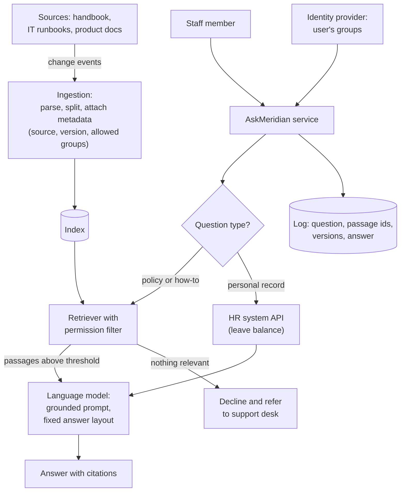

This assessment covers all ten lessons of *Introduction to RAG*: what RAG is and why it was introduced, the limits of language models used alone, knowledge cutoffs and hallucination, parametric and non-parametric knowledge, how retrieval improves generation, the comparisons with fine-tuning and long-context prompting, and real-world applications. The multiple-choice section has 19 questions; the pass mark is 14 correct (about 75%). The open questions, coding exercises, design challenge and troubleshooting scenarios are not scored automatically: attempt each one before opening its solution, and treat any you could not answer as a pointer back to the relevant lesson. Where prices appear they are assumptions for arithmetic practice, not quotes from any provider.

```quiz
[
  {
    "q": "Which description of retrieval-augmented generation is the most accurate?",
    "options": [
      "Training a language model on a company's documents so it memorises them",
      "Finding passages relevant to a question in an external store and giving them to a language model along with the question",
      "Asking a language model the same question several times and keeping the commonest answer",
      "Replacing the language model with a search engine"
    ],
    "answer": 1,
    "why": "RAG retrieves relevant text at question time and places it in the prompt, so the model generates its answer with that evidence in view. The model's weights are not changed."
  },
  {
    "q": "In the paper that introduced the term RAG (Lewis et al., 2020), what were the two memories being combined?",
    "options": [
      "A short-term memory and a long-term memory inside one transformer",
      "A cache of previous answers and a cache of previous questions",
      "A pre-trained sequence-to-sequence model as parametric memory and a dense vector index of Wikipedia as non-parametric memory",
      "A SQL database and a spreadsheet"
    ],
    "answer": 2,
    "why": "The paper pairs a pre-trained generator (parametric memory) with a dense index of Wikipedia reached through a neural retriever (non-parametric memory)."
  },
  {
    "q": "A general-purpose language model, with no retrieval, is asked for Meridian's home-office equipment budget. What is the fundamental reason it cannot answer reliably?",
    "options": [
      "The question is too short",
      "Its context window is too small",
      "Budgets are numerical and language models cannot output numbers",
      "Meridian's internal handbook was never part of its training data, so the fact is not in its weights"
    ],
    "answer": 3,
    "why": "Private documents are absent from the training data. The model has nothing to recall and can only produce a plausible guess."
  },
  {
    "q": "A model's training data ends in a particular month. A user asks about a product released four months later, and no documents are supplied. What should you expect?",
    "options": [
      "The model either says it does not know or produces a plausible guess, because the event lies after its knowledge cutoff",
      "The model looks the product up on the internet automatically",
      "The model's weights update themselves when the question is asked",
      "The model refuses all questions that mention dates"
    ],
    "answer": 0,
    "why": "Weights are frozen after training. Anything after the knowledge cutoff is unknown to the model unless it is supplied in the prompt."
  },
  {
    "q": "What is a hallucination in the context of language models?",
    "options": [
      "A response that is too long",
      "An error message from the API",
      "Fluent, confident output that is false or not supported by any source",
      "A response in the wrong language"
    ],
    "answer": 2,
    "why": "The defining features are fluency and lack of support. The text reads as authoritative, which is what makes it dangerous."
  },
  {
    "q": "Does adding retrieval eliminate hallucination?",
    "options": [
      "Yes, because the model can only copy from the retrieved passages",
      "No. It reduces it, but the model can still answer wrongly when retrieval misses, when passages are irrelevant, or when it ignores the context",
      "Yes, provided the temperature is set to zero",
      "No, retrieval makes hallucination more frequent in every case"
    ],
    "answer": 1,
    "why": "Retrieval gives the model evidence but does not force it to use the evidence, and a retrieval miss leaves it guessing. Grounding instructions, refusal paths and evaluation are still needed."
  },
  {
    "q": "A customer exercises a right to have their personal data erased. Their details appear in support documents used by an assistant. In which design is erasure most straightforward to carry out and verify?",
    "options": [
      "The documents were used to fine-tune the model",
      "The documents were used to fine-tune the model and are also pasted into the prompt",
      "It is equally easy in all designs",
      "The documents are held in a searchable store and retrieved at question time"
    ],
    "answer": 3,
    "why": "Non-parametric knowledge has an address: delete the document and its index entries, then confirm it no longer appears in search results. There is no reliable operation for deleting one fact from weights."
  },
  {
    "q": "Which component of a typical RAG system is parametric, even though the document store is non-parametric?",
    "options": [
      "The embedding model the retriever uses to judge similarity",
      "The text of the stored passages",
      "The metadata recording who may read each passage",
      "The passage identifiers"
    ],
    "answer": 0,
    "why": "An embedding model has learned weights, a training cutoff and blind spots. The store holds explicit text, but the thing that searches it is a trained model."
  },
  {
    "q": "A retriever gives two passages probabilities 0.8 and 0.2. Given each passage, the generator gives the correct answer probabilities 0.9 and 0.1. What does this print?\n```python\np_z = [0.8, 0.2]\np_y = [0.9, 0.1]\nprint(round(sum(a * b for a, b in zip(p_z, p_y)), 2))\n```",
    "options": [
      "0.9",
      "0.5",
      "0.74",
      "1.0"
    ],
    "answer": 2,
    "why": "This is the marginalisation over passages: 0.8 x 0.9 + 0.2 x 0.1 = 0.72 + 0.02 = 0.74."
  },
  {
    "q": "What does this print?\n```python\ngold = [\"a\", \"b\", \"c\", \"d\"]\nretrieved = [[\"a\", \"x\"], [\"y\", \"b\"], [\"x\", \"y\"], [\"d\", \"c\"]]\nhits = sum(g in r for g, r in zip(gold, retrieved))\nprint(hits / len(gold))\n```",
    "options": [
      "1.0",
      "0.75",
      "0.5",
      "0.25"
    ],
    "answer": 1,
    "why": "The gold passage is among the retrieved ones for the first, second and fourth questions but not the third (\"c\" is not in [\"x\", \"y\"]). Three hits out of four is 0.75, the hit rate."
  },
  {
    "q": "A RAG assistant gives wrong answers on about a third of test questions. Inspecting the logs shows that for nearly all of those, the passage containing the answer was not among the retrieved passages. What should the team work on first?",
    "options": [
      "A larger language model",
      "A longer system prompt",
      "Fine-tuning the generator on the test questions",
      "Retrieval, because the model never saw the evidence"
    ],
    "answer": 3,
    "why": "Answer quality is capped by the hit rate. If the right passage is not in the prompt, no change to the generator can produce a grounded correct answer."
  },
  {
    "q": "A team needs every reply in a fixed three-part layout. The facts in the replies are already correct, and clear instructions with examples have not made the layout reliable. Which approach addresses this?",
    "options": [
      "Fine-tuning on examples of correctly laid-out replies, because the problem is behaviour",
      "Adding more documents to the index",
      "Retrieving more passages per question",
      "Switching to long-context prompting"
    ],
    "answer": 0,
    "why": "Layout is behaviour, which lives in instructions or weights. Retrieval and long context change which facts are in view, not how the model formats its output."
  },
  {
    "q": "With assumed prices of 3.00 dollars per million input tokens and 15.00 per million output tokens, what does this print?\n```python\ntokens_in, tokens_out = 2000, 200\nprice_in, price_out = 3.00, 15.00\nprint((tokens_in * price_in + tokens_out * price_out) / 1_000_000)\n```",
    "options": [
      "0.9",
      "0.09",
      "0.0009",
      "0.009"
    ],
    "answer": 3,
    "why": "2000 x 3.00 = 6000 and 200 x 15.00 = 3000. Their sum, 9000, divided by one million is 0.009 dollars per question."
  },
  {
    "q": "Which statement about combining RAG and fine-tuning is correct?",
    "options": [
      "They cannot be used in the same system",
      "Fine-tuning replaces the need for an index once the model has seen the documents",
      "A model can be fine-tuned for behaviour, or to use retrieved context well, while facts are still supplied by retrieval",
      "Fine-tuning the retriever makes the document store parametric"
    ],
    "answer": 2,
    "why": "The techniques act on different things. A tuned generator plus retrieved facts is a common design, and the embedding model behind the retriever can also be fine-tuned."
  },
  {
    "q": "A 15-person firm wants an assistant over a 30-page office manual that all staff may read. It changes twice a year and will be asked a few dozen questions a day. What is the most reasonable first design?",
    "options": [
      "Fine-tune a model on the manual",
      "Put the whole manual in the prompt, with caching, and test it on real questions",
      "Build a vector database with a multi-stage retrieval pipeline",
      "Train a new language model from scratch"
    ],
    "answer": 1,
    "why": "The corpus is far smaller than a context window, public to all users, stable and lightly used. Long-context prompting is the simplest design that works and cannot miss a passage."
  },
  {
    "q": "A long-context assistant places the current date and time at the very start of its system prompt, followed by 80,000 tokens of documents marked for caching. What is the effect on prompt caching?",
    "options": [
      "No effect, because only the documents are cached",
      "Caching works better, because the timestamp identifies the request",
      "The cache is hit only for requests in the same hour",
      "The prefix differs on every request, so the cache is almost never hit and each request pays to write it again"
    ],
    "answer": 3,
    "why": "A cache hit needs an identical prefix up to the cache point. Volatile content must come after the cached block, not before it."
  },
  {
    "q": "A customer asks a support assistant, \"Where is my order right now?\" What should produce the answer?",
    "options": [
      "A call to the order system's API, because this is live transactional data",
      "Passage retrieval over the help centre articles",
      "The model's parametric knowledge",
      "A fine-tuned model trained on last month's orders"
    ],
    "answer": 0,
    "why": "The answer is a live record, not something written in a document. Retrieval could explain the delivery policy, but the status must be looked up in the system that holds it."
  },
  {
    "q": "In a multi-user RAG system, where must document permissions be enforced?",
    "options": [
      "In the system prompt, by telling the model which documents are confidential",
      "After generation, by scanning the answer for restricted words",
      "At retrieval, so that passages a user may not read never enter the prompt",
      "In the user interface, by hiding the citations"
    ],
    "answer": 2,
    "why": "Anything in the prompt can be reflected in the answer. The only reliable control is to keep restricted passages out of the prompt by filtering at retrieval."
  },
  {
    "q": "A long-context system has every passage in the prompt, so in effect its hit rate is 1. Why can its answers still be wrong?",
    "options": [
      "A hit rate of 1 means the retriever is overloaded",
      "Presence is not use: the model may overlook the relevant passage among a very large context, or side with its own memory",
      "Long prompts always exceed the context window",
      "Caching corrupts the documents"
    ],
    "answer": 1,
    "why": "Overall accuracy is hit rate times accuracy on hits. Putting everything in view makes the first factor 1 but can lower the second, which has to be measured."
  }
]
```

## Conceptual questions

**1.** Explain, in your own words, the difference between parametric and non-parametric knowledge, and give two properties that each has and the other lacks.

<details><summary>Show model answer</summary>

Parametric knowledge is whatever a model learned in training and now holds implicitly in its weights. Non-parametric knowledge is kept as explicit text in an external store and looked up when a question arrives.

Parametric knowledge is always available at no extra cost per question (no search, no extra prompt tokens), and it includes general skills such as reading, reasoning and writing that apply to every question. It lacks an address: a fact cannot be traced to a source, updated without training, hidden from particular users, or reliably deleted.

Non-parametric knowledge is exact and current (the store holds the document as written, and editing the document changes the answer), and it supports provenance, per-user filtering and deletion. It lacks any ability to act on its own: it helps only if the retriever finds the right passage, and it costs a search and extra input tokens every time.

RAG uses both: weights for language ability, the store for facts.

</details>

**2.** "Retrieval makes the model smarter." Explain why this is the wrong way to describe what retrieval does, and give the correct description using the idea of conditional probability.

<details><summary>Show model answer</summary>

Retrieval does not change the model at all: the weights before and after are identical. What changes is the prompt. A language model generates each token from a probability distribution conditioned on all the text so far, so its answer is a function of what it is given. With only the question, that distribution is shaped by parametric memory alone, and for a fact the model never learned, probability is spread across several plausible answers. With a relevant passage in the prompt, the model is conditioned on evidence, and the answer the passage supports becomes far more probable, because reading a fact from the context is much easier than recalling it.

Lewis et al. (2020) formalise this by treating the retrieved passage as a latent variable: the probability of an answer is a sum, over the top retrieved passages, of the retriever's probability for the passage times the generator's probability of the answer given that passage. Most current systems instead concatenate the passages into one prompt, but the principle is the same. The practical consequence is that retrieval can only help if the right passage is retrieved and the model uses it.

</details>

**3.** A colleague says: "We should fine-tune a model on our documentation instead of building RAG, so that the knowledge is really *in* the model." Give a fair response that says where this is wrong and where fine-tuning does have a place.

<details><summary>Show model answer</summary>

Where it is wrong: fine-tuning adjusts weights to imitate patterns in examples; it does not store documents for exact recall. Facts that appear a few times are learned weakly, so specific figures come back unreliably. The tuned model cannot cite a source. Each change to the documentation needs another training run and evaluation, so the model is stale between runs. Every user of the model receives the same weights, so document permissions cannot be enforced, and content cannot be reliably removed later. A fine-tuned model still hallucinates outside its training, now in a convincing house style.

Where fine-tuning has a place: changing *behaviour*. A fixed output format or tone that prompting cannot make reliable, a narrow task performed at very high volume where short prompts save cost and latency, reading domain-specific notation, or teaching a generator to make better use of retrieved passages. The retriever's embedding model can also be fine-tuned for a domain.

A fair conclusion: keep the documentation in a retrievable store for the facts; consider fine-tuning only for a behaviour problem that survives good prompting; the two are often combined.

</details>

**4.** Context windows now hold hundreds of thousands of tokens. Give three reasons RAG is still needed for many systems, and one situation in which long-context prompting is the better choice.

<details><summary>Show model answer</summary>

Reasons RAG is still needed (any three):

- **Size.** Many corpora are far larger than any window, and corpora grow.
- **Cost and latency.** Long-context prompting pays for every corpus token on every question; cost and processing time scale with corpus size times traffic. Caching lowers the rate only while the prefix is unchanged and the cache is warm.
- **Permissions.** A shared prompt exposes every document to every user. Per-user filtering is a retrieval-time operation.
- **Accuracy over long inputs.** Having a passage present does not guarantee the model uses it; reliability over very long contexts has to be tested.
- **Data minimisation.** Retrieval sends only the needed passages to the model provider.

Long context is the better choice when the corpus is small relative to the window, readable by all users, fairly stable and not queried at high volume, or when the question needs a whole document (a summary or a comparison between sections). It is simpler and cannot miss a passage.

Large windows also improve RAG itself: a system can retrieve more or larger passages, which makes it less sensitive to chunking.

</details>

**5.** Choose two families of RAG application and contrast them using the six requirements (corpus, permissions, question type, cost of error, latency, auditability). State which requirement dominates each.

<details><summary>Show model answer</summary>

One good contrast is customer support against legal research.

| Requirement | Customer support | Legal research |
| --- | --- | --- |
| Corpus | Help articles and policies; moderate size; edited regularly | Contracts, regulations, case law; long, cross-referenced, versioned by date and jurisdiction |
| Permissions | Mostly public content; little filtering | Often matter- or client-restricted |
| Question type | Routine how-to and policy lookups | Precise questions needing exact clauses, often comparisons |
| Cost of error | Commercial and reputational; the company is answerable for what the assistant says | Professional and legal; an unsupported claim can lead to sanctions |
| Latency | A few seconds | Tens of seconds are acceptable |
| Auditability | Useful (logs of what was said) | Essential: every statement tied to a specific source and version |

Customer support is dominated by grounding with a tested refusal path and by cost per question, because volume is high. Legal research is dominated by auditability: verified citations to the correct version matter more than speed or cost. The same retrieve-then-generate core serves both, but the first would be tuned for speed and economy with a hand-off to a person, and the second for thoroughness with verification steps.

</details>

## Coding exercises

**1. Diagnose a RAG log.** You are given a log of eight test questions. Each row has the identifier of the passage that answers the question (`gold`), the identifiers that were retrieved, and whether the final answer was judged correct. Write a function that prints the hit rate, the accuracy on hits, the accuracy on misses and the overall accuracy, confirms that the overall accuracy equals $h \cdot a_{\text{hit}} + (1 - h) \cdot a_{\text{miss}}$, and labels each failure as a retrieval or a generation failure.

```python
log = [
    {"question": "How many days of annual leave do I get?", "gold": "leave-01",
     "retrieved": ["leave-01", "leave-02"], "correct": True},
    {"question": "Can I carry leave over?", "gold": "leave-02",
     "retrieved": ["leave-02", "leave-01"], "correct": True},
    {"question": "How often must I change my password?", "gold": "it-01",
     "retrieved": ["it-02", "remote-01"], "correct": False},
    {"question": "Do I need a receipt for a £90 taxi?", "gold": "expenses-02",
     "retrieved": ["expenses-01", "expenses-02"], "correct": False},
    {"question": "What is the home-office budget?", "gold": "remote-02",
     "retrieved": ["remote-02", "remote-01"], "correct": True},
    {"question": "Is the VPN needed in a cafe?", "gold": "it-02",
     "retrieved": ["remote-01", "leave-01"], "correct": False},
    {"question": "When is the support desk open?", "gold": "it-03",
     "retrieved": ["it-03", "it-01"], "correct": True},
    {"question": "How long do I have to file expenses?", "gold": "expenses-01",
     "retrieved": ["expenses-01", "expenses-02"], "correct": True},
]
```

<details><summary>Show solution</summary>

```python
def diagnose(log: list[dict]) -> None:
    hits = [row for row in log if row["gold"] in row["retrieved"]]
    misses = [row for row in log if row["gold"] not in row["retrieved"]]

    hit_rate = len(hits) / len(log)
    accuracy = sum(row["correct"] for row in log) / len(log)
    a_hit = sum(row["correct"] for row in hits) / len(hits) if hits else 0.0
    a_miss = sum(row["correct"] for row in misses) / len(misses) if misses else 0.0

    print(f"questions            {len(log)}")
    print(f"hit rate h           {hit_rate:.3f}")
    print(f"accuracy on hits     {a_hit:.3f}")
    print(f"accuracy on misses   {a_miss:.3f}")
    print(f"overall accuracy     {accuracy:.3f}")
    print(f"h*a_hit+(1-h)*a_miss {hit_rate * a_hit + (1 - hit_rate) * a_miss:.3f}")

    print("\nfailures:")
    for row in log:
        if not row["correct"]:
            kind = "generation (passage was present)" if row["gold"] in row["retrieved"] else "retrieval (passage missing)"
            print(f"  {kind:<34} {row['question']}")


diagnose(log)
```

```output
questions            8
hit rate h           0.750
accuracy on hits     0.833
accuracy on misses   0.000
overall accuracy     0.625
h*a_hit+(1-h)*a_miss 0.625

failures:
  retrieval (passage missing)        How often must I change my password?
  generation (passage was present)   Do I need a receipt for a £90 taxi?
  retrieval (passage missing)        Is the VPN needed in a cafe?
```

Six of eight questions were hits, and five of those six were answered correctly. Both misses were answered wrongly. The decomposition reproduces the overall accuracy exactly, as it must: it is the law of total probability applied to the log. Two of the three failures are retrieval failures, so retrieval is where to work first; the receipt question is a generation failure (the passage was there, and the model had to apply "over £75" to a £90 amount) and needs a look at the prompt.

</details>

**2. A retriever that can refuse.** Using scikit-learn's `TfidfVectorizer`, build a retriever over the eight Meridian passages below that returns the top two passages with their identifiers and scores, discards any scoring under 0.2, and builds a grounded prompt. If no passage survives, it must refuse instead of building a prompt. Test it on "How many unused leave days carry over?" and "What is the dress code?".

```python
corpus = {
    "leave-01":    "Annual leave is 25 days per year.",
    "leave-02":    "Up to 5 unused leave days carry over and must be used by 31 March.",
    "remote-01":   "Staff may work remotely up to 3 days a week.",
    "remote-02":   "The home-office equipment budget is £400.",
    "expenses-01": "Expenses must be submitted within 30 days.",
    "expenses-02": "Any expense over £75 needs a receipt.",
    "it-01":       "Passwords must be rotated every 90 days.",
    "it-02":       "The VPN is required on public Wi-Fi.",
}
```

<details><summary>Show solution</summary>

```python
import numpy as np
from sklearn.feature_extraction.text import TfidfVectorizer
from sklearn.metrics.pairwise import cosine_similarity

ids = list(corpus)
vectoriser = TfidfVectorizer(stop_words="english")
matrix = vectoriser.fit_transform(corpus.values())


def retrieve(question: str, k: int = 2, min_score: float = 0.2) -> list[tuple[str, float]]:
    scores = cosine_similarity(vectoriser.transform([question]), matrix)[0]
    order = np.argsort(-scores)[:k]
    return [(ids[i], float(scores[i])) for i in order if scores[i] >= min_score]


def build_prompt(question: str, results: list[tuple[str, float]]) -> str | None:
    if not results:
        return None
    context = "\n".join(f"[{pid}] {corpus[pid]}" for pid, _ in results)
    return (
        "Answer using only the context. Cite passage ids in square brackets. "
        "If the context does not contain the answer, say you don't know.\n\n"
        f"Context:\n{context}\n\nQuestion: {question}"
    )


for question in ["How many unused leave days carry over?", "What is the dress code?"]:
    results = retrieve(question)
    prompt = build_prompt(question, results)
    print(f"Q: {question}")
    print("retrieved:", [(pid, round(score, 2)) for pid, score in results])
    print(prompt if prompt else "REFUSE: no passage scored above the threshold.")
    print()
```

```output
Q: How many unused leave days carry over?
retrieved: [('leave-02', 0.71), ('leave-01', 0.29)]
Answer using only the context. Cite passage ids in square brackets. If the context does not contain the answer, say you don't know.

Context:
[leave-02] Up to 5 unused leave days carry over and must be used by 31 March.
[leave-01] Annual leave is 25 days per year.

Question: How many unused leave days carry over?

Q: What is the dress code?
retrieved: []
REFUSE: no passage scored above the threshold.
```

The first question retrieves the carry-over passage with a clear lead and a related passage second. The second shares no meaningful words with any passage, so every score is zero and the function refuses. Without the threshold, `argsort` would still have returned two passages, and the model would have been handed irrelevant text to answer from. The threshold of 0.2 suits this scorer and corpus only; it must be chosen again from observed scores whenever the retriever changes.

</details>

**3. Three-way cost comparison.** Write a function that returns the monthly cost of three designs (RAG, long-context prompting with caching, and a fine-tuned model without retrieval) for a given corpus size, query volume and number of knowledge updates per month. Long context must be reported as unavailable when the corpus does not fit a 200,000-token window. Use these **assumed** prices per million tokens: input 3.00, output 15.00, cache read 0.30, cache write 3.75, training 25.00 per epoch; fine-tuned inference at 1.5 times base; retrieval fixed cost 50.00 a month. Use 50 question tokens, 100 system tokens, 200 answer tokens, 1,500 tokens of RAG context, 3 million training tokens for 3 epochs, and a 90% cache hit rate. Print the cheapest design for four scenarios of your choosing.

<details><summary>Show solution</summary>

```python
M = 1_000_000

# ASSUMED prices in US dollars per million tokens. Not quotes from any provider.
P_IN, P_OUT = 3.00, 15.00
P_CACHE_READ, P_CACHE_WRITE = 0.30, 3.75
P_TRAIN, TUNED_PREMIUM = 25.00, 1.5
RETRIEVAL_FIXED = 50.00

QUESTION, SYSTEM, ANSWER = 50, 100, 200
RAG_CONTEXT = 1_500
TRAINING_TOKENS, EPOCHS = 3 * M, 3


def monthly_costs(corpus_tokens: int, queries: int, updates: int,
                  window: int = 200_000, cache_hit_rate: float = 0.9) -> dict[str, float | None]:
    base = (QUESTION + SYSTEM) * P_IN + ANSWER * P_OUT

    rag = RETRIEVAL_FIXED + queries * (base + RAG_CONTEXT * P_IN) / M

    if corpus_tokens + QUESTION + SYSTEM + ANSWER > window:
        long_context = None
    else:
        corpus_price = cache_hit_rate * P_CACHE_READ + (1 - cache_hit_rate) * P_CACHE_WRITE
        long_context = queries * (base + corpus_tokens * corpus_price) / M

    fine_tuned = (updates * TRAINING_TOKENS * EPOCHS * P_TRAIN / M
                  + queries * base * TUNED_PREMIUM / M)

    return {"RAG": rag, "long context": long_context, "fine-tuned": fine_tuned}


scenarios = [
    ("small corpus, quiet", 30_000, 1_000, 1),
    ("small corpus, busy", 30_000, 200_000, 1),
    ("large corpus, busy, volatile", 1_000_000, 200_000, 30),
    ("large corpus, very busy, stable", 1_000_000, 1_000_000, 0),
]
for name, corpus_tokens, queries, updates in scenarios:
    costs = monthly_costs(corpus_tokens, queries, updates)
    possible = {k: v for k, v in costs.items() if v is not None}
    cheapest = min(possible, key=possible.get)
    shown = "  ".join(f"{k}: {'n/a' if v is None else f'${v:,.0f}'}" for k, v in costs.items())
    print(f"{name:<32} {shown}  -> cheapest: {cheapest}")
```

```output
small corpus, quiet              RAG: $58  long context: $23  fine-tuned: $230  -> cheapest: long context
small corpus, busy               RAG: $1,640  long context: $4,560  fine-tuned: $1,260  -> cheapest: fine-tuned
large corpus, busy, volatile     RAG: $1,640  long context: n/a  fine-tuned: $7,785  -> cheapest: RAG
large corpus, very busy, stable  RAG: $8,000  long context: n/a  fine-tuned: $5,175  -> cheapest: fine-tuned
```

Each design wins somewhere, which is the point of the exercise. Long context is cheapest for a small corpus with little traffic (though a 90% cache hit rate is optimistic at 1,000 questions a month). RAG is cheapest when the corpus is large and changes daily. The fine-tuned model is cheapest on tokens when volume is very high and knowledge is stable, because its prompts are short.

A complete answer must add what the numbers leave out. "Cheapest" is only meaningful among designs that meet the requirements: the fine-tuned model cannot cite sources, enforce permissions or reliably recall specific facts, so for a factual question-answering system its low price in rows two and four does not make it the right choice. The model also omits engineering time, which favours long context for small systems and counts against fine-tuning.

</details>

## Architecture design challenge

**Brief.** Meridian (400 staff) has approved the first production version of AskMeridian. Requirements:

- It answers staff questions from the employee handbook (about 120 pages, readable by all staff, revised a few times a year), the IT runbooks (about 300 pages, some sections readable only by the IT team, revised weekly) and the product documentation (about 1,500 pages, readable by all staff, edited daily).
- A change to any document must be reflected in answers within one hour.
- Every answer must cite the passages it relied on.
- Staff must never be shown content from documents they may not read.
- HR wants answers in a consistent layout: a one-sentence answer, then supporting detail, then sources.
- Staff will also ask "how many days of leave do I have left?", which depends on the HR system's records.
- Expected traffic is about 20,000 questions a month.

Decide where each kind of knowledge lives, and whether to use RAG, long-context prompting, fine-tuning or a combination. Draw the architecture and state the trade-offs.

<details><summary>Show reference design</summary>

**Decisions.**

- **Facts live in a retrievable store (RAG).** Together the three collections come to roughly a million tokens by the estimate in the long-context lesson, which does not fit a 200,000-token window, and at 20,000 questions a month even the handbook alone was cheaper to serve by retrieval than by a cached long prompt under that lesson's assumed prices. The one-hour freshness requirement, the citation requirement and the IT-only sections all point the same way: knowledge that changes, must be cited and differs by user belongs in a store.
- **Permissions are enforced at retrieval.** Each passage carries the groups allowed to read it, captured at ingestion. The retriever filters on the asking user's groups before ranking, so restricted passages never enter a prompt.
- **Not fine-tuning for facts.** Daily edits would mean constant retraining; a tuned model cannot cite or filter by user.
- **Layout by prompting first.** HR's three-part layout is a behaviour requirement. A system prompt with the layout and one example is tried first. Fine-tuning is held in reserve and adopted only if the layout proves unreliable at volume.
- **Leave balance through a tool, not retrieval.** The balance is live data. The assistant calls the HR system for the number, retrieves the leave policy to explain the rules (25 days, up to 5 carried over, to be used by 31 March) and computes nothing itself that the HR system can compute.
- **Refusal is designed.** If no permitted passage clears the relevance threshold, the assistant says so and points to the support desk (08:00 to 18:00 UK time).
- **Freshness by events.** A change in a source system triggers re-ingestion of that document, so the index is current within minutes; a nightly full reconciliation catches anything missed.



**Trade-offs.**

- *RAG against long context.* RAG introduces retrieval misses and an index to operate. In exchange it scales past the window, costs far less per question at this traffic and makes permission filtering possible. A reasonable refinement is to use the large window generously, retrieving more or larger passages, to raise the hit rate.
- *One index against one per collection.* A single index with metadata filters is simpler to run and allows cross-collection questions; separate indexes isolate the IT-only material more strongly. With filtering done correctly and tested, a single index is adequate here.
- *Prompted layout against fine-tuned layout.* Prompting costs a few hundred tokens per request and can drift; fine-tuning removes those tokens and stabilises the format, at the price of a training pipeline and of being limited to models that can be fine-tuned. Start with prompting.
- *Event-driven against scheduled ingestion.* Events meet the one-hour requirement with margin but need integration with each source system. A scheduled job every thirty minutes is a simpler fallback that still meets it.
- *Strict refusal against helpfulness.* A high relevance threshold produces more "I could not find this" replies and fewer wrong answers. For HR and IT policy, that is the right bias; the refusals are logged and reviewed as a list of documentation gaps and retrieval defects.

**What to measure before launch.** A labelled set of real staff questions with their answering passages; the hit rate; accuracy on hits; the refusal rate on questions that have no answer in the corpus; and a permission test in which a non-IT account asks questions answerable only from IT-only sections and must be refused every time.

</details>

## Troubleshooting scenarios

**Scenario 1: the stale answer.** The handbook was updated on Monday. On Wednesday AskMeridian is still giving the previous wording of a policy, and it cites a handbook passage when it does so. The model and prompt have not changed.

<details><summary>Show diagnosis and fix</summary>

**Diagnosis.** The citation is the clue: the answer is grounded in a passage, so this is not a hallucination and not a generation problem. The index contains an out-of-date passage. Open the cited passage and compare its text and version with the current handbook. The usual causes are:

1. The ingestion job did not run or failed silently, so the new version was never indexed.
2. The new version was indexed but the old passages were not removed, so both exist and the old one sometimes ranks higher.
3. A copy of the old handbook exists in another location that is also ingested.

**Fix.** Re-ingest the document and delete the superseded passages. Then address the cause: give every passage a document identifier and version so that indexing a new version replaces the old one; alert on ingestion failures; record an effective date and status in metadata and filter to current documents at retrieval; and add a check that compares document modification times with index times. If the assistant had been a fine-tuned model without retrieval, the same symptom would have required a training run, which is the argument for keeping changing facts in a store.

</details>

**Scenario 2: the bill that tripled.** A team serving a 90,000-token policy pack by long-context prompting with caching sees its monthly bill roughly triple, although traffic has not grown. Two changes went out that month: the system prompt now begins with a line greeting the user by name, and the policy team started correcting typos in the pack several times a day.

<details><summary>Show diagnosis and fix</summary>

**Diagnosis.** Look at the usage fields the API returns for cached tokens. If the tokens written to the cache are high on nearly every request and the tokens read from it are near zero, the cache is not being hit. Both changes explain it:

1. The user's name at the start of the system prompt makes the prefix different for every user, so a cache entry written for one request is useless to the next. Every request pays the cache-write price for 90,000 tokens, which is higher than the ordinary input price and many times the cache-read price.
2. Each edit to the policy pack changes the cached text itself and invalidates the cache for everyone until it is rewritten.

**Fix.** Order the prompt from most stable to least stable: fixed instructions, then the policy pack with the cache marker at its end, then per-user and per-request content afterwards (the name belongs in the user message). Batch the typo corrections into a scheduled daily release so the prefix changes once a day. Then monitor the cache hit rate as a metric. If the pack will keep changing through the day or keep growing, re-run the cost comparison: this is the profile for which retrieval becomes the cheaper design.

</details>

**Scenario 3: the leak.** A contractor without access to the finance wiki asks AskMeridian a general question about budgeting and receives an answer that includes a figure from a confidential finance document. The system prompt contains the instruction "Never reveal confidential finance information to non-finance staff."

<details><summary>Show diagnosis and fix</summary>

**Diagnosis.** A prompt instruction is not access control. The figure reached the answer because the confidential passage was in the prompt, or because the knowledge is in the model's weights. Check the logged passage identifiers for that request.

- If the finance passage is in the log, retrieval is not filtering by the user's permissions. Either passages were ingested without access metadata, or the filter is missing, or it runs after ranking in a way that can be bypassed (for example a second retrieval path, or a cache of results shared across users).
- If no finance passage was retrieved, ask whether the model was ever fine-tuned on finance documents. If so, that content is available to every user of the model and no filter can remove it.

**Fix.** Treat it as a security incident: establish what was exposed and to whom. Then enforce permissions at retrieval: store each passage's allowed groups at ingestion (mirroring the source system's permissions), filter on the authenticated user's groups before ranking, and make sure no cache can return one user's results to another. Add an automated test that queries restricted content from an unprivileged account and fails the build if anything comes back. Remove the reliance on the prompt instruction; it may stay as a second line of defence but must never be the first. If a fine-tuned model is implicated, retire it and retrain without restricted data.

</details>
