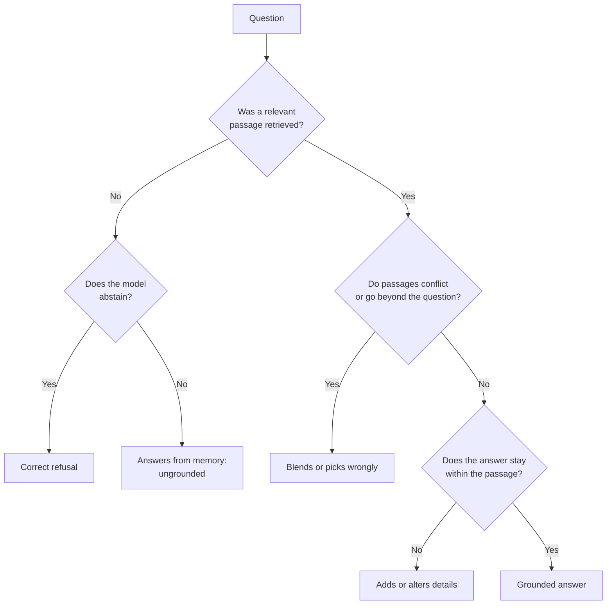

[Knowledge limitations of LLMs](/learn/introduction-to-rag/knowledge-limitations-of-llms) ended on an uncomfortable point: a model asked about something beyond its knowledge does not reliably say so. It often answers anyway, in the same assured prose it uses for things it knows well. An output that is fluent and confident but not supported by the facts, or by the sources the model was given, is called a **hallucination**.

This lesson explains why hallucination is a normal consequence of how language models produce text and not a rare malfunction, sets out the two different standards an answer can be checked against, shows what retrieval does and does not fix, and builds a first, crude instrument for measuring unsupported claims. Reliability is the reason RAG exists, so the ideas here are the yardstick for everything built later in the course.

## Learning objectives

- Define hallucination and explain why a model that predicts the next token will produce one when its knowledge runs out.
- Distinguish factuality (true of the world) from faithfulness (supported by the supplied sources), and intrinsic from extrinsic errors.
- Identify the ways a RAG system can still hallucinate after retrieval has been added.
- Compute a token-overlap support score for each sentence of an answer and an unsupported-sentence rate for the whole answer.
- Explain the false positives and false negatives of overlap-based checking and when a stronger verifier is needed.

## Prerequisites

- [What is RAG?](/learn/introduction-to-rag/what-is-rag)
- [Knowledge limitations of LLMs](/learn/introduction-to-rag/knowledge-limitations-of-llms)

## Why this matters

A system that is wrong in an obvious way gets caught. A system that is wrong in a well-written, plausible way gets believed, and the cost lands on whoever acted on the answer.

Two public cases show the stakes. In *Mata v. Avianca* (2023), lawyers were sanctioned by a United States federal court after filing a brief containing case citations that a chatbot had invented; the cases did not exist. In *Moffatt v. Air Canada* (2024), a Canadian tribunal held the airline responsible for incorrect information its website chatbot gave a customer about bereavement fares. In both, the text read perfectly well. Nothing in its style distinguished invention from fact.

For an engineer the point is that reliability has to be designed and measured. You cannot review every answer by eye, users cannot tell a grounded sentence from an invented one, and a single confident fabrication about a policy, a dosage or a contract term can outweigh a thousand correct answers. A RAG system is, more than anything else, a set of mechanisms for making a model's claims checkable.

## The intuition

Imagine an exam marked like this: one point for each correct answer, nothing for a wrong answer, nothing for a blank. A student who does not know an answer has no reason to leave the space empty. A guess might score; a blank never does. A student trained for years on such exams learns to always write something plausible, and becomes very good at producing answers that *look* like right answers: the right length, the right vocabulary, a date where a date is expected.

A language model is that student. Its training rewards producing the text that would most plausibly come next, and for nearly every question in its training data, what came next was an answer, not an admission of ignorance. Kalai and colleagues (2025) make this argument formally: models hallucinate in part because training and common evaluation methods reward guessing over acknowledging uncertainty.

The remedy suggested by the analogy is also the one RAG uses. Change the exam: put the source material on the desk, require each answer to point at the line that supports it, and make "the source does not say" an acceptable, creditable response.

## How it works

### A model always has a next token

A language model writes one token at a time. At each step it assigns a probability to every token in its vocabulary, and one is selected. ([How LLMs work](/learn/understanding-large-language-models/how-llms-work) describes the machinery.) The scores it computes are converted into probabilities by a function called **softmax**, which makes them positive and makes them sum to 1.

That last property is the heart of the matter. The probabilities always sum to 1, so *some* token is always chosen. There is no built-in outcome meaning "no answer available". Declining is not a separate mechanism; "I don't know" is just another sequence of tokens, and it is produced only if those tokens happen to be more probable than a guess.

The following runs on toy numbers. It compares the distribution over the next token after "Meridian's annual leave allowance is" for a model that has seen the fact often with one that has never seen it:

```python
import numpy as np

candidates = ["25", "20", "28", "30", "I", "unlimited"]


def softmax(logits: np.ndarray) -> np.ndarray:
    e = np.exp(logits - logits.max())
    return e / e.sum()


cases = {
    "model has seen the fact many times": np.array([6.0, 1.5, 1.0, 1.2, 0.5, 0.2]),
    "model has never seen the fact":      np.array([1.9, 2.1, 1.8, 2.0, 1.2, 0.9]),
}

rng = np.random.default_rng(seed=7)
for name, logits in cases.items():
    p = softmax(logits)
    print(name)
    print("  " + "  ".join(f"{c}={x:.2f}" for c, x in zip(candidates, p)))
    print(f"  most likely next token: {candidates[p.argmax()]!r} (p={p.max():.2f})")
    print(f"  five samples: {[str(t) for t in rng.choice(candidates, size=5, p=p)]}\n")
```

```output
model has seen the fact many times
  25=0.97  20=0.01  28=0.01  30=0.01  I=0.00  unlimited=0.00
  most likely next token: '25' (p=0.97)
  five samples: ['25', '25', '25', '25', '25']

model has never seen the fact
  25=0.20  20=0.24  28=0.18  30=0.22  I=0.10  unlimited=0.07
  most likely next token: '20' (p=0.24)
  five samples: ['I', '25', '30', '30', '28']
```

In the second case the model's uncertainty is real and visible in the numbers: the distribution is nearly flat across plausible leave allowances. But the reader never sees the distribution. They see one token, "20" or "30", followed by a grammatical sentence. Only one sample in five began with "I", the start of a possible "I don't know". The uncertainty existed inside the model and was discarded at the moment of output.

### Why the guess is plausible and wrong

Several forces combine.

1. **A knowledge gap.** The fact is past the cutoff, private, rare or only approximately stored, as classified in the previous lesson.
2. **An objective that rewards plausibility.** Training optimises for likely text. Truth is correlated with likelihood for common facts and uncorrelated where the model has no information.
3. **Strong formats.** The model knows precisely what a court citation, a URL, a package name or a policy clause looks like. It can fill the format with invented content that passes a glance. Fabricated references are the classic example.
4. **Leading questions.** "Which section of the handbook covers the sabbatical policy?" presupposes that one exists. The most natural continuation names a section.
5. **Self-consistency.** Each token is conditioned on those before it. Once an invented detail has been written, the continuation treats it as given and elaborates, so one early error grows into a coherent, wrong paragraph.

### Two standards: factuality and faithfulness

"Is the answer right?" hides two different questions.

- **Factuality**: is the statement true of the world?
- **Faithfulness** (also **groundedness**): is the statement supported by the sources the model was given?

They come apart in both directions.

| | Supported by the sources | Not supported by the sources |
| --- | --- | --- |
| **True** | The goal | Right from memory: unverifiable, cannot be cited |
| **False** | Faithful to a wrong or outdated source | A plain fabrication |

The top-right cell deserves attention. If AskMeridian says the home-office budget is £400 when no retrieved passage mentions it, the statement is true and still a defect: it came from somewhere other than the sources, the user cannot check it, and the same behaviour will produce a false statement next time. The bottom-left cell is the opposite lesson: a perfectly faithful answer is only as good as the index behind it.

In a RAG system you engineer and measure faithfulness directly, because it can be checked against text you hold, and you obtain factuality indirectly by keeping the sources correct and current.

Research on summarisation (Maynez and colleagues, 2020) supplies two further terms. An **intrinsic** hallucination *contradicts* the source: the source says 30 days and the answer says 60. An **extrinsic** hallucination *adds* something the source neither supports nor contradicts: the answer mentions a payout the source never discusses. The distinction matters in practice because the two need different detectors, as the code below demonstrates.

### What retrieval changes, and what remains

Supplying sources attacks the first cause directly: the gap is filled with text. It also changes the task from recall to reading, where models are far more dependable. [How retrieval improves generation](/learn/introduction-to-rag/how-retrieval-improves-generation) develops that mechanism. What retrieval does not do is change how generation works. The model still always produces a next token, so hallucination persists in new forms:



- **Retrieval missed, generation filled in.** Nothing relevant is in the prompt, and the model answers from memory instead of declining.
- **Blending.** Two retrieved passages (say, the 2023 and 2025 policies) are merged into one answer that neither supports.
- **Over-reach.** The passage answers part of the question and the model completes the rest unaided.
- **Altered details.** The right passage is present and a number, name or condition is changed in the retelling.
- **False citations.** The answer cites a real document identifier next to a claim that document does not make. This is arguably the worst form, because the citation invites trust.

So a RAG system's hallucination rate depends on both halves: how often retrieval supplies what is needed, and how strictly generation stays inside it.

### The shape of the defences

Later modules treat each of these properly. The overall mechanism is:

1. **Retrieve well**, so that the needed passage is present.
2. **Instruct the model to answer only from the context and to say when it cannot.** See [Grounded generation](/learn/prompt-engineering-for-rag/grounded-generation) and [Refusal behaviour](/learn/prompt-engineering-for-rag/refusal-behaviour).
3. **Require citations**, so every claim points at a passage. See [Citation instructions](/learn/prompt-engineering-for-rag/citation-instructions).
4. **Verify after generation**: split the answer into claims, look for support for each in the retrieved passages, and act on the ones without it. See [Faithfulness](/learn/generation-evaluation/faithfulness) and [Hallucination detection](/learn/generation-evaluation/hallucination-detection).
5. **Show sources to the user**, so the final check is possible for a person.

None of these reduces the rate to zero. Together they make failures rarer, visible and measurable. The rest of this lesson builds the simplest possible version of step 4.

## The mathematics

A support score asks: how much of this sentence can be found in a source?

**Intuition.** Reduce the sentence and the source to their meaningful words. If nearly all of the sentence's words occur in the source, the sentence is probably restating it. If few do, the sentence is saying something the source does not.

**Formula.** Let $T(c)$ be the set of content tokens of a claim $c$: its words and numbers, lower-cased, with very common words such as "the" and "of" removed. Let $D$ be the set of retrieved source passages. The support score of the claim is

$$
s(c) = \max_{d \in D} \frac{|T(c) \cap T(d)|}{|T(c)|}
$$

where $|T(c) \cap T(d)|$ counts the claim's tokens that also appear in passage $d$, and $|T(c)|$ is the number of tokens in the claim. The maximum picks the single passage that supports the claim best. The score runs from 0 (no token found) to 1 (every token found). It is a precision-style measure: of what the claim says, how much is covered.

A claim is counted as unsupported when $s(c)$ falls below a threshold $\tau$. For an answer with claims $c_1, \dots, c_n$ the **unsupported rate** is

$$
U = \frac{1}{n} \sum_{i=1}^{n} \mathbb{1}\big[s(c_i) < \tau\big]
$$

where $\mathbb{1}[\cdot]$ is 1 when the condition holds and 0 otherwise.

**Worked example.** Source: "Annual leave is 25 days per year. Up to 5 unused days carry over and must be used by 31 March." Its content tokens are {annual, leave, 25, days, year, 5, unused, carry, used, 31, march}.

Claim: "Any days left after that are paid out with your April salary." After removing common words, $T(c)$ = {days, left, paid, april, salary}, five tokens. Only "days" occurs in the source, so

$$
s(c) = \frac{1}{5} = 0.2
$$

With $\tau = 0.6$ the claim is unsupported.

```python
claim = {"days", "left", "paid", "april", "salary"}
source = {"annual", "leave", "25", "days", "year", "5", "unused", "carry", "used", "31", "march"}

found = claim & source
print("found in source:", sorted(found))
print("support score:  ", len(found) / len(claim))
```

```output
found in source: ['days']
support score:   0.2
```

## In code

**The problem.** AskMeridian has produced a four-sentence answer from two retrieved passages. Score each sentence against the passages, flag the unsupported ones, and report the unsupported rate for the answer.

**Dependencies.** scikit-learn, used here only for its list of common English words.

```bash
pip install scikit-learn
```

The answer below is constructed to contain two faithful sentences, one extrinsic hallucination (a payout the sources never mention) and one intrinsic hallucination (60 days where the source says 30).

```python
import re

from sklearn.feature_extraction.text import ENGLISH_STOP_WORDS

SOURCES = {
    "hr-leave": "Annual leave is 25 days per year. Up to 5 unused days carry over and must be used by 31 March.",
    "fin-expenses": "Expenses must be submitted within 30 days. Any expense over £75 needs a receipt.",
}

ANSWER = (
    "You get 25 days of annual leave per year. "
    "Up to 5 unused days carry over, and they must be used by 31 March. "
    "Any days left after that are paid out with your April salary. "
    "Expenses must be submitted within 60 days."
)


def content_tokens(text: str) -> set[str]:
    """Lower-cased words and numbers, minus very common words such as 'the' and 'of'."""
    return {t for t in re.findall(r"[a-z0-9£]+", text.lower()) if t not in ENGLISH_STOP_WORDS}


def support(sentence: str) -> tuple[float, str, set[str]]:
    """Best fraction of the sentence's content tokens found in any single source."""
    claim = content_tokens(sentence)
    best = (0.0, "", claim)
    for source_id, text in SOURCES.items():
        found = claim & content_tokens(text)
        score = len(found) / len(claim)
        if score > best[0]:
            best = (score, source_id, claim - found)
    return best


THRESHOLD = 0.6
sentences = re.split(r"(?<=[.!?])\s+", ANSWER.strip())
unsupported = 0
for sentence in sentences:
    score, source_id, missing = support(sentence)
    verdict = "supported" if score >= THRESHOLD else "UNSUPPORTED"
    unsupported += verdict == "UNSUPPORTED"
    print(f"{score:.2f}  {verdict:<12}{source_id:<13}{sentence}")
    print(f"      not in source: {sorted(missing)}")

print(f"\nunsupported sentences: {unsupported} of {len(sentences)} ({unsupported / len(sentences):.0%})")
```

```output
1.00  supported   hr-leave     You get 25 days of annual leave per year.
      not in source: []
1.00  supported   hr-leave     Up to 5 unused days carry over, and they must be used by 31 March.
      not in source: []
0.20  UNSUPPORTED hr-leave     Any days left after that are paid out with your April salary.
      not in source: ['april', 'left', 'paid', 'salary']
0.75  supported   fin-expenses Expenses must be submitted within 60 days.
      not in source: ['60']

unsupported sentences: 1 of 4 (25%)
```

**The important lines.**

- `content_tokens` returns a *set*, so repeated words count once and word order is ignored. That is what makes the method cheap, and also what makes it blind to meaning.
- `support` takes the best single source, not the union of all sources. Scoring against the union would let a sentence be "supported" by stitching together words from unrelated passages.
- `re.split(r"(?<=[.!?])\s+", ...)` splits after sentence-ending punctuation. It is adequate here and will mis-split on abbreviations such as "e.g." in real text.
- The "not in source" line is the most useful output for a human reviewer: it names exactly what the answer added.

**What the output means.** The two faithful sentences score 1.00, and the extrinsic hallucination is caught cleanly at 0.20: "paid", "april" and "salary" are nowhere in the sources. The fourth sentence is the instructive one. It contradicts its source, and it scores 0.75 and passes, because three of its four content tokens match and only the number differs. The method reports an unsupported rate of 25% when the true rate is 50%.

That is the general pattern. Token overlap is good at extrinsic hallucinations, which bring new vocabulary, and poor at intrinsic ones, which reuse the source's vocabulary with a detail changed. The printed "not in source: ['60']" shows the evidence was available; the score simply gave it too little weight.

**Errors people commonly hit.** A sentence made only of common words has no content tokens and causes `ZeroDivisionError`; guard for an empty set in real use. Different word forms do not match ("carried" is not "carry"), so true paraphrases are penalised. And a threshold chosen on one example will not generalise: it must be tuned against answers that people have labelled.

**How to extend it.** Since changed numbers are the commonest intrinsic error in policy answers, add a rule that every number in a sentence must appear in its matched source:

```python
def numbers_supported(sentence: str, source_id: str) -> bool:
    """Every number in the sentence must also appear in the source it is matched to."""
    numbers = lambda text: set(re.findall(r"\d+(?::\d+)?", text))
    return numbers(sentence) <= numbers(SOURCES[source_id])


print()
for sentence in sentences:
    score, source_id, _ = support(sentence)
    ok = score >= THRESHOLD and numbers_supported(sentence, source_id)
    print(f"{'supported' if ok else 'UNSUPPORTED':<12}{sentence}")
```

```output
supported   You get 25 days of annual leave per year.
supported   Up to 5 unused days carry over, and they must be used by 31 March.
UNSUPPORTED Any days left after that are paid out with your April salary.
UNSUPPORTED Expenses must be submitted within 60 days.
```

Both hallucinations are now flagged. The check is still shallow (it would not notice "5 days" moved from carry-over to something else), and the exercises explore two more of its blind spots. The stronger alternative is to ask a language model whether each claim follows from the source. This block needs an API key and was not run:

```python
import anthropic

client = anthropic.Anthropic()  # reads ANTHROPIC_API_KEY from the environment


def verify(claim: str, source: str) -> str:
    prompt = f"Source:\n{source}\n\nClaim: {claim}"
    response = client.messages.create(
        model="claude-opus-5-5",
        max_tokens=1024,
        system=(
            "Decide whether the claim is fully supported by the source. Reply with exactly one "
            "word: SUPPORTED, CONTRADICTED or NOT_FOUND."
        ),
        messages=[{"role": "user", "content": prompt}],
    )
    return "".join(block.text for block in response.content if block.type == "text").strip()
```

For the claim "Expenses must be submitted within 60 days." and the expenses passage, the expected reply is `CONTRADICTED`. A model-based verifier understands paraphrase and negation, costs a model call per claim, and can itself be wrong, which is why its judgements are checked against human labels before being trusted. [LLM-as-a-judge](/learn/testing-and-benchmarking/llm-as-a-judge) covers the practice.

## A real-world example

Brightwater Insurance, a fictional home insurer, runs a RAG assistant that helps claims handlers find policy terms. A handler reports that it stated a 60-day window for notifying a claim; the policy says 30. The team's first assumption is a retrieval fault. The logs say otherwise: the correct clause was retrieved and was first in the prompt. A second retrieved passage, from a different product's wording, mentioned 60 days in another context, and the answer had blended the two.

The engineer, Amara, makes two decisions. First, she will not rely on reading samples by eye, because the one error that mattered looked exactly like a correct sentence. She adds an automatic check to every answer: sentence-level overlap against the retrieved passages plus the rule that every number must appear in the supporting passage. It is crude, and she labels it so, but it costs almost nothing to run on every answer and it would have caught this case.

Second, she separates the fixes by cause. The blending is addressed at retrieval, by filtering passages to the product the handler is working on, and in the prompt, by requiring each sentence to cite one passage. Flagged answers are shown to handlers with a visible warning and the source clause beside them, not suppressed, because a handler with the clause in view can resolve the conflict in seconds.

After a month, the flagged answers give her something the team never had before: a rate, tracked week by week, and a growing file of real failures to test each change against. She notes the limit of the instrument in the same report: it measures agreement with retrieved text, so it says nothing about cases where the retrieved text itself was wrong.

## Common mistakes

- **Treating fluency as evidence.** Well-formed, confident prose is what a model produces in every case. It carries no information about truth.
- **Believing retrieval ends hallucination.** It reduces the rate. Missed retrieval, blended passages and altered details all survive, and without measurement they go unnoticed.
- **Checking only factuality.** An answer that is true but not in the sources reveals a system that will also produce untrue unsourced answers. Count it as a defect.
- **Trusting citations without checking them.** A cited identifier shows the model wrote an identifier. Whether the passage supports the claim has to be verified.
- **Asking leading questions in tests and prompts.** Questions that presuppose an answer exists invite one. Include questions whose correct answer is "the documents do not say".
- **Relying on one cheap detector.** Token overlap misses contradictions and penalises paraphrase. Used alone it gives false reassurance.

## Best practices

- Instruct the model to answer only from the supplied context and make declining an explicitly acceptable outcome.
- Measure faithfulness on every release against a fixed set of questions, including unanswerable ones, and track the rate over time.
- Layer detectors: fast lexical and numeric checks on every answer, a model-based verifier on a sample or on flagged cases, and human review of a small labelled set to calibrate both.
- Show users the supporting passages next to the answer so that verification is one glance away.
- When a hallucination is found, classify it (missed retrieval, blending, over-reach, altered detail, false citation) before fixing it; the classes have different fixes.
- Keep the sources themselves correct and current, since faithfulness to a wrong document is still a wrong answer.

## Performance considerations

Verification adds work to every answer, and the options differ by orders of magnitude.

A token-overlap check does set intersections over a few hundred words: for an answer of $n$ sentences and $k$ retrieved passages it performs $n \times k$ comparisons, each over tens of tokens. With $n = 5$ and $k = 5$ that is 25 small set operations, negligible beside the generation call, so it can run on all traffic.

A model-based verifier makes one call per claim, or one call for all claims if batched. Each call's input is the claim plus its source passage. With 5 claims and passages of about 200 tokens, that is roughly $5 \times 220 = 1{,}100$ extra input tokens per answer if done claim by claim, comparable to the original RAG prompt. Verification by model therefore roughly doubles input cost and, if done before the answer is shown, adds a second model round trip to the response time. Common compromises are to verify asynchronously after responding, to verify only answers that fail the cheap check, or to verify a random sample for monitoring.

There is also a quality trade-off in the threshold $\tau$. Raising it flags more sentences: more true hallucinations caught, and more faithful paraphrases wrongly flagged. The right setting depends on whether a missed fabrication or a needless warning costs more in your application, and it should be chosen with labelled data.

## Security considerations

- **Invented identifiers can be weaponised.** Models sometimes suggest software package names or URLs that do not exist. Attackers have registered such names so that anyone following the suggestion installs their code. Verify that any generated package, link or command refers to something real before acting on it.
- **Faithful to a poisoned source.** Grounding makes the model repeat its sources. If an attacker can plant a document in the index, a perfectly faithful system will state its contents with a citation. See [Data poisoning](/learn/rag-security-fundamentals/data-poisoning).
- **Over-trust is itself a risk.** Citations and a confident tone increase the chance that a wrong answer is acted on. For high-stakes actions, require a human to open the source.

## Summary

- A hallucination is fluent, confident output that is not supported by the facts or by the supplied sources; it follows naturally from generating the most plausible next token.
- A model always produces some token. Its internal uncertainty is not visible in the text, and declining to answer happens only if those words are the likeliest continuation.
- Factuality (true of the world) and faithfulness (supported by the sources) are different standards; RAG systems measure faithfulness and maintain factuality through their sources.
- Retrieval fills knowledge gaps but leaves generation unchanged, so RAG systems still hallucinate through missed retrieval, blending, over-reach, altered details and false citations.
- A token-overlap support score is a cheap first detector that catches added content and misses contradictions; numeric checks and model-based verifiers cover more.
- Reliability comes from layers (grounded prompts, citations, verification, visible sources) and from measuring the unsupported rate continuously.

## Exercises

**1.** Classify each statement from AskMeridian as faithful or unfaithful, and factual or not, given that the only retrieved passage is "Passwords must be rotated every 90 days. The VPN is required on public Wi-Fi." (a) "Passwords must be changed every 90 days." (b) "Laptops are replaced every 3 years." (c) "Passwords must be rotated every 60 days." (d) "The VPN is optional on public Wi-Fi."

<details><summary>Show solution</summary>

(a) Faithful and factual: a paraphrase of the passage. (b) Factual (it matches Meridian's policy) but unfaithful: nothing in the retrieved passage supports it, so it came from elsewhere and cannot be cited. An extrinsic error. (c) Unfaithful and not factual: it contradicts the passage, an intrinsic error. (d) Unfaithful and not factual: also intrinsic, a contradiction by changing one word. Only (a) is acceptable output for a grounded system, even though (b) happens to be true.

</details>

**2.** Compute the support score by hand for the claim "The VPN is required on public Wi-Fi and at home." against the passage in exercise 1. Assume the content tokens of the claim are {vpn, required, public, wi, fi, home} and that the passage contains all of those except "home". With a threshold of 0.6, is it flagged? What does this tell you about the method?

<details><summary>Show solution</summary>

Five of six tokens are found: $s = 5/6 \approx 0.83$, above 0.6, so the claim is counted as supported. Yet "and at home" is an addition the passage does not make. A long sentence that is mostly faithful can carry a short fabrication past an overlap threshold, because the score is an average over the whole sentence. Remedies are to split answers into smaller claims before scoring, to inspect the "not in source" tokens, or to use a verifier that judges meaning.

</details>

**3.** Run the lesson's `support` function on these three sentences and explain each result: "Unused leave cannot be carried over." / "Leftover holiday rolls into the next year, up to a limit of five." / "The home-office equipment budget is £400."

<details><summary>Show solution</summary>

```python
for sentence in [
    "Unused leave cannot be carried over.",
    "Leftover holiday rolls into the next year, up to a limit of five.",
    "The home-office equipment budget is £400.",
]:
    score, source_id, missing = support(sentence)
    print(f"{score:.2f}  {'supported' if score >= THRESHOLD else 'UNSUPPORTED':<12}{sentence}  missing={sorted(missing)}")
```

```output
0.67  supported   Unused leave cannot be carried over.  missing=['carried']
0.20  UNSUPPORTED Leftover holiday rolls into the next year, up to a limit of five.  missing=['holiday', 'leftover', 'limit', 'rolls']
0.00  UNSUPPORTED The home-office equipment budget is £400.  missing=['budget', 'equipment', 'home', 'office', '£400']
```

The first is a **false negative of the detector**: the sentence says the opposite of the source and passes, because "cannot" is in the common-word list and is discarded, leaving tokens that mostly match. Overlap cannot see negation. The second is a **false alarm**: it is a correct paraphrase of the carry-over rule, flagged because it uses different words ("holiday", "rolls", "five" spelled out). The third is **correctly flagged**: the statement is true at Meridian, but neither supplied source mentions it, so it is unfaithful. Together they show why overlap is a first filter and not a verdict.

</details>

**4.** Design the verification policy for AskMeridian. Budget allows a model-based verifier on at most 10% of answers. Decide which answers get which checks, what the user sees when a check fails, and what you record.

<details><summary>Show solution</summary>

One reasonable design. Run the overlap and numeric checks on every answer, since they cost almost nothing. Send to the model-based verifier (a) every answer the cheap checks flag and (b) a small random sample of answers they pass, the sample sized so that the total stays under 10%. The random sample matters: it estimates how many hallucinations the cheap checks miss, which is the number you most need and cannot get from flagged cases alone.

When a check fails, do not silently drop the answer. Show it with a clear notice that part of it could not be confirmed, display the retrieved passages, and for topics where errors are costly (IT security steps, pay) replace the answer with the passages and a link to the source.

Record the question, retrieved passage identifiers and scores, the answer, each check's result and the unsupported tokens. Review a sample weekly with human labels to calibrate the threshold and the verifier, and add each confirmed hallucination to a regression set so that later changes are tested against real failures.

</details>

## Check your understanding

```quiz
[
  {
    "q": "Why does a language model produce an answer even when it has no knowledge of the fact asked about?",
    "options": [
      "It is programmed to refuse only offensive questions",
      "It retrieves a random document and summarises it",
      "Its output at each step is a probability distribution over tokens, so some token is always chosen",
      "It checks a database and returns the nearest match"
    ],
    "answer": 2,
    "why": "The probabilities over next tokens always sum to 1. There is no built-in empty outcome; declining happens only if the words of a refusal are the most probable continuation."
  },
  {
    "q": "The retrieved passage says expenses must be submitted within 30 days. The answer says \"within 60 days\". What kind of error is this?",
    "options": [
      "An intrinsic hallucination: it contradicts the source",
      "An extrinsic hallucination: it adds unrelated information",
      "A retrieval failure",
      "A faithful but non-factual answer"
    ],
    "answer": 0,
    "why": "The right passage was retrieved and the answer contradicts it. Intrinsic errors alter what the source says; extrinsic errors add what it does not say."
  },
  {
    "q": "An answer states a true fact that appears in none of the retrieved passages. How should a RAG system's evaluation treat it?",
    "options": [
      "As correct, because it is true",
      "As a retrieval success",
      "As an intrinsic hallucination",
      "As unfaithful: it is unsupported by the sources even though it is true"
    ],
    "answer": 3,
    "why": "Faithfulness is judged against the supplied sources. A true but unsourced claim cannot be cited or checked, and the same behaviour will yield false claims on other questions."
  },
  {
    "q": "In the lesson's output, \"Expenses must be submitted within 60 days.\" scored 0.75 and was marked supported. Why?",
    "options": [
      "The threshold was set too high",
      "Three of its four content tokens appear in the source; only the number differs",
      "The sentence splitter merged two sentences",
      "The source also says 60 days"
    ],
    "answer": 1,
    "why": "Token overlap averages over the sentence. A contradiction that reuses the source's wording and changes one detail keeps a high score, which is why overlap misses intrinsic errors."
  },
  {
    "q": "Which statement about RAG and hallucination is accurate?",
    "options": [
      "RAG eliminates hallucination because the model can only copy retrieved text",
      "RAG makes hallucination worse because prompts are longer",
      "RAG reduces hallucination by supplying sources, but missed retrieval, blending and altered details remain",
      "RAG only affects hallucination if the model is fine-tuned"
    ],
    "answer": 2,
    "why": "Retrieval fills knowledge gaps and makes claims checkable, but generation still works the same way, so residual failure modes must be detected and measured."
  }
]
```

## Further reading

- Ji, Lee, Frieske et al. (2023), *Survey of Hallucination in Natural Language Generation*, ACM Computing Surveys. A broad overview of definitions, causes and metrics.
- Maynez, Narayan, Bohnet and McDonald (2020), *On Faithfulness and Factuality in Abstractive Summarization*, ACL. The source of the intrinsic and extrinsic distinction used here.
- Kalai, Nachum, Vempala and Zhang (2025), *Why Language Models Hallucinate*. Argues that training and evaluation reward guessing over admitting uncertainty.
- Lewis, Perez, Piktus et al. (2020), *Retrieval-Augmented Generation for Knowledge-Intensive NLP Tasks*: [arxiv.org/abs/2005.11401](https://arxiv.org/abs/2005.11401). Reports more factual generation with retrieval than with a parametric-only baseline.
- Min, Krishna, Lyu et al. (2023), *FActScore: Fine-grained Atomic Evaluation of Factual Precision in Long Form Text Generation*, EMNLP. Splitting text into atomic claims and checking each against a source, the idea behind this lesson's code.
- Es, James, Espinosa-Anke and Schockaert (2023), *RAGAS: Automated Evaluation of Retrieval Augmented Generation*. Introduces a widely used faithfulness metric for RAG.
