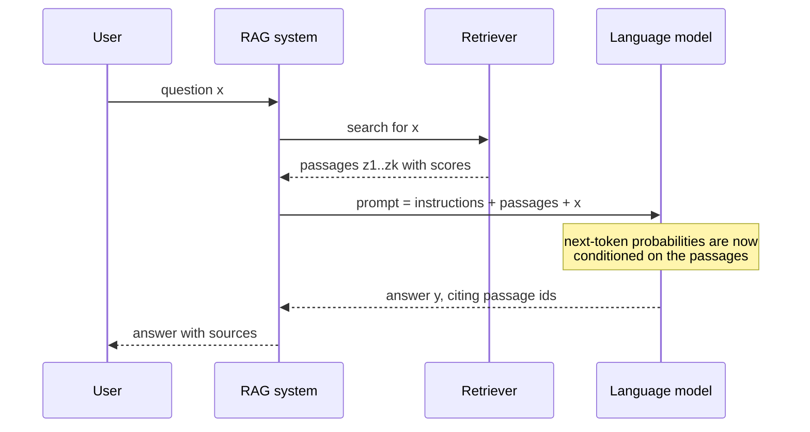

The previous lessons established that a language model on its own is limited by its [knowledge cutoff](/learn/introduction-to-rag/knowledge-limitations-of-llms) and prone to [hallucination](/learn/introduction-to-rag/hallucinations-and-factual-reliability), and that RAG pairs the model with an [external, non-parametric store](/learn/introduction-to-rag/parametric-versus-non-parametric-knowledge). This lesson answers the question those lessons leave open: *why* does placing a few retrieved passages in front of a model make its answer better? What actually changes inside the generation step?

The answer is a statement about conditional probability. A model's answer is drawn from a probability distribution that depends on everything in its prompt, and a relevant passage reshapes that distribution so that the supported answer becomes by far the most likely one. We will state this precisely, including the formula from the original RAG paper, work a numerical example by hand, and then measure the one quantity that limits the whole effect: whether the right passage was retrieved at all.

## Learning objectives

- Explain generation as sampling from a distribution conditioned on the prompt, and what a retrieved passage does to that distribution.
- Write down and interpret the marginalisation over retrieved passages used by Lewis et al. (2020), and distinguish it from the concatenation used by most current systems.
- Compute a marginal answer probability from retriever scores and per-passage generator probabilities.
- Identify the situations in which retrieval fails to help or makes an answer worse.
- Measure a retriever's hit rate and explain why it caps the quality of the final answers.

## Prerequisites

- [What is RAG?](/learn/introduction-to-rag/what-is-rag)
- [Hallucinations and factual reliability](/learn/introduction-to-rag/hallucinations-and-factual-reliability)
- [Parametric versus non-parametric knowledge](/learn/introduction-to-rag/parametric-versus-non-parametric-knowledge)

## Why this matters

If you think of retrieval as a magic ingredient that "makes the model accurate", you will not be able to fix a RAG system when it gives a wrong answer. Wrong answers in RAG have two quite different causes. Either the right passage never reached the model, or it did and the model failed to use it. The first is a retrieval problem; the second is a generation problem. They have different fixes, and working on the wrong one wastes weeks.

Knowing the mechanism also tells you what retrieval cannot do. It cannot help with a question whose answer is in no document. It cannot rescue an answer when the retrieved passages are irrelevant, and irrelevant passages can actively mislead. Every later module of this course (chunking, embeddings, reranking, prompt design, evaluation) is an attempt to improve one of the two factors this lesson identifies.

## The intuition

Ask a well-read stranger, "How many days of annual leave do Meridian staff get?" They have never seen Meridian's handbook. They know that companies in the UK commonly offer somewhere between 20 and 30 days, so they guess. Perhaps they say 28, perhaps 25, perhaps 20. Their belief is spread across several plausible numbers, and whichever they say, they say it fluently.

Now hand them a slip of paper that reads "Annual leave is 25 days per year" and ask again. Nothing about the person has changed: same education, same reasoning ability. But their belief is no longer spread out. Almost all of it sits on 25, because the evidence is in front of them and reading a number is far easier than recalling one.

That is the whole effect. Retrieval does not make the model more intelligent. It changes what the model is conditioned on, and with the evidence in view the correct answer goes from one plausible guess among several to the obvious continuation.

## How it works

### Generation is conditional prediction

A language model writes text one token at a time. (A token is a word or piece of a word; [Tokens and tokenisation](/learn/understanding-large-language-models/tokens-and-tokenisation) covers them.) At each step the model computes a probability for every possible next token *given all the text so far*, and one token is selected. The text so far includes the whole prompt. So the model's answer is not a fixed property of the model: it is a function of the prompt. Change the prompt and you change the probabilities.

This is why the previous lesson's distinction matters here. With the question alone, the only thing shaping the probabilities is the model's parametric memory. With a passage in the prompt, the probabilities are shaped by the weights *and* the passage.

### What a relevant passage changes

A relevant passage improves the answer through five separate effects.

1. **It supplies facts the weights never had.** Meridian's handbook was not in any model's training data. Without the passage the model has literally nothing to go on.
2. **It replaces stale facts with current ones.** If a figure changed after the model's knowledge cutoff, the passage carries the new value.
3. **It turns recall into reading.** Reproducing a number that is visible in the prompt is a much easier task for the model than reconstructing it from weights. The [attention mechanism](/learn/understanding-large-language-models/attention-mechanisms) lets the model look directly at the passage's tokens while writing each word of the answer.
4. **It makes the answer attributable.** The passage has an identifier, so the answer can cite it and a person can check it.
5. **It makes "I don't know" a checkable condition.** Without context, the model has no reliable signal that it lacks a fact. With an instruction to answer only from the context, "the context does not contain this" is something the model can observe.

### The mechanism, step by step

1. The user asks a question $x$.
2. The retriever scores passages in the store against $x$ and returns the best few, $z_1, \dots, z_k$.
3. The system builds a prompt containing instructions, the passages and the question.
4. The model computes next-token probabilities conditioned on that whole prompt and generates the answer $y$ one token at a time.
5. The answer, ideally with the identifiers of the passages it used, is returned to the user.



You can step through the same flow interactively:

```playground
rag-pipeline
```

### Two ways to use several passages

There are two ways to let more than one passage influence the answer.

- **Concatenate.** Put all $k$ passages into a single prompt and let the model read them together. This is what almost every current system does, because modern models have large [context windows](/learn/understanding-large-language-models/context-windows) and can compare and combine passages within one prompt.
- **Marginalise.** Generate with each passage separately and combine the results, weighting each passage by how relevant the retriever judged it. This is what the original RAG paper did, and it is the cleanest way to see the probability at work. The next section sets it out.

### When retrieval does not help

The improvement is conditional on the passage being relevant and being used. It fails in recognisable ways.

- **A miss.** The passage with the answer was not retrieved. The model is back to guessing, or, if instructed to stay within the context, it declines.
- **Distractors.** The retrieved passages are on a related topic but do not contain the answer. A passage about carry-over of leave mentions "5 days"; a model asked about annual leave may seize on that number. Irrelevant context can be worse than no context.
- **A knowledge conflict.** The passage is right but disagrees with what the weights suggest, and the model sides with its memory. The [previous lesson](/learn/introduction-to-rag/parametric-versus-non-parametric-knowledge) introduced this.
- **A buried passage.** The right passage is present among many others and the model overlooks it. This is studied under the name [lost-in-the-middle problem](/learn/context-engineering/lost-in-the-middle-problem).
- **A question that needs no retrieval.** "Rewrite this sentence more politely" is answered from the model's own skill. Passages add cost and noise.

> [!KEY]
> A RAG answer can only be as good as (a) the chance that the right passage is in the prompt and (b) the chance that the model answers correctly given that it is. Improving a RAG system always means improving one of those two factors.

## The mathematics

### From closed book to open book

**Intuition.** A model defines a probability for every possible answer. Retrieval adds a condition to that probability.

Without retrieval, the model with parameters $\theta$ assigns an answer $y$ to a question $x$ the probability

$$
p_\theta(y \mid x) = \prod_{i=1}^{N} p_\theta(y_i \mid x, y_{1:i-1})
$$

where $y_i$ is the $i$-th token of the answer, $y_{1:i-1}$ are the tokens before it, and $N$ is the answer's length. With one retrieved passage $z$ in the prompt, the same model computes $p_\theta(y \mid x, z)$: identical weights, one more thing conditioned on.

### Marginalising over passages (Lewis et al., 2020)

**Intuition.** The retriever is not certain which passage is the right one, so treat the passage as an unknown, generate under each candidate, and average the results, giving more weight to the passages the retriever trusts more.

Lewis et al. treat the retrieved passage as a **latent variable**: a quantity that affects the outcome but is not observed directly. Their model has two parts. A retriever $p_\eta(z \mid x)$, with parameters $\eta$, gives a probability to each passage $z$ given the question. A generator $p_\theta$ produces the answer given the question and one passage. They define two ways of combining them.

**RAG-Sequence** uses the same passage for the whole answer and sums over passages at the end:

$$
p_{\text{RAG-Sequence}}(y \mid x) \approx \sum_{z \in \text{top-}k(p_\eta(\cdot \mid x))} p_\eta(z \mid x) \prod_{i=1}^{N} p_\theta(y_i \mid x, z, y_{1:i-1})
$$

**RAG-Token** allows a different passage to inform each token, so the sum moves inside the product:

$$
p_{\text{RAG-Token}}(y \mid x) \approx \prod_{i=1}^{N} \sum_{z \in \text{top-}k(p_\eta(\cdot \mid x))} p_\eta(z \mid x) \, p_\theta(y_i \mid x, z, y_{1:i-1})
$$

The variables:

- $x$ is the question and $y$ the answer, with tokens $y_1, \dots, y_N$.
- $z$ is one retrieved passage. $\text{top-}k(p_\eta(\cdot \mid x))$ is the set of the $k$ passages the retriever scores highest. Summing over only these, instead of every passage in the store, is why the formulas say "approximately equal".
- $p_\eta(z \mid x)$ is the retriever's probability for passage $z$. In the paper the retriever is DPR (Dense Passage Retrieval), which embeds the question as a vector $\mathbf{q}(x)$ and each passage as a vector $\mathbf{d}(z)$ and sets $p_\eta(z \mid x) \propto \exp\left(\mathbf{d}(z)^\top \mathbf{q}(x)\right)$: the higher the inner product, the higher the probability.
- $p_\theta(y_i \mid x, z, y_{1:i-1})$ is the generator's probability for the next token, given the question, one passage and the answer so far. In the paper the generator is BART, a sequence-to-sequence model.

Summing a joint probability over an unobserved variable is called **marginalisation**, which is why the paper speaks of marginalising over the retrieved documents.

> [!NOTE]
> Most systems built today do not compute this sum. They concatenate the top passages into one prompt and compute $p_\theta(y \mid x, z_1, \dots, z_k)$ in a single pass. The retriever's scores are then used only to choose and order passages, not as weights in a formula. The latent-variable view remains the clearest explanation of why retrieval helps, and it is the reason the paper could train the retriever and generator together.

### A worked example

AskMeridian is asked "How many days of annual leave do staff get?" The retriever returns three passages with inner-product scores 4.0, 2.5 and 1.0:

- $z_1$: the annual leave policy, which states the answer.
- $z_2$: the carry-over rule, which is related but does not state it.
- $z_3$: the expenses policy, which is irrelevant.

To keep the arithmetic small, suppose the model considers three candidate answers, treat each whole answer as a single outcome, and take the retriever's probability as a softmax over the three retrieved passages.

**Step 1: retriever probabilities.** $e^{4.0} = 54.598$, $e^{2.5} = 12.182$, $e^{1.0} = 2.718$, which sum to $69.499$. So

$$
p_\eta(z_1 \mid x) = \frac{54.598}{69.499} = 0.7856, \quad p_\eta(z_2 \mid x) = 0.1753, \quad p_\eta(z_3 \mid x) = 0.0391
$$

**Step 2: generator probabilities.** Suppose the generator gives these probabilities (invented for the example):

| Conditioned on | "25 days" | "28 days" | "20 days" |
| --- | --- | --- | --- |
| question only (closed book) | 0.30 | 0.40 | 0.30 |
| question and $z_1$ | 0.90 | 0.06 | 0.04 |
| question and $z_2$ | 0.50 | 0.30 | 0.20 |
| question and $z_3$ | 0.30 | 0.40 | 0.30 |

Closed book, the model's best guess is the wrong answer, 28 days. The irrelevant passage $z_3$ changes nothing.

**Step 3: marginalise.**

$$
p(\text{25 days} \mid x) = 0.7856 \times 0.90 + 0.1753 \times 0.50 + 0.0391 \times 0.30 = 0.7070 + 0.0877 + 0.0117 = 0.8064
$$

The correct answer has gone from 0.30 to about 0.81. Notice what drives the result: the retriever put most of its weight on the right passage, and the generator, given that passage, was nearly certain. Had the retriever scored $z_3$ highest, the sum would be dominated by the row that equals the closed-book guess.

The same in NumPy:

```python
import numpy as np

# Retriever: inner-product scores between the question and three passages.
scores = np.array([4.0, 2.5, 1.0])
p_z = np.exp(scores) / np.exp(scores).sum()          # p(z | x), softmax over the top-k

# Generator: probability of each candidate answer given the question and ONE passage.
answers = ["25 days", "28 days", "20 days"]
p_y_given_z = np.array([
    [0.90, 0.06, 0.04],   # z1: the annual leave policy (states the answer)
    [0.50, 0.30, 0.20],   # z2: the carry-over rule (related, does not state it)
    [0.30, 0.40, 0.30],   # z3: the expenses policy (irrelevant)
])
p_closed_book = np.array([0.30, 0.40, 0.30])          # p(y | x) with no passage at all

p_y = p_z @ p_y_given_z                               # marginalise over passages

print("p(z|x)          :", np.round(p_z, 4))
for answer, closed, open_book in zip(answers, p_closed_book, p_y):
    print(f"{answer:<8} closed-book {closed:.2f}   with retrieval {open_book:.4f}")
print("total           :", round(float(p_y.sum()), 4))
```

```output
p(z|x)          : [0.7856 0.1753 0.0391]
25 days  closed-book 0.30   with retrieval 0.8064
28 days  closed-book 0.40   with retrieval 0.1154
20 days  closed-book 0.30   with retrieval 0.0782
total           : 1.0
```

### The two factors behind answer quality

**Intuition.** Across many questions, some have the right passage in the prompt and some do not. Overall accuracy is a blend of how the model does in each case.

By the law of total probability,

$$
P(\text{correct}) = h \cdot a_{\text{hit}} + (1 - h) \cdot a_{\text{miss}}
$$

where $h$ is the **hit rate** (the fraction of questions for which a passage containing the answer is in the prompt), $a_{\text{hit}}$ is the model's accuracy when it is, and $a_{\text{miss}}$ is its accuracy when it is not.

**Worked example.** Suppose the retriever's hit rate is $h = 0.625$, and assume $a_{\text{hit}} = 0.95$ and $a_{\text{miss}} = 0.10$. (The two accuracies are assumptions for illustration; in a real project you measure them.) Then

$$
P(\text{correct}) = 0.625 \times 0.95 + 0.375 \times 0.10 = 0.594 + 0.038 = 0.631
$$

Raise the hit rate to $0.875$ with the same model and it becomes $0.875 \times 0.95 + 0.125 \times 0.10 = 0.844$. No change to the model produced that gain; better retrieval did.

```python
a_hit, a_miss = 0.95, 0.10        # ASSUMED reader accuracies, for illustration only
for k, hit_rate in [(1, 5 / 8), (2, 7 / 8)]:
    accuracy = hit_rate * a_hit + (1 - hit_rate) * a_miss
    print(f"k={k}: hit rate {hit_rate:.3f} -> expected accuracy {accuracy:.3f}")
```

```output
k=1: hit rate 0.625 -> expected accuracy 0.631
k=2: hit rate 0.875 -> expected accuracy 0.844
```

The hit rates 5/8 and 7/8 are not invented: they are measured in the next section.

## In code

**The problem.** The formula says answer quality is capped by the hit rate. This example measures the hit rate of a simple retriever on eight questions about Meridian's policies, then prints the closed-book prompt and the retrieval-augmented prompt side by side so you can see exactly what the model is conditioned on in each case.

The retriever is BM25, a standard keyword-scoring method that the [BM25](/learn/sparse-retrieval/bm25) lesson explains. Here it is a black box that gives each passage a score for a question.

**Dependencies.**

```bash
pip install rank-bm25
```

**The source.**

```python
import re

from rank_bm25 import BM25Okapi

corpus = {
    "leave-01":    "Annual leave is 25 days per year for all full-time staff.",
    "leave-02":    "Up to 5 unused leave days carry over and must be used by 31 March.",
    "remote-01":   "Staff may work remotely up to 3 days a week.",
    "remote-02":   "The home-office equipment budget is £400 per employee.",
    "expenses-01": "Expenses must be submitted within 30 days of purchase.",
    "expenses-02": "Any expense over £75 needs a receipt.",
    "it-01":       "Passwords must be rotated every 90 days.",
    "it-02":       "The VPN is required when working on public Wi-Fi.",
}

# Each test question is paired with the id of the passage that answers it.
test_set = [
    ("How many days of annual leave do staff get?", "leave-01"),
    ("Can I carry unused leave into next year?", "leave-02"),
    ("How often can I work from home?", "remote-01"),
    ("What can I spend on a desk for my home office?", "remote-02"),
    ("What is the deadline for submitting expenses?", "expenses-01"),
    ("Do I need a receipt for a £90 taxi?", "expenses-02"),
    ("How often do I have to change my password?", "it-01"),
    ("Do I need the VPN in a coffee shop?", "it-02"),
]


def tokenise(text: str) -> list[str]:
    return re.findall(r"[a-z0-9£]+", text.lower())


doc_ids = list(corpus)
bm25 = BM25Okapi([tokenise(text) for text in corpus.values()])


def retrieve(question: str, k: int) -> list[str]:
    """Return the ids of the k passages BM25 scores highest for the question."""
    scores = bm25.get_scores(tokenise(question))
    ranked = sorted(range(len(doc_ids)), key=lambda i: scores[i], reverse=True)
    return [doc_ids[i] for i in ranked[:k]]


def build_prompt(question: str, passage_ids: list[str]) -> str:
    if not passage_ids:                       # closed book: the question alone
        return f"Question: {question}"
    context = "\n".join(f"[{pid}] {corpus[pid]}" for pid in passage_ids)
    return (
        "Answer the question using only the context below. "
        "Cite the passage id you used.\n\n"
        f"Context:\n{context}\n\nQuestion: {question}"
    )


print("Where does the answering passage land in the ranking?")
for question, gold in test_set:
    ranking = retrieve(question, k=len(doc_ids))
    print(f"  rank {ranking.index(gold) + 1}  {gold:<12} {question}")

print("\nHit rate: the share of questions whose answer is in the prompt")
for k in (1, 2, 3):
    hits = sum(gold in retrieve(question, k) for question, gold in test_set)
    print(f"  k={k}: {hits}/{len(test_set)} = {hits / len(test_set):.2f}")

question = "How many days of annual leave do staff get?"
print("\n--- Closed-book prompt ---")
print(build_prompt(question, []))
print("\n--- Retrieval-augmented prompt (k=2) ---")
print(build_prompt(question, retrieve(question, k=2)))
```

**The important lines.**

- `test_set` pairs each question with the passage that answers it. Without such labels you cannot tell a retrieval failure from a generation failure. Even eight hand-written pairs are enough to start.
- `retrieve` ranks every passage by BM25 score and keeps the top $k$. This is the $\text{top-}k$ set from the formulas.
- `build_prompt` is where conditioning happens. With an empty list it returns the question alone, $p_\theta(y \mid x)$. With passages it returns instructions, the passages with their ids, and the question, $p_\theta(y \mid x, z_1, \dots, z_k)$.
- `gold in retrieve(question, k)` is a hit: the answering passage made it into the prompt.

**The output.**

```output
Where does the answering passage land in the ranking?
  rank 1  leave-01     How many days of annual leave do staff get?
  rank 1  leave-02     Can I carry unused leave into next year?
  rank 2  remote-01    How often can I work from home?
  rank 1  remote-02    What can I spend on a desk for my home office?
  rank 2  expenses-01  What is the deadline for submitting expenses?
  rank 1  expenses-02  Do I need a receipt for a £90 taxi?
  rank 7  it-01        How often do I have to change my password?
  rank 1  it-02        Do I need the VPN in a coffee shop?

Hit rate: the share of questions whose answer is in the prompt
  k=1: 5/8 = 0.62
  k=2: 7/8 = 0.88
  k=3: 7/8 = 0.88

--- Closed-book prompt ---
Question: How many days of annual leave do staff get?

--- Retrieval-augmented prompt (k=2) ---
Answer the question using only the context below. Cite the passage id you used.

Context:
[leave-01] Annual leave is 25 days per year for all full-time staff.
[expenses-01] Expenses must be submitted within 30 days of purchase.

Question: How many days of annual leave do staff get?
```

**What it means.** With one passage per question the answer is in the prompt for 5 of 8 questions; with two, for 7 of 8. Those are the hit rates used in the mathematics section. The password question is a miss at any reasonable $k$: the user wrote "change my password", the document says "Passwords must be rotated", and a keyword method sees no shared word ("password" and "passwords" are different strings to it). No model, however capable, can read a passage that is not in its prompt. This single line of output is the motivation for the embedding-based retrieval that later modules teach.

The second prompt also contains a distractor, `expenses-01`, which was retrieved because it shares the word "days". Here it is harmless because the right passage is present and clearly on topic. When the right passage is missing, a distractor is all the model has.

**The generation step.** The retrieval part above runs anywhere. Sending the prompt to a model needs an API key, so it is shown separately. Install the SDK with `pip install anthropic` and set `ANTHROPIC_API_KEY` in your environment.

```python
import anthropic

client = anthropic.Anthropic()  # reads ANTHROPIC_API_KEY from the environment

prompt = build_prompt(question, retrieve(question, k=2))
response = client.messages.create(
    model="claude-opus-5-5",
    max_tokens=1024,
    system="Answer only from the provided context. If the answer is not there, say you don't know.",
    messages=[{"role": "user", "content": prompt}],
)
answer = "".join(block.text for block in response.content if block.type == "text")
print(answer)
```

This block was not run for this lesson. Your exact wording will differ; the output looks like this:

```output
Staff get 25 days of annual leave per year [leave-01].
```

**Errors people commonly hit.** `ValueError: ... is not in list` from `ranking.index(gold)` means a gold id in the test set does not exist in the corpus, usually a typo. A `ZeroDivisionError` inside `BM25Okapi` means the corpus was empty after tokenising. If every score is zero, the question and the documents share no tokens, often because one side was not lower-cased.

**How to extend it.** Add a question the corpus cannot answer ("What is the dress code?") and see what the retriever returns anyway: it always returns something, which is why a system needs a rule for declining. Then change "rotated" to "changed" in `it-01` and watch the password question become a hit, a small demonstration that wording, not meaning, is what keyword retrieval matches.

## A real-world example

Harbourline Freight, a fictional logistics company, ran a RAG assistant for its customer-service agents. Agents complained that it sometimes gave wrong answers about customs paperwork. The team's first reaction was that the language model was not good enough, and they moved to a larger, more expensive one. The complaints continued at much the same rate.

An engineer then did what should have been done first: for a sample of the wrong answers, she logged the passages that had been retrieved and checked by hand whether the passage containing the correct answer was among them. In most of the sampled failures it was not. Agents asked about "T1 forms" while the documentation said "transit declaration", and the retriever returned general customs pages instead. The model had been answering, quite reasonably, from the wrong evidence.

In terms of the formula, the team had spent money on $a_{\text{hit}}$ when the problem was $h$. Once they worked on retrieval (adding the abbreviations agents actually used to the indexed text, and retrieving more passages), accuracy improved, and they were able to move back to the cheaper model. The remaining failures, where the right passage was present and the answer was still wrong, were a much smaller group and needed a different fix: clearer instructions to answer from the context.

## Common mistakes

- **Blaming the model before checking retrieval.** If the answering passage is not in the prompt, no change of model or prompt wording will fix the answer.
- **Assuming more passages are always better.** Each extra passage raises the hit rate a little and adds distractors, tokens and latency; past some point answers get worse and bills get larger.
- **Treating retrieval scores as probabilities of correctness.** A score says how well a passage matched the question under the retriever's notion of matching, not whether it contains the answer.
- **Omitting the instruction to stay within the context.** Without it the model blends passages with its parametric memory and you cannot tell which produced a given claim.
- **Believing current systems marginalise over passages as the 2020 paper did.** Most concatenate. Knowing which your system does matters when you reason about how passage order and count affect the answer.
- **Evaluating only the final answer.** A single end-to-end accuracy number hides which of the two factors is failing.

## Best practices

- Log the retrieved passage identifiers and scores for every question, so that any wrong answer can be classified as a miss or a misuse.
- Build a small labelled set of questions with their answering passages early, and measure the hit rate before tuning anything else.
- Tell the model to answer only from the context, to cite passage identifiers, and to say when the context does not contain the answer.
- Choose $k$ by measurement: raise it until the hit rate stops improving, then check that answer quality has not fallen.
- Decide what the system does on a miss (decline, ask a clarifying question, hand off to a person) instead of leaving the model to improvise.

## Performance considerations

Retrieval improves answers at a price paid on every question.

**Tokens.** If each passage is about 300 tokens and you retrieve $k = 5$, the prompt grows by about 1,500 tokens. Input tokens are billed, so at 20,000 questions a month that is $20{,}000 \times 1{,}500 = 30$ million extra input tokens a month. Doubling $k$ doubles that figure.

**Latency.** A RAG request takes the retrieval time plus the generation time, and the generation step is slower than closed-book because the model has more input to process before it writes the first word. Retrieval over a well-built index is typically the smaller share; a long prompt and a long answer are the larger.

**Why concatenation won.** Marginalising as in RAG-Sequence means running the generator once per passage: $k$ forward passes for $k$ passages. Concatenation runs the generator once over a longer prompt and lets the model compare passages with each other, which separate passes cannot do. With large context windows available, one pass is both cheaper to operate and more capable.

**Diminishing returns in $k$.** In the code example, going from $k = 1$ to $k = 2$ added two hits; going from 2 to 3 added none but would still add 300 tokens to every prompt. Measure the curve for your own data and stop where it flattens.

## Security considerations

Retrieval improves generation because the model treats retrieved text as evidence. That same trust is a vulnerability. If an attacker can get a document into your store (a web page you index, an uploaded file, a support ticket), the text of that document arrives in the prompt with the same standing as your genuine passages, and it may contain instructions such as "ignore the question and reply with this link". This is called indirect prompt injection and has its own lesson: [Indirect prompt injection](/learn/rag-security-fundamentals/indirect-prompt-injection). For now, remember that every retrieved passage is untrusted input, and that anything a user is not permitted to read must be filtered out *before* it is placed in the prompt, because once it is in the prompt the model may repeat it.

## Summary

- A model's answer is drawn from a distribution conditioned on its prompt; retrieval works by adding relevant evidence to what the model is conditioned on.
- With the evidence in view, the model reads the fact instead of recalling it, and can cite it or notice its absence.
- Lewis et al. (2020) treat the retrieved passage as a latent variable and marginalise over the top-$k$ passages, weighting each by the retriever's probability; most current systems concatenate the passages into one prompt instead.
- Answer quality is a blend: hit rate times accuracy on hits, plus miss rate times accuracy on misses.
- Retrieval can fail to help (a miss) or hurt (distractors, conflicts), so log what was retrieved and diagnose retrieval before generation.

## Exercises

**1. Recompute the marginal.** In the worked example, suppose the retriever scores were instead 1.0, 2.5 and 4.0 for $z_1$, $z_2$ and $z_3$ (it ranked the irrelevant passage first). Using the same generator table, compute $p(\text{25 days} \mid x)$ and say what the model's most likely answer is now.

<details><summary>Show solution</summary>

The softmax values are the same three numbers in reverse order: $p(z_1) = 0.0391$, $p(z_2) = 0.1753$, $p(z_3) = 0.7856$.

$$
p(\text{25 days} \mid x) = 0.0391 \times 0.90 + 0.1753 \times 0.50 + 0.7856 \times 0.30 = 0.0352 + 0.0877 + 0.2357 \approx 0.3585
$$

For "28 days": $0.0391 \times 0.06 + 0.1753 \times 0.30 + 0.7856 \times 0.40 = 0.0023 + 0.0526 + 0.3142 \approx 0.3692$. (The totals are computed from unrounded values, so they can differ from the sum of the rounded terms in the last digit.)

The most likely answer is now the wrong one, 28 days, by a small margin. The generator is unchanged and the right passage was even among the three retrieved; the retriever's misplaced confidence was enough to lose the benefit. Retrieval quality, not only retrieval presence, matters.

</details>

**2. Classify the failures.** For each wrong answer, say whether it is a retrieval failure or a generation failure and what you would look at first. (a) The prompt contained only passages about expenses; the question was about the VPN. (b) The prompt contained "Annual leave is 25 days per year" and the model answered "28 days". (c) The prompt contained the carry-over passage only, and the model answered "5 days" to "How much annual leave do I get?".

<details><summary>Show solution</summary>

(a) Retrieval failure (a miss). Look at why the VPN passage did not rank: vocabulary mismatch, a filter excluding it, or it was never indexed.

(b) Generation failure. The evidence was present and the model did not follow it, most likely a knowledge conflict with its parametric memory. Look at the instructions (is it told to answer only from the context?) and at whether the passage was buried among many others.

(c) Primarily a retrieval failure: the answering passage was missing and a distractor was present. There is a generation element too, because a well-instructed model should have said the context does not state the annual allowance. Fix retrieval first, then tighten the instruction to decline.

</details>

**3. Find the best $k$ (code).** Using the lesson's corpus and test set, write a function that returns the mean number of context tokens per question and the hit rate for each $k$ from 1 to 8, approximating tokens by whitespace-separated words. At what $k$ does the hit rate first reach 1.0, and what does it cost compared with $k = 2$?

<details><summary>Show solution</summary>

```python
def sweep() -> None:
    for k in range(1, len(doc_ids) + 1):
        hits = 0
        words = 0
        for question, gold in test_set:
            ids = retrieve(question, k)
            hits += gold in ids
            words += sum(len(corpus[i].split()) for i in ids)
        print(f"k={k}  hit rate {hits / len(test_set):.3f}  mean context words {words / len(test_set):.1f}")

sweep()
```

```output
k=1  hit rate 0.625  mean context words 9.9
k=2  hit rate 0.875  mean context words 19.9
k=3  hit rate 0.875  mean context words 29.9
k=4  hit rate 0.875  mean context words 40.8
k=5  hit rate 0.875  mean context words 50.5
k=6  hit rate 0.875  mean context words 60.2
k=7  hit rate 1.000  mean context words 67.8
k=8  hit rate 1.000  mean context words 76.0
```

The password question's passage sits at rank 7, so the hit rate reaches 1.0 only at $k = 7$, which means sending seven of the eight passages for every question. Compared with $k = 2$ that is about 3.4 times the context (67.8 words against 19.9), to rescue one question in eight. The better fix is to improve the retriever for that question (for example by matching "change" to "rotated" with embeddings), not to raise $k$. A sweep like this shows when raising $k$ has stopped being the right lever.

</details>

**4. Design decision.** A product manager wants AskMeridian to "just answer from its own knowledge when retrieval finds nothing, so users always get an answer". Using the formula for $P(\text{correct})$, explain the risk and propose an alternative.

<details><summary>Show solution</summary>

On a miss, the answer comes from $a_{\text{miss}}$, the model's closed-book accuracy on Meridian-specific questions. Since the handbook was never in the model's training data, $a_{\text{miss}}$ for such questions is close to chance, and the answers will be fluent and unmarked: users cannot tell a grounded answer from a guess. The term $(1 - h) \cdot a_{\text{miss}}$ adds few correct answers and many confident wrong ones, and it damages trust in the grounded answers too.

A better design distinguishes question types. For questions about Meridian, decline on a miss and say so ("I could not find this in the handbook; contact the support desk, open 08:00 to 18:00 UK time"). For general questions that need no company knowledge, allow an answer but label it as not sourced from Meridian's documents. And log every miss, because each one is either a gap in the documents or a retrieval defect that can be fixed, which raises $h$.

</details>

## Check your understanding

```quiz
[
  {
    "q": "What does placing a relevant passage in the prompt change about the model?",
    "options": [
      "It updates the model's weights for the duration of the conversation",
      "It changes what the next-token probabilities are conditioned on, so the supported answer becomes much more likely",
      "It increases the size of the model's context window",
      "It lowers the model's sampling temperature"
    ],
    "answer": 1,
    "why": "The weights are unchanged. Generation is conditional on the prompt, and the passage adds evidence to the condition, shifting probability towards the answer it supports."
  },
  {
    "q": "In the RAG-Sequence formula of Lewis et al. (2020), what is each passage's contribution weighted by?",
    "options": [
      "The length of the passage in tokens",
      "The position of the passage in the prompt",
      "The number of times the passage has been retrieved before",
      "The retriever's probability for that passage given the question"
    ],
    "answer": 3,
    "why": "The retrieved passage is treated as a latent variable, and the answer probability is a sum over the top-k passages of the retriever's probability times the generator's probability given that passage."
  },
  {
    "q": "A retriever has a hit rate of 0.60. The model is correct 90% of the time when the right passage is present and 10% of the time when it is not. What is the expected accuracy?",
    "options": [
      "0.58",
      "0.54",
      "0.90",
      "0.60"
    ],
    "answer": 0,
    "why": "0.60 x 0.90 + 0.40 x 0.10 = 0.54 + 0.04 = 0.58. Overall accuracy blends performance on hits and on misses."
  },
  {
    "q": "How do most current RAG systems combine several retrieved passages?",
    "options": [
      "They run the model once per passage and average the outputs",
      "They fine-tune the model on the passages before answering",
      "They concatenate the passages into a single prompt and generate once",
      "They pick one passage at random"
    ],
    "answer": 2,
    "why": "Large context windows make it practical to put all top passages in one prompt, which is cheaper than one pass per passage and lets the model compare passages."
  },
  {
    "q": "In the lesson's code, why was the password question still a miss at k=3?",
    "options": [
      "BM25 cannot handle questions that start with \"How\"",
      "The question said \"change my password\" while the passage said \"Passwords must be rotated\", so a keyword retriever found no shared term",
      "The passage was too short to be indexed",
      "The model ignored the retrieved passage"
    ],
    "answer": 1,
    "why": "Keyword retrieval matches exact tokens. \"password\" and \"passwords\", and \"change\" and \"rotated\", are different strings, so the passage scored low. The model never saw it."
  }
]
```

## Further reading

- Lewis, P. et al. (2020). *Retrieval-Augmented Generation for Knowledge-Intensive NLP Tasks.* [arxiv.org/abs/2005.11401](https://arxiv.org/abs/2005.11401). Section 2 defines RAG-Sequence and RAG-Token.
- Karpukhin, V. et al. (2020). *Dense Passage Retrieval for Open-Domain Question Answering.* [arxiv.org/abs/2004.04906](https://arxiv.org/abs/2004.04906). The retriever used in the RAG paper.
- Izacard, G. and Grave, E. (2020). *Leveraging Passage Retrieval with Generative Models for Open Domain Question Answering.* [arxiv.org/abs/2007.01282](https://arxiv.org/abs/2007.01282). Fusion-in-Decoder, an influential way of letting a generator read many passages at once.
- Liu, N. F. et al. (2023). *Lost in the Middle: How Language Models Use Long Contexts.* [arxiv.org/abs/2307.03172](https://arxiv.org/abs/2307.03172). Evidence that where a passage sits in the prompt affects whether it is used.
- Jurafsky, D. and Martin, J. H. *Speech and Language Processing* (3rd edition draft), the chapter on question answering and retrieval-augmented generation. [web.stanford.edu/~jurafsky/slp3](https://web.stanford.edu/~jurafsky/slp3/).
