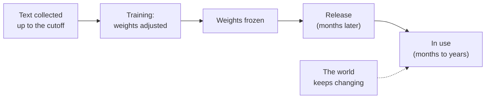
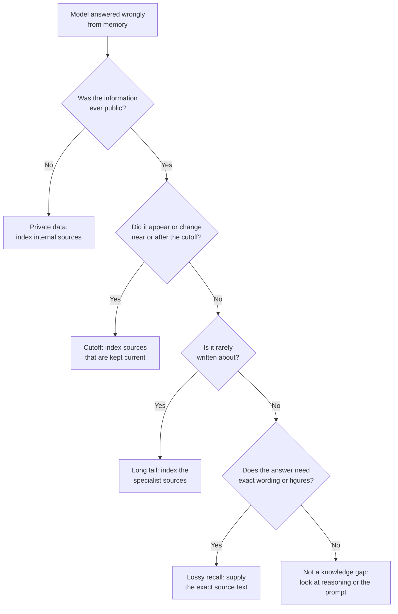

The previous lesson treated the model as a sealed box and looked at the applications built around it. This lesson opens the box far enough to answer one question: what does a language model know, and where exactly does that knowledge stop? The answer is not "it knows everything up to a date". A model's knowledge has several distinct edges, each with a different cause, and a question can fall off any of them.

Being able to say *which* edge a failing question fell off is a practical skill. It tells you whether retrieval will help, what the index needs to contain, and how fresh it has to be.

## Learning objectives

- Explain how a model's knowledge arises as a by-product of training on a fixed snapshot of text.
- Distinguish five knowledge limitations: the training cutoff, unseen private data, the long tail, lossy recall of exact details, and the inability to update or delete.
- Classify a failing question by the limitation responsible and choose the matching remedy.
- Estimate how the share of out-of-date facts grows with time since the cutoff.
- Simulate a frozen knowledge snapshot in Python and compare it with a live lookup.

## Prerequisites

- [What is RAG?](/learn/introduction-to-rag/what-is-rag)
- [Problems with traditional LLM applications](/learn/introduction-to-rag/problems-with-traditional-llm-applications)

## Why this matters

When an assistant gives a wrong answer, "the model didn't know" is not a diagnosis. Compare four failures. It reports last year's software version as the latest. It has never heard of your internal expense system. It gets a small supplier's VAT number nearly right. It quotes a clause of a famous statute with two words changed. All four are knowledge failures, and they call for different engineering: a fresher index, an internal index, coverage of obscure sources, and exact text in the prompt.

Without this vocabulary, teams draw the wrong conclusion from tests. A model that answers well-known questions impressively gets trusted with obscure ones. A system that was accurate at launch is assumed to stay accurate. An index is built from the wrong sources because nobody asked what the model was actually missing. Each of those mistakes is avoidable once the edges are named.

## The intuition

Think of a printed road atlas.

It was accurate on the day the surveyors finished. Roads built since then are not in it, and it does not say so: the page simply shows a field where the bypass now runs. That is the **cutoff**.

It has no map of your office car park. The surveyors never had access, so no amount of careful printing could have included it. That is **private knowledge**.

Motorways are drawn precisely because every survey covers them. A farm track in a remote valley is a faint line that may be a few hundred metres out, because it was surveyed once, long ago. That is the **long tail**.

At this scale the atlas cannot show house numbers. It tells you roughly where a street is, not which door. That is **lossy detail**.

And it is printed. You cannot amend a page; you can only buy next year's edition. That is **immutability**.

A sat-nav that downloads live map data has none of these problems in principle, though it has others (it needs a signal, and the live data must be right). The atlas is the model's memory. The live data is retrieval.

## How it works

### How facts get into a model

A language model is trained to do one thing: given a stretch of text, predict what comes next. Facts are not entered into it. They are absorbed because predicting text well requires them. To continue "The capital of France is", it helps to have encoded that the answer is Paris. The step-by-step path from the world to a model's answer runs like this:

1. **Collection.** A very large body of text is gathered: web pages, books, code, reference works. Collection stops on some date.
2. **Training.** The model's **weights** (the billions of numbers that define its behaviour, also called parameters) are adjusted, over many passes, to make the training text more predictable. Statements that appear often and consistently leave a strong imprint; statements that appear once leave almost none.
3. **Freezing.** Training ends. The weights are fixed.
4. **Release.** Evaluation and safety work take further months, so the model reaches users some time after collection stopped.
5. **Use.** The model then answers questions for months or years. Nothing it is asked, and nothing that happens in the world, alters the weights.



Every limitation below follows from one of these steps.

### 1. The training cutoff

The **training cutoff** (or knowledge cutoff) is the date after which the model has seen no text. Anything that happened or changed later is absent. Three details make this less tidy than a single date suggests.

*The gap is always open.* Because of steps 4 and 5, a model in use is never current. Add the release delay to however long the model has been deployed, and the typical question is asked many months after the cutoff.

*Knowledge thins out before the cutoff.* The world keeps writing about an event for years: commentary, retrospectives, documentation, forum answers. At training time, the final months before the cutoff are represented only by the first trickle of that text. A model is therefore noticeably weaker on its last few months than the stated date implies, and research on the question (Cheng and colleagues, 2024) has found that the cutoff a model effectively behaves as having can be earlier than the reported one.

*A stale fact looks like a known fact.* If something changed after the cutoff, the model still holds the earlier value and gives it fluently. From the outside, an out-of-date answer and a correct one are indistinguishable.

### 2. Private and unseen data

Training text is overwhelmingly public. Your handbook, tickets, contracts, source code and wiki were never collected, so the model has nothing on them whenever they were written. This is the limitation that matters most for business applications, and it is categorically different from the cutoff: no future model will fix it, because the data will still be private.

### 3. The long tail

Popularity is wildly uneven. A few facts are repeated across millions of pages; most facts appear a handful of times. Statisticians call the many rare items the **long tail** of a distribution. Because weights are shaped by repetition, a model's reliability on a fact tracks how often that fact appeared in training. Kandpal and colleagues (2023) measured exactly this relationship for question answering, and Mallen and colleagues (2023) found that retrieval helped most on questions about less popular entities, while for very popular ones a model's own memory was often enough.

For an engineer the consequence is that testing with famous examples proves little. A domain's specialist knowledge (part numbers, minor regulations, obscure API options) is mostly tail.

### 4. Lossy recall of exact details

Weights are a compressed summary of the training text, not a copy. A rough calculation shows why exact recall cannot be general. Suppose, for illustration, a model has 100 billion parameters stored at 2 bytes each: 200 GB. A training collection running to many trillions of words occupies tens of terabytes as plain text. The summary is a small fraction of the source, so most text cannot be stored verbatim. What survives is the gist, plus exact wording for the minority of passages repeated very often.

The practical symptom is answers that are *nearly* right: a date a year out, a version number one release off, a quotation with words altered, an identifier with digits transposed. For anything where precision is the point (figures, clauses, codes, names), recall from weights is the wrong tool even when the model "knows" the topic.

### 5. No update, no delete, no source

Once frozen, the weights cannot be edited fact by fact. There is no supported operation equivalent to "change the home-office budget from £250 to £400" or "forget this customer". Techniques for editing individual facts in weights exist in research but are experimental and not something to build a product on. And since facts are blended across weights, the model cannot say which document a statement came from. [Parametric versus non-parametric knowledge](/learn/introduction-to-rag/parametric-versus-non-parametric-knowledge) explores this contrast between knowledge in weights and knowledge in a store.

### The missing signal: the model does not see its own edges

One more property turns these gaps from an inconvenience into a hazard. A database asked for a missing row returns nothing. A model asked about something beyond its knowledge does not reliably return "nothing"; it has no internal list of what it knows to consult, and it often produces a plausible answer anyway. Why that happens, and what to do about it, is the subject of the next lesson, [Hallucinations and factual reliability](/learn/introduction-to-rag/hallucinations-and-factual-reliability).

### Diagnosing a failure

Given a question the model got wrong from memory, ask these in order:



Every knowledge branch ends in "retrieve it", but the branch tells you *what to index and how often to refresh it*. The last branch matters too: some errors are failures of reasoning or instruction-following, which retrieval does not address. [LLM limitations](/learn/understanding-large-language-models/llm-limitations) covers the limitations that are not about knowledge.

The converse also holds. For stable, widely repeated knowledge (how a for-loop works, what a mortgage is) none of the five limitations bites, and retrieval adds cost without benefit.

## The mathematics

How quickly does a frozen snapshot go out of date? A simple model gives a usable estimate.

**Intuition.** If each fact has a small chance of changing every month, then the longer you wait, the more facts will have changed at least once. The share that is still current shrinks like compound interest in reverse.

**Formula.** Let $p$ be the probability that a given fact changes in any one month, assumed the same every month and independent between months. The probability that it has *not* changed after $m$ months is $(1-p)^m$, so the expected fraction of facts that are stale is

$$
S(m) = 1 - (1 - p)^m
$$

where $S(m)$ is the stale fraction, $m$ is the number of months since the snapshot, and $p$ is the monthly change rate.

**Worked example.** Take $p = 0.02$, meaning a fact in this domain has a 2% chance of changing in a month. After a year, $m = 12$:

$$
S(12) = 1 - 0.98^{12} = 1 - 0.785 = 0.215
$$

About one fact in five is out of date. After two years, $S(24) = 1 - 0.98^{24} = 1 - 0.616 = 0.384$.

```python
import numpy as np

p = 0.02                                   # assumed chance that a given fact changes in a month
months = np.array([1, 6, 12, 24, 36])
stale = 1 - (1 - p) ** months

for m, s in zip(months, stale):
    print(f"{m:>2} months after cutoff: {s:.1%} of facts expected to be stale")

# Simulation check: 10,000 facts, each flipping independently month by month.
rng = np.random.default_rng(seed=0)
changed = rng.random((10_000, 12)) < p     # True where a fact changed in that month
print(f"simulated at 12 months: {changed.any(axis=1).mean():.1%}")
```

```output
 1 months after cutoff: 2.0% of facts expected to be stale
 6 months after cutoff: 11.4% of facts expected to be stale
12 months after cutoff: 21.5% of facts expected to be stale
24 months after cutoff: 38.4% of facts expected to be stale
36 months after cutoff: 51.7% of facts expected to be stale
simulated at 12 months: 21.3%
```

The simulation agrees with the formula to within sampling noise. The value of $p$ here is an assumption chosen for illustration, and it varies enormously by domain: the boiling point of water never changes, while prices and software versions change constantly. You can measure $p$ for your own domain from the edit history of your documents. The same formula applies to a RAG index that is not refreshed, with $m$ counted from the last re-index, which is why refresh frequency is a design parameter and not an afterthought.

## In code

**The problem.** Make the limitations concrete by building the smallest possible "model memory": a snapshot of facts frozen at a cutoff date and restricted to what was public. Then ask it questions on a later date and label each outcome with the limitation responsible.

**Dependencies.** Only the Python standard library.

The facts are about Meridian. Its product **Meridian Sync** has public release notes, so those facts could plausibly appear in a model's training text. The leave allowance and laptop policy are in the internal handbook and never public. Each fact records the date from which it was true, so one key can have several values over time.

```python
from dataclasses import dataclass
from datetime import date


@dataclass
class Fact:
    key: str
    value: str
    since: date      # the day this value became true
    public: bool     # was it ever published where a training crawl could see it?


HISTORY = [
    Fact("latest version of Meridian Sync", "4.0", date(2024, 3, 1), True),
    Fact("latest version of Meridian Sync", "4.1", date(2024, 11, 5), True),
    Fact("latest version of Meridian Sync", "5.0", date(2025, 6, 10), True),
    Fact("Meridian Sync free-plan storage", "5 GB", date(2023, 1, 15), True),
    Fact("Meridian Relay launch price", "£8 per user", date(2025, 4, 2), True),
    Fact("annual leave allowance", "25 days", date(2022, 1, 1), False),
    Fact("laptop refresh cycle", "3 years", date(2024, 7, 1), False),
]


def snapshot(history: list[Fact], as_of: date, public_only: bool) -> dict[str, str]:
    """The newest value of each key that existed on `as_of`."""
    state: dict[str, str] = {}
    for fact in sorted(history, key=lambda f: f.since):
        if fact.since <= as_of and (fact.public or not public_only):
            state[fact.key] = fact.value
    return state


CUTOFF = date(2025, 1, 1)
model_memory = snapshot(HISTORY, CUTOFF, public_only=True)   # frozen at training time


def diagnose(today: date) -> dict[str, int]:
    truth = snapshot(HISTORY, today, public_only=False)       # what is actually true today
    tally = {"correct": 0, "stale": 0, "after cutoff": 0, "never public": 0}
    for key, true_value in truth.items():
        remembered = model_memory.get(key)
        if remembered == true_value:
            verdict = "correct"
        elif remembered is not None:
            verdict = "stale"
        elif any(f.key == key and f.public for f in HISTORY):
            verdict = "after cutoff"
        else:
            verdict = "never public"
        tally[verdict] += 1
        print(f"  {key:<34} memory={str(remembered):<6} truth={true_value:<12} -> {verdict}")
    return tally


for today in (date(2025, 1, 2), date(2025, 9, 1)):
    print(f"Asked on {today} (cutoff {CUTOFF}):")
    print("  tally:", diagnose(today), "\n")
```

```output
Asked on 2025-01-02 (cutoff 2025-01-01):
  annual leave allowance             memory=None   truth=25 days      -> never public
  Meridian Sync free-plan storage    memory=5 GB   truth=5 GB         -> correct
  latest version of Meridian Sync    memory=4.1    truth=4.1          -> correct
  laptop refresh cycle               memory=None   truth=3 years      -> never public
  tally: {'correct': 2, 'stale': 0, 'after cutoff': 0, 'never public': 2} 

Asked on 2025-09-01 (cutoff 2025-01-01):
  annual leave allowance             memory=None   truth=25 days      -> never public
  Meridian Sync free-plan storage    memory=5 GB   truth=5 GB         -> correct
  latest version of Meridian Sync    memory=4.1    truth=5.0          -> stale
  laptop refresh cycle               memory=None   truth=3 years      -> never public
  Meridian Relay launch price        memory=None   truth=£8 per user  -> after cutoff
  tally: {'correct': 1, 'stale': 1, 'after cutoff': 1, 'never public': 2}
```

**The important lines.**

- `snapshot` is the whole idea in six lines: sort by date, keep everything up to `as_of`, and let later values overwrite earlier ones. Called with the cutoff and `public_only=True` it produces the model's memory; called with today's date and `public_only=False` it produces the truth.
- `model_memory` is computed once and never touched again. That single assignment is "freezing the weights".
- In `diagnose`, the order of the tests encodes the diagnostic flow: a remembered value that no longer matches is stale; a missing value that was public at some point arrived after the cutoff; a missing value that was never public is private.

**What the output means.** The day after the cutoff, the only gaps are the private facts, and they are gaps whenever you ask. Eight months later two more failures have appeared without anything about the model changing. The version number is the dangerous one: memory holds `4.1`, a real value that used to be correct, so a system relying on it would answer confidently and wrongly. The Relay price is missing outright. And notice that the private facts dominate the tally throughout, which matches experience: for internal assistants, unseen data is a bigger problem than the cutoff.

A dictionary is a kinder memory than a real model in two respects. It returns `None` for a missing key, where a model may produce a guess; and it stores values exactly, where a model stores them approximately. The simulation shows where the edges are, not how the model behaves at them.

**Errors people commonly hit.** Comparing a `date` with a `datetime` raises `TypeError`; keep to one type. Forgetting to sort by `since` lets an older value overwrite a newer one, which produces a subtly wrong snapshot with no error at all, the same bug that puts superseded documents into real indexes.

**How to extend it.** Replace the lookup failure with a live source. The following adds an index built from today's facts and consults it first. With a real model, the retrieved value would be placed in the prompt as in [What is RAG?](/learn/introduction-to-rag/what-is-rag); the generation call needs an API key and is not run here.

```python
import anthropic

live_index = snapshot(HISTORY, date(2025, 9, 1), public_only=False)   # re-built whenever facts change
client = anthropic.Anthropic()  # reads ANTHROPIC_API_KEY from the environment


def ask(key: str) -> str:
    context = live_index.get(key, "No matching record.")
    prompt = f"Today's date: 2025-09-01\nContext: {key}: {context}\n\nQuestion: What is the {key}?"
    response = client.messages.create(
        model="claude-opus-5-5",
        max_tokens=1024,
        system="Answer only from the provided context. If the answer is not there, say you don't know.",
        messages=[{"role": "user", "content": prompt}],
    )
    return "".join(block.text for block in response.content if block.type == "text")
```

Putting today's date in the prompt is a small, worthwhile habit: a model has no clock, and without being told it tends to reason as though the present were its cutoff.

## A real-world example

Lumen Forge, a fictional developer-tools company, adds an assistant to its documentation site. It is closed-book at first: a general model with a system prompt saying it is the Lumen Forge helper. Support tickets soon mention it, and the engineer on call, Dariusz, sorts a week of complaints by cause instead of fixing them one at a time.

The largest group concerns the SDK's fifth major version, released after the model's cutoff. The assistant writes code using version 4 method names, which were removed. This is the cutoff, in its stale form: the model is not ignorant of the SDK, it is confidently out of date.

The second group is about the enterprise edition's administration API, documented only behind a customer login. The model has never seen it and improvises endpoints. This is private data.

The third is a scatter of questions about rarely used configuration flags. The public documentation covers them and predates the cutoff, but each flag is mentioned on one page of one site. Answers are close and wrong in the details. This is the long tail combined with lossy recall.

Sorting the tickets changes the plan. A single index of current documentation addresses the first and third groups. The second needs a separate, access-controlled index, because enterprise documentation must not be shown to anonymous visitors. And the refresh schedule is set by the first group: the index is rebuilt on every documentation release, since a stale index would simply recreate the original problem one layer down.

## Common mistakes

- **Treating the cutoff as a sharp line.** Coverage of the months just before it is thin, so a model can be unreliable about events it nominally "knows". Teams that test only on older facts miss this.
- **Assuming a newer model removes the need for retrieval.** A later cutoff shrinks one gap for a while. Private data stays private, and the clock restarts on release day.
- **Testing with famous facts.** Good results on popular knowledge say little about the specialist tail your users will actually ask about.
- **Trusting recalled figures because the topic is familiar.** A model can explain a regulation correctly and still misquote its thresholds. Exact values need exact sources.
- **Expecting the model to flag its own gaps.** Without explicit instruction and context, a missing or outdated fact is usually answered, not declined.
- **Letting the index go stale.** A RAG index that is not refreshed is a snapshot too, and inherits the same decay as the model it was meant to supplement.

## Best practices

- Classify failures by limitation before designing the fix, as in the diagnostic flow. The classification determines the index's sources and refresh rate.
- Record each model's stated cutoff alongside its name in your configuration, and re-test time-sensitive questions when you change models.
- Include the current date in the prompt for any application where recency matters.
- Build test sets that deliberately include recent, private, rare and exact-value questions, not only well-known ones.
- Supply the source text for anything that must be precise, even if the model appears to know it.
- Set an index refresh schedule from how quickly your documents change, and monitor the age of the oldest un-refreshed source.

## Performance considerations

There are two ways to bring new knowledge to a model, and their costs scale differently.

*Retraining* (or waiting for a new model) has a cost that does not depend on how much changed: the whole training run is repeated to incorporate one new fact or a million. It happens on a provider's schedule measured in months.

*Re-indexing* costs in proportion to what changed. If 50 of 10,000 documents were edited this week, only those 50 are re-processed, which is half a percent of the work of a full rebuild. Later modules call this [incremental ingestion](/learn/understanding-document-ingestion/incremental-ingestion).

Refresh frequency trades compute against staleness. With a nightly rebuild, the worst-case age of any indexed fact is about a day; with a weekly one, about a week. Using the decay formula with $p = 0.02$ per month, a week is roughly a quarter of a month, so the expected stale fraction just before a weekly refresh is about $1 - 0.98^{0.25} \approx 0.5\%$, against 21.5% for a model a year past its cutoff. The index does not need to be instantaneous to be far fresher than weights.

Retrieval is not free at request time: it adds a search and lengthens the prompt. For questions about stable common knowledge that overhead buys nothing, which is one reason some systems decide per question whether to retrieve at all.

## Security considerations

- **Stale security knowledge.** A model's advice on vulnerabilities, deprecated algorithms and library versions is frozen at its cutoff. Treat security-sensitive answers from memory as potentially outdated and retrieve from current advisories.
- **Do not close the private-data gap by training on private data without care.** Text placed in weights is available to every user of the model and cannot be selectively removed. An access-controlled index keeps private data private.
- **A model may misjudge the present.** Without the date, it can treat an expired certificate, a superseded policy or an ended support period as current.

## Summary

- A model's knowledge is a by-product of predicting text from a snapshot collected up to a cutoff date; after training, the weights never change.
- The cutoff is not a clean edge: coverage thins in the final months, the gap widens for as long as the model is in use, and a stale fact is delivered as confidently as a current one.
- Private data was never in the training text, and no later model will change that.
- Reliability tracks how often a fact appeared in training, so rare, specialist knowledge is weak even when it is old and public.
- Weights are a lossy summary: exact figures, quotations and identifiers are unreliable from memory.
- Naming the limitation behind a failure tells you what the index must contain and how often it must be refreshed.

## Exercises

**1.** Classify each failure by the limitation most likely responsible: (a) the assistant does not know Meridian's VPN rules; (b) it says a framework's latest version is one that was superseded two months ago; (c) it gives the population of a village of 300 people incorrectly; (d) it quotes a well-known legal clause with several words changed.

<details><summary>Show solution</summary>

(a) Private data: Meridian's rules were never public. (b) The cutoff, in its stale form: the model holds the previous value. (c) The long tail: a rarely mentioned fact leaves a weak imprint. (d) Lossy recall: the topic is well covered, but exact wording is not stored verbatim. All four are addressed by retrieval, from an internal index, a frequently refreshed index, a specialist source and the exact source text respectively.

</details>

**2.** A domain's facts change at a rate of 1% per month. What fraction is expected to be stale 12 months after a snapshot? At 5% per month? Compute both by hand or in Python.

<details><summary>Show solution</summary>

$S(12) = 1 - 0.99^{12} = 1 - 0.886 = 0.114$, about 11%. At 5%: $1 - 0.95^{12} = 1 - 0.540 = 0.460$, about 46%.

```python
for p in (0.01, 0.05):
    print(p, round(1 - (1 - p) ** 12, 3))
```

This prints `0.01 0.114` and `0.05 0.46`. A fivefold increase in change rate takes the stale share from roughly a tenth to nearly a half, which is why fast-moving domains depend on retrieval far more than slow ones.

</details>

**3.** Extend the lesson's code with a function `answer(key)` that prefers a live index, falls back to the frozen memory with a warning, and otherwise says it does not know. Test it with the Sync version, the Relay price, the leave allowance and a key that exists nowhere.

<details><summary>Show solution</summary>

```python
live_index = snapshot(HISTORY, date(2025, 9, 1), public_only=False)


def answer(key: str) -> str:
    if key in live_index:
        return f"{live_index[key]} (from the index)"
    if key in model_memory:
        return f"{model_memory[key]} (from memory, may be out of date)"
    return "I don't know."


for key in ["latest version of Meridian Sync", "Meridian Relay launch price",
            "annual leave allowance", "office dog policy"]:
    print(f"{key}: {answer(key)}")
```

```output
latest version of Meridian Sync: 5.0 (from the index)
Meridian Relay launch price: £8 per user (from the index)
annual leave allowance: 25 days (from the index)
office dog policy: I don't know.
```

The index supplies the current version (not the stale 4.1), the post-cutoff price and the private allowance. The fourth key shows the behaviour a real system must be instructed to produce: an explicit "I don't know" when neither source has the answer.

</details>

**4.** Your team is choosing how often to refresh AskMeridian's index. The handbook changes about twice a month; IT runbooks change several times a week, and a wrong runbook step can lock people out of their accounts. Propose a refresh design and justify it with the ideas from this lesson.

<details><summary>Show solution</summary>

Refresh frequency should follow each source's change rate and the cost of a stale answer, so one schedule for everything is the wrong design. A reasonable proposal: re-index runbooks whenever one is edited (triggered by the edit, or at least hourly), because they change often and stale steps are harmful; re-index the handbook nightly, which bounds staleness at a day for a source that changes fortnightly. Re-process only changed documents so that frequent refreshes stay cheap. Record each chunk's last-updated date in the index, show it with the citation, and alert if any source has not been refreshed within its expected interval. The justification is the decay argument: an un-refreshed index is a snapshot that goes stale at the source's change rate, so the refresh interval sets the worst-case age of any answer.

</details>

## Check your understanding

```quiz
[
  {
    "q": "Why is a model usually less reliable about the last few months before its training cutoff than the cutoff date suggests?",
    "options": [
      "Providers deliberately remove recent data",
      "Recent events are under-represented because most text about them is written later",
      "Models are trained on text in chronological order and run out of time",
      "The tokeniser cannot encode recent dates"
    ],
    "answer": 1,
    "why": "The world keeps producing text about an event for years. At training time only the first small share of that text exists, so the final months leave a weak imprint."
  },
  {
    "q": "A newer model with a later cutoff is released. Which limitation does it NOT help with?",
    "options": [
      "Events from the year before the old model's cutoff",
      "Software versions released between the two cutoffs",
      "Your company's internal handbook",
      "Widely reported news from between the two cutoffs"
    ],
    "answer": 2,
    "why": "Private data was never in any training set and will not be in the next one either. A later cutoff only moves the temporal edge."
  },
  {
    "q": "In the lesson's simulation, asked on 2025-09-01, the memory held `4.1` for the latest Meridian Sync version while the truth was `5.0`. Why is this kind of failure especially risky?",
    "options": [
      "The model returns nothing, so the application crashes",
      "The value is random noise",
      "It only occurs for private data",
      "The remembered value was once correct, so it is delivered confidently and looks plausible"
    ],
    "answer": 3,
    "why": "A stale fact is a real former value. Nothing in the output marks it as outdated, so it is harder to spot than an obvious gap."
  },
  {
    "q": "With a monthly change rate of 2%, the lesson computed that about 21.5% of facts are stale after 12 months. What does the formula `1 - (1 - p) ** m` assume?",
    "options": [
      "Each fact has the same independent chance of changing every month",
      "Exactly 2% of facts change each year",
      "Facts never change more than once",
      "The model is retrained monthly"
    ],
    "answer": 0,
    "why": "The term (1 - p) ** m is the chance of surviving m independent months unchanged. Real change rates vary by domain and over time, so p must be estimated for your own data."
  },
  {
    "q": "A model explains a tax rule correctly but states the threshold as 85,000 when the source says 90,000, and the rule has not changed in ten years. Which limitation best explains this?",
    "options": [
      "The training cutoff",
      "Private data",
      "Lossy recall of exact details",
      "Statelessness of the API"
    ],
    "answer": 2,
    "why": "The topic is old and public, so it is neither a cutoff nor a privacy issue. Weights store a compressed gist, and precise figures are among the details that do not survive reliably."
  }
]
```

## Further reading

- Kandpal, Deng, Roberts, Wallace and Raffel (2023), *Large Language Models Struggle to Learn Long-Tail Knowledge*, International Conference on Machine Learning. Relates question-answering accuracy to how often the relevant facts appear in training data.
- Mallen, Asai, Zhong, Das, Khashabi and Hajishirzi (2023), *When Not to Trust Language Models: Investigating Effectiveness of Parametric and Non-Parametric Memories*, ACL. Shows where retrieval helps most and least.
- Cheng, Marone, Weller, Lawrie, Khashabi and Van Durme (2024), *Dated Data: Tracing Knowledge Cutoffs in Large Language Models*. On the difference between reported and effective cutoffs.
- Petroni, Rocktäschel, Lewis et al. (2019), *Language Models as Knowledge Bases?*: [arxiv.org/abs/1909.01066](https://arxiv.org/abs/1909.01066). The original probe of factual knowledge in model weights.
- Lewis, Perez, Piktus et al. (2020), *Retrieval-Augmented Generation for Knowledge-Intensive NLP Tasks*: [arxiv.org/abs/2005.11401](https://arxiv.org/abs/2005.11401). See the index-swapping experiment for the cutoff problem solved by retrieval.
- Anthropic's model documentation, which lists each model's training cutoff: [docs.anthropic.com](https://docs.anthropic.com/).
